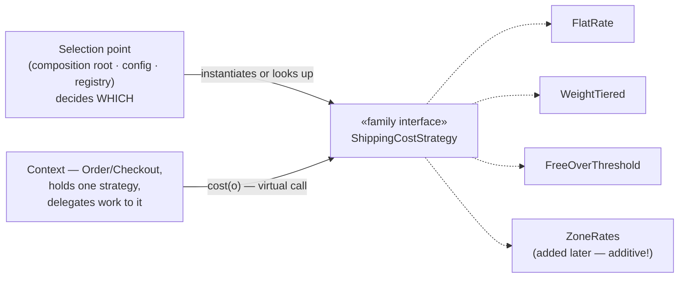
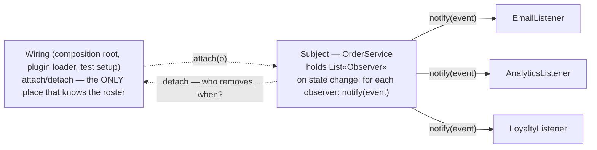
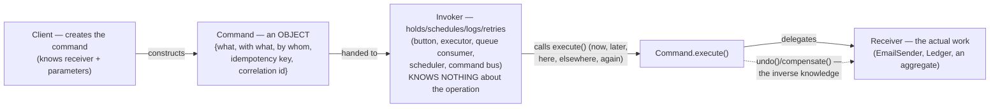
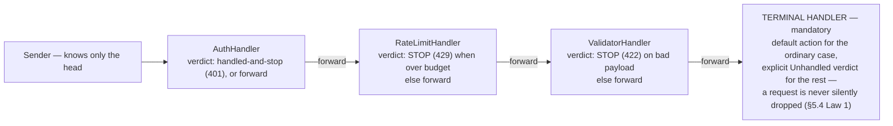
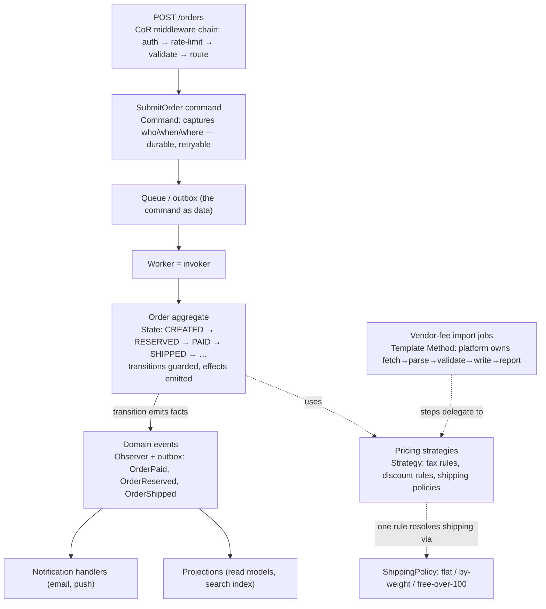

# 05 — Behavioral Patterns: Strategy, Observer, Command, State, Chain of Responsibility, Template Method

> **The shift this file makes.** Files 03 and 04 were about **objects** — how they are made, how they are wrapped. This file is about **behavior**: the *dynamics* of a running system — which algorithm is executing, who hears about a change, what a request *is*, which state a lifecycle is in, who gets to handle a message, and who owns the skeleton of a procedure. The six patterns here are the vocabulary for turning behavior from **code a reader must trace** into **structure a designer can vary**: replaceable, notifiable, queueable, persistable, chainable, inheritable.
>
> **The file's thesis:** *behavioral patterns promote behavior to first-class citizens — objects, data, state, chains — each one buying a specific kind of change (swap the algorithm, add a listener, queue the request, make the lifecycle explicit, configure the handlers, defer the steps) at a specific and knowable cost.*

---

## 0. What "Behavior" Means Here — and the Two Threads to Track

### 0.1 The six behavior questions

Every system, every day, answers six questions about *how it acts*. The six patterns are the named, proven answers to those questions — and the reason they cluster in this file is that each turns one hard-to-change thing (a hardcoded choice) into an easy-to-change thing (a first-class structure):

| Question | Pattern | The thing that becomes first-class | Section |
|---|---|---|---|
| *Which algorithm runs?* | **Strategy** | The algorithm — a swappable family member | §1 |
| *Who needs to know when something happens?* | **Observer** | The list of listeners — runtime data | §2 |
| *What **is** a request?* | **Command** | The request itself — an object: queueable, loggable, undoable, transportable | §3 |
| *Where in its lifecycle is this?* | **State** | The lifecycle — explicit states and legal transitions | §4 |
| *Who gets to handle this message?* | **Chain of Responsibility** | The handler set and its order — configuration | §5 |
| *What's fixed and what's variable in this procedure?* | **Template Method** | The steps — overridable hooks in a fixed skeleton | §6 |

### 0.2 The two threads running through all six

Watch for these in every section; they are what make the file cohere, and what you'll be asked to articulate in interviews:

**Thread 1 — Inversion of control ("don't call us, we'll call you").** Four of the six invert who calls whom. Template Method: the *base class* calls your step. Observer: the *subject* calls your listener. Chain of Responsibility: the *head of the chain* calls your handler. State: the *context* calls your state object. Once you see that the same inversion appears in every framework you have ever used (Spring calls your bean's lifecycle methods, the kernel calls your driver's probe, React calls your component), you stop experiencing frameworks as magic: **a framework is a skeleton plus hooks, and the hooks are these patterns.** The phrase "don't call us, we'll call you" — the Hollywood principle — is the industry's nickname for this inversion, and §6 will trace it to its purest form.

**Thread 2 — Behavior as data.** Command turns a request into an object that can be queued, persisted, serialized, retried, and versioned; State turns a lifecycle into explicit, inspectable, *storable* states and transitions; Observer turns the interested-party list into runtime registry data; Strategy turns the algorithm choice into a configurable value. Once behavior is data, new capabilities appear almost for free: audit (store the commands), replay (re-execute the log), distribution (send the command across the wire — §3 will show RPC is *literally* serialized commands), and tooling (state machines you can visualize, chains you can reorder in config). **The industry's biggest modern architectures — event sourcing, CQRS, workflow engines, message queues — are these two threads scaled to system size.** This file plants the seeds; files 06 and 09 will harvest them.

### 0.3 The at-a-glance map

| | **Strategy** | **Observer** | **Command** | **State** | **CoR** | **Template Method** |
|---|---|---|---|---|---|---|
| **One-line intent** | Interchangeable algorithms | One-to-many change notification | Request as an object | Behavior varies with internal state | Pass along until handled | Fixed skeleton, variable steps |
| **What varies** | The algorithm | The listener set | The request (as data) | The current state | The handler set/order | The step implementations |
| **Mechanism** | Composition: context holds a strategy | Registry: subject holds observers | Composition: invoker holds command | Composition: context holds state | Links: handler holds successor | Inheritance: subclass overrides hooks |
| **Who calls whom** | Context → strategy | Subject → observers (inverted) | Invoker → command → receiver | Context → state (inverted-ish) | Sender → head → … → handler | Base → subclass steps (inverted) |
| **Typical trigger** | Policy/algorithm must vary by config, tenant, environment | Dependents must react without the subject knowing them | Actions must be queued/logged/undone/sent | Lifecycle with rules about legal moves | A message, several possible handlers, flexible set | Same procedure, several variants |
| **Classic exhibit** | `Comparator`, sched classes, congestion control | Event listeners, notifier chains, `inotify` | Workqueues, job queues, undo stacks | TCP state machine, order lifecycle | Middleware, LSM hooks, `netfilter` | JUnit lifecycle, driver `probe()` |
| **Failure mode** | Strategy chosen and frozen; fat strategy params | Listener leaks; exception kills the chain | Command as god object; wire versioning | Hidden transitions; bare status enums | No terminal handler; chain order drift | Fragile base class; "must call super()" |
| **LSP pressure point** | Family contract must fit all members | Event payload contract ("what you must expect") | `execute()` semantics across receivers | State transition legality | Handler must handle-or-forward, never vanish | Hooks must not break the skeleton's invariants |

### 0.4 Where this file sits in the course

Files 03–04 gave you the *nouns* (created, wrapped). This file gives you the *verbs*. File 06 will turn all of it into selection judgment (which pattern, when, and the anti-patterns each degenerates into); file 08 completes the GoF set; file 09 runs the whole vocabulary through interview-scale case studies. When a case study says "the order flows through states, emits events, and the retry job re-queues commands" — every term in that sentence will be from *this* file.

---

## 1. Strategy — Interchangeable Algorithms

### 1.1 Word by word

> **Word by word — *strategy*:** from Greek **stratēgia** — *generalship, the art of command* — built from **stratos** (*army*, the host spread out) + **agein** (*to lead*; the same root as *agenda*, "things to be driven"). A **stratēgos** was the general; *strategy* was the general's *art* — as distinct from *tactics*, the immediate handling of troops, and distinct again from the **forces** themselves. The etymology is the design: **the plan of action is separable from the army that performs it** — you keep the army, swap the plan, and the army doesn't care. And note the classical connotation of *choosing the plan for the conditions*: strategy is about *selection under circumstance* — which is exactly where the pattern puts its variation point.
>
> **The pattern in one literal sentence:** *put each alternative algorithm in its own class behind one shared interface, let the context hold one of them, and let the choice be made (and changed) from outside the algorithm.*

### 1.2 Source and precise statement

The Gang of Four's intent, verbatim:

> **"Define a family of algorithms, encapsulate each one, and make them interchangeable. Strategy lets the algorithm vary independently from clients that use it."**

Dissect it — four clauses, four design facts. **"A family"**: the algorithms are alternatives *for the same job* — they share an interface because they must be substitutable (the family is a type contract, LSP again: file 02 §3 already governs which members qualify). **"Encapsulate each one"**: each algorithm becomes a unit — independently readable, testable, reviewable, versionable; the crudest version of this insight is "today's 400-line `if/else` becomes five classes with five tests." **"Make them interchangeable"**: the client code cannot tell which one it holds — *the context programs against the interface, never the implementation*. **"Vary independently from clients"**: the change-receipt in one clause: adding a sixth algorithm touches one new file and one selection point; no client recompiles semantically (OCP, file 02 §2, cashed on the behavior axis).

**Precise definition used in this file:** *Strategy is the pattern that makes the algorithm a first-class, replaceable value: a family interface defines the contract, each concrete strategy implements one member, a context delegates its work to the held strategy, and the act of choosing — the selection point — is pulled out of the algorithm into whoever owns policy (a factory, a config value, a registry, a runtime signal).*

**The definition's last clause is the one that separates a real strategy from a costume:** *the pattern includes the selection story.* An interface with two implementations chosen by an `if` buried inside the same class is strategy *shape* without strategy's *benefit* — the second algorithm can't be added without editing the selector; substitution exists, extension doesn't. Interviews probe exactly this seam (§1.10).

### 1.3 The problem it kills — conditional sprawl and the welded algorithm

The problem has two faces, and the first is so familiar it looks innocent:

```java
// THE SPRAWL — one method, or one class, growing a new branch every quarter:
Money shippingCost(Order o) {
    switch (o.tenant().shippingPlan()) {
        case FLAT:            return Money.usd(5_00);
        case WEIGHT_TIERED:   return weightTieredCost(o);          // 30 lines
        case FREE_OVER:       return overThreshold(o) ? Money.ZERO : flat(o);  // 20 lines
        case EXPRESS_ZONES:   return zoneRates(o);                 // 45 lines
        // Q3: "add a plan for the enterprise deal" → edit this method. Again.
    }
}
```

Three distinct costs, all measurable: **(1) the edit surface is shared** — every plan's change re-opens one method whose branches interfere (a bug in `zoneRates` blocks the release for `FLAT`'s fix); **(2) the tests are entangled** — you cannot unit-test `zoneRates` without the switch; the test file mirrors the branch explosion; **(3) the type is closed** — new plans mean recompiling and re-reviewing the class that *everything* imports; the family can never be extended by another team, and the missing receipt (file 02 §2.5) is the fourth plan that had to queue behind unrelated releases.

The second face is subtler: **the algorithm is welded to the wrong variation axis.** The plan *is not a property of the shipping calculation* — it's a property of the customer's contract. Burying it in the calculator means every other consumer of "plans" (billing display, T&C rendering, support tooling) re-derives the same concept from the same switch, each in its own dialect (§3.3's divergent-sequences problem, one layer down: *divergent classifications*). Strategy moves the plan *out* of the algorithm into a value that can be defined once and passed around — the algorithm becomes a *service* the plan *uses*, not a switch the plan lives inside.

**And the honest accounting, because seniors audit their own patterns:** strategy does **not** remove conditionality — it **relocates** it. Somewhere, something must still decide "FLAT." The pattern's claim is not "no ifs"; it is: *there will be exactly one selection point, it will live at a boundary (root, config, registry) where a switch is data or a policy decision, it will not be scattered through the algorithms, and the algorithms themselves will be condition-free family members.* Trading five distributed switches for one owned, testable selection is the deal — and when the selection itself becomes complex (multi-factor, evolving), it graduates to a rule engine or bandit/learning system (§1.7) — still one owned selection point, now a subsystem.

### 1.4 Mechanics — the shape, the selection spectrum, and the two states of a strategy



**The mechanics in five sentences** (Java-flavored; §1.5 generalizes): a **family interface** states the one operation the algorithms perform (`cost(order)`); each **concrete strategy** implements it with no knowledge of siblings; the **context** holds a reference (`private final ShippingCostStrategy strategy`) and delegates (`strategy.cost(o)`) — the context contains *no algorithm*, only the *hookup*; the **selection point** — the composition root (file 02 §5.4), a config value, or a registry (file 03 §1.2 flavor 4) — instantiates/picks the strategy; **strategies come in two states, and each has a rule**: *stateless* strategies (pure functions of their inputs — rate tables, formulas) **should be shared** (one instance, thread-safe by nature — file 01 §4.5's immutability earning its keep: 100k orders, one `FlatRate` object), while *stateful* strategies (a rate limiter holding a token bucket; a strategy with caches or accumulated calibration) **must be scoped to their lifetime** (per-run, per-connection, per-tenant — file 03 §4's scope vocabulary applies here word for word: *the strategy's scope is a design decision, and an un-owned stateful strategy is a race*).

**The selection spectrum — name where in it you are, in any design conversation:**

| Stage | Selection happens at… | Change cost | Senses |
|---|---|---|---|
| 1. Hardcoded | The one call site (`new WeightTiered()`) | Recompile | Prototype; the first case |
| 2. Configured at boot | Composition root reading config (`cfg.shippingPlan()`) | Deploy a config change; no code | The common production default |
| 3. Registry | Name→strategy map, built at boot; entries extensible (plugins) | Register a new entry — no root edits | Platform territory (file 03 §1.2 flavor 4's receipt) |
| 4. Runtime-adaptive | Per-request signals (A/B buckets, tenant, geo, ML score — a *selector* component) | New selector logic; strategies untouched | Experimentation/optimization: pricing, fraud, routing |

The spectrum is also the YAGNI ladder: start at stage 2; climb only when a receipt exists (we *will* add third-party plans → stage 3; we *are running experiments* → stage 4). Climbing prematurely is file 02 §6.2's overshoot in behavior-flavored clothing.

> **[INTERVIEW] The lambda question — because modern languages change the pattern's costume, not its anatomy.** In Java, `Comparator<Order>` *is* the Strategy interface and `Comparator.comparing(Order::weight)` is a concrete strategy written as a lambda; the sort machinery is the context. The lambda form is not a replacement for the pattern — it is the pattern at **small scale**: suitable when (a) the family is one operation, (b) strategies are stateless, and (c) the selection is local. The moment any premise breaks — multiple related operations per algorithm (a "plan" needs `cost`, `etaLabel`, `terms`, `codEligible` — a *fat* family: one interface, several operations, ISP discipline on the family itself), stateful strategies, or registry-scale extensibility — the pattern re-materializes as classes, and pretending otherwise produces lambdas smuggled in tuples, i.e., nameless classes with worse names. The interview-ready sentence: *"a lambda is a strategy with no name; I use them for small stateless families and promote to classes when the strategy needs a name, state, or siblings."*

### 1.5 Tri-language mechanics

**Java — the canonical, then the production shape:**

```java
// (1) THE CANONICAL STRATEGY EVERY JAVA ENGINEER HAS ALREADY USED:
List<Order> orders = new ArrayList<>(...);
orders.sort(Comparator.comparing(Order::priority)
                      .thenComparing(Order::createdAt));      // family: ordering algorithms
// The machinery in List.sort is the CONTEXT; Comparator is the FAMILY interface; the lambda
// chain is a concrete member. Nobody calls this "using Strategy" — but that is exactly what
// the GoF documented. (Their own example: different line-breaking algorithms in a text editor.)

// (2) THE PRODUCTION SHAPE — a fat family with state and a registry:
public interface ShippingCostStrategy {                      // the family contract — now with
    String planId();                                          // identity (registry key)
    Money cost(OrderFacts facts, TenantShippingConfig cfg);   // the algorithm
    // deliberately NOT here: eligibility questions, display text — those belong to the plan's
    // billing/terms facets elsewhere (ISP on the family: file 02 §4).
}

public final class WeightTieredStrategy implements ShippingCostStrategy {
    private final RateTable table;                            // IMMUTABLE → shareable, thread-safe
    public WeightTieredStrategy(RateTable table) { this.table = table; }
    @Override public String planId() { return "weight_tiered"; }
    @Override public Money cost(OrderFacts f, TenantShippingConfig cfg) {
        return table.rateFor(f.totalWeight(), cfg.zone());    // no sibling awareness, no switch
    }
}

public final class ShippingPlans {                            // the SELECTION point, owned and testable
    private final Map<String, ShippingCostStrategy> byId;     // populated at boot (registry)
    static ShippingPlans from(PlatformConfig cfg, List<ShippingCostStrategy> all) {
        return new ShippingPlans(indexByPlanId(all));         // duplicates → fail fast at startup
    }
    public ShippingCostStrategy forTenant(Tenant t) {
        return byId.getOrDefault(t.shippingPlanId(), byId.get("flat"));  // explicit default
    }
}
// Context:
public final class ShippingCalculator {
    private final ShippingPlans plans;                        // the selection point, injected
    public Money shippingCost(Order o, TenantShippingConfig cfg) {
        var strategy = plans.forTenant(o.tenant());           // ONE selection, at a boundary
        return strategy.cost(o.facts(), cfg);                 // delegate — no branches in sight
    }
}
```

**C++ — three tiers, because C++ lets you choose when the strategy is bound:**

```cpp
// TIER 1 — RUNTIME (the pattern's default form): std::function or an interface.
struct ShippingCostStrategy {                                 // interface (virtual family)
    virtual ~ShippingCostStrategy() = default;
    virtual Money cost(const OrderFacts&, const TenantConfig&) const = 0;
};
// …concrete classes as in Java; context holds std::unique_ptr<const ShippingCostStrategy>
// (const+unique_ptr: "perpetually this algorithm, owned here" — ownership spelled in types).

// TIER 2 — COMPILE-TIME STRATEGY (C++'s signature move): the strategy as a TEMPLATE PARAMETER.
template <class CostPolicy>
class ShippingCalculator {
    const CostPolicy& policy_;                                // stateless policy by value/ref
public:
    Money cost(const OrderFacts& f, const TenantConfig& c) const { return policy_.cost(f, c); }
};
struct FlatRate    { Money cost(const OrderFacts&, const TenantConfig&) const { return Money::usd(5); } };
struct WeightTiered{ Money cost(const OrderFacts& f, const TenantConfig& c) const { /* … */ } };
// ShippingCalculator<FlatRate> vs ShippingCalculator<WeightTiered>: TWO TYPES, chosen at compile
// time, each monomorphized and inlinable (file 01 §7.2). The receipt: zero virtual dispatch on
// hot paths; the bill: the family is fixed at compile time, and every instantiation is its own
// type (container of "a calculator" needs one type — you must decide which variance is real).
// TIER 3 — std::function as the small-case form (the Java lambda parallel).

// WHEN EACH (the rule senior C++ code follows): variance from CONFIG → tier 1; variance from
// TEMPLATE INSTANTIATION (performance-critical, closed set known per build) → tier 2; local
// one-liners → tier 3. Mixing them (a std::function inside a template parameter) is how you get
// the indirection cost WITHOUT the monomorphization win — the classic anti-pattern.
```

**C — the ops table as the family, selection by config lookup:**

```c
/* The family: shipping cost algorithms share one contract, stated as an ops table. */
struct shipping_facts { unsigned grams; int distance_km; int item_count; };
struct shipping_cfg   { const char *zone; bool express; };
struct shipping_cost_strategy {
    const char *plan_id;                                          /* registry key */
    long (*cost_cents)(const struct shipping_facts *, const struct shipping_cfg *);
};

static long flat_rate(const struct shipping_facts *f, const struct shipping_cfg *c)
{ return 500; }
static long weight_tiered(const struct shipping_facts *f, const struct shipping_cfg *c)
{ long cents = 400 + (long)(f->grams / 100) * 7; if (c->express) cents *= 2; return cents; }

static const struct shipping_cost_strategy strategies[] = {
    { "flat",          flat_rate },
    { "weight_tiered", weight_tiered },
};

/* THE SELECTION POINT — one lookup, owned by the platform config layer: */
static const struct shipping_cost_strategy *plan_for(const char *tenant_plan_id)
{
    for (size_t i = 0; i < ARRAY_SIZE(strategies); i++)
        if (strcmp(strategies[i].plan_id, tenant_plan_id) == 0)
            return &strategies[i];
    return &strategies[0];                                        /* explicit default */
}
/* Context: holds the resolved strategy pointer, delegates:
 *     long cents = calc->strategy->cost_cents(&facts, &cfg);
 * Notes the C economy makes explicit: strategies here are STATELESS and const — the array
 * sits in .rodata, shared by every caller, zero allocation, zero lifetime questions. The
 * moment a strategy needs state, the design turns into `struct ... *ctx` per instance —
 * and the scope question (per order? per tenant?) must be answered out loud, exactly as in
 * Java/C++. The languages differ in syntax; the lifetime discipline is the invariant. */
```

> **[KERNEL & SYSTEMS] The kernel's three great strategy families — cite all three, they land with force.** (1) **Scheduling classes**: `struct sched_class` (CFS, real-time, deadline, idle) — each a strategy family member implementing `pick_next_task`, `enqueue_task`, `task_tick`; a task's `sched_class` is chosen from its policy (a selection point: `sched_setscheduler`, priorities), and the core scheduler — the *context* — calls `p->sched_class->pick_next_task(...)` without a single `if (is_cfs)`. Adding a new scheduler = one new `sched_class` implementation; the core never changes. This is simultaneously the pattern's purest production instance *and* an OCP exhibit (file 02 §2's ops-table form). (2) **I/O schedulers**: `mq-deadline`, `BFQ`, `Kyber` selected per block device (`/sys/block/*/queue/scheduler`) — same family shape (`struct elevator_type`), selection at *device-configuration* time — strategy chosen per instance, exactly the "per-tenant plan" story with disk queues. (3) **TCP congestion control**: `struct tcp_congestion_ops` — Reno, CUBIC, BBR as interchangeable members, **chosen per connection** (`net.ipv4.tcp_congestion_control` default, `TCP_CONGESTION` per socket), the algorithm's state living in the connection — the *stateful strategy scoped to its natural lifetime*, the §1.4 rule enforced by the kernel's own data model. The interview line that ties it shut: *"the kernel does not have 'the' algorithm for any of its hardest decisions — it has families, contracts, and a selection point; userland calling that state-of-the-art but writing `switch (tenant.plan())` in business logic is the same discipline applied inconsistently."*

### 1.6 Production reality — where strategies run (and how they fail)

**The estate:** pricing/discount policies (the family + registry + selection spectrum's full ladder — at stage 4, note the graduation: **when selection needs multi-factor logic and feedback data, it becomes a rule engine or an ML bandit — and the strategy interface is what makes that graduation survivable**, because the algorithms never moved); **payment/PSP routing** (per-transaction strategies choosing providers by cost, geography, success rate — the weighted/learning selector); **retry/backoff policies** (the backoff math as a strategy — decorating file 04 §2's retry decorator with a strategy family: *patterns stack*); **cache eviction policies** (LRU/LFU/TinyLFU — strategies inside caches, selected per cache); **compression/crypto algorithm agility** (the per-context choice of cipher or codec as a strategy family — *algorithm agility is a security requirement*: NIST transitions, deprecations, and per-tenant constraints all demand the algorithm be swappable data; say "crypto agility is Strategy applied to security posture" in the right room and it echoes); **feature-flag evaluation** (percentage rollouts, tenant targeting, dependency rules — strategies selected per flag); **allocation/scheduling in userland** (thread pools choosing work-stealing vs FIFO vs priority policies); **A/B experiments** (the selector reads the bucket; strategies are the variants).

**The failure modes, one line of mechanism each — the review checklist for a strategy family:**

1. **The frozen strategy** — selected once at startup from config and never reloaded; then ops changes the config and nothing happens until restart (or worse: two instances reloaded at different times, and the fleet runs *mixed strategies* — the split-brain of config). Mechanism: the selection point read its input once. Fix: the reload story (file 03 §4's snapshot-and-swap works verbatim: strategies are immutable; the *map* is swapped) and a health check that reports which strategy each instance actually runs (observability of selection — logs once per selection change, not per call).
2. **The shared stateful strategy** — one `RateLimiterStrategy` instance field on a singleton context, mutated per call — a race with production hair (file 01 §4.5's sharing protocol un-owned). Fix: scope it (per tenant/per connection — `sched_class` per-task thinking: *state lives where its lifetime naturally lives*) or make it internally synchronized and budget the contention.
3. **The fat parameter blob** — family interface drifts to `cost(FactsBlob blob)` where the blob accretes "everything anyone needed": strategy members now downcast/poke at fields not all have; the family contract is mush (ISP erosion at the family). Fix: the *family's* interface takes what *all members* legitimately need (LSP/ISP discipline applies to families too); member-specific data comes via member constructors (the plan object owns its tables) — the classic fix is "params in, config into constructors."
4. **The invisible selection** — `if (tenant.isEnterprise())` reappears at three call sites "just to pick the strategy" — the selection point multiplied, and the five-distributed-switches disease is back with a registry on top. Fix: one owned selector (`ShippingPlans.forTenant` above), everything else injected with an already-selected strategy; selection happens once per context lifetime, never per call inside business logic.
5. **Dispatch cost in the inner loop** — per-item virtual dispatch when the family was chosen for the whole batch: hoist the strategy outside the loop (obvious when said, forgotten when the loop is in a different file); at monomorphic call sites the JIT/CPU will predict it fine, but *megamorphic* strategy calls in hot paths want the C++ tier-2 treatment or a batch API on the family (`costAll(items)`) — measure first (file 01 §7.7's law), but know which knob to turn.

### 1.7 Misconceptions

> **[MISCONCEPTION]** *"Strategy = 'an interface with implementations.'"* The interface is the *shape*; the pattern is the **family + delegation + selection ownership** (§1.2's fourth clause). An interface with two implementations chosen by an `if` inside the consumer is strategy with its most valuable organ missing — substitution works, extension doesn't, and the selection logic is homeless. The interview follow-up that finds this: *"so who decides which one runs — show me the code — and what happens when I ask you to add a third next sprint?"*
>
> **[MISCONCEPTION]** *"Strategy eliminates branching."* It relocates branching to one owned selection point (§1.3's honest accounting) — and that point is *better* branching: at a boundary, over data (config/registry/score), testable in isolation, with an explicit default. The claim to make is *"one selection point, condition-free algorithms"* — never "no ifs," because a senior engineer who promises no ifs has never added the second tenant rule.
>
> **[MISCONCEPTION]** *"Strategy and State are the same shape — context holds a delegate — so they're the same pattern."* The shapes coincide; **the ownership of switching differs** (§4 will make this the whole discriminator): a Strategy's *client/context policy* picks it and the strategy *serves the context's purpose*; a State switches *itself* (or via the context's transitions) as the object's own lifecycle advances — the delegation graph is the object's internal clockwork, not an externally chosen tool. Interview probe: "who decides a switch happens, and does the object's state change over its lifetime without external input?" — Strategy: no; State: yes, that's its purpose.
>
> **[MISCONCEPTION]** *"Lambdas/first-class functions made the pattern obsolete."* They made its *small form* idiomatic (§1.4's [INTERVIEW] block): one operation, stateless, local choice. The pattern returns the moment the family grows a *name*, *state*, *multiple operations*, or *registry-scale extensibility* — which is precisely when unnamed lambdas become defective classes. "Obsolete" is the judgment of someone who has never debugged a 200-line lambda-in-a-map configured by four teams.
>
> **[MISCONCEPTION]** *"The GoF example (line-breaking algorithms) means strategy is for algorithmic exotica."* The pattern's real production mass is **business policy** — plans, policies, routing, pricing — because *policy is the algorithm family businesses actually iterate on*. The sorting-comparator and crypto-agility examples are the pattern's small and safety-critical ends of one same span.

### 1.8 When NOT to strategize — the honest refusals

- **One algorithm, no named variation coming.** The conditionless calculator with one plan is the honest code — generalize on the second plan, not in anticipation of it (file 03's "second-case rule," now on the behavior axis; the YAGNI of file 01 §12.6 waits here most reliably).
- **The variation is *data*, not algorithm.** Tax brackets as numbers, not as five classes-and-an-interface: if every member would be "look up in my table and add," the family is a table with a switch **you already have, in data form** (and data versions without recompiles). The tell: the strategy members' code is *identical except constants*. (Counter-tell: identical structure but *different semantics* — e.g., `flat` vs `tiered` genuinely compute differently — family it is.)
- **The members can't share a meaningful contract.** If advancing one algorithm violates the family interface's promises (the CSP-style "strategy" whose callers need to know which member is running and call member-specific methods), the "family" is a lie dressed for the diagram; two separate interfaces and an explicit choice beat one family with downcasts (LSP/ISP un-violated is worth more than the pattern's aesthetic).
- **Selection can't be owned.** In legacy situations where the call sites *cannot* be unified, layering a strategy registry under scattered `if`s makes the maze worse; the prerequisite fix is the selection point (an afternoon of modest refactoring), then the family. Sequence the surgery honestly — sometimes the deliverable is "selection point first, strategy in the next release."
- **Hot paths with a closed, build-time family.** C++ tier 2 (template policies) or plain functions inlined — see §1.5; the runtime family is for *runtime* variance; using it for compile-time-known choices pays dispatch forever for flexibility nobody uses.

### 1.9 Interview bank and drill

> **[INTERVIEW]** The strategy cluster, model answers:
> — ***"Give me the pattern in one breath, then prove it's not just an interface."*** — *"Interchangeable algorithms behind a family interface, held and delegated-to by a context, with the choosing pulled out to one owned selection point. Not just an interface because the pattern includes the selection story — an interface with two implementations and a homeless `if` is shape without substance."*
> — ***"You've just named Comparator — what else actually uses this in production?"*** — the estate from §1.6, each with its receipt: pricing plans (the quarterly plan additions touch zero algorithms), PSP routing (per-transaction pick with observable outcomes — then the bandit graduation), retry backoff (decorator + strategy stacking), cache eviction (per-cache policy — the Caffeine/TinyLFU design), crypto/codec agility (the algorithm as security posture data) — then the kernel trio (sched classes, I/O elevators, TCP congestion control: *algorithms as named, per-instance, kernel-callable families — the pattern at 30M-LOC scale*).
> — ***"How do you test a strategy family?"*** — two test classes, mechanically: **(1) a per-member contract suite** — the same suite (`file 02 §3.5's shape`) run against every member: invariants that define family membership (cost ≥ 0; monotone in weight for every plan claiming monotonicity — *prefix*: not every member claims every property; the suite enumerates the *promises* and checks per-member opt-in), plus **(2) selection tests** — default behavior, unknown-id failure, reload/swap behavior, and the mixed-fleet observability check (does the instance report which strategy it runs?). The anti-pattern test smell: one giant test method per member with copy-pasted assumptions — the suite exists precisely to make members *comparable*.
> — ***"Strategy vs Template Method?"*** — the two axes: **binding time** (strategy: runtime substitution via composition; TM: compile-time via inheritance) and **who owns the whole** (strategy: the context owns the flow *shape* and delegates *everything* variable; TM: the base owns the skeleton and pins the order — subclasses fill holes). Practical rule: if the "algorithm" is one operation with alternatives → strategy; if the "algorithm" is a *procedure with steps* in a fixed order and only some steps vary → TM (and often: first try refactoring TM to strategy—prefer composition, file 01 §6 — unless you're a framework that *wants* the inversion; §6 will argue both sides).
> — ***"The config says the strategy, but the fleet behaved differently for an hour. Diagnose."*** — the frozen/reload-once class from §1.6 (mechanism: selection input read once at boot; two instances reloaded at different times → mixed fleet). Evidence path: log the *active strategy id* per instance at boot and on change (the missing instrument); fix: snapshot-and-swap the selection map (immutable strategies, atomic reference), plus the health endpoint reporting active selection — *"selection is a production state; unobservable state is an incident scheduled for later."*

**[DRILL]** Design the **shipping-fee strategy family** for a marketplace with these facts: tenants pick one of {flat, weight-tiered, free-over-threshold, zone-rates} and enterprise tenants get *custom* compressed rate cards loaded from their contracts; a quarterly experiment may *override* the tenant's plan for 5% of orders (call it `plan_experiment_q3`); ops changes defaults in the admin console without deploys; the fee must appear in checkout quotes (hot path, ~2k rps) and in nightly invoices (batch, correctness-critical, 10^6 rows); the finance team audits "which algorithm and configuration charged this order" months later. Deliverables: (a) the family interface and which parameters are in, which in constructors, and why (the fat-blob discipline); (b) the selection design across the four tiers of §1.4 — where each of {tenant plan, enterprise cards, experiment override, ops defaults} enters *as data*; (c) the reload story (no deploys for ops changes; mixed-fleet safety); (d) the two test suites; (e) the audit answers — how finance reconstructs "which algorithm, which config" for an order from three months ago; (f) the hot-path/batch split. *(Model: (a) **Interface:** `String planId(); Money cost(OrderFacts facts, QuoteContext ctx)` — `OrderFacts` = weight, item count, address zone, declared value (facts *of the order*); `QuoteContext` = quote-time inputs (instant for time promotions). **Constructors carry configuration:** `WeightTieredStrategy(RateTable)`, `ZoneRatesStrategy(ZoneMatrix)` — the *rate tables are the identity of the instance*, so they're constructor data, not call params (the fat-blob fix: call params = facts all members might legitimately vary on; instance config = what makes this member *this member*). Enterprise custom cards: `WeightTieredStrategy(enterprise.cards().get("acme"))` — the *same algorithm class* parameterized by a different table — note the design insight: **enterprise "custom plans" are usually data-variants of an existing family member, not new members** — the family grows only for genuinely new *semantics* (if a contract invents a novel fee shape → new member; that's the second-case rule applied per-tenant). (b) **Selection in four layers of data:** (i) *experiment override*: a selector consulted first — bucket by hash(orderId + "plan_experiment_q3") → 5% get experiment plan; (ii) *tenant plan → strategy id* (the registry lookup); (iii) *enterprise cards* resolve the *constructor config* for the chosen member; (iv) ops defaults are config values for cases (i–iii) don't cover. Order matters and is policy — the selector is one owned class (`ShippingPlanSelector.planFor(order)`) with this precedence list as its documented contract (*one selection point, condition-free algorithms*; the inquiry "who decides" has one answer file). (c) **Reload:** strategies immutable; the selector holds a `volatile List<PlanRule>` (or a snapshot object) swapped atomically on config change (file 03 §4.6's snapshot-and-swap); ops console publishes a new rule set → instances swap within seconds; **mixed-fleet safety is inherent to snapshot-swap** (each instance is internally consistent; cross-instance skew is bounded by propagation, and the quote records *which snapshot version* it used — see (e) — so skew is auditable, never silent). Health endpoint reports `activeRuleSetVersion` + per-instance checksum. (d) **Suites:** *member contract suite* (file 02 §3.5 shape): non-negative; deterministic for same facts+config; idempotent; monotone-in-weight where the member claims it (opt-in tags per member); *selection suite*: precedence table cases (experiment beats tenant plan; unknown tenant → default; enterprise without cards → explicit error, not silent fallback — *an enterprise silently charged flat is a contract incident*); snapshot-swap race tests; experiment bucketing stability (same orderId → same bucket across calls and instances — **hash input must not include instance-local state**, the classic experiment bug). (e) **Audit:** two mechanisms, layered — (1) the quote *persists its decision inputs*: order record stores `plan_id`, `rule_set_version`, `experiment_bucket`, and the *config version* of any table used (cheap, complete: finance re-runs the algorithm or reads the stored fee with full provenance); (2) nightly invoices never silently recompute from *current* config — they must use the versioned tables (invoice = quote inputs + historical tables; the "recompute at today's prices" bug is precisely a lost version pointer). The interview line: *"a pricing decision is an event with inputs; storing only its output makes every future dispute a forensic exercise — store the inputs, and the audit becomes a lookup."* (f) **Hot path:** quotes call the selector with per-order memoization of the resolved strategy (selector cost = a hash + map lookup, ~ns) — *never* re-resolve per line item; batch jobs hoist the strategy outside the 10^6-row loop (§1.6 failure 5) and, being batch, additionally verify against the quote's stored decision (drift detection for free: any divergence between invoice recompute and stored quote = alert, not surprise).)*

---

## 2. Observer — One-to-Many Change Notification

### 2.1 Word by word

> **Word by word — *observer*:** from Latin **observare** — *ob-* (toward, against) + **servare** (*to keep, to watch over, to preserve* — the root also of *preserve*, *reserve*, *conservation*) — "to watch over, to attend to, to heed." The Latin *observator* is *one who watches*. The etymology hides the pattern's inversion, neatly: the observer (the watcher) is the **dependent**; but in the pattern, the *watched* (the subject) takes on the work — it must **notice its watchers and speak to them**. The watcher stops watching (no polling!); the watched starts reporting. **The word describes the old arrangement; the pattern implements the new one** — and the distance between them is the pattern's whole content.
>
> **The pattern in one literal sentence:** *a subject keeps a runtime list of interested parties (observers), and on state change calls each one — so dependents can be added, removed, and multiplied without the subject knowing who they are.*

### 2.2 Source and precise statement

The Gang of Four's intent, verbatim:

> **"Define a one-to-many dependency between objects so that when one object changes state, all its dependents are notified and updated automatically."**

Dissect — and note that each clause maps to a design decision you will make explicitly: **"one-to-many *dependency*"**: the subject depends on the observer list's *existence*, observers depend on the subject's *events* — a mutual dependency, asymmetrically known: the subject knows observers only as the interface (`Observer`), never by implementation — *that interface boundary is the OCP receipt: add a listener class, touch zero subject code.* **"notified"** vs **"updated"** — the book's own two verbs sketch the **push/pull axis**: *notified* = you're told something happened (push); *updated* = your view is brought current (often requires pulling details from the subject — and the GoF's own advice: **push what changed; let observers pull the state they need** — §2.6 shows why production has converged on exactly this). **"Automatically"**: no polling loop — the latency receipt (events arrive at the speed of the mutation) and the load receipt (no idle queries — the difference between a GUI that repaints on change and one that spins at 60Hz asking "anything new?").

**Precise definition used in this file:** *Observer is the pattern that converts "who cares about this change" from a compile-time fact (hardcoded calls) into runtime registry data: a subject exposes attach/detach for an Observer interface, maintains the list, and on each state change iterates it — with every engineering decision about that iteration (sync/async, isolation, ordering, delivery guarantees, lifetime) being part of the pattern's real contract, not implementation detail.*

That last clause is the section's spine: *the GoF gave the mechanics; production gave the semantics.* Most observer code in the wild skips the semantics — and the incidents in §2.6 are the bill.

### 2.3 The problem it kills — polling loops and hardcoded dependents

**Face 1 — the polling loop** (the problem the pattern was born to kill):

```java
// THE POLLING WORLD — every dependent spins on its own schedule:
while (true) {                                    // analytics thread
    var orders = db.findOrdersChangedSince(lastCheck);   // a query per poll per dependent
    if (!orders.isEmpty()) { process(orders); lastCheck = now(); }
    sleep(30_000);                                        // and the latency is up to 30s…
}
// …multiply by every consumer: email, loyalty, inventory, audit — each polling the same
// table, each with its own lastCheck bug (the drift, the missed window, the double-process
// on restart — the exactly-once illusion again), each a standing load on the DB.
```

The costs: **latency** (bounded by poll interval — a UX and reconciliation problem), **load** (N consumers × M polls × the query — capacity spent asking "anything new?"), and **correctness** (change-window bookkeeping is state, and everyone rolls it slightly wrong — the missed-window and double-process classes are born here). The fix's shape: *the data's owner emits, the interested listen* — the load becomes proportional to *changes*, and the latency becomes the notify path's.

**Face 2 — the hardcoded dependents** (the problem you have the moment polling is too crude and you patch it locally):

```java
// THE WELDED WORLD — the subject knows its consumers by name:
void placeOrder(Order o) {
    orders.save(o);
    emailService.sendConfirmation(o);        // the subject imports email…
    analytics.track("order_placed", o);      // …and analytics…
    loyalty.accrue(o);                       // …and loyalty — the roster is compiled in
    // Q3: a new consumer? Edit this method — the subject is closed for extension and its
    // release train is now shared with every consumer's schedule (the file 02 §2.5 receipt
    // for OCP, unpaid at the notification seam).
}
```

And the third, deepest face: **the unknown-set problem.** Some consumers *cannot* be known at the subject's compile time — plugins, tenant-specific integrations, the audit tap that ops will demand next quarter, the UI that a future platform renders. The set is **runtime data** — and Observer is what makes the subject's code independent of its cardinality. *One* place knows the roster: the registration (attach) calls, which belong to whoever knows both parties — the composition root, a plugin loader, a test's setup. This placement is why observer lists are rarely "configured in the subject" and usually "assembled at the boundary" — another instance of file 02 §5.4's law.

### 2.4 Mechanics — the loop, the five contracts, and the registry's own lifecycle



**The five contracts of an observer registry** — the "semantics production gave" from §2.2, stated as decisions to make out loud (this table is the drill's checklist and half the interview's content):

| # | Contract | The decision | The failure if un-owned |
|---|---|---|---|
| 1 | **Delivery semantics** | Fire-and-forget? At-least-once? Exactly-once (built from delivery + idempotency — the industry's only honest way)? | Duplicates (double-credited loyalty) or losses (missed emails) discovered by customers |
| 2 | **Timing** | Synchronous (in the subject's call path — consistent, latency-additive, failure-coupled) vs asynchronous (queued — fast, eventual, needs durability) | Sync: one slow observer slows every mutation; async: events lost on crash unless durable (§2.6's outbox — the mode most teams end up at) |
| 3 | **Isolation** | If observer A throws, do B and C still get notified? (Almost always *yes* — so the notify loop must catch per-observer, and the subject must decide *what it does* with a caught failure: log? count? fail the transaction?) | One listener's bug silently silencing all downstream listeners — the "why did analytics stop?" incident |
| 4 | **Ordering** | Is notification order part of the contract, or explicitly not? (If unnamed, it is *not* — and anyone depending on it is building on sand) | "But loyalty always ran after email" — the assumption, discovered in an incident |
| 5 | **Lifetime** | Who owns the observer, how long does registration live, who detaches — on what event? (The leak class lives here: registry holds strong reference → observer never collected → memory, or worse, a *stale* observer still receiving events after its purpose ended — the zombie listener that sends emails for deleted accounts) | The listener leak (memory growth) and the zombie listener (behavior wrongness — the worse cousin) |

**Registry mechanics that make the contracts implementable** (Java-flavored; §2.5 shows the language-shaped versions): the subject's list should be **copy-on-write** or snapshotted before iteration (notifying while an observer attaches/detaches = `ConcurrentModificationException` or lost notifications — the reentrancy class; the fix is *iterate a snapshot, mutate a separate structure* — the pattern-level statement of the kernel's RCU idea, §2.7). Detach must be safe during notification (`remove` after the snapshot is fine — the detached observer may receive *this* event; say so in the contract or document the stronger guarantee). And **attach should be idempotent or defined** (double registration → double notify: dedupe by identity, or make the API `register(observer)` semantics explicit — the double-credit bug has been shipped from this exact seam).

### 2.5 Tri-language mechanics

**Java — from the classic listeners to the modern backpressured form:**

```java
// (1) THE CLASSIC — and its JDK tombstone, worth narrating (interviews love it):
// java.util.Observable/Observer (1996) is DEPRECATED since Java 9, for reasons that are
// exactly this section's lessons: Observable is a CLASS (forces inheritance on subjects —
// file 01 §8's bill, and it can't extend anything else); its notifyObservers() iterates
// a Vector with no defined concurrency story; it offers no ordering, no isolation, no
// backpressure. The JDK's replacement tells the direction of the industry:

// (2) THE MODERN JDK FORM — Flow (Java 9+): the Observer pattern with BACKPRESSURE built in:
//     Publisher<T>.subscribe(Subscriber<T>); the subscriber pulls via Subscription.request(n).
//     The lesson in the API: unbounded push (classic observer) eventually needs flow control
//     (the fast-producer problem — §2.6); the platform answered by making demand part of the
//     pattern's contract. (Reactive Streams: RxJava/Reactor/Flow — the industrial form of the
//     pull/push fusion; the full reactive world is file 06's territory, but its ancestry
//     is this section.)

// (3) THE PRODUCTION SHAPE I WANT IN YOUR HANDS — isolated, snapshot-iterated, lifecycle-owned:
public interface OrderEvents {                                  // the Observer interface (narrow!)
    void onOrderEvent(OrderEvent event);                        // one event shape, versioned (§2.6)
}

public final class OrderService {
    private final CopyOnWriteArrayList<OrderEvents> listeners = new CopyOnWriteArrayList<>();
    // CopyOnWriteArrayList: snapshot iteration for free — notify loops never see concurrent
    // modification; writes (attach/detach) are rare (registration-time), reads (notify) dominate —
    // precisely the read-mostly trade COW is for (the kernel's RCU trade, library-sized; file
    // 01 §4.5's sharing protocol: the list is the shared thing, COW makes readers lock-free).

    public void addListener(OrderEvents l)    { listeners.addIfAbsent(l); }   // idempotent attach
    public void removeListener(OrderEvents l) { listeners.remove(l); }

    private void emit(OrderEvent e) {                            // ← THE NOTIFY LOOP, contracted:
        for (OrderEvents l : listeners) {                        // snapshot: safe under concurrent
            try { l.onOrderEvent(e); }                           //   attach/detach (contract 5's fix)
            catch (Exception ex) {                               // ISOLATION (contract 3): one
                log.error("listener failed for {}", e.type(), ex);   // listener never silences
                metrics.listenerFailure(l.getClass(), e.type());     // others — and we COUNT it
            }                                                    // (unobserved isolation = silent
        }                                                        //  loss with extra steps)
    }
    // …placeOrder() calls emit(OrderEvent.of(ORDER_PLACED, o)) AFTER the state change commits —
    //  the emit-after-commit rule: never notify the world about a state change that can still
    //  roll back (the "ghost event" incident: listeners fetch the order and it doesn't exist yet).
}
```

**C++ — the lifetime problem solved by types (this is C++'s gift to the pattern):**

```cpp
// boost::signals2 / Qt-style: the industrial form — with the LEAK fixed by RAII.
// The core problem Observer shares with callbacks: the subject outlives the observer, or the
// observer is destroyed without detaching — dangling call or leak. C++'s answer: make the
// *connection* an object with a destructor (file 01 §11's lemma, applied to registration):

class OrderService {
    using Signal = boost::signals2::signal<void(const OrderEvent&)>;
    Signal onOrder_;                                          // the registry IS a signal
public:
    boost::signals2::connection subscribe(std::function<void(const OrderEvent&)> f) {
        return onOrder_.connect(std::move(f));                // the connection = the registration
    }                                                         // handle, copyable, lifetime-bearing
private:
    friend class OrderTx;
    void emit(const OrderEvent& e) { onOrder_(e); }           // thread-safety policy lives in
};                                                            // the signal's template arg (mutex…)

// THE OBSERVER/CONSUMER, RAII-SCOPED — detach cannot be forgotten:
class AnalyticsTap {
    boost::signals2::scoped_connection conn_;                 // ⚠ scoped_connection: dtor detaches
public:
    explicit AnalyticsTap(OrderService& svc)
        : conn_(svc.subscribe([this](const OrderEvent& e) { track(e); })) {}
    ~AnalyticsTap() = default;                                // conn_ dies → detach happens
        // No leak. No zombie. The registration's lifetime IS the observer's lifetime — the
        // strongest lifetime contract the pattern can have, bought with the language's ownership
        // discipline (and ws2 gives weak-connection variants: "notify only if the observer
        // still exists" — the zombie-listener fix as a first-class API choice: connection vs
        // scoped_connection vs weak — C++ makes the §2.4 lifetime contract a Type decision).
};
// Same discipline in Qt: QObject destruction auto-disconnects its connections (the metaobject
// machinery exists partly to make this exact guarantee, because skipping it cost the GUI world
// two decades of use-after-destroy crashes); the *pattern-level* statement: **registration
// lifetime must be bound to an owner's lifetime — by RAII where the language has it, by
// explicit close/finally where it doesn't (Java: try/finally or the caller's scope), by
// documented contract where neither holds (C).**
```

**C — callbacks with hand-managed lifetime, and the kernel's notifier chains:**

```c
/* The C observer: a function pointer + a context pointer; the "observer identity" is the pair.
 * (How do you detach? You need the identity back — so the C API must return a registration
 * token, or the contract is "detach by matching both pointer halves" — the missing RAII made
 * explicit: whoever attaches owns the duty to detach, and the header must say so, because
 * nothing in the language will remember it for them.) */
struct order_observer {
    void (*on_event)(void *ctx, const struct order_event *e);
    void  *ctx;                                      /* the observer's world; lifetime: CALLER's */
};
struct order_service {
    struct order_observer observers[MAX_OBSERVERS];  /* fixed capacity: failure mode named and
                                                      * returned (REG_ERR_FULL), not silent malloc */
    size_t count;
};
int order_subscribe(struct order_service *s, struct order_observer o);   /* idempotence: callers' */
void order_unsubscribe(struct order_service *s, struct order_observer o);/* duty (documented!)  */

static void order_emit(struct order_service *s, const struct order_event *e)
{
    struct order_observer snapshot[MAX_OBSERVERS];          /* SNAPSHOT before iterating: an
                                                             * observer may unsubscribe during the
                                                             * notify (reentrancy — contract 5);
                                                             * iterating the live array corrupts */
    size_t n = order_snapshot(s, snapshot, MAX_OBSERVERS);
    for (size_t i = 0; i < n; i++)
        snapshot[i].on_event(snapshot[i].ctx, e);           /* isolation: C has no try/catch —
                                                             * the contract must say "do not
                                                             * longjmp, do not abort" and the
                                                             * observer's code must honor it —
                                                             * an API promise, not a language one */
}
```

> **[KERNEL & SYSTEMS] Notifier chains — the kernel's observer at the registry's scale, with a twist that previews §5.** `struct notifier_block { int (*notifier_call)(...); int priority; }`, registered per *chain* (`netdev_chain`, `panic_notifier_list`, `reboot_notifier_list`, memory-hotplug chains), invoked by `notifier_call_chain` — the kernel's own Observer: subsystems (the subjects) emit, interested blocks (the observers) react, the roster is runtime. Three kernel-specific lessons worth carrying: **(1) the return-code contract**: a notifier returns `NOTIFY_DONE`/`NOTIFY_OK`/… or **`NOTIFY_STOP_MASK`** — a flag that *halts the chain*: the moment an observer can stop the iteration, the mechanism has grown §5's Chain-of-Responsibility behavior — the kernel is comfortable with a structure that is *observer when nobody vetoes and responsibility-chain when someone does* (patterns are purposes, not cages; state the purpose and design the semantics). **(2) Context rules as contract**: *atomic* notifier variants run in interrupt context — observers must not sleep, must not allocate — a synchronization/context contract enforced by API *variant* (two attach functions: atomic vs blocking — the type system of C APIs); violating it is a panic, which is the kernel's way of saying "contract 3, read it again." **(3) The chain is walked per event, so chains stay short and hot paths avoid them** — every notify is O(listeners); the kernel registers notifier blocks where events are *rare and structural* (device add/remove, reboot, panic), never in per-packet paths (those use direct calls, per-CPU dispatch, or static calls — the performance version of "know when the set is truly dynamic"; §2.6 failure 6, answered by engineering). Bonus tie for reading: **inotify** is the literal pattern offered as an OS service (processes subscribe to filesystem events; the VFS is the subject); **ftrace/eBPF** probe attachment is observation with the extra-special contract "your observer must not perturb the observed" — the causality-tax paid in the tracing domain.

### 2.6 Production reality — where notification runs, and the incident catalogue

**The estate, by distance from the method call:**

| Reach | Form | Semantics reality |
|---|---|---|
| In-process, synchronous | Classic listeners (UI, Spring events), taps | Same thread, same failure domain, order = registration (but contractually undefined), latency additive — *the subject pays every listener every emit* |
| In-process, async | Executor/queue-backed listeners; reactive pipelines | Decouples latency; introduces the queue's own semantics (bounded? what on overflow?) and the *ordering loss* (parallel dispatch) — read the executor's policy the way you read a contract |
| Transactional outbox → worker | The internet's answer for "must not lose" | At-least-once delivery + idempotent consumers = the only honest "exactly-once" (the file 03–04 idempotency thread, now structural — §2.9's drill builds it) |
| Cross-process (broker) | Kafka/NATS/SQS — "distributed observer" | At-least-once, per-partition order, replayable log, consumer groups; *a fundamentally different beast with shared ancestry* — §2.7's misconception table |
| External (webhooks) | Partner HTTP callbacks | At-least-once + retry/backoff + signature verification + **the receiver's idempotency** — the pattern's semantics across a trust boundary, where all guarantees must be re-negotiated in writing |

**The incident catalogue — each a named failure class with its mechanism and fix (the review checklist in story form):**

1. **The listener leak.** An observer registers with a long-lived subject (a singleton bus, a static registry — file 03 §4's coupling hub, making leaks easy) and is never detached; its closure/parent captures a large object graph; memory grows per request-week ("the leak that grows with traffic"). Mechanism: strong reference in a process-lifetime registry. Fixes, in order of strength: RAII/scoped connections where available (§2.5 C++), weak references (the registry doesn't own observers — *the right default for UI/taps*: `WeakReference<Observer>` or weak callbacks), or explicit lifecycle discipline (`unsubscribe` in the same scope that subscribed — `try/finally`, `onDestroy` — enforced by review, because nothing else can). **The instrument that finds the leaks before incidents do: registry-size metrics** — an observer list that only grows is a leak by definition; graph it like memory.
2. **The zombie listener.** Worse than the leak: a detached-in-fact (dead purpose) observer still registered, still notified — sending emails for deleted accounts, accruing points for closed wallets. Mechanism: lifetime mismatch without detach *and* without collection (the strong-reference variant of the same bug). The same fixes apply, plus: **observers should be written defensively** (check the entity still enables the behavior) — the belt to the registry's suspenders, *because "detached perfectly" is a claim about every future teardown path, and teardown paths are where code goes to die.*
3. **The swallowed storm (isolation's converse).** The loop catches per-observer (contract 3) — good — but nobody *counts* failures: a downstream service has been rejecting every analytics event for six weeks; the counter (if it existed) reads zero because the failures are caught into a `log.debug`. Mechanism: isolation without observability. Fix: per-listener failure counters + the health check reading them (the §2.5 code's `metrics.listenerFailure` exists for exactly this); and a policy sentence per listener class: *what does the subject do when a listener fails — proceed (email) or fail the operation (compliance audit)?* — **that sentence is a business decision that must live in code, not in a catch block's default.**
4. **The ghost event.** The subject emits *before* the state change commits; a listener reacts by fetching the entity — it doesn't exist yet (notify-then-save) or exists-then-vanishes (save rolled back after emit). Mechanism: emit placement inside the transaction's story. Fix: **emit after commit** (in-process) or **the outbox** (cross-process — the event's existence becomes transactional with the state). The interview sentence: *"events are facts; never announce a fact that can still be un-facted."*
5. **The double notification.** Dual causes: registration duplicate (attach called twice — diff: two listeners, one code path) or delivery duplicate (retry/outbox/re-broker). Mechanisms live in the registry's idempotence and the consumer's idempotence respectively. Fix: idempotent attach (`addIfAbsent` by identity) + idempotent consumers (dedupe key) — *the layered sentence: "at-least-once delivery is the world's default; exactly-once is a construction you build in the consumer, not a promise you receive from a bus."*
6. **The latency multiplication.** A checkout path with nine synchronous listeners: each adds its latency, and the 90th-percentile pays the *sum* of nine 90th-percentiles (the tail compounds — file 01 §7.7's performance law at the orchestration level). Mechanism: sync dispatch on the critical path as the thoughtless default. Fix: classify listeners — *must-be-consistent-or-current-transaction* (rare: the audit that must fail the operation, the in-tx projection) vs *can-be-eventual* (the 95%: analytics, email, loyalty accrual, cache warmth) — and send the latter out-of-band (outbox/queue). The design sentence: *"the critical path carries the minimum number of listeners that must share its fate; everything else gets eventual consistency **deliberately and visibly** — not as a fallback."*
7. **The reentrancy crash.** An observer, while being notified, attaches/detaches (or triggers another emit — listener storms: emit → listener → emit → …). Mechanism: iteration over mutating structure; unbounded causal chains. Fixes: snapshot iteration (mechanics §2.4); emit depth guards/cycle detection (a depth counter that logs + caps — the cheap circuit breaker for notification graphs); and the design nose: *an observer that emits is a system growing a graph — draw it before it draws itself.*

### 2.7 Misconceptions

> **[MISCONCEPTION]** *"Observer means pub/sub; Kafka is the Observer pattern."* The pattern is the **in-process registry-and-delegation mechanism**: synchronous by default, same failure domain, no durability, no delivery contract beyond what the loop implements. Brokers are the pattern's *descendant* that took the semantics away from the loop and made them an infrastructure product: durability, at-least-once, partitioning (ordering *per key*, not globally — a change in what "order" even means), replay, consumer groups. The interview-clean formulation: *"in-process observers are method calls with a roster; message queues are that roster's semantics productized — I choose based on the guarantees needed, not the shape."*
>
> **[MISCONCEPTION]** *"Listeners are free."* Every emit costs the *sum over listeners*: dispatch, work, latency (if sync), memory (if queues grow), failure surface (each listener is a new way the subject can misbehave). An unbounded registry on a hot path is a resource leak with extra steps; the pattern's economy is "notify *few*, *meaningfully*" — registries are designed, budgeted, and instrumented like any other production resource (size metrics, failure counters, latency per listener on the critical path).
>
> **[MISCONCEPTION]** *"Notification order is whatever I saw in the logs — it's stable."* Log order is an observation, not a contract. Iteration order over a COW list = registration order; over a hash-based structure = accident; across async dispatch = undefined. Until *written* as part of the interface ("listeners are notified in priority-ascending order, ties by registration"), order is an implementation detail, and any listener depending on it is depending on an unpromised artifact. (Spring's `@Order` exists because this lesson was paid for repeatedly; the pattern-level rule: *promote order to contract, or forbid reliance — silence is the bug.*)
>
> **[MISCONCEPTION]** *"Synchronous notification is the safe default."* Sync is the *tightest coupling* option: the subject's latency, failure, and threading model are merged with every listener's — sometimes correct (the audit that must share the transaction's fate, the projection that must be current before return) and usually not (email, analytics, loyalty accrual — none of which should be able to slow or fail a checkout). The safe default is **classified listeners** (§2.6 failure 6): the ones that must share fate stay in; the rest cross a durability boundary. *"Default sync" is how 300ms checkouts become 3s ones one listener at a time.*
>
> **[MISCONCEPTION]** *"The registered observer will naturally be around when notified (or naturally gone when done)."* Both halves are false, and the truth is worse than either: it will *sometimes* be one and *sometimes* the other, depending on threads and collection timing — the heisenbug. The registry's lifetime contract (who owns, when detached, weak or strong) is a *design decision per registration site*, and the honest defaults are: weak for observers with shorter natural lifetimes than the subject; RAII/explicit scope where the language supports it; and either way, the instrument: registry-size and notify-failure metrics on a dashboard, because these bugs are undetectable by reading and obvious by measuring.

### 2.8 When NOT to observe — the refusals

- **A single, known, compile-time dependent.** The subject calls it directly — an interface and a registry for one always-present collaborator is ceremony whose only production value is one indirection (and one more bean). The observer's receipt is *changing cardinality* or *unknown-at-compile-time membership*; absent both, a constructor-injected direct call is the better design (file 02 §5's DIP already gives you substitutability for tests — you don't need the roster machinery for that).
- **Consumers need current state, not changes.** A consumer that must know *the* status (not the *transitions*) should read the source (a query, a projection) — observers deliver *deltas*, and delta-reconstructing state is exactly the bug family of missed/reordered/duplicated events (a distributed-state problem you'd be importing into one process). The healthy split: **emit events for happenings; serve queries for truths** — and the *hybrid* the pros use: thin events ("order 42 changed — come read it") with the consumer pulling truth from the authoritative store, which converts notification bugs from wrong-state to merely-late-state. (Push-notify + pull-detail — the GoF's own advice, rediscovered by every mature system.)
- **You need durable delivery guarantees and you're about to hand-roll them.** "Retry the listener up to 5 times with backoff, then park it" — being designed inside a `for` loop is a queue being built badly (§2.6 failure 3's policy sentence is now an infrastructure requirement). Cross the boundary *deliberately*: a queue/bus (industry semantics, ops surface) or the outbox pattern (which, note, is still implemented *in* the application — but as a *log*, not a loop; §2.9).
- **Latency budget can't pay every listener.** On the critical path, the registry should shrink to the must-share-fate few; everything else is eventual *by design* (§2.6 failure 6). If a "listener" must be synchronous *and* isn't consistent-with-transaction, re-examine the requirement — that combination is usually a misclassified flow, not a synchronization puzzle.
- **Observers would outnumber events or approach per-item cardinality.** A registry of 10,000 observers each wanting one entity's events is a *subscription keying* problem (topic-per-entity, routing, filtered streams — a different design), not a flat observer list being walked per emit. Know when the roster needs a router.

### 2.9 Interview bank and drill

> **[INTERVIEW]** The observer cluster, model answers:
> — ***"Push or pull?"*** — the GoF's advice *and* its production evolution: **push the fact, pull the detail.** Push-everything (fat events with full state) couples the subject's serialization to every consumer's needs, ossifies schemas (every new field is a wire-format change for all — the event-versioning tax), and duplicates data that drifts. Thin event (id + type + version + minimal invariants) + consumer pulls from the source = smaller contract, natural filtering, and the drift problem becomes "late," never "wrong." Name the trade: pulls cost a round trip per reaction (fine for most; batch/batch-by-id for the many — `orderIds[]` in one event is the middle path the pros use: event-carried *pointers*, not state).
> — ***"How do you implement 'exactly-once' for this event?"*** — *"I don't — the world ships at-least-once, so I build exactly-once: at-least-once delivery (retry/outbox) + idempotent consumption (dedupe key derived from the fact's identity — orderId+eventType, or an event id stored with the effect in the same transaction as the effect). The effect and the dedupe record commit together — that's the only place the illusion becomes real."* (Tie to files 03/04's idempotency thread and §2.9's drill — this answer should now be a reflex.)
> — ***"Why is `java.util.Observable` deprecated?"*** — §2.5(1): inheritance-forced subjects (composition impossible), no concurrency/organization story, no ordering/isolation/backpressure — the JDK's tombstone is this section's five contracts, written by absence; and the replacement (Flow, with `request(n)` demand) shows the industry's direction: *observer grew flow control and became reactive streams.*
> — ***"Your service's memory grows with traffic. Where do you look first?"*** — the listener/registration leak (§2.6 failure 1) if there's any plugin/bus/tap architecture: registry-size over time is the instrument; strong refs in process-lifetime registries are the mechanism; RAII/weak/scoped fixes per language (§2.5); and the same investigation shape applies to any runtime registry (caches too — file 04 §4's caching proxies leak by *default* in many libraries: always-bounded or always-instrumented).
> — ***"In-process observers or a broker?"*** — the semantics table (§2.6's estate): same-failure-domain and synchronous-consistent vs durable and eventually-consistent; the decision inputs: must-survive-crash? must-not-lose? fan-out beyond this process? replay need? ops appetite? — and the answer's shape should always name *the guarantees chosen*, not the tech ("we chose at-least-once + idempotent consumers because a lost loyalty accrual is a customer-visible debt; analytics is best-effort by design because a lost metric is a graph imperfection").

**[DRILL]** Design the **order-lifecycle event system** for the marketplace: events = `orderPlaced`, `orderPaid`, `orderShipped`, `orderCancelled`. Consumers: (1) **email** — confirmation/receipt/shipped notices (~1 per order per event; a duplicate email is embarrassing, a lost one is a support ticket); (2) **analytics** — funnel metrics (~1/s, loss tolerance: high, latency tolerance: minutes, volume: everything); (3) **loyalty** — points accrual on `orderPaid` (duplicate = double points = money; loss = angry customer; both must not happen *from the platform's side*); (4) **inventory** — restock signals on `orderPlaced` and `orderCancelled` (needed within seconds for rare high-demand SKUs; eventual is acceptable for the rest). Constraints: checkout's p99 budget is 200ms; the system runs 6 pods; a plugin marketplace will let tenants add their own webhook consumers next year; audit requires that *every* emitted business event be reconstructible for any order, forever. Deliverables: (a) placement and mechanism per consumer (in-process? outbox? broker?) with the deciding guarantee named; (b) the event shape (thin/fat, fields, versioning from day one); (c) failure isolation, retry, and DLQ design per consumer; (d) the exactly-once construction for loyalty, concretely (fields, keys, transaction boundaries); (e) ordering requirements and how they're achieved (or explicitly waived); (f) audit's requirement — how "every emitted event, forever" is met and *what exactly is stored* (the event is not the email text…); (g) the plugin/webhook future — what the design does today so next year isn't a rewrite; (h) the observability set (which metrics/alerts exist on day one). *(Model: (a) **Classification first, mechanisms second (the §2.6-failure-6 discipline):** checkout's transaction commits the order state and *an outbox row* — one write surface, no listeners on the critical path. **Email:** outbox → worker (at-least-once) → send with a dedupe key (orderId+eventType+emailType) recorded by SES's idempotency/our dedupe table; duplicate-suppressed, loss-retried — **at-least-once + dedupe = the "one email" guarantee**. **Analytics:** outbox → worker → fire-and-forget batch to the pipeline; loss acceptable *by written design* (and the design says so in the ADR — not an accident of no-retry) — volume-protected by batching, so analytics can't tax the outbox rate. **Loyalty:** the crown case — two candidate constructions: (i) **consumer-side dedupe**: worker processes `orderPaid`, computes points, writes {points_ledger row with UNIQUE(order_id), balance update} in *one* DB transaction; retry after crash → unique violation → already-processed → skip. The unique key *is* the exactly-once. (ii) even stronger for money-grade: the ledger write happens against a *state transition* (`paid→points_accrued`) with optimistic locking — the state machine (§4) as the idempotence anchor. Choose (i) here, cite (ii) as the pattern. **Inventory:** `orderPlaced/Cancelled` → same outbox → *consumer with a real-time demand*: for the small set of high-demand SKUs, a faster path is warranted — a per-SKU in-process tap would lose on crash (short window, acceptable? decide: for restock *signals*, eventual-loss-bounded is fine because the nightly reconciliation re-derives — write that sentence in the design, with the reconciliation as the backstop; **"eventual + reconciler" is a legitimate guarantee class the industry undersells**). (b) **Event shape:** thin + immutable + versioned from v1: `{event_id (uuid), type, version: 1, occurred_at, order_id, minimal invariants (tenant_id, amounts for money events), correlation_id}` — consumers pull detail (order snapshot query / the order service's read API); *money events may carry amounts* (self-sufficient for audit and for consumers that shouldn't call back — the balance: the invariants a consumer *cannot do its job without* ride along; everything else is pulled). Version rule: additive fields don't bump `version`; semantic changes do (consumers switch on `type@version` — the contract). (c) **Isolation/retry/DLQ:** per-consumer *topic/subscription* (each consumer's retries and failures are its own — *one consumer's poison message must not block others*: the fan-out is at the infra level, not a loop over a shared list — this is the moment observer semantics graduate to broker semantics, and it happens as soon as retries exist); retry: exponential + jitter, max attempts, then DLQ with alert; every consumer's lag and DLQ depth are dashboard-first facts. (d) **Loyalty construction:** as (i) above — `points_ledger (order_id UNIQUE, account_id, points, created_at)` + balance update in one transaction; the worker is at-least-once; uniqueness enforces once; **the transaction boundary is the consumer's own** (consumer-side exactly-once — the only place it can exist); document the invariant: *"processing the same `orderPaid` twice is a no-op by construction, not by hope."* (e) **Ordering:** per-order order *matters only for same-consumer pairs* (placed→shipped for email). Achieved by: publish/consume with `order_id` as partition key (per-order FIFO in the broker) — or, in the outbox era, sequenced rows processed in order per order — state the choice; cross-consumer ordering is explicitly waived (write it down: email may precede analytics — nobody may assume otherwise). (f) **Audit:** "every emitted event forever" = the **outbox table is the append-only event log** (never deleted/test-truncated — archived; it *is* the reconstructibility); plus an audit consumer that writes the same events to long-term storage (S3/warehouse) for queryability; what's *not* stored: rendered email text (product state, not business event — reconstructible from the event + template version). The design line: *"the audit store is an event log; the email is a rendering — one is truth, the other is a view."* (g) **Plugin/webhook future:** today's design already has (1) versioned thin events, (2) a broker, (3) per-subscription delivery mechanics, (4) dedupe keys, (5) an event log — next year's webhooks are *a new subscription kind* (HTTP dispatcher with retries, signing, per-tenant registration, DLQ, and a self-serve onboarding console): the substrate exists; what's genuinely new is trust and tenancy (per-tenant rate limits, payload scoping — a tenant's webhook sees only its events — and signing/secret rotation), NOT the eventing. The interview gold: *"we designed for webhooks by choosing semantics the day we chose the outbox — the webhook feature is a dispatcher, not a re-architecture."* (h) **Observability day one:** outbox depth & age (the "are we lagging" gauge), per-subscription lag, DLQ depth + alerts, listener/consumer failure counters (the §2.6-failure-3 fix: no isolation without counting), dedupe-suppression counts (how many duplicates we *did* absorb — the number that proves the construction works and sizes the retry budget), event-log write rate (the SLO anchor: events/s and bytes/day), and a synthetic canary: a heartbeat event every minute end-to-end (the "is the whole pipeline alive" probe — because a silent event system is indistinguishable from a working one until month-end).)*

---

## 3. Command — The Request as an Object

### 3.1 Word by word

> **Word by word — *command*:** from Latin **commandare** — *com-* (together, wholly) + **mandare** (*to entrust, to give into someone's hand, to order*) — where *mandare* itself is **manus** (*hand*) + **dare** (*to give*): *to give by hand*. The whole family descends from it: **mandate** (an order given into someone's hands), **demand** (*de-* + *mandare* — to hand over as a claim), **commend** (to hand over with trust), **command**. The etymology is the pattern, embarrassingly literal: **a command is something you can *hand over*** — an order that exists as a thing apart from the person who will carry it out, passing from the issuer's hand to the executor's. A bare method call is a gesture; a command is *a writ*.
>
> **The pattern in one literal sentence:** *turn a request into an object that carries what to do and everything needed to do it, so the request can be handed to someone else — queued, logged, retried, undone, sent across a wire — without the caller and the performer ever meeting.*
>
> **Word by word — *mandate*, kept beside *command* because interviews love the line:** *"a method call is a spoken word; a command object is a written mandate — and only paper can be filed, forwarded, and audited."*

### 3.2 Source and precise statement

The Gang of Four's intent, verbatim:

> **"Encapsulate a request as an object, thereby letting you parameterize clients with different requests, queue or log requests, and support undoable operations."**

Read it as a **consequences list**, because the book wrote it as one — each clause is a capability purchased by the objectification: **"parameterize clients with different requests"** — a menu, a button, a job runner, a keyboard binding becomes *configured with* commands instead of hardwiring actions (the GUI-era motivation: the same menu item object configurable per context); **"queue or log requests"** — once a request is a value, it can be *stored*: scheduled for later, persisted for retry, written to an audit log, replayed from a log; **"support undoable operations"** — a stored request can be *inverted* if it carries (or can reconstruct) the knowledge of what it changed.

**Precise definition used in this file:** *Command is the pattern that promotes a request from a stack frame — an occurrence in time — to a first-class value with identity and lifecycle: a Command object names an operation and carries its parameters (and often its receiver); an **invoker** holds/schedules/records/retries it without understanding it; the actual work happens when the command's `execute()` is invoked, typically by delegation to a receiver. Its three great uses follow from the definition: **storing** requests (queues, logs, replay), **transporting** them (RPC, job queues, CQRS), and **inverting** them (undo/compensation).*

**The distinction that clears most confusion about this pattern, up front:** *strategy is the `how` of an operation, chosen from outside; command is the `what` — a whole request reified.* A `Comparator` tells a sort *how to compare*; a `TransferMoney` command *is the act of initiating a transfer*, storable in a queue and replayable. Put beside file 04's proxies for the modern use of "command": an RPC call is **a command serialized** — the stub marshals the request-as-object to the other side, where a dispatcher (invoker) routes it to the receiver (the server method). The pattern is *underneath* most distributed systems.

### 3.3 The problem it kills — requests stuck in the "now, here, me"

A plain method call hardwires three coordinates: **now** (executes immediately, in this stack, under this transaction), **here** (this process, this thread), **me** (the caller's context — the code doing it). Every requirement that *moves a request in any of those coordinates* demands the request become an object:

| The requirement | Why the call can't do it | What the command provides |
|---|---|---|
| **Later** — run at 02:00, or after this transaction commits | A call executes in *this* stack now; "later" requires storage | The request as a persistable row/message: run-queue, scheduler |
| **Elsewhere** — another thread, process, machine, tenant | The callee is inside this address space | The request at a *receiver address*: job queue, RPC, command bus |
| **Again** — retry on failure, replay for recovery | Failures forget requests; a thrown exception leaves no record | The request as a *fileable fact of intent*: retry with the same command, replay from the log |
| **Undo** — reverse the effect | A call leaves no trace of what it changed | The request carrying its inverse knowledge (undo record) |
| **Under another me** — audit "who asked for what", or execute as a different principal | Caller context is ambient, stolen by mishap | Identity baked into the command: actor, tenant, idempotency key |
| **Parameterized** — the menu/UI/job-type is configured, not coded | Invoker must import every action's guts | Invoker knows only `Command`; the set is configuration/registry data |

Two antipattern symptoms this pattern kills, both familiar:

```java
// (a) THE INVOKER KNOWS EVERYTHING — a job runner built on a string type and a switch:
void run(String jobType, Map<String,Object> params) {     // version 11 of this method:
    switch (jobType) {                                     // every new job edits THE runner
        case "send_email":  email.send((String) params.get("to"), ...); break;
        case "gen_invoice": invoice.generate((Long) params.get("orderId")); break;
        // …40 cases, casts, unowned params, one team edits it…
    }
}
// The fix is not a better switch: it is commands + a registry (jobId → Command handler) —
// the fork becomes data, exactly as file 03 §1.2 taught for creation, now for actions.

// (b) THE RETRY THAT NEVER WAS — fire-and-forget async without a record:
executor.submit(() -> email.send(welcome));   // process dies → the email never happened,
                                              // and nothing anywhere knows it was owed.
// If a request's completion is owed to anyone (a customer, a ledger, a compliance officer),
// the request must outlive the process that conceived it — that "must outlive" is precisely
// what "encapsulate as an object, persist, retry, log" means.
```

**The third face — invisibility in audit.** Regulators, incident reviewers, and finance all ask the same question: *"what was requested, by whom, when, and what came of it?"* Method calls have no persistent identity; commands do. Mature systems converge on **the command log** (file 03/04's outbox thread, again): a table in which every intent that matters is *first* written as a row, and the row's status is the system's memory of intention — the difference between "we think it ran" and "here is the mandate and its outcome." §3.7's estate is built on this convergence.

### 3.4 Mechanics — the five participants, and the modern collapse of four of them



**The five participants** (GoF's names, kept): **Command** (the interface: `execute()`, optionally `undo()`); **ConcreteCommand** (holds *what to do* — receiver reference and/or the data — and knows how to execute it); **Receiver** (where the actual work lives; may be several collaborators); **Invoker** (holds commands, decides *when* to call `execute` — a button, a scheduler, a queue consumer; *knows nothing else*); **Client** (constructs commands — typically the composition root, a UI configuration, or the entry point that received the request). 

**The modern collapse — say this before an interviewer asks "isn't this just a callable?":** in a single-process, in-memory world, the *concrete command* is idiomatically a **lambda/closures** (`executor.submit(() -> ledger.post(entry))` — `Runnable`/`Callable` *are* Command; `std::packaged_task` is literally "a command with a future result" shipped in the standard library; Python's `functools.partial` builds commands). The lambda carries receiver + parameters as a closure and hands them through the invoker. **What the lambda *cannot* do — and therefore what justifies the named class — is the rest of the pattern's value:** be *serialized* (cross the wire, persist in a queue table), be *versioned* (the class's fields are a schema; a lambda is unversionable code), be *inspected* (audit: "what job is this?" — a lambda has no noun), be *retried by someone else's process* (the executor is in-process), carry *identity* (idempotency keys need a named home). The rule that falls out, and the one to carry into design reviews: **lambda commands are for invokers in the same memory; named command objects begin the moment the request crosses a process, a persistence boundary, or an audit requirement** — which, in modern systems, is the moment it becomes a job queue/RPC/CQRS message. (Notice the pattern's own history: the GoF wrote it for in-memory menus and undo; the industry grew it into the wire.)

**Undo vs compensation — the distinction the interview is fishing for.** `undo()` restores a previous state *within reach*: the editor's commands keep enough (the deleted text, the cursor) to invert themselves exactly, and an undo stack replays inverses LIFO. But the moment an effect *left your boundary* — an email sent, money charged, a message published — **inversion is impossible and compensation is the honest noun**: you don't un-charge, you refund; you don't un-send, you apologize/send-a-correction; the ledger records a compensating entry rather than deleting one. So: **undo is a memory discipline (in-process, exact, LIFO); compensation is a business discipline (cross-boundary, approximate, logged as its own fact)** — and a command that spans a boundary should implement `compensate()` (its *business* inverse), not pretend at `undo()`. Files 03/04's saga thread (reserve→release, capture→refund) is exactly this table's right column; §4 will show compensation as a *transition of the state machine*, completing the trio the case studies use.

### 3.5 Tri-language mechanics

**Java — from the one-liner to the mandated audit trail:**

```java
// (1) THE SMALL FORM YOU USE DAILY — Runnable/Callable ARE Command; the executor IS the Invoker:
Future<Invoice> f = executor.submit(() -> billing.generate(order));   // in-memory only: fine
// — and the moment you need "survive a crash / cross the wire / audit", this stops being
// enough: the lambda dies with the process; nothing to retry from. The graduation:

// (2) THE PERSISTED FORM — the command as a row; the invoker as a poller; retry and audit free:
public record GenerateInvoiceCommand(OrderId orderId, TenantId tenant,
                                     String idempotencyKey, String requestedBy, Instant requestedAt) {}

// The enqueue site — INSIDE the same transaction that made the command necessary (the outbox):
@Transactional
public void onOrderPaid(OrderPaidFact fact) {
    outbox.save(GenerateInvoiceCommand.of(fact.orderId(), fact.idempotencyKey(),
                                          fact.causer(), clock.instant()));   // commit together:
}                                        // "the invoice is owed" and the order state are one fact.

// The invoker — a worker that owns retry/backoff/dead-letter, and knows NOTHING about invoices:
@Scheduled(fixedDelay = 1_000)
public void drain() {
    for (OutboxRow row = outbox.claimNext(); row != null; row = outbox.claimNext()) {
        try {
            handlers.dispatch(row.command());        // registry: type → handler (a Command Handler)
            outbox.markDone(row);
        } catch (RetryableException e) {
            outbox.reschedule(row, backoff(row.attempts()));       // still just a row
        } catch (Exception e) {
            outbox.deadLetter(row, e);                // parked WITH the command — replayable,
        }                                             // auditable, alertable (§3.7's catalogue)
    }
}

// The handler — the Receiver's front door; idempotence lives here (§3.7 failure 4):
public final class GenerateInvoiceHandler implements CommandHandler<GenerateInvoiceCommand> {
    public void handle(GenerateInvoiceCommand c) {
        invoices.generateOnce(c.orderId());           // UNIQUE(order_id) — replay-safe by schema
    }
}
```

Two Java footnotes with weight: the **CommandHandler registry** (`Map<Class<?>, CommandHandler<?>>`) is the modern return of the GoF's "parameterize clients" — the dispatch table is data, the runner never changes; and **commands vs events vs queries in one paragraph** (the model answer for §3.10's central question): *a command is an imperative intent addressed to one handler, rejectable ("do X"); an event is a past fact broadcast to anyone, unrejectable ("X happened"); a query is a read with no intent to change. Queues carry commands and events; the handler count and rejectability distinguish them; confusing the two corrupts retry semantics (events must not be "rejected" — they already happened; commands can be).*

**C++ — the standard library already ships the pieces; the discipline is lifetime and inversion:**

```cpp
// (1) THE STANDARD LIBRARY'S COMMAND TYPES — name them, people are surprised how many there are:
std::packaged_task<int(int)> task{compute};      // a Command with a result future attached
auto fut = task.get_future();
worker_queue.push(std::move(task));              // the invoker is your thread pool
// push(std::function<void()>) — the lambda form (§3.4's small-scale collapse) — and it is
// INTERNAL: perfect for in-process, useless for persistence. The named class begins when the
// request must outlive the process or cross a boundary:

// (2) THE MANDATE FORM — POD-ish commands (trivially copyable/Serializable), a registry,
//     and the INVERSION KNOWLEDGE carried alongside:
struct TransferMoney {
    AccountId from, to; Money amount; std::string idempotency_key;
};
struct TransferMoneyHandler {
    Ledger& ledger_;
    void operator()(const TransferMoney& c) { ledger_.transfer_once(c); }   // idempotent by key
};
// Compensation, stated as the business inverse (not "undo"):
struct RefundTransfer { TransferId original; std::string reason; };
// Undo, where inversion is genuinely possible (the editor case), needs the inverse KNOWLEDGE:
struct DeleteText { std::size_t pos; std::string removed; };   // undo = insert(removed, pos):
// the command STORED what it destroyed — command-undo's essence: "record enough to invert,
// exactly once, LIFO" — and its limit: nothing outside this address space may have observed
// the effect, or inversion is a lie (§3.4's table).

// (3) THE C++ OWNERSHIP STORY for queued commands: std::variant of commands OR a
// std::unique_ptr<Command> base — the choice encodes whether commands are a closed set
// (variant: exhaustive std::visit, compile-time coverage — tie to §4.5's variant states)
// or open (work in… polymorphism with unique_ptr, registration like Java).
```

**C — the command as a tagged struct: the wire format *is* the pattern:**

```c
/* In C, persisted/queued commands are usually a tagged union — the same shape protobuf's
 * oneof and every RPC IDL compile to: a small header (type, id, tenant, idempotency) plus
 * per-type payload. The "registry" is dispatch over the tag. This is not a poor-man's class
 * hierarchy; it IS the canonical serialized-command representation with the two things C
 * keeps first-class: MEMORY LAYOUT and VERSION. */
enum job_type { JOB_GEN_INVOICE = 1, JOB_SEND_EMAIL = 2, JOB_EXPORT_TENANT = 3 };

struct job_header {
    uint32_t    type;            /* the tag — drives both dispatch and versioning */
    uint32_t    version;         /* per-type payload version: additive evolution (§3.7 #2) */
    char        id[37];          /* uuid: the command's IDENTITY (dedupe, logs, exactly-once) */
    char        idem[64];        /* idempotency key: retries of THIS intent share it */
    int64_t     requested_at;    /* audit: when ordered */
    char        requested_by[64];/* audit: who ordered (user/service principal) */
};

struct job_invoice { struct job_header h; int64_t order_id; };
struct job_email   { struct job_header h; char to[256]; char template_id[64]; };

/* The INVOKER: pops bytes, dispatches by tag — blind to meaning, uniform in policy. */
static int job_execute(const uint8_t *row, size_t len)
{
    struct job_header h;
    if (job_read_header(row, len, &h) != 0) return -1;      /* poison: dead-letter, not crash */
    switch (h.type) {
    case JOB_GEN_INVOICE: return invoice_run_ordered_once(row, len, &h); /* idempotent receiver */
    case JOB_SEND_EMAIL:  return email_run_once(row, len, &h);
    default:              return JOB_ERR_UNKNOWN_TYPE;      /* forward-compat: old worker, new
                                                             * command — park, alert, never guess */
    }
}
/* The VERSION discipline is visible in the struct: old worker sees version=2 → parks the row
 * (deploys must be N-1 compatible, §3.7 #2); new worker reads version=1 fine (additive).
 * The audit story needs no ceremony: the queue TABLE IS the audit trail — every mandate and
 * its terminal status lives in one queryable place. The C version makes visible what the
 * Java annotations hide: identity, version, retry-status, and ordering key are FIELDS. */
```

> **[KERNEL & SYSTEMS] The kernel's command objects — including the one that re-founded the syscall interface on the pattern.** (1) **Workqueues**: `struct work_struct` *is* a command object (a function pointer + payload, embedded in drivers' structs); `queue_work()`/`schedule_work()` is the client handing a mandate to an invoker; kernel worker threads pop and `execute` — with the pattern's concerns solved kernel-style: flags (pending/active states on the work item — the *command's own lifecycle*, §3.4's identity-and-status made a bitfield), `flush_work()` (drain), `cancel_work_sync()` (the cancel discipline §3.10's drill requires), and ordering guarantees per queue. (2) **io_uring — the syscall interface *re-imagined as commands***: classic syscalls are the "now, here, me" form (call, execute synchronously, return); io_uring makes the request an object — an **SQE** (submission queue entry) written into a shared ring, carrying opcode + parameters (a serialized command), consumed by the kernel (the invoker+receiver) asynchronously, with completion posted as a **CQE**. Everything §3.3 lists appears at OS scale: *later* (submit now, complete later), *batched* (queue many mandates per transition — syscalls per operation collapse), *loggable* (the ring is inspectable), *retryable* (resubmission), *linked* (dependencies: command B after A — a saga in the ring), and **fewer, larger boundary crossings** — the syscall-as-command exists for the same economics as the job-queue-as-command: cross the expensive boundary once per *batch of intents*, not once per want. (3) **URBs (USB Request Blocks) and block-layer bios** — I/O mandates to devices: queued, retried, completed with status — the pattern is *how the kernel talks to everything that is slower than it*. The synthesis line for interviews: *"the command pattern is what you get when an effect must survive a boundary — process, time, machine, or the user-kernel line; the kernel's modern interfaces (io_uring) are the pattern applied to the oldest boundary there is."*

### 3.6 Production reality — the command estates and the failure catalogue

**The estates, by how far the mandate travels:**

| Estate | The commands | The invoker | The guarantee vocabulary |
|---|---|---|---|
| **In-process undo/redo** | Editor/file-manager operations carrying inverse knowledge | The undo stack | Exact inversion, LIFO; **memory-only** (§3.4's left column) |
| **Thread-pool tasks** | Runnables/Callables/packaged_tasks | Executor/ExecutorService | In-memory; lost on crash — *fine until it isn't* |
| **Durable job queues** | Rows/messages: emails, invoice runs, exports, webhooks | Workers with retry/backoff/DLQ | At-least-once + idempotent handlers (§3.5's Java shape) |
| **CQRS/command buses** | Domain intents (`ApproveLoan`, `ShipOrder`) routed to one handler | Bus + handler registry | Rejectable intents; audit via the log; often paired with events on the write side |
| **RPC** | The call's request object, serialized | The remote dispatcher | Deadlines, idempotency keys — the §4.9 RPC honesty rules, from the interface's side |
| **Infra/ops** | Migrations (with `up`/`down` — commands with built-in compensation), rollbacks, deploy steps | Migration runners, orchestrators | Idempotence per step; ordering; the migration table as command log |

**The failure catalogue — the review checklist for any command system (each item is a class of outage):**

1. **The enqueue-commit gap.** The command is enqueued *outside* the transaction that necessitated it: order marked paid (committed), command enqueue fails → *silent omission* ("paid but never invoiced"). Or enqueued *before* commit → the command runs, the transaction rolls back → *ghost mandate*. Mechanism: the two facts live in two systems with no atomicity. Fix: the **transactional outbox** (row enqueued in the same DB transaction; a relay moves rows to the queue; at-least-once onward) — the industry's consensus answer, already built three times in these files (file 04 §3.6's drill, §2.9's drill, now generalized): *when two facts must both happen, and one is a message, write both in one place first.*
2. **The wire-format rot.** The command's schema evolves; old workers (mid-deploy) read new commands; new workers read old ones; a removed field breaks a live retry queue entry written yesterday. Mechanism: commands on queues are *distributed data with a deployment-skew problem*. Discipline: **version the type** (`type@version`), **additive-only within a version**, tolerant readers (ignore unknown fields, *preserve* them if re-emitting), **N-1 compatibility** during deploys, and replay tests against *recorded* command samples (golden files) in CI. The one-liner: *"a command on a queue is an API to your future self's cluster."*
3. **The retry storm.** A dependent service browns out; every worker retries at fixed interval: the mandate population × retries becomes a self-amplifying load multiplier (file 04 §2.6's table, at the job layer). Fixes, layered: exponential backoff + jitter (never unbounded retry — **message TTL/age-out**), concurrency caps per job type (the queue is also a bulkhead), circuit breaking on the dependency, and *idempotent handlers with unlimited retry budget* — because the deepest fix is knowing that retrying is safe (item 4).
4. **The non-idempotent handler.** The command is delivered at-least-once (it always is, eventually); the handler charges the card / sends the email / increments the counter → the duplicate class (double invoices, double points — the thread from files 03/04, now *structural*). Fix: idempotence at the effect: unique key on the effect row (`UNIQUE(idempotency_key)`), or effect+dedupe-record in one transaction, or the handler consults the command's **terminal status stored with the command** (the outbox row's status *is* the dedupe record — the pattern's own memory of completion). No handler is done until "ran twice" is a no-op.
5. **The un-cancellable cancel.** Ops cancels a 6-hour export; the worker is mid-DB-write; SIGKILL corrupts the output artifact and leaves the row `RUNNING` forever. Mechanism: cancellation is cooperative — threads don't die politely, and the *command's status* must be a state machine (§4 *again* — the thread keeps braiding). Design: `cancel_requested` status set by the requester; workers check it at defined checkpoints (between entity batches), transition to `cancelled` cleanly, and **lease-based claiming** (workers hold time-limited leases; expired lease → another worker resumes — which requires *checkpointed, resumable* work: the export writes progress per shard; resume reads the checkpoint). This item is the drill's heart (§3.10), and its real name is: *"long-running commands are workflows in denial — see §4.7's graduation."*
6. **The god command.** The "command" accreted state until it's a fat aggregate snapshot (all the order's fields "just in case"), computed flags, derived data — an un-versionable beast whose fields mean different things per sender, and whose purpose (a *mandate*) is buried under a *state dump*. Mechanism: convenience (the payload is right there). Fix: commands carry **intent + identity + minimal invariants** (the fields a handler cannot fetch for itself: the user's chosen amount, the target id) and *references* for everything else (`orderId`, not the order's 40 columns — the handler reads current truth; the §2.9 thin-event discipline, command-flavored). Test: *"could I reconstruct this command's meaning from its identifiers + a code version? Then the rest is cargo."*
7. **The rider command.** ("Also, while you're generating that invoice, update the CRM.") — one mandate with two unrelated effects: retries replay both (one idempotent, one not), failure taxonomy muddles (which effect failed?), the audit answers two questions with one row. Fix: one command — one intent — one handler; orchestrating *several* commands belongs to a *sequence owner* (a facade/saga — file 04 §3's thinness rule, behavioral edition). The review smell is exactly the same sentence as file 04's: *sequencing elsewhere; the command does one thing.*

### 3.7 Misconceptions

> **[MISCONCEPTION]** *"A Runnable/lambda in an executor is 'using Command' — nothing more exists."* That's the pattern's *in-memory degenerate form* (§3.4's collapse): no persistence, no identity, no versioning, no audit, no cross-process — none of the four coordinates §3.3 moves. It deserves the name for pedagogy, but the *engineering content* of Command begins exactly at the boundary the lambda can't cross: **the mandate outliving the process**. Say both halves; the interview's follow-up ("so when do you upgrade it to a class?") is answered by the boundary list, not by taste.
>
> **[MISCONCEPTION]** *"Undo and compensation are the same — 'the inverse method.'"* §3.4's table: **undo** is exact, in-memory, LIFO ("the editor"); **compensation** is a business-level inverse recorded as its own fact — refund, cancellation note, corrective entry — because the original effect crossed a boundary and *cannot* be un-happened (the customer saw the email; the ledger has the row). Architectures that hand-wave this end up shipping "delete the row" as their refund logic, and audit ends the argument.
>
> **[MISCONCEPTION]** *"CQRS = putting verbs on Kafka."* CQRS is the *read/write model split*: writes capture intent (commands/events, consistency per aggregate) and reads serve queries (denormalized, scalable, possibly stale). Commands-on-a-bus is one *implementation family*; the pattern's receipt is read/write asymmetry at scale — and the cargo cult (CQRS on a CRUD app; a bus where a method call lived) pays eventuality, infrastructure, and debugging costs *for no receipt* (§3.8's refusals; file 02 §6's overshoot discipline).
>
> **[MISCONCEPTION]** *"Commands and events are interchangeable — both are messages."* The distinction is semantic and load-bearing (**§3.5's one-paragraph answer**): a **command** is *addressed and rejectable* — one handler, an imperative mood ("ShipOrder"), may be refused (validation, policy, conflict); an **event** is a *past fact, broadcast, unrejectable* — many consumers, declarative mood ("OrderShipped"), and consumers must cope (that's what events *are*). Retrying a rejected command is meaningful (the condition may clear); "rejecting" an event is a category error (it happened; you may compensate). Systems that blur the two end up with retry storms that "un-happen" facts and rejectable events — the vocabulary is the architecture.
>
> **[MISCONCEPTION]** *"The Invoker schedules; therefore Command is 'just async.'"* Asynchrony is one coordinate (§3.3's "later"); Command also moves *here* (process boundaries: RPC), *again* (replay/audit), and *under-another-me* (identity delegation — the command carries the actor). The pattern's essence is the **mandate's lifecycle** (created → queued → claimed → done/failed/dead — with identity, versions, and history), of which scheduling is one chapter.

### 3.8 When NOT to command-ify — the refusals

- **The call is "now, here, me" and always will be.** A synchronous method call for an in-process, immediate, un-audited operation is the industry's default for excellent reasons: no serialization, no skew, no duplicates, no queue, full type safety, stack traces that mean something. The command's overhead is real (identity, retries, dedupe keys, DLQ tooling, dashboards, versioning discipline) — buy it against a named boundary, not a mood.
- **You're building undo and memento is the better fit.** If inversion logic is complex but states are cheap (small documents, settings), snapshotting states (**Memento**, file 08) beats writing N inverse operations; command-undo wins when operations are simple-to-invert and states are huge (the editor's document). The trade in one line: *commands store operations (memory-cheap, inversion-costly); mementos store state (memory-costly, zero inversion logic)* — choose by which cost your domain pays more often.
- **The "commands" are queries.** A "command" whose handler returns rich data and changes nothing is a query wearing a mandate — and the costume drags command semantics (retries, at-least-once, acceptance) onto a read path that needed cache semantics instead (the split exists to keep *those two semantic systems* from contaminating each other — §3.5's paragraph, again).
- **The sequence needs an owner, not a bus.** Commands are one-intent mandates; a *flow* of them (validate → reserve → charge → ship with compensations) is a facade/saga/workflow (§3.6 #7; file 04 §3.6's graduation) — deploying a command bus does not make sequences disappear; it *relocates* them into code nobody can read at 3 a.m. unless the sequence owner is explicit.
- **CQRS/storage-and-replay machinery for a system with no audit, no scale asymmetry, no multi-writer contention.** The receipt test (file 02 §2.5/§6) applies to architecture vocabularies exactly as to patterns: *what change or property does this buy, and is it on the roadmap?* No receipt → plain service methods, plain DB, outbox only where durability is owed.

### 3.9 Interview bank and drill

> **[INTERVIEW]** The command cluster, model answers:
> — ***"Command vs Strategy vs Observer — same wiring, different intent — argue it."*** — Strategy: the context *gets* an algorithm and delegates (the strategy serves the context's operation; switched by policy, stable per use). Observer: the subject *tells* a roster (notification of changes; many-to-many knowledge via an interface). Command: a *request becomes a value* with its own identity and lifecycle — the invoker is indifferent to meaning, the command knows its receiver, and the value can be stored/queued/replayed/inverted. The synthesis sentence: *"Strategy varies HOW an operation happens; Command makes the operation a THING that happens — the difference is whether the request has a lifecycle of its own."*
> — ***"Command vs Event."*** — §3.7's misconception in full: addressed/rejectable/one-handler vs broadcast/unrejectable/many-consumers; retry semantics differ (rejected commands retry meaningfully; events don't get "rejected" — consumers compensate); and the practical signature: a queue topic named `ShipOrder` (imperative, single consumer group = the shipping service) vs `OrderShipped` (past tense, fan-out). The advanced footnote: command handlers *emit* events (the write-side sandwich: command in, events out), which is how CQRS systems keep the two straight.
> — ***"Implement undo for a text editor — then for a payment."*** — §3.5/§3.4: editor = commands carrying inverse knowledge (the deleted text + position), LIFO stack, exact and in-memory; payment = you do *not* implement undo — you implement compensation as a new mandate (refund command — a command *about* the original), because the original effect crossed the boundary; audit knows no other way. The candidate who says "call the reverse operation" for payments has just failed the boundary question.
> — ***"Why did io_uring happen — in pattern terms?"*** — §3.6's kernel exhibit: syscalls as the "now/here/me" call form paid a mode-switch per want; the interface became commands-as-data in a shared ring: many intents per crossing, async completion, batching, linking — the exact economics of job queues, applied at the oldest boundary in the machine. It is also the strongest possible evidence for the pattern's thesis: *when a boundary is expensive, you cross it with mandates, not with calls.*
> — ***"Your job queue delivers a job twice at 3 a.m. What guarantees do you have, and what do you do?"*** — the expected arc: (1) delivery is at-least-once — *assume duplicates forever*; (2) the duplicate arrives because of a retry after the worker's ack died in flight (the classic window); (3) the handler must be idempotent by construction — unique key at the effect, or the stored terminal status as the dedupe record (§3.6 #4); (4) the *detection* is the dedupe counter/alerts (duplicates absorbed are a *metric*, not an incident); (5) the review question afterward: which other handlers are lying about idempotence (the audit pass), because the incident found one honest bug and nine hopeful ones.

**[DRILL]** Design the **job/command infrastructure** for the marketplace's async estate: four workloads: (1) **invoice generation** — nightly batch, ~10^6 rows, per-tenant sequencing *not* required, correctness-critical (double invoices are an incident, missing ones are worse); (2) **transactional emails** — order confirmations and receipts, milliseconds-to-seconds tolerance, dedupe-critical (no double receipts), durable (the customer was promised); (3) **user-requested exports** — long-running (minutes to hours), user-visible progress, **cancellable**, and restart-survivable (deploys happen; the user must not lose a 40-minute export); (4) **tenant data export (GDPR)** — rare, very long, must complete *eventually* (legal obligation), must resume after any interruption, must be auditable (who requested, when, what was delivered). Deliverables: (a) the infrastructure split — which of the four share a queue and which need different mechanics, and *why* (name the guarantee each needs); (b) the command shape(s) and their identity/versioning fields; (c) the failure taxonomy and the retry/backoff/DLQ policy per workload; (d) the cancellation design for (3) — *concretely*, including what happens mid-batch; (e) the resume design for (3) and (4) — what is checkpointed, where, and how a resumed worker proves what was already done (the idempotence tie); (f) the observability set; (g) at what point each workload stops being "a job" and becomes "a workflow" (§4.7's graduation) — and the argument for keeping (4) as jobs-plus-checkpoints instead. *(Model: (a) **The split follows the guarantee, not the convenience** (§3.6's estate table): (1) and (3)/(4) can share a *durable-queue-with-retry* substrate but (1) wants **throughput batching** (claim 500 rows at a time; per-row idempotence keyed by `invoice(uuid)` unique on order_id+period — replay-safe by schema) while (3)/(4) want **long-lease workers with checkpointing** (different lifecycle: claims measured in minutes with heartbeats, not milliseconds with acks). (2) wants **latency-first**: a small dedicated worker pool on the outbox drain (not the batch queue — batch maintenance jobs and customer-visible receipts must not share fate or starvation; the queue is a *bulkhead*, §3.6 #3's vocabulary), with dedupe at the sender: `email_log(order_id, kind)` unique + SES idempotent send. (b) **Command shapes**: all carry `id, type@version, idempotency_key (= business key, e.g. `invoice:order:42:2026-09`), requested_by, requested_at, correlation_id`; payloads stay *thin* (§3.6 #6: order id + period, not the order's rows); (2) adds the rendered-template id (rendering is versioned too — an invoice PDF is a legal-ish artifact); (3)/(4) add `resume_token`/`checkpoint_ref` fields — the fields that make a command resumable are the *machine's* (§4's) persistence, living inside the mandate. (c) **Failure taxonomy — one table, three columns** — for every workload, classify failures as **retryable-now** (timeout, 503, lease loss: backoff+retry), **retryable-later** (downstream degraded: park with TTL and alert; e.g., invoice run against a dead billing API resumes at 02:00 tomorrow), and **terminal** (validation: unknown order, malformed tenant → DLQ + alert + a *repair path* (an ops verb — file 04 §3.9's second facade, again!)). Policy per workload: retry budget (attempts × age cap — commands have TTLs; a three-day-old "send receipt" is noise, a three-day-old GDPR export is still due — *the TTL is part of the mandate's semantics*), concurrency caps (bulkheads), and DLQ ops (the DLQ is a *work queue for humans with tools*, not a graveyard — alert, triage, replay-after-fix). (d) **Cancellation**: `status ∈ {QUEUED, RUNNING, CANCEL_REQUESTED, CANCELLED, DONE, FAILED, DEAD}`; the worker checks `CANCEL_REQUESTED` at batch boundaries (every N items / every ~5s) and between *external effect groups* — never mid-effect; it then completes the *current* atomic unit (the current shard's committed part is valid and marked), writes `CANCELLED` with a final progress snapshot, emits an event (`ExportCancelled` — a fact, §3.7's vocabulary), and the user sees "stopped at 61%, partial file retained/deleted per contract." Mid-batch rules, spelled out because the drill asks *concretely*: the in-flight chunk either commits or rolls back atomically (chunk = transaction); the checkpoint is written *after* chunk commit (checkpoint trails commits — a crash between them re-does one chunk: safe because chunk-writes are idempotent by `(export_id, chunk_no)` unique). Cancellation is thus: *a state transition observed cooperatively at chunk boundaries — the word "kill" never appears.* (e) **Resume/checkpoint**: the export's progress lives in `export_checkpoint(export_id, last_committed_chunk, bytes_done, updated_at, lease_owner, lease_expires)`; workers claim by lease (heartbeat renews; expiry → another worker claims — crash tolerance with *no orchestrator*); resume = read checkpoint, skip committed chunks (or re-run them — idempotent — whichever is simpler; *skip-if-proof else rerun-safely* is the decision rule); the user's progress bar reads the checkpoint (progress is *the machine's state*, exposed read-only — §4's state-as-data fusing with §3's mandate). For (4): identical machinery, plus completeness auditing: the final manifest lists every entity written with counts and hashes; the audit event records the manifest ref — *"eventually and verifiably complete"* is the GDPR-grade promise (it must also support the deletion-request's interaction with an in-flight export — a legal edge the drill invites you to *name*). Weekly reconciliation: a "sweeper" verifies no `QUEUED`/`RUNNING` mandate is older than X without a live lease (the lost-mandate detector — the pattern's memory audited by the pattern's own log). (f) **Observability**: queue depth + age (the two numbers that predict pain), per-workload success/failure/retry rates, DLQ depth (alert > 0 — DLQ is never "normal"), dedupe-suppression counts (proof idempotence works, sizing retry policy), lease-expiry churn (worker health), checkpoint lag for (3)/(4), and the canary mandate end-to-end per workload per hour. (g) **The graduation argument**: (1) is *batching* — stays jobs forever (no timeline; a run is a periodic fact). (2) is *messaging* — stays jobs. (3)/(4) are already *workflows wearing a job's coat*: they have a timeline (minutes-hours), internal progress, cancellation mid-flight, resumability across crashes, and (for 4) legal completion obligations — the honest end-state is a workflow execution engine (Temporal-class: durable timers, retries as first-class, visibility into in-flight state) *or* the deliberate homegrown "jobs + checkpoint + lease" pattern above. The senior argument for keeping (4) homegrown *is available but must be argued*: the workload is a *single linear pass with checkpoints* (no branching, one retry policy, one terminal condition) — a workflow engine's value (branching, timers, compensation graphs, rich visibility) is mostly unused; the pattern's own economy: *buy the engine when the machine's complexity exceeds the checkpoint's.* And the closing line the drill exists to earn: *"I designed the mandate's lifecycle first — statuses, leases, checkpoints, idempotence keys — and the runtime choice (queue vs workflow engine) became a deployment decision, not an architecture rewrite; the pattern vocabulary is what made the two options the same design at different levels of machinery.")*

---

## 4. State — The Lifecycle Made Explicit

### 4.1 Word by word

> **Word by word — *state*:** from Latin **status** — *manner of standing, position, condition* — from **stare**, *to stand* (the root beneath *stable*, *statue*, *station*, *stature*, *constitute*, *substance*). *State* is **how something stands right now** — and its preposition matters: a *status* is a standing *with respect to something* (an order stands *paid*; a connection stands *open*). The compound **state machine** adds the formal skeleton (the term arrived with automata theory — Mealy and Moore machines, and Harel's 1987 *statecharts*, which added hierarchy and parallel regions — more on both in §4.5).
>
> **The pattern in one literal sentence:** *an object whose behavior depends on which of a finite set of conditions it currently stands in gets an explicit machine — named states, an owned set of legal transitions, and behavior dispatched to whichever state the object currently occupies — instead of a raw status field with behavior scattered around it.*
>
> **Word by word — the field that pretends to be a machine, *status*:** the same Latin word, but in the wild, a `status` column is usually a string that **everyone writes and no one owns** — a state machine *whether or not anyone admits it*. The pattern's first move is the admission: *this field is a machine; name its states, its events, and its legal moves, or it will acquire illegal ones in production.*

### 4.2 Source and precise statement

The Gang of Four's intent, verbatim:

> **"Allow an object to alter its behavior when its internal state changes. The object will appear to change its class."**

The second sentence is the pattern's trick, stated plainly by the authors: a state machine's *polymorphism axis* is the object's own lifecycle rather than its type. A class hierarchy is normally fixed at birth ("this is an `Order` forever"); State makes the *dispatch target* change **as the object lives** — today `PaymentPendingState.ship()` refuses, tomorrow `PaidState.ship()` does the real thing — so the object *behaves as if* its class changed mid-life. Dissect the intent's clauses for the design facts: **"alter its behavior"** — not merely its data: the same method *does different things* per state (data-only state is just a field); **"when its internal state changes"** — the transition is *internal*: the object's own events drive the changes (this is the ownership clause that separates State from Strategy — §1.7's discriminator, now to be cashed); **"appear to change its class"** — polymorphism as the *mechanism*, chosen deliberately over `if/switch` for the reasons §4.4 unfolds.

**Precise definition used in this file:** *State is the pattern that makes a lifecycle first-class: the set of conditions an object can stand in is enumerated (named states), the set of events that act on it is enumerated, the **legal (state, event) → (next state)** moves are owned in one place with guards and effects attached, and each state's behavior for each event lives with that state — so that illegal moves are refused by construction, the machine is inspectable (and often persistable, testable, visualizable), and adding a state or an event is a bounded, reviewable change.*

**The substance-over-form clause, stated now and proved in §4.6:** *the pattern's substance is the explicit machine — named states, owned transitions, behavior-per-state — not necessarily polymorphic State classes.* The object-per-state form (the GoF's) shines when per-state behavior is rich and states are many; a **transition table** (states as data, machinery as a function) shines when the machine must be persisted, visualized, hot-configured, or exhaustively tested; and even a plain `switch` can carry the substance when the machine is closed, hot, and documented (the kernel's TCP does exactly this — §4.6). The review question is never "are there State classes?" but: **"is the machine visible, are its transitions owned, and can illegal states occur?"**

### 4.3 The problem it kills — the naked lifecycle (three forms of the disease)

**Form 1 — the switch sprawl.** A lifecycle field whose behavior is answered by every method independently:

```java
class Order {
    Status status;   // CREATED, PAID, SHIPPED, DELIVERED, CANCELLED, REFUNDED… strings or enums
    void ship()     { if (status == PAID)      { ... } else throw ...; }   // the rules live HERE,
    void cancel()   { if (status == CREATED || status == PAID) { ... }     // repeated in 30 methods,
                      else throw ...; }                                    // each with its own
    void refund()   { if (status == DELIVERED || status == SHIPPED) { ... }// approximation of
                      else ...; }                                          // "what's legal"
}
```

Costs, all classically measurable: **legality is distributed** — each method re-approximates which states permit it, and the approximations *disagree* (the bug: `cancel()` allows PAID because someone patched it for a customer, `refund()` doesn't know CANCELLED exists, and a state added next quarter breaks N call sites that never saw it); **behavior for a state is not colocated** — "what can happen to a SHIPPED order?" requires reading every method (the navigation cost, file 01 §10); **adding a state is an unbounded edit** — the receipt test (file 02 §2.5) fails spectacularly: new state = sweep the codebase; and **illegal states are representable** — `status` is a string column anyone can UPDATE (support scripts, the ad-hoc migration, the integration that PATCHes the API) with no owner to refuse. Production's relics: `REFUNDED_PARTIAL_V2`, `PAID_OR_SHIPPED`, and the reconciliation ticket reading *"orders in a state the state machine didn't know it had."*

**Form 2 — the boolean soup.** States encoded as independent flags (`isPaid`, `isCancelled`, `isShipped`, `isRefunded`): 16 combinations, of which ~4 are meaningful; the rest are *bugs in waiting* (isCancelled && isShipped? — the schema permits it; the code has an `if` somewhere that "probably" prevents it). The fix philosophy is the one from file 03 §3's validation gates, now applied to lifecycles: **make the illegal states unrepresentable** — a single state with enumerated values cannot be in two states, and transitions are the only way to change it.

**Form 3 — the invisible machine.** The lifecycle is real but *unnamed*: `status` values drift between services (the order service writes `paid`, the billing service expects `PAID`, a third writes `payment_complete` — three dialects of one machine, discovered in a join query), and the *allowed* transitions exist only as scattering precedent — "can we ship a returned order?" is answered by deploying and observing. Mechanism: no owner, no enum, no transition authority. The pattern's third gift is the *artifact*: **a documented machine** (a table, a diagram generated from the table, a test matrix generated from the table) that any engineer, dashboard, or state-machine-drawing tool can read — and that §4.5 will show is trivially executable in three languages.

### 4.4 Mechanics — two grades of machinery, one transition contract

**The transition contract** (common to both grades — this is the substance; memorize its clauses):

```
Each transition is a rule:  (from-state, event) --[guard]--> (to-state) { effects }
  · STATES are finite, named, and OWN the object's current standing (exactly one at a time);
  · EVENTS are the machines' vocabulary of happenings (pay, ship, cancel, timeout, webhook…)
    — note "timeout": TIME is just another event source (§4.7);
  · GUARDS are predicates that gate a move (pay only if amount > 0; cancel only if unshipped —
    a guard REFUSES: the machine's legality is a first-class, testable function);
  · EFFECTS are what happens ON a legal move (side effects, notifications, compensation
    triggers — the observability hooks: transition → audit/event, ties §2);
  · ILLEGAL (state, event) pairs are REFUSED by default — the default is "no", and each legal
    move is explicit (the whitelist shape; whitelists over blacklists, always).
```

**Grade 1 — the polymorphic State objects** (the GoF's form). Each state is a class implementing the event methods; the *default behavior of the base/interface is refusal*, so a state class contains **only its legal moves** — the rest refuse by inheritance:

```java
public interface OrderState {
    OrderState pay(Order ctx, Payment p);     // each returns the NEXT state (see below)
    OrderState ship(Order ctx, Shipment s);
    OrderState cancel(Order ctx, String reason);
    // …deliberately NO default implementations here; concrete states extend an abstract
    // RefusingOrderState whose every method throws IllegalTransition — so a state class
    // reads as a LIST OF LEGAL MOVES: legality visible per state at a glance.
}
```

Two design choices hide inside that interface, and interviews probe them: **who performs the transition** — the state *returns* the next state and the context assigns (`ctx.state = state.pay(this, p)`), keeping states stateless and the context the single mutator (my preferred shape: transitions are *values flowing*, testable without mutation — and it eliminates back-references and circular coupling); or the state *sets* the context's field itself (needs a back-reference, mutates mid-call, couples state to context internals — more direct, blurrier). **And what makes states shareable** — states carry *no per-object data* (the order's data lives in the context; states are stateless and therefore singletons/statics — file 01 §4.5's immutability earning its keep *again*, now for machine dispatch: a million orders share six `OrderState` instances, lock-free, because states are pure functions of (context, event)).

**Grade 2 — the transition table** (the machine as data). The same contract, expressed as rows; the engine is one function; everything else (visualization, persistence validation, configuration, exhaustive tests) becomes *data processing*:

```java
record Transition(OrderStatus from, OrderEvent ev, OrderStatus to,
                  List<Guard> guards, List<Effect> effects) {}

static final List<Transition> ORDER_MACHINE = List.of(
    new Transition(CREATED,   PAY,     PAID,      List.of(amountPositive()), effects(captureEvent())),
    new Transition(CREATED,   CANCEL,  CANCELLED, List.of(),                   effects(none())),
    new Transition(PAID,      SHIP,    SHIPPED,   List.of(),                   effects(shipEvent())),
    new Transition(PAID,      CANCEL,  CANCELLED, List.of(),                   effects(refundCompensation())),
    // … every legal pair; anything not here REFUSES by absence (the whitelist, executable)
);
OrderStatus fire(OrderStatus from, OrderEvent ev, OrderFacts facts) {   // THE engine: one function
    for (Transition t : ORDER_MACHINE)
        if (t.from() == from && t.ev() == ev && guardsPass(t, facts))
            return t.to();                       // effects dispatched after the state change commits
    throw new IllegalTransition(from, ev);       // refusal is the default — §4.4's contract clause
}
```

**When each grade (the judgment, since both are correct somewhere):** Grade 1 (state objects) when per-state *behavior is rich* — different states execute substantially different logic per event (protocol handlers, connection states, UI modes) — polymorphic dispatch keeps each behavior physically with its state and the class list *is* the state list. Grade 2 (tables) when the machine is *long-lived, persisted, inspected, or governed* — business lifecycles, where the winners are: rendering the machine as a diagram (tools consume the table — the table is the documentation, generated once, never drifting), exhaustively testing it (`for (s × e)` — the test *matrix* is generated from the table, including every refusal — §4.10's drill), persisting transitions as *data* (a transition-log table gives audit and debugging for free — file 04 §4's proxies and file 05 §3's commands both leave trails; the machine's trail is the most valuable), validating production data against the machine (the nightly check: *any order in a combination the table forbids?* — the reconciler's first query), and configuring/hot-fixing (a corrected transition is a row change in the table's config, not a deploy — with all the governance that implies). **The industry's business systems have overwhelmingly settled on Grade 2 with Grade-1 flourishes** (effects as stateful handlers); protocol implementations run Grade 1 or the kernel's switch (§4.6). Naming this choice *with the criteria* — not just "I'd use a state machine" — is the section's interview payoff.

### 4.5 Tri-language mechanics

**Java — both grades in their natural sizes:**

```java
// GRADE 1, properly shaped (stateless states, context mutates, refusal by default):
public abstract class OrderState {
    public OrderState pay(Order ctx, Payment p)  { return illegal("pay"); }
    public OrderState ship(Order ctx, Shipment s){ return illegal("ship"); }
    // … illegal() throws IllegalTransition(this, event) — one refusal, inherited by all.
    protected OrderState illegal(String ev) { throw new IllegalTransition(name(), ev); }
    public abstract String name();
}
public final class CreatedState extends OrderState {
    public OrderState pay(Order ctx, Payment p) {                 // ONLY the legal moves appear:
        ctx.recordPayment(p);                                     // effects onto the context
        return StateRegistry.PAID;                                // …and the next state, as a value
    }
    public OrderState cancel(Order ctx, String why) { ctx.markCancelled(why); return StateRegistry.CANCELLED; }
    public String name() { return "created"; }
}
// The context — the only mutator, the persistence boundary, and the event emitter (§2 ties):
public final class Order {
    private OrderState state;                       // rebuilt on load from the DB's status string
    private int version;                            // optimistic lock (§4.7 #2)
    public void pay(Payment p) {
        var next = state.pay(this, p);              // legality lives in the machine…
        this.state = next;                          // …the context performs the move
        events.emit(new OrderEvent(OrderEvent.PAID, id));    // effects AFTER commit (file 05 §2.6):
    }                                               // emit-after-commit, the observer file's rule, here
}
// GRADE 2, at its natural address (a workflow-ish service): the List<Transition> from §4.4 —
// with the SAME semantics, but the machine now renders itself (Graphviz from the list), src
// generation for the exhaustive test matrix (all (state × event) pairs, asserting refusals),
// and a transition_log write on every legal fire.

// THE PERSISTENCE LAW (both grades — §4.7's #2 war story, stated as code):
// UPDATE orders SET status = 'paid', version = version + 1
//  WHERE id = ? AND version = ? AND status = 'created';   -- affected == 0 → someone else moved it
// The database is the machine's mutex; the version column is the optimistic lock; the WHERE's
// status clause is the GUARD, enforced by the storage engine at the last responsible moment.
// Any design that reads status, decides in Java, then blind-writes, has a lost-update bug
// waiting for its two-thread day (§4.7 #2 tells it).
```

**C++ — the language's gift: the compiler can enforce transition *coverage*:**

```cpp
// GRADE 1.5 — VARIANTS: states as TYPES, the context as std::variant, dispatch by std::visit:
struct Created {}; struct Paid { Payment p; }; struct Shipped { TrackingId t; };
using OrderStateV = std::variant<Created, Paid, Shipped>;

// Events as types too (the C++ idiom: verbs are types — a preview of std::execution's senders):
struct Pay { Payment payment; }; struct Ship { Shipment s; };

// Transition = a function from (state, event) to (state | refusal). Overloads give us the table:
OrderStateV apply(const Created&, const Pay& e);      // legal
OrderStateV apply(const Paid&,    const Pay& e);      // → overload for ILLEGAL: refuse
OrderStateV apply(const Shipped&, const Pay& e);      // → refuse
// … and a catch-all in the VISITOR closes the matrix:
template <class S, class E>
OrderStateV apply(const S&, const E&) { throw IllegalTransition{}; }

OrderStateV fire(OrderStateV s, EventV e) {
    return std::visit([](auto&& st, auto&& ev){ return apply(st, ev); }, s, e);
}
// WHAT THE COMPILER AUDITS FOR FREE: add a new state type (say Refunded) and std::visit's
// overload resolution + the catch-all make every UNHANDLED (state,event) an explicit decision —
// nothing silently compiles into the new state's behavior. The dispatch is as fast as a switch
// (no vtables; variant access is a tag check + jump table), and `apply` overloads read as
// THE TABLE — the machine is the set of overloads (or a constexpr table consumed identically).
// Grade choice in C++ terms: variants when the machine is closed & hot (compile-time exhaustiveness,
// zero indirection — kernel-flavored); polymorphic states when per-state code is genuinely large
// (the vtable buys organization, not speed); constexpr tables when the machine must be DATA
// (introspect, persist, generate tests for) — the same Grade-2 criteria as Java, expressed natively.
```

**C — the table as a const array; the machine as .rodata (the kernel's habit, userland-sized):**

```c
enum order_state { ST_CREATED, ST_PAID, ST_SHIPPED, ST_CANCELLED, ST__COUNT };
enum order_event { EV_PAY, EV_SHIP, EV_CANCEL, EV__COUNT };
enum ev_result  { EV_OK, EV_REFUSED, EV_GUARD_FAILED };

struct transition {
    enum order_state from;
    enum order_event  ev;
    enum order_state  to;
    bool (*guard)(const struct order *o, const void *arg);   /* NULL = ungated */
    int  (*effect)(struct order *o, const void *arg);        /* side effects on the move */
};
static const struct transition ORDER_MACHINE[] = {
    { ST_CREATED, EV_PAY,    ST_PAID,      guard_amount_positive, effect_capture },
    { ST_CREATED, EV_CANCEL, ST_CANCELLED, NULL,                  effect_none    },
    { ST_PAID,    EV_SHIP,   ST_SHIPPED,   NULL,                  effect_schedule},
    { ST_PAID,    EV_CANCEL, ST_CANCELLED, NULL,                  effect_refund  },
    /* …rows; ABSENCE = refusal (whitelist); the table is const → the machine ships read-only,
     * and the exhaustive test iterates from ∈ ST__COUNT × ev ∈ EV__COUNT asserting each pair's
     * verdict against expectations — the matrix is enumerated BY THE ENUMS, not by hand. */
};
enum ev_result order_fire(struct order *o, enum order_event ev, const void *arg)
{
    for (size_t i = 0; i < ARRAY_SIZE(ORDER_MACHINE); i++) {
        const struct transition *t = &ORDER_MACHINE[i];
        if (t->from != o->state || t->ev != ev) continue;
        if (t->guard && !t->guard(o, arg)) return EV_GUARD_FAILED;   /* refusal is FINAL, distinct
                                                                      * from a bug — the caller can
                                                                      * render "cannot cancel" vs
                                                                      * "invalid request" differently */
        enum order_state prev = o->state;
        o->state = t->to;                                            /* the move — single writer */
        if (t->effect && t->effect(o, arg)) { o->state = prev; return EV_REFUSED; } /* effect failure
                                                     rolls the MOVE back (the in-memory sibling of
                                                     §4.7's CAS; cross-boundary effects don't
                                                     roll back — they COMPENSATE, §3.4) */
        order_log_transition(o, prev, ev, o->state);                 /* the transition log — audit,
                                                                      * debugging, and the state-
                                                                      * timeline UI, one write */
        return EV_OK;
    }
    return EV_REFUSED;                                               /* not in the table: refused */
}
```

> **[KERNEL & SYSTEMS] TCP is the canonical machine, and its lesson is substance over form.** The connection lifecycle — `CLOSED → SYN_SENT → ESTABLISHED → FIN_WAIT_1/2 → TIME_WAIT → …` (eleven states per RFC 793; the full graph including the simultaneous-open/close arcs) — is a **state machine with an RFC as its table**, timeouts as events, and per-state receive processing in `tcp_rcv_state_process()`'s `switch (sk->sk_state)`. Note what the kernel did and did not do: **the substance is total** — states are named constants on the socket, every packet's legal effect is a function of state, illegal arrivals handled per state (RST in SYN_SENT ≠ RST in ESTABLISHED), timers are first-class events (the retransmit and TIME_WAIT clocks *are* the machine's clockwork), and the whole thing is *testable against a spec* (conformance suites, packetdrill scripts enumerating (state, packet) sequences — the transition matrix, executable). **The form is a switch** — because the machine is closed, universally known, and on the hottest path in the stack; vtable-per-state would buy organization the RFC already provides and pay dispatch the fast path refuses. Userland's takeaway, and the sentence to carry: *"TCP proves the pattern's substance (explicit states, owned transitions, events including time) can be delivered without the GoF's class form — the question in review is never 'where are the State classes?', it is 'where is the table, who owns the moves, and can anything write the state field besides the machine?'"* Two more kernel exhibits for range: **process states** (`TASK_RUNNING`, `TASK_INTERRUPTIBLE`, …) with transitions driven by scheduler/wait/signal events and the **wake-up path** as the machine's cross-CPU handoff; and **DRM's atomic modesetting** — `drm_atomic_state`: display configuration built as a *state object graph*, validated as a whole, committed atomically (and on failure, discarded whole) — the pattern's read-check-swap discipline applied to hardware, the same shape as this file's CAS-on-order and file 03 §4's snapshot-swap: **build the next state elsewhere, prove it, swap the pointer** — one idea, three places, and the T-approach to "state changes" that scales from a row to a display pipeline.

### 4.6 Production reality — the state estates and the incident catalogue

**The estates (spotting lifecycles; every one of these *is* a machine, named or not):**

| Estate | States (abridged) | Events include | Notes |
|---|---|---|---|
| **Order/payment lifecycles** | created → paid → shipped → delivered (+ cancelled/refunded/unknown) | user actions, PSP webhooks, **timeouts** | The money lives here; §4.10's drill is this row |
| **Circuit breakers** | closed → open → half-open | failures, success, **timer** | The resilience pattern *is* a state machine — three states, a rollout timer, a trial request; Grafana's state-timeline panel renders it because it's a machine |
| **Consensus (Raft/Paxos)** | follower → candidate → leader | timeout, vote, append | Elections as transitions; the machine's *safety* is the proof obligation |
| **Connection/protocol** | TCP, WebSocket, TLS handshakes, OAuth flows | packets, timeouts | The kernel row, userland-sized; RFCs as tables |
| **Kubernetes workloads** | Pending → Running → Succeeded/Failed (+ Terminating) | scheduler, kubelet, probes | The *reconciliation loop* is a machine driver: observe → compare to desired state → transition — and its design lesson: the desired state is data, transitions are idempotent converges |
| **Human workflows** | draft → review → approved → published | approvals, rejections, expiry | Approval chains (file 05 §5's CoR cousin): the machine tames "who can move this" |
| **Session/auth** | anonymous → authenticated → elevated → expired | login, MFA, timeout, revoke | Time as a first-class event (expiry) |

**The incident catalogue — six failure classes, each mechanical, each with its fix (this is the §4.10 drill's checklist and the review instrument for any status column you meet):**

1. **The hidden transition.** The state was changed *outside the machine* — a support script's `UPDATE`, an integration's PATCH, a batch job's "fixup." Symptom: states the machine "can't produce," behaviors nobody can explain ("who set it to X?"), and the machine's own tests passing while production is wrong. Fixes, layered: **all writers through the transition function** (the state field is private to the machine — §4.5's single mutator; services *ask* for events, never write states); **the transition log** (every change has a who/when/why row — the debugging and the audit in one structure); **schema-level discouragement** (the status column's valid values in a CHECK/enum; in Postgres, an enum type or a domain); and the social fix: the runbook's "repair" path is *an ops verb on a facade* (files 03/04's thread — never raw SQL: **repair is a use case, and use cases go through the machine**).
2. **The lost update (concurrent transitions).** Two actors fire events concurrently (the PSP webhook says *paid*; the user's cancel says *cancel*; the machine's status is read by both, both decide on `created`, both write). The classic interleaving writes one decision over the other — *silently*: a paid order cancelled with no refund event (both "succeeded"). Mechanism: read-decide-write with no version check. Fix — the CAS, stated once more because it is *the* concurrency law for state (§4.5's SQL): `UPDATE … WHERE id = ? AND version = ? AND status = <expected>`; zero rows affected = **you lost the race, and the loser must now re-read and re-fire against the new state (the event may now be illegal — correct! an order shipped a second ago cannot be cancelled — the machine said so)**. The architectural point: *the machine's legality check is not done once in memory before the write; it is re-asserted **at the write**, where the race actually resolves* — optimistic concurrency as the machine's judge. (Distributed variant: the two writers are separate services — the CAS crosses a boundary and becomes a conditional API call / a compare-and-swap in the state store / an event-sourced append with the expected version — same law, wider legs.)
3. **The state/status two-timers.** Two fields "tracking" one lifecycle (the CRM's `deal_stage`, the order's `status`, plus the warehouse's `fulfillment_state` — three machines, one reality) drifting apart in production, reconciled by nightly scripts whose failures create a fourth source. Mechanism: one lifecycle, multiple owners. Fixes: **one authoritative machine per entity with the others as *projections*** (derived read models, rebuilt from the authoritative machine's transition log — event-sourcing-lite: the truth is the log, the columns are materialized views, and drift is a *rebuild*, not a reconciliation war); or explicit **orthogonal regions** where the lifecycles are genuinely independent (payment-region × fulfillment-region — Harel's statecharts' gift: if truly orthogonal, model the regions *separately and deliberately*, don't mush them into one field or deny their independence; the bugs live in the mush).
4. **The time bomb (temporal transitions, unowned).** `expired`, `delivered_after_timeout`, `abandoned` — transitions whose event is *the clock* — implemented as ad-hoc cron sweeps that grow with every new temporal rule, double-fire under restarts, and race the user's own action ("cancel" fired at T-1s of auth expiry). Mechanism: time as an event *without a machine home*. Fixes: timers as **first-class scheduled events** in the machine's vocabulary (`AUTH_EXPIRES` with a `expires_at` the sweep *fires* — the sweep becomes a dumb event-reader, retryable and idempotent like any event), the CAS from item 2 resolving the race *correctly by design* (whichever event lands second finds the state moved and is refused — the machine adjudicates the simultaneity, not the cron); and where timelines grow long/durable, §4.7's graduation.
5. **The resumed stranger (persistence skew).** The machine changes (a state added, a transition corrected); *in-flight entities* carry the old statuses into new code; the deploy's first hour has entities in states the new machine "can't produce" (item 1's symptom, but caused by *your own* evolution). Mechanism: the machine is code; the population is data; deploys straddle. Fixes: **migration as state transition** (schema/data migrations that *fire events* to bring old states forward — the migration is a command with an inverse, file 05 §3; and it runs *through* the machine, not around it), **forward-and-backward compatibility within a version** (new code tolerant of old states; old code (rollback!) tolerant of new — the N-1 discipline from §3.6's wire (#2), now for states), and the pre-deploy query: *"which (state, code-version) combinations will exist during the rollout?"* — answered before, not during, the incident.
6. **The machine as a bottleneck of attention.** The table grows to 60 states; nobody can hold it; transitions are added by whoever's ticket it is; the diagram is stale; the tests enumerate by hand and miss pairs. Mechanism: machine complexity outgrew its governance. Fixes: **the generated artifact regime** (the table *generates* the diagram, the test matrix, and the validation query — never hand-maintained copies — §4.4's Grade-2 receipt, institutionalized), **hierarchy/history** (Harel's statecharts: nested states for sub-lifecycles — `Active{ Working, Paused }` — collapsing combinatorial "X_working/X_paused" inflation; composite states keep diagrams readable), and — the honest signal — **partitioning**: if the machine has 60 states, it is 2–3 machines sharing a name; split entities, or split regions (item 3), and let composition replace one impossible table.

### 4.7 Misconceptions

> **[MISCONCEPTION]** *"A status enum is a state machine."* An enum without **owned transitions** (one authority that validates moves, refuses illegal ones, and logs changes) is a string with fewer spellings — §4.3's form 1, in prettier type. The machine's substance is the *transition contract* (§4.4): legality as a first-class function, refusal by default, single writer, log on every move. Ask any "state machine" candidate codebase: *"where is an illegal transition refused?"* — the answer's existence and address are the test.
>
> **[MISCONCEPTION]** *"State = Strategy with a different name (both are context + delegate)."* The delegation *shape* coincides; the **ownership of switching** (file 05 §1.7's discriminator, cashed): a Strategy is chosen and replaced by *external policy* (config, tenant, experiment) and then holds still, serving the context's purpose; a State is switched by the object's *own events over its life* — the machine moves itself as its world happens, and its states' right to exist is a *lifecycle*, not a policy option. One more distinguishing probe: "while unchanged, does the delegate still make sense to swap?" — Strategy: yes, anytime (the algorithm is orthogonal to identity); State: swapping means *faking the lifecycle* — a state is meaningless outside its machine's history.
>
> **[MISCONCEPTION]** *"State machines are for parsers and protocols — business CRUD doesn't need them."* Every status column is a machine (admitted or feral); the parade of §4.6's estates is *dominated* by business lifecycles — and the money sits exactly there: the order status machine is the ledger's guard (paid-without-capture bugs are *state machine violations* that a table would have refused). The kernel's TCP and the marketplace's order differ in hotness, not in kind — and the *temporal* transitions (expiry), the *concurrent* transitions (CAS), and the *audit* (log) — the three things CRUD guesses at — are the machine's free gifts.
>
> **[MISCONCEPTION]** *"Polymorphic State classes are THE pattern; tables/switches are cop-outs."* §4.4–§4.6's substance-over-form thesis, with receipts both ways: TCP dispatches by `switch` *while owning the full substance*; business workflow tables out-test and out-govern class hierarchies; C++ variants deliver compile-time exhaustiveness with switch-speed. The form is chosen by the axes — per-state behavioral mass, machine openness, persistence/inspection/tooling needs, dispatch cost — and a reviewer asking for "State classes" on a machine that's better as a generated-tested table is wearing the pattern as jewelry.
>
> **[MISCONCEPTION]** *"State persistence is just saving the status string."* Persistence carries the §4.6 catalogue's obligations: the single-writer rule (item 1), the CAS discipline (item 2), the log (items 1/3's floor), the deploy-skew tolerance (item 5), and — the design decision interviews probe — **what the truth *is**: the current status (simple; history lost), the status + transition log (history cheap; the pragmatic default), or the events alone with status as a fold (event sourcing; the full receipt — §4.6 item 3's projections and file 09's scale).* The wrong answer is the unconsidered one: the bare column written from everywhere is not "persistence" — it's corruption with a schema.*

### 4.8 When NOT to machine-ify — the refusals

- **No illegal transitions and no behavior variation.** A single-bit flag (`is_active`, `has_onboarded`) whose two values don't gate anything differently: booleans are the honest machine for two-state, no-rule columns. The test: *are there (value, event) pairs that must be refused, or behaviors that differ by value?* No refusal rules and no behavior split → the enum (or bool) is all the machinery there is, and a table would be ceremony.
- **The "state" is a category, not a lifecycle.** `DocumentFormat.PDF`, `PaymentMethod.CARD` — values assigned at creation, never transitioned: that's a *type discriminator* (polymorphism/Strategy territory), not a machine. Lifecycles have *time* (they move); categories have *membership* (they sit). Confusing them produces "state machines" whose every transition is illegal-by-design and whose "events" are set-at-birth — the pattern's name misapplied to a discriminant.
- **A one-shot linear procedure.** `init → configure → start → run → stop` owned by a single executor, unobservable, unpersisted, with no concurrent actors: it's a *script with a progress variable*; the machine's buff (persistence obligations, CAS, logs, tools) buys nothing a stack-local enum doesn't already carry. (Moment of graduation: when a *second actor* can observe or affect it — ops hits "stop" while it runs; a timeout may fire; a restart may resume — the machine's audience arrived, and so has its receipt: one actor is a procedure; two actors and a clock are a machine.)
- **When the timeline graduates entirely.** Multi-day, externally-driven, durable flows (the payment-unknown saga, the GDPR export's eons): the *definition* (states, transitions) stays — but the *runtime* belongs to a workflow engine (durable timers, retries-as-states, visibility into in-flight instances) — file 04 §3.6's graduation line and §3.10(f) of this very file; the machine theory is the engine's input format ("design the table; let the engine be the scheduler").
- **When the status field is a *projection of something else you already own*.** If a ledger or event log is the truth, the "state" should be *derived* (a fold/view), never a second writable authority (item 3's disease, caught before it spreads). Adding a machine *on top of* an existing truth means either replacing the truth or projecting it — "both writable" is the only wrong answer.

### 4.9 Interview bank and drill

> **[INTERVIEW]** The state cluster, model answers:
> — ***"Walk me through the order lifecycle as a state machine — and then tell me where the class diagram lies."*** — the model: enumerate states and events, run a couple of transitions with guards/effects out loud (`pay`: guard amount>0; on success → `paid`, effect emits the event *after* commit), state the refusal-by-default and the single-writer law; then the lie: *"the class diagram shows structure, but the machine's *authority* isn't in the classes — it's in the database's CAS (`WHERE version = ? AND status = ?`) and the transition log; the diagram is documentation, the CAS is the referee, the log is the memory — miss those two and the diagram is fiction."* This answer is the section's whole thesis in three sentences.
> — ***"State vs Strategy — settle it."*** — §4.7's misconception with the ownership-of-switching probe (*external policy, swapped once, serving* vs *internal event-driven, moved through life*) + "while unchanged, does swapping still make sense?" — and the practical closer: *"Strategy's delegate is the context's tool; State's delegate is the context's position — a tool can be exchanged anytime, a position only by living."*
> — ***"You find a status column updated by four services and a cron. Your plan?"*** — the §4.6 checklist as a migration: (1) *inventory* — enumerate every writer and every observed value pair in production (the log query: what transitions *actually* happen, including the illegal ones — the forensic step, and the one that always surprises: production contains states the code "can't" produce); (2) *write down the machine* — the legal table from the domain's rules + the registry of observed transitions (the reconciliation of theory and record); (3) *single-writer* — route all mutations through one transition service (the ops verbs and cron become event *emitters* — §4.6 items 1 and 4's fixes); (4) *CAS + version* — the write-side law (item 2); (5) *log* — every move, who/when/why (item 1's memory and the future projections' source); (6) *migrate the strays* — bring impossible states forward *through* the machine (item 5); (7) *generate* — table → diagram + test matrix + nightly validation query (item 6's regime). The plan's shape matters most: *inventory before design, one writer before cleverness, log before automation.*
> — ***"Implement a circuit breaker — where's the pattern?"*** — closed (calls pass; failures counted; threshold guard) → open (calls refuse *fast* — the state's signature act; a **timer event** schedules the audition) → half-open (limited trial calls; success → closed with reset counts; failure → open with backoff-extended timer — the *guard on re-entry* being the escalation policy). Name the machine explicitly (the Grafana state-timeline panel renders the truth), and tie it home: *"the resilience primitives the industry ships (breakers, bulkheads' saturation states, retry controllers' backoff phases) are all state machines — recognizing that is what lets me reason about their concurrency (the CAS analogue: one attributes-writer per breaker per instance, or the counts race the transitions) and their testability (the (state × event) matrix — including the trials under concurrent failure+timeout)."*
> — ***"How do you test a state machine?"*** — §4.4's Grade-2 receipt: **(1) the generated matrix** — every (state × event) pair asserted for verdict (legal → transitioned, right effects, right log row; illegal → refused with the right refusal *type* — `IllegalTransition` vs `GuardFailed` vs unknown-event, distinct for callers' rendering); **(2) invariant checks after every legal move** (machine-level invariants: single state set, no paid-without-payment, no shipped-after-cancel — the properties that must hold *for all* sequences, hence the model-based flavor); **(3) concurrent-transition tests** (the CAS war: two events racing → exactly one wins, loser re-reads and is correctly refused — the test that finds item-2 bugs *before* production does); **(4) sequence/model-based tests for the money paths** (random legal walks asserting invariants — property-based testing; a state machine is *the* friendliest structure for it: the machine *is* the model, §4.9's methodological gift); **(5) persistence round-trips** (every state persists, reloads, and resumes correctly — item 5's deploy-skew cases in CI).

**[DRILL]** Model the **payment lifecycle** for the marketplace — the capstone that braids every thread in this file and the two before it. Facts: a payment starts `created`; it is `authorized` at the PSP (may decline; may **time out with unknown outcome** — files 03/04's recurring demon); it is `captured` (may also time out — *unknown*); capture can be **partial**; captures **settle** later (a settlement batch event); authorizations **expire** on a TTL if uncaptured; refunds (full/partial) execute against captured balances and settle later too; the PSP rewrites history via *webhooks* that can arrive **late, duplicated, or out-of-order**; and ops has a reconciliation tool (files 03/04's second facade). Deliverables: (a) the state table — states, events, guards, effects — including the **unknown states as first-class states** (not error branches); (b) the webhook handling law (late/duplicate/out-of-order — how the machine absorbs each); (c) the concurrency law for *this* entity (which events can race — the user's cancel vs the webhook's capture; the timeout sweeper vs the authorize response); (d) the time events (auth TTL expiry, settlement arrival) and their scheduling design; (e) refunds/partials — the machine's shape for balances (hint: is it one machine or a machine plus a *ledger*?); (f) the reconciliation verbs; (g) the audit obligations; (h) the graduation call — where this machine outgrows a table+code and wants a durable workflow, and what stays behind either way. *(Model: (a) **States:** `created → authorized → {captured | partially_captured} → settled`; `authorization_unknown` / `capture_unknown` as **first-class states** — the file-04-drill lesson made structural: an unknown outcome is not an exception, it's *a standing the payment genuinely occupies* until the PSP's truth arrives (query or webhook); terminal-by-design states `declined`, `expired`, `cancelled`, `refunded`; **Events:** `authorize_requested`, `authorize_ok`, `authorize_declined`, `auth_timeout`, `capture_requested`, `capture_ok(amount)`, `capture_declined`, `capture_timeout`, `settle_batch`, `refund_requested`, `refund_ok`, `webhook_*(type, psp_ref, occurred_at, seq)`, `ttl_expired`; **Guards:** capture only from authorized and ≤ authorized amount; refund ≤ captured−refunded (a *balance* guard — see (e)); settle only from captured; **Effects:** emit the `PaymentEvent`s (the money events are the system's atoms — §2's drill consumes them), write the transition log with the *cause* (webhook/queries/user — the "why" column), schedule the TTL/watchers. (b) **Webhooks: late** → the machine *replays* the fact against the *current* state: a late `capture_ok` arriving in `capture_unknown` resolves it (legal transition, the whole point of the state's existence); arriving in `settled` (the query resolved it first) → **idempotent absorption** (same psp_ref + amount → no-op; log "duplicate webhook absorbed" — the counter from files 04/05's thread); *conflicting* (amount differs — the two-truths incident) → `disputed` sub-state/flag + ops alert, machine refuses to guess. **Duplicated** → dedupe key `(psp_ref, event_type, occurred_at)` documented *and stored* (webhook ledger) + transitions idempotent anyway (same event on same state = absorbed). **Out-of-order** (the killer: `capture_ok` before `authorize_ok` — PSP's retro-amendments) → the *buffer-and-replay law*: webhooks carry `occurred_at` + per-payment `seq`; the handler stores *all* webhooks, then **replays them in occurred-order against a state cursor** — the machine is *event-time-ordered*, not arrival-ordered; arrival order only triggers replay. This is the machine's hardest surface (and worth saying explicitly: *"the machine is a fold over ordered facts; webhook chaos is an ordering problem, solved by ordering — not by hoping"*). (c) **Concurrency law:** the racing pairs are real — user-cancel vs pending authorize (both from `created`), sweeper TTL vs webhook resolving (from `authorized`/`authorization_unknown`), double refund requests (from `captured`). Law: CAS on `(version, state)` per §4.5; the loser's event is *re-evaluated against the winner's state* (cancel arriving after authorize_ok finds `authorized` — legal → proceed to cancel-and-void! A *compound* transition: the table includes `authorized + cancel → voiding/webhook_void_ok → cancelled`, because *business* cancel-from-authorized means void-at-PSP — the machine encodes the compensation as a real transition chain, §3.4's boundary honesty); timeouts' CAS: `auth_timeout` from `created` while `authorize_ok` lands milliseconds later → whichever CAS wins, the other re-reads: if authorize_ok won, timeout finds `authorized` — and the *guard* refuses (the race resolved by the machine's rules: authorization arrived, TTL was for `created` — but ops policy may want "expire if authorization was empty for 48h post-auth" — a *different* transition, owned explicitly, not a variant of `auth_timeout`). (d) **Time events:** `ttl_expired` scheduled at authorize-time (`expires_at` on the payment; a sweeper fires due timers as events — dumb reader, machine adjudicates by CAS+guards per (c)); `settle_batch` arrives as a scheduled external fact; the *watcher* for unknown states: `capture_unknown` schedules escalating queries (`reconcile_query` events at 5s/30s/5m/30m/2h — the backoff-as-schedule, each query's answer a fact replayed per (b)); key rule: *sweepers and watchers are event emitters — they never write states* (item 1's law). (e) **The ledger insight — one machine plus a balance:** refunds/partials push the single-state model to its limit: "refunded_50" as a state is combinatorial decay. The machine's job is the payment's *standing* (`captured` ≠ `settled`; `refunding` during an in-flight partial refund); the *amounts* are a **ledger** (append-only balance entries: `+authorize`, `+capture(amt)`, `−refund(amt)`, each tied to its transition) — machine speaks states, ledger speaks money; `refund_requested`'s guard consults the ledger (`refundable ≥ requested`), the effect appends and fires the PSP refund, settlement transitions *the machine*, the ledger's settlement rows mirror it. The interview sentence: *"a state machine tells you where the payment stands; a ledger tells you how much money stands *where* — the moment partials exist, blending them into one structure produces a state explosion, and splitting them is the design."* (f) **Reconciliation verbs** (file 04 §3.9's second facade, final form): `queryPspState(paymentId)` (emitted as `reconcile_query` event — a *transition-driving fact*, not a write), `resolveUnknown(paymentId, evidence)` (for cases the PSP API can't answer — bank statement imports: an *ops event* with required evidence and audit — enters the machine as a first-class event, guarded to unknown states only), `forceVoid`, — every verb emits events; none touches the status column. (g) **Audit:** the transition log *is* the money trail (immutable, append-only, one row per move with cause+actor+webhook refs); the ledger *is* the balance trail; Sarbanes-Oxley-flavored queries reduce to joins over both ("show every capture's authorization, settlement, and any refunds" — a graph walk over the log). Store webhooks raw (the buffered ledger from (b)) *forever* — the PSP's late truth is evidence. (h) **Graduation:** the machine *definition* (table + ledger semantics) stays regardless; the *runtime* splits as the surfaces grow — the TTL/watchers/escalating quorums are durable timers (workflow-engine territory), the webhook-reorder buffer is a stream-processing concern (log + replay), the transitions' CAS stay in the datastore. The call: *when the number of scheduled facts + their escalation ladders exceeds a screen, move the orchestration to a durable engine — **the table becomes the engine's configuration** (states/timers/compensations are exactly what these engines model), the ledger stays in the database, the webhook stream stays a stream, and the machine's *thesis* — one writer, ordered facts, explicit legality — survives every runtime choice intact.* Which is the course's deepest recurring lesson, restated here because this drill earns it: **the patterns are the design; the runtimes (threads, queues, engines, kernels) are deployment decisions — and the design is what makes them swappable.**)*

---

## 5. Chain of Responsibility — The Request That Travels Until Someone Answers

### 5.1 Word by word

> **Word by word — *responsibility*:** from Latin **respondere** — *re-* (*back*) + **spondere** (*to promise solemnly, to pledge*) — "to promise back, to answer." The same *spondere* gives **sponsor** (one who pledges) and **spouse** (one pledged by vow); a **responsum** was a formal answer. Being *responsible* is literally *being pledged to answer* — and the pattern's reading is exact: a request moves along a chain of parties, and each party is asked, in effect, *"are you the one who answers for this?"* — until one is. **Word by word — *chain*:** Latin **catena** — a chain, a fetter (through Old French *chaine*; the same root as *concatenate*, the very operation the pattern performs on handlers).
>
> **The pattern in one literal sentence:** *send the request to the first party and let the parties pass it down the line — each either answers it (and the journey ends) or hands it on — so the sender never needs to know which party will answer, or how many there are.*

### 5.2 Source and precise statement

The Gang of Four's intent, verbatim:

> **"Avoid coupling the sender of a request to its receiver by giving more than one object a chance to handle the request. Chain the receiving objects and pass the request along the chain until an object handles it."**

Dissect the clauses for the design facts they fix — and then notice the load-bearing omissions, because production's entire §5.7 catalogue lives in what the book *didn't* legislate. **"Avoid coupling the sender to the receiver"**: the sender knows the *head* and a `Handler` interface — never the roster, never the order, never the implementations (the OCP receipt again: add a handler, touch the sender's code zero times). **"Giving more than one object a chance"**: the point is *candidacy* — the set of potential answerers is plural by design, whether because it's genuinely dynamic (plugins, tenant policies), because the *right* answerer depends on the request's content (routing), or because the set grows over time (every new compliance rule). **"Until an object handles it"**: the handle-or-forward contract — and here the book stops, leaving three questions to the engineer, the same way §2.2 left Observer's semantics: *What happens if nobody handles it?* (the **terminal-handler gap** — §5.4's first law: the silence that ships as a bug); *May a handler process and still pass it on?* (the **middleware variant** — processing that adds but doesn't end the journey); *Who owns the order?* (the chain's composition and sequence — §5.4's second law: order is policy).

**Precise definition used in this file:** *Chain of Responsibility is the pattern that decouples a request from its answerer by passing it through an ordered sequence of candidate handlers, each of which returns a **verdict** — handle-and-stop, process-and-continue, or forward-untouched — with the sequence's membership and order composed at one wiring point as runtime data, and with an explicit terminal guaranteeing that every request ends somewhere. Its subject is **adjudication**: who, of several, deals with this — and its native concerns are ordering, termination, and the verdict vocabulary.*

### 5.3 The problem it kills — the distributed switch and the welded dispatcher

**Face 1 — the dispatcher that knows everything** (the same disease as file 05 §3.3's `jobType` switch, now for *policy* rather than work):

```java
// THE WELDED DISPATCHER — routing conditions and handler calls pile up in one place:
void submit(Expense e) {
    if (e.amount() < 1_000)        manager.approve(e);
    else if (e.amount() < 10_000)  director.approve(e);                  // the map from
    else if (e.amount() < 100_000) vp.approve(e);                        // conditions to
    else                           cfo.approve(e);                       // handlers…
    // Q3: "compliance must review anything with the new category code" → edit here. Again.
    // The routing logic is demanded in ONE method that every new rule reopens — and the
    // handlers themselves (manager, director…) don't even know they're middle links:
    // the knowledge of the sequence lives HERE, far from the parties it sequences.
}
```

**Face 2 — the unwelded version**: each handler class gets its own `canHandle(e)` + `handle(e)`, the dispatcher becomes a loop over a list, but the list is built inline, unordered, and… nobody remembers what happens when no `canHandle` returns true (the request evaporates — §5.4's terminal gap). This half-migration is the *most common* state of chain code in the wild: the pattern's shape without its laws. The fix is not to revert; it's to finish the pattern — terminal, order-as-data, verdict vocabulary.

**Face 3 — the set is genuinely runtime data**: tenant-specific approval rules, per-region compliance handlers, plugin pipelines. The moment the roster is *configured* rather than compiled, the dispatcher's `if`-ladder cannot express it (components don't import each other's conditions), and the pattern is the only structure whose *composition* is data — the third face is where chains stop being a refactoring and start being an architecture. Note the family resemblance one more time (this is the third of the six to cash it): file 03 §5.2's decision matrix already sent "the set is runtime data" to a registry — a chain is *the registry where order and veto matter*.

### 5.4 Mechanics — the three verdicts, the two laws, and the onion



**The verdict vocabulary** — three outcomes, and every handler's contract names which it may return (this table *is* the chain's type system; in languages with sum types it's literally the return type):

| Verdict | Meaning | Canonical party |
|---|---|---|
| **Handled — stop** | I answer for this request; the journey ends here (success or refusal are both "I answered") | Authorization (401/403); the approving manager in an expense chain; LSM's denying module |
| **Continue — processed** | I did my part (logged, annotated, enriched) and the request must go on | Middleware that stamps a trace id; a *non-last* validation that records warnings; netfilter rule that matched `LOG` but not `DROP` |
| **Forward — untouched** | Not mine; pass it whole | A handler whose domain doesn't cover this request type |

**The two laws** (the GoF left them implicit; five decades of production made them explicit):

1. **The terminal guarantee.** Every chain has a *designated terminus* — the default handler that answers the common case — and the *absence* of an answer is itself an explicit, counted outcome (`Unhandled`), never a silent drop. The incident this law prevents is the most expensive kind in this pattern's catalogue: *nothing happened and nothing said so* (the §5.7 #1 story). Implementation: the chain always ends in a real handler (`DefaultShipping`, `CfoApproval`, the 404-equivalent of your pipeline) or an explicit `NoHandler` verdict that the *sender* must render (an error response, an alert, a DLQ item — never a bare `return;`).
2. **Order is policy, and policy is owned.** The sequence is not incidental: auth-before-rate-limit and rate-limit-before-auth are different systems (one leaks existence of resources to unauthenticated flooders; the other lets authenticated floods melt downstream). Order lives at **one** wiring point (the composition root), is **documented** as a list (the chain, written down — yes, literally re-write the sequence in a comment/ADL/design doc so it can be diffed), and has **order-assertion tests** (file 04 §2.6's regression guard, here per handler pair that could interfere). In distributed descendants the same law is visible as *positions in a filter chain* (Envoy: filters ordered by type and registration) or *rules with insertion positions* (netfilter: `-I` vs `-A` — the order is the firewall).

**The onion variant — process around the next call** (the middleware shape every web framework converges on): the handler receives not just the request but a `next` continuation; it may act *before* calling `next`, then act again *after* `next` returns — the request travels inward, the response travels back out through the same layers in reverse (LIFO on the way up). This single shape powers: pre/post logging (timings!), header enrichment on the way in + compression on the way out, error catching around everything downstream (`try { next() } catch { render(error) }` — the outermost layers see inner failures), retries-on-response, and — the subtle power — **the wrap means "always runs, even on inner rejection"**: placed outermost, an audit layer observes *every* request's fate, including the 401 from layer two. Which direction the after-half runs in is a fact reviewers get wrong (§5.7 #4); say it out loud in the design: **in: top-down. out: bottom-up.**

### 5.5 Tri-language mechanics

**Java — the servlet filter (the canonical onion) and the approval chain (the canonical handle-or-forward):**

```java
// (1) THE CANONICAL ONION — servlet Filter; every Java engineer has written this shape:
public class TraceFilter implements Filter {
    public void doFilter(ServletRequest req, ServletResponse res, FilterChain chain)
            throws IOException, ServletException {
        var id = UUID.randomUUID();                 // ── way IN (top-down)
        MDC.put("trace", id.toString());
        long t0 = System.nanoTime();
        try {
            chain.doFilter(req, res);               // ── pass onward: rest of chain + handler
        } finally {
            long ms = (System.nanoTime() - t0) / 1_000_000;   // ── way OUT (bottom-up: this
            metrics.record("http", ms);                       //    code runs LAST-to-FIRST on unwind,
            MDC.clear();                                      //    exactly like decorators — but the
        }                                                     //    WIRING is server policy, not the
    }                                                         //    caller's composition)
}
// Short-circuit = simply DO NOT call chain.doFilter: the request stops HERE (an auth filter
// that wrote a 401 and returned — verdict: handled-and-stop). The framework's contract: after
// doFilter returns, the response is considered written; filters must cooperate (the reason
// "filter ordering" is a classic framework doc chapter and a classic incident).

// (2) THE CLASSIC HANDLE-OR-FORWARD — an expense approval chain, where LAW 1's terminal
// is a real party (the pattern's cleanest shape):
public interface ApprovalHandler {
    Approval handle(Expense e);                       // may refuse too — refusal is an ANSWER
}

public class LimitApproval implements ApprovalHandler {
    private final ApprovalHandler next;               // the link — wiring only, no domain knowledge
    private final Money limit; private final Role role;
    public Approval handle(Expense e) {
        if (e.amount().isAtMost(limit))               // "mine?" — the condition lives WITH its party
            return approvals.record(role, e);         // handle-and-stop
        return next.handle(e);                        // not mine — forward, untouched
    }
}
// Wiring (ONE place — the law 2 site):
ApprovalHandler chain = new LimitApproval(          // manager   ≤ 1k
                            new LimitApproval(      // director  ≤ 10k
                              new LimitApproval(    // vp        ≤ 100k
                                cfoApproval()),     // TERMINAL  — the guaranteed answerer
                            vpLimit, Role.VP),
                          directorLimit, Role.DIRECTOR),
                        managerLimit, Role.MANAGER);
// Deliberate shape notes: · each link OWNS its threshold — the routing knowledge sits with the
// party, not in a dispatcher (the §5.3 face-1 fix); · COMPLIANCE RULE NEXT QUARTER = one new
// link inserted at the right position in THIS one wiring line (receipt paid); · the terminal
// (CFO) cannot forward — every request is answered (law 1, structurally); · and when the chain
// needs audit of refusals too, wrap it: the ONION variant around the classic chain — the two
// shapes compose, and mature designs use exactly this nesting.
```

**C++ — the middleware vector and the elegant fold that builds the onion:**

```cpp
// The modern C++ web/server idiom (userver, drogon, Boost.Beast ecosystems): middleware as VALUES.
using Response   = HttpResponse;
using Request    = const HttpRequest&;
using Next       = std::function<Response(Request)>;              // the continuation
using Middleware = std::function<Response(Request, const Next&)>; // act, maybe call next, act

// THE FOLD — the whole onion, built backwards from the terminal (read it twice; it is the
// pattern's construction refined to its 6-line essence):
Next build(const std::vector<Middleware>& mws, Next terminal) {
    for (auto it = mws.rbegin(); it != mws.rend(); ++it) {        // reverse order!
        const Middleware mw = *it;                                 // capture by value (see note)
        Next inner = terminal;                                     // what this layer wraps
        terminal = [mw, inner](Request req) { return mw(req, inner); };  // wrap: next → this
    }
    return terminal;
}
// Call: build(mws, [](Request r){ return router_.dispatch(r); })(req);
// WHY REVERSE: the LAST middleware in the vector must be the INNERMOST (nearest the terminal),
// and the fold wraps outward from there — the vector reads in execution order (top-down on the
// way in), the construction runs bottom-up: the same inside-out/top-down duality as file 04 §2.4's
// decorator chain, now as a loop. (The capture-by-value line is not incidental: capturing `mw`
// by reference in a loop = every layer calling the last middleware — the classic fold bug; the
// C++ versions of "chain order" live in ownership and capture, the Java versions in wiring and
// proxies — same law, two dialects.)
// SHORT-CIRCUIT in this shape: a middleware simply returns WITHOUT calling next — the 401 case —
// and because it's std::function, a middleware that never calls `inner` costs nothing beyond its
// own frame. Handle-or-forward chains (unique_ptr-linked classes) appear in C++ where handlers
// are long-lived, stateful, and registered dynamically (plugin handlers) — same laws, more ceremony.
```

**C — the verdict-returning hook list (the netfilter shape, userland-sized):**

```c
/* The chain as an array + a verdict enum — no pointers-to-handlers, no allocation:
 * order is the array order (one place, diffable), and the VERDICT is the interface. */
enum verdict { V_CONTINUE, V_ACCEPT, V_DROP };

struct rule {
    const char *name;
    enum verdict (*check)(const struct pkt *p, void *arg);   /* the handler — returns its verdict */
    void *arg;                                               /* per-rule data (config, limits)      */
};

static const struct rule INPUT_CHAIN[] = {
    { "conntrack",  check_conntrack, NULL },
    { "ratelimit",  check_ratelimit, &rl_cfg },
    { "auth",       check_auth,      NULL },
    /* … ORDER is literally the array order — LAW 2's most visible enforcement: the diff of
     * this array IS the policy change review. */
};

enum verdict input_eval(const struct pkt *p)
{
    for (size_t i = 0; i < ARRAY_SIZE(INPUT_CHAIN); i++) {
        enum verdict v = INPUT_CHAIN[i].check(p, INPUT_CHAIN[i].arg);
        if (v != V_CONTINUE)                        /* handle-and-stop; V_CONTINUE = processed-or-
                                                     * untouched (the rule can log and CONTINUE —
                                                     * the middleware verdict, in one line) */
            return v;
    }
    return V_ACCEPT;                                /* LAW 1, made explicit: the TERMINAL default.
                                                     * The alternative discipline (fail-closed)
                                                     * returns V_DROP here instead — the second
                                                     * thing to decide and write down: what does
                                                     * an empty or exhausted chain MEAN? */
}
/* NESTED CHAINS (netfilter's user-defined chains, exactly): a rule's check() may call
 * input_eval-like evaluation of a COPY of a sub-array with a different terminal — the RETURN
 * verdict ("hand back to the caller chain") is the recursion contract. When you add this,
 * you have a graph of chains: validate it acyclic at load time (or bound the depth) — that is
 * §5.7 #5's murder weapon, disarmed at design time. */
```

> **[KERNEL & SYSTEMS] netfilter is the pattern wearing its name as its data model — walk it once, cold.** The Linux firewall's object model is literally: *tables* → **chains** → *rules*; a packet traverses hook points (`PREROUTING`, `INPUT`, `FORWARD`, `OUTPUT`, `POSTROUTING`) — each hook invoking its chain — and each **rule returns a verdict: `ACCEPT`, `DROP`, `RETURN` (hand back to the calling chain — the recursion contract above), or `JUMP` (evaluate a user-defined chain and then come back)**. Everything this section legislates appears, enforced by tooling: **order is data** (`-A` append vs `-I` insert-at-position — inserting a `DROP` above an `ACCEPT` is *how policy changes are expressed*, and the chain listing (`iptables -L`) is the artifact engineers diff in review); **composition is runtime data** (user-defined chains built from other chains — the plugin roster, made of the same material); **the terminal is explicit** (each *base chain* has a **policy** — default `ACCEPT` or `DROP` — literature's "default deny" is Law 1's fail-closed choice, configured in one word); **the verdict vocabulary is typed** (§5.4's table verbatim: `ACCEPT`/`DROP` = handled-and-stop, no-match = forward, `LOG`-then-continue = the continue verdict). And the second kernel exhibit is the quiet one: **LSM's security-module stack** — a list of security modules, consulting hooks in order, where *any* denial stops the operation (handle-and-stop with priority order — file 04 §1's stacking, file 05 §2's notifier `NOTIFY_STOP`, and this section's verdicts are the same structural idea seen from three API directions; the kernel lint is that you now recognize it every time). The synthesis sentence for interviews: *"netfilter is not 'like' Chain of Responsibility — its core data structure is named after the pattern; a firewall is what you get when the pattern is taken seriously at every level: handlers with typed verdicts, order as versioned data, an explicit terminal policy, and tooling that renders the chain for review."*

### 5.6 Production reality — the estate and the incident catalogue

**The estate (every row is a chain you can point at; two rows are decision *systems* people rarely name as such):**

| Estate | Shape | Notes |
|---|---|---|
| **HTTP middleware** | Onion (order matters in both directions) | authn → tenancy → rate limit → validation → routing → handler; the universal shape (servlet filters, Express/Koa, Django middleware, gRPC interceptors, Envoy filter chains) |
| **Approval/policy workflows** | Classic handle-or-forward, human links | Expense approvals, deploy gates, break-glass escalations; SLA timeouts = events (file 05 §4.6 #4's temporal thread lands here: the chain needs time as a verdict — *escalate*) |
| **Security stacks** | Handle-and-stop, priority order | LSM, seccomp filter *lists* (the BPF program is one handler, but the evaluated list per syscall is a chain), auth pipelines |
| **Event dispatch in the UI** | Chain with two phases + stop | DOM: capture (top-down) → target → bubble (bottom-up) — and *two distinct verdicts the browser taught the industry*: `stopPropagation()` (I answered; travel ends) vs `preventDefault()` (the *default terminal* should not act) — "handled" and "default suppressed" split into two orthogonal axes; most backend chains conflate them and suffer (§5.7 #1's subtler cousin) |
| **Alert/incident routing** | Handle-or-forward with escalation | PagerDuty routes: primary answers in 5m or the chain advances — *time as an implicit handler in the chain* |
| **Build/deploy pipelines** | Onion-ish stages with stop-on-failure | Each stage a handler; promotion gates = approval chains; failure = handled-and-stop |

**The incident catalogue — seven classes, each mechanical, each with its law and fix:**

1. **The vanished request.** Every handler decided "not mine"; the last one forgot to be terminal; the request returns `200 OK` with nothing performed (or worse: hangs, or is dropped with a log line at DEBUG). Mechanism: Law 1 unowned — the terminal gap. Fixes: **the terminal is structural** (the wiring *cannot* omit it — the fold/constructor takes the terminal as a required argument, as in §5.5's C++ `build`); **unhandled is a counted verdict** (`NoHandler` increments a metric — the dashboard that makes silence visible); and the review question forever after: *"what happens to a request this chain doesn't recognize?"* — answerable in one sentence, or the chain isn't done.
2. **The order drift.** A handler is added (or reordered) and the interference appears: audit logs after the response is written (the timing numbers lie), compression inside signing (signed bytes ≠ sent bytes), tracing inside auth (failed requests untraced — the requests you most need to see). Mechanism: order was implicit — "wherever it got registered." Fixes: **one registration site** (a single ordered list, reviewed as data — the netfilter `-A`/`-I` discipline); **order-assertion tests** (assert the chain's sequence programmatically — a test that fails when someone inserts in the wrong place; the guard is cheap and priceless); and **a written chain spec** (the doc/ADL line that diffs in review — the sequence is a design artifact, exactly like file 04 §2.6's pipeline spec).
3. **The stateful link.** A handler keeps request-scoped state in its *own fields* (a singleton filter with a `currentUser` field — the concurrency bug that appears only under load, cross-contaminating users between requests). Mechanism: the chain is long-lived; the request is not; state was parked in the wrong lifetime (file 01 §4.5's scope discipline, violated at a new address). Fix: **the context object** — request state travels *with the request* (a `RequestContext` passed through, or thread-scoped explicitly and cleared in a finally — the TraceFilter's `MDC.put/clear` shape); handler fields hold only *immutable configuration*. Review smell: any mutable field on a handler that isn't injected config.
4. **The onion confusion.** Code placed before vs after `next()` does different work than the author thought (post-processing runs on the way *out*: reverse order, response-visible; pre-processing runs top-down, request-visible); the classic manifestation: a metrics layer inside a compression layer counts *compressed* bytes on the way out and *plaintext* on the way in (or vice versa) — the numbers are coherent-looking and wrong. Mechanism: the two directions of an onion are asymmetric and undocumented. Fix: **state the chain's two orderings as specs** (inbound sequence and outbound sequence, both written — because they are *not* the same list read the same way); and put layers where their observation belongs (bytes-before-compression? outside), with tests asserting the direction (a marker header added inbound must be visible at the terminal; response mutations added outbound must appear only above their layer).
5. **The cycle.** User-defined chains jump among each other and close a loop (netfilter protects with `RETURN` semantics and tooling — homegrown chains usually don't): the request circles until the stack dies. Mechanism: chains as graphs, validated as lists. Fix: **validate the topology at wiring/load** (cycle detection — the graph is small and static; a 20-line check at startup beats a stack trace at 3 a.m.), or bound recursion depth explicitly ("sub-chains may nest at most N — else `ChainTooDeep` verdict").
6. **The business link in the infrastructure chain.** A refund rule, a pricing decision, an entitlement calculation — born in a middleware ("the request was passing through anyway"). Mechanisms compound: the logic is now untestable without HTTP, invisible to the domain model, and duplicated when the same rule is needed on another path (the divergent-sequences disease, file 04 §3.3, at the transport layer). Fix: **the infrastructure/business boundary as a review rule**: middleware may *authenticate, meter, trace, validate shape, route, transform representation* — it may not decide *business outcomes*; the moment a handler's verdict depends on domain state beyond its own concern, the rule moves down into a use case (a facade — file 04 §3 — invoked by a thin, generic middleware).
7. **The latency tail.** Nine middlewares × p99 tails = one p99 that is the *sum* of nine surprising little waits (the file 04 §2.6 / file 05 §2.6 thread, third appearance — it is not a coincidence: **any per-request ordered layer list is a tail-addition machine unless the layers are async or provably cheap**). Fix: per-layer latency metrics (the middleware that can't produce a p99 number is the one to suspect), a budget for the chain ("all middleware ≤ 15ms p99; anything heavier moves out of the path or becomes async"), and periodic *deletion review*: the same receipt (§5.4's Law 2 documentation) that justified each layer's order must justify its continued existence — chains only grow unless someone owns their pruning.

### 5.7 Misconceptions

> **[MISCONCEPTION]** *"Chain of Responsibility and Decorator are the same pattern — linked wrappers."* The shapes rhyme; the **governance differs**, and it is exactly the verdict: a decorator layer *always* forwards (it augments and delegates — its added behavior is the point); a CoR handler *may end the journey* (its decision is the point). One review question settles any ambiguous layer: ***"does this layer have the right to NOT pass the request on?"*** — a yes means CoR discipline (terminal awareness, verdict vocabulary, documented stop-conditions), a no means decorator discipline (order semantics, chain spec — file 04 §2.6). **Middleware is the honest hybrid** and the reason the confusion exists: it is a chain that *may* short-circuit (auth) but is usually *used* as decoration (tracing); name each layer by the verdicts it may return, and the architecture conversation clarifies itself.
>
> **[MISCONCEPTION]** *"The chain must be a linked list of handler objects."* The **array-with-index** (or vector-fold, §5.5) is the equal and usually better form: order is visible in one place (Law 2's site), iteration is trivial, and — decisively — the *chain as data* enables the tooling the pattern deserves (render it, diff it, assert it in tests, generate docs). The linked form earns its keep when handlers are long-lived, stateful, plugin-registered, and dynamically inserted — and even then, a list of registrations is usually what the plugins actually manipulate. Mechanism is a costume; **the laws are the pattern**: terminal guarantee, owned order, typed verdicts.
>
> **[MISCONCEPTION]** *"If nobody handles it, the framework will."* Only if a terminal exists and only if the sender *renders* the terminal's verdict (an error response, an alert, a DLQ item). The GoF's silence on the terminal — and on what an unhandled request *means* (accept by default? reject by default? the fail-open/fail-closed decision) — is the pattern's most expensive omission in practice; §5.4's Law 1 and its C snippet's closing comment are the entire antidote. Decide the default *policy* (accept vs drop vs escalate) as deliberately as netfilter makes you type `policy ACCEPT` — because undecided defaults resolve to whichever behavior was tested least.
>
> **[MISCONCEPTION]** *"Handlers remove conditionals."* The conditionals are **relocated to their owners** — `e.amount().isAtMost(limit)` now lives *with the manager's approval rule*, not in a dispatcher (§5.3 face 1's fix), which is a genuine win (each condition sits where its knowledge lives; adding a party adds one file and one wiring line). But the wiring point still holds the *order* decision, and when the routing logic itself becomes rich ("compliance reviews when amount > 10k **xor** the category is restricted **and** the requester is not pre-approved"), the per-handler conditions collectively become a **distributed matching engine** — recognizably the moment to consolidate into a *router* whose table is explicit (§5.8's refusal) or to graduate to a rule engine/DSL (netfilter's own answer — a firewall's order and conditions *are* its product, so they built `iptables`; when your routing is your product, build the DSL, when it's incidental, the chain is right).
>
> **[MISCONCEPTION]** *"DOM event bubbling is just 'events,' not this pattern."* It is this pattern, and a *better-teaching* instance than most codebases: the event travels capture → target → bubble (a chain across the tree); `stopPropagation()` is handle-and-stop; `preventDefault()` is a **second, orthogonal verdict** ("the terminal's default action is suppressed") — the browser split "who answers" from "what the default does," a distinction your backend chains need the moment a request has both a handler *and* a fallback behavior (routing matched a static file → *also* "log the miss"? The two-verdict split answers it cleanly). The UI world paid for these semantics in visible ink; borrow them deliberately.

### 5.8 When NOT to chain — the refusals

- **One handler, now and (credibly) forever.** The direct call is the design; a `Handler` interface with a single implementation and no order question is the pre-pattern with ceremony. (The receipt test: which of {the set grows, membership is runtime data, several parties must get a *chance*} is actually true? None → call it directly.)
- **All layers must always run, and none may stop.** That is a **decorator pipeline** (file 04 §2.6) wearing CoR clothes — and the mislabel costs exactly the conversation that matters: decorator pipelines are governed by *order semantics* (augmentation sequencing), CoR chains additionally by *termination and verdicts*. If your "handlers" have no `handled` outcome and no stop rights, govern them as decorators; the code barely moves, the *review vocabulary* becomes truthful.
- **The routing table is the system's substance.** When `canHandle` implementations collectively encode a rich global matching policy (multi-dimensional eligibility, priorities, conflicts), N parties each partially knowing the map produces a **distributed switch** — harsher to debug than the original `if`-ladder. The honest consolidations: **one router component** (the matching table explicit, testable as data; handlers become pure steps — a Strategy selection, file 05 §1, wearing the chain's clothes no more), or the **DSL/rule-engine** graduation (§5.7's misconception, netfilter's own trajectory). The smell sentence: *"I have to read all N handlers to know which one runs for request X."*
- **Decisions must combine, not adjudicate.** Some requests need *every* party's contribution (all validators' findings, all pricing rules' adjustments), aggregated — that's **fan-out + collection** (Observer's estate, file 05 §2, or reduce/map shapes), not a chain: CoR's semantics ("until an object handles it") *discard* the unconditional participation the domain needs. Chains are courts (one answers); fan-outs are panels (all opine).
- **You need time and escalation as first-class mechanics.** Human approval chains with SLAs, retry ladders, and escalation policy are chains *plus a durable timeline* — the moment "if no answer in 4 hours, escalate" is real, the mechanism needs timers, persistence across restarts, and audit of *who answered the clock*; that's a **workflow** (file 05 §4.7's graduation, file 04 §3.6's line, again) — the chain survives as the *routing definition* inside the engine, not as in-memory links (the escalation timer inside a servlet filter chain dies with the process — the production lesson hiding in every "approval chain" that forgets it needs to outlive a deploy).

### 5.9 Interview bank and drill

> **[INTERVIEW]** The chain cluster, model answers:
> — ***"Chain of Responsibility vs Decorator vs Middleware — one distinction that always holds."*** — *"The right to stop: decorators always forward (their added behavior is the point, order semantics govern them); CoR handlers return a verdict and may end the journey (termination and typed verdicts govern them); middleware is CoR-capable syntax usually deployed as decorators — I name each layer by the verdicts it may return."* Then cash the second half: ordering law (one site, spec'd, tested) is shared by all three, and *"both chains and pipelines pay for their layers in p99 tails, so both get per-layer metrics and periodic deletion review."*
> — ***"Design an API gateway pipeline: auth, tenancy, rate limit, validation, routing. What's the order, and defend it."*** — the model: authn **before** authz **before** tenancy-scoped anything (you can't rate-limit per tenant before you know the tenant — and you can't leak tenant existence to unauthenticated callers); rate limit *after* tenant resolution but *before* body-reading validation (reject floods before parsing costs — the cost-gradient principle: **cheap existence/identity checks before expensive content checks**); validation before routing (routers match on shape); routing last among infra; terminal = the route dispatch; and the outermost wrap = tracing + audit *so they observe rejections too* (§5.4's onion superpower — "every request is traced" includes the 401s, which is exactly when traces are needed). The defensible-answer shape: not the order memorized, but the *principle* (cost gradient + information dependencies) from which the order derives.
> — ***"A request may be rejected at stage 3 of 6, but compliance demands an audit record of every request and its fate. Design it."*** — the onion answer, precise: compliance's layer goes **outermost** as a wrap — `try { next(); record(fate) } catch { record(fate); rethrow }` — so it sees *all* fates (including terminal refusals and unhandled verdicts) without knowing any of the inner layers (law: its correctness must not depend on a future engineer's placement of it — outermost is the position that is *structurally* always-crossed; the second-best answer, a mandatory `record()` in every handler, is the one that rots). Audit's own failure semantics must be stated (fail-closed for compliance: no audit, no service — §4.10's drill's sentence, reused exactly).
> — ***"netfilter verdicts — what do `RETURN` and a base-chain `policy` teach about your homegrown chains?"*** — `RETURN`: chains nest, and the recursion contract ("hand back to the caller's next rule") is how composition works without flattening — the same shape as sub-chain plugins; base-chain `policy`: **the terminal's default is explicit configuration** (accept vs drop = fail-open vs fail-closed), the decision §5.4's Law 1 makes mandatory. The teaching sentence: *"iptables forces me to type the two things my homegrown chains usually leave implicit — what returns to whom, and what nothing-matched means — which is why firewalls are debuggable and most middleware stacks are not."*
> — ***"When does a chain become a rule engine?"*** — §5.8's last refusal + §5.7's window: when the *routing itself* is the system (rich conditions, priorities, conflicts, business review of the rules) and handlers are data-shaped steps; the graduation path is real and observable — inline `if`-ladder → handler chain (this pattern) → explicit router (table) → DSL/rule engine (netfilter's own biography: from `ipchains` code to `iptables`' data model to `nftables`' DSL — an industry's route, replayed). Say the trajectory, not the endpoint, and add the receipt: *"until rules need business-level diff review, a chain is enough."*

**[DRILL]** Design the **request pipeline for a public API gateway** serving the marketplace (files 03–05's running system). Facts: routes fall into families: (a) ordinary JSON APIs [JWT auth]; (b) webhook receivers [signature verification instead of JWT — a *different* authentication mechanic]; (c) file uploads [JWT auth **plus** size/MIME pre-checks *before* the rest of the pipeline — the body must not be buffered before the gate]. Requirements: per-tenant rate limits (tenant known only after auth); `/health` and `/internal/*` routes bypass rate limiting and audit-logging but not tenancy resolution (`/internal` still needs a tenant for metrics); compliance requires an audit record of every request's *fate* (accepted, rejected-by-which-stage, unhandled); error responses must render as the platform's error taxonomy regardless of which stage failed; tenant feature flags decide whether the `beta_uploads` chain and the `ai_assist` middleware are active per tenant; and the platform team wants the whole pipeline *rendered as a diagram in docs* that cannot drift. Deliverables: (a) chain topology — one global chain or per-family chains? where the family selection happens; (b) the stage order with the *principle* justifying each adjacency; (c) where compliance audit sits and why (the fate-visibility argument); (d) how the special families are expressed without `if (route.startsWith(...))` inside generic middlewares; (e) bypass mechanics for health/internal (and why "bypass" should not be an if *inside* the rate limiter); (f) the feature-flag composition (which stage activates chains/middlewares per tenant — and where that's decided); (g) the error-taxonomy rendering (who catches, who maps); (h) the diagram-that-cannot-drift mechanism; (i) the terminal design and the unhandled metric; (j) the per-layer observability set; and (k) — the senior kicker — the "buy vs build" call: at what point this becomes an off-the-shelf gateway (Envoy/Kong) with configuration instead of a homegrown chain, and what the decision inputs are. *(Model: (a) **Per-family chains, selected by a thin router at the head**: `familyOf(route)` → {`json`, `webhook`, `upload`, `internal`} → each family is its own *ordered stage list* (data), composed at wiring. Why not one global chain: the families differ *structurally* (signature auth has no JWT stage; upload's pre-checks must precede body work; internal skips audit+ratelimit) — expressing structure as conditional stages inside one chain is §5.7's distributed-switch disease with extra steps; family chains make each family's shape *readable as its list* and the router's table explicit (three lines you can diff). (b) **Order, from two principles:** *information dependencies* (a stage must run after the stages that produce its inputs: tenancy after authn — the token carries the tenant; rate-limit after tenancy — the key is the tenant) and *cost gradient* (cheap gates before expensive work: existence/shape before parsing, parsing before business, reject floods before they consume body-reading CPU; upload's size/MIME pre-check is the principle's sharpest case — it must sit *before* anything that would buffer the body: in the family's list, first). Concretely for `json`: [trace-wrap] → authn → tenancy → flags → rate-limit → schema-validate → route-dispatch → terminal; for `webhook`: [trace-wrap] → **signature-verify** → tenancy (from payload config) → rate-limit → schema-validate → dispatch; for `upload`: [trace-wrap] → authn → tenancy → **size/MIME gate (headers-only!)** → flags → rate-limit → *streaming* validation → dispatch. (c) **Compliance audit = the outermost wrap of every family chain**: `try { fate = next(); } finally { audit.record(fate) }` — sees every fate including terminal refusals; placed outermost because *only the outermost position is structurally always-crossed* (any inner placement depends on future engineers preserving it — the position must be right *by construction*, §5.4's onion). Audit's failure semantics stated: **fail-closed for `/payment`-family routes, fail-open (buffered retry) for reads**; drops are counters + alerts, never silence. (d) **Special families via the router, not via conditionals** — the head router selects the family stage-list; generic middlewares never inspect routes (their contracts stay: "authn authenticates what it's given; the *family* decides what it's given"). Adding family (d) next quarter = one new list + one router row (the receipt). (e) **Bypass = different family, not a flag**: `/health` and `/internal/*` get the `internal` family whose list simply omits audit+ratelimit stages (`internal` keeps tenancy — for metrics, per the requirement). Why not `if (route.isInternal()) skipRateLimit()` inside the limiter: that conditional makes the *limiter* know about routing (a middleware that knows routes is the boundary violation §5.7 #6 — the tax arrives as duplicated knowledge the next time a route family is added). (f) **Feature flags as stage-list composition, resolved once per request in the `flags` stage**: `beta_uploads` toggles the upload family's *extended* list variant; `ai_assist` is a conditional middleware spliced into `json`'s list for flagged tenants — the decision point is a single `chainFor(tenant, family)` function (one owner), and the *active chain* for the request is logged with the trace (so "which pipeline did this request run?" is answerable in production — the observability of composition itself). (g) **Error taxonomy:** one outermost-of-each-family `error-render` wrap catches everything downstream (mapping `AuthError → 401`, `RateLimited → 429 + Retry-After`, `ValidationError → 422/400` with the platform's problem+json shape, `NoHandler → 404`, unknown → 500 + alert) — rendering belongs to *one* layer (the outermost catch) so no stage ever writes half-responses (the servlet-filter contract note from §5.5, made policy); stages throw *typed* errors, never render. (h) **The diagram-that-cannot-drift = generate it from the composition data**: the family stage-lists are data (names + order + wrap-ness); a build-time script/golden test renders them to Mermaid checked into docs *and* fails CI when the rendered page differs from the committed one (the generated-artifact regime, applied to architecture docs) — the doc is downstream of the code, so drift is a failed build, not a stale wiki. (i) **Terminal + unhandled:** every family's list ends in the dispatcher whose no-match returns `NoHandler` — rendered as 404, *and counted* (`gateway_unhandled_total{family}` — the metric whose existence is Law 1's proof; a `NoHandler` on `json` means the router table and the route registry disagreed — a deploy-time bug surfacing as a metric, not a phantom). (j) **Observability per layer:** per-stage latency histogram (p99 per stage — the tail-sum detector), per-stage verdict counters (stop conditions visible: 401s from authn vs 429s from limiter — different teams, different alerts), audit write lag, active-chain identity per request (f), unhandled counter (i), and the canary route exercising each family end-to-end per minute. (k) **Buy vs build:** the inputs: how *commodity* is the pipeline (Envoy/Kong ship authn-JWT, rate-limiting, tracing, routing, and even WASM-extensible custom stages as *configuration*); how *specific* are the differentiators (the signature-verify mechanic is commodity; per-tenant flag-spliced chains and the audit-fate semantics are your product's policy — but Envoy's filter chains + ext_authz + WASM stages express both); the tipping signals: the homegrown chain's *stage count and governance* approaching a framework's (you start writing a plugin API, a config language, a hot-reload story — you are re-implementing the gateway), SRE's operational appetite (one gateway's CVE stream and blast radius vs your bespoke middlewares'), and the team-time ledger (chain maintenance vs product). The rehearsal-ready verdict: *"the first version as a homegrown chain is right — it's 300 lines and teaches the team the laws; the review trigger to migrate is the day we add a config file for it — the day our chain grows a DSL, we've written a worse Kong, and the story flips."*)*

---

## 6. Template Method — The Skeleton and the Steps

### 6.1 Word by word

> **Word by word — *template*:** from Latin **templum** — *a space marked out* (originally by the augur's staff in the sky and on the ground, for observing omens — the *templum* was a ritually delimited area; a *temple* is the same word, a space marked off as sacred; *contemplate* literally means *to observe the templum*). By extension: a **pattern or mold that shapes whatever is poured into it** — a fixed frame with designed openings. **Word by word — *method*:** from Greek **methodos** — *meta-* (*after, along, across*) + **hodos** (*road, way, journey*) — literally *"the way along which one travels toward something"*: a route, a systematic way. (*Hodos* travels through English in **exodus** — *ex-hodos*, the way out — and **episode** — *eis-hodos*, the way in*: roads, all of them.) A method is not a spell — it is **a road**. Put together: *template method* = **the marked-out road** — a fixed route through the procedure, with designated points where the traveling party supplies what's missing.
>
> **The pattern in one literal sentence:** *one place owns the **sequence** of a procedure — step one, step two, step three, in that order, with the invariants that make the order meaningful — while the **steps themselves** are declarations that someone else fills in; the filler can change what each step does, never which steps happen or when.*

### 6.2 Source and precise statement

The Gang of Four's intent, verbatim:

> **"Define the skeleton of an algorithm in an operation, deferring some steps to subclasses. Template Method lets subclasses redefine certain steps of an algorithm without changing the algorithm's structure."**

Dissect — three clauses, three design facts, and one of the book's deepest ideas hiding in plain sight. **"The skeleton of an algorithm in an operation"**: *one method owns the sequence* — not a convention, not a comment, a single physical location where the order is written and can be read (and reviewed, and changed). **"Deferring some steps to subclasses"**: the *variation points are declared* — some steps are fixed (the base does them; subclasses can't touch), some are required (subclasses must provide), some are optional (hooks with defaults) — the distinction is part of the design, not an accident of who happened to override what. **"Without changing the algorithm's structure"**: the constraint is the point — subclasses *fill* the frame; they cannot reorder, skip, or duplicate steps (the structure is the invariant; the pattern exists to *protect* it).

**The inversion, which the book named in spirit right beside this pattern (the Hollywood principle):** *"Don't call us — we'll call you."* A library is called by you; a **framework calls you**. Template Method is that inversion in its most concrete form: the base class owns the control flow, and *it* invokes the subclass's steps at the moments the skeleton dictates. This one property explains the pattern's true habitat — §6.6 will show that Template Method is a pattern you mostly **receive** (as a framework's extension point: JUnit calling your `setUp`, the kernel calling your driver's `probe`, Keras calling your `call`) and **rarely write** (when you own both sides, composition usually beats inheritance — §6.4's honest accounting, §6.8's refusals): *the pattern's product is control, and control is exactly what frameworks hoard.*

**Precise definition used in this file:** *Template Method is the pattern in which a base type owns an algorithm's fixed sequence in a single non-overridable operation, expressing the algorithm's invariants (order, wrapping, cleanup, reporting) as base-class code; the variation points are declared as abstract steps (must-fill), hooks (may-fill, defaulted), and final surround-methods (invariant protection); subclasses supply step implementations and nothing else — no reordering, no skipping, no knowledge of the whole.*

**Two precision gains interviews will reward:** (1) ***final, surround, defer*** — the trio of mechanics that makes the pattern honest: the template is **final** (the skeleton can't be overridden — in Java `final`, in C++ non-virtual, in the table-driven style nonexistent because there's nothing to override); steps that need invariants are wrapped: the skeleton calls a **final** method which enforces the invariant and delegates to a **protected virtual** one (the "final wrapper" trick — §6.4); and the base calls the steps at fixed moments — **deferred** to the subclass's fill-in but never *displaced*. (2) The pattern is about **sequence ownership**, so an abstract class that merely declares methods without a concrete skeleton that *calls them in order* is not this pattern — it's an interface with extra steps of ceremony.

### 6.3 The problem it kills — the duplicated skeleton and the boolean camouflage

**Face 1 — the skeleton copied N times, drifting:**

```java
// FOUR import jobs, four copies of the same PROCEDURE with different bodies:
class CsvImportJob {
    void run() { openSource(); for (Batch b : source.batches()) {          // the skeleton:
        parse(b); validate(b); transform(b); write(b); }                   //  open→loop{parse→
        source.close(); report(); }                                        //  validate→transform→
    // …50 lines of cursor math, error accounting, retry-around-batch…    //  write}→close→report
}
class JsonImportJob { void run() { /* the SAME skeleton, re-typed */ } }
class VendorApiImportJob { void run() { /* same, with the loop subtly different:
    // validate() accidentally moved BEFORE parse() in one of them. Nobody noticed for a year. */ } }
class S3ParquetImportJob { void run() { /* same, but close() forgotten on the error path
    // — the file descriptor leak that shipped because the fourth author retyped a skeleton. */ } }
```

The costs are the four copies of every skeleton rewrite: **the invariant broke silently** (validate-before-parse in one clone), **the resource discipline is per-copy** (the forgotten `close()` — RAII-able in C++, hand-managed everywhere), **the improvements don't propagate** (the cursor fix landed in one job), and — the strategic cost — **the procedure has no owner**: "what IS the import procedure, exactly?" has four approximately-right answers. Template Method's fix: the procedure's one true copy lives in the base; the jobs become *what differs* — parsed formats and writers — which is also suddenly **testable**: a `FakeImportJob` (recording steps, tiny data) unit-tests the skeleton once for all future subclasses (§6.9's drill), and each real job tests only its steps.

**Face 2 — the pre-pattern, wearing booleans:**

```java
// THE CAMOUFLAGED SKELETON — one method, steps selected by flags:
Report buildReport(Data d, boolean skipValidation, boolean dryRun,
                   boolean withCharts, ReportKind kind) { … }        // the "algorithm" is
// a forest of ifs; every call site chooses its own procedure by boolean combination (2^5 possible
// "algorithms," of which ~3 are intended); the kind switch changes the skeleton itself; and
// nobody can say which sequence any given caller gets without simulating the flags.
```

This is the template method **before it was extracted**: the flags are exactly the variation points, the ifs are exactly the sequence, and the call sites are exactly the subclasses. The pattern's first gift in this material is the *vocabulary of the extraction* ("these booleans select steps — name the steps, pin the good sequences, give each intended combination a name"). The second gift is the *judgment about when not to*: flag-driven single methods sometimes encode genuinely orthogonal options whose combinations are the product (not every boolean is a hidden subclass — §6.8's refusal) — the smell is precise: **flags that change WHEN steps happen or WHETHER earlier steps' results are used are sequence controls in disguise** (extract); flags that change only a step's parameters are configuration (keep).

### 6.4 Mechanics — the skeleton operation, the three step kinds, and the traps in each

```mermaid
sequenceDiagram
    participant C as Caller
    participant B as ImportJob base - owns the SEQUENCE
    participant D as CsvImportJob - fills the STEPS
    C->>B: run()  (the template - final, non-overridable)
    B->>B: open()  [hook - defaulted: source-less jobs need nothing]
    B->>D: parseChunk()  [abstract step - REQUIRED: must be provided]
    D-->>B: rows
    B->>D: validateRow()  [hook - defaulted lenient; strict jobs override]
    B->>D: transformRow()  [abstract step]
    B->>D: writeRow()  [abstract step - reached only via the final wrapper]
    Note over B: onBatchError()  [hook - default: abort entire job]
    B->>B: close()  [final surround: runs on success AND failure, like a finally]
    B->>B: report()  [final: invariants — counters, summary, metrics]
    B-->>C: ImportSummary
```

**The three step kinds — and each kind's own trap (this table is the section's toolkit):**

| Step kind | Base's promise | Subclass's duty | The trap, named |
|---|---|---|---|
| **Fixed step** (base code) | I do it; not your concern | Nothing — can't touch it | None; this is where the algorithm's *invariants* live (order, cleanup, bookkeeping) — resist making these configurable "just in case" |
| **Abstract step** (must-fill) | You WILL provide it; I *depend* on its contract | Implement, honoring the documented pre/postconditions | Compile-time obligation (good — the alarm); the trap is **contract drift**: the impl violates step contracts (throws where the skeleton assumes continuation, mutates what it shouldn't) — the fix is the **step contract** (below) + contract tests per step implementation |
| **Hook** (may-fill, defaulted) | Safe default; override to specialize | Override *knowing the default's semantics* | The **silent semantics change**: the base later changes the default hook's behavior → every subclass relying on "did nothing" now inherits new behavior (the fragile-base-class incident, §6.6 #1 — hooks are API, and their *defaults* are the API's fine print) |

**The two invariant-protection mechanics (name them; they're the pattern's safety belts):**

- **The final wrapper.** The skeleton never calls an overridable step *bare* when the step must obey an invariant it could break: it calls a **final** method that (a) enforces preconditions, (b) delegates to the protected virtual step, (c) enforces postconditions/cleanup — the subclass overrides the *inside*, and the invariants **cannot be forgotten** because they aren't the subclass's to remember. (§6.5's Java sketch shows this in three lines; it is the same device as file 03 §4.9/§4.5's guarded surfaces: *the base owns what must hold; the inner owns what varies.*) It also converts "remember to call `super.step()`" — which relies on subclass discipline — into "the base's code always runs" — which relies on nothing.
- **The declared contract for steps.** For each step, the base documents: *may it throw? what does the skeleton do — abort the batch, abort the job, skip the row? may it leave side effects? what idempotence does it owe?* The **error semantics per step kind** is the design (the import skeleton's hardest question — and one the drill §6.9 makes you answer): e.g., `parseChunk` throwing = **infrastructure failure** (abort job, retryable); `validateRow` refusing = **data failure** (record, continue — a *verdict*, not an exception); mixing these two vocabularies inside one method's exceptions is the classic subclass divergence (some jobs treating a bad row as fatal, others skipping — beneath one abstract class, two error policies, discovered in production). The contract makes the split explicit; §6.9's drill requires you to produce exactly this table.

### 6.5 Tri-language mechanics

**Java — the honest base class, with every protection on display:**

```java
public abstract class ImportJob<S, R> {                 // S: source chunk type; R: record type

    // ── THE TEMPLATE: final — subclasses CANNOT reorder, skip, or override the skeleton. ──
    public final ImportSummary run() {
        var stats = new Counters();
        open();                                          // hook: default no-op
        try {
            for (var chunk : fetchBatches()) {           // fixed: iteration policy is the base's
                var rows = parseChunk(chunk);            // abstract step — REQUIRED
                try {
                    for (R r : rows) {
                        var verdict = validateRow(r);    // hook: default = accept-all (lenient)
                        if (verdict == RowVerdict.REJECT) { stats.reject(r); continue; }
                        writeRowGuarded(transformRow(r)); // abstract steps — reached via wrapper
                        stats.count(r);
                    }
                } catch (BatchFailure f) {               // the step-contract's batch vocabulary
                    if (onBatchError(chunk, f) == BatchPolicy.ABORT) throw f;  // hook: policy!
                }
            }
        } finally {
            close();                                     // final surround: the leak cannot happen
            report(stats);                               // final: summary/metrics invariants
        }
        return stats.summary();
    }

    // ── step kinds, declared: ──────────────────────────────────────────────────────────
    protected void open()               { /* hook: default = nothing */ }
    protected abstract Iterable<S> fetchBatches();        // abstract: must-fill
    protected abstract List<R> parseChunk(S chunk);       // abstract; contract: throws BatchFailure
                                                          //  on infra trouble, NEVER on bad data
    protected RowVerdict validateRow(R row) { return RowVerdict.ACCEPT; }  // hook: lenient default
    protected abstract R transformRow(R row);             // abstract; contract: pure, total
    protected abstract void writeRow(R row);              // abstract; contract: idempotent by key
    protected BatchPolicy onBatchError(S chunk, BatchFailure f) { return BatchPolicy.ABORT; }
    protected void close()              { /* hook */ }
    protected void report(Counters c)   { metrics.publish(this.getClass(), c); }

    // ── THE FINAL WRAPPER (the invariant belt): the base calls this final method; subclasses
    //    implement the inside. Row accounting cannot be skipped — no code path reaches
    //    writeRow() except through here, so "forgot to count" is not a representable bug. ──
    protected final void writeRowGuarded(R row) {
        stats.assertOpen();
        writeRow(row);                                   // the overridable inside
        stats.recordWritten(row);                        // the invariant, owned by the base
    }

    // ── The base class's honesty, per §6.4: step CONTRACTS are declared as docs (and asserted
    //    by the platform's own test fleet): parseChunk throws only for infra; transformRow is
    //    pure; writeRow is idempotent per business key, because a retried batch re-delivers
    //    rows. The contracts are what make onBatchError=RETRY safe — see §6.9(i). ──
}

// A concrete job is now ONLY its differences — and it reads that way:
public final class CsvImportJob extends ImportJob<CsvChunk, OrderRow> {
    protected Iterable<CsvChunk> fetchBatches() { return csv.batches(chunkSize()); }
    protected List<OrderRow>     parseChunk(CsvChunk c){ return c.skipping(1).map(OrderRow::fromCsv); }
    protected RowVerdict         validateRow(OrderRow r){ return r.hasOrderId() ? ACCEPT : REJECT; }
    protected OrderRow           transformRow(OrderRow r){ return r.normalized(); }
    protected void               writeRow(OrderRow r)    { postgres.upsert(r); }
    protected BatchPolicy        onBatchError(CsvChunk c, BatchFailure f) { return RETRY_ONCE_THEN_ABORT; }
}
```

> **[INTERVIEW] Two framework histories worth quoting, because they show the pattern's arc.** (1) **JUnit is Template Method as a product**: `TestCase.run()` (the skeleton) calls `setUp() → testMethod → tearDown()` — *you write three steps, it owns the timeline* — and JUnit 5 kept the inversion while modernizing the mechanism (annotations + extensions instead of subclass slots): **the control flow is the constant; the plug-in syntax changed.** When someone asks "isn't Template Method dated?", JUnit 4→5 is the answer that isn't: what got dated was *inheritance as the extension syntax*; the inversion itself (the framework calls you — the one thing you cannot compose from outside) is the product, and it's alive in every framework on your machine. (2) **Spring's `JdbcTemplate` walked the other direction, and its own history is the section's thesis in one library**: the original design was template-method-ish (extend, fill steps for connection/statement lifecycles); the modern API is **composition** — `jdbcTemplate.execute((ConnectionCallback<List<Row>>) con -> …)` — callbacks, injected behavior, no subclassing: *"Template" survives in its name and its keystones (one owner of the scary sequence: borrow connection → configure → execute → map → close/release), while the extension mechanism moved from inheritance to composition.* The lesson to state in interviews: **keep the skeleton's ownership; change the plug-in mechanism as your language's culture does** — and when *you* own both sides of the base/subclass line, prefer starting on the composition side (the callback shape above) because it's testable without a subclass and composable per-instance; write the inheritance form when the framework role is real (§6.6).

**C++ — CRTP, the zero-cost static template, and what it trades:**

```cpp
// CRTP (Curiously Recurring Template Pattern): the Hollywood principle resolved at COMPILE time —
// the base is templated on the derived class, and calls its steps through a static downcast.
template <class Derived>
class ImportJob {
public:
    ImportSummary run() {                        // the skeleton — zero virtual calls, fully inlinable
        auto& self = static_cast<Derived&>(*this);
        self.open();
        Counters stats;
        for (auto&& chunk : self.fetchBatches()) {
            for (auto&& row : self.parseChunk(chunk))
                if (self.validateRow(row) == RowVerdict::Accept)
                    self.writeRow(self.transformRow(row)), stats.count();
        }
        self.close();                            // CRTP's classic leak-window: on the error path
        return stats.summary();                  // you still write try/catch yourself (RAII in the
    }                                            // derived can carry it — or a scope guard here)
};

struct CsvImportJob : ImportJob<CsvImportJob> {  // through the looking glass: derived is the template
    void open() { /* … */ }                      //   argument of its own base — no vtable, no
    std::vector<Chunk> fetchBatches() { /* … */ }//   dynamic dispatch, and missing steps are
    std::vector<OrderRow> parseChunk(const Chunk& c) { /* … */ }  // COMPILE errors naming the type
    RowVerdict validateRow(const OrderRow& r) { /* … */ }
    OrderRow transformRow(const OrderRow& r) { /* … */ }
    void writeRow(const OrderRow& r) { /* … */ }
    void close() { /* … */ }
};
// TRADES, stated honestly: (+) zero indirection, inlining, perfect for hot paths and embedded;
// (+) the "subclass set" is a compile-time closed set — the compiler audits coverage; (−) NO
// runtime polymorphism (a std::vector<ImportJob*> across job kinds doesn't exist — you can't
// choose the concrete job at runtime without a type-erasing wrapper, which reintroduces the
// vtable you dodged); (−) code per instantiation (binary size, compile time — the classic CRTP
// tax, file 01 §7.2's monomorphization bill); (−) error messages through the looking glass can
// make the eyes water. Rule of thumb: CRTP when the algorithm is hot or embedded and the job
// set is closed; virtual (or composition) when the roster is runtime data.
```

**C — the driver function and the ops table (the framework primitive made visible):**

```c
/* The C idiom IS the inverted control flow in its most naked form: the skeleton is a FUNCTION;
 * the steps are function pointers in an ops table; "don't call us, we'll call you" is literally
 * `ops->step(...)` — the framework calls the implementer through one indirection. Every C
 * "subsystem" you have ever used (drivers, codecs, database backends — and the kernel itself,
 * below) is this shape: define a struct of function pointers; hand it to the engine; the engine
 * owns the order forever. */
struct import_ops {
    int  (*open)(void *ctx);
    int  (*next_batch)(void *ctx, struct batch *out);       /* 1 = got one, 0 = done, -1 = fail  */
    int  (*parse)(void *ctx, const struct batch *, struct row_set *out);
    int  (*validate)(void *ctx, const struct row *);        /* >=0 accept, <0 reject-the-row     */
    int  (*transform)(void *ctx, struct row *);             /* in place; <0 = batch infra failure */
    int  (*write)(void *ctx, const struct row *);
    void (*close)(void *ctx);
};

/* THE TEMPLATE: order fixed here, once, for all importers; the ops fill the steps. */
int import_run(const struct import_ops *ops, void *ctx, struct import_summary *sum)
{
    int rc = ops->open(ctx);
    if (rc)
        return rc;
    struct batch b;
    while ((rc = ops->next_batch(ctx, &b)) == 1) {
        struct row_set rows;
        if (ops->parse(ctx, &b, &rows))                     /* infra failure: whole job        */
            goto fail;
        for (size_t i = 0; i < rows.count; i++) {
            if (ops->validate(ctx, &rows.row[i]) < 0) {     /* DATA failure: a verdict —
                                                                 skip the row, keep the job
                                                                 (the §6.4 split, encoded)       */
                sum->rejected++;
                continue;
            }
            if (ops->transform(ctx, &rows.row[i]))          /* infra: abort                    */
                goto fail;
            if (ops->write(ctx, &rows.row[i]))
                goto fail;
            sum->written++;
        }
    }
    if (rc < 0)                                             /* source errored mid-stream       */
        goto fail;
    ops->close(ctx);                                        /* success path closes…            */
    return 0;

fail:
    ops->close(ctx);                                        /* …and the failure path closes —
                                                             * both calls written ONCE, in the
                                                             * skeleton: the forgotten-close bug
                                                             * of §6.3 face 1 is not
                                                             * representable: implementers have
                                                             * no place to forget it. */
    return -1;
}
/* Note the C architecture's honesty: the ops table may live in FLASH (const), a ctx carries the
 * per-instance data, and there is no inheritance, no subclass, no vtable beyond the flat struct —
 * yet the pattern is fully present: fixed sequence, declared steps, invariants (both closes!)
 * owned by the skeleton, implementations swappable per instance. Template Method is a SHAPE,
 * and C shows the shape without the class metaphor. */
```

> **[KERNEL & SYSTEMS] The kernel's driver model is Template Method with the roles named exactly right — and its documentation says the Hollywood line out loud.** A bus core (PCI, USB, platform) owns the **device lifecycle algorithm**: enumerate → match against registered drivers → **call the driver's `probe()`** → on success, bind and announce; later: quiesce → call `remove()`; and around it, `suspend`/`resume`/`shutdown` steps. The *driver author* writes only the steps (`probe`: map BARs, register the device class, request IRQs; `remove`: tear down in order) — and the kernel's driver-writing guide says the quiet part explicitly: **the driver doesn't call the kernel; the kernel calls the driver — at the moments the core dictates** ("don't call us, we'll call you" as the literal mental model of every Linux driver developer; the match table is the roster; the probe/remove callbacks are the steps → the ops table above, at fleet scale). Vocabulary notes for the interview: what the kernel calls the **ops/operations structure** (`file_operations`, `net_device_ops`, `pci_driver`) *is* this pattern's ops table when the object is a subsystem's step-set for a sequence the kernel owns (VFS's open→read→release skeleton; net core's `ndo_start_xmit` within the transmit path), and is **Strategy/interface** when it's one operation dispatched per call (file 04 §1's side of the same structs — the boundary is exactly §6.2's test: *does the owner call it as steps of a fixed procedure, or as an implementation of one act?* The same struct family can serve both roles — name which role you mean and the cloud of confusion evaporates). And the second kernel exhibit with a sharper edge: **`initcall` levels** — the kernel's boot is a skeleton (`setup_arch → … → rest_init`) and your `module_init(f)` slot is invoked at its designated phase — *deferring steps to implementations while owning the sequence*, at OS scale; the failure mode is also template-method-native: a step that assumes another step's phase ran (init ordering dependencies) is §6.6 #6's "order assumptions leaking," in kernel clothing (`-EPROBE_DEFER`, the kernel's own apology for exactly this).

### 6.6 Production reality — the framework estate and the incident catalogue

**The estate — this pattern's habitat is frameworks; inventory the frameworks you've extended:**

| Framework | The skeleton (owned) | The steps (yours) |
|---|---|---|
| **JUnit / TestNG** | `setUp → test → tearDown`, lifecycle, skip/expected handling | your test methods, fixtures, extensions |
| **Keras / Lightning (ML)** | `fit()` epoch/batch loops, checkpointing, logging, device placement | `call()` / `training_step()`, `configure_optimizers()`, callbacks — literally documented as hooks |
| **Maven / Gradle** | lifecycle phases (`validate → compile → test → package → verify → install → deploy`) and task graphs | goals/tasks *bound to phases*: your code runs at the phase the skeleton dictates |
| **Servlet containers** | `init → service → destroy`, request lifecycle | `init()`, `doGet()`, `destroy()` — the classic lifecycle |
| **Spring Batch–style ETL** | `Job → Step → chunk(read→process→write)` with retries/skip policies | reader/processor/writer, `skipPolicy` hooks |
| **Kernel driver cores** | device add/remove/suspend/resume lifecycle | `probe`, `remove`, PM callbacks |
| **(your framework ambitions)** | the import pipeline of §6.5 | per-team steps — attended by §6.8's receipts |

**The incident catalogue — six classes, the fragile-base family dominant (as it must be: hooks are API):**

1. **The fragile base class (the silent default change).** The base "improves" a defaulted hook (say, `afterBatch()` now also flushes metrics and *commits the batch* — a sensible-looking base-side addition); subclasses that override it *without* calling the old behavior (there was nothing to call before) now silently lose the flush — or double-commit if they'd implemented their own. Nothing fails to compile; behavior changes in subclasses across other teams' repos. Mechanism: **a hook's default behavior is part of the API contract**, and changing it is a breaking change wearing an internal commit's clothes. Fixes: (a) treat base-class evolution with **public-API discipline**: changing what a default *does* gets the deprecation cycle, release notes, and (where possible) a *new* hook (`afterBatchV2`) rather than a semantics change; (b) make additions **defaults that preserve old behavior** (the new flush runs only if a new hook isn't overridden — additive layered defaults); (c) the test that catches it: **subclass conformance tests** shipped *with the base* (a tiny fleet of reference subclasses — real and pathological — run in the base's own CI; the base team sees what its change does to subclass behavior *before* release — this practice, standard in framework shops, is almost unknown in application teams, which is exactly why in-house base classes break quietly).
2. **The must-call-`super` trap.** The subclass overrides a step and forgets `super.step()` (or Java's inherited no-op makes it *look* fine until the base's version mattered). Mechanism: invariants placed in overridable code rely on override discipline. Fixes: the **final wrapper** (§6.4 — invariants in final code *around* the virtual; nothing to remember), or the annotation/lint regime (`@CallSuper` — the compiler-adjacent nudge, second best because it's advisory), or — the re-design — split the step into `beforeStep()`/`afterStep()` pairs the skeleton calls around the (now pure) virtual; all three are versions of one law: **what must always happen belongs to code that cannot be overridden.**
3. **The hook sprawl / god-base.** Tenants wanted variations; the base grew a hook per wish; fifty subclasses override overlapping subsets; the base class is now a configuration language *accidentally* (its seams are the config schema) and every base release risks the whole fleet (#1 at scale). Mechanism: extension points added one at a time under delivery pressure. Fixes: **hook-set review as API review** (a new hook must answer: what variation does it serve? how many subclasses need it? could this be *data/config* instead? — file 03 §4's 2×2 discipline: variation-by-configuration wants parameters, not seams), **periodic consolidation** (overlapping hook pairs collapse into one richer step — abstractions need *merging* refactors too), and the decomposition question: a base with 15 hooks is probably two procedures sharing a name (§6.8's split).
4. **The wrong-variation-axis (subclass-per-config).** Subclasses multiplied by *data*: `AcmeCsvImportJob`, `GlobexCsvImportJob` — same algorithm, different delimiter/columns/auth. Mechanism: configuration expressed as type (the inheritance reflex). Fix: **the values move to constructor/config/parameters** (tenancy data in, identical class); the tell is exact: **if the subclasses' code bodies are identical except constants/values, the axis is data, and the subclasses are a schema waiting to be a parameter** (file 03 §4's grid again — this is its fourth appearance in three files, because it is the single most repeated design mistake in OO).
5. **The deep hierarchy.** `AbstractImport → AbstractTabular → AbstractCsv → AbstractCsvV2 → TenantCsvImport` — five levels where hook invocation order is only tractable by holding the whole chain in one's head ("which of the three `afterBatch` overrides run, and can any suppress another?"). Mechanism: inheritance used as growth (each team extends the previous team's extension). Fix: **flatten to base + one level** (the pattern needs exactly one abstraction boundary; variance beyond that goes to composition — steps holding strategies holding…); the migration is mechanical (collapse intermediates into the leaf or into injected collaborators).
6. **The leaked order assumption.** A subclass step quietly assumes another step's *notion* of state: `writeRow()` assumes `validateRow()` computed a field it stashes on the instance ("the validator fills `this.normalizedKey`") — now the skeleton's step order is load-bearing *in a way the base never documented*, and the next subclass or skeleton tweak strands it. Mechanism: transient step-to-step communication smuggled through object state. Fixes: **step contracts document the base's promises** (what state the row/context carries *into* each step — the per-step pre/post table §6.4 introduced); **prefer passing an explicit context object** through the steps (the base owns it; steps receive, read, and augment it visibly — the CoR §5.5 context discipline, in its second habitat); and the base's own test fleet (#1's reference subclasses) includes a *stateless-pathological* subclass — which would have caught the smuggled field on day one (a subclass that doesn't populate it proves whether anything may rely on it).

### 6.7 Misconceptions

> **[MISCONCEPTION]** *"Template Method is outgrown inheritance nostalgia — composition replaced it."* Split the pattern's two halves by their fate: the **extension mechanism** (inheritance slots) *is* often replaced — callbacks, lambdas, injected strategies, annotations/plugins modernized it per language culture (§6.5's JUnit 4→5, `JdbcTemplate`'s own migration); the **skeleton ownership** (one owner of a fixed sequence with invariants, calling the variations at dictated moments — the inversion of control) is *the reason frameworks exist* and composes *poorly from outside* (you cannot inject yourself into JUnit's timeline; the framework must call you). So the honest position: *"I rarely write new base-and-subclass skeletons in application code — composition and pipelines buy more per line; I recognize, extend, and design frameworks' inversion points constantly — and when I build a platform's extension surface deliberately, Template-Method-with-modern-plug-ins is exactly what I build."* The pattern's modern form is **the framework extension point**; the pattern's modern *spelling* varies (hooks, plugins, callbacks — the skeleton endures).
>
> **[MISCONCEPTION]** *"Template Method vs Strategy — pick the more flexible one."* Different axes, and the interview wants the axes named. **Strategy**: the *whole algorithm* is a value chosen at runtime (one operation swapped; binding by composition; multiple strategies coexist per instance; testable by substitution — no subclassing). **Template Method**: a *fixed procedure* whose *steps* vary (the sequence is the invariant; binding by inheritance; one skeleton per instance at a time; tested via a driver subclass). The placement test: **is the order itself the contract (and must it be protected)?** — TM. **Is the algorithm the interchangeable product?** — Strategy. And their domestic life together: a TM skeleton's steps *commonly hold strategies* (the import job's `transformRow` delegating to an injected `RowTransformer` family) — the patterns nest, and the nested design is usually the mature one (fixed frame, fluent contents).
>
> **[MISCONCEPTION]** *"Hooks are free extension points — add one per request, nothing to lose."* Each hook is a **published API for every current and future subclass** (including ones in other teams' repos and other *companies'* plugins): an added hook is a new surface to document and preserve (compatibility forever); a *changed default* is a silent breaking change (§6.6 #1); a *removed* hook breaks subclasses loudly at best. Hook design = API design, with API governance: few, cohesive (one concern per hook), defaulted-safely (defaults must be no-ops or documenting themselves), and reviewed with the question *"could this have been data?"* (§6.6 #3/#4). The practitioners' tax sentence: *"a framework's hook set is the most expensive surface it owns — cheaper to add a conference talk about than a hook."*
>
> **[MISCONCEPTION]** *"The Hollywood principle just means callbacks."* It means **who owns the timeline**. A callback is a mechanism (a pointer called back); the Hollywood principle is the *inversion of control* — the framework holds the clock, the sequence, and the failure fate, and calls you *at its moments*: Template Method (control-flow inversion: the base calls steps), Observer (notification inversion: the subject calls listeners), DI containers (wiring inversion: the container calls your constructor), and the kernel's driver model (lifecycle inversion: the kernel calls `probe`) are one philosophy at four addresses. Knowing the family lets you answer the taxonomy question — *"what pattern is my framework extending?"* — with the pattern whose inversion you are inside, which is exactly the question that decides what you may safely do in the callback (in TM steps: no reordering, no assuming other steps ran; in observers: no blocking the notifier; in `probe`: no sleeping; each inversion dictates its own constraints — §5.5's filter contracts were this lesson at the HTTP address).
>
> **[MISCONCEPTION]** *"An abstract class with subclasses is Template Method."* The pattern requires **a concrete skeleton operation that calls the declared steps in sequence** (§6.2's sequence-ownership). An abstract class that merely declares abstract methods (a shape with no procedure) is an interface-with-ceremony — the subclass hierarchy enjoys none of the pattern's properties (no owned order → no protected invariants → the §6.3 face-1 costs remain, now with class-hierarchy interest). The check, again, is one sentence: *"where is the code that calls these steps, in what order, and who may override it?"* — no answer, no pattern (just inheritance).

### 6.8 When NOT to template — the refusals

- **You own both sides of the base/subclass line and can compose.** Higher-order functions, injected steps, pipelines: `runImport(loader, parser, validator, writer)` — testable per component without subclassing, reorderable explicitly, assemblable per instance (the §6.5 `JdbcTemplate` migration, as a rule). **Write the inheritance form only when the framework role is real** — when other teams (or the future) extend *at your timeline*, and the inversion is the feature (their steps must run at *your* moments, and they must not reorder). "I might want extension points" is not the receipt; *an extension you're shipping to parties who need your sequence* is.
- **The sequence isn't actually fixed.** If subclasses keep needing to reorder/skip steps (reflected in hook sprawl, §6.6 #3), the order was never the invariant — the procedure is **data or a pipeline** (an ordered step list — file 04 §2.6/§2.8's conversion; the class form fights you every sprint, the list form *is* the requirement). The signal-to-extract test: *"does any subclass need step N+1 before step N's result? Then step N and N+1 are neighbors, not a skeleton."*
- **Only one implementation exists or is planned.** The abstract base with a single subclass is the pre-pattern with ceremony (the YAGNI overshoot catalogue, file 02 §6, again): write the concrete class, and extract the base **the day a second implementation appears** — file 03's second-case rule, honored by every framework in §6.6's table (they *received* their second implementations before they became frameworks).
- **Steps need rich mutual communication.** When steps pass six things to each other through the base's fields (the god-base vector), the "steps" are really **a workflow with state** — the honest machine is §4's (states, transitions, explicit context) or a pipeline of stage objects that share a *designed* context (not smuggled fields, §6.6 #6); Template Method's skeleton was carrying state it never declared.
- **The variation is data.** Subclass-per-tenant/delimiters/endpoints (the §6.6 #4 killer): parameters/config/strategy — the same code for every tenant, the differences in constructors. (This refusal has now appeared in all three pattern files; its recurrence is the point: **the data/type confusion is the most common design error the creational, structural, and behavioral catalogs each catch with their own tools** — the patterns earn their keep largely by naming each axis of confusion's correct home.)
- **Modern extension mechanisms exist *and* fit.** JUnit 5 extensions, Spring's functional beans, Kubernetes-style pluggable controllers: the same inversion, less inheritance — when the ecosystem's idiom is there, extending *it* (rather than inventing a base class beside it) is the design; the pattern lives on inside the extension mechanism (recognize it, name it, use the idiom).

### 6.9 Interview bank and drill

> **[INTERVIEW]** The template cluster, model answers:
> — ***"Template Method vs Strategy — the eternal question, but give me the answer I can use on Monday."*** — the §6.7 axes in the Monday form: **fixed order that must be protected → Template Method; interchangeable whole algorithm → Strategy; and check the ownership question — if you own both sides, prefer composing the steps (strategy-of-steps, callback pipelines); if a *framework* is calling you, you're inside someone's Template Method and the pattern names your constraints (no reordering, honor step contracts).** Add the nesting sentence: they compose — skeletons whose steps are strategies are the mature shape.
> — ***"Why is JUnit (or say, Keras) a Template Method, and what did their evolution change?"*** — the inversion (framework owns the timeline; you fill the steps) is the *product* and the constant; the *mechanism* modernized (subclass slots → annotations → extensions/plugins) as languages' extension cultures changed. The senior close: *"the pattern is the control-flow relationship, not the inheritance syntax — which is why 'Template Method is dated' is exactly half-true: dated as the user-facing plug-in style; permanent as the framework's internal architecture."*
> — ***"Design a base class that survives other teams extending it for five years."*** — the checklist from §6.6 #1/#2/#3: final template; required steps `abstract` (compile-time alarms); hooks few, cohesive, **default-safe**, and their defaults treated as frozen API (new behavior = new hook, not a changed default); final wrappers for invariants (nothing to remember, no `super` discipline); **step contracts documented and test-enforced** (per-step pre/post + error vocabulary); **a reference-subclass test fleet in the base's CI** (real, minimal, and pathological subclasses — the base team *sees* subclass impact before release); versioning discipline on hooks (deprecation > removal; additive > semantic change); and depth discipline (base + one level). Then the meta-point: *"this is public-API governance applied to an internal artifact — the base class is a published product the moment the second team extends it, whatever the release notes call it."*
> — ***"CRTP — what does it buy, what does it cost?"*** — §6.5's trades in one breath: compile-time Hollywood (zero virtual dispatch, full inlining, closed set audited by the compiler — the embedded/hot-path choice); costs: no runtime polymorphism across kinds, per-instantiation code bloat and compile time (monomorphization — file 01 §7.2's bill), and through-the-looking-glass diagnostics. The Monday rule: closed hot set → CRTP; open runtime roster → virtual or composition.
> — ***"How do you test a Template Method?"*** — the three-layer answer: **(1) the skeleton, once, via a driver subclass** — a `RecordingImportJob` whose steps are trivial stamps: assert the *sequence*, the finally-clauses (close on failure paths!), the counters, and the hook defaults — this test is written *by the base team* and is the CI fleet of §6.6 #1; **(2) each concrete subclass, thinly** — its steps only (the parser's edge cases, the writer's upsert idempotence), *not* the skeleton again; **(3) the step contracts, as conformance tests** — the `writeRow`-idempotence and `parseChunk`-throws-only-infra assertions, run against every subclass (the contract suite, file 02 §3.5's discipline, at the step address). The interview bonus: *"the driver subclass is the pattern's unit-test strategy — the same trick as a recording fake, applied to control flow."*

**[DRILL]** Design the **data-import extension surface** for the marketplace platform: sources (CSV uploads, JSON APIs, vendor feeds), sinks (Postgres, S3, webhooks-on-complete), validation modes (strict/lenient), and — the constraints that make it *this* section's drill — **three other teams will build importers against it**, tenant configs differ (delimiters, column maps, auth), the pipeline runs at 10^5–10^7 rows, batch-level retry must be safe, and platform engineers rotate; the extension surface must be learnable in an afternoon. Deliverables: (a) the shape decision — Template Method base class, composition pipeline, or *both* (a TM façade over composable internals)? Argue from §6.2's test (is a fixed sequence the contract?) and §6.8 (who owns both sides of the line?); (b) the skeleton — its steps, what's fixed, required, hooked — with the *error-semantics table* from §6.4 (which step failing means what: row-verdict vs batch-retry vs job-abort) written as part of the design; (c) the step contracts, documented as pre/post per step (what state a step receives, what it may do, what idempotence it owes — given 10^7 rows + batch retry); (d) the extension ergonomics — what a team implementing a new source writes (how many methods, what they never see — the invariant belt) and the afternoon's learnability argument (a worked example: "the whole of a vendor-feed importer is 60 lines"); (e) the testing story — driver-subclass skeleton tests in platform CI, per-importer step tests, contract-conformance suite, the reference-subclass fleet (including the pathological ones — which catch smoked-in state and order assumptions before three teams do); (f) the config-vs-code line for tenant differences (which differences are constructor data — delimiters, maps, endpoints — vs new steps; the §6.6 #4 test); (g) the evolution plan — hook versioning discipline, the reference-subclass canary, and *how the platform will know* if it picked wrong (the signals: teams overriding the skeleton / needing reorder → the sequence wasn't the invariant → the pipeline-of-steps form was the right product); (h) the 10^7-row performance stories — batch sizing and streaming through the steps (no full-materialization anywhere in the contracted step semantics: "`parseChunk` must be lazy/streaming" is a *contract clause*, not an implementation hope); (i) — the synthesis — one paragraph: which specific pattern decisions are *Template Method* (sequence ownership, inversion, the belt) and which are *other files'* patterns composing inside it (steps holding strategies; the sink registry; the retry decorator around batch writes; the state machine of a job's own lifecycle for the ops dashboard). *(Model: (a) **Both, deliberately layered — and the drill's first mark is refusing the either/or**: the *sequence* is genuinely fixed and compliance-visible (fetch → parse → validate → transform → write → report, with the invariant belt: resource close, counters, retry semantics) — so a **Template Method base** is the right *outer contract*: it is a framework for three other teams, the inversion is the product (platform owns the timeline; teams own steps), and §6.2's test answers cleanly yes. Inside the steps, **composition**: the sink is a `Writer` strategy (Postgres/S3/webhook — runtime data via tenant config), transformation is a `RowTransformer` chain, auth for vendor feeds is an injected `FeedAuthStrategy` (each resolved from config/registry — file 05 §1/§3's patterns *inside* the skeleton — §6.7's nesting sentence made real). The either/or is answered: *outer skeleton for control, inner composition for variation; the base class is the platform's timeline, the injected pieces are the teams' tools.* (b) **The skeleton (final `run()`):** `open → [per batch: fetchChunk → parseChunk → (per row: validateRow → transformRow → writeRowGuarded) → commitBatch] → close (finally) → report (finally, on both fates)`, with hooks `open`/`close` (default no-op), `validateRow` (lenient default — row-verdicts, not exceptions), `onBatchError(chunk, failure) → {RETRY_ONCE_THEN_ABORT default, SKIP_BATCH, ABORT}` (the policy hook), and required `fetchBatches`/`parseChunk`/`transformRow` — while *the sink is a strategy, not a step*: the platform owns the *call* to write; teams pick the writer from the registry; that decision is the drill's cleanest illustration of outer-skeleton/inner-composition. **Error-semantics table (the design's spine):** `fetchChunk` fails → batch infra failure → `onBatchError` policy (retry once then abort default); `parseChunk` fails → infra (*malformed file is data* — parseChunk is contractually forgiving: bad rows become row-verdicts; only I/O/format-catastrophe arrives as `BatchFailure`); `validateRow` rejects → row verdict (counted, skipped, *pipeline continues*); `transformRow` fails on a row → contract: transform must be total (`Either<Row, RowFailure>` — the type carries the split) — failures ride the verdict path, never the abort path; `writeRow` fails → infra → falls to `onBatchError` (batch-level: upserts are idempotent per row, so RETRY is safe — the retry-the-batch *needs* that contractual idempotence, hence (c)); `close/report` — final, both fates (the §6.5 C skeleton's double-close, Java-shaped). (c) **Step contracts (written, reviewed, test-enforced):** *`fetchBatches`: pull-based iterator; pre: `open` ran; post: each chunk owned by callee until returned; must not hold more than chunk-size memory.* *`parseChunk`: pre: chunk from fetch; post: rows are complete, per-row defects *marked not thrown*; **streaming obligation** — may return a stream; the platform consumes it lazily; implementations must not materialize beyond the batch boundary.* *`transformRow`: total (returns `Either`); pre: validated row; post: pure-ish, no writes.* *`writeRow` (via injected writer): **idempotent per row by business key** — batch retry re-delivers rows; the platform's contract test *runs* this claim (write twice, count once).* The idempotence obligation being *contractual* — not a hope — is the bridge to the batch-retry safety the constraints demand, and it is the files-03/04/05 idempotency thread's seventh appearance: *the platform cannot offer retry safety unless the extension contract pays for it, so the contract states, and the suite enforces, the payment.* (d) **Ergonomics — what a vendor-feed importer writes:** `open` (auth via injected `FeedAuthStrategy`), `fetchBatches` (vendor page iterator), `parseChunk` (JSON → rows, per-row defects marked), `transformRow` (mapping + `Either`), and a config block naming its writer; **never**: the loop, batching, counters, close discipline, retry machinery, metrics, or the report — all in the base (the invariant belt does not leak). The 60-line claim is *argued from the belt*: the team writes differences; the platform's core is invisible and untouchable. *Learnable in an afternoon* follows the JUnit rule: one worked 60-line example in the docs, a `FakeImportJob` in the repo for experiments, and the conformance suite telling them *before review* whether their steps honor their contracts (the test suite as documentation — the strongest ergonomics argument there is: **the platform's correctness machinery educates the extender**). (e) **Testing:** platform CI runs (1) skeleton tests via `RecordingImportJob` — sequence, finally-on-failure closes, counters, hook defaults, the retry-once default policy; (2) a **contract suite** applied to every registered importer — the contracts above, including write-idempotence-under-rerun and transform-totality (fuzz a little: nulls, unicode, huge rows); (3) **the reference fleet**: `MinimalJob` (nothing but required steps — proves defaults), `StatePathologicalJob` (steps share nothing — proves no smuggled fields, §6.6 #6's canary), `FailingJob` (every failure class at every step — proves the error-semantics table *as a table*); (4) per-importer step tests (vendors' JSON edge cases) — thin, because the skeleton's correctness is already platform-owned; (5) a golden **order-assertion** test (the sequence itself: if someone reorders the base's loop, this fails loudly — law enforcement for §6.2's clause 3). (f) **Config-vs-code:** delimiters, column maps, endpoints, auth *values* → config (constructor data); a *new auth mechanic* (a signed-URL fetcher) → a new `FeedAuthStrategy` (type — new behavior); a *new row-defect semantics* → hook override (variation); a *new pipeline stage* (e.g., dedup pass) → **platform decision** (sequence change = platform's table, not an extension point — and the tell that a team asks for it is the §6.8 signal being watched). The line, memorized: **values → data; behaviors of a declared kind → strategies; changes to the timeline → platform review; a class per tenant → never.** (g) **Evolution plan:** hooks are versioned API (new defaulted hooks for new capabilities; defaults frozen; deprecations announced in the platform changelog the three teams actually read); the reference fleet runs against every base-class commit (the subclass-impact canary); and the pick-wrong signals instrumented *socially*: extension requests that are reorderings (queue them as review items — if they recur, the sequence wasn't invariant → migration to a declared-step-list engine, which is why the base's skeleton was written to *build steps from a table* internally even though extensions can't see it — the escape hatch stays open); teams overriding ≥ N hooks (the base crept past its abstraction — consolidate). (h) **Performance:** chunked streaming end to end (the contract clauses are the performance design: nothing materializes above batch size; backpressure = the pull-based iterators; the writer strategy batches upserts); the retry unit is the batch (bounded memory of in-flight rows: one batch); and the 10^7 number is a *test* (the platform's CI runs the skeleton at production scale against a synthetic source — the driver-subclass trick again: the scale test uses the fake, so it tests the *platform*, not any tenant's vendor). (i) **The synthesis paragraph:** *Template Method here = the sequence ownership (final `run`), the inversion (platform calls teams' steps — the framework role is real and the reason the class exists), the belt (close/counters/retry in final code — the leak-class and accounting bugs engineered out), and the contracts (steps' pre/post/idempotence — the pattern's fine print, written to be testable). The other files' patterns inside: the writer as Strategy (§1) resolved by a registry (§3's command routing shows the same table shape), the transformer as a composed processor chain, the job's own lifecycle (QUEUED→RUNNING→…→DONE, with cancel/retry states) as a State machine (§4) feeding the ops dashboard, the completion notifications as Observer/outbox (§2), and dispatch of import runs as Commands (§3). The drill's real answer is the layering sentence: **outer skeleton for control, inner patterns for change, contracts for both — and the moment 'change' asks to touch the timeline, the layering says 'platform review,' which is the difference between a platform three teams extend and a base class three teams fork.***

---

## 7. The Six Together — Direction of Control, Composition, and the Decision Matrix

### 7.1 Who calls whom — the inversion matrix

The six patterns differ most sharply on one axis: **at runtime, who calls whom, and who owns the flow after entry.** This table is the file's core reference; every interview question in §7.3 and §8.2 decomposes into a row of it.

| Pattern | The runtime call | Who owns control | What varies | Binding mechanism |
|---|---|---|---|---|
| **Strategy** | client → *the chosen algorithm* | the **client** (it calls the strategy and keeps its own flow) | the whole algorithm; one operation's implementation | composition, chosen at runtime, per instance (or per call) |
| **Observer** | subject → *all registered observers* | the **subject** (after subscription; the observer never calls back) | the reaction set; many-to-many fan-out | a registration list — membership is data |
| **Command** | invoker → *the command object* → receiver | the **invoker** — but the *choice* of receiver, time, place, and mode was captured earlier, when the command was created | when/where/by whom the work executes; its retryability and undoability | a queued object — the request itself is data |
| **State** | context → *the current state object* → back into the context's API for the next transition | the **caller** owns entry, but after entry the *flow shape* is data — the current state decides what may happen next | behavior **and legality** per lifecycle phase | the current-state pointer (data) + state objects |
| **Chain of Responsibility** | sender → *the head*, then handler-to-handler | the **sender** initiates; the **handlers** adjudicate — each may continue or end the journey | *who answers* the request; the sequence itself | the ordered chain — composition and order as data |
| **Template Method** | base skeleton → *subclass steps* (the framework calls you) | the **base** — entirely; the subclass never controls the timeline | the step bodies; the procedure's sequence is frozen | inheritance (or an ops table in C): the skeleton holds the flow |

Read the middle column downward and a line appears: **Strategy, Observer, Command are *library-shaped* — you call the pattern; Template Method is *framework-shaped* — the pattern calls you; State and Chain sit between — you call in, but the flow after entry is data-driven.** That line is the file's first thread (§0.1) drawn one final time, now as a table: *the interview discriminator for "which one is this?" is almost always "who owns the timeline after the entry point?"* — and the follow-up sentence (which the table makes sayable in one breath) is always about safety obligations: whichever code owns the call may not be blocked (observer), may not be reordered (TM steps), must terminate (chain), must persist transitions (state) — each row's "owns control" cell is also the cell that dictates the contract.

### 7.2 One system, all six — the composition map

The patterns do not compete for a system; they layer. The marketplace's order flow, drawn with each pattern at its address (this is also the §8.1 mega-answer's diagram):



And the memorable index — the **six freedoms of behavior**, one per pattern (use this as the quick-recall list; each freedom names the *axis of change* the pattern buys):

| Freedom | Pattern | "I want to change…" | Pre-pattern form |
|---|---|---|---|
| Choose the algorithm | Strategy | *what* runs for one operation | the kind-switch |
| React to change | Observer | *who gets told*, and how many | hard-coded notification calls |
| Defer and replay work | Command | *when/where/by whom* the work runs | direct synchronous call, lost on failure |
| Move through phases safely | State | *what's allowed now* and what happens next | bare status strings + scattered `if`s |
| Adjudicate among handlers | CoR | *who answers*, in what order | welded dispatcher ladder |
| Pin a procedure, fill the steps | Template Method | *how each step works*, while the sequence holds | copy-pasted skeletons, flag-driven mega-methods |

### 7.3 The symptom → pattern decision matrix (behavioral edition)

Rows are *symptoms as engineers describe them* (in standups, in reviews, in incident postmortems). The candidate is the first resort; the discriminator is the question that confirms or redirects; the last column is the wrong-choice tax — what you pay when the discriminator was skipped. (Companion to file 03 §5.2's tool triage and file 04 §5.1's wrapper triage — the three matrices together cover all 14 course patterns.)

| Symptom (as spoken) | Candidate | Discriminator | Wrong-choice tax |
|---|---|---|---|
| "Every new shipment kind means editing the same `switch` — and it's printed in two files" | **Strategy** | Does the *whole operation* vary per kind, or just parts of it? | If only a step varies inside an otherwise fixed procedure — it's the other row (TM/pipeline); a strategy per *step* while the sequence drifts elsewhere is half the cure |
| "The same `switch` decides what's legal — and illegal combos keep reaching the database" | **State** (Gen 2 table) | Does *behavior* vary by phase, or only *legality*? | If only legality: a transition table, not 6 state classes; building polymorphic states whose methods are all stubs is state-machine cosplay |
| "Our status column is a `String`; `PAID_SHIPPED_CANCELLED` exists in production" | **State** (Gen 1 + guard) | Can illegal states be *represented* today? | The fix starts as a type (enum/sealed) + guards — pattern or not, representation first (§4.3) |
| "Everything has to happen in this order: validate, then reserve, then charge, then notify — four teams have their own copy" | **Template Method** *or* pipeline | Is the sequence the invariant, and do *other parties* extend inside it? | If you own both sides: a pipeline of strategy steps (testable without inheritance) — the TM class form is the framework's tool (§6.8) |
| "Notifications fire before the transaction commits — customers get emails for orders that rolled back" | **Observer** (+ outbox) | Is the reaction set runtime data, or a fixed short list? | If fixed and internal: direct calls after commit are honest; the pattern is for the *set* being data — the bug is commit-ordering, not the pattern's absence |
| "An event handler vetoed 'OrderPaid' and now the order is paid but the projection says otherwise" | **Not Observer** — that's a **Command** (or a saga) | Is this a *fact* (broadcast, no veto) or a *request* (one handler, may refuse)? | Mixing command semantics into events: the veto-in-a-broadcast bug — events get replayed, so a "vetoed fact" corrupts every consumer that already read it (§3.8) |
| "Retries double-charge customers" | **Command** + idempotency contract | Is the work an object with an identity (key, attempt, dedup id)? | The mechanism was chosen (async/retry) without the pattern's discipline (identity + idempotent receiver): every queue system in history has paid this tax |
| "We need undo for the last N steps of a wizard" | **Command** (inverse objects) | Is each step's inverse expressible as an object? | If steps touch external systems: compensation, not undo — design the *semantic* inverse or write off blanket rollback (§3.6) |
| "Auth, tenancy, quota, validation, audit — the order in which they run is debated in every review" | **CoR** | Can any stage stop the request? | If all must always run: a decorator pipeline (no stop-rights, order-by-augmentation semantics) — the vocabulary, not the code, is what's wrong |
| "A request hit six stages and then… nothing happened; no error, no log" | **CoR** (its Law 1, betrayed) | Is there a terminal — and does 'unhandled' exist as a counted outcome? | The half-migrated chain — shape without laws; fix the terminal and the metric before touching anything else |
| "The fee rules live in three if-chains; finance can't change a threshold without a deploy" | **Strategy** (data-driven) | Is the variation *values* (thresholds, rates) or *structure*? | If values: a rule table/config — a Strategy class per threshold is the wrong-variation-axis tax (§7.5, file 03 §4's grid) |
| "The fee rules need different *structures* per region — steps reordered, extra steps" | **Pipeline** (list of steps) | Does any variant need step N+1 before step N's result? | If yes: the sequence wasn't invariant; forcing TM here = hook sprawl inside a class (§6.8's signal) |

### 7.4 Behavioral anti-patterns — the field guide

Each row is a *named* illness, its mechanism, and its repair. This is the file's diagnostic poster; the incident catalogues of §§1–6 are the case studies.

| Anti-pattern | The smell | Mechanism | Repair |
|---|---|---|---|
| **Switch sprawl** | the same kind-switch appears in a second file | behavior selected by outer control flow, repeatedly | Strategy once, at the source (§1.3) — the second occurrence is the alarm |
| **The invisible state machine** | status string + `if (status)` scattered across services | lifecycle knowledge distributed; illegal states representable | State — Gen 1 (types + guards) minimum; Gen 2 (table) when transition rules are the product (§4) |
| **Event-command confusion** | "events" that can be vetoed; commands fanned out to many handlers | broadcast and directed semantics mixed in one channel | Split the channels: facts (events) immutable and replayable; requests (commands) single-handler and refusable (§3.8) |
| **The listener leak / zombie observer** | memory grows with load; callbacks fire on dead objects | subscriptions without lifecycle symmetry or weak references | Symmetric register/unregister bounded to a scope; weak/structured bindings; test the *removal* path (§2.7 #1) |
| **The terminal-less chain** | silent no-op success; "it just did nothing" | handle-or-forward with nobody answering; unhandled not a value | Terminal handler + counted `Unhandled` (§5.4 Law 1) |
| **The god command / kitchen-sink DTO** | one class holds the request + does the work + knows every receiver | command as a dumping ground instead of a thin envelope | Thin command (identity + parameters) + service/domain doing the work (§3.4) |
| **Behavior-in-the-context** | the Context grows `if (state == …)` again — the states were "awkward" | state logic leaking back into the context (anemic states) | States own their allowed transitions and effects; the context is an API surface + data (§4.5) |
| **The fragile base class / hook sprawl** | hook per request; subclass breaks on upgrades | extension points as ad-hoc API | §6.6's governance: final skeleton, default-safe hooks, version discipline, conformance fleet |
| **The blocking notifier** | subject latency == slowest observer; timeouts cascade | synchronous observer work inside the subject's control | Inline = cheap and local, async/outbox = everything else (§2.5's decision; NOTIFY coherence) |

### 7.5 Restating the threads — the file's actual thesis

> **[DEEP DIVE] Thread 1 — Inversion of control, four addresses.** §6.7's misconception made the family explicit: Template Method (control-flow inversion: the base calls your steps), Observer (notification inversion: the subject calls your listeners), DI containers (wiring inversion: the container calls your constructor), and the kernel's driver model (lifecycle inversion: the kernel calls your `probe`). One philosophy — *the caller is not the implementer* — four addresses. The senior skill is knowing **which inversion you are inside** at any given moment, because each inversion dictates its constraints on you (no reordering; no blocking; no `new` in constructors; no sleeping in `probe`). Every production incident in §§2–6's catalogues is, at bottom, someone violating the contract of the inversion they were standing in.
>
> **[DEEP DIVE] Thread 2 — Behavior as data.** §0.2's second thesis, now earned six times over: **Strategy** is a chosen value; **State** is a current-pointer (and, at Gen 2, an explicit transition table); **Command** is the request itself as a serializable object; **Observer** is a registration list; **Chain of Responsibility** is an ordered roster with verdicts; **Template Method** is a hook set over a fixed skeleton. Every one of the six is a story about **moving a decision out of hard-coded flow and into data** — which is why the same upgrade compresses all six into patterns-in-a-runtime (rule tables, workflow engines, event buses, pipeline configs): at the limit, the data *is* the design, and the code is the interpreter. And it is why the pre-pattern stages in every section looked alike — switches, flags, status strings, direct calls — because they are all *the same decision, still wearing code's clothes*.
>
> **[DEEP DIVE] Thread 3 — The cross-file spine (idempotency, outbox, and the unknown-timeout).** Intentionally tracked: file 03's Builder drill (order construction with unknown commit outcomes), file 04 §3/§4 (facade transactions; proxy retries) and file 05 §3/§4's drills (command re-delivery; state re-entry after `PAID` — was it me?) all collide on the same production bedrock: **distributed work has no atomic commit, so every behavioral mechanism you build must answer "what happens when the outcome is unknown?"** — commands need identity + idempotent receivers; observers need outbox + at-least-once delivery with dedup; state transitions need persistence-before-effect; chains need terminal verdicts that assume retries. The patterns are not the answer; the patterns are the *shapes that make the answer statable*. When in doubt in any interview: state the unknown-outcome question for the mechanism on the table, then let it pick the design.

---

## 8. File-Level Interview Bank

### 8.1 The mega-question: design order processing end-to-end

> **[INTERVIEW]** ***"Design the backend for orders in a marketplace: submission, payment, fulfillment, notifications, plus vendor fee reconciliation. Name every pattern you use and say why — and say what you deliberately did NOT use."*** This is the composite of the file. The model answer walks the flow (the §7.2 diagram), names one pattern per station, and pays the receipts — then exits through the subtraction door, because that is the column senior interviewers score.

**The station walk (say it in this order — it is a flow, not a list):**

| Station | Pattern | Why this and not the alternatives |
|---|---|---|
| HTTP entry: auth → quota → validation → routing | **CoR** (middleware pipeline, per-family lists) | Multiple stages *may stop* (auth, quota) → verdict semantics needed (file 04 §2.6's decorator pipeline would be the wrong governance: no stage there may end the request). Order-as-data at one site; terminal = router; audit wrapped outermost. |
| Submit: durable, retryable, audited | **Command** | The work must survive the caller (async acceptance, retry on processor death, audit of intent) — the request becomes an object with identity and an idempotency key. A direct service call would lose work and be untraceable (and retries would be invisible). |
| Worker: dispatch and retry | **Command** (invoker) + idempotent receiver | Re-delivery is guaranteed by at-least-once transport; the receiver must absorb it — the §3.5 Command Handler's `processed` table. |
| Order lifecycle: CREATED → RESERVED → PAID → SHIPPED → … | **State** | Behavior *and* legality vary by phase (cancellation rules, refund eligibility); illegal transitions must be unrepresentable; effects (reserve stock, capture payment) belong to transitions, persisted before effect. A status string + `if`-ladder would spread this across services (§4's invisible-machine illness). |
| Facts: OrderPaid, OrderReserved | **Observer** (+ outbox) | The reaction set is runtime data (email, projection, analytics, vendor notifications — grows quarterly); emission after commit via outbox; at-least-once with dedup on the consumer side. A vetoed "event" would be a category error (§7.3). |
| Pricing, tax, discount, shipping | **Strategy** (data-driven where possible) | The whole computation differs per region/tenant: whole-algorithm swap at runtime, composed per instance (files 03–04's stacking: a `Discounted(Taxed(Shipping(...)))` decorator ordering inside). *Values* (rates, thresholds) go to configuration/tables — not classes (§7.5, the recurring axis). |
| Vendor fee reconciliation (file ingestion) | **Template Method** (platform-side framework) | A fixed sequence (fetch → parse → validate → transform → write → report) that three teams extend; platform owns the timeline and the belt (close/counters/retry contract); steps delegate to strategies (parsers, writers). In-house single-use version would instead be a composition pipeline (§6.8). |
| Cross-cutting: metrics, tracing, rate limits | Decorators/proxies at the platform edge | (Files 04's contribution to the station table — named briefly so the answer shows the whole course, not just this file.) |

**The subtraction door (the senior column — say at least two):**
- **No pattern for notifications that are fixed and internal**: order-confirmation to *our own* audit log — a direct call after commit, or it becomes ceremony.
- **No Strategy for a single implementation**: if billing has exactly one tax rule today, it is a function until the second rule exists (the second-case rule — file 03 §5's YAGNI).
- **No State machine for a two-state flag** (`active/deactivated` with no behavioral differences): an enum and a boolean guard *is* the machine; six state classes would be cosplay.
- **No Command for synchronous in-process calls that MUST complete inline** (the request-scoped read path): capturing time/place as data buys nothing when the caller needs the result now.

**And the close** — the sentence that makes the answer sound like fifteen years: *"the patterns are the bones; the joints are the contracts — idempotency, commit-ordering, terminal verdicts, transition guards — and I'd rather ship one station with its contract right than six patterns with the contracts unstated, because that is what production actually charges for."*

### 8.2 The reading exercise: find the six in this code

> **[INTERVIEW]** ***"Here's a service you've inherited"*** — the interviewer describes (or hands over) a `SettlementService` with these traits: a 400-line `settle()` method; a `switch (vendor.type())` computing fees, repeated in a second method; a `status` String with values set in four places and read in nine; notifications sent mid-transaction (`email.send(...)` inside the loop); a `boolean retryable, boolean dryRun, boolean skipValidation` parameter tuple threaded through five private methods; and a `List<Runnable> hooks` field that three teams push into at startup. ***"Which behavioral patterns are already (badly) present, which are missing, and in what order do you repair?"***

The model answer (pattern-*spotting*, not pattern-*applying* — the inverted skill):

| What's there | What it is | The repair |
|---|---|---|
| `switch (vendor.type())` × 2 | **Strategy, pre-pattern** (already duplicated — §7.4's switch sprawl alarm) | Extract `FeeStrategy` once, at the source; second duplication removed by construction |
| `status` String in four write-sites, nine read-sites | **State, invisible** | First a type (enum/sealed) + guards (§7.3's representation-first rule), then Gen 2 tables if transitions are the product; keep behavior-per-phase *only where behavior actually varies* |
| `email.send()` mid-transaction | **Observer missing its channel discipline** | Events emitted after commit via outbox; consumers dedup; the "invoice rolled back, email sent" incident class dies here |
| `retryable/dryRun/skipValidation` threaded through 5 methods | **Template Method's boolean camouflage** (§6.3 face 2) — *or* genuinely orthogonal options | Decide per flag: sequence controllers (extract procedure) vs step parameters (keep as config); usually a split: the retry/validation **sequence** extracts; `dryRun` becomes an injected sink |
| `List<Runnable> hooks` at startup | **Observer, undocumented** (registration order, no removal, no error isolation) | Either bless it as the extension point (document order, isolate failures, test the hostile-line order — §2.4) or fold it into a typed event registry; the current form fails all four of §2.7's disciplines |
| The 400-line `settle()` | **the absence** — the procedure itself has no owner | Extract the skeleton (TM or pipeline — §6.8's ownership test decides the form); the method's *order* is the hidden spec nobody wrote |

**The repair-order doctrine** (the question behind the question): *contracts before patterns*. (1) Write down the **order** (`settle()`'s true sequence) and the **error semantics** — the invisible spec; (2) **representation** (status types, fee-kind enums) — cheap, no pattern required, kills the worst bugs; (3) **idempotency keys** on the retryable side (the Command discipline) before extracting any dispatch; (4) **commit-ordering** for notifications (outbox) before touching the observer shape; (5) *then* the extractions (Strategy, State, pipeline) — each with the contract test that proves the old bug cannot recur. Repairing patterns-first over unpinned contracts is the classic mid-level mistake: beautiful seams over an unknown sequence — the interviews' exact probe.

### 8.3 The subtraction questions

> **[INTERVIEW]** ***"Which of these six would you remove from this design?"*** — the over-patterning probe. The model answers (receipts, again):
> — *Strategy with one implementation and no planned second* — a function/inline until the second case appears (record the threshold in a comment: "the day a second rule ships, this becomes a Strategy").
> — *Observer where the "observer" is one object that never changes* — a direct call with a commit-order test; the registration list is pretending to be data.
> — *Command for synchronous in-process work whose result the caller needs now* — the time/place capture buys nothing; it is the pattern's costume without its powers (durability, retry, undo).
> — *State classes for a two-value flag with no behavioral difference* — enum + guard.
> — *A CoR with a single handler that never forwards* — a function call; the chain is the pre-pattern with ceremony.
> — *Template Method in application code where the team owns both sides* — a pipeline of steps (callback composition): same semantics, testable without subclasses; the class form reserved for real frameworks (§6.8).
> The scoring twist: an answer that removes *nothing* misses the point of the file — the six are a vocabulary for changes **worth** paying for; the practitioner's skill includes declining most changes' ceremony. And the symmetric probe, asked less often: ***"which two would you add if the requirements evolved one notch in this direction?"*** — the answer is a §7.3 matrix lookup, out loud.

### 8.4 The architecture question

> **[INTERVIEW]** ***"How do these six relate to MVC, hexagonal, and event-driven architecture?"*** — patterns vs styles: architectures are *arrangements of patterns in a topology*. EDA is Observer + Command taken to the system level (broker = their composition; outbox = their transaction discipline); hexagonal/ports-and-adapters is Strategy (ports) + Adapter (file 04 §1) — the domain depends on ports, implementations are chosen at wiring (also Strategy's binding axis, and DIP's receipt from file 02 §5); MVC's controller is Command-shaped (requests as objects), the view is an Observer of the model. The senior close: *"styles tell me where the seams are cheap to cut; these six tell me what to do at a seam — and the wiring discipline (who constructs what, who calls whom) is what keeps a style from degrading into its eponymous framework."*

---

## 9. Integrative Drills

Section-level drills trained each pattern; these three train the file — *classification* (spotting), *synthesis* (composing), and *audit* (judging the installed base). Do them cold; the model answers follow each prompt.

### D1 — The classifier (60 seconds per case)

Name the pattern — or refuse. For each, write the *one clause* that decided it (the discriminator habit from §7.1/§7.3).

1. A logistics service picks one of three route calculators per shipment; the calculators are stateless and chosen from tenant config; a fourth arrives next quarter.
2. After `order.cancel()`, four subsystems — refund, inventory, email, analytics — must react; the list grows quarterly.
3. A job must be retried tomorrow at 3 a.m. by whichever worker is free if the current process dies; finance wants an audit line per attempt.
4. A credit application moves NEW → REVIEW → APPROVED/DECLINED; approving twice must be impossible; decline-after-approval must be illegal; the approval flow differs per region.
5. Every inbound request: parse → authorize → enrich → dispatch; each stage may reject with its own error type; the marketing site's routes are exempt from enrichment.
6. A nightly report: connect → extract → transform → load → verify — four report kinds share the order, each overrides extract/transform; the data team owns the procedure; three product teams write report kinds.
7. A single `PricingPolicy` implementation, no second case in sight, no planned extension point.
8. A compliance team wants to *veto* decisions that were already published to the analytics stream last night.

**Model answers:** 1 → **Strategy** (whole algorithm varies; binding is runtime config — and note the fourth arrival is exactly the pattern's receipt). 2 → **Observer** (reaction *set* is runtime data; no veto semantics anywhere). 3 → **Command** (time/place survival + audit of attempts = the request as an object with identity). 4 → **State** (legality *and* behavior vary by phase; region-varying flow inside a phase = states delegating to strategies — the nesting is the tell). 5 → **CoR** (stages *may stop*, each with a verdict; per-family exemption = per-family chains, not an `if` inside enrich — §5.9's model). 6 → **Template Method** (fixed sequence is the contract; *other teams* extend — the framework role is real — and the in-house alternative would be a pipelined list if only one team owned it). 7 → **Refuse** — direct call; the receipt set {set grows, runtime data, several parties need a chance} is empty (§7.3's subtraction). 8 → **Category error** — a vetoed *fact* is not any of the six; the repair is channel separation (commands = refusable requests with one handler; events = immutable facts that replay, §3.8) — naming this *as* a category error is the senior answer, not picking a pattern off the shelf.

### D2 — Refactor the shipping switch (synthesis)

File 05 §1.3's shipping-fee `switch` has grown up badly. Current state of the service: the switch is now duplicated for *delivery ETA estimation*; the fulfillment lifecycle is a `String` status written in four places; "Your order shipped" email is sent inside the transaction that sets SHIPPED; carrier label calls are retried blindly on timeout and occasionally double-book labels; address/weight validation lives inline in the controller; and label creation for the three carriers is copy-pasted (create → poll status → download artifact) with per-carrier drift.

**Deliverables:** (1) the six-signal inventory; (2) the target design — pattern per station, with the §7.1 discriminator cited; (3) the repair *order* (the contracts-first doctrine of §8.2); (4) the migration plan (strangler + what tests act as receipts); (5) the deleted-code list; (6) a 90-second retelling for the interview.

*(Model: (1) **Signals:** switch sprawl — fee switch ×2 (ETA) with the *same* reason-to-change → **one concept, one strategy** (`ShippingMethod.quote()` returning fee + ETA — merging is the senior move: two switches that change together are one abstraction, and file 05 §1's "tax and discount are not the same reason to change" test runs in reverse here); invisible state machine — status `String`, legality unrrepresentable; observer mid-transaction — the email; **command-less retry** — blind carrier retries with no idempotency key (the §7.5 unknown-outcome bedrock); no procedure owner — three copy-pasted carrier flows with drift (a *fixed sequence* — create → poll → fetch — owned by the platform); controller-inline validation — a CoR/pipeline candidate but only if stages may stop independently; otherwise a function. (2) **Target:** `ShippingMethod` strategies (flat / by-weight / free-over-N; data-driven thresholds in config), selected per cart+tenant — **Strategy** (discriminator: whole quote algorithm varies per method); fulfillment lifecycle as enum + guarded transitions with effects — **State** (Gen 1 enum + guard now; Gen 2 table only if transition policy becomes product — with region differences, effects delegate to strategies, §7.3 row 4's nesting); shipment events (OrderShipped, LabelReady) after commit, consumers deduped — **Observer + outbox** (the email becomes a consumer; commit-order contract test added); `CreateLabelCommand{orderId, carrier}` with idempotency key `(orderId, carrier)` and a processed-ledger — **Command** (discriminator: outcome unknown on timeout; retry must be safe — the receiver pays the idempotence, §3.5); carrier label sequence (create → poll → fetch) as the platform's skeleton with per-carrier steps — **Template Method** (discriminator: fixed sequence + *the platform* owns it while carriers fill steps; in-house-only version would be a pipeline list). (3) **Repair order (contracts before patterns):** first *write the fulfillment sequence and its error semantics* (the invisible spec — including "who may call the carrier, when, and what a timeout means"); then **representation** (status enum + fee/ETA kinds); then **idempotency keys** on label creation (kills double-booking *before* any structure moves); then **commit-ordering** (outbox for the email — kills phantom sends); only then the extractions (strategy, state, TM skeleton), each extraction *guarded by a contract test that encodes the bug it fixes* (quotes equal old switch on a golden corpus; double-book test asserts one label per key; no-email-on-rollback test). (5) **Deleted code:** the second switch entirely; the status-string constants; the inline `email.send`; the blind retry loop (replaced by keyed retry); two of the three copy-pasted carrier flows (folded into the skeleton + steps). (6) **The retelling:** *"Two switches changing together told me fee and ETA were one concept — one strategy, data-driven thresholds. The status string and illegal transitions said State; the mid-transaction email said outbox before I touched any structure. The carrier timeouts were the real bug: without an idempotency key, no pattern in the book helps — so that landed first, then the label flow became a platform skeleton with carrier steps. Four contracts, four extractions, one deleted switch — in that order.")*

### D3 — The audit (the installed base)

Pick any real service you know (work repo, internship project, open-source module). Produce a one-page audit: (1) the **six-signal scan** — one line per pre-pattern smell present; (2) the **top three findings** each with the cheapest-first repair (contract or representation moves *before* structural ones); (3) one **"already present, wrongly governed"** item (a pattern instance whose laws are violated — the terminal-less chain, the leaked listener, the vetoable event, the state logic in the context — §7.4's field guide as the checklist); (4) one **subtraction** (an over-patterned spot with its removal receipt); (5) the **contract gap** — the one mechanism operating without its contract (missing idempotency key, unstated commit-order, missing guard, missing terminal). Scoring: an audit that finds the contract gap — something *no pattern change would have fixed* — is the senior finding; the grep-able evidence (the duplicated switch's two file paths, the four status write-sites) is the mid finding; the correct *refusal* is what separates audit from pattern-shopping.

---

## 10. Rapid-Fire — File 05 in Fifteen Seconds Each

| Question | The fifteen-second answer |
|---|---|
| What do the six share? | They are the six ways *decisions become data*: a chosen algorithm value, a reaction list, a queued request object, a current-state pointer (+table), an ordered roster with verdicts, a hook set over a fixed skeleton. |
| Strategy in one line? | The whole operation is a value chosen at runtime; the client keeps its flow. |
| State in one line? | Behavior *and legality* are functions of the current phase; the phase is data; transitions are guarded and effects follow persistence. |
| Strategy vs State — one question? | Is the variation the whole algorithm (Strategy) or the phase the object is in (State)? |
| Command in one line? | The request becomes an object — identity, parameters, time/place — so it can outlive its caller: queue, retry, audit, undo. |
| Command vs Observer — one question? | One handler and refusable → Command; many listeners and immutable fact → Observer. |
| Why does every command need an idempotency key? | Because at-least-once delivery is the only delivery; the receiver must absorb re-delivery (the unknown-outcome bedrock, §7.5). |
| Why do events need an outbox? | Facts must be published iff the transaction committed — emit inside the transaction and you publish futures (§2.6). |
| Observer sync vs async — the rule? | Inline only if cheap, local, and failure-tolerant; otherwise dispatch after commit via outbox; never do slow work on the notifier's thread. |
| The listener discipline? | Symmetric register/unregister bounded to a scope, or weak references; test the *removal* path, not just delivery. |
| CoR in one line? | The request travels an ordered chain until a handler answers; verdicts are typed; the sender knows only the head. |
| CoR vs Decorator — one question? | May the layer stop the request? CoR, with terminal and verdict laws; no → decorator discipline, with order semantics. |
| The two laws of chains? | A guaranteed terminal (unhandled is a counted outcome, never silence) and order as owned, documented, tested policy. |
| The onion direction rule? | In: top-down. Out: bottom-up — post-processing runs LIFO on the way out (the metric-counting bug lives here). |
| Template Method in one line? | One owner of a fixed sequence; steps are declared (fixed/abstract/hook); subclasses fill, never reorder. |
| The Hollywood principle? | Don't call us, we'll call you — control-flow inversion: the framework owns the timeline. Four addresses: TM steps, observers, DI wiring, kernel `probe`. |
| Template Method vs Strategy — one question? | Is the *order itself* the protected contract (TM) or is the *whole algorithm* the interchangeable product (Strategy)? Who owns both sides of the line? |
| The final wrapper — what and why? | The skeleton calls a final method that enforces invariants around the protected virtual step — "must call super" becomes unrepresentable. |
| Why are hooks API? | Every hook is a forever-promise to every subclass; a changed default is a silent breaking change — version them like public methods. |
| The pre-pattern of each of the six? | kind-switch (Strategy); hard-coded notification calls (Observer); direct call that loses work (Command); status strings + scattered `if`s (State); welded dispatcher (CoR); copied skeletons / flag-driven mega-method (TM). |
| Kernel exhibit per pattern? | `sched_class`/IO schedulers → Strategy; notifier chains → Observer; workqueues/`io_uring` → Command; TCP state machine → State; netfilter chains (verdicts!) → CoR; driver `probe` lifecycle (the kernel calls you) → TM. |
| When is a pattern *wrong*? | When the freedom it buys is not a change you actually have; when the data/type axis is confused (tenant config as subclasses); when its contract is unpayable in your runtime. |
| The file's one-sentence takeaway? | Behavioral patterns are decisions moved into data; each moves a *different* decision and imposes a *different* contract — ship the contract first, the pattern second, or the pattern is costume. |

---

## 11. Closing Map

**What you can now do** (the earned checklist — self-test before file 06): name each of the six from a *symptom*, not a definition; draw each one's runtime call direction (§7.1's matrix) from memory; state each one's native contract (idempotency, commit-order, guard, terminal, order, hook-versioning); recognize each one's pre-pattern smell in code you did not write; and — the differentiator — *refuse* at least three of them in any given design with receipts.

**What file 06 does with this file**: pattern *selection* at the scale where several patterns compete for one seam (the judgment matrix across all 14 patterns so far), the anti-pattern *catalogue* at system scale (this file's §7.4 was the behavioral chapter), the maturity model and Minimum Viable Design ("when do I not pattern at all?"), and the cost ledger that makes every one of this file's receipts comparable across files. Bring §7.1's matrix and §7.3's symptom table to it; they are merged there into the master selection instrument.

**The file's takeaway, once more, underlined:** §0 promised two threads; §7.5 paid them. **Inversion of control** — know which address you stand on (the framework calls you; the subject calls you; the kernel calls `probe`) and honor that address's constraints. **Behavior as data** — every pattern here relocates one decision from code flow into a value, a list, a table, a queue, or a hook set; the pre-pattern stages were the same decision still wearing code's clothes. And the practitioner's coda, threaded through all six sections: *the patterns are the shapes that make the hard questions statable — the contracts (idempotent receivers, committed facts, guarded transitions, guaranteed terminals) are where production actually grades you.*

---


