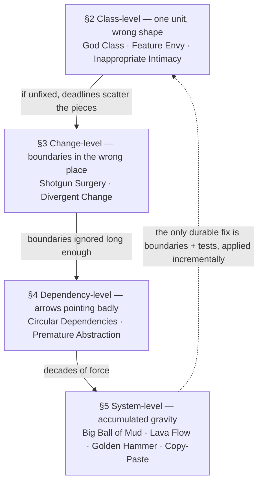
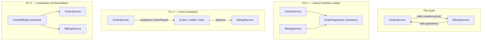
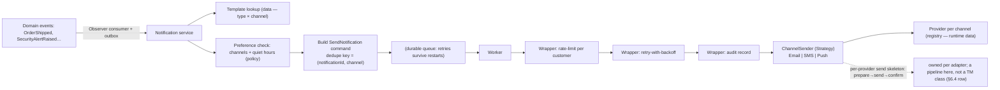
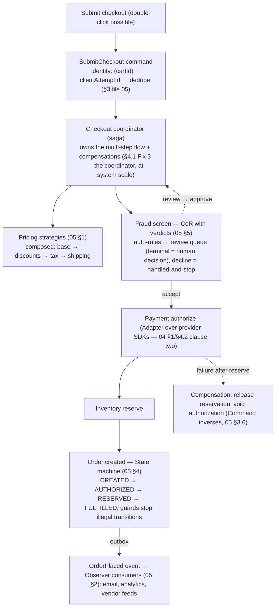
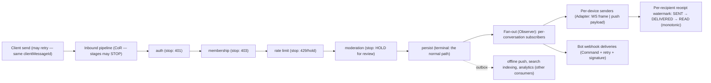
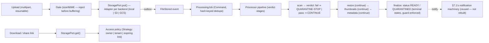

# 06 — Judgment: Pattern Selection, Anti-Patterns, and Minimum Viable Design

> **The shift this file makes.** Files 03–05 taught you the vocabulary: fourteen patterns, their mechanics, their contracts. This file teaches the *judgment* that decides whether any of it should be used — and it is a file about **refusal as much as construction**. The uncomfortable premise: every pattern you now know makes you *more dangerous* before it makes you more effective — a carpenter with only a hammer sees nails everywhere, and a candidate who has just learned Strategy sees algorithm variation in every `if`. This file is the counterweight: the selection process (§6), the field guide to the ways designs actually go wrong (§1–§5), and the discipline that keeps structure proportional to requirements (§8).
>
> **The file's thesis:** *judgment is three skills — recognition (a symptom in the requirements maps to a pattern), restraint (a pattern in your head maps to a refusal receipt), and the refactoring eye (a smell in existing code maps to a named fix). Senior interviews are conducted almost entirely in these three skills; pattern knowledge is merely the vocabulary they are spoken with.*

---

## 0. Judgment — the Skill This File Trains

### 0.1 The two failure modes — same muscle, opposite directions

Every design decision sits between two cliffs, and both are the same failure — *structure disproportional to requirements*:

| | **Over-engineering** | **Under-designing** |
|---|---|---|
| **What happens** | patterns, interfaces, and extension points for changes that never come | no seams at all; every change reopens and re-verifies everything |
| **The tell** | more abstraction layers than change drivers; "flexibility" with no requirement sentence behind it | the second implementation of anything means editing the original switch/if; change #2 costs like change #1 |
| **Who does it** | the newly-trained (patterns as identity), the interview performer (patterns as score), the résumé-driven résumé builder | the deadline-pressured, and — the subtle case — the burned: engineers who once over-engineered and swung to the opposite cliff |
| **The cost** | indirection tax: navigation, wiring, tests for behaviorless classes; and **false confidence** — structure that *looks* like it handles change it doesn't | change tax: the shotgun surgery, the drift, the latent bugs where "forgot to update one of the eight places" |
| **The fix** | §8: MVD, receipts, the second-case rule | the same sections run the other way: the moment a *named* change repeats, the seam gets cut |

The asymmetry worth internalizing: **over-engineering is punished socially (in reviews and interviews) more visibly, but under-designing is punished financially (in production).** The two are separated by exactly one artifact — a written answer to *"what change is this structure for?"* If the answer is a requirement sentence, the structure is proportional; if the answer is a mood ("cleaner", "scalable", "more flexible"), it is decoration.

### 0.2 The three skills — and where interviews test each

| Skill | Direction | Interview test | Trained in |
|---|---|---|---|
| **Recognition** | requirements → pattern | "Design X" — hearing *"multiple types of…"* and reaching for a family, *out loud, with the signal named* | §6–§7 (this file), files 03–05 per-pattern |
| **Restraint** | pattern → refusal | "That's an interface with one implementation — tell me why you kept it" / "What did you *not* abstract?" | §8 (MVD), every "when NOT" table in 03–05 |
| **The refactoring eye** | existing code → smell → fix | "Here's a class. What's wrong?" (the reverse question — reading instead of writing) | §1–§5 (this file), §10's drills |

A structural fact about senior loops: the higher the level, the more the interview shifts from *production* (draw the design) to *reading* (critique the design, defend a refactor). The refactoring eye is the skill candidates most often arrive without — it cannot be faked, because it requires naming the *mechanism*, not just the discomfort ("this feels bloated" scores nothing; "eight dependencies spanning four change drivers — the fix is splitting along the drivers" scores).

### 0.3 Word by word — the judgment vocabulary

Seven terms carry this file. Each gets its origin, because the origins are the mnemonic:

> **Word by word — *judgment*:** from Latin **judicium** — *ius* (*right, law*) + **dicere** (*to say, to declare*) — literally *"the saying of the law"*: the act of deciding a case by applying a rule with reason. A *judex* was one who *says* the right. The design reading is exact: judgment is not taste or preference — it is **saying the right thing about a case**, applying articulated criteria to a specific situation, in a way that can be argued and audited. Every choice in this file ends with a sentence that can be argued — that's what makes it judgment rather than vibes.
>
> **Word by word — *smell*:** the metaphor is literal and domestic. The term entered software via Kent Beck and Martin Fowler's refactoring culture — Chapter 3 of *Refactoring* (1999) opens by Kent Beck with his grandmother's household advice about a different problem entirely: **"If it stinks, change it" — Grandma Beck, discussing child-rearing philosophy.** The design reading: a smell is not a proof of a defect — it is a *perception* that reliably predicts hidden rot, worth investigating, not necessarily condemning. This precision matters in interviews: *"this smells like Feature Envy"* invites testing; *"this is bad code"* just asserts.
>
> **Word by word — *anti-pattern*:** *anti-* (Greek *anti*, *against, opposite*) + *pattern*. The concept was named by **Andrew Koenig** in 1995 ("Patterns and Antipatterns", *Journal of Object-Oriented Programming*) — his observation: the pattern movement had built a vocabulary for what works, and nothing for what reliably *fails*; documenting failures was as valuable, because **a named failure can be avoided by decision instead of by scar tissue**. The canonical text (*AntiPatterns: Refactoring Software, Architectures, and Projects in Crisis*, Brown et al., 1998) gave the formal definition: *"a commonly occurring solution to a problem that generates decidedly negative consequences."* Dissect that definition — it is load-bearing three times: **commonly occurring** (else it's just a bug), **solution** (it *works* — that's what makes it seductive; every anti-pattern is a pattern that pays today and bills later), **negative consequences** (the bill). The full anti-pattern entry mirrors the GoF's format — name, root cause, symptoms, consequences, **refactored solution** — because the point was never mockery; it was the cure.
>
> **Word by word — *technical debt*:** the metaphor is **Ward Cunningham's, 1992** (the OOPSLA experience report on the WyCash portfolio system) — his advice: ship the *simple* version now, accepting that the difference between the simple version and the "right" one is **debt**: you gain speed today and pay **interest** — the tax charged on every future change made in the shadow of the shortcut — until you pay down the principal by refactoring. *Debitum* is Latin for *a thing owed*. The metaphor's discipline is in the interest: debt is a *financial instrument*, not a moral failing — take it deliberately, for a reason (deadline, learning, evidential uncertainty), and service it. The corruption of the metaphor — "debt" as a label for any mess, used to excuse it — is itself an anti-pattern this file's vocabulary prevents: **undeliberate debt is not debt; it's damage.**
>
> **Word by word — *refactoring*:** *re-* (again) + *factor*, and *factor* is the mathematical verb: to break a number or expression **into factors** — its constructive parts (Latin *factor*: *one who does/makes*). Applied to software (the term predating Fowler's book — William Opdyke's 1992 thesis documented refactorings for frameworks), the definition to quote verbatim in interviews is Fowler's: **"a change to the internal structure of software to make it easier to understand and cheaper to modify without changing its observable behavior."** All three clauses earn their keep: **internal structure** (behavior is the contract; structure is what you may reshape), **easier and cheaper** (refactoring is measured in change-cost, not aesthetics), **without changing observable behavior** (the safety rail that makes it distinct from "rewrite" — and the reason the tests-behavior-first discipline is inseparable from it).
>
> **Word by word — *YAGNI*:** the acronym for **"You Aren't Gonna Need It"** — the phrase from the extreme-programming community (Ron Jeffries, 1998) and the discipline it names: *do not implement capability now on the speculation that it will be needed later*. The epistemology behind it is sharp and often misquoted: YAGNI does not say "future needs don't matter" — it says **speculation is not evidence**. And the strongest form of YAGNI is economic, not aesthetic: when the future need actually arrives, the code you didn't write costs *less* to add than the wrong abstraction you'd have written costs to unwind — *because now you know the actual requirements*. "You aren't gonna need it" is short for "when you need it, you'll build it better" (file 03's second-case rule is YAGNI, formalized for families).
>
> **Word by word — *over-engineering*:** *over-* (beyond) + *engineering*. The root *engine* is Latin **ingenium** — *innate quality, genius, a clever device* — and an *engineer* originally ran **engines of war** (siege engines; the word entered English as "constructor of military engines"). The design reading of *over-*: the failure is not engineering (structure, care, foresight) but structure *past the point where it pays* — engines built for wars not being fought. The companion failure — *under-engineering* — rarely gets said aloud, because it looks like a deadline. Both names exist so the conversation can be had without insult: *"this is over-engineered for the current requirement set"* is a technical claim, testable; *"you're overcomplicating"* is a person.
>
> **Word by word — *MVD (Minimum Viable Design)*:** this course's coinage, deliberately echoing the startup world's MVP (minimum viable *product* — the smallest thing that delivers real value and produces real learning) and transplanted to design: **the least structure that satisfies the stated requirements, keeps the design testable, and leaves the *known* change drivers cheap to serve.** Three clauses, three escape hatches: **stated requirements** (not imagined ones — speculation goes to §8's ledger as a liability, not an asset); **testable** (some structure is not decoration — a seam-injected clock or repository earns its place by making verification possible; §8.4's clause); **known change drivers** (changes already named, observed, or scheduled — not probabilistic guesses). MVD is not minimalism as an aesthetic; it is the *budget* that makes structure auditable: every abstraction cites the requirement clause it serves, or it gets cut.

### 0.4 The map of this file — and how to read it with 03–05 open

| Part | Contents | Companion to |
|---|---|---|
| **§1 — Anti-patterns from zero** | What anti-patterns are, their anatomy, and the pattern→shadow degeneration map | Files 03–05's "when NOT" tables (this file generalizes them) |
| **§2 — Class-level smells** | God Class, Feature Envy, Inappropriate Intimacy — with tri-language fixes | File 01 §10 (cohesion/coupling), file 02 §1 (SRP) |
| **§3 — Change-level smells** | Shotgun Surgery, Divergent Change — the pair that measures *boundaries* | File 02 §2 (OCP), §5 (DIP) |
| **§4 — Dependency-level smells** | Circular Dependencies, Premature Abstraction | File 02 §5, file 03 §5.2's YAGNI rows |
| **§5 — System-scale smells** | Big Ball of Mud (and the kernel's BKL redemption arc), Lava Flow, Golden Hammer, Copy-Paste | Files 01 §11, 03 §6 (Singleton as golden hammer) |
| **§6 — Selection** | The three questions, the five-step process, and the **master signal→pattern matrix** across all fourteen patterns | The synthesis of files 03–05's three triage matrices |
| **§7 — Worked selection** | Notification service, checkout, chat, file storage — full requirement→pattern walks *with refusals spoken aloud* | The course's running systems |
| **§8 — Over-engineering and MVD** | The cost ledger of every pattern, MVD, the maturity ladder, the four questions before any abstraction | Every "when NOT" table, unified |
| **§9 — Frequency data** | Where interview prep time pays (tiers, company types, levels — as priors, honestly framed) | File 09's preparation plan |
| **§10–§12** | The ReportManager critique, drills, interview bank, misconceptions, rapid-fire, closing map | — |

---

## 1. Anti-Patterns from Zero — The Negative Pattern Language

### 1.1 What an anti-pattern actually is (and what it isn't)

The seduction is the definition. Recall §0.3's dissection — **a commonly occurring *solution*** — and notice what it rules out: an anti-pattern is *not* a bug (bugs occur once, by accident; anti-patterns recur *because they work, initially*), not an excuse (documenting a failure is the prelude to its fix), and not a character flaw (the entry names the *solution's* consequences, not the engineer's). Three properties, in the order that matters for interviews:

1. **It pays early and bills late.** The God Class is *convenient* for eighteen months — that's the whole problem; the cost (every change risks unrelated features, every test mocks twelve things) accrues silently, which is why the detection instrument is not "does it work?" but **change-cost over time**.
2. **Its causes are structural, not moral.** The anti-patterns book's own framing: these are *forces* (deadline pressure, ownership ambiguity, weak boundaries, optimism) meeting a system that doesn't punish them immediately. The interview line that lands: *"God Classes are a gravity phenomenon — every shortcut moves one more method into the popular class; the counter-force is deciding boundaries when the second change driver appears."*
3. **It is *removable* by named moves.** Every entry in this file ends in a **refactored solution** — and in this course's tri-language form, so the fix is not "decouple it" (a mood) but "move the method; extract the interface; invert the arrow" (a move, reviewable, testable).

The pragmatic value of the vocabulary is *compression and de-escalation*: "this is Feature Envy — the method lives where its data doesn't; it should move" transmits a diagnosis, a mechanism, and a remedy in one sentence, without saying anyone is bad at their job. Names are how senior teams discuss defects without depositions.

### 1.2 The anatomy of an entry — and the degeneration map

Anti-pattern entries mirror the GoF's discipline (§0.3's definition of their form). The template this file uses:

| Field | The question it answers | Why it earns its place |
|---|---|---|
| **Name** | what do we call it in review? | shared vocabulary; memory hook (the name should *stick* — "Shotgun Surgery" cannot be forgotten) |
| **Root cause** | which design force produced it? | refactoring without the cause is cycle-of-punishment (fix the class, keep the pressure, regrow it) |
| **Symptoms** | what do we *observe*? | countable evidence: dependency counts, file-touch counts, getter ratios — evidence makes the review testable |
| **Consequences** | what does it cost, when? | separates "annoying" (tolerable) from "compounding" (must fix) — the interest-rate estimate |
| **Refactored solution** | what is the move? | terminology from files 01–05: *move the method, split along change drivers, invert the dependency* |
| **Interview line** | how is it tested and answered? | this file's running column: the probes and the model answers |

And the table that organizes the catalogue — the **degeneration map**: every pattern from files 03–05 has a reachable shadow, entered not by misuse-by-bad-engineers but by *the pattern outliving the force that justified it*. Learn the pairs; senior interviewers probe exactly the boundary:

| Pattern (file) | Its shadow, when the justifying force dies | The tell |
|---|---|---|
| **Singleton** (03 §6) | **Golden Hammer / global state** — chosen for "only one", delivering hidden coupling | the second unrelated caller needing "just the one" instance; tests fighting over shared state |
| **Factory Method / Abstract Factory** (03) | **Premature abstraction** — the family has one member; the factory, one product | "add a type" is a one-line enum change; the hierarchy exists "for symmetry" |
| **Builder** (03 §4) | **Ceremony** — a builder for three fields with no validation | `new Thing(a, b, c)` would fit on one line; `build()` is a `return new` |
| **Decorator** (04 §2) | **Mystery wrapper stack** — five layers, observed behavior nobody can predict; debugging enters by binary search | "why is the response uppercase?" traced through four constructors |
| **Facade** (04 §3) | **God Class** (the god facade) or **Law of Demeter violation** (the leaky facade) | every new feature adds a facade method; the facade exposes `getOrder().getPayment()` |
| **Proxy** (04 §4) | **Accidental behavior** — caching/lazy semantics that callers didn't contract for | "it didn't save because the proxy wasn't told"; identity surprises |
| **Strategy** (05 §1) | **Strategy costume** — interface + implementations, selection buried in an `if` inside the consumer | the second variant requires editing the consumer; strategies with unused fat interfaces |
| **Observer** (05 §2) | **Listener leak / invisible control flow** — subscribers nobody can enumerate; LIFO-order dependence | memory growth with load; "who does what on OrderPaid?" unanswerable without a debugger |
| **Command** (05 §3) | **God command / event-command confusion** — commands that do everything; vetoable "events" | one command class per workflow; consumers disagreeing on whether an event can fail |
| **State** (05 §4) | **Invisible state machine / state-machine cosplay** — status strings and scattered `if`s, or state classes with stub methods | illegal transitions reaching the database; `if (state == …)` reappearing in the context |
| **Chain of Responsibility** (05 §5) | **Terminal-less chain / distributed switch** — silent drops; routing knowledge smeared over N handlers | "it just did nothing"; reading all N handlers to know which answers |
| **Template Method** (05 §6) | **Fragile base class / hook sprawl** — every wish a hook; subclass breakage on upgrade | N hooks, M subclasses overlapping differently; release notes that break extenders |

The map's usage sentence — worth having verbatim: *"the patterns and their shadows are the same decision at two moments in time; the pattern is the decision while its requirement lives, and the shadow is the same decision after the requirement died — which is why the review question is never 'is this a pattern?' but 'does the force that justified this still exist?'"*

### 1.3 The catalogue's organization — four levels of magnification

Smells nest: a God Class *causes* Shotgun Surgery when its methods call across the scattered pieces; cycles cause both. This file's order runs from small to large — class, change, dependencies, system — because the fixes run in that direction too (you move methods before you split services):



> **[MISCONCEPTION] *"Anti-patterns are what bad engineers write."*** The force is gravity, not character (§1.1): every pattern on the degeneration map was entered *by doing the locally-right thing* — adding the method where the data already is (God Class), putting the check where the request already flows (terminal-less chain), choosing "the" instance for "the" resource (golden hammer). The map's real lesson is for *authors of new structure*: your pattern is a lease on time, and **the review question that renews it is "does the force that justified this still exist?"** — a question with a file path, a dependency count, and a change-frequency, not a vibe. Engineers who internalize this stop experiencing their own good designs as permanent and start scheduling their maintenance — which is precisely the posture senior interviews are calibrated to find.

---

## 2. Class-Level Smells — One Unit, Wrong Shape

### 2.1 God Class (the Blob)

> **Word by word — *God Class*:** *god* in the design sense is not theology but *omnipotence* — the class that knows all and does all; the older name in the literature is the **Blob** (Brown et al., 1998 — after the 1958 film's amoeba: a formless mass that absorbs everything it touches). The two names encode the two observations: **authority** (it decides everything — the god) and **growth** (it *became* everything, one absorption at a time — the blob). Both names are diagnostics: the class that gets asked everything, and the class that absorbed one method too many without anyone noticing.
>
> **Definition:** *a single class that has accumulated responsibilities from several unrelated domains, so that changes for any one of them risk all the others.* The tell is not size in lines — it is **span**: how many different *reasons* does this class get edited for?

**How it forms — the gravity, not the stupidity** (the lifecycle is so regular it can be dated): a reasonable service class with three or four methods → the product evolves; the next feature's method is added *here* because the data is here and asking "where should this live?" costs a discussion → the ownership question is never asked, so the answer defaults to *here* → eighteen months later: twelve dependencies, twenty-five methods, and the class touches ordering, payment, shipping, notification, analytics, and fraud. Nobody decided to build a God Class; everybody declined to have the boundary conversation, one method at a time.

**The detection instrument — change drivers, not line counts.** Count the *independent reasons* this class changes:

| Signal | Threshold worth speaking aloud | What it points at |
|---|---|---|
| Methods from **3+ unrelated domains** | ordering + payment + notification in one class | the span; the split boundaries are *between the domains* |
| Constructor takes **8+ dependencies** | most will belong to the extracted services | the dependencies are the disassembly diagram — each cluster is a future class |
| Class edited **every sprint by different teams** for different features | it is a merge-conflict magnet | conway's shadow: the class is where team boundaries went to die |
| Unit tests mock **10+ collaborators** | test setup longer than the test | the untestability *is* the coupling, made visible |
| **Vague name** | `UserService`, `AppManager`, `CoreHandler`, `OrderManager` | the name couldn't be specific — no single domain existed to name |

**The fix, named:** **split along change drivers.** Not "split into smaller classes" (that yields arbitrary ClassPart1/ClassPart2); the split lines are the *reasons to change* — because those lines are also the future team boundaries, the future test seams, and the future deployment units. The refactored class should pass the sentence-test: *each extracted class's changelog tells one coherent story.*

**Tri-language, before/after (condensed — the full slide example lives in v1's tongue):**

```java
// BEFORE — one class, six reasons to change [the classic formation]
public class OrderService {                       // "OrderService" — the vague name
    private final OrderRepository orderRepository;
    private final PaymentGateway paymentGateway;       // payment reasons
    private final InventoryService inventoryService;
    private final ShippingService shippingService;     // fulfillment reasons
    private final EmailClient emailClient;
    private final SmsGateway smsGateway;               // notification reasons
    private final AnalyticsTracker analyticsTracker;
    private final FraudDetector fraudDetector;         // risk + analytics reasons
    private final TaxCalculator taxCalculator;
    private final DiscountEngine discountEngine;
    private final InvoiceGenerator invoiceGenerator;
    private final AuditLogger auditLogger;             // 12 dependencies, four domains

    public OrderResult placeOrder(OrderRequest r) { /* 80 lines of everything */ }
    public void cancelOrder(String id)            { /* … */ }
    public RefundResult processRefund(String id)  { /* … */ }
    public void sendOrderConfirmation(String id)  { /* notification, here? */ }
    public OrderAnalytics getOrderAnalytics(DateRange d) { /* analytics, here? */ }
    public FraudCheckResult checkForFraud(OrderRequest r) { /* risk, here? */ }
    // … 25 methods later, no one asks "where should this live?" anymore.
}

// AFTER — split along the change drivers; each class's changelog is one story
public class OrderPlacementService {              // driver: how orders get placed
    private final OrderRepository orderRepository;
    private final PaymentService paymentService;       // 4 deps, one domain
    private final InventoryService inventoryService;
    private final OrderEventPublisher eventPublisher;

    public OrderResult placeOrder(OrderRequest request) {
        inventoryService.reserve(request.items());
        PaymentResult payment = paymentService.charge(request);
        Order order = Order.create(request, payment.transactionId());
        orderRepository.save(order);
        eventPublisher.publish(new OrderPlacedEvent(order));   // notifications left the class
        return OrderResult.success(order.id());
    }
}
public class OrderPricingService {                // driver: how orders get priced
    private final TaxCalculator taxCalculator;         // 2 deps, one domain
    private final DiscountEngine discountEngine;
    public PricingBreakdown calculatePricing(OrderRequest request) { /* … */ }
}
// Notifications became Observer listeners on OrderPlaced (§2.3's payoff, file 05 §2);
// analytics, fraud, invoices → their own services. The dependency list WAS the design doc.
```

```cpp
// C++ — the same split: the constructor signature is the honest dependency count
class OrderPlacementService {
    OrderRepository&     orders_;
    PaymentService&      payments_;
    InventoryService&    inventory_;
    OrderEventPublisher& events_;
public:
    OrderPlacementService(OrderRepository& orders, PaymentService& payments,
                          InventoryService& inventory, OrderEventPublisher& events)
        : orders_(orders), payments_(payments), inventory_(inventory), events_(events) {}
    OrderResult placeOrder(const OrderRequest& request);      // 4 refs — all one domain
};
```

```c
/* C — the god struct decomposes into per-domain structs wired together at main();
 * the "12 dependencies" became the assembly manifest, made explicit. */
struct order_placement_service {
    struct order_repository  *orders;
    struct payment_service   *payments;
    struct inventory_service *inventory;
    struct order_event_bus   *events;
};

int order_placement_place_order(struct order_placement_service *svc,
                                const struct order_request *req,
                                struct order_result *out)
{
    if (inventory_reserve(svc->inventory, &req->items) != 0) return -1;
    struct payment_result pay;
    if (payment_charge(svc->payments, req, &pay) != 0)       return -1;
    struct order order = order_create(req, pay.transaction_id);
    if (order_repository_save(svc->orders, &order) != 0)     return -1;
    order_event_bus_publish(svc->events, &(struct order_placed_event){ .order = order });
    out->order_id = order.id;
    return 0;
}
/* The C posture makes the point invisibly: C has no classes to make godlike —
 * the god is a .c file with 4,000 lines and a struct everything pokes at.
 * The fix is identical: split the MODULE along change drivers, keep one header. */
```

> **[PRODUCTION] What the God Class actually costs, in one incident.** The class is the merge-conflict epicenter: two teams editing `OrderPlacementService`-that-became-God every sprint means every PR rebases through the same 80-line method; the first "quick fix" that bypasses a validation because the full path was too tangled to reason about ships as a data-integrity bug; and the class's test suite — mocking twelve collaborators — is the one everyone skips when the deadline shortens, which is exactly when it was needed. The senior summary: **the God Class's cost is not size; it is that every change pays the class's *entire* complexity, even when it touches one method.**

> **[INTERVIEW]** The probe is always shaped *"what's wrong with this design?"* and the graded answer has three moves, in order: **(1) evidence first** — count the dependencies and name the domains out loud ("twelve dependencies spanning four change drivers — placement, pricing, notification, risk"); **(2) the principle** — "SRP: more than one reason to change" (exactly enough vocabulary — no more); **(3) the sketch** — the split along drivers, with the honest promise: "the 12-dependency constructor is the disassembly diagram; each cluster extracts cleanly." The anti-pattern name is the *last* thing said, not the first — naming beats narrating only when the narration is already right.

### 2.2 Feature Envy

> **Word by word — *envy*:** from Latin **invidia** — *in-* (*into, upon*) + **videre** (*to look*) — literally *"to look upon* (maliciously)": the evil-eye sense; to envy is to *look into* another's goods. The design reading is exact and slightly funny once seen: **the method keeps looking into another object's fields.** Its home is wrong; it lives where its data does not, and every line of it is a glance across the fence.
>
> **Definition:** *a method that uses more data belonging to another class than to its own — the method should (probably) move to the class whose data it uses.*

**The instrument — the getter ratio.** Count the method's accesses: **3+ getters on one other object and 0–1 on its own → the method is envious.** The confirmation is the move-test from the literature: *if relocating the method to the envied class would eliminate all the accessor calls, the move is right.* It is a two-second review instrument, and it is deliberately mechanical — envy is a perception ("this method feels out of place") made countable.

```java
// BEFORE — the calculation lives where its data does not [the classic envy]
public class OrderReportGenerator {
    public String generateSummary(Order order) {
        double total = order.getItems().stream()                       // 6 getters,
                .mapToDouble(i -> i.getPrice() * i.getQuantity())      // 0 fields of its own
                .sum();
        double tax = total * order.getTaxRate();
        double shipping = order.getWeight() > 10 ? 15.00 : 5.00;
        return String.format("Total: $%.2f, Tax: $%.2f, Shipping: $%.2f", total, tax, shipping);
    }
}

// AFTER — the operations live with the data they operate on (file 01's thesis, cashed)
public class Order {
    public Money calculateSubtotal() { /* items · price · quantity */ }
    public Money calculateTax()      { /* taxRate */ }
    public Money calculateShipping() { /* weight thresholds */ }
}
// OrderReportGenerator becomes a thin formatter over three calls — or disappears.
```

```cpp
// C++ — smell: a free function envious of Order through its accessors
std::string generateSummary(const Order& order) {
    Money total = 0;
    for (const auto& item : order.items())          // reaches through accessors…
        total += item.price() * item.quantity();
    Money tax = total * order.taxRate();            // …for everything it needs
    Money shipping = order.weight() > 10.0 ? 15.00 : 5.00;
    return format("Total: %m, Tax: %m, Shipping: %m", total, tax, shipping);
}
// FIX: make it Order::summary() — the members it envied become its own fields; the
// accessor path closes. (Or OrderSummary over value objects, if formatting is a
// separate axis of change — the extraction still moves the CALCULATION home.)
```

```c
/* C — the function pulls five fields out of struct order: */
double order_report_summary(const struct order *o)
{
    double total = 0.0;
    for (size_t i = 0; i < o->item_count; i++)
        total += o->items[i].price * o->items[i].quantity;
    double tax = total * o->tax_rate;
    double shipping = o->weight > 10 ? 15.00 : 5.00;
    return total + tax + shipping;
}
/* FIX: move it into order.c — the module that owns the struct — and expose only
 * `double order_summary(const struct order *o);` in order.h. The C version of
 * "move the method" is "move it to the module that owns the data, and stop
 * exporting the fields." */
```

> **[KERNEL & SYSTEMS] The kernel obeys this smell's fix so consistently that it is a review tradition.** `inode_permission()` lives beside the inode, not in a separate "reporting" file; packet-processing functions that read ten fields of `struct sk_buff` belong — per mailing-list culture — in the networking core next to the struct, not in a driver that reaches through; and the header discipline is the same instrument at module scale: **if you can imagine the function in the file that owns the struct, it belongs there.** Envy at module scale is exactly a kernel layering violation: a driver reaching into core structures' internals (through "private" fields) is both an envy smell *and* an encapsulation break (§2.3 next) — which is why kernel reviewers ask "*why does this driver know so much about `sk_buff`?*" The expected answer is either "it shouldn't — move the logic to core behind a helper," or a named, argued reason (a hot path, with measurements). The rephrased rule that survives everywhere: **knowledge of internals must be paid for in maintenance; the kernel makes each driver pay at review time.**

> **[MISCONCEPTION] *"A service that calls five collaborators is envious."*** No — and this distinction is the one that keeps the smell from being applied as a bludgeon. Envy is about **reaching for another object's *data* to *compute* with it** (`order.getItems()`, `order.getTaxRate()` — ask-shape). A service that *orchestrates* five collaborators is **telling**, not asking (`payment.charge(...)`, `inventory.reserve(...)` — tell-shape); orchestrators are supposed to know many collaborators, because their job is sequence, not calculation. The test: *if moving this method to the other class eliminates accessor calls, it's envy; if the method's job is to make several objects act in order, it's coordination — and the smell there would be a different one (God Class, if the coordination spans domains).* "Tell, don't ask" is this smell's slogan; the orchestrator exception is its fine print.

> **[INTERVIEW]** The probe: a code blob containing one method that reads six getters of another object; the graded answer: *"is this method in the right class?" — it uses six getters from `Order` and nothing of its own: classic Feature Envy; the fix is Move Method to `Order` (or to an `OrderPricingService` if a second consumer needs the calculation and pricing is itself a change driver).* Then the refinement that separates strong answers: *"either way, the *calculation* moves home — only the *presentation* stays in a generator, and it becomes a thin formatter over three method calls."*

### 2.3 Inappropriate Intimacy

> **Word by word — *intimacy*:** from Latin **intimus** — *the inmost, the deepest* — a superlative of *intus* (*within*). The *intimus* was the closest friend, the one admitted to the inner rooms. *Inappropriate intimacy* in design is exactly that image inverted into a defect: **two classes admitted into each other's inner rooms — without the relationship to justify it.** The design reading: relationships have depths; code should make intimacy *match* the architectural relationship (a pair of collaborators share an interface, not each other's organs).
>
> **Definition:** *two classes that are too tightly coupled — reaching into each other's internal state, mutating each other's collections, or holding reciprocal references so that neither can be understood, tested, or changed alone.*

**Two distinct forms — diagnose them separately:**

**Form 1 — the mutual reach-in (the pair).** Two classes each call several of the other's accessors and mutators, often reciprocally (`order.pricing()` calls `pricing.applyTo(order)` which calls back `order.setTotal(...)`). This is File 05 §7's cycle *experienced at class pair scale* — one of §4's cycle cases wearing intimacy's clothes — and the fixes are that section's three (**shared interface, event, coordinator**), plus the local discipline: *push behavior to one side of the relationship so that data flows one way.* The smell's sentence: *"can you change one without reading the other?"* — if no, and the whole interaction must be re-understood together, the pair is a unit pretending to be two classes (extract the unit, or clarify the direction).

**Form 2 — the leaked internals (the quieter, more common, more damaging).** One class hands out its internal collection or mutable state:

```java
// BEFORE — hand out the internal list, lose all control [the classic leak]
public List<Item> getItems() { return items; }        // callers can add/remove/mutate freely;
                                                      // every invariant you documented is now
                                                      // unenforced, everywhere, forever
// AFTER — expose intentional operations; the collection stays yours
public void addItem(Item item)      { validate(item); items.add(item); recalc(); }
public void removeItem(Item item)   { items.remove(item); recalc(); }
public List<Item> itemsView()       { return Collections.unmodifiableList(items); }  // a VIEW
```

```cpp
// C++ — BEFORE: callers mutate behind your back
std::vector<Item>& items() { return items_; }
// AFTER: controlled access; const view, mutation via methods
void addItem(const Item& item);
const std::vector<Item>& items() const;
```

```c
/* C — BEFORE: a pointer to the internal array escapes; every caller is now a co-owner */
struct item *order_items(struct order *o) { return o->items; }
/* AFTER: accessor + explicit mutators; ownership stays inside order.c */
size_t             order_item_count(const struct order *o);
const struct item *order_item_at(const struct order *o, size_t i);   /* read-only view  */
int                order_add_item(struct order *o, const struct item *it);  /* validates */
```

The mechanism is identical in all three tongues and worth naming plainly: **returning an internal collection converts every caller into a co-owner of your invariants — but without your maintenance obligations.** The day a caller mutates the list without `recalc()`, the class's documented invariant is false, and no compiler, no reviewer, and no test that used the sanctioned operations will ever notice. The leaked collection is the most common form of broken encapsulation in production Java and C++ codebases, and it is *invisible* in every diagram — the class looks encapsulated (fields are `private`!) while its guts circulate freely.

**The fixes, as a short liturgy** (say all three; pick by diagnosis): **(1) one-way dependency** — kill the reciprocity via interface/event/coordinator (§4's machinery, reused); **(2) encapsulate collections behind intentional, named operations** (above — the fix is *naming the operations the callers actually need*, which usually shrinks the public surface dramatically); **(3) treat `friend` (C++) and public mutators as explicit, argued exceptions** — the review question is not "private?" but "*this opening is an exception to encapsulation: what pays for it?*"

> **[INTERVIEW]** Envy and Intimacy arrive together in one probe (a class pair + a method), and the scoring is about **discipline of order**: diagnose the method first (envy: it reads six getters — *moves*), then the pair (intimacy: the references run both ways / the collection leaks — *direction fixed, collections encapsulated*). Always end with the two fix sentences: *"the method moves to its data; the reference becomes one-way."* And keep the third observation ready for the top grade: *"if the pair genuinely needs both directions, I'd extract their interaction into a coordinator — the cycle fix — rather than enforce artificial one-way-ness that misstates the domain."*

---

## 3. Change-Level Smells — Where the Boundaries Are Wrong

The class-level smells are readable in a sitting. The next two are only readable **over time** — they are the smells whose evidence lives in git history, not in the code text: *how many files does one change touch, and how many reasons does one class change for?* They are a pair — the same question (are the boundaries drawn along change drivers?) failed in opposite directions — and together they are the most decision-relevant smells in this file, because they are what prediction *actually* uses: not "will this change?" but "where does it change, and how far does the change travel?"

### 3.1 Shotgun Surgery

> **Word by word — *shotgun*:** the firearm that fires a **shot** (a cluster of pellets) rather than a bullet — one trigger pull, damage spread across a wide, imprecise area; *surgery* from Greek **kheirourgia** — *kheir* (*hand*) + *ergon* (*work*) — *hand-work*, the manual craft of healing by direct intervention (the root of *surgeon*, *chirurgy*; the same *ergon* as *energy*, *work*). Put together, the image is exact: **a single change that must be performed by hand across a wide field, each pellet a file, and every unperformed pellet a lesion left in the body.** The name is the best in the catalogue; nobody forgets a shotgun.
>
> **Definition:** *one logical change requires editing many places, because a single responsibility is scattered across modules — and nothing enforces that all the places change together.*

**The cost model — and it is worse than irritation.** The slides' canonical case: adding one customer-notification type requires editing eight files — `CustomerService`, `NotificationTemplates`, `EmailFormatter`, `SmsFormatter`, `NotificationConfig`, `NotificationValidator`, `NotificationMetrics`, `NotificationTest`. The painful sentence is not "eight files" (tedious but survivable) — it is the *latent bug*: **if a developer forgets `SmsFormatter`, nothing fails to compile, nothing fails a test, and SMS notifications for the new type silently fail in production** — days later, as a support ticket, not a build error. Shotgun surgery converts every logical change into a **checklist item that cannot be checked** — and organizationally, that is a machine for manufacturing omissions.

**The fix — consolidate the scattered responsibility into one cohesive unit per variant.** Each notification type becomes a self-contained class encapsulating *all* its facets (template, formatting, validation, config):

```java
// The fix — one self-contained class per type; adding a type = creating one file.
public class WelcomeNotification implements NotificationType {
    public String getTemplateName()                     { return "welcome"; }
    public String formatForEmail(Customer customer)     { /* … */ }
    public String formatForSms(Customer customer)       { /* … */ }
    public boolean isValid(NotificationRequest request) { /* … */ }
    public Map<String, String> getDefaultConfig()       { /* … */ }
}
// The router looks the type up by key. No switch exists anywhere else to edit.
```

```cpp
// C++ — the same consolidation: each type is one file implementing one interface;
// the compiler now enforces completeness at the only place completeness matters.
class WelcomeNotification final : public NotificationType {
public:
    std::string templateName() const override { return "welcome"; }
    std::string formatForEmail(const Customer&) const override;
    std::string formatForSms(const Customer&) const override;
    bool isValid(const NotificationRequest&) const override;
};
```

```c
/* C — one ops table per type. Adding a type = one new struct in one new file;
 * nothing else in the system changes shape. This is Linux's file_operations. */
struct notification_type {
    const char *name;
    const char *(*template_name)(void);
    int  (*format_email)(const struct customer *, char *buf, size_t len);
    int  (*format_sms)(const struct customer *, char *buf, size_t len);
    int  (*is_valid)(const struct notification_request *);
};

static const struct notification_type welcome_notification = {
    .name = "welcome", .template_name = welcome_template_name,
    .format_email = welcome_format_email, .format_sms = welcome_format_sms,
    .is_valid = welcome_is_valid,
};
/* The router looks the type up in a TABLE (or registry). There is no switch(driver_type)
 * anywhere — and that absence is the entire fix, mechanically stated. */
```

> **[KERNEL & SYSTEMS] The kernel's answer to shotgun surgery is the ops-table pattern, adopted a generation ago.** You can add a new character-device driver **without touching the VFS** — because everything a driver must provide lives in one `struct file_operations`. The counterfactual writes the smell from the other side: imagine the VFS instead containing `switch (driver_type)` in `read`, `write`, `open`, `release`, `ioctl`, and `poll` — six kernel files edited per driver, with the same latent-bug machine (forget `poll` and a driver's select behavior silently misbehaves). The general statement: **shotgun surgery is what you get when a variant's required members are *implicit* (must remember to edit N places) instead of *explicit* (the interface/ops table spells out the members — and the compiler or the table's completeness check enforces them).** The fix is always the same move: pull the variant's scattered facets into one cohesive unit and let callers look it up. Java's interface gives you a compile-time checklist; C's ops table gives you a single struct that *is* the checklist; C++'s abstract base gives both.

> **[INTERVIEW]** The probe describes a change (e.g., "adding an export format touches seven files") and asks how you'd restructure. The graded answer has two halves, and the second half is the separator: **(1) consolidate** — one `ExportFormat` per format, encapsulating validation, formatting, defaults (the §3.1 fix moved sideways); **(2) name the enforcement mechanism** — *"each format is an interface implementation, so the compiler catches missing members; the controller looks up by key; nothing else switches on format."* Junior answers stop at "put it in one class"; the interview scores the mechanism, because the mechanism is what stops the shotgun from re-forming.

### 3.2 Divergent Change

> **Word by word — *divergent*:** from Latin **divergere** — *dis-* (*apart*) + *vergere* (*to bend, to turn*) — *to bend apart*: two roads leaving one point in different directions. (The same *vergere* in *converge* — bending together.) *Change* is the plain word; the smell is exact: **one class that keeps bending apart** — modified in different ways for different reasons, its edit-history a fan of unrelated branches from a single file.
>
> **Definition (Fowler's, near-verbatim):** *one class is commonly changed in different ways for different reasons — several unrelated change drivers meet at a single point.* It is, precisely stated, **SRP's violation observed through history** — and the pair to §3.1: Shotgun Surgery scatters *one* reason across *many* places; Divergent Change gathers *many* reasons into *one* place. Both are answered by the same instrument — boundaries on change drivers — failed in opposite directions.

**The instrument — the class changelog, read as a sentence.** Take the frequently-changed class; read its last quarter of commits; write one sentence per merged change; then ask: **do these sentences share a subject?** The class that changed "to add the loyalty-points discount", "to fix the SMS template for tax invoices", and "to make analytics events fire on refunds" is three classes wearing one file — and its review load proves it: unrelated reviewers requested on one PR, merge conflicts between teams, the sprints where it shows in the diff of every feature.

**The fix** is §2.1's split along drivers — but note the sequence this file keeps insisting on: **Divergent Change is usually detected *after* the fact** (the history shows the fan), while the *trigger* to split is the moment the second unrelated driver appears in a single class's diff. That's the practical version for code you're writing versus code you inherit:

> **[PRODUCTION] The kernel's process rule is this smell's prophylaxis — "one patch, one concern."** Kernel patch series are reviewed with a rule that maps directly onto divergent change: a patch (or series) should implement *one logical change*; a submission that mixes a `mm/` fix with a `net/` cleanup gets "please split" in review, and the git history of a healthy subsystem reads as a sequence of single-subject commits. It is the smell's discipline applied *before* the smell can form: **if you cannot write the change's one-sentence subject line cleanly, the change (or the boundary) is wrong.** The same instinct at class level: the class whose commits cannot share a subject line is ready to split, and the team that writes subject lines first (the commit-message discipline) detects divergent change at authoring time instead of at archaeology time.

> **[INTERVIEW]** Divergent Change appears in interviews as the *pair* with Shotgun Surgery, usually as: *"this class is touched for three different features each quarter — what's the design defect?"* The graded answer names the mechanism precisely — *"three independent change drivers meeting in one class: SRP's divergence; the fix is splitting along the drivers, using the drivers to choose the seams"* — then cashes the pair sentence, which is the one being scored: ***"Shotgun Surgery is one responsibility scattered thin; Divergent Change is many responsibilities bundled; both are answered by the same question — where does the change actually come from? — and both are read from history, not from the class diagram."***

### 3.3 The five smells, side by side — the review table

| Anti-pattern | The symptom you can count | The unit too… | The fix, as a move | Read from |
|---|---|---|---|---|
| **God Class** | dependencies 8+, domains 3+, vague name | one class too **large** | split along **change drivers** (deps = disassembly diagram) | the constructor + method list |
| **Feature Envy** | 3+ getters of another, 0–1 of its own | one method in the **wrong home** | **Move Method** to the data (or to a service if a second consumer + change driver exists) | the method body |
| **Inappropriate Intimacy** | reciprocal references; leaked collections | a **pair** too entangled | one-way dependency (interface/event/coordinator); encapsulate collections behind named operations | the class pair + accessor paths |
| **Shotgun Surgery** | one change touches 6–10 files | one responsibility spread **thin** | **consolidate** the variant's facets into one unit + name the enforcement mechanism (interface/ops table) | the *pull request*, over time |
| **Divergent Change** | one class, 3+ unrelated change subjects per quarter | many responsibilities bundled in one **hub** | split along drivers; use commit subjects as the seam-finder | git log of the class, read as sentences |

Two closing observations that make the table a system rather than a list: **the last two rows are the *dynamic* smells** (invisible in any single snapshot — they are about *diffs*), and **the first three are the *static* smells** (visible in the text). Experienced reviewers do both passes — read the code for shape, read the history for flows — and the interview version of the double-pass habit is simply narrating both: *"statically this is a God Class; dynamically its changelog shows the three drivers — same finding, two proofs."*

---

## 4. Dependency-Level Smells — Arrows Pointing Badly

### 4.1 Circular Dependencies

> **Word by word — *circular*:** from Latin **circulus**, *a little ring* — the diminutive of *circus* (*ring, circle*); through Greek **kyklos** (*wheel, circle* — the same root as *bicycle*, *cyclone*, *cycle*). **Word by word — *dependency*:** from Latin **dependere** — *de-* (*down*) + *pendere* (*to hang*) — *to hang down from*; a dependency is **that which something hangs from**. Put together: a circular dependency is the state where **each thing hangs from the other** — a ring of support with no ground beneath it. The etymology is the failure mode: suspend two objects from each other and neither can be picked up.
>
> **Definition:** *module/class A depends on B, and B depends on A — directly or through a chain — so that neither can be understood, constructed, tested, or deployed without the other.*

**The costs — name all four in order; the fourth is the one most candidates forget:**

| Cost | Why it bites |
|---|---|
| **Construction** | no valid linear initialization order exists: each needs the other *first* (the wiring problem surfaces as "who injects whom?" — and the workaround is a half-constructed object passing itself around) |
| **Testing** | neither can be tested without the other (or a mock of a mock); the cycle's edge count *is* the mocking burden |
| **Comprehension** | neither can be understood alone: to reason about A you must hold B in your head, and B turns you back to A — the cognitive version of the ring |
| **Deployment** | across module/service boundaries, a cycle is a *deployment cycle*: neither can ship independently — the release trains become coupled forever, and the CI graph deadlocks |

**The usual prompt — and how the cycle formed:**

```java
// The classic pair — each reached for the other, both locally reasonable:
public class OrderService {
    private final BillingService billingService;            // A → B
    public void placeOrder(Order order) { billingService.createInvoice(order); }
}
public class BillingService {
    private final OrderService orderService;                // B → A — the ring closes
    public void processPayment(String invoiceId) {
        Order order = orderService.getOrder(invoiceId);     // B reaches BACK for data
        chargeCustomer(order);
    }
}
```

Read the arrow causes and the fix picks itself: B → A exists **because B needs order *data*** — a query, not a call back into order *behavior*. Most cycles form exactly this way: one edge is a real collaboration, the other edge is a quiet data-reach (§2.2's envy, seen from the arrow side).

**The three fixes — say all three, then choose with reasons:**



**Fix 1 — extract the shared interface (when one side needs *data*).** Both classes depend on an interface *neither owns* — here, `OrderRepository`; the arrow from Billing points at the contract, and the ring breaks:

```java
public class BillingService {
    private final OrderRepository orderRepository;      // the interface — not OrderService
    public void processPayment(String invoiceId) {
        Order order = orderRepository.findById(invoiceId);   // data access, one direction
        chargeCustomer(order);
    }
}
```

```c
/* C — Fix 1 is the ops-table move: billing depends on the repository CONTRACT,
 * injected at wiring time; billing.c never includes order_service.h — no header cycle. */
struct order_repository {
    struct order *(*find_by_id)(void *ctx, const char *id);
    void          *ctx;
};
struct billing_service {
    struct order_repository repo;            /* injected; billing owns nothing about orders */
};
void billing_process_payment(struct billing_service *b, const char *invoice_id)
{
    struct order *o = b->repo.find_by_id(b->repo.ctx, invoice_id);
    charge_customer(o);
}
```

**Fix 2 — introduce an event (when one side is a *reaction*).** `OrderService` publishes `OrderPlaced`; billing listens. Neither references the other; the cycle is broken by inverting who initiates — file 05 §2's Observer, used here as an architecture tool. In C this is literally the kernel notifier-chain shape: `order.c` calls `blocking_notifier_call_chain()`; billing registered a callback; **`order.c` never includes `billing.h`.** This fix is *right when* the depending side reacts to a fact and the caller needs no synchronous answer — and *wrong when* it needs one (leading to the next fix).

**Fix 3 — extract a coordinator (when the interaction is genuinely bidirectional).** `OrderBillingCoordinator` depends on both; neither depends on the other. This is the honest fix when the domain truly needs request-and-response over time (authorize now, capture later): someone must sequence the two, and that someone should be a third party, not either participant. The class-level coordinator is the same shape as the system-level **saga/orchestrator** — the follow-up interviewers love: *"and if these live in separate services, the coordinator becomes the saga; the cycle was the same problem at a different scale."*

**Choosing among the three (the decision table worth memorizing):**

| The dependency's nature | The fix |
|---|---|
| one side needs the other's **data** (a query — ask-shaped) | **Fix 1** — shared interface/contract |
| one side is a **reaction** to something that happened (fire-and-forget) | **Fix 2** — event/notifier |
| the interaction is **bidirectional orchestration** (request + response over time) | **Fix 3** — coordinator (saga at system scale) |

> **[PRODUCTION] The cycle you'll actually inherit is not this tidy pair — it is a ring through five modules, formed by eleven individually-reasonable edges.** The archaeology: run a dependency analyzer (ArchUnit, `jdeps`, `cargo tree`, an import linter), find the shortest cycle, and fix *one edge* — the cycle disappears; then repeat. The discipline: **break the weakest edge, not the most discussed one** (the data-reach edge is almost always the weakest — Fix 1). And the prevention, which beats all curing: import rules in CI (layers may only depend downward), package-by-feature so cycles are *visible* (features that import each other are spotted in review), and the kernel's version of the same rule — **layering violations** (core code reaching up into drivers) get flagged in review by the same reflex with which they protect the `sk_buff` boundaries (§2.2). A cycle is not an aesthetic problem; it is a *release-coupling event waiting to happen*.

> **[INTERVIEW]** The questions: ***"what's wrong with mutual references?"*** → the four costs (§4.1's table — and earn extra credit by naming *deployment cycle* as the operational one); ***"how do you break it?"*** → the three fixes *with the choosing criteria*, not just Fix 2 (everyone reaches for "add an event"; the strong answer is "it depends whether the edge is data, reaction, or orchestration — here it's data, so interface"). The final flourish if asked about boundaries: *"cycles across service boundaries are worse and rarer to fix — they need either an anti-corruption layer and one-way replication, or accepting a saga; that is why I chase cycles at module level while they are still cheap."*

### 4.2 Premature Abstraction

> **Word by word — *premature*:** from Latin **praematurus** — *prae-* (*before*) + *maturus* (*ripe*) — *before ripe*: fruit picked early. (The medical sense — born before term — carries the same productive connotation: the thing is *formed* but not *ready to live outside*.) **Word by word — *abstraction*:** from Latin **abstrahere** — *abs-* (*away*) + *trahere* (*to draw*) — *to draw away from*: to pull the general pattern out of the particular cases. The two words together are the whole diagnosis: **drawing out the general form before the particulars have ripened** — generalizing from one case. The code version has a proverb already: *premature optimization* is scheduling-early; *premature abstraction* is generalization-early — the same error on the design axis.
>
> **Definition:** *creating interfaces, abstract bases, factories, or pattern indirection before any evidence — a second implementation, a named requirement, a testability need, a second consumer — justifies the generality; the abstraction is built for a change that has not been observed or promised.*

**The canonical specimen — the single-implementation repository** (every codebase has three):

```java
public interface UserRepository {                 // one implementation, no plan for a second
    User findById(String id);
    void save(User user);
}
public class PostgresUserRepository implements UserRepository {
    private final DataSource dataSource;          // … the only implementation there is
}
```

What it actually costs — say these, because "indirection" alone is a mood: **navigation tax** (every reader crosses interface → implementation → back, forever — a daily tax paid by every developer); **refactoring tax** (renames and signature changes update two places, every time); **false contract** (an interface that mirrors its only implementation exactly promises nothing — *if no implementation could violate it, it isn't a contract*, it's a photocopy); **flexibility fraud** (it exists "in case the database changes" — cite the last time the database changed: usually never, and when it does, the migration touches *different* code anyway, because driver differences are not the Domain's business). And the fixed, falsifiable test that turns the smell into a review instrument: ***"name the second implementation"*** — if you can't, you're holding a precaution, not a contract; extract it the day the second implementation (or test double) has a name.

**When abstraction *is* justified — the four clauses (any one suffices; "flexibility" is not on the list):**

| Clause | The test that cites it | Typical form |
|---|---|---|
| **2+ implementations exist or are explicitly required** | "the requirements name three payment methods" | Strategy/family over the axis the requirement named |
| **An explicit swap is stated** ("we will replace the SMS provider in Q3") | the requirement sentence exists in the backlog, dated | interface at the boundary you own (file 02 §5's DIP rule) |
| **Testability is otherwise impossible** | "we need to fake the clock / the network / the payment API in tests" | port + test double — a *named* justification, not "flexibility" |
| **Multiple consumers stabilize the API** | "three teams build on this contract" | the interface *is* the product (published API discipline) |

```cpp
// C++ — premature: an abstract base with exactly one derived class
class UserRepository {
public:
    virtual User findById(const std::string& id) = 0;
    virtual void save(const User& user) = 0;
    virtual ~UserRepository() = default;
};
class PostgresUserRepository final : public UserRepository { /* the only impl */ };

// THE MVD version: concrete by default; virtual when the second implementation
// (or the test double) actually has a name:
class PostgresUserRepository {
public:
    User findById(const std::string& id);
    void save(const User& user);
};
```

```c
/* C — premature: an ops table built for exactly one backend: */
struct user_repo_ops {
    struct user *(*find_by_id)(void *ctx, const char *id);
    int          (*save)(void *ctx, const struct user *u);
};
/* The MVD version is user_repo_postgres.c exposing find_by_id/save directly.
 * When a second backend arrives WITH a named requirement, the ops table is
 * extracted — and now it has two users, which is what makes it a design
 * decision instead of a decoration. (Same rule as the file 05 §6.5 C skeleton:
 * the ops table is the framework's shape — and frameworks with one adopter
 * are ceremony.) */
```

**The extraction asymmetry — the line that wins the question:** *extracting an interface from an existing concrete class is a thirty-second IDE refactor (extract-interface) the day evidence arrives; adding one too early is a permanent tax paid by every future reader.* The options are not symmetric, so the *default* is concrete — with the two escape hatches above, each *citing its clause*. And handle the honest objection: "but interfaces are cheap to write!" — writing them is cheap; **maintaining the belief that they're a design is not.**

> **[MISCONCEPTION] *"Premature abstraction and YAGNI mean never abstracting."*** No — both are *evidence tests*, not prohibitions: the second case **is** evidence (§4.2's clause one), the named swap **is** evidence (clause two), the untestable-without-a-seam is evidence (clause three). The discipline is *citation*: every abstraction answers "which clause?", and the answer is a sentence, not a shrug. The same discipline, applied to the two obvious legitimate exceptions: **test doubles** (a virtual destructor + abstract port introduced purely for faking is clause three — it pays rent in test speed and determinism) and **DIP at boundaries you own** (a port at the edge of your Domain whose whole purpose is inverting a dependency on someone else's code is clause two — the swap is guaranteed, even if undated: *all* external integrations get replaced or pivot eventually; the boundary port is cheap insurance there in a way a repository interface is not). The rule that survives both cases: ***every abstraction names its clause; what can't, gets deleted.***
>
> **[INTERVIEW]** The probe: "you find four interfaces: `UserRepository` (one impl), `EmailSender` (one impl, mocked in tests), `PaymentProvider` (Stripe + PayPal), `LoggerWrapper` (one impl, mirroring `Logger`) — keep or delete?" The graded form walks the clauses: **keep `PaymentProvider`** — "the requirements name two providers" (clause one); **keep `EmailSender`** — "the tests fake SMTP; that's clause three, testability" (and note the distinction from `UserRepository`: one is faked *because the real thing is slow/hostile*, the other has no fake and no second impl — no clause); **delete `LoggerWrapper`** — "mirrors the implementation exactly; no behavioral contract; no clause"; **delete or defer `UserRepository`** — "name the second implementation or it goes." The score is in the *citations*, not the verdicts — and examiners specifically listen for whether the candidate treats "for flexibility" as an argument (it never is).

---

## 5. System-Scale Smells — Accumulated Gravity

The smells so far fit in a code review. These four are what systems become *after years of those reviews going the convenient way* — they are measured in person-years, org charts, and migration budgets. Two subsections end with the discipline that prevents them; the kernel's BKL story is this section's case study, because it is the most-documented large-scale debt *repayment* in existence.

### 5.1 Big Ball of Mud

> **Word by word — *mud*:** the word is Old English *mudde* — wet, soft earth; the metaphor predates its software paper but was canonized by **Brian Foote and Joseph Yoder's 1997 pattern-paper "Big Ball of Mud"**, whose description has aged perfectly: *"a haphazardly structured, sprawling, sloppy, duct-tape-and-baling-wire, spaghetti-code jungle."* The paper's thesis is what makes it a *pattern* observation rather than an insult: **Big Ball of Mud is the most common architecture in the world** — and mud systems are often *successful*, because mud is adaptive: it grows in any direction with no coordination cost, survives personnel turnover because it depends on nothing but itself, and absorbs features the way real mud absorbs everything.
>
> **Definition:** *a system with no discernible architecture — modules, layers, and boundaries eroded by successive waves of piecemeal growth and unchecked shortcuts — where any change requires archaeology and any untangling requires a moat.*

The paper's forces are organizational, not technical, and naming them is the interview skill: **time pressure** (structure's payoff is deferred; mud's isn't), **personnel churn** (each newcomer re-optimizes locally), **ownership vacuum** ("everyone's" modules), **incremental growth** (each step reasonable; the aggregate a swamp), and **the success trap** — mud keeps shipping, so the feedback that punishes structure never arrives until scale does, and at scale the fix looks unaffordable because the mud is where all the revenue lives.

> **[KERNEL & SYSTEMS] The Big Kernel Lock — the debt that got repaid in public.** In the 1996-era 2.0 kernel, a stopgap named the **Big Kernel Lock** was introduced: one global lock serializing entry into the kernel, so SMP safety could be approximated while the rest of the codebase caught up. The stopgap's logic was real (it let the kernel ship on multiprocessors at all); its consequences were archetypal mud: **every subsystem's concurrency depended on one another's—every performance problem was a kernel-to-kernel negotiation—and the lock became the thing everyone knew was wrong and no one could remove**. The campaign that removed it (led by Arnd Bergmann, with many contributors, running roughly 2008–2011 — its conclusion celebrated in a commit message the kernel still quotes) is the best recorded debt-repayment playbook in the field, and every step generalizes:
>
> **(1) Freeze the growth first.** Before removing anything: **no new users** — a hard rule that stops the interest accruing, turning a growing debt into a bounded one. (Every cleanup's step zero: the double-down stop, not the fix.)
> **(2) Carve out subsystem by subsystem, behind existing behavior.** Each subsystem (XFS, ext, net, etc.) replaced the global lock with its own finer-grained locking — independently mergeable, independently testable, benefit banked per subsystem while the rest still held the global lock. (The strangler: the mud stays working; the perimeter of good code grows.)
> **(3) Track the remainder with tooling.** The BKL's remaining users were made *visible* (lockdep/grep-able patterns) so progress was measurable, and regressions (new BKL usage sneaking back) were detectable. (Debt cleanup without instrumentation is folklore; with it, it's a burndown chart.)
> **(4) Delete the corpse.** When the last user left, the lock was removed outright — and the removal itself was checked by the same test infrastructure that had protected every intermediate step. (The final act: the interface the mud hid behind goes away, so it can never quietly return.)
>
> The generalizable shape — **freeze, carve, instrument, delete** — is the answer to "how do you pay down a Big Ball of Mud" in any codebase, at any scale. The kernel's second lesson is quieter and more important: **the stopgap was correct when created.** BKL was debt-taken-deliberately (Cunningham's actual meaning — §0.3); the failure wasn't its birth, it was the *years of no repayment plan*. The interview sentence: *"the anti-pattern isn't the shortcut; it's the shortcut with no scheduled interest payment."*

**The anti-mud playbook (what to actually do when you inherit it — in order):** **(1) keep it shipping** (the paper's first rule and the one engineers flinch at — a mud system mid-migration that stops shipping has no revenue and no sponsor); **(2) find the shearing layers** (structures that change at different rates — billing cycles, data schemas, integrations — those are the natural first seams; don't sort by aesthetic disgust); **(3) put a moat around the mud** (a stable API/facade at the boundary — new code targets the moat; the biggest win of the migration comes from *stopping the spread*, not from the cleanup's speed); **(4) carve behind the moat** capability by capability (the BKL shape); **(5) instrument the burn** (measure, or it's folklore). What's naive and common: "rewrite" — which discards the mud's one embedded asset (the encoded business rules *and their bug fixes* — the system's scar tissue) and typically rebuilds the same swamp with newer syntax in three years.

> **[INTERVIEW]** *"You inherit a Big Ball of Mud. What do you do?"* — the four-step generalized playbook above, with the two sentences graders listen for: *"first, I stop new code from adding to it — a moat/API at the boundary"* (prevention before cure) and *"I carve it incrementally, subsystem by subsystem, keeping it shipping the whole time — the BKL shape"* (rejecting the rewrite). The mud's *success* should get one sentence of respect — *"if it's paying the bills, the plan starts from that fact, not from its aesthetics"* — because the interviewer is testing whether you've ever owned one.

### 5.2 Lava Flow

> **Word by word — *lava*:** the metaphor comes from Brown et al.'s *AntiPatterns* (1998): **lava flow** — once-molten rock that *moved with purpose and then solidified*, leaving formations that everyone works around. The code version: **once-active code — prototypes, experiments, dead branches, abandoned features — that has cooled into the codebase; it does nothing, nobody owns it, and nobody dares remove it.** The name's precision is in the "nobody dares": the obstacle isn't technical difficulty (deleting code is `git rm`) — it's the *unknown* underneath: "someone might need this."

**How it forms** — four regular sources, worth naming because each has its own disarm: **the prototype shipped** (the quick script that became load-bearing: mark its origin and schedule its replacement *at adoption time*, or it cools into lava); **the dead feature** (launched, then disabled — the flag remains, the code behind it rots: delete the feature *and* the flag, or you're preserving two codebases); **the abandoned integration** (half-migrated vendor support: two adapters, one live); **the archaeology layers** (leftover config keys, "temporary" toggles from 2019). The common mechanism: **absence of an owner** — lava is code that no team's mandate covers, which is exactly the state that review can't fix because there's no one to ask.

**The costs, in the order they bite:** navigation and comprehension (readers must each re-determine what's live — paid by every engineer, forever); **false affordances** (dead switches that look live get configured; dead extension points get extended — new features built on cooled lava); build/test time (dead paths executed by tests "just in case"); the security tax (dead code with live permissions — see the flag-gated endpoints that still authenticate); and the courage tax — the growing, unspoken belief that the codebase is unownable. Total: the map stops matching the terrain, and **every engineer then pays a daily archaeology fee**.

**The fix — deletion as a discipline, with these load-bearing rules:** **(1) the version-control reassurance, said out loud** — *"deleting code is reversible; git is the archive"* — because the fear is irreversibility, and the fear is false (lava flows look identical to "needed later" code; the difference is the archive exists); **(2) kill-switch pipelines for the genuinely uncertain** — deprecate, log-warn, then delete on a schedule, with the *decision date* in the ticket (uncertainty gets a deadline, not a permanent reprieve); **(3) flags are ephemeral by contract** — every feature flag carries its removal date at creation (the flag that never dies is how one codebase becomes two); **(4) coverage as the map** — uncovered branches are candidates for the lava inventory, executed-in-production paths are the terrain that matters.

> **[INTERVIEW]** The probe is short — *"you find a 2,000-line file no one admits to writing; walk me through it"* — and the graded answer is a *procedure with decision dates*: inventory live paths from production observability (metrics/logs/coverage), mark the remainder, deprecate with warnings on a schedule, delete with the git sentence. The sentence that signals seniority: *"the hard part isn't deleting; it's getting a decision out of a system designed to have no owner — so the cleanup starts by assigning one."*

### 5.3 Golden Hammer

> **Word by word — *golden hammer*:** the compound of two proverbs. The first is **Maslow's hammer** (Abraham Maslow, *The Psychology of Science*, 1966): *"I suppose it is tempting, if the only tool you have is a hammer, to treat everything as if it were a nail"* — originally an observation about method-blinded *scientists*, adopted wholesale by software. The second is the **golden** — the tool so admired (expensive: a license, a training budget, an organizational identity, someone's promotion) that its use becomes self-justifying regardless of fit. Brown et al. formalized **Golden Hammer**: the overapplied tool — *"we have it, therefore we use it"* — with the sunk-cost engine ("we paid for it") running it.
>
> **Definition:** *a familiar technology, pattern, or technique applied to problems it doesn't fit — not from analysis, but from familiarity, investment, and reward structure.*

**The software hammers, with the reach-for and the failure:** **Singleton** for every shared resource (file 03 §6 — the most-hammered pattern in the catalogue); **inheritance** as the only reuse mechanism (file 01 §6's composition default, unlearned); **`Map<String, Object>`** as the universal DTO (the type system dissolved to solve every modeling problem with a dictionary); **the relational database** for queues/sessions/graphs (it's there, it's durable, it will die under polling load); **microservices** for every team topology (distributed mud: the BBoM with network latency); **Kafka** for every async need (including the request/reply it was never good at); **State machines** on two-value flags (file 05 §4's cosplay); **Decorator-everything** (file 04 §0's layer-count law). And the organizational twin: the **vendor hammer** — the platform bought *deeply* (the licensing, the certification program) being proposed for every problem, with objections processed as disloyalty.

**The mechanism — why competent people swing it:** sunk cost (investment demands returns), expertise bias (we're *good* at this hammer — skill selection), organizational identity (the team *is* the Kafka team), and reward structure (resume-building favors using the admired tool). None is stupidity; each is a *force* — which is why the fix is procedural, not exhortation: **(1) the tool-neutral problem statement** — articulate the problem's shape before naming any tool ("what must this do: ordering, durability, fan-out, latency bounds?"); **(2) the two-candidate rule** — for any non-trivial choice, two genuinely different candidates argued from the problem's shape; **(3) the fit receipts** — "Postgres because transactions + our ops competence" is a reason; "Postgres because Postgres" isn't; **(4) normalize the boring answer** — the most common correct verdict is the tool already operated *if* it fits, chosen for fits, not for familiarity *(the meta-risk at senior levels: after enough years, your hammer is your judgment's default — audit it periodically.)*

> **[INTERVIEW]** The probe rarely names it: *"you've used Kafka a lot — design me X"* — and the trap is designing X with Kafka before X's shape is known. The graded move is to *refuse the frame gracefully*: *"before tools: what does X actually need — request/response, ordering, fan-out, replay? [answers] — then for this shape I'd actually choose a queue, not Kafka, and here's why."* Declining the hammer **in the direction of the problem** is the signal; using your favorite tool competently is not.

### 5.4 Copy-Paste Programming (and the wrong-abstraction caveat)

> **Definition:** *duplicating code by transcription rather than by call, reference, or parameterized extraction — so that one logical rule exists in N places, drifting.* The mechanism is always the same: the copy *works* (that's why it was fast), and each copy is *locally* cheapest; the bill arrives when the rule changes — **the fix must land in every copy, and nothing enforces that it does** (Shotgun Surgery, §3.1 — this smell is its birthplace: the scattered responsibility *began* as N copies).

**The drift arithmetic is why it's a system-scale smell:** two copies cost 2 fixes per change; the *divergence* costs more — copies evolve slightly differently (one got the tax fix, one didn't), and now they are N *variants* that must be reconciled before they can be merged, which is why "we'll just grep for it later" is an interest-only payment. The tell: near-identical blocks with small deltas; bugfix PRs that cite "same fix as #4821, #4877, #4902." The cure, in order of preference: **(1) extract the skeleton** (the duplicated procedure's one true copy — file 05 §6's Template Method problem statement is *literally this smell*); **(2) parameterize the variation** (the deltas become arguments/strategy — the difference must be *named*, which is also the test: if you can't name the delta, they may not be copies); **(3) generate it** (when the copies are mechanical — schema-driven codegen).

> **[MISCONCEPTION] *"All duplication must be removed."*** The caveat that distinguishes senior answers, from Sandi Metz's essay *"The Wrong Abstraction"*: ***"duplication is far cheaper than the wrong abstraction."*** Duplicated code is honest — two things that happen to look alike, and may never move together; a wrong abstraction is a **lie with a vote**: it asserts a shared rule that the variants will each evolve away from, and every future change must then squeeze through a shared interface that fits none of them, adding flags and special cases until the abstraction is worse than the copies (the "abstraction" accretes the divergence it denied). The refinement of the rule: **duplicate until the copies' reason-to-change is shared, then extract** — the same second-case evidence as §4.2's clause one, now applied to sameness: identical *text* is not the signal; a shared *change driver* is. (Kernel illustration, quickly: driver boilerplate was copy-paste for years — until the shared *sequence* and *resource rules* were real, at which point the kernel extracted `probe/remove` templates and `devm_*` resource helpers and the copies collapsed legitimately; the extraction followed the shared reason-to-change, not the textual similarity.)

### 5.5 The system-scale table — and the one paragraph that binds them

| Smell | The accumulation | The tell | The prevention | The cure (in order) |
|---|---|---|---|---|
| **Big Ball of Mud** | years of piecemeal growth; organizational forces | no boundary survives a ledger of "small" shortcuts; everyone knows, everyone ships | shearing layers; a moat (API) around new code; module ownership | keep shipping → moat → carve subsystem-by-subsystem → instrument → delete (the BKL shape) |
| **Lava Flow** | dead prototypes/features/flags cooling in place | "no one knows if this is live"; archaeology fees | flags with expiry dates; delete-on-replace; production coverage as the map | inventory live paths → deprecate on schedule → delete (git remembers) |
| **Golden Hammer** | investment + familiarity + rewards | the tool's name precedes the problem's description | problem-first statements; two-candidate rule; fit receipts | re-frame the problem; re-audit fit; make boring correct answers normal |
| **Copy-Paste** | each copy locally cheapest | near-identical blocks, small deltas; fixes citing each other | extract on *shared change driver*, not on text similarity | name the delta → extract skeleton → parameterize → codegen |

The binding paragraph: **all four are the same failure at different speeds — structure not being maintained against entropy.** Class-level smells cost a sprint; change-level smells cost a quarter; these cost a decade — and they share one cure, which is also this course's core claim: **named boundaries on change drivers, and the discipline to keep the names true.** The scale smells are not the absence of pattern knowledge; they are the cost of every retained decision whose justifying force quietly left — which is why §1.2's renewal question ("does the force that justified this still exist?") is the single most useful review question in this file, at every scale.

---

## 6. Selection — From Requirements to Patterns (and Refusals)

### 6.1 The problem of selection

Files 03–05 each ended with a matrix; this section is where they merge into **one instrument**, because the interview never asks "what's Strategy?" — it asks *"here's a situation — what do you do?"* and grades the route taken. The route has two halves that feel opposite but are the same discipline facing two directions: **recognition** (§0.2 — symptoms in requirements reach for patterns) and **restraint** (patterns in your head must survive refusal checks). Selection is not inspiration; it is a *procedure you can run out loud* — which is exactly what senior interviews are: a live performance of the procedure, with interruptions.

Two framings that keep the procedure honest. **First: requirements are the only evidence.** Every candidate pattern must be traceable to a requirement sentence; the trace is the receipt (§0.1). **Second: selection happens *after* understanding, never *during* naming.** The fatal sequence — hear "types" → say "Strategy" → design around Strategy — is pattern-shopping (§6.5); the correct sequence — hear the whole problem → identify objects and their principles → *then* check the axes against the instrument — is slower by ninety seconds and right by default. The ninety seconds are the point: they are what the interviewer is timing.

### 6.2 The three questions — the portable version

When there is no time for a process (whiteboard interviews, incident bridges, the 30 seconds before a design review), three questions reconstruct the decision. Ask them in order; each one prunes half the space:

> **Q1 — What varies, and what must stay stable?** Name the *axis of change* exactly: is it the whole operation (algorithm), a policy/threshold, the steps inside a fixed sequence, the object's phase, who gets notified, when/where work runs, or who answers a request? The axis names the family (files 03–05's tables convert axis → pattern). The second clause — *what must stay stable* — is the restraint half and the one candidates forget: the interface callers depend on, the ordering of side effects, the transaction boundary. The pattern you choose must protect the stability while allowing the variation, not the reverse.
>
> **Q2 — Who owns the timeline?** For the seam in question: will *your* code call the varying piece (library shape: Strategy, Decorator, Factory), or must the varying piece be called *by* something that owns the flow (framework shape: Template Method steps, Observer listeners, kernel `probe`)? This single question decides *binding* (composition vs inheritance vs registration) and *contract* (who may block, who may reorder, who must persist) — file 05 §7.1's matrix is this question tabulated. Getting it wrong is the classic inversion error: a "framework" whose steps the caller still sequences by hand is ceremony; a library seam waiting for a callback that never comes is dead code.
>
> **Q3 — Who pays, and is the change named?** Every candidate pattern's bill comes due somewhere: readers (navigation), wiring (composition roots), tests (substitution), and the ops surface (new failure modes). The receipt test: *can I cite the requirement sentence this structure serves, and is the change it enables already named, observed, or scheduled?* A named change is §4.2's clause one — evidence. An unnamed one is speculation wearing a design's clothes, and it fails here regardless of how elegant the pattern is in the abstract. (This is also the question that produces the *refusals* — and refusals are scored.)

The three questions in one breath, as the interview opener they are: ***"Before I pattern anything: what varies here, who owns the call, and what named change is this for?"*** — ask it visibly; the meta-signal (a candidate who runs a procedure before producing structure) is worth as much as the structure.

### 6.3 The five-step selection process — the full walk

The three questions are the portable form; the five steps are the assembled instrument — the one to run on purpose for a new system or a large feature (and the one to narrate, one step at a time, when an interviewer says "take me through your design process"). Each step has a *product* (an artifact that makes the step checkable) and a *classic error* (the way this step usually goes wrong).

**Step 1 — Identify the objects, their responsibilities, and their data ownership.** The nouns of the domain, each with the data it owns and the invariants it protects. **Product:** the object list with ownership (who holds which fields, who answers which questions — file 01's nouns-first discipline). **Classic error:** skipping to verbs/patterns before nouns — you get "there's a Service for it" designs where no object owns anything. The step's real check: *for each fact, who is responsible for keeping it true?*

**Step 2 — Identify the dimensions of variation.** The axes on which the future is *known* to differ: multiple payment providers (family axis), tax rules by region (policy axis), order lifecycle phases (state axis), notification consumers (fan-out axis). **Product:** a table of axes, each with *evidence* (the requirement sentence) and *timing* (runtime? build-time? config-time?). **Classic error:** conflating axes — treating values (thresholds, rates) as structure, or treating structure (different algorithms) as values; the wrong-variation-axis mistake that files 03–05 keep catching (the recurring data/type confusion). The discriminating tool is §6.2-Q1 applied per axis.

**Step 3 — Identify cross-cutting concerns.** The behaviors that wrap *many* operations rather than belonging to one: logging, authorization, transactions, retries, metrics, caching. **Product:** the list of wraps, each with its layer-count and ordering story (file 04 §0's three questions). **Classic error:** sewing cross-cutting concerns directly *into* each operation (the weaving problem — every new concern touches everything), or the inverse, wrapping so eagerly that the pipeline becomes its own system (§5.3's golden hammer). The judgment: cross-cutting concerns get wrappers **when they must apply uniformly and stack**; otherwise a helper called at two contexts is a helper.

**Step 4 — Check for the deferred-commerce needs: undo, queuing, pipelines.** Three requirement-shapes that single-call designs cannot serve, because they make *time* and *failure* first-class: **undo/redo or auditing** (Command's territory), **queuing, retrying, or surviving restarts** (Command/durable workflow), **ordered processing where stages may stop or wrap** (pipeline/CoR — and the fixed-sequence question: single implementation vs framework — Template Method's fork). **Product:** the time/failure inventory: which operations may execute later, more than once, out of order, or partially — because those exact words dictate the choice (and most of these requirements appear as *reliability adjectives* sprinkled through the problem statement — "retryable", "exactly once", "auditable", "reversible"). **Classic error:** hearing reliability adjectives and reaching for infrastructure (queues) without the *design* half (idempotent receivers, command identity) — or ignoring them entirely because the happy path is prettier.

**Step 5 — Validate against the requirements — the refusal pass.** Walk every candidate from steps 2–4 and run §6.2-Q3's receipt check: *which requirement sentence cites this pattern, which change does it name, and is a simpler form sufficient?* **Product:** the final design *plus the written refusals* — the list of patterns considered and declined, each with its reason sentence. **Classic error:** the missing refusals. A design presented without declined alternatives reads as pattern-shopping no matter how clean it looks; the refusals are what demonstrate the design was *chosen*. Cultivate the habit of saying refusals out loud — interviews grade them, and design reviews should too.

| Step | Question | Product | Classic error |→|
|---|---|---|---|---|
| 1 | nouns, responsibilities, data ownership | object list + ownership map | verbs before nouns ("a Service does it") |
| 2 | axes of variation, with evidence + timing | axes table (axis, evidence, timing) | values-as-structure (wrong-variation-axis) |
| 3 | cross-cutting concerns + wrapping story | wrap list + order/layer count | weaving concerns into every operation |
| 4 | deferred commerce: undo/queue/pipeline | time & failure inventory | infrastructure without the design half |
| 5 | the receipt pass | design + **written refusals** | refusals missing (looks like shopping) |

### 6.4 The master signal → pattern matrix (all fourteen patterns)

The instrument's centerpiece — files 03 §5.2, 04 §5.1, and 05 §7.3 merged and re-cut around *how requirements are spoken*. Column 1 is the symptom as an engineer (or an interviewer) would actually say it; column 2 the candidate; column 3 the discriminator that confirms or redirects (the question that decides); column 4 the tax when the discriminator was skipped. Read it as a lookup table during practice; reproduce the *shape* (symptom → discriminator → tax) from memory in interviews — the specific rows matter less than the reflex.

**Creational — "how do things get made?"**

| Signal (as spoken) | Candidate | Discriminator | Tax if wrong |
|---|---|---|---|
| "Constructor has 12 parameters; half are optional combinations" | **Builder** (03 §4) | is construction a *process* (staged, validated, variable) or just long? | builder ceremony around `new` — a `build()` that returns new |
| "Framework must create the right object as events arrive; never told which" | **Factory Method** (03 §3) | does the *framework* own the creation moment (template call site)? | a factory whose product set has one member |
| "Related objects must be chosen together — families that must match" | **Abstract Factory** (03 §3) | do the products *vary together*, or independently? | a matrix factory for independent axes (multiplies classes for unasked combinations) |
| "Exactly one X, globally; everyone needs it" | **Singleton** (03 §6) | is one-ness a *resource* fact (hardware, registry) or convenience? | global state: hidden coupling, tests fighting over the instance — prefer DI with container scope (03 §6.5) |

**Structural — "how do things connect to things they can't change?"**

| Signal (as spoken) | Candidate | Discriminator | Tax if wrong |
|---|---|---|---|
| "Vendor SDK's interface doesn't match ours; can't change either" | **Adapter** (04 §1) | is it *interface conversion at a boundary you don't control*? | adapter over interfaces you own — you're paying for a translation that should be a rename |
| "New behavior should layer on; features combine per-tenant" | **Decorator** (04 §2) | are the features orthogonal, stackable, chosen at runtime? | wrapper-stack mystery (five layers, unpredictable behavior) or static subclass if features never combine |
| "Callers drown in the subsystem's 8 objects; give them one door" | **Facade** (04 §3) | is the goal one calm entry, keeping the parts available? | god facade (new feature = new method) or leaky facade (callers reach past the door) |
| "Same interface, but access must be lazy/cached/remote/locked/guarded" | **Proxy** (04 §4) | is the interface *identical* and the change in access semantics? | invisible behavior: users surprised by what the "same" call now does — contract first (04 §4.6) |

**Behavioral — "how does behavior vary over time and set?"**

| Signal (as spoken) | Candidate | Discriminator | Tax if wrong |
|---|---|---|---|
| "Same operation, N implementations, chosen at runtime" | **Strategy** (05 §1) | does the *whole operation* vary per case? | strategy costume: selection buried in an `if` inside the consumer; or kinship ceremony for one impl (§4.2) |
| "Behavior (and what's legal) changes with the object's phase" | **State** (05 §4) | do phases change *behavior + legality*, or just a label? | state-machine cosplay (stub methods) or the invisible machine (strings + scattered `if`s) — representation first (§7.3 05) |
| "Many parties must react when X happens; the set grows" | **Observer** (05 §2) | is the reaction *set* runtime data (registration)? | listener leaks, invisible control flow; a fixed two-listener list is a direct call |
| "Work must be queued/retried/audited/undone; outlives the caller" | **Command** (05 §3) | must the request survive *time and process boundaries*? | god command; or command costume for synchronous in-process calls whose result the caller needs now |
| "A request passes through stages; each may stop or enrich it" | **Chain of Responsibility** (05 §5) | may a stage *stop* the request (verdict), and is order policy? | terminal-less chains (silent drops); distributed switch (routing smeared over N handlers) |
| "One fixed sequence; the steps differ per context; the sequence must hold" | **Template Method** (05 §6) — or a pipeline | does the sequence *itself* need protecting, and do third parties extend inside it? | fragile base class / hook sprawl; and when you own both sides, a step-list pipeline is usually the better mechanism (§6.8/05 §6.8) |

**And the row that earns the file — the master refusal:** **"Nothing varies. One implementation, one call-site pattern, no named change."** → **None of the above — write the direct call.** The separation of concerns this row encodes is the entire difference between a mid-level and a senior delivery: *the instrument's first output is always the refusal, and only variant axes get patterns* (§8's MVD).

### 6.5 Selection anti-patterns — how choosing goes wrong

The matrix can be executed correctly and still produce bad designs if the *chooser's incentives* are wrong. These are the failure modes around the instrument, not inside it:

| Selection anti-pattern | The mechanism | The tell | The counter-move |
|---|---|---|---|
| **Pattern-shopping** | the decision starts from the pattern (recently learned, recently used) and hunts for a requirement to justify it | "we could use a Visitor here" before any axis was named | Q1 first — name the axis from the *problem*, then consult the matrix |
| **Résumé-driven design** | technology/pattern choice serves the builder's narrative (the promotion doc, the conference talk) | the design's complexity level exceeds the problem's, with articulate justifications ready | the receipt test — every structure cites a requirement sentence, auditable by someone else |
| **Cargo cult** | a shape is copied from a context that earned it (a Google-scale system, a tutorial, a previous employer) without the forces that justified it there | "Google does it this way" as the load-bearing argument; microservice per team with 4 total engineers | identify the force that justified the shape *there* and test whether it exists *here* — it usually doesn't |
| **Design-by-blog** | a single-source decision ("the post said always use X") without the constraints the source was operating under | one framework/pattern as the answer to everything — the golden hammer's little brother | two-candidate rule (§5.3); state constraints before solutions |
| **Abstraction-as-scheduling** | the abstraction exists to *avoid* deciding (we'll make it configurable/flexible) — deferral dressed as design | config files that encode what should have been code; variants nobody chose | force the decision: which behavior ships *now*? (the deferred decision has a cost too — it's the one being paid daily) |
| **Monoculture review** | the team's shared blind spot ratifies itself (everyone reaches for the same shape) | the design review where no alternative was considered at all | rotate reviewers from the boundary teams; require the *refusals* section in every design doc |

The unifying observation — and the sentence that makes §6.5 sound senior: **selection errors are almost never knowledge errors.** The chooser knows the patterns; the failure is in what the choice *serves* (identity, comfort, avoidance) instead of the requirement set. That is why the counter-moves are all procedural (refusals, receipts, two candidates, external reviewers): they replace the chooser's incentives with the problem's evidence.

---

## 7. Worked Selection — Four Walks, With the Refusals Spoken

Worked examples are where the instrument becomes speakable. Each walk below follows the same shape — **requirements → the five steps (compressed) → the design → the refusals, said out loud → the interview line** — because the refusals are the sections interviews actually grade (§6.3 step 5). Read the first walk as a *process demonstration*; the rest as pattern-recognition drills with the answers reasoned.

### 7.1 The process exemplar — a notification service (the five steps, fully narrated)

**Requirements (as given):** notify customers over **email, SMS, and push**; message content varies by notification type (welcome, receipt, shipment, security alert…) and is **templated**; users configure **which channels** they accept and **quiet hours**; sends must be **retried on transient failure**; every send must be **audited**; provider integrations vary per channel (an email provider, an SMS provider, a push provider — and any of them may be swapped); *security alerts bypass quiet hours*; the notification types grow quarterly.

**Step 1 — Objects and their data.** `Customer` (channel preferences, quiet hours — *this customer's* facts), `NotificationType` (content shape — system facts, shared), `Template` (per type + channel), `DeliveryAttempt` (one try: when, result, provider response), `ChannelSender` (the thing that talks to a provider). Check each fact's owner: quiet hours belong to the customer *record*, not to the sender; provider credentials belong to configuration, not to the notification. **Product:** the ownership map you'll design interfaces around.

**Step 2 — Axes of variation (with evidence).** *Channel* (email/SMS/push — a **family axis**, runtime-selected, growing); *notification type* (content/template — a **data axis**: new types are new rows, not new code); *provider per channel* (swap-ability is stated: "may be swapped" — a **boundary axis**); *timing/urgency* (quiet-hours policy — a **policy axis**); *destination set* (one customer, or many — a **fan-out axis** for future broadcasts). **Product:** five axes with their evidence sentences — and note what each axis *is not*: the type list is not a family of classes (it's data); the urgency rule is not a state machine (it's a predicate).

**Step 3 — Cross-cutting concerns.** Retry (wraps every send), audit (wraps every send), rate limiting (per customer — wraps too), tracing/logging (wraps the service). All four must apply *uniformly* and *stack* — the wrapper test passes. Ordering story: rate-limit outside retry (don't retry into a rate limiter), audit outermost of the send wrappers (records every fate, including rate-limit drops — file 05 §5.4's onion law, re-used). **Product:** the wrap list with order, per file 04 §0's three questions.

**Step 4 — The deferred-commerce inventory.** Retries (**durable**: the attempt must survive a process death — a queue, not a loop); quiet hours (**scheduled**: "send at 8am" is deferred execution); audit (**persistent record**); and the reliability adjectives demand the design half: retried sends need **idempotency** — a dedupe key per (notification, channel, attempt-window) so a retried send can't double-deliver. **Product:** the time/failure inventory — and it names Command-shaped work, a queue, and a key.

**Step 5 — Validate and refuse.** Every axis gets its instrument row; everything else gets a refusal:

**The design (axes → patterns, one instrument row each):**



| Axis (evidence) | Instrument row | The chosen form |
|---|---|---|
| Channel families, growing | Strategy (05 §1) | `ChannelSender` per channel; selected from the message |
| Provider swap per channel (stated) | Strategy + registry (03 §5's runtime-data row) | provider adapters resolved by name from config — **the boundary you own, so the port is justified (§4.2 clause two)** |
| Notification type content | **not a pattern** — data | templates as rows; the "family of types" impulse is the wrong-variation-axis smell (§6.3 step 2) |
| Quiet hours / urgency | **policy** — a predicate | one `shouldSendNow(customer, notification)` — no State, no CoR (see refusals) |
| Retry + audit + rate limit | Decorator (04 §2) | three wrappers in a fixed, documented order (rate-limit → retry → audit) |
| Durable retry + scheduling | Command (05 §3) | `SendNotification` with identity + dedupe key: the worker's receiver is idempotent |

**Spot code (Java — the two load-bearing pieces):**

```java
// (1) The Strategy seam — the channel: one interface, three implementations, chosen at runtime.
public interface ChannelSender {
    Channel channel();                                     // EMAIL | SMS | PUSH
    SendResult send(OutboundMessage message) throws TransientSendException;
}

// (2) The Command + idempotency: the receiver absorbs re-delivery (the queue is at-least-once).
public final class SendNotificationHandler {
    private final DeliveryLedger ledger;                   // dedupe: (notificationId, channel) → attempt
    private final ChannelSender sender;                    // resolved per message

    public void handle(SendNotification cmd) {
        if (ledger.alreadyDelivered(cmd.notificationId(), cmd.channel()))
            return;                                        // re-delivery absorbed — the contract
        var attempt = ledger.recordAttempt(cmd);
        try {
            sender.send(cmd.toMessage());                  // may throw TransientSendException
            ledger.markDelivered(attempt);
        } catch (TransientSendException e) {
            ledger.markRetryable(attempt, e);              // the worker's retry policy takes over
            throw e;
        }
    }
}
```

**The refusals (spoken, with reasons — this is the graded section):** — ***"No State machine for the attempt lifecycle:*** queued → sending → sent/failed is bookkeeping owned by the queue; no behavior varies by phase — a status field and the retry policy are the design. (If attempts later gain *processes* — like a manual-review pause — the enum + guard is the first upgrade, per §7.3's representation-first rule.)" — ***"No Chain of Responsibility for the checks:*** preference checks don't *adjudicate* a request through candidates — they're a predicate evaluated once; a chain here would be cosplay (no verdict vocabulary, no order policy, one party)." — ***"No Abstract Factory for channels:*** the three senders vary independently of each other — no family consistency to enforce (05 §3's Abstract Factory test is *matched sets*; email and SMS aren't a matched set)." — and the positive summary line: ***"five axes, five instrument rows, three refusals — and every wrapper cites its ordering reason."***

> **[INTERVIEW]** This walk *is* the answer to ***"design a notification system"*** — but the question that actually appears is usually ***"how would you add a fourth channel (WhatsApp)?"*** — and that is the *test of the design*, not a new design: under these choices, the answer is *one new `ChannelSender` + one template row + one registry entry, nothing else touched* (the OCP receipt); the interview then pushes on the refusals: *"what if WhatsApp needs a two-phase send (media upload then send)?"* — *"then the send isn't a single operation anymore: either the adapter hides the phases (preferred — an implementation detail behind `send`) or, if phases need platform-level retry visibility, the provider's flow becomes a pipeline of steps — and the fourth provider is where I'd re-evaluate Template Method for the per-provider skeleton (the file 05 §6.6 test: does the platform own the flow across ≥ 2 providers?)."* — the meta-message: the design's *edges* are where the follow-ups live, so walk them deliberately.

### 7.2 Checkout — the course's running system, entered fully

**Requirements (the marketplace's checkout, restated in selection language):** price a cart (tax, discounts, shipping — rules vary by region/tenant and *change quarterly*); authorize payment through **one of several providers** (swap-ability stated); reserve inventory; create the order and **email/push the confirmation**; retry transient payment timeouts **without double-charging**; a double-clicked submit must **create one order**; suspicious orders may go to **manual fraud review** (approve/reject, sometimes hours later); if payment succeeds but reservation fails (or vice versa), **compensate** and release.

**Compressed steps:** *Objects* — Cart, PricingBreakdown, PaymentAuthorization, InventoryReservation, Order, FraudDecision. *Axes* — pricing rules (family, runtime, quarterly churn), payment providers (boundary, stated swap), checkout lifecycle (phases with legality: a shipped order can't be cancelled-and-refunded the same way a created one can), compensation (response to partial failure), fraud screening (adjudication with verdicts: auto-approve / review / decline). *Cross-cutting* — authorization (already a boundary: user → cart ownership), tracing, metrics wraps. *Time/failure* — retries (transient payment), idempotency (submit; charge; the *whole* flow re-entered after a crash), delayed decisions (fraud review returns hours later → the checkout must *persist a decision point*), compensation (undo of prior steps).

**The design (the full band plays — and the connections to earlier files are the point):**



**The pattern-per-station table (the interview's spine):**

| Station | Pattern | Why (discriminator cited) |
|---|---|---|
| Submit (double-click, retries) | **Command** + idempotent receiver | the request must survive re-delivery; identity = (cartId, attempt) — the unknown-outcome bedrock (05 §7.5, thread 3) |
| The multi-step flow with compensations | **Coordinator** (saga; §4.1 Fix 3) | genuinely bidirectional/dependent steps across systems — neither payment nor inventory can own the other |
| Pricing | **Strategy**, composed (decorator order fixed: base → discounts → tax → shipping) | whole computations vary by region/tenant at runtime; *values* (rates) stay data |
| Provider integration | **Adapter** behind a port we own | external interface we can't control; swap stated (clause two) |
| Fraud screening | **CoR, verdicts typed** (accept / review / decline) | stages *adjudicate*, may stop; the review queue is the terminal for "not automatically decidable"; order is policy (cheap checks first) |
| Order lifecycle | **State** (enum + guards minimum) | behavior and *legality* vary by phase; illegal transitions must be unrepresentable |
| Confirmation, analytics, vendor feeds | **Observer + outbox** | reaction set is runtime data and must fire iff the transaction committed |
| Compensation on partial failure | Compensation actions as **Command** inverses | semantic undo across systems (§4.1's saga, 05 §3.6's honest limit: compensation ≠ rollback) |

**Spot code (the two questions the interviewer will drill — idempotent submit, and the review queue as terminal):**

```java
// (1) Idempotent submit — the double-click dies here (not in the UI).
public OrderResult submit(SubmitCheckout cmd) {
    var existing = checkouts.findByCartAndAttempt(cmd.cartId(), cmd.clientAttemptId());
    if (existing.isPresent()) return existing.get().result();   // same answer, no second order
    var checkout = checkouts.create(cmd);                       // one row per (cart, attempt)
    saga.start(checkout);                                       // durable; resumes after crashes
    return checkout.currentResult();
}

// (2) The fraud chain's terminal is a real party — "review" is not a silent default.
public FraudVerdict screen(OrderDraft draft) {
    for (FraudRule rule : rules) {                    // ordered: cheap heuristics → expensive models
        FraudVerdict v = rule.evaluate(draft);        // ACCEPT | REVIEW | DECLINE | CONTINUE
        if (v != FraudVerdict.CONTINUE) return v;     // handled-and-stop (or handled — review)
    }
    return FraudVerdict.REVIEW;                       // terminal = human queue, explicitly; NOT "accept"
}
```

**The refusals:** ***"No Abstract Factory for payment providers:*** providers vary independently — no matched product families (04 §1's stacking is the mechanism, not a factory)." — ***"No Singleton for the saga or the pricing engine:*** both are per-checkout/stateless-and-injected; singleton-ing them would buy global state and testing pain (03 §6's one-ness test fails: no hardware-like resource)." — ***"No Template Method for the checkout flow:*** we own both sides (one team); the flow is a saga with *durable steps and compensations* — a different mechanism entirely (§6.4's TM row requires the framework relation; the saga is the coordinator in its real habitat)." — ***"State only at the order lifecycle, not every status field:*** the payment authorization has a status; it is bookkeeping consumed by the saga — behavior doesn't vary with it, so no state machine (the hardest refusal to defend — practice it: *representation where legality exists; fields everywhere else*)."

> **[INTERVIEW]** Checkout is the course's full band — and the two named traps: *"is this now over-patterned?"* (no: eight stations, each with its requirement sentence — but the answer must *cite* them, §0.1) and *"what would you cut if this shipped next month?"* (the classic *subtraction* follow-up — the honest answer: the fraud CoR collapses to one predicate until the second rule is real; the saga's compensations ship as *manual runbooks* until automated paths exist; and the pricing stays composition because its quarterly churn is proven). Both answers are §8's material — which is next, because every worked example eventually meets the budget.

---

### 7.3 Chat — the realtime system (pipeline + fan-out + idempotency)

**Requirements (selection language):** messages delivered in realtime to all online devices of all conversation members; **offline members get push**; per-recipient delivery states (sent / delivered / read); history persisted; edits and deletes exist; typing indicators; **third-party bots** subscribe to conversations via webhooks (unreliable delivery — retries needed); *one message must not send twice when a mobile client retries on a flaky network* (the sentence that names the whole design problem).

**Compressed steps:** *Objects* — Conversation (membership), Message (client-generated id, revisions), Per-recipient receipt (a watermark per member per message), Connection (device socket), Bot subscription. *Axes* — transport per device (WebSocket vs push — family, runtime), recipient set (fan-out, dynamic), message processing stages (…to be classified: pipeline or chain?), bot delivery (durable retries — Command-shaped). *Cross-cutting* — rate limiting (per connection), moderation (verdicts), tracing/compression wrappers. *Time/failure* — client retries (idempotency on `clientMessageId`), bot webhook failures (durable retry + signature), offline delivery (deferred — push fallback), edits (append revisions, not mutate).

**The design:**



**Station decisions, with the discriminating clauses:** the inbound walk is a **Chain of Responsibility** because stages *adjudicate and may stop* (auth/membership/rate/moderation each return a verdict; persist is the terminal — the normal path, not a default to be forgotten); the fan-out is **Observer** because the recipient set is runtime data (memberships change, devices come and go); transports are **Adapter** (each device's delivery mechanics translated behind one sender); bot deliveries are **Command**-shaped (must outlive the request, retry durably, be signed and deduped on the bot's side); and the client's flaky-network retry is absorbed by **idempotency on `clientMessageId`** — the receiver's job, not the sender's. **The classification most candidates get wrong — the receipts:** `SENT → DELIVERED → READ` *looks* like State, and it is refused with a receipt: the receipt is a **monotonic watermark** (upgrades only, no behavior varies by phase — nothing *does* different things in DELIVERED vs READ except permit the upgrade), so the honest form is an enum + an upgrade-only guard; State classes would be cosplay (§6.4's State row, *representation first*).

**Spot code (C — the watermark guard, representation doing the work):**

```c
/* The receipt as a monotonic watermark: the type + the guard make illegal regressions
 * unrepresentable — the "representation first" move, at its smallest scale. */
enum receipt { RECEIPT_SENT = 1, RECEIPT_DELIVERED = 2, RECEIPT_READ = 3 };

int receipt_upgrade(enum receipt *current, enum receipt observed)
{
    if (observed <= *current)          /* upgrades only: DELIVERED can't undo READ —
                                        * out-of-order acks from multiple devices die HERE  */
        return 0;
    *current = observed;
    return 1;                          /* changed — publish a receipt-updated event */
}
/* Note what is NOT here: a state class per receipt value, a transition graph, a pattern.
 * Three values, one ordering rule, one guard. The discipline of refusal, executable. */
```

**The refusals:** — ***"No Template Method for message processing:*** one team owns the sequence; a step-list pipeline is the mechanism (we own both sides — the file 05 §6.8 verdict)."* — ***"No State for receipts:*** monotonic watermark, no behavior-by-phase — a guard is the design (§6.4's row, exercised)."* — ***"No storage Strategy:*** one database, no named swap; a plain repository until the second store is real (§4.2's clause check; testability alone is served by the repository boundary already present)."* — ***"No Singleton for the connection registry:*** it's a scoped runtime structure, injected — one-ness is topology, not a resource fact (03 §6's test)."*

> **[INTERVIEW]** Chat's probe is usually ***"how do you make sure a message isn't sent twice when the client retries?"*** — the graded answer names the *receiver-side* contract (*clientMessageId*, unique constraint/marker, "re-delivery absorbed, same answer returned") and, pressed further, distinguishes **duplicate delivery** (client id) from **duplicate processing** (server-side idempotence of the fan-out side effects — each consumer dedupes on the message id, file 05 §2's discipline), and, pressed again, *ordering* (per-conversation sequence numbers; late retries must not resurrect a deleted message — revisions and tombstones).

### 7.4 File processing and storage — the boundary service (Adapter's home turf)

**Requirements:** uploads (including large multipart resumes); storage backends may swap (local → S3 → GCS, stated need); downloads with access control (private, tenant-shared, expiring links); on upload: **virus scan, image resize, thumbnails, metadata extraction** — asynchronously (minutes-scale work); virus-found files go to **quarantine** (nobody downloads them, owners are told); other steps are best-effort enrichment; notify the uploader when processing completes; audit uploads/downloads.

**Compressed steps:** *Objects* — File (content hash, owner, state), StoragePort (the contract *we* own), Backend adapters, ProcessingJob, QuarantineRecord, ShareGrant. *Axes* — storage backend (node in file 04 §2's grid — code clause, stated), processing stages (sequence that stages can *stop* — verdicts: quarantine-stop vs continue), access policy (per-file rules: owner/share/expiry — policy axis), async jobs (durable, retried — hash-keyed idempotency), uploader notifications (§7.1's machinery — reuse, don't rebuild). *Cross-cutting* — audit wrappers (every upload and download path), tenant isolation (authorization wrap). *Time/failure* — processing outlives the upload (job queue, status), multipart resumes re-deliver chunks (dedupe by hash), quarantine is a *terminal state reachable from failures* (the state question again — see classification below).

**The design:**



**Spot code (the two heterodox pieces — the port's honest shape, and the verdict pipeline in C++):**

```cpp
// The StoragePort: an interface WE own, adapters per backend (file 04 §2's grid: Code node,
// Translation clause — external systems we cannot change). Note the contract it DOESN'T promise:
// no "list everything", no backend capabilities leaked — the port is exactly what callers need.
class StoragePort {
public:
    virtual PutResult put(std::string_view key, InputStream& data) = 0;   // idempotent by key
    virtual GetResult get(std::string_view key, std::string_view range) = 0;
    virtual void       remove(std::string_view key) = 0;
    virtual ~StoragePort() = default;
};
// S3Storage, GcsStorage, LocalStorage implement it. Callers never name a provider type.

// The processor pipeline — stages return verdicts (continue or stop), the C++ middleware fold's
// quieter sibling for a value-typed pipeline. Order is the vector's order: policy in one place.
enum class Verdict { Continue, Stop };
struct Stage { std::string name; std::function<Verdict(FileContext&)> run; };

void process(FileContext& ctx, const std::vector<Stage>& stages) {
    for (const auto& s : stages)
        if (s.run(ctx) == Verdict::Stop) {
            ctx.finalize_as(Status::Quarantined);      // STOP means something: the terminal is
            return;                                    // stated, not inferred — the chain law
        }
    ctx.finalize_as(Status::Ready);                    // the normal terminus, explicit
}
// scan = [](FileContext& c){ return c.virus_found() ? Verdict::Stop : Verdict::Continue; };
// resize/thumbnail/metadata = always Continue (best-effort enrichment).
```

**The classification worth narrating (the *file* status):** `UPLOADED → PROCESSING → READY | QUARANTINED` — refused as a State machine here with the same receipt as the chat watermark plus one more clause: quarantine *is* a terminal state with consequences (downloads blocked, notifications differ) — but those consequences live at the **access policy** (the download path checks status) and the **notification** (different template), not in polymorphic per-status behavior; the file's status remains a field consumed by policy — *representation first, behavior only where behavior actually varies.*

**The refusals:** — ***"No Abstract Factory over backends:*** no matched sets — each backend is one independent adapter (§6.4's row; the grid analysis from file 04 §2 already answered this)."* — ***"No CoR for download access checks:*** one policy decision per request, evaluated once — no sequence of adjudicating candidates (a chain here would be cosplay; the *policy* is a Strategy because its rules vary)."* — ***"No Template Method for the processing sequence:*** single owner team, no extension contract — a stage list (§7.3's identical verdict, and note it surviving a different domain: the ownership test travels)."* — ***"Notifications not rebuilt:*** §7.1's service consumes `FileReady`/`FileQuarantined` — the Observer consumer side is reused, which is itself the strongest sign the seams from §7.1 were drawn on the right axes."

> **[INTERVIEW]** File-processing probes test **boundary literacy**: *"how do you make storage backends swappable?"* (a port we own + adapters; callers never see provider types — and the trigger was a *stated* swap, not speculation), *"why not an Abstract Factory?"* (independent products — matched-family test fails), *"where does quarantine live?"* (a terminal status consumed by policy + notifications — representation first — not a state class), and *"why is the pipeline a vector, not a class hierarchy?"* (single owner, verdict stages, order as one diffable list — the pipeline/TM fork, answered with the ownership test out loud). The follow-up that separates: *"what happens when processing fails for infrastructure reasons (not virus)?"* — *"that's not a verdict — it's a job failure: the Command is retried by the queue; the verdict vocabulary is reserved for *content* judgments (quarantine vs continue), and mixing the two error vocabularies is the classic drift the file 05 §6.4 step-contract table exists to prevent."*

### 7.5 The four walks in one table — and the spine they share

| | Notification (§7.1) | Checkout (§7.2) | Chat (§7.3) | Files (§7.4) |
|---|---|---|---|---|
| **Command + idempotency** | send (notificationId, channel) | submit (cartId, attempt); compensation inverses | message (clientMessageId); bot webhooks | processing job (content hash) |
| **Chain / pipeline** | wrapper order (rate → retry → audit) | fraud chain (verdicts; human terminal) | inbound chain (stop stages; persist terminal) | processor pipeline (verdict; quarantine terminal) |
| **Strategy axes** | channel senders; providers | pricing rules; payment adapters | transports; storage? — *refused* | access policy; storage adapters |
| **Observer** | domain events → sends (outbox) | OrderPlaced consumers (outbox) | fan-out + offline consumers (outbox) | FileStored consumers (reused §7.1) |
| **State** | *refused* (bookkeeping) | order lifecycle (guards) | *refused* (monotonic watermark) | *refused* (status + policy) |
| **Best refusal** | no CoR for predicates | no TM for the saga | no State for receipts | no Abstract Factory for backends |

The pattern across the walks — and the closing lesson of §7: **every system's design was *mostly refusals***, and the refusals were decided by the same three questions in every domain (§6.2). The structures that survived share one more thing, visible in the table's first row: **Command-with-identity** — the unknown-outcome contract — appears in all four, because every one of them touches a boundary where an outcome can be unknown. That recurrence is thread 3 of file 05, now demonstrated as *selection instinct*: where a design meets an unreliable boundary, the instrument's first reach is identity + idempotent receiver — before any structural pattern at all.

---

## 8. Over-Engineering and Minimum Viable Design

### 8.1 The anatomy of over-engineering — locally rational, aggregate ruin

§0.1 named the failure; this section dissects the *process*, because over-engineering is never a decision anyone makes once — it is the sum of decisions each of which was defensible in isolation. Three engines drive it, and each has a distinct counter-move:

| Engine | The inner sentence | Why it survives review | The counter-move |
|---|---|---|---|
| **Speculation** ("we might need it later") | "flexibility is cheap insurance" | it *sounds* like foresight; the cost is deferred and diffuse | the receipt test: name the change (§6.2-Q3) — no requirement sentence, no structure (§4.2's clauses) |
| **Best-practice pressure** ("this is what good code looks like") | "clean code has interfaces/factories/layers" | the authority is real *and context-free* — the principle is right, the application is uninspected | context arithmetic: best practice *here*? (the port was right for a stated swap, wrong for an unnamed one — §4.2 §7.4) |
| **Identity** ("senior engineers build platforms") | "I build systems, not scripts" | it is rewarded socially (and in interviews!) | the ledger: structure is judged by change-cost served, not by sophistication displayed (§8.2) |

The aggregate mechanism deserves a name from earlier in this file: over-engineering is the **Big Ball of Mud in reverse** — the same gravity (§5.1), the same piecemeal rationality, but instead of shortcuts compounding into a swamp, *abstractions* compound into a hall of mirrors: every layer individually clean, the whole unnavigable, and — the distinctive cruelty — **each removal proposal meets resistance because every layer has a justifier** (the person or doc that added it). That protective structure is why over-engineered systems are often harder to *shrink* than muddy ones are to *carve*: the mud has no champions; the layers do.

Two diagnostic instruments, both cheap and both worth having verbatim:

> **The one-sentence test for a structure:** *"Complete this requirement: this abstraction exists so that ______ can change without ______."* No requirement sentence completes it → the structure is speculation, and the next review question is §8.5-Q4 (what would make us remove it?).
>
> **The deletion-probe:** *"If this class/interface/layer were deleted tonight, how long until someone notices — and what breaks?"* Nothing breaks → it was insurance against a change that never came; one thing breaks, visibly and rarely → a configuration/data simplification is waiting; things break *immediately and often* → keep it, and cite that fact in reviews. (The probe is deliberately brutal; the calibrated version is the layering bill in §8.2.)

### 8.2 The cost ledger — every pattern's bill, on one page

The synthesis instrument this file has been building toward: for each of the fourteen patterns, **what it adds to the system, what that addition costs *forever*, and the exact condition under which the bill is worth paying.** Use it as the counterweight to §6.4's matrix (which told you where each pattern is *indicated*); this table is what you *owe* once indicated. Both together are the selection instrument in full: §6 chooses; §8.2 prices.

| Pattern (file) | What gets added | The bill (every future reader, change, test pays it) | Worth it exactly when |
|---|---|---|---|
| **Builder** (03 §4) | a second type per built type; staged mutable API | fields declared twice; ceremony visible at every call site | construction is genuinely staged/validated/variable — not merely long (a data class with a big constructor is not this) |
| **Factory Method** (03 §3) | creation hidden behind a hook | "which concrete?" requires chasing the hierarchy; creation moments become indirect | a framework/template owns the creation moment, so subclasses must decide (§6.4's row) |
| **Abstract Factory** (03 §3) | a matrix of create-methods | combinatorial classes for combinations nobody asked for | products must **match** (illegal combinations exist); independent axes → plain factories/registry |
| **Singleton** (03 §6) | global access path + lifecycle | hidden dependencies; test interference; every caller can reach it forever | one-ness is a resource fact (registry, hardware) — and DI-scoped alternatives were priced and rejected |
| **Adapter** (04 §1) | a translation layer | indirection + translation bugs (the adapter must be tested *as the boundary*) | the interface on one side is not yours to change, and a real change (integration, swap) is served |
| **Decorator** (04 §2) | a runtime wrapper stack | identity surprises; stack-depth debugging; order becomes contract | features are orthogonal and *compose at runtime*, with a written order spec (04 §2.6) — else subclass/flag |
| **Facade** (04 §3) | one entry point over many parts | facade rot (every feature adds a method) or leakage (callers bypass it) | callers genuinely drown in the subsystem; keep the parts reachable for power users |
| **Proxy** (04 §4) | hidden access behavior | semantics surprise: the "same" call now caches/queues/guards — contracts must be re-declared | access semantics genuinely vary (lazy, cache, remote, lock, guard) *and* the contract is documented (§4.6) |
| **Strategy** (05 §1) | an interface + selection place + N implementations | navigation; selection provider must exist; N implementations to keep coherent | the *whole operation* varies, chosen at runtime, with ≥ 2 named cases (second-case evidence) |
| **Observer** (05 §2) | a registration list + fan-out path | invisible control flow ("who reacts to X?" needs tooling); leaks; ordering; failure isolation | the reaction *set* is runtime data (registrations change) — a fixed pair of listeners is a direct call |
| **Command** (05 §3) | request objects + transport + identity | async complexity; the idempotency burden lands on *receivers* (the bill **is** the contract) | work must outlive the caller (queue/retry/audit/undo) — else synchronous direct call |
| **State** (05 §4) | phase types/tables + guards | cosplay risk (stub methods) or drift risk (logic leaks back to context) | behavior *and legality* vary by phase; representation-first (enum+guard) is the entry level, not a failure |
| **Chain of Responsibility** (05 §5) | ordered handlers + verdict vocabulary | terminal obligation; order debt (spec + tests); "which handler answers?" tooling | stages adjudge a request (may stop/enrich): adjudication is real and order is policy |
| **Template Method** (05 §6) | a base skeleton + a hook set | fragile-base upgrades; hook sprawl — **the hook set is API forever** | the framework role is real (others extend inside your timeline); you-own-both-sides → step-list pipeline |

Read down the "bill" column and a pattern appears: **the bills are contracts in disguise** (idempotent receivers, order specs, contract documents, upgrade discipline). That is the ledger's deepest truth, and this course's recurring spine: **the pattern is the shape; the bill is the contract; production grades the contract.** And a practical reading rule for the table — the middle column is what to *say in review* when arguing for the pattern: naming the bill before the opponent does converts the discussion from taste to arithmetic.

### 8.3 MVD — Minimum Viable Design, operatively

§0.3 gave the definition (*the least structure that satisfies the stated requirements, keeps the design testable, and leaves known change drivers cheap to serve*). Operationally, MVD is a **two-artifact process**, and both artifacts are deliverables — the design is only half:

1. **The design at the lowest tier that serves the named axes.** For each axis from §6.3-step 2, choose the *simplest sufficient form*, in this ascending order: **data** (a table/row/enum beats a class) → **enum + guard** (legality and representation before behavior) → **a direct function/call** (no interface) → **composition at a seam** (injected strategy/port — justified by a named clause) → **a full pattern mechanism** (only when its bill's condition in §8.2 holds). The tiers are not ranks of quality — they are *prices*, and you buy the cheapest one whose condition the requirements actually meet. (Note what this ordering does to the old reflexive move: "add an interface" is the *fourth* step now, not the first.)
2. **The deferred ledger — the upgrade triggers, written down.** Every axis served below the "full pattern" tier gets a one-line entry: *the change event that will justify the upgrade, and the upgrade itself.* Examples: *"when a second storage backend is named: extract `StoragePort` from `S3Storage` (extract-interface; ~an hour)."* *"when fraud rules exceed ~3 and churn: promote the predicate to an ordered rule list (verdicts per §7.2)."* *"when a second consumer needs the pricing calculation: move it out of the checkout service into its own module."* The ledger converts **YAGNI from a vibe into a plan**: nothing is built early, and nothing is *forgotten* — the future knows exactly which evidence unlocks which refactor. (This is also the artifact most candidates have never produced; producing it in an interview is a strong senior signal.)

Two asymmetries make MVD honest rather than merely minimal:

- **Extraction is cheaper than insertion for *behavioral* seams** (extract-interface from a concrete class ≈ an IDE refactor; un-inventing an early abstraction ≈ renegotiating every call site) — so the default leans *concrete until evidence* (§4.2's asymmetry, restated as process).
- **Extraction is *not* cheap for *data* seams** (changing a stored shape, an API payload, an event schema has migration costs) — so the default leans differently there: **get representations right early** (types/enums/ids), because those *are* the expensive-to-change surfaces. MVD is not "minimal everywhere"; it is minimal-in-structure and **generous-in-representation** — level 1 of the ladder below is not deferrable.

### 8.4 The maturity ladder — the levels between naive and framework

The axis over which MVD moves: a system (or one subsystem) climbs six levels, each with an entry criterion (the pain that justifies it) and a characteristic failure when a team *jumps* levels. This ladder is also the honest answer to *"what's the difference between junior, mid, senior design?"* — it is not how many patterns you know; it is *at which level your current decision is calibrated*.

```mermaid
flowchart TB
    L0["L0 — Naive: strings, if-ladders, direct calls everywhere"] -->|"entry: bugs from unrepresentable states; change #2 repeats change #1"| L1["L1 — Representation: types, enums, ids, guards — the expensive-to-change surfaces made explicit"]
    L1 -->|"entry: repeated failures of the SAME kind (data integrity, double processing, partial writes)"| L2["L2 — Contracts: idempotent receivers, terminal verdicts, commit-ordering, validation at boundaries — discipline, no new types"]
    L2 -->|"entry: a named second case / stated swap / required testability (the §4.2 clauses)"| L3["L3 — Seams: extract interface/port/strategy where a clause is cited; composition over inheritance"]
    L3 -->|"entry: the forces are real and recurring — runtime variation, adjudication, lifecycle, frameworks"]| L4["L4 — Patterns: full mechanisms with their bills paid (order specs, hook governance, state tables)"]
    L4 -->|"entry: multiple teams extend inside your timeline; extensibility is the product"| L5["L5 — Platforms: frameworks, hook sets under API governance, pipeline engines, plugin systems"]
    L0 -.->|"jumping L1–L2 to L4: pattern-shopping on strings — Structure around chaos"| L4
    L1 -.->|"stopping too long: everything works but every change is re-verified by hand"| L2
```

| Level | The signature move | Entry criterion (the trigger sentence) | Classic mis-calibration |
|---|---|---|---|
| **L0 → L1** | strings → `enum`/sealed types; `if`-ladder → guards + one validation point | *illegal states exist in production data; the same field is validated in four places* | lingering here while scaling: "we'll add types when it stabilizes" — the migration cost grows with the data |
| **L1 → L2** | identity keys, idempotent receivers, commit-order (outbox), terminal handlers | *the same class of bug repeats — double processing, partial writes, drops* | buying L4 structure to fix an L2 bug (a queue won't dedupe your charges) |
| **L2 → L3** | extract the interface/port at a *cited* boundary; inject the strategy | *a named second case, a stated swap, or testability-otherwise-impossible* | extracting for sympathy ("flexibility") — §4.2's cited clauses are absent |
| **L3 → L4** | full mechanisms (state machines, chains with laws, command queues) | *the forces are real and recurring* — variation is runtime, adjudication is ordered, the lifecycle is the product | adopting L4 mechanisms for L3 variation (a Strategy with one impl; a "chain" that never stops) |
| **L4 → L5** | frameworks: hook sets, plugin registries, engines — **under API governance** | *other teams extend inside your timeline* — the framework relation is real (§6.4's TM row) | becoming an accidental framework: the internal base class with 40% external subclasses and no versioning discipline (§6.6 #1, file 05) |

The ladder's two lessons, both interview-shaped: **climb by pain, not by ambition** (each entry criterion is a *symptom*, answerable from incidents and git history — a design conversation, not a taste conversation), and **the cheap levels are not optional** — L1 representation and L2 contracts are where most senior gravity lives: the largest quality returns in the ledger of any real system came from *representations and contracts*, not from pattern count. A candidate who says *"before Strategy, I'd fix the enum and the idempotency key"* is displaying exactly the calibration senior loops are built to measure.

### 8.5 The four questions before any abstraction

The receipt template, usable in a design review, a code comment, or an interview answer — four questions, asked in order, each one *cheap to fail*:

1. **What named change does this serve?** (The requirement sentence — not "flexibility".) *Fails → stop; it's speculation.*
2. **What does it cost?** (The §8.2 bill, spoken: navigation, wiring, tests, API-forever clauses.) *Cost not statable → the abstraction isn't understood yet.*
3. **What is the simplest sufficient alternative at a lower level?** (Data? Enum+guard? Direct call? The ladder is the menu.) *Alternative not considered → the choice wasn't a choice.*
4. **How will we know it was wrong?** (The trigger/signal that downgrades or upgrades it — written into the deferred ledger.) *No signal → it will never be revisited, which is how the ledger's items accrete into §8.1's hall of mirrors.*

Applied end-to-end, the ritual takes two minutes and produces a one-line entry you can quote forever: *"`StoragePort` — serves the stated GCS migration (change); bill = one indirection layer, translation tests; simpler alternative (direct S3 calls) rejected because the swap is named; wrong if no second backend ships by Q3 — trigger: revisit at planning."* That sentence *is* the discipline of this file in miniature: a pattern choice, priced, refused-where-possible, and scheduled for review.

> **[INTERVIEW]** The over-engineering probes, and the shape of strong answers: ***"Isn't this design over-engineered?"*** → do not retreat reflexively; walk the ledger — *"each structure cites a requirement sentence; here are the bills I accepted knowingly; and these two pieces are deliberately minimal with trigger notes."* ***"You didn't use any patterns — why not?"*** → the ladder: *"the named changes are representation and contract fixes (L1–L2); the axes haven't produced a second case yet; the deferred ledger names what would trigger each seam."* ***"You used a lot of patterns — defend it."*** → the same ledger from the other side, plus the subtraction offer: *"and here's the one I'd cut if the fraud rules don't materialize by launch — it's in the ledger."* In every case the winning move is identical: **convert the aesthetic question into the arithmetic question** — which change, which bill, which trigger. Candidates who can do that mid-conversation are, in practice, indistinguishable from those who have run real designs.

---

## 9. Frequency Data — Where Practice Time Pays

### 9.1 The honest framing first

There is **no census** of design-pattern usage in production code: every published frequency claim is a sample (GitHub scans, interviewer anecdotes, book citations) with selection bias built in — and this file will not pretend otherwise. What the tiers below *are*: **field reports** — what repeatedly shows up in real codebases and in interview loops per role type — useful as **priors for study order**, useless as laws of design (§5.3's golden hammer wearing a study plan's clothes would be the irony of the century). The operational rule: **use the tiers to sequence practice; use §6 and §8 to make every actual design decision.**

### 9.2 The tiers

**Tier 1 — fluent or bust** (expect to *see, name, justify, and code* these at any level; they carry the majority of interview airtime and real-codebase sightings):

| Pattern | Why it dominates |
|---|---|
| **Strategy** | the default vocabulary for "N ways to do X" — the most assigned, most (mis)used pattern in existence |
| **Factory Method** | every framework boundary creates objects; the vocabulary of "framework calls you to create" |
| **Singleton** | the most *encountered* (and most *abused*) — interviews probe both the use and the removal |
| **Observer** | every event system, UI, and notification path; the leak discipline alone earns airtime |
| **Builder** | configuration objects, DSL-ish APIs, staged construction — ubiquitous in Java/C++/Go libraries |
| **Adapter** | every integration; the boundary vocabulary candidates are *tested* on (ports vs adapters) |

**Tier 2 — know cold, expect follow-ups** (heavy in senior loops; common in systems code): **Command** (queues/retries/undo — where senior interviews live), **State** (lifecycle questions — and the representation-first trap), **Decorator** (middleware/wrapper reasoning), **Template Method** (frameworks; the inversion family), **Chain of Responsibility** (pipelines, middleware, adjudication — systems roles especially), **Facade** (architecture communication).

**Tier 3 — know, recognize, don't force** (real in codebases, less frequent in interview whiteboards; taught fully in file 08): Abstract Factory, Proxy, Composite, Iterator, Mediator, Visitor, Memento, Bridge, Flyweight, Prototype, Interpreter. — the rule for these: *recognize on sight, apply when the exact force appears, never pattern-shop them into a design* (§6.5).

### 9.3 By context — three axes that shift the mix

| Context | Shifts the tiers toward |
|---|---|
| **Real codebases (the sampling)** | Singleton, Factory, Strategy, Adapter, Observer dominate *counts*; Command/State/CoR dominate *incident reports* |
| **Senior interviews (the grading)** | Strategy/State/Observer/Command/TM decision-making, **selection + refusals (this file)**, and anti-pattern critique — pattern *names* are the vocabulary, judgment is the subject |
| **Systems/backend roles** | adds CoR (pipelines), Adapter/Proxy (boundaries), idempotency/unknown-outcome reasoning (file 05's thread — appearing as Command/outbox talk in every serious loop) |

And the two honest caveats to carry: **the tiers predict what you'll be *asked about*, not what you should *build*** (the ledger §8.2 remains the authority), and **Tier-1 fluency means the bills too** — the interview follow-ups on Strategy and Singleton are always about their shadows (§1.2's degeneration map). Prep plan consequence, briefly (file 09 details it): Tier 1 until they're reflexes (code + refusal + bill), Tier 2 until they're decision-fluent, Tier 3 to recognition, *this file* at least twice — because selection and refusals are where the scoreboard actually lives.

> **[INTERVIEW]** The meta-question appears directly at senior levels: ***"Which patterns do you actually use, and which do you avoid?"*** — the graded shape: a short Tier-1-flavored list *with their conditions* ("Strategy and Adapter constantly — both boundary-driven; Builder for any staged config; Observer only where the set is genuinely dynamic"), two deliberate avoidances with receipts ("Singleton by default — I use scoped DI; Template Method in application code — pipelines instead, unless the framework relation is real"), and the closer that signals calibration: *"but the honest answer is that most of my design time is representation and contracts — the patterns are maybe a fifth of the decisions, and the least interesting fifth."*

---

## 10. The Reading Drills — Spotting, Judging, Repairing

### 10.1 The ReportManager — the full spotting exercise

The v1 notes had this exercise and it earned its keep: one class, ten planted findings, five different levels of the file's catalogue, and one decoy that must be *left alone* (the restraint tax). Read the class once, list what you see with evidence, then check the answer table.

```java
public class ReportManager {
    private static ReportManager instance;                         // ①
    private final EmailService emailService;
    private final AuditLogger auditLogger;
    private final DatabasePool dbPool;

    public static ReportManager getInstance() {                    // ① (cont.)
        if (instance == null) instance = new ReportManager(/* … */);
        return instance;
    }

    public void generateAndSendReport(String reportType, Date from, Date to, String recipient) {
        if (from.after(to)) throw new IllegalArgumentException("bad range");   // ④ (copy 1)
        String sql = "SELECT * FROM " + reportType.toLowerCase() + "_data "   // ⑦ (type→SQL by string)
                   + "WHERE created_at BETWEEN ? AND ?";
        List<Map<String, Object>> rows = dbPool.query(sql, from, to);          // ② raw rows: no type
        double total = 0; long count = 0;
        for (Map<String, Object> r : rows) { total += ((Number) r.get("amount")).doubleValue(); count++; }

        String body;
        if (reportType.equals("SALES"))      { body = formatSales(rows, total, count); }   // ⑤ (switch 1)
        else if (reportType.equals("USAGE")) { body = formatUsage(rows, total, count); }
        else if (reportType.equals("AUDIT")) { body = formatAudit(rows, total, count); }
        else { throw new IllegalArgumentException("unknown type"); }
        // if (reportType.equals("LEGACY_PDF")) { body = legacyPdf(rows); }               // ③ lava flow

        emailService.send(recipient, body);                                    // ⑨ before any state commit
        auditLogger.log("report sent: " + reportType);                         // ⑨ (order + audit)
        this.lastRows = rows;                                                  // ⑩ handed out below
    }

    public List<Map<String, Object>> getLastRows() { return lastRows; }        // ⑩ leaked internal state

    public void validateReport(String reportType, Date from, Date to) {
        if (from.after(to)) throw new IllegalArgumentException("bad date range");   // ④ (copy 2)
        if (reportType == null || reportType.isEmpty()) throw new IllegalArgumentException("no type");
        // NOTE: "USAGE" is not checked here, but IS handled in the generator's switch      // ⑥ drift
    }

    public void emailReportAgain(String reportType, Date from, Date to, String recipient) {
        if (from.after(to)) throw new IllegalArgumentException("invalid range");    // ④ (copy 3 — 3 wordings!)
        emailService.send(recipient, loadCached(reportType));                   // ⑧ cache path → callback
    }
    private String loadCached(String reportType) { /* reaches back through the singleton */ }  // ⑧
}
```

**The findings — the answer table** (evidence → name → fix; note how many levels §1–§5's catalogue contributed):

| # | Finding | Evidence | Name | The fix (named move) |
|---|---|---|---|---|
| ① | static instance + lazy init | `getInstance()`; every call site reaches it | **Singleton as global** (§1.2's degeneration map) | inject a `ReportService`; scoped DI — the one-ness was convenience, not a resource (§6.4's test) |
| ② | raw `List<Map<String,Object>>` as the data model | string-keyed access, casts, `"amount"` magic | **representation debt** (ladder L0 — before any pattern) | typed row/column model or projection — representation work precedes pattern work (§8.4's entry criterion) |
| ③ | commented-out legacy path | dead code someone fears removing | **Lava Flow** (§5.2) | delete it; git is the archive; if "someone might need it," a *dated ticket*, not a comment |
| ④ | the date-range check, three times, three wordings | three copies, drift already visible | **Copy-Paste → Shotgun Surgery** (§5.4 / §3.1) | one `DateRange` value object owning validation (representation + single point) |
| ⑤ | `reportType` switch in formatting *and* in validation (⑥) *and* string-built into SQL (⑦) | the same kind-axis in three methods | **Strategy pre-pattern** (§3.1's alarm — *the second occurrence*) | one report-type unit (template + columns + validation); registry lookup — adding a type = one file |
| ⑥ | validation's supported set differs from generation's | `USAGE` handled but never validated | **Divergent Change** (§3.2 — kind knowledge scattered) | the same §⑤ extraction: each type declares what it supports; the drift becomes impossible by construction |
| ⑦ | `reportType.toLowerCase()` → SQL table name | strings as schema | **representation/injection debt** (security + L1) | named type → vetted query mapping; never string-built schema |
| ⑧ | `emailReportAgain` → cache → reaching back through the singleton | a cycle forming (manager ↔ cache ↔ email path) | **Circular Dependency in formation** (§4.1) | extract the cache behind a port; the send path depends on *data*, not on the manager's identity |
| ⑨ | email sent *before* any state is durable; audit after the side effect | order-of-effects in a failure window | **missing contract — commit ordering** (L2; §7.2's outbox lesson) | commit first; emit via outbox; audit as the outer wrap (file 05 §5.4) |
| ⑩ | `getLastRows()` returns the internal collection | callers can mutate the cache | **Inappropriate Intimacy** (§2.3 form 2) | intentional operations + a read-only view |
| — | the *decoy*: `DateRange` as a small immutable value object with validation | it looks like "extra classes" to eager refactorers | **correct structure — leave it alone** | it *is* the fix for ④ at the right level (representation); deleting it to "simplify" would be the over-engineering swing |

**The repair order — the drill's real exam** (contracts before patterns; cheap before structural; §8.4's ladder): **representation first** (②④⑦ — the `DateRange`, the typed report model, the named type — no pattern required, kills the worst bugs), **then contracts** (⑨ commit-order + outbox; ⑩ the leak; the audit wrap), **then the extractions** (⑤⑥⑦'s type unit behind one interface + registry; ⑧'s port; ①'s DI), **then the deletion** (③ — gone, with the *why* said aloud: fear of deletion is its own audit finding). The triage sentence to deliver: *"half of this class's ten wounds are representation-and-contract level; fixing those first is not the boring path — it's the path that makes the extractions small enough to succeed."*

### 10.2 Drill — MVD end to end, with the deferred ledger

**Scenario (extending §7.4):** product asks for **shareable file links** — owners generate links to files; links can expire; *"later, links might include download limits and password protection — build with that in mind."* Deliverable: the MVD design + the deferred ledger + the four questions applied to the eye-catching abstraction ("a `SharePolicy` framework with pluggable rules").

*(Model: **Representation (L1):** a `ShareGrant` record — `(fileId, token, expiresAt, createdBy, revokedAt)` — expiry/revocation as *data* compared at read; the token is an opaque random id (the URL format is an infra choice with its own bill — not chosen yet). **Contracts (L2):** validity checked at one boundary — `grants.isValid(token, now)` (expiry, revocation, *and the file's status*: quarantined files can never be served regardless of grant); the download path consults it at request time (no cached authority); audit as the outer wrap. **L3 seams — only clause-cited ones:** the check injects `Clock` (testability clause — expiry logic must be testable deterministically); that is the entire seam budget. **Refusals:** --- *no `SharePolicy` framework:* the future features are not yet requirements — no second policy shape exists to abstract over; "build with that in mind" is a mind-set mandate, not a requirement sentence (§4.2's clauses fail); --- *no State machine for the grant lifecycle:* valid → expired/revoked is monotonic-ish bookkeeping + policy — the §7.4 refusal, reused; --- *no Strategy for token formats:* one format, chosen and reviewed. **The deferred ledger:** *"download limits: when the requirement lands, add `maxDownloads`/`downloadsUsed` and an atomic check-and-increment *in the same validity boundary* — the boundary is the seam that makes this a small change."* *"Password protection: when it lands, `passwordHash` + verification at the same boundary; refusal stands until then."* **The four questions on `SharePolicy`: (1) named change?** — "later, links *might*…" → no dated sentence → fail. **(2) cost?** — a rules interface, composition order, error semantics, per-rule tests — §8.2's Strategy row in full. **(3) simpler sufficient alternative?** — yes: validity as one function whose *signature is the future seam* (`isValid(token, now)` is where limits and passwords will attach). **(4) wrong-signal?** — two genuinely different policy shapes shipping (e.g., per-tenant rule sets) — recorded as the ledger's trigger. **The scored sentence:** *"I'm not building the policy framework; I'm building the boundary the framework will plug into — and writing down what evidence unlocks it."*)*

### 10.3 Drill — the audit of a design you know

Pick a service you have worked on (or maintained, or cursed). Deliver: (1) its **three most painful changes from the last quarter**, each as one sentence ("adding X required editing Y and Z"); (2) each mapped through §6.4's matrix to the axis and the pattern that *would have* served it — *or* the ladder level (representation/contract) it actually needed; (3) one structure you will **defend** in the next review, with its receipt (change → bill → alternative → wrong-signal); (4) one structure you will **propose deleting**, with the deletion-probe answer; (5) the sentence you'll say out loud when someone proposes the next abstraction. This drill produces the artifacts this file has been handing you — a ledger, a receipt, a refusal — applied to code with your name on it. That is the difference between having *read* §8 and having *done* it.

---

### 10.4 File-Level Interview Bank

> **[INTERVIEW]** The judgment questions — each with the model's *shape* (specifics get improvised; shapes are rehearsed):
>
> — ***"Define an anti-pattern. Give me one you've actually seen."*** — the definition (§0.3: a commonly occurring *solution* with decidedly negative consequences), then a *story with a mechanism and a fix*, told end-to-end: the class that became the God Class by incremental gravity, the symptoms (merge conflicts, tests mocking twelve collaborators), the repair (split along change drivers — and the honest note that the split took three incremental PRs, not a big bang). Endings matter; a strong one: *"and the last thing we deleted was the interface nobody had implemented twice."*
>
> — ***"How do you decide whether to use a pattern?"*** — the three questions (§6.2) in order, then the receipt pass (refusals spoken), then the pricing (§8.2's bill for whichever candidate survives) — closed with the ledger line: *"and I write the upgrade trigger for what I deliberately didn't build."*
>
> — ***"Between over-engineering and under-designing, which is worse?"*** — the asymmetry answer (§0.1: over-engineering is punished in review, under-designing in production) *and* the unifier: *"both are structure disproportional to requirements; one artifact checks the proportion — the requirement sentence each structure cites."* (Pushing back on the binary — "worse where?" — is permitted only *after* answering it.)
>
> — ***"Tell me about paying down technical debt."*** — the BKL-shaped arc (§5.1): freeze the growth (no new uses), carve subsystem by subsystem (keep shipping), instrument the remainder (visible burndown), delete the corpse. Tell it with *your* system's nouns; the kernel story is the shape, not the content.
>
> — ***"How do you review a design you didn't write?"*** — the instrument in order: **evidence counts first** (dependencies, change drivers from history, file-touch counts — *"what does the code actually do, versus what the diagram says?"*), then **contracts** (idempotency, commit-order, terminal paths, guard coverage — the L2 audit, the highest-yield five minutes), then **proportion** (per structure: change cited? bill named?), then **refusals** (were alternatives considered? is anything built for a change that died?). The close: *"I try to leave every review with one receipt or one ledger entry added — that's the review's artifact."*
>
> — ***"A legacy system nobody understands — you're the new owner. First month?"*** — the mud playbook compressed: keep it shipping (and first: make the tests/observability slightly better so every later move is cheaper), find the shearing layers (the seams that change at different rates are the carve lines), moat the boundary (new work targets a stable API; the spread stops), instrument before carving (no mythology), carve the largest pain *behind tests* — and the humility clause: *"the rules encoded in that system are the business's actual history; a rewrite discards them and rebuilds the same swamp with newer syntax. I mine them."*
>
> — ***"What would you remove from this design?"*** — the file's signature probe, answered with the subtraction receipts (§8.2 in reverse): the interface with one implementation, the listener list that never changes, the "event" that's really a command, the state classes for a two-value flag — delivered with the *conditions under which each returns* (the ledger), not blankly.

### 10.5 File-Level Misconceptions

> **[MISCONCEPTION] *"Patterns are quality; more patterns, better design."*** Quality is **fitness to the change-cost curve** — a pattern is a priced structure (§8.2), not a unit of goodness. The uncomfortable evidence, worth saying plainly: the highest-quality systems most engineers have touched are usually *quiet* — heavy in representation (L1) and contracts (L2), a handful of patterns each doing real work, and a ledger of deliberate refusals. Pattern *density* correlates with over-engineering (§8.1) about as often as with quality.
>
> **[MISCONCEPTION] *"Anti-patterns happen to bad engineers."*** Gravity, not character (§1.3) — every entry on the degeneration map was reached by locally-reasonable moves under real pressure. The useful consequence: when you find one (in your code, in review), the opening move is *mechanism, not blame* — name the force, name the fix, name the trigger that prevents re-formation. Blame adds nothing the mechanism didn't already explain.
>
> **[MISCONCEPTION] *"YAGNI means never abstract; MVD means no design."*** Both are *evidence tests with two outputs* (§4.2, §8.3): YAGNI defers structures whose clause is uncited **while recording the trigger**; MVD delivers a design **and a ledger** — and is *generous* with representations (types, ids, enums) precisely because those are the expensive-to-change surfaces. Deferring representation to "stay minimal" is the ladder misread from the other side (§8.4's L0→L4 jump cuts both ways).
>
> **[MISCONCEPTION] *"Refactoring means rewriting."*** Refactoring is *behavior-preserving*, incremental, and test-anchored (Fowler's three clauses, §0.3) — its power is precisely that the system keeps shipping throughout. A rewrite is not refactoring with more ambition; it is a different strategy with different risks (the BBoM trap, §5.1: discarding the scar tissue) — legitimate only when chosen with eyes open, which means its proposer can state what specifically *cannot* be carved.
>
> **[MISCONCEPTION] *"Seniority is measured in abstraction height."*** The ladder (§8.4) says the opposite: seniority is **calibration** — the right level for the current evidence, and knowing why: representation when states are illegal, contracts when failures repeat, seams when a clause is cited, patterns when forces are real, frameworks only when the extension relation is real. The recurring interview tell: candidates who *lower* their design under follow-up pressure versus candidates who lower it *themselves* — the second is the hire.

---

## 11. Rapid-Fire — File 06 in Fifteen Seconds Each

| Question | The fifteen-second answer |
|---|---|
| Anti-pattern in one line? | A commonly occurring *solution* whose consequences are decidedly negative — it pays early, bills late, and is *named* so it can be avoided by decision instead of scar tissue. |
| Design smell in one line? | A perception that reliably predicts hidden rot — an investigation prompt, not a verdict ("if it stinks, change it" — Grandma Beck, diapers). |
| Technical debt, properly? | Cunningham's accounting metaphor: ship the simple version now, pay *interest* until the principal is refactored — taken deliberately and serviced, or it isn't debt, it's damage. |
| Refactoring in one line? | A change to internal structure that leaves observable behavior identical — incremental, test-anchored, and never a rewrite. |
| The degeneration map? | Every pattern has a shadow it becomes when its justifying force dies — Singleton→global, Observer→leak, TM→fragile base, CoR→terminal-less, Strategy→costume. |
| The God Class test? | Change drivers, not line counts: 3+ unrelated reasons to change, 8+ dependencies — the dependency list is the disassembly diagram. |
| The Feature Envy metric? | 3+ getters of another object, 0–1 of its own — move the method to the data. |
| Envy vs orchestration? | Envy *asks* another's data to compute; an orchestrator *tells* collaborators to act — don't bludgeon coordinators with the smell. |
| Inappropriate Intimacy's most common form? | The leaked collection — `getItems()` returns the live list; every caller becomes a co-owner of invariants they don't maintain. |
| Shotgun Surgery in one line? | One logical change touches N files — the latent bug is the file someone forgets; the fix needs an *enforcement mechanism* (interface, ops table), not just consolidation. |
| Divergent Change in one line? | One class, many unrelated reasons to change — SRP's smell-name, read from the commit log, not the class diagram. |
| Shotgun vs Divergent? | One responsibility scattered thin vs many bundled in one hub — same instrument (boundaries on change drivers), opposite directions. |
| A cycle's four costs? | Construction (no valid init order), testing (mock of a mock), comprehension (can't know one without the other), deployment (release coupling). |
| The three cycle fixes, and the chooser? | Shared interface (data edges), event (reaction edges), coordinator (true bidirectional orchestration) — the edge's nature picks the fix. |
| Premature abstraction's four clauses? | 2+ implementations named; a stated swap; testability otherwise impossible; multiple consumers — any clause justifies it; "flexibility" never does. |
| The wrong-variation-axis? | Values treated as structure (class-per-tenant) or structure treated as values (config where algorithms differ) — the most repeated design error across all six files. |
| Big Ball of Mud's uncomfortable truth? | It's the most common architecture — and often *successful*; the plan starts from that fact, not from its aesthetics. |
| The BKL repayment shape? | Freeze the growth (no new users) → carve subsystem by subsystem (keep shipping) → instrument the remainder → delete the corpse. |
| Lava Flow's fix? | Delete it — git is the archive; uncertainty gets a *dated ticket*, not a permanent reprieve. |
| Golden Hammer's counters? | Problem-shape first, two genuinely different candidates, fit receipts, and normalizing the boring correct answer. |
| The copy-paste caveat? | Duplication is far cheaper than the wrong abstraction — extract on a shared *change driver*, not on textual similarity. |
| The three selection questions? | What varies (and must stay stable)? Who owns the timeline? Who pays — and is the change named? |
| The five-step process? | Objects/data → axes of variation → cross-cutting concerns → time & failure (undo/queue/pipeline) → validate *and refuse* (receipts + written refusals). |
| The master matrix's shape? | Symptom as spoken → candidate → discriminator → the tax when the discriminator was skipped — and its first output is always the refusal. |
| The cost ledger's deep truth? | The bills are contracts in disguise — idempotent receivers, order specs, hook governance — production grades the contract, not the shape. |
| MVD's two artifacts? | The design at the lowest sufficient tier **and** the deferred ledger — dated triggers naming the evidence for each future refactor. |
| The ladder's levels? | L0 naive → L1 representation (generous — expensive to change) → L2 contracts → L3 cited seams → L4 patterns (bills paid) → L5 platforms (API governance). |
| The four questions before any abstraction? | Named change? Cost? Simplest alternative? Wrong-signal? — no answer, no abstraction. |
| Over- vs under-design, the one-line verdict? | The same failure in two directions; the separator is one artifact — the requirement sentence each structure cites. |
| This file's takeaway? | Judgment = recognition + restraint + the refactoring eye; every design is mostly refusals, and the survivors are priced and scheduled — the receipts are the design. |

---

## 12. Closing Map

**What you can now do** (the earned checklist — self-test before file 07): name any of the system's smells with a *mechanism* and a *named fix move*; run the five-step selection out loud and land it in the master matrix; write a refusal with a requirement sentence and a deferred-ledger trigger; price any pattern from the cost ledger before proposing it; place a decision on the maturity ladder and justify its level from evidence; and — the file's lived test — **critique a class you did not write, in one page, with three findings, a repair order, and one deletion.**

**Where the course goes from here.** Files 01–06 have built the complete instrument: principles (01–02), the fourteen patterns with their mechanics and bills (03–05), and judgment — selection, anti-patterns, MVD (06). **File 07** is the *field reference*: everything above compressed into recall tables for the last 48 hours before interviews — nothing new, everything dense (signals, comparisons, checklists, the exam-day card). **File 08** completes the catalog: the remaining nine GoF patterns (Prototype, Bridge, Composite, Flyweight, Iterator, Mediator, Memento, Visitor, Interpreter) in the same house style — *recognition* of all 23 is part of the interview surface, even where the bills are rarely worth paying. **File 09** is the playbook: the end-to-end design method, the case studies assembled whole (the marketplace, the chat system, the payment workflows), and the timed interviewing drills — every instrument from 01–06 played under clock.

**The file's takeaway, once more, underlined:** §0 promised that judgment is three skills and that this file would be about **refusal as much as construction**. Both resolved into one practice: **every structure you keep must cite its change, name its bill, and schedule its own review** — and everything that can't, gets refused, recorded, and served by the cheapest sufficient form until evidence arrives. The patterns are how the course started; this is how the course thinks.

---


