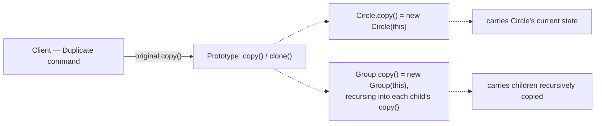
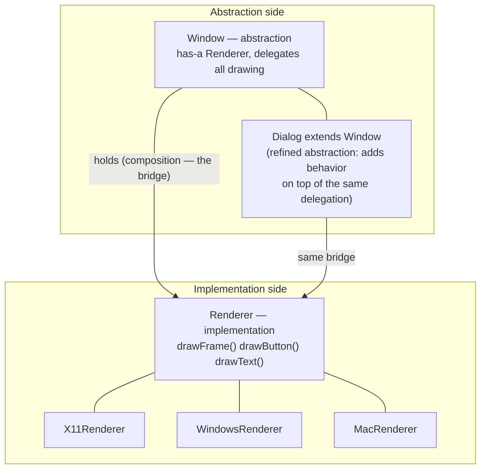
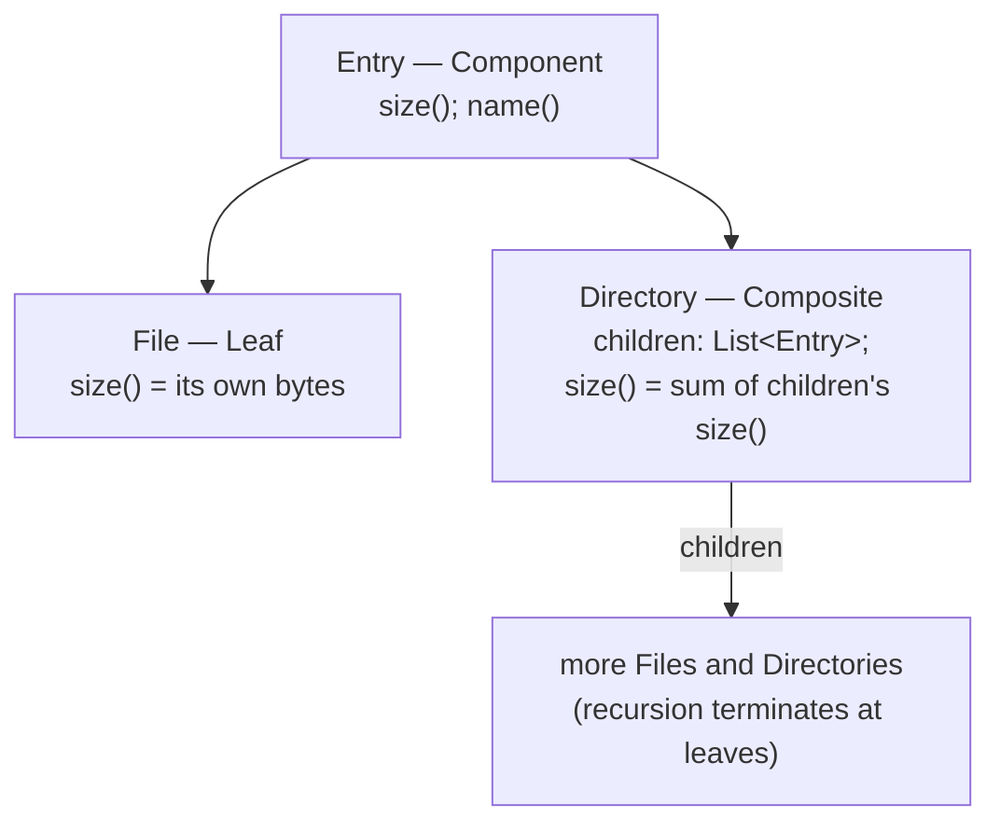
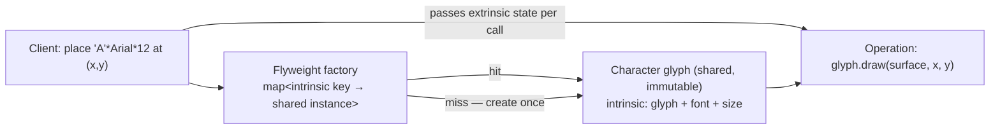
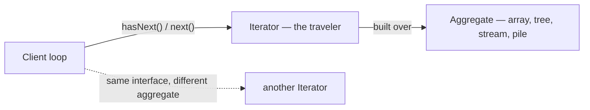
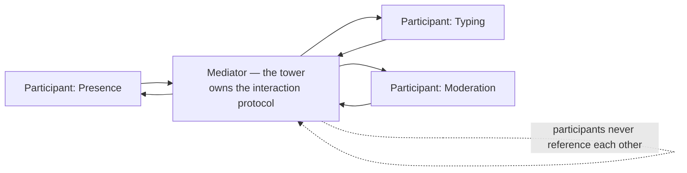
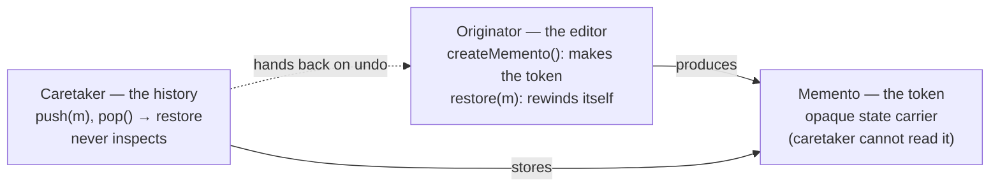
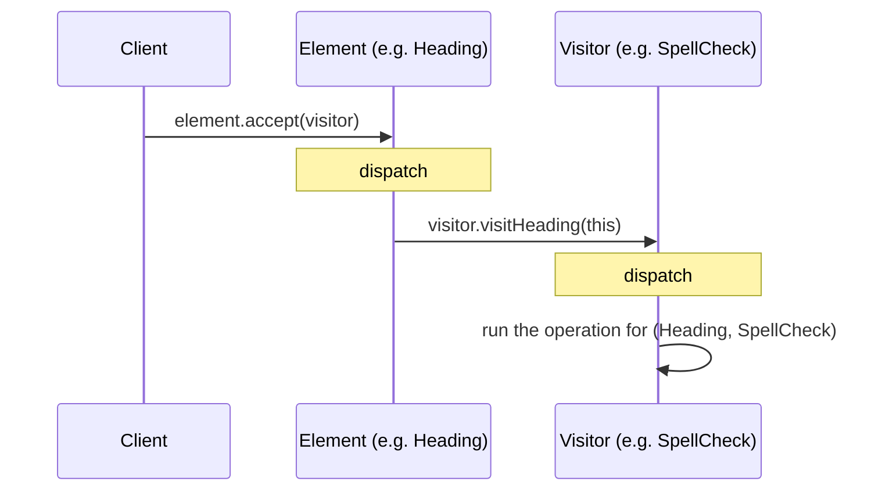
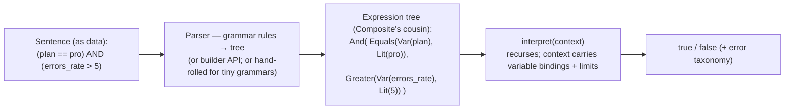

# 08 — The Remaining Nine: Prototype, Bridge, Composite, Flyweight, Iterator, Mediator, Memento, Visitor, Interpreter

> **The shift this file makes.** Files 03–05 taught fourteen patterns as the working vocabulary — the ones that headline designs. This file completes the catalog: the **nine remaining Gang-of-Four patterns**. Their role is different. They rarely *headline* an interview question; they appear as **follow-ups** ("the editor needs undo" → Memento; "users define the rules" → Interpreter; "the UI is a tree" → Composite) and as **everyday infrastructure** you use without naming (Iterator is the STL's spine; Composite is every filesystem; Visitor is every compiler pass). The treatment matches the house style — word by word, verbatim intents, structure, tri-language code, kernel parallels — but the depth is calibrated to the role: **recognition-fast, bills compressed, shadows named** — because the failure mode for these nine is neither ignorance nor overuse, it is *freezing when the follow-up arrives*.
>
> **The file's thesis:** *the remaining nine are the vocabulary of the second question — and three of them (Iterator, Composite, Visitor) are so woven into everyday code that not recognizing them means not recognizing the infrastructure you already build.*

---

## 0. The Complete Set — and How These Nine Behave

### 0.1 The 23, split by coverage

| Category | Patterns | Covered in |
|---|---|---|
| **Creational (5)** | Factory Method, Abstract Factory, Builder, Singleton | File 03 |
| 〃 | **Prototype** | **§1 here** |
| **Structural (7)** | Adapter, Decorator, Facade, Proxy | File 04 |
| 〃 | **Bridge, Composite, Flyweight** | **§2–§4 here** |
| **Behavioral (11)** | Strategy, Observer, Command, State, Chain of Responsibility, Template Method | File 05 |
| 〃 | **Iterator, Mediator, Memento, Visitor, Interpreter** | **§5–§9 here** |

### 0.2 The nine, one honest sentence each

| Pattern | The one honest sentence | Where it lives in practice |
|---|---|---|
| **Prototype** | Clone existing objects instead of constructing new ones — polymorphism for copying. | editors' Duplicate, configured exemplars, `fork()` |
| **Bridge** | Split an abstraction and its implementation into two hierarchies that vary independently. | driver models, cross-platform UI, protocol stacks |
| **Composite** | Treat single objects and compositions of them uniformly — trees with one interface. | filesystems, UI trees, org charts, expression trees |
| **Flyweight** | Share the parts of objects that repeat, so a million objects don't hold a million copies. | string interning, glyph caches, page cache |
| **Iterator** | Walk a sequence without exposing how it is stored. | every `for` loop, the STL, `readdir`, list macros |
| **Mediator** | Centralize many-to-many interactions into one hub that speaks the protocol. | chat rooms, traffic control, kernel buses |
| **Memento** | Capture state so it can be restored later, without breaking encapsulation. | undo, snapshots, checkpoints, hibernate |
| **Visitor** | Add operations over a stable structure without touching the classes in it. | compilers, verifiers, tax/serialization passes |
| **Interpreter** | Represent a small language's grammar as an object structure and evaluate sentences by walking it. | rule engines, query filters, bytecode |

### 0.3 The follow-up map — which question leads to which pattern

This table is the file's most practical artifact. Interviewers do not usually ask "tell me about Memento"; they describe a *situation* and listen for whether the vocabulary arrives. Learn the left column as triggers:

| The follow-up situation (as asked) | The pattern the room expects | The comparison that usually follows |
|---|---|---|
| "The editor needs undo/redo." | **Memento** (snapshots) — or command inverses (file 05 §3) | snapshot vs replay: memory cost vs correctness burden |
| "The UI/document is a tree of containers and leaves." | **Composite** | where `add`/`remove` live (safety vs transparency) |
| "Add a new operation to every node — without editing the node classes." | **Visitor** | the expression problem: adding types vs adding operations |
| "Users write their own conditions/rules." | **Interpreter** (small, closed DSL) | why not a general language (parsing + security + sandboxing) |
| "Iterate the collection without exposing its internals." | **Iterator** | invalidation semantics; internal vs external iteration |
| "Millions of items share most of their state." | **Flyweight** | intrinsic vs extrinsic split; who owns immutability |
| "The same abstraction must work across N platforms/backends, *and both sides will grow*." | **Bridge** | Bridge vs Strategy vs Adapter (the triangle) |
| "N modules all need to talk to each other." | **Mediator** | the god-mediator failure; Observer vs Mediator vs Facade |
| "Duplicate this object — it might be any subtype." | **Prototype** | shallow vs deep; Prototype vs Flyweight ("one duplicates, the other deduplicates") |

### 0.4 How to read each entry

Same anatomy as files 03–05, compressed: **word by word → GoF verbatim → the problem and its pre-pattern → mechanics (diagram + the design decisions that matter) → tri-language → kernel parallel where the pattern is genuinely native → when NOT → the interview line.** Two standing rules carried from file 06 apply throughout: every pattern here gets priced by file 06 §8.2's ledger logic (what it adds, what that costs forever), and every one has a *shadow* (the anti-pattern it becomes when its force dies). Where a pattern is mostly *recognized* rather than *written*, the entry says so — the judgment is knowing which mode you're in.

---

## 1. Prototype — Cloning as a First-Class Operation

### 1.1 Word by word and source

> **Word by word — *prototype*:** from Greek **protos** (*first*) + **typos** (*impression, mold, stamp*) — the *first form struck from which all others are made*: in coinage, the prototype is the die-stamped exemplar from which production copies are struck; in engineering, the first working model. (*Typos* — a *blow/stamp* — is also the root of *type*: a class of things struck from one pattern; the two words have been intertwined ever science.) The pattern's operation is the metaphor exactly: **an existing object serves as the die; new objects are struck from it by copying.**
>
> GoF intent, verbatim: **"Specify the kinds of objects to create using a prototypical instance, and create new objects by copying this prototype."** The load-bearing phrase is *the kinds of objects* — plural: one `clone()` call must produce whatever subtype the original was, which is precisely what a constructor (which names a type) cannot do.

### 1.2 The problem — the duplicator's growing switch

A document editor with shapes (circles, rectangles, groups, imported SVGs) needs a **Duplicate** command. The naive form is the pattern's classic pre-pattern — a *type-switch over construction*:

```java
public Shape duplicate(Shape original) {
    if (original instanceof Circle c)      return new Circle(c.radius(), c.x(), c.y());
    if (original instanceof Rectangle r)   return new Rectangle(r.w(), r.h(), r.x(), r.y());
    if (original instanceof Group g)       return new Group(/* …deep-copy children… */);
    throw new IllegalStateException("unknown shape");   // every new type edits this method
}
```

Two failures compound: **the growing switch** (every new subtype edits the duplicator — the OCP receipt from file 02), and the **deep-copy knowledge leak** (the duplicator must know *how* each type's state is structured to copy it correctly — including nested groups, recursively). The fix is the pattern's whole content: **let each object copy itself** — the object owns the knowledge of its own copying, and the caller stays type-blind: `original.copy()`.

### 1.3 Mechanics — and the decision everyone gets asked about



**Shallow vs deep — the interview's actual question, dwarfing the pattern's name:**

| | Shallow copy | Deep copy |
|---|---|---|
| copies | fields as-is: reference fields point to the **same** children | fields recursively: children copied too |
| effect | duplicates **share** children — the first mutation through either is visible to both | duplicates are fully independent |
| use when | children are **immutable** (safe to share) or sharing is intended | children are mutable and must diverge |

The mature position, which the drill in §1.7 tests: **deep-copy the structure, share the immutable leaves** — a copied `Form` owns its own list of fields, each copied field owns its own list of rules, and the rule *value objects* (immutable) are shared freely. That sharing-at-the-leaves is Flyweight (§4) operating inside a Prototype — the two patterns are complementary, not rivals.

### 1.4 Tri-language

**Java — copy constructor + polymorphic `copy()`** (the modern idiom; `Cloneable`/`Object.clone()` is the legacy one candidates get quizzed away from):

```java
public abstract class Shape {
    protected int x, y;
    protected Shape(Shape source) { this.x = source.x; this.y = source.y; }   // copy ctor: base state
    public abstract Shape copy();                                            // polymorphic clone
}
public final class Circle extends Shape {
    private final int radius;
    private final List<Tag> tags;                    // mutable child — the deep-copy decision point
    public Circle(Circle source) {
        super(source);
        this.radius = source.radius;
        this.tags = new ArrayList<>(source.tags);    // DEEP: duplicates must not share this list
    }
    @Override public Circle copy() { return new Circle(this); }
}
// Usage — type-blind, OCP intact: Shape dup = selected.copy();
```

**C++ — copy constructors are native; `clone()` makes copying polymorphic** (the slicing lesson):

```cpp
class Shape {
public:
    virtual ~Shape() = default;
    virtual std::unique_ptr<Shape> clone() const = 0;   // polymorphic copy through base ptr
protected:
    Shape(const Shape&) = default;
    int x_ = 0, y_ = 0;
};
class Circle final : public Shape {
    int radius_ = 0;
    std::vector<Tag> tags_;                             // mutable child
public:
    Circle(const Circle& o) : Shape(o), radius_(o.radius_), tags_(o.tags_) {}   // deep by construction
    std::unique_ptr<Shape> clone() const override { return std::make_unique<Circle>(*this); }
};
// Why clone() at all, given copy constructors exist? They are NOT virtual: copying through a
// Shape& with `new Shape(original)` compiles only in the slicing sense — you'd get a Shape,
// not a Circle. The virtual clone() is the slicing-safe polymorphic copy.
```

**C — a `clone` entry in the ops table**, with deep/shallow semantics documented per type (C has neither copy constructors nor clone; the pattern becomes explicit):

```c
struct shape_ops {
    struct shape *(*clone)(const struct shape *s);   /* returns a NEW heap object */
    void          (*destroy)(struct shape *s);
};
struct shape { const struct shape_ops *ops; int x, y; };
struct circle { struct shape base; int radius; };    /* base first: the "inherits" slot */

static struct shape *circle_clone(const struct shape *s)
{
    struct circle *copy = malloc(sizeof *copy);
    if (!copy) return NULL;
    *copy = *(const struct circle *)s;               /* shallow struct copy... */
    /* ...plus explicit deep copies of any owned heap fields (e.g. name = strdup(...)).
     * The clone contract MUST document which fields are deep-copied: in C that
     * documentation IS the safety mechanism (no compiler checks it for you). */
    return &copy->base;
}
/* Type-blind duplication: struct shape *dup = original->ops->clone(original); */
```

### 1.5 Kernel parallel

> **[KERNEL & SYSTEMS] `fork()` is Prototype at process scale** — a new process is not *constructed from a specification*; it is **created by copying an existing one**: `copy_process()` clones the parent's `task_struct`, then mutates the copy (new PID, new namespaces, copy-on-write memory). And networking offers the shallow/deep choice as a literal API pair: **`skb_clone()` is the shallow copy** (the new `sk_buff` shares the payload buffer with the original — the data block is reference-counted, immutable-by-convention until someone must write it, at which time copy-on-write kicks in) while **`skb_copy()` is the deep copy** (the entire data duplicated). Choosing wrongly between them is a genuine kernel bug class — the same shallow/deep question from §1.3, decided per call site, in the hottest code path in the world.

### 1.6 When NOT to prototype

| Use it when | Refuse it when |
|---|---|
| copying must be polymorphic (the caller cannot name the concrete type) | the caller knows the type — a copy constructor/`new` at the known type is clearer |
| construction is expensive and an exemplar exists (parsed documents, configured objects, DB-loaded graphs) | construction is cheap — `new` + setters is the design |
| "Duplicate" / "save as template" are genuine product verbs | what you actually want is *sharing one instance* among many callers — that is Flyweight (§4), not Prototype |
| pre-configured exemplars drive creation ("new campaign from this campaign") | a well-designed Factory with parameters reads better |

> **[INTERVIEW]** Two answers to have loaded. **(1) The distinction line:** *"Prototype gives each caller an independent copy; Flyweight gives many callers one shared immutable instance — one duplicates, the other deduplicates."* **(2) The shallow/deep answer** (asked far more than the pattern): *"a shallow copy shares mutable children — the first mutation through either reference is seen by both; the fix is deciding per field: structure deep-copied, immutable leaves shared deliberately."* The third, if pushed: recursive structures (groups of groups) copy by *delegation* — each node's `copy()` recurses into its children's `copy()`; no central duplicator ever needs the full type map.

### 1.7 The drill

*"The form builder has 'Duplicate this form.' Forms contain fields; fields contain validation rules. What does the copy operation look like — and what must be deep?"*
*(Model: `Form.copy()` copies its field list, delegating to each `Field.copy()`; each `Field.copy()` copies its rules list; the **rules themselves are immutable value objects — shared across copies deliberately** (deep-copy the structure, share the leaves: §1.3's mature position, Flyweight inside Prototype). The class of bugs this avoids: a duplicated form whose edits to a field silently mutate the original's field (a shared mutable child); the class it preserves: a million duplicated forms sharing one rule object each — cheap because immutable.)*

---

## 2. Bridge — Two Hierarchies That Vary Independently

### 2.1 Word by word and source

> **Word by word — *bridge*:** Old English **brycg** — a structure *spanning an obstacle*, carrying a path across something that would otherwise block it. The pattern's obstacle is **the explosion of combinations**: when a design has two independent dimensions that both evolve, inheritance couples them and the class count multiplies; the bridge spans the gap between the two hierarchies so each can grow on its own side. (The engineering metaphor is load-bearing, not decorative: a bridge carries both sides without welding them into one mass.)
>
> GoF intent, verbatim: **"Decouple an abstraction from its implementation so that the two can vary independently."** Note both verbs: *decouple* (the mechanism — composition, not inheritance) and **vary independently** (the economic claim — the thing you're buying).

### 2.2 The problem — the multiplicative class count

A cross-platform UI toolkit. Windows must exist on three OSes; later, three more window kinds arrive. The textbook attempt grades types from both axes at once:

```text
Inheritance over both axes (the pre-pattern):
    XWindow, XDialog, XTooltip,           ← kind axis × OS axis = 9 classes for 3×3,
    WindowsWindow, WindowsDialog, ...       and each new OS adds 3, each new kind adds 3
    MacWindow, MacDialog, ...
The count is M × N — the smell: any change touches a rectangle of the type system.
```

The two axes are genuinely independent — *what the window is* (dialog, tooltip, main) and *how it is drawn* (the OS's primitives) — and nothing forces their futures together: new kinds arrive from product; new OSes arrive from the market. **Bridge splits them: an abstraction hierarchy (the kinds) holding a reference to an implementation hierarchy (the renderers); M × N classes become M + N.**

### 2.3 Mechanics



The naming says it exactly: *abstraction* (the vocabulary callers use) and *implementation* (the platform mechanics) are both hierarchies; the bridge is the single composition edge between them. The classes double only when a side genuinely grows one member — never by multiplication.

### 2.4 Tri-language

**Java — kind × renderer:**

```java
public interface Renderer {                              // implementation hierarchy
    void drawFrame(int x, int y, int w, int h);
    void drawText(String text, int x, int y);
}
public final class MacRenderer implements Renderer { /* CoreGraphics calls */ }

public abstract class Window {                           // abstraction hierarchy
    protected final Renderer renderer;                   // the bridge: composition, not inheritance
    protected Window(Renderer renderer) { this.renderer = renderer; }
    public abstract void draw();
}
public final class Dialog extends Window {               // refined abstraction
    private final String message;
    public Dialog(Renderer r, String message) { super(r); this.message = message; }
    @Override public void draw() {
        renderer.drawFrame(10, 10, 320, 120);            // delegation, not overriding mechanics
        renderer.drawText(message, 30, 60);
    }
}
// New kind = one subclass on the left; new OS = one implementation on the right. Never M×N.
```

**C++ — same shape, with the two hierarchies made explicit:**

```cpp
class Renderer {                                    // implementation side (abstract)
public:
    virtual void drawFrame(int x, int y, int w, int h) = 0;
    virtual void drawText(const std::string&, int x, int y) = 0;
    virtual ~Renderer() = default;
};
class Window {                                      // abstraction side
public:
    explicit Window(Renderer& r) : renderer_(r) {}
    virtual void draw() = 0;
    virtual ~Window() = default;
protected:
    Renderer& renderer_;                            // the bridge — a reference, injected
};
class Dialog final : public Window {
public:
    Dialog(Renderer& r, std::string message) : Window(r), message_(std::move(message)) {}
    void draw() override { renderer_.drawFrame(10, 10, 320, 120);
                           renderer_.drawText(message_, 30, 60); }
private:
    std::string message_;
};
```

**C — two ops tables, bridged by a pointer** (the C reading makes the pattern's skeleton maximally visible):

```c
struct renderer_ops {                               /* implementation hierarchy */
    void (*draw_frame)(void *ctx, int x, int y, int w, int h);
    void (*draw_text)(void *ctx, const char *text, int x, int y);
};
struct renderer { const struct renderer_ops *ops; void *ctx; };   /* e.g. X11 ctx, Mac ctx */

struct window {                                     /* abstraction side */
    const struct window_ops *ops;
    struct renderer renderer;                       /* THE BRIDGE: held by composition */
    void *kind_state;                               /* dialog/tooltip-specific data */
};
struct window_ops { void (*draw)(struct window *w); };

/* Dialog's draw (C, explicit): */
static void dialog_draw(struct window *w)
{
    w->renderer.ops->draw_frame(w->renderer.ctx, 10, 10, 320, 120);
    w->renderer.ops->draw_text(w->renderer.ctx, dialog_message(w), 30, 60);
}
/* Two ops tables, one pointer between them: "two hierarchies, varying independently"
 * spelled in the only way C can spell it — and, once seen, unmistakable in every
 * driver model on the planet. */
```

### 2.5 Kernel parallel

> **[KERNEL & SYSTEMS] The driver model is Bridge institutionalized.** Every subsystem that faces hardware shows the same two hierarchies: the **subsystem's abstract operations** (what callers see: read/write/configure; the block layer's `bio`/requests, the audio layer's PCM streams, the network layer's socket operations) and the **hardware implementations** (what each device does — one driver per chip family). The subsystem defines the abstraction; drivers implement the other side; and the two evolve independently *by policy* — new hardware does not touch the subsystem API; new API capabilities (with care and compatibility) do not touch every driver. The block layer is the cleanest specimen: the *request/bio* vocabulary above, the *driver* mechanics below, and a dispatch layer between — an artifact that exists **precisely so the two sides can vary independently**, which is this intent verbatim, enforced across thousands of maintainers.

### 2.6 The triangle — Bridge vs Strategy vs Adapter

The famous follow-up, answered once and forever:

| | What it decouples | Shape | The tell |
|---|---|---|---|
| **Adapter** (04 §1) | an existing interface from a desired one — **retrofitted** | wrapper around one object | you're translating interfaces that already exist; neither side was designed together |
| **Strategy** (05 §1) | one operation's algorithm from its consumer — **behavior swap** | one composition edge to a behavior object | one axis varies; no second type hierarchy exists |
| **Bridge** | **two hierarchies that both grow** — structural, designed up front | two hierarchies + one composition edge | the combinatorics threat: two independent axes would multiply classes without the split |

The one-sentence discriminator: ***"Adapter converts, Strategy swaps, Bridge divides — and Bridge is the only one whose justification is the future class count of both sides."*** (If only one side will ever grow, you don't have a Bridge — you have a Strategy that got a fancy name.)

### 2.7 When NOT to bridge

| Use it when | Refuse it when |
|---|---|
| two axes genuinely both evolve (kinds × platforms, protocols × transports) | one axis is frozen — then it is inheritance (or Strategy), and the "bridge" is ceremony |
| the class-count arithmetic (M×N → M+N) is real and imminent | the matrix is 2×2 and product says it stays 2×2 — four classes are cheaper than the indirection |
| platform/implementation vocabulary should stay hidden from callers | callers must choose implementation *mechanics* per call — then the abstraction is leaking and the model is wrong |

> **[INTERVIEW]** The expected arc: the question describes cross-platform growth, you name **Bridge**, and — unprompted — close with the triangle table above *and* the arithmetic: *"the point is M×N becoming M+N; if only one side grows, I'd reach for Strategy and say so."*

### 2.8 The drill

*"A payments SDK must run over several transports (HTTPS, gRPC, a message queue) and support several operations (charge, refund, subscribe). The transports will grow yearly; operations grow quarterly. Sketch it."*
*(Model: **Bridge** — the operations are the abstraction hierarchy; transports are the implementation hierarchy (`Transport.send(request) -> response`); each operation's mechanics ride one transport object injected at construction. Class count: ops × transports → ops + transports. Refusals to narrate: no Adapter (no pre-existing incompatible interface — both sides are ours and new); no per-pair subclasses (`ChargeOverGrpc`) — that *is* the M×N explosion. The bridge seam also localizes retry/timeout semantics: they belong to the transport side (each transport has different failure modes), which the interview will probe — *"where do retries live?"* — answer: on the implementation side, behind the same interface, with the abstraction promising only semantic outcomes.)*

---

## 3. Composite — Trees With One Interface

### 3.1 Word by word and source

> **Word by word — *composite*:** from Latin **compositus**, the past participle of **componere** — *com-* (*together*) + **ponere** (*to place*) — *placed together, put together*. (The same *ponere* — *to place* — gives *position*, *component*, *compound*, *deposit*; *componere* is the root of *compose*, *composition*, *composite*.) The pattern's noun is exact: **a composite is an object that is itself a placement-together of others** — and the design move is to make the placed-together thing *behave like* the things it places together. (The GoF class for the container node is literally named `Composite`; the leaf, `Leaf`.)
>
> GoF intent, verbatim: **"Compose objects into tree structures to represent part-whole hierarchies. Composite lets clients treat individual objects and compositions of objects uniformly."** Carry both sentences: the first states the *domain* (part-whole trees), the second the *contract* (**uniform treatment** — the whole reason the pattern exists).

### 3.2 The problem — special-casing every tree walk

A file explorer, a document outline, an org chart, a permission tree — any part-whole structure without Composite produces the same client-side disease: **every operation branches on leaf-vs-container, everywhere**:

```java
// The pre-pattern: each new operation re-learns the tree's shape
long totalSize(Object entry) {
    if (entry instanceof File f)        return f.size();
    if (entry instanceof Directory d) {                 // and every OTHER operation repeats
        long sum = 0;                                   // this leaf/branch branching —
        for (Object child : d.children())               // and every NEW node type edits
            sum += totalSize(child);                    // every operation
        return sum;
    }
    throw new IllegalStateException("unknown entry");
}
```

Three costs, familiar by now as receipts: **each operation re-implements the traversal**, **each new node type edits every operation** (the growing switch, again), and **the uniformity the domain actually has is not represented** — "a directory is an entry, and its children are entries" is a *true sentence about the domain* that the type system refuses to say.

### 3.3 Mechanics — and the debate that lives inside it



The operation recurses by *polymorphism*: `directory.size()` **is** the loop — clients never branch. And the pattern's perennial design debate, asked in every interview that contains it: **where do `add`/`remove` live?**

| Placement | Name | Consequence |
|---|---|---|
| on **Composite only** (`Directory.add`) | **safety** (design-time type safety: cannot call `add` on a leaf) | clients that hold `Entry` must downcast/cast to add — transparency lost |
| on **Component** (`Entry.add` throws/no-ops on leaves) | **transparency** (uniform interface everywhere) | illegal operations fail at *runtime*; the interface lies for leaves |

The mature answer is a sentence, then a criterion: *"safety by default; transparency when a framework/framework-like API must treat all nodes identically and the tree is manipulated through the uniform role (and then the failure is documented as a contract, ideally a typed error — not a silent no-op)."*

### 3.4 Tri-language

**Java — filesystem entries:**

```java
public sealed interface FsEntry permits FileEntry, DirectoryEntry {
    String name();
    long size();                                    // the uniform operation
}
public record FileEntry(String name, long bytes) implements FsEntry {
    public long size() { return bytes; }
}
public final class DirectoryEntry implements FsEntry {
    private final String name;
    private final List<FsEntry> children = new ArrayList<>();
    public boolean add(FsEntry child) { return children.add(child); }    // SAFETY placement
    public String name() { return name; }
    public long size() {                                 // the recursion IS the operation
        long total = 0;
        for (FsEntry child : children) total += child.size();
        return total;
    }
}
// Client code: entry.size() — no instanceof, no branching, for the whole tree.
```

**C++ — an expression tree (Composite's classic second habitat):**

```cpp
class Expr {                                            // Component
public:
    virtual double eval() const = 0;
    virtual std::string print() const = 0;
    virtual ~Expr() = default;
};
class Literal final : public Expr {                     // Leaf
    double value_;
public:
    explicit Literal(double v) : value_(v) {}
    double eval() const override { return value_; }
    std::string print() const override { return std::to_string(value_); }
};
class Sum final : public Expr {                         // Composite
    std::vector<std::unique_ptr<Expr>> terms_;
public:
    void add(std::unique_ptr<Expr> e) { terms_.push_back(std::move(e)); }
    double eval() const override {
        double total = 0;
        for (const auto& t : terms_) total += t->eval();  // recursion via polymorphism
        return total;
    }
    std::string print() const override { /* "(" + join(children) + ")" */ return {}; }
};
```

**C — entries with an ops table, children as a VLA/array** (uniformity without classes):

```c
struct entry_ops {
    const char *(*name)(const struct entry *e);
    long        (*size)(const struct entry *e);   /* leaf: its bytes; dir: sums children */
};
struct entry {
    const struct entry_ops *ops;
    /* common base state */
};
struct dir_entry {
    struct entry base;
    struct entry **children;                       /* array of ENTRY pointers — uniformity */
    size_t count;
};

static long dir_size(const struct entry *e)
{
    const struct dir_entry *d = (const struct dir_entry *)e;
    long total = 0;
    for (size_t i = 0; i < d->count; i++)
        total += d->children[i]->ops->size(d->children[i]);   /* the recursion, type-blind */
    return total;
}
/* C's version of "treat leaf and composite uniformly": both are struct entry*;
 * only the ops table differs. The kernel's VFS is this exact shape, below. */
```

### 3.5 Kernel parallel

> **[KERNEL & SYSTEMS] The kernel's most famous data structures are Composites.** A **filesystem tree** is inodes and dentries recursively containing one another, walked by uniform VFS operations — `path_lookup` doesn't special-case "directory vs file" at every name segment; each node's operations recurse. The **device tree** (`of_node` — the hardware description tree) has a uniform `children`/`parent` frame and uniform accessor patterns whether a node represents a bus, a device, or a property. And the **cgroup hierarchy** is the pattern at its most operational: tasks and sub-cgroups are both "members" of a cgroup, and controllers (`memory`, `cpu`) compute their numbers by *recursing the tree uniformly* — a cgroup's memory usage is its own plus its descendants', through one interface, which is exactly `dir_size()` at resource-accounting scale.

### 3.6 When NOT to composite

| Use it when | Refuse it when |
|---|---|
| the domain is genuinely a part-whole tree | the structure is flat (a list of DTOs is not a tree pretending otherwise) |
| operations should apply uniformly through the tree (size, render, validate, execute) | only *some* operations apply to leaves and others to containers — the interface will lie systematically |
| clients benefit from not knowing node kinds | clients must know kinds for correctness (then consider Visitor, §8: stable structure, per-kind operations, without lying interfaces) |

Two standing hazards to mention (they are the interview's second layer): **cycle prevention** (a child added to its own descendant creates an infinite recursion — either forbid structurally, like systems do with hard links, or cycle-check at mutation time) and **recursion depth** (deep trees need iterative walks or bounded depth — the pattern doesn't remove the need to think about it).

> **[INTERVIEW]** The expected content: the uniform-treatment sentence (intent's second clause), the **safety-vs-transparency** table, and one of the hazards — cycle prevention or `size()` performance (a repeated `size()` that re-walks the tree is O(n) per call; caching/aggregation is the follow-up; note the tension with mutability — invalidation of cached aggregates is the real design problem, and naming that tension is the strong answer).

### 3.7 The drill

*"Design a document model: sections contain paragraphs and other sections; operations: render, word count, spell check. Where does `add` live, and what breaks if a user pastes a section into itself?"*
*(Model: Component = `DocNode`; Leaf = `Paragraph`; Composite = `Section` (children list, uniform `render()`/`wordCount()`); `add` on `Section` only (safety — the editing UI holds `Section` references); the paste-into-itself question: either reject at mutation time by walking ancestor links (`O(depth)` check — the cheap, local guard) or accept that document trees allow shared subtrees and make operations visit-aware (the heavier choice); saying **which invariant you're buying** — a strict tree vs a DAG — is the discriminating answer, because it decides every downstream implementation detail.)*

---

## 4. Flyweight — Share What Repeats

### 4.1 Word by word and source

> **Word by word — *flyweight*:** the name comes from **boxing**, where the *flyweight* division is the **lightest weight class** — the smallest, fastest fighters (the word *fly* here carries its old sense *nimble, light — as in "fly" half-back*). The metaphor transferred to software objects: **make the object as light as possible by sharing the heavy parts.** The heavy parts are the **intrinsic state** — identical across many objects and therefore stored *once*; the light parts are the **extrinsic state** — different per use and therefore passed in per operation. (The naming pair *intrinsic/extrinsic* is the pattern's actual test: if you can't split the state, you can't fly.)
>
> GoF intent, verbatim: **"Use sharing to support large numbers of fine-grained objects efficiently."** Read it as an *optimization pattern* — the only one in the catalog whose entire justification is a resource measurement, which is why its first entry in "when not" is always *measure first*.

### 4.2 The problem — a million objects and their duplicates

The GoF's own example, still the clearest: a text document's **characters**. Naively, every character instance carries its glyph, font, size, and rasterized bitmap — 100,000 characters × a 2KB bitmap = 200MB, *for text*. The insight: at any moment the document uses **dozens of distinct character styles**, repeated tens of thousands of times. The intrinsic state is the glyph+font+size combination (shared); the extrinsic state is *where this particular character sits* (different per occurrence, and tiny). The fix: one shared object per distinct intrinsic state, looked up from a pool; per-use position travels separately.

### 4.3 Mechanics



The four requirements worth saying aloud (each is a place implementations die):

1. **Intrinsic state must be immutable** — it is shared; any mutation is a cross-object data race by construction.
2. **The pool must be keyed correctly** — the key is the intrinsic state's value (often a composite key; hashing/equality bugs create silent duplicates, which shows up as memory still exploding).
3. **The pool's lifetime and concurrency are design decisions** — who owns it (a factory with a cache), can entries be evicted, is it thread-safe (concurrent maps or locking — but note lock contention: a hot flyweight pool is a contention point).
4. **Identity implications** — in languages where `==` means identity, sharing changes observable behavior (usually fine, sometimes a bug — the same class of surprise file 04 §4's Proxy documents for a different reason).

### 4.4 Tri-language

**Java — a glyph pool; and the JVM's built-in flyweights** (the strongest teaching moment: you already rely on flyweights):

```java
public final class Glyph {                                 // intrinsic, immutable
    private final char ch; private final String font; private final int size;
    /* value semantics: equals/hashCode on all three */
}
public final class GlyphPool {                             // the flyweight factory
    private final Map<Glyph, Glyph> pool = new ConcurrentHashMap<>();
    public Glyph get(char ch, String font, int size) {
        Glyph key = new Glyph(ch, font, size);
        return pool.computeIfAbsent(key, k -> k);          // one canonical instance per key
    }
}
// Extrinsic state travels separately: final class PlacedGlyph { Glyph glyph; int x, y; }
```

> The built-ins to name in interviews: **`String` interning** (identical literals share one object), **`Integer.valueOf(int)`'s cache** (−128..127 — the reason `Integer a = 127; Integer b = 127; a == b` is `true` and 128 makes it `false` — a flyweight identity implication *in the standard library's contract*), and **primitive-type boxing caches** generally.

**C++ — interning with `shared_ptr<const T>`** (immutability enforced by the type system):

```cpp
class GlyphPool {
    std::unordered_map<GlyphKey, std::shared_ptr<const Glyph>, GlyphKeyHash> pool_;
public:
    std::shared_ptr<const Glyph> get(const GlyphKey& key) {
        auto it = pool_.find(key);
        if (it != pool_.end()) return it->second;
        auto g = std::make_shared<const Glyph>(key);        // const: immutability is a language fact
        pool_.emplace(key, g);
        return g;
    }
};
// Placement stores {shared_ptr<const Glyph>, x, y} — extrinsic position, shared intrinsic glyph.
```

**C — the interning table with refcounts** (the pattern's most naked form; memory earned and returned):

```c
struct glyph_key { char ch; const char *font; int size; };
struct glyph {
    struct glyph_key key;
    unsigned          refs;          /* how many placements share this instance */
    /* rasterized bitmap etc. — the heavy intrinsic payload */
    unsigned char    *bitmap;
    size_t            bitmap_len;
};
static struct glyph *glyph_pool_lookup(struct glyph *pool, size_t *n, struct glyph_key key);

struct glyph *glyph_intern(struct glyph **pool, size_t *n, struct glyph_key key)
{
    struct glyph *g = glyph_pool_lookup(*pool, *n, key);
    if (g) { g->refs++; return g; }                     /* shared: just a refcount bump */
    /* miss: allocate + rasterize ONCE, store, refs = 1 */
    return glyph_pool_insert(pool, n, key);
}
void glyph_release(struct glyph *g) {                   /* refcount to zero → evict (careful:
                                                         * eviction while shared = UAF bug class) */ if (--g->refs == 0) glyph_destroy(g); }
```

### 4.5 Kernel parallel

> **[KERNEL & SYSTEMS] The kernel are flyweights, top to bottom — three exhibits worth different amounts.** **(1) The page cache** is the canonical intrinsic share: one physical copy of a file's page, mapped into every process that reads it; the *extrinsic* state (which process, which virtual address, what offset) lives in per-process page tables — the split is architectural, not stylistic. **(2) Dentries and inodes are interned**: a file opened by a thousand processes is *one* `struct inode` in memory, shared and refcounted — open the same path twice and you are handed the same in-memory object (with a refcount bump), exactly `glyph_intern`'s shape. **(3) KSM (Kernel Same-page Merging)** is Flyweight mechanized: it scans memory for *identical pages of content*, deduplicates them into one physical page shared copy-on-write — the kernel performing the intrinsic/extrinsic split at page granularity, for whatever workloads present the repetition. The forward-looking sentence: *"when the sharing key is content itself, deduplication can be built as infrastructure — that is KSM; most application flyweights, by contrast, should be designed, not detected."*

### 4.6 When NOT to flyweight

| Use it when | Refuse it when |
|---|---|
| object counts are genuinely large (10^5+) and a measurement shows the duplication | counts are modest — the pool + key + lookup machinery costs more than it saves (measure first: this is an optimization pattern) |
| repetition is high and the shared state is genuinely immutable | state is mostly mutable or unique per instance — there is nothing to share |
| identity semantics of sharing are acceptable (or the language hides identity) | callers rely on reference identity/equality distinctness — sharing changes observable behavior |

> **[INTERVIEW]** Three loaded answers: **(1) the split** — *"separate intrinsic (shared, immutable) from extrinsic (per-use, passed in); if the split doesn't exist, the pattern doesn't apply."* **(2) The built-ins** — string interning, the `Integer` cache; the flyweight pattern is *in the JDK's contract*, often asked sideways ("why is `Integer a == Integer b` true for 127?"). **(3) The contrast with Prototype** (the v1 line, worth keeping): *"one duplicates, the other deduplicates"* — and in the same breath, the drill's synthesis: **deep-copy the structure, share the immutable leaves** — Prototype *uses* Flyweight for its leaves.

### 4.7 The drill

*"An RPG world has 50,000 trees rendered on a map from 12 tree kinds. Memory is exploding. Where do you cut?"*
*(Model: intrinsic = the twelve kinds' meshes/textures (heavy, identical per kind — share: one resource per kind, ideally uploaded once to the GPU); extrinsic = each tree's position/rotation/scale/health (light, unique, per-instance *data* — potentially a struct-of-arrays, the data-oriented sibling of the pattern). The measurement discipline stated aloud: *"50,000 trees × per-instance state that is two dozen bytes is fine — the explosion is the textures being loaded per instance; fix that first, then measure again."* The bonus observation: this is Flyweight at the *asset* level and Composite at the *scene* level — real systems stack the catalog's patterns; naming where each applies is the skill.)*

---

## 5. Iterator — Walking Without Knowing

### 5.1 Word by word and source

> **Word by word — *iterator*:** from Latin **iter** (*a journey, a way*) — the root of **iterare**, *to travel repeatedly, to do again* — hence *iterate* (to repeat a process, to go through a sequence) and *iterator* (one who makes the journey). The software noun is exact: **an iterator is the traveler that walks a collection** — and the design question is what the walker may assume and what the walked thing reveals. (The same *iter-* breathes in *itinerary* and *itinerant*; a collection's iterator is its itinerary's guide.)
>
> GoF intent, verbatim: **"Provide a way to access the elements of an aggregate object sequentially without exposing its underlying representation."** Both halves matter: **access sequentially** (traversal as a first-class operation) and **without exposing the representation** (array today, tree tomorrow, computed lazily in between — the walker's interface survives them all).

### 5.2 The problem — traversal code, multiplied by structure

Without Iterator, every client that walks a structure must know the structure: index loops for arrays, recursive calls for trees, buffer-draining for streams — and **every new representation multiplies every client's traversal code**. The degradation is subtler than it looks: traversal *policy* (skip filtered items, chunk, reverse, merge) gets copy-pasted into callers, and *concurrency* discipline (what happens if the collection mutates mid-walk) gets re-invented per loop. Iterator's fix: **one traversal interface per structure family**, so clients (and — the commercial Jackpot — *algorithms*) operate on the walker, not the walked.

### 5.3 Mechanics — and the two dichotomies that carry the questions



**Dichotomy 1 — external vs internal iteration** (this is the interview's real content):

| | External (pull) | Internal (push/inversion) |
|---|---|---|
| control | the **caller** drives: `while (it.hasNext()) it.next()` | the **aggregate/stream** drives: `forEach(cb)`, `stream().filter(...).map(...)`, `for (x : coll)` desugared |
| examples | STL iterators, Java `Iterator`, `readdir` | Java streams/`forEach`, C++ ranges pipelines, callbacks |
| wins | caller can interleave, break, branch mid-walk; full control of rhythm | compact pipelines; the structure can parallelize/lazy-compose; fewer borrow/iterator invalidation footguns in safe languages |
| costs | caller manages state and *invalidation* | less control mid-stream; debugging through callbacks/pipelines |

**Dichotomy 2 — invalidation semantics** (what happens if the walked collection mutates mid-walk): *fail-fast* (throw: Java's `ConcurrentModificationException` via `modCount`, C++'s undefined behavior made detectable in debug iterators) vs **fail-safe/snapshot** (iterate a copy: `CopyOnWriteArrayList`, C# snapshot enumerators — safe but memory-stale) vs **defined concurrent semantics** (e.g., a ring buffer's doc'd behavior). No correct universal choice — the choice is a contract, and the interview grades whether you *name* it.

### 5.4 Tri-language

**Java — the interface everyone has used; the invalidation contract is the lesson:**

```java
public final class RingBuffer<T> implements Iterable<T> {
    private final T[] items; private int version;
    public Iterator<T> iterator() {
        int expected = version;                       // snapshot the version at creation
        return new Iterator<>() {
            private int i = 0;
            public boolean hasNext() { return i < items.length; }
            public T next() {
                if (version != expected)              // FAIL-FAST: mutation detected at next()
                    throw new ConcurrentModificationException();
                return items[i++];
            }
        };
    }
}
// Every mutation path does: version++;
```

**C++ — the STL's iterators are the pattern's greatest commercial success:**

```cpp
// Why the STL's algorithms take ITERATORS, not containers:
//    std::sort(prices.begin(), prices.end());
// decouples ALGORITHMS from CONTAINERS — sort works on vectors, deques, raw arrays,
// and (with other iterators) streams-to-be; neither side knows the other's representation.
// The range-for loop is the language burning the external pattern into its syntax:
for (const auto& price : prices) { /* the compiler writes begin()/end() + ++ and * */ }
// The cost of the decoupling lives in the iterators' contract: categories (input → forward →
// bidirectional → random access), and the invalidation rules per container — push_back may
// invalidate vector iterators (reallocation), which is exactly §5.3's dichotomy 2 as a letter
// of the standard.
```

**C — macro iterators and callback iterators; the kernel uses both:**

```c
/* (1) The MACRO iterator — intrusive lists (list.h): the pattern as a macro-expanded loop. */
#define list_for_each_entry(pos, head, member)                              \
    for (pos = list_first_entry(head, typeof(*pos), member);                \
         &pos->member != (head);                                            \
         pos = list_next_entry(pos, member))

/* (2) The CALLBACK iterator — the "internal iteration" style, used by readdir: */
typedef int (*filldir_t)(void *ctx, const char *name, int len, loff_t off);
int iterate_dir(struct file *f, struct dir_context *ctx);   /* calls ctx->actor(...) per entry —
                                                             * the walker drives; the actor receives. */
/* Both are "access sequentially without exposing representation": the macro keeps zero overhead;
 * the callback keeps the in-kernel buffer private. C picks the form per heat and per ABI. */
```

### 5.5 Kernel parallel

> **[KERNEL & SYSTEMS] The kernel may use more iterators per line than any codebase alive.** `list_for_each_entry` / `hlist_for_each` macro iterators walk the intrusive lists that hold together half the kernel's data structures; `seq_file` provides the safe text-file iteration protocol for `/proc` (position-safe, resumable — batch iteration designed around a *file* as the aggregate); `readdir`'s `filldir` callback is the internal-iteration dichotomy industrialized, and the network stack's `for_each_netdev` family iterates per-namespace device tables with RCU-aware variants — iterators whose invalidation semantics (§5.3, dichotomy 2) are *entirely* explicit: RCU-safe iteration takes a reference or runs under `rcu_read_lock()`, and every kernel developer learns those rules the way application developers learn `ConcurrentModificationException` — by getting them wrong once.

### 5.6 When NOT to iterate (custom)

| Use it when | Refuse it when |
|---|---|
| multiple structures share traversal code, or clients/algorithms should be structure-blind | one internal caller iterating an array it owns — index loops are honest |
| traversal policy (laziness, filtering, paging) benefits from being a first-class object | you'd reimplement a plain for-each with ceremony (custom `Iterator` over a `List` in Java *is* ceremony — `Iterable` already exists) |
| external libraries/frameworks consume sequences through a standard interface | no consumer ever differs — the abstraction has no second user |

> **[INTERVIEW]** The three expected layers: **one line of pattern** (*"sequential access without exposing representation"*), **one dichotomy named** (*external vs internal iteration — and I can say which my design is and why*), and **the invalidation contract** (*"my iterator is fail-fast: mutations bump a version; the call site gets a `ConcurrentModificationException` rather than a heisenbug"* — or snapshot, or defined-concurrent, but *chosen*). The classic traps: `remove()` during iteration (Java: `it.remove()` exists; C++: the erase-return idiom); the C++ `vector` invalidation-on-rehash lesson; and the STL-decision lesson — **algorithms take iterators so containers and algorithms vary independently** — which, note, is the Bridge pattern's economic argument (§2) appearing inside the standard library.

### 5.7 The drill

*"The orders service streams exports: 10 million rows from a database, filtered, transformed, written to S3. Design the traversal."*
*(Model: internal iteration with lazy pipelines — a cursor/iterator over the DB result set (server-side cursor, batched fetches — the aggregate is the DB, the representation must not be materialized), rows flowing as a lazy sequence through filter/transform stages (external iteration *inside* the pipeline, internal at the edges), written in chunks. The two contracts to state aloud: **bounded memory** (the pipeline must never accumulate — backpressure/rejection on slow sinks; the batch boundary as the unit of memory) and **cursor invalidation** (what happens if the table changes mid-export — snapshot isolation or documented at-least-once-with-dedup on the consumer side: §6's import drill threads, reused). Naming the pattern is the ten-second part; naming the two contracts is the hire.)*

---

## 6. Mediator — The Hub That Speaks the Protocol

### 6.1 Word by word and source

> **Word by word — *mediator*:** from Latin **mediator** — *one who is in the middle* (from **medius**, *middle* — the root of *medium*, *mediate*, *intermediate*, *median*). A mediator is a **go-between**: the party positioned between others so that they need not face each other directly. (In law and diplomacy, the mediator's skill is exactly the design's: knowing the *protocol* both sides accept — which is why the pattern's substance is the interaction rules, not the hub object.) The verb *to mediate* is older than software: to intervene between parties for a purpose; the code pattern is that, with method calls.
>
> GoF intent, verbatim: **"Define an object that encapsulates how a set of objects interact. Mediator promotes loose coupling by keeping objects from referring to each other explicitly, and it lets you vary their interaction independently."** The third clause is the economic claim and the most-quoted: **vary the interaction independently** of the participants — the protocol becomes its own artifact.

### 6.2 The problem — the N-squared web

Five chat-service components (presence, typing, history, notifications, moderation) all needing to react to each other's events: each component holds references to the others it talks to; the reference graph is a web; adding a sixth component means editing five class constructors and reasoning about cycles (file 06 §4.1's costs, arriving on schedule). The GoF's example — **air traffic control** — states the alternative perfectly: planes do not negotiate landing order with each other; they speak to the *tower*, and the tower owns the protocol. N×N interactions become N×1: everyone references the mediator; the mediator owns the rules.

### 6.3 Mechanics



Each participant holds a mediator reference and reports events; the mediator decides who hears what, in which order, with what transformations — **the protocol is one readable place**. The known failure is the pattern's shadow, and it must be said in the same breath as the pattern (interviewers wait for it): **the god mediator** — as rules accrete, the hub grows into the class file 06 §2.1 documented, because "the protocol" never stops expanding. The structural reply: the mediator is *decomposed along its own change drivers* like any other class (per-conversation mediators, per-domain protocols), and the language matters — a mediator whose rules are really a *state machine of interactions* should host one (file 05 §4), not a switch.

### 6.4 Tri-language

**Java — air traffic control (the GoF's canonical form):**

```java
public interface Mediator { void notify(Object sender, String event, Object payload); }

public final class ControlTower implements Mediator {          // the hub
    private final Map<String, Aircraft> airborne = new HashMap<>();
    private final Queue<String> landingQueue = new ArrayDeque<>();

    public synchronized void notify(Object sender, String event, Object payload) {
        Aircraft a = (Aircraft) sender;
        switch (event) {
            case "enter-airspace" -> { airborne.put(a.callsign(), a); a.assignedFlightLevel(FL250); }
            case "request-landing" -> {
                if (landingQueue.isEmpty() && runwayFree) { runwayFree = false; a.clearedToLand(); }
                else { landingQueue.add(a.callsign()); a.holdPattern(); }
            }
            case "runway-vacated" -> {
                String next = landingQueue.poll();
                if (next != null) airborne.get(next).clearedToLand(); else runwayFree = true;
            }
            default -> throw new IllegalArgumentException("unknown event: " + event);
        }
    }
}
public final class Aircraft {                                   // participant: knows ONLY the tower
    private final Mediator tower;                                // never another Aircraft
    public Aircraft(Mediator tower, String callsign) { this.tower = tower; }
    public void requestLanding() { tower.notify(this, "request-landing", null); }
    public void clearedToLand()  { /* approach */ }
}
```

**C++ — an event hub spelling the same shape:**

```cpp
class Mediator {
public:
    virtual ~Mediator() = default;
    virtual void notify(Participant& sender, Event e, const Payload& p) = 0;
};
class ChatRoom final : public Mediator {                        // hub = one conversation
    std::vector<std::reference_wrapper<Participant>> members_;
public:
    void join(Participant& p) { members_.emplace_back(p); }
    void notify(Participant& sender, Event e, const Payload& p) override {
        for (auto& m : members_)                                // protocol: broadcast to others,
            if (&m.get() != &sender) m.get().receive(e, p);     // per-event routing rules live HERE
    }
};
```

**C — the kernel's own bus model, userland-sized** (devices and drivers never call each other; the bus mediates):

```c
struct bus_ops {
    int (*match)(const struct device *dev, const struct driver *drv);
    int (*probe)(struct device *dev);
};
struct bus {                                   /* the MEDIATOR */
    const char *name;
    const struct bus_ops *ops;
    struct list_head devices;                  /* registered participants… */
    struct list_head drivers;                  /* …on both sides */
};
/* Registration is the participants' entire vocabulary: */
int bus_register_device(struct bus *b, struct device *dev);
int bus_register_driver(struct bus *b, struct driver *drv);
/* Matching, probing, binding — the whole interaction PROTOCOL — lives in the bus, not in the
 * participants. A device struct has no pointer to a driver and vice versa: the N×N web does
 * not exist; every arrow passes through the hub. (This is not "like" the kernel's driver model:
 * it IS the kernel's driver model — bus_for_each_drv() etc. — reduced to its skeleton.) */
```

### 6.5 Kernel parallel

> **[KERNEL & SYSTEMS] The device/driver/bus model is Mediator as kernel policy.** A `device_register()` call does not search for drivers; a driver registration does not scan for devices — both publish themselves to the **bus** (PCI, USB, platform, I2C…), and the bus core runs the matching protocol, then mediates `probe`/`remove`/power-management interactions for the lifetime of the binding. Devices never hold driver pointers; drivers never hold device pointers *by discovery*; every interaction is routed, logged, and — critically — *the protocol can evolve* (async probing, `-EPROBE_DEFER`, suspend/resume ordering) **without touching every participant** — which is GoF's second clause ("vary the interaction independently") operating at fleet scale. The second exhibit, one layer up: **netlink** mediates kernel↔userland subsystems (routing daemons, udev) through routed message protocols rather than direct couplings — the tower, again, with message framing.

### 6.6 The triangle — Mediator vs Facade vs Observer

| | Traffic | Direction | Substance |
|---|---|---|---|
| **Facade** (04 §3) | one-way: callers → subsystem | simplification | *what callers may do* — a calm API over many parts; the parts never call back through it |
| **Observer** (05 §2) | one→many: subject → listeners | notification | *who hears an event* — the event's payload is the message; no protocol across listeners |
| **Mediator** | many↔many: participants ⇄ hub ⇄ participants | coordination | *the interaction rules themselves* — routing, ordering, state of the conversation; participants act on what the hub tells them |

The discriminator sentence: ***"Facade exposes, Observer broadcasts, Mediator negotiates"*** — and the operational test: **does the hub hold state about the interactions (queues, assignments, conversation state)?** A stateless router is an Observer's registry (or a Strategy); a hub that decides *who may do what next* is a Mediator (or, one upgrade later, a State machine of the protocol).

### 6.7 When NOT to mediate

| Use it when | Refuse it when |
|---|---|
| many participants genuinely interact many-to-many, with rules | the graph is already a star (one coordinator calling N services is a *service*, not a mediator — no pattern needed) |
| the interaction protocol is an evolving artifact (chat rooms, auctions, traffic, workflow coordination) | the "mediator" would just forward calls 1:1 — that's a Facade or a simple router |
| participants benefit from not knowing each other (replaceability, testability, security boundaries) | the protocol is trivial and static — indirection with no independent variation to buy (§2.7's arithmetic, again) |

> **[INTERVIEW]** Expected: the tower example compressed to its economics (N×N → N×1, protocol as artifact), the **god-mediator shadow** with its repair (decompose along change drivers; host the protocol in a state machine when it is one), and the **triangle** above — the question is almost always phrased "how is this different from Facade/Observer?", so the one-sentence discriminator (*exposes / broadcasts / negotiates*) is the answer to rehearse. The bonus: *"I'd reach for Mediator when the interaction has *state* — assignments, queues, turn-taking; without state, my 'mediator' is an event bus, and I'd name it that."* (The hub-as-bus vs hub-as-protocol-owner distinction is where mid-level answers thin out.)

### 6.8 The drill

*"Design a multi-step job coordination service: tasks (extract, transform, load) run on workers; each may fail, retry, or need another task's output; schedules vary per job. Coordinate the components."*
*(Model: the coordinator is a **Mediator for the task graph** — it owns the protocol (what may run when, retry policy per task, which outputs feed which inputs) and the task-state bookkeeping; workers are participants that know only the coordinator. The classification honesty the drill tests: this is Mediator *plus* State (each task's lifecycle) *plus* Command (the durable task envelope) — and the mediator's own shadow is the thing to pre-empt: split coordination into (a) graph semantics (one place, tested as data: dependencies as edges) and (b) runtime dispatch (the hub) — or the hub becomes the god class within two quarters. The interview's push: *"why not have tasks call each other directly?"* — *"then the N×N web is the job graph, retry/ordering policy smears across participants, and cycles in a task graph become deadlocks instead of validation errors; the hub makes invalid graphs unrepresentable — §3.6's cycle discipline, in workflow form."*)*

---

## 7. Memento — Remember This

### 7.1 Word by word and source

> **Word by word — *memento*:** Latin **memento** — *remember!* — the imperative of **meminisse** (*to remember*), the reduplicated present of the root *men-* (*to think*: the same root as *memory*, *mental*, *mention*, *commentary*). A *memento* passed between people is a token that says *remember this* — a keepsake kept precisely to recall a moment. The pattern is the word, literalized: **a token that carries a moment of an object's state, kept so the moment can be returned to.**
>
> GoF intent, verbatim: **"Without violating encapsulation, capture and externalize an object's internal state so that the object can be restored to this state later."** The opening clause is the design's whole difficulty — the naive "undo" stores the object's fields from outside, which means *everyone outside knows the fields*; Memento insists the state-token be produceable and consumable **only through the object's own consent**.

### 7.2 The problem — undo, and the encapsulation trap

The editor needs undo. Two naive paths, each with a named failure: **(a) external snapshot** — the history subsystem reads `editor.getText()`, `getCursor()`, … and stores them; the history now *knows the editor's internals*, and every new editor field edits the history code (the growing switch's cousin) *and* the encapsulation is fiction (§2.3's intimacy, file 06). **(b) snapshot-the-references** — copying the editor's state shakily (shared mutable children) — the shallow-copy trap of §1.3 arriving in snapshot clothing: the "saved" state mutates along with the live one, and undo restores a future. The pattern's answer: **the object that owns the state produces the snapshot token itself** (and can restore itself from it); the history subsystem handles tokens it cannot read — holding capacity, never contents.

### 7.3 Mechanics — the three roles and the encapsulation trick



The pattern's craft is that third caption — *the caretaker cannot read it* — implemented per language: in **C++**, the classic idiom is `friend class Editor` on the memento (only the originator accesses fields; everyone else sees an opaque type) or a `pimpl`-style opaque struct; in **Java**, a nested class / package-private access / a sealed `record` handed out as an interface; in **C**, the *natural* form — an opaque struct behind a `void *` or a pointer to a forward-declared type, with the originator's functions the only readers. Every language has exactly one idiomatic way to say "a token only its producer can read"; naming it per language is the follow-up.

### 7.4 The comparison that matters — snapshot vs replay

Memento is one of the two answers to undo (file 05 §3's Command was the other); the interview's real content is the choice:

| | **Memento (snapshot)** | **Command log (replay)** |
|---|---|---|
| what's stored | the *state* after each step | the *operations* between steps |
| restore cost | O(1) — assign the snapshot back | O(history) — re-run commands from a baseline |
| memory per step | O(state size) — potentially large | O(command size) — usually small |
| correctness burden | low: restore is mechanical | high: replay must be **deterministic** and side-effect-free (the classic bug: replaying a command that *sent an email*) |
| works when | state is self-contained (text, model, config) | commands have inverses or the domain is event-sourced (file 05 §3.6's honest limits: compensation ≠ rollback) |
| system-scale form | VM snapshots, DB backups, hibernate images | event sourcing, WAL, Kafka-replay reprocessing |

The mature sentence: ***"snapshot when state is cheap to copy and steps are expensive or side-effectful to replay; replay when commands are small, pure, and the history has value beyond undo — because then you get audit and time-travel for free."*** (The second clause is why *event sourcing* exists; the first is why editors, IDEs, and databases checkpoint.)

### 7.5 Tri-language

**Java — an editor with a bounded undo stack:**

```java
public final class Editor {
    private StringBuilder text = new StringBuilder();
    private int cursor = 0;

    public record Snapshot(String text, int cursor) {}          // the memento: opaque record

    public Snapshot save() { return new Snapshot(text.toString(), cursor); }   // only Editor makes one
    public void restore(Snapshot s) { text = new StringBuilder(s.text()); cursor = s.cursor(); }
    // mutations below…
}
public final class History {                                    // caretaker: capacity, never contents
    private final Deque<Editor.Snapshot> undo = new ArrayDeque<>();
    private static final int LIMIT = 100;                       // BOUNDED — the memory decision
    public void push(Editor.Snapshot s) { if (undo.size() == LIMIT) undo.removeLast(); undo.push(s); }
    public void undo(Editor editor) { editor.restore(undo.pop()); }
}
```

**C++ — `friend` as the encapsulation instrument:**

```cpp
class Editor {
public:
    class Memento {                                             // opaque to everyone but Editor
        friend class Editor;                                    // the idiomatic C++ consent
        std::string text_; int cursor_;
        Memento(std::string t, int c) : text_(std::move(t)), cursor_(c) {}
    };
    Memento save() const { return Memento(text_, cursor_); }
    void restore(const Memento& m) { text_ = m.text_; cursor_ = m.cursor_; }
private:
    std::string text_; int cursor_ = 0;
};
// History stores Editor::Memento by value in a deque; it can copy, move, and destroy them —
// and cannot read a field. "Friendship as encapsulation" is the phrase to have ready.
```

**C — the opaque struct (the pattern's natural C shape):**

```c
struct editor_memento;                       /* forward declaration: opaque BY CONSTRUCTION */
struct editor *editor_create(void);
struct editor_memento *editor_save(const struct editor *e);        /* allocates + deep-copies state */
void editor_restore(struct editor *e, const struct editor_memento *m);
void memento_destroy(struct editor_memento *m);

/* The caretaker (history) holds an array of pointers it cannot dereference into:
 * struct editor_memento *undo_stack[LIMIT]; — C's header discipline IS the narrow interface;
 * only editor.c ever sees the struct's definition. */
```

### 7.6 Kernel parallel

> **[KERNEL & SYSTEMS] Hibernation is Memento at system scale — and its classic failure is the pattern's classic failure, verbatim.** Suspend-to-disk captures the kernel's and processes' state into an image (the *memento*) and restores from it at boot; the machinery underneath (the freezer, device quiescing, the snapshot device) exists because **not every piece of state is capturable by copying** — open devices, hardware registers, in-flight DMA — which is precisely §7.4's warning about state that isn't self-contained. CRIU (Checkpoint/Restore In Userspace) makes the same trade for processes and documents the residue honestly: sockets and file descriptors get *reconstructed* (reopened, re-bound), not restored — a designed admission that the snapshot is of *logical* state, with external resources re-created around it. The kernel's second exhibit is the daily one: **filesystem journals and database WALs are Command logs** (replay, per §7.4's right column) *while* VM snapshots and crash dumps are Mementos — both undo paths, chosen by exactly the criteria in the table.

### 7.7 When NOT to memento

| Use it when | Refuse it when |
|---|---|
| undo/rollback/checkpoints are genuine features | the state includes external resources (connections, file handles, hardware) — copying captures a lie (§7.6's lesson) |
| state is self-contained and snapshot size is manageable | snapshots would be huge and frequent — bound the stack, snapshot sparsely, or move to replay |
| steps are expensive/side-effectful to replay (replay would repeat the side effects) | commands are pure and small — event sourcing/replay gives audit and time-travel for the same storage |

> **[INTERVIEW]** The four-line answer: the **three roles** (originator produces/restores, memento carries opaque state, caretaker stores without reading), the **per-language consent mechanism** (*"C++: friendship; Java: nesting/package-private; C: the opaque forward declaration"*), the **snapshot-vs-replay table** with its criterion, and the **memory bound** (*"a bounded stack — undo is a product feature with a product budget; unbounded snapshots are a leak"*). The classic deepen: *"what about undo across a network call?"* — *"then the state isn't self-contained: I'd model the call as a Command with an inverse/compensation (file 05 §3), because a snapshot can't re-open the world."*

### 7.8 The drill

*"The IDE needs undo for multi-file refactors (rename symbol touches 12 files) and individual file edits."*
*(Model: file-level edits = Memento-friendly (per-file snapshot stack, bounded); the refactor = a **transaction** across files whose undo is either (a) one composite command holding per-file inverse edits (replay-shaped, small storage — the right default when the inverse is deterministic string replacement) or (b) a pre-refactor snapshot of all touched files (Memento-shaped, robust — right when inverses are error-prone). The discriminating sentence: *"I'd take per-file snapshots for the refactor *because the inverse of a 12-file rename is exactly where replay's determinism assumptions get expensive to verify* — memory is the cheaper currency here."* The follow-up — persistence — separates further: snapshots saved to disk (crash-safe undo, size-bounded per file, content-addressed to dedupe identical versions — Flyweight rides in, §4) vs commands logged — and the answer should *choose*, per §7.4's table, out loud.)*

---

## 8. Visitor — Operations That Go to Every Node

### 8.1 Word by word and source

> **Word by word — *visitor*:** from Latin **visitare** — *to go to see*, a frequentative (repeated-action form) of **videre** (*to see*) — so *visit* means *to see repeatedly, to make a call upon*; a **visitor** is one who calls upon others. (The frequentative is the design: the visitor does not see the structure once — it **calls upon every node, one by one**; the pattern is a formalized round of visits.) The choice of name encodes the operation's shape: a distinguished external party, moving through a household of nodes.
>
> GoF intent, verbatim: **"Represent an operation to be performed on the elements of an object structure. Visitor lets you define a new operation without changing the classes of the elements on which it operates."** The second sentence is the trade — and the trade has a name, which the interviewer is often fishing for: **the expression problem**.

### 8.2 The expression problem — the trade in two columns

The classic formulation (named for a discussion of extensible programming): data types (elements) and operations (functions over them) form a 2×2 of change costs, and *the two axes cannot both be cheap* with ordinary mechanisms:

| | **Adding a new operation** | **Adding a new element type** |
|---|---|---|
| **Plain OO (methods in classes)** | edit **every** element class (method added everywhere) | add **one** class — cheap, natural |
| **Visitor** | add **one** visitor class — cheap, natural | edit **every** visitor (a `visit` method for the new type) *and* the element gains `accept` |

Visitor flips the cost: **operations become the easy axis, types the expensive one.** So the honest signal is two-sided: *"operations grow, types are stable"* → Visitor; **"types grow, operations stable" → plain methods.** (And the marks of a strong answer: naming *why* — "the visitor interface has one method per element type, so a new type breaks every visitor at compile time — the alarm is part of the design; if the type axis is alive, the alarm is a tax instead.")

### 8.3 Mechanics — double dispatch, in one breath

The mechanism's name — **double dispatch** — is the interview's usual probe, and the one-breath answer is: *"the operation depends on **two** types, the element's and the visitor's, and neither language dispatch does that alone: the element's `accept(visitor)` dispatches on the element (polymorphism one), then it calls `visitor.visitThisElement(this)`, dispatching on the visitor (polymorphism two) — the pair selects the method."*



### 8.4 Tri-language

**Java — a document model with render and spell-check visitors:**

```java
public sealed interface DocElement permits Heading, Paragraph, Image {
    <R> R accept(Visitor<R> visitor);                    // generic so visitors return values
}
public record Heading(int level, String text) implements DocElement {
    public <R> R accept(Visitor<R> v) { return v.visit(this); }
}
public interface Visitor<R> {                            // one method PER ELEMENT TYPE — the trade
    R visit(Heading h);
    R visit(Paragraph p);
    R visit(Image i);
}
public final class HtmlRender implements Visitor<String> {
    public String visit(Heading h)   { return "<h" + h.level() + ">" + h.text() + "</h" + h.level() + ">"; }
    public String visit(Paragraph p) { return "<p>" + p.text() + "</p>"; }
    public String visit(Image i)     { return ""; }
}
// New operation (PlainText, SpellCheck, WordCount) = one new Visitor class, ZERO element edits —
// and a new element type = every Visitor edited (the alarm, §8.2).
```

**C++ — the modern form is `std::visit` over `std::variant` (pattern-matching's arrival):**

```cpp
using DocElement = std::variant<Heading, Paragraph, Image>;     // closed set of types — explicit

struct HtmlRender {                                             // a visitor: overload set
    std::string operator()(const Heading& h) const   { return /* <hN>… */ ""; }
    std::string operator()(const Paragraph& p) const { return /* <p>… */ ""; }
    std::string operator()(const Image& i) const     { return /*  */ ""; }
};
std::string render(const DocElement& e) { return std::visit(HtmlRender{}, e); }
// std::variant + std::visit: the type set is CLOSED (the variant lists it once) and the
// compiler enforces exhaustive handling of every alternative — the classic accept()/visit()
// double-dispatch, resolved by the language's own dispatch. The trade is unchanged; the
// ceremony is: the hierarchy's openness is now syntactically visible.
```

**C — the AST walker, honestly switch-based** (C has no overloading; the *visitor* is the pattern's shape, and the ternary dispatch is a switch — say that plainly rather than perform double dispatch in C for its own sake):

```c
enum node_kind { N_LITERAL, N_SUM, N_PRODUCT };
struct node {
    enum node_kind kind;
    union { double literal; struct { struct node *l, *r; } binary; };
};
/* An "operation as a visitor": one function per operation, switching on kind.
 * The accept/visit ceremony would add nothing in C — the switch IS the open dispatch —
 * and its cost profile (one predictable branch table) is why interpreter loops in C
 * (and the kernel's own bytecode evaluators) look like this. */
static double eval(const struct node *n)
{
    switch (n->kind) {
    case N_LITERAL: return n->literal;
    case N_SUM:     return eval(n->binary.l) + eval(n->binary.r);
    case N_PRODUCT: return eval(n->binary.l) * eval(n->binary.r);
    }
    return 0.0;                              /* unreachable; -Werror=switch keeps it honest */
}
/* A second operation (print, typecheck, optimize) = a second function over the same kinds.
 * That is the visitor trade in C's budget: adding OPERATIONS is one function each (cheap);
 * adding a KIND edits every function (the perimeter alarm — here paid at compile time by
 * -Wswitch warnings, the compiler's enforcement of the visitors' completeness). */
```

### 8.5 Kernel parallel

> **[KERNEL & SYSTEMS] Every verifier and every walker is a Visitor.** The **eBPF verifier** is the sharpest modern specimen: a stable object structure (the BPF program's instruction graph/CFG) receives a parade of visiting *operations* — type-tracking, bounds-checking, liveness, stack-depth validation — each a pass over the same nodes, each extensible without re-defining the program representation (new verifier checks in new kernel versions touch *verifier* code, rarely the instruction structs; a new *instruction type* — the rare event — is where the verifier's complexity budget goes, exactly §8.2's expensive column). The **device-tree and ACPI walkers** process the same stable node trees with per-operation passes (resource collection, IRQ mapping, population) — and the classic pattern at the smallest scale is the kernel's **`for_each_*` + callback** idiom: a tree walked once, an *operation object* (the callback + its context) applied at every node — Visitor's externals with C's dispatch mechanics.

### 8.6 When NOT to visit

| Use it when | Refuse it when |
|---|---|
| a **stable** element set receives **growing**, unrelated operations (compilers, verifiers, reporters, serializers) | element types are still arriving — every new type edits every visitor (the compile alarm becomes a tax) |
| operations must be *objects* — pluggable, separately versioned, individually testable | the operation is one method over a small stable hierarchy that modern languages' pattern matching (sealed types, `switch` exhaustiveness, `std::visit`) handles with less ceremony |
| traversal policy varies (visit order, depth limits) independently of operations | visitors would need to mutate the elements — traversal changing state under visit is a bug factory (make operations read-only, or model mutations as Commands) |

> **[MISCONCEPTION]** *"Visitor is obsolete — pattern matching killed it."* Precise version: **language full-match exhaustiveness replaces Visitor's *dispatch ceremony*, not its *economics*.** When operations are plugins (separately compiled, versioned, from different teams — lint rules, report renderers, optimizer passes), the operation-as-object structure is the point; `std::visit`/sealed-switch collapses the boilerplate for in-language cases and the *same trade* (closed types, open operations) remains visible in both. The interview-safe sentence: *"modern dispatch makes Visitor cheap to write and unnecessary for one internal operation — it doesn't change which axis is expensive."*

### 8.7 The drill

*"A code-analysis platform must run lint rules — dozens now, hundreds eventually — over a stable AST, with per-rule versions and enable/disable per project. Design the operation model."*
*(Model: Visitor for the operation axis — each rule is a visitor (or a pair of visitors: pre/post-order), independently compiled and versioned (the operation-as-object argument, §8.6); the element axis is frozen by policy (a new language construct is a *platform release*, and the compiler's exhaustiveness alarm (§8.4's C `-Wswitch`, Java's sealed switch) is *desired*: every rule that handles syntax must consciously consider the new node). The platform's own additions: a traversal driver (external iteration, §5) that batches rules per pass for speed, rule enablement as configuration (data, file 06's axis), and the cost check the drill hides: *hundreds of rules × full-tree walks* — solvers: index rules by node kind (registry per kind — the switch inverted), or a shared multi-rule visit per node (each node dispatches to its registered rules) — which is exactly the "operations as data" move from file 05 §7.5, arriving to rescue the pattern from its own arithmetic.)*

---

## 9. Interpreter — A Language, Small Enough to Own

### 9.1 Word by word and source

> **Word by word — *interpreter*:** from Latin **interpres** — an *agent, broker, negotiator; one who explains* — commonly derived as *inter-* (*between*) + a root connected to **pretium** (*price, value*): originally *one who negotiates a deal between parties*, hence *one who explains between languages* — the go-between who renders meaning across. (The etymology's second element is debated; what is *not* debated is the job description history settled on: an interpreter stands **between a text and its meaning** and renders the one into the other — which is exactly the software pattern.) The noun came to English through diplomacy and translation: an interpreter converts a *sentence in a source language* into *effect in the target world*. The code pattern keeps both halves: the "sentence" is an expression the system was handed; the "effect" is its evaluation.
>
> GoF intent, verbatim: **"Given a language, define a representation for its grammar along with an interpreter that uses the representation to interpret sentences in the language."** Two deliverables, not one — the *representation* (classes for the grammar's rules) and the *evaluator* (walking sentences in that representation); and note *a language*: scoped, owned, and small.

### 9.2 The problem — rules that must be *expressed*, not hard-coded

The alerting system must let teams write conditions like `(plan == "pro") AND (errors_rate > 5)` — expressions that arrive *as data* (from config, from a UI, saved per team) and must be *evaluated per event*, after deployment, without a release. The pre-pattern is the same disease the file keeps meeting, in linguistic costume: a chain of special cases — condition strings parsed by ad-hoc splitting, each new operator a new `if`, comparisons through `eval`-like tricks or bespoke parsing — until the "simple condition field" is an undocumented, untested programming language with none of a language's machinery (no grammar, no validation, no errors, no security). The pattern's claim: **if you need a language, build one deliberately — grammar, representation, evaluator — or refuse and use one that exists (§9.6); what you may not do is keep growing an accidental one.**

### 9.3 Mechanics — grammar to tree to evaluation



Grammar-rule classes: **terminals** (`NumberLiteral`, `StringLiteral`, `Variable`) evaluate directly; **non-terminals** (`And`, `Or`, `Not`, `Equals`, `Greater`) evaluate by recursing into children — the recursion is Composite (§3) wearing a language's clothes, and the *context* object carries what evaluation needs (variable bindings, clock, per-rule limits). Three design decisions separate a solid interpreter from the GoF toy:

| Decision | The honest options | The failure if skipped |
|---|---|---|
| **Who parses?** | hand-written recursive descent (tiny fixed grammars); a builder API (programmatic rules — no parser at all); a parser generator (anything growing) | ad-hoc string splitting — the accidental-language disease (§9.2) |
| **Evaluation model** | walk the tree; or **compile** the tree to closures/low-level ops once, then evaluate the compiled form per event | re-interpreting text (or re-walking un-compiled structure) in the hot path; the classic perf rescue is compilation to closures/bytecode — the *kernel's own move* (§9.5) |
| **Sandbox and limits** | whitelisted operators only; bounded depth; step/time budgets; no I/O, no reflection | user-supplied expressions as an injection/DoS surface — the reason §9.6's refusal rules exist |

### 9.4 Tri-language

**Java — the alert-rule grammar, compiled to a `Predicate` (the production form):**

```java
public sealed interface Expr {
    boolean eval(EventContext ctx);
}
public record And(Expr l, Expr r) implements Expr {
    public boolean eval(EventContext ctx) { return l.eval(ctx) && r.eval(ctx); }   // short-circuit
}
public record Greater(Expr left, double bound) implements Expr {
    public boolean eval(EventContext ctx) { return left.value(ctx) > bound; }
}
public record Var(String name) implements Expr {
    public boolean eval(EventContext ctx) { return ctx.bool(name); }
    public double value(EventContext ctx)      { return ctx.number(name); }
}
// The COMPILE step — parse once per rule save; evaluate the closure per event (AKA CPS/trampolined eval):
public static Predicate<EventContext> compile(Expr e) {
    return ctx -> e.eval(ctx);          // trivially, here; in hot paths, fold to a closure tree that
}                                        // captures vars & bounds ONCE — the "compile to closures" move
```

**C++ — `std::variant` AST, visited (ties §8 to §9 in three lines):**

```cpp
struct Expr;                                   // recursive variant needs indirection, so:
using ExprPtr = std::unique_ptr<Expr>;
struct And   { ExprPtr l, r; };
struct Greater { std::string var; double bound; };
using Node = std::variant<And, Greater>;
struct Expr { Node node; };

struct Eval {
    const EventContext& ctx;
    bool operator()(const And& a) const     { return eval(*a.l) && eval(*a.r); }
    bool operator()(const Greater& g) const { return ctx.number(g.var) > g.bound; }
    bool eval(const Expr& e) const          { return std::visit(*this, e.node); }   // §8, verbatim
};
```

**C — the switch interpreter loop** (the kernel's dispatch style, and honest C):

```c
enum opcode { OP_AND, OP_GREATER, OP_VAR };
struct expr {
    enum opcode op;
    union { struct { struct expr *l, *r; } bin;
            struct { const char *name; double bound; } cmp; };
};
static double eval_number(const struct expr *e, const struct context *ctx);
static int eval_bool(const struct expr *e, const struct context *ctx)
{
    switch (e->op) {
    case OP_AND:     return eval_bool(e->bin.l, ctx) && eval_bool(e->bin.r, ctx);
    case OP_GREATER: return eval_number(e->bin.l, ctx) > e->cmp.bound;
    case OP_VAR:     return context_bool(ctx, e->cmp.name);
    }
    return 0;
}
/* Small VM niceties the kernel applies one step further: replace the tree with a flat bytecode
 * array and a switch over opcodes on a value stack — OP_AND pops two, pushes one; the tree
 * becomes a program. That is the interpreter's END STATE when the hot path demands it. */
```

### 9.5 Kernel parallel

> **[KERNEL & SYSTEMS] The kernel compiles its languages to bytecode — and that is Interpreter's production end-state.** **eBPF** is the definitive case: programs are written in C, compiled to *BPF bytecode* (a small, closed-class instruction set with no arbitrary loops in the original model), *verified* statically — and then either **interpreted or JIT-compiled** by the kernel, per program. **SELinux** policy is a policy language compiled to bytecode, evaluated per access check; **nftables** expressions compile to a small VM's bytecode too. Read the pattern through this lens and the architectural lesson falls out in one piece: *the expression evaluated per-event is never a tree-walking interpreter in the hot path; it is a program compiled by the tree-walker.* If userland interpreters' performance matters (rule evaluation per event, per request), **compile once** — closures (Java), a bytecode array (C), a `Predicate` composition — and keep the tree for authoring, validation, and display. The 2-story pairing to keep: **the tree is the source; the compiled form is the product.**

### 9.6 When NOT to interpret — the refusal rules

| Use it when | Refuse it — and what to use instead |
|---|---|
| a **small, closed** expression language: policy conditions, filters, feature-flag rules, math in a report builder | a general-purpose language ("let users script it") — that is a language implementation with a runtime, a security model, and a decade of maintenance; use existing engines (CEL, Lua sandbox, Starlark) deliberately chosen |
| the grammar is *yours, fixed, and typed* — every operator is a reviewed product decision | free-form syntax growth (dates, functions, string ops at user request) — a growing language needs a real parser generator (ANTLR), test suites, and a versioning story — budget it as such or refuse |
| expressions arrive as **data** (config, UI, per-tenant) and must be *validated before use* | grandfathered `eval()`-style tricks — injection and fingerprinting surface; whitelist **operators** (the grammar is closed), never pass through the host language |
| evaluation is bounded and sandboxable (bounded depth, step budgets, no I/O) | anything with loops/unbounded recursion over user input — ReDoS/algo-DoS is the tax; bound everything, test with adversarial inputs |

The framed version to say aloud: ***"I'll build the smallest closed grammar that serves the product sentence, compile it once, sandbox it, and name the moment we should buy an existing engine instead — the moment the grammar grows its second arc of syntax."***

> **[INTERVIEW]** Expected arc: the *expression-vs-general-language* refusal (the strongest part), the **grammar → tree → evaluate** mechanics with the **compile-once** optimization (naming closures/bytecode, citing the kernel's bytecode choice), and the **security clamps** (whitelisted ops, depth/steps, no I/O). Bonus ties: *"the expression tree is Composite (walking) — evaluation by an external operation is Visitor's shape — and the compiled form is what the hot path sees"* — one sentence wiring §3, §8, §9 together, which is precisely the fluency this file exists to install.

### 9.7 The drill

*"The alerting product wants: conditions (`errors_rate > 5 AND region IN (us, eu)`), a window (`last 10m`), and actions (page, slack, webhook). Design the rule engine."*
*(Model: **grammar, closed and typed** — comparisons, membership, and/or/not, a small function set (`rate`, `sum`, `p95`) over the window; **representation** — the rule persisted as a JSON AST (data: §9.2's arrival mode) *and* a compiled closure tree built at save time (per-event evaluation is the hot path: §9.5's compile-once); **validation** — parse + type-check + sandbox check *at save*: unknown vars/operators rejected against the tenant's known metric namespace, depth/step limits set from the product's own guardrails — bad rules die at authoring time, not at 3 a.m.; **evaluation context** — bindings (metric values in window) + `Clock` + budget counter (step limit → rule auto-disabled with an alert about the rule, not a storm of alerts from it); **action dispatch** — actions are §7.1's notification machinery (reuse: the rule engine *emits*, the notification service *delivers, retries, dedupes* — the two files' seams clicking together is the point). The deliberate refusals to narrate: no general scripting (`"and then anything"` — bought engines exist; the moment syntax grows past condition-and-window, that's the buy signal, written into the deferred ledger), no tree-walk per event if the numbers say compile (measure, then cite), no `eval()` anywhere near tenant input (the sentence that ends that debate).)*

---

## 10. Closing — The Nine in One Table, and What They Taught

### 10.1 The nine, priced and shadowed (file 06's ledger, extended)

| Pattern | The signal sentence | What it adds (the bill) | Its shadow (force dies →) | Kernel cameo |
|---|---|---|---|---|
| **Prototype** (§1) | "Duplicate this — it might be any subtype." | polymorphic `copy()`; the shallow/deep decision lands on every class | un-owned copy semantics: silent shared-mutable bugs | `fork()`; `skb_clone` vs `skb_copy` |
| **Bridge** (§2) | "Two axes both grow; inheritance multiplies classes." | two hierarchies + one composition edge | a "bridge" where one side never varies — Strategy in a costume | driver models; block layer |
| **Composite** (§3) | "Part-whole tree; treat leaves and containers uniformly." | uniform interface; the safety/transparency choice | lying interfaces: leaf methods that must throw | filesystems; device tree; cgroups |
| **Flyweight** (§4) | "Millions of objects share most of their state." | a pool, a key, immutability discipline, lifetime rules | deduplication machinery where measurement never justified it | page cache; inode/dentry interning; KSM |
| **Iterator** (§5) | "Walk the sequence without exposing its representation." | the walker interface; invalidation semantics become a contract | ceremony iterators over plain lists; unstated invalidation bugs | `list_for_each_*`; `readdir`; RCU iterations |
| **Mediator** (§6) | "N modules talk to each other; centralize the protocol." | a hub owning the interaction rules | the god mediator — the protocol ate the class | device/driver/bus model; netlink |
| **Memento** (§7) | "Undo/checkpoint — restore to an earlier state." | opaque snapshots; per-language consent mechanics; memory bounds | snapshotting state that isn't self-contained (connections, handles) | hibernation; CRIU; (WAL is the replay cousin) |
| **Visitor** (§8) | "New operations over a stable structure, without editing it." | double dispatch (or its modern dispatch-collapse); one method per element type | the compile-alarm becomes a tax when types are still arriving | eBPF verifier passes; ACPI/DT walkers |
| **Interpreter** (§9) | "Users need to write conditions/rules (a small language)." | grammar + evaluator + sandbox — a language to maintain | the accidental language; the unbounded grammar | eBPF/SELinux/nftables bytecode |

### 10.2 Which of the nine earn their keep — honest placement

Continuing file 06 §9.2's tiers with the completed set — the distinctions here are finer because the runtime sightings are high but the *recognition* is what's usually missing:

- **Everyday, often unnamed (recognize instantly — you likely use them today):** **Iterator** (the STL, streams, DB cursors), **Composite** (every filesystem, UI tree, org structure), **Visitor** (every compiler/analysis pass, often in pattern-matching clothes). The interview risk here is not using them — it's producing *"I'd add an Iterator"* where the language already has one. Say the *recognition* sentence: *"this is already a Composite/Iterator/Visitor situation — here's where I name it and here's where I don't need to."*
- **Regularly, when the named force appears:** **Memento** (undo stories — with the snapshot-vs-replay fork), **Mediator** (coordination with state — versus plain coordinator services for stateless routing), **Prototype** ("duplicate/save-as" and exemplar-driven creation; copy-semantics questions regardless).
- **Occasionally — exact-force patterns, refuse by default:** **Bridge** (needs the two-growing-axes arithmetic to be real), **Flyweight** (needs a measurement), **Interpreter** (needs a *closed* language and the sandbox discipline; otherwise buy an engine). For these three, the file 06 discipline is the whole story: *price before proposing; cite the measurement or the arithmetic; refuse with the trigger written down.*

### 10.3 File-level interview bank — the nine as follow-ups

> **[INTERVIEW]** Each model answer is a *shape*; the rehearsal is speaking the shapes without notes:
>
> — ***"The editor needs undo. Design it."*** — the fork named first: *"snapshot (Memento) or command inverses (replay)?"* then the criteria (§7.4: state size, replay determinism, side-effect safety), then the chosen mechanics (opaque mementos, bounded stack — or command objects with inverses), then the deepening: persistence across restarts, multi-user conflicts, and the boundary — *"state that isn't self-contained (an open connection) can't be snapshotted; those interactions become compensating commands."*
>
> — ***"The scene graph/document is a tree — how do you render it, count its words, run spell-check?"*** — Composite (§3) with the uniform-treatment sentence, the safety/transparency choice for `add`, one hazard (cycles or aggregate invalidation), and the natural bridge: *"if operations keep multiplying over a frozen node set, the operations move to Visitors — that's the type-stability check, said out loud."*
>
> — ***"New report the system can generate — without touching the node classes."*** — Visitor (§8): the operation-as-object, double dispatch in one breath (or the modern `std::visit`/sealed-switch version), **and the two-sided honesty**: *"this is the right tool only while the node types are stable; my alarm for that assumption: a new node type edits every visitor at compile time — if that alarm starts firing, the pattern was the wrong axis and I'd say so."*
>
> — ***"Users want to write their own alert conditions."*** — Interpreter (§9) compressed to its four load-bearing decisions (grammar closed? tree or compiled? sandboxed how? buy an engine when?) — the refusal rules are half the answer (§9.6).
>
> — ***"Iterate ten million rows for export."*** — Iterator (§5) at system scale: server-side cursor, lazy pipeline, the two contracts (bounded memory; cursor-invalidation semantics) — naming the pattern takes ten seconds; the contracts are the answer (§5.7).
>
> — ***"Duplicate this checkout draft / template / config — it may be a subtype."*** — Prototype (§1): polymorphic `copy()`, the shallow/deep split *per field* (structure deep, immutable leaves shared — Prototype-with-Flyweight), and the exemplar-driven creation story ("new campaign from campaign").
>
> — ***"Memory is exploding: 50,000 entities from 12 kinds."*** — Flyweight (§4), measurement first, intrinsic/extrinsic split, pooled lifetime + thread-safety, and — the closing move — *"and if the shared state is per-kind assets, that's also a data-layout question: structs-of-arrays and GPU-side instancing are the same sharing insight, one level down."*
>
> — ***"We're rewriting the UI for the fourth platform — and window kinds keep growing."*** — Bridge (§2) with the M×N → M+N arithmetic and the triangle (§2.6) rendered as speech: *"Adapter converts, Strategy swaps, Bridge divides — and the arithmetic is why Bridge is warranted here: both axes are demonstrably alive."*
>
> — ***"Six services must react to each other's state changes; the constructor graph is a web."*** — Mediator (§6): the N×N → N×1 economics, the protocol-as-artifact, the **god-mediator shadow** pre-empted with its repair, and the triangle (*exposes/broadcasts/negotiates*, §6.6) — plus the honest alternative: *"if the interactions are stateless notifications, this is an event bus (Observer); Mediator is when the hub tracks the conversation."*

### 10.4 Rapid-Fire — the nine in fifteen seconds each

| Question | The answer |
|---|---|
| Prototype in one line? | Polymorphic copying: an existing object is the die; `copy()` strikes new instances without the caller naming a type. |
| The copy question that actually gets asked? | Shallow (shared children) vs deep (independent) — resolved per field: structures deep, immutable leaves shared. |
| Prototype vs Flyweight? | One duplicates, the other deduplicates. |
| Bridge in one line? | Two hierarchies that must vary independently, joined by one composition edge — the class count goes M+N, not M×N. |
| Adapter vs Strategy vs Bridge? | Converts / swaps / divides; Bridge's receipt is the two-axis arithmetic. |
| Composite in one line? | Part-whole trees with uniform treatment — the recursion is polymorphism. |
| Composite's design debate? | `add`/`remove`: on the composite (type-safe, less transparent) or the component (transparent, runtime failures). |
| Composite's second-layer hazards? | Cycles (forbid or detect) and aggregate invalidation (cached `size()` after mutation). |
| Flyweight in one line? | Share the immutable intrinsic state; pass the per-use extrinsic state in — for genuinely many objects. |
| Flyweight's first rule? | Measure. It is the catalog's one pure optimization pattern. |
| Flyweights in the JDK? | String interning; `Integer` cache (−128..127 — the `==` surprise). |
| Iterator in one line? | Sequential access without exposing representation. |
| The Iterator dichotomy? | External (caller drives) vs internal (pipeline/callback drives); plus invalidation: fail-fast vs snapshot vs defined-concurrent. |
| Why do STL algorithms take iterators? | So algorithms and containers vary independently — Bridge's economics inside the standard library. |
| Mediator in one line? | The protocol gets its own owner; participants reference the hub, never each other — N×N becomes N×1. |
| Mediator's shadow? | The god mediator — decompose along change drivers; host the protocol in a State machine when it is one. |
| Facade vs Observer vs Mediator? | Exposes / broadcasts / negotiates — and the hub knows the *state of the interaction* only in the third. |
| Memento in one line? | Opaque state tokens: originator produces/restores, caretaker stores without reading. |
| The consent mechanism per language? | C++ friendship; Java nesting/package-private; C the opaque forward declaration. |
| Memento vs command-log? | Snapshot: O(state) memory, O(1) restore. Replay: small commands, determinism burden — audit for free. |
| Memento's classic trap? | State that isn't self-contained — connections, handles, hardware — cannot be copied into truth. |
| Visitor in one line? | Operations become objects visiting a stable structure — dispatch depends on two types (element × operation). |
| The expression problem in two columns? | Plain OO: new types cheap, new operations expensive. Visitor flips it — choose by which axis grows. |
| Is Visitor dead (pattern matching)? | Dispatch ceremony collapsed, not the economics: closed types + open, pluggable operations is still Visitor's trade. |
| Interpreter in one line? | A small, closed grammar: represent it as classes, evaluate sentences by walking them. |
| Interpreter's four decisions? | Who parses; walk vs compile; the sandbox; the moment to buy a real engine. |
| The kernel's interpreter lesson? | Compile the tree to bytecode once — eBPF/SELinux/nftables: the tree is the source, the program is the product. |
| The nine's shared pattern? | Recognition-fast, force-exact: name them when the force is present, refuse them by default — the file 06 discipline, completed. |

### 10.5 Closing map

**What this file added to the instrument.** Files 03–05 gave you the working fourteen; this file closed the catalog — and the closing changed the shape of *recognition*: you can now hear any of the **23 intents in a requirements sentence**, price it from file 06's ledger logic, name its shadow, and — the actual skill — **refuse it by default, with the trigger recorded**. The nine also taught four vocabularies the first fourteen under-served: **copy semantics** (§1's shallow/deep), **structural economics** (§2's arithmetic, §3's uniformity, §4's measurement), **walking** (§5's invalidation contracts, §8's dispatch-by-two-types, §9's grammar-and-sandbox), and **coordination with state** (§6's protocol-as-artifact, §7's snapshot-vs-replay). Those four are precisely the regions where senior follow-ups live.

**Where the course goes next.** All 23 patterns are now taught — fourteen in working depth (files 03–05), nine in recognition depth (this file), all of them priced by file 06. **File 07** compresses the entire course — principles, all 23, SOLID, the selection instruments — into the field reference for the last 48 hours before interviews: nothing new, everything dense, including a one-page card for each pattern family. **File 09** is the room itself: the end-to-end playbook — the full case studies assembled whole (the marketplace, chat, payments), the interview mechanics (clarify → frame → design → deepen → defend), follow-up barrages modeled on §10.3's shapes, and the drills that make all of it speakable under pressure.

**The file's thesis, re-paid once more:** *the remaining nine are the vocabulary of the second question.* The first question gets Strategy and Observer and Command — the patterns of structure. The second question — *"and how would undo work?"*, *"what if the types change?"*, *"who coordinates?"*, *"users want to write rules"* — is where these nine answer, and where interviews actually separate levels. You now have both halves.

---


