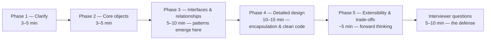
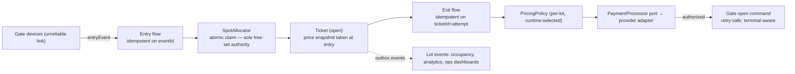

# 09 — The Interview Playbook: What Strong Hire Sounds Like

> **What this file is.** Files 01–08 built the instrument; file 07 indexed it; this file is the **performance**: the room, the clock, the case studies assembled whole, the follow-up barrages, the defense drills, and the rubric's-eye view of all of it. Everything here is *spoken* — transcripts, narration, refusal sentences — because that is the actual medium being graded. **You already know the content; the remaining risk is delivery:** a complete, well-paced design with two patterns scores higher than a perfect answer with five that never finishes. Read this file with a timer near you once; after that, use it as a mock-interview script.
>
> **The file's thesis:** ***"Strong hire" is not a pattern count — it is the sound of a process running in public: requirements becoming sentences, sentences becoming axes, axes becoming structures with receipts, and refusals said out loud.*** Every transcript below is annotated to make that sound visible.

---

## 0. The Room — How Senior LLD Rounds Actually Run

### 0.1 The formats you will actually meet

| Format | The shape | What it actually grades |
|---|---|---|
| **Classic design round** (45–60 min) | a prompt ("design a parking lot / library / payments"); whiteboard or shared editor | the full five-phase process (§0.3): clarification, structure, depth, trade-offs, defense |
| **Design + code hybrid** (60–90 min) | 30 min design, then implement one piece ("now code `allocateSpot` with concurrency safety") | can the design actually descend into code without discovering the assumptions were paper-thin |
| **Code-review round** (30–45 min) | they show you code (sometimes deliberately smelly — file 06 §10.1's shape) and watch you critique | taste under evidence: do you name mechanisms and fixes, or vibes; do you *delete* as well as add (the **refusal** test) |
| **Evolve-this-design round** (senior/Staff) | a working design is presented; follow-ups pile requirements on ("now make it multi-tenant / survive a crash mid-flow / 10× the traffic") | change-economics judgment: what bends cheaply, what must be reopened, what was accidentally load-bearing |
| **Systems-flavored design** (backend roles) | the same process with the reliability spine foregrounded (queues, idempotency, ordering, unknown outcomes — file 05's thread 3) | depth of the contract layer: the candidate who reaches for identity + idempotent receiver *before* any structural pattern |
| **Take-home + review** (varies) | build something; defend it live | self-awareness about its weaknesses; the ledger you wrote for it; how you take pushback |

The common denominator, across all six: **judgment, spoken, under mild pressure.** Nobody is grading whether you remember "the name of the pattern that shares intrinsic state"; they are grading whether the *situation* reaches the right structure — which is why file 06 is the spine this file performs.

### 0.2 The rubric, as sound — weak / strong / outstanding, per signal

The rubric dimensions are stable across companies; the *phrases* are what differ. Learn the sounds:

| Signal | The weak sound | The strong sound | The outstanding sound |
|---|---|---|---|
| **Requirements rigor** | "I'll assume… everything" then designs for everything | 3–5 targeted questions, then *"designing for what you stated; here's my assumption list"* | assumptions *written down*, ambiguity flagged as a design risk with a named fallback ("if per-tenant pricing is real, today's single table becomes X — trigger noted") |
| **Object identification** | class names arrive before nouns are settled ("a Manager… a Service…") | objects with owners: *"who keeps each fact true?"* — 4–6 nouns, one sentence each | nouns double as the future interfaces: *"this object's boundary is where the second implementation will land"* |
| **Structural judgment** | patterns applied on recognition ("this is definitely a Strategy") | signals → axes → citations: *"whole operation varies at runtime — Strategy; selection lives in one place"* | gaps refused aloud with triggers: *"no factory here; the trigger would be a second provider being named"* |
| **Contracts & failure** | failure handling ignored until asked; retry = hope | the reliability checklist run unprompted (idempotency, commit-order, unknown outcome, terminal paths) | contracts precede structures in the narration (L1/L2 before patterns) — the irreversible order, said out loud |
| **Depth** | wave-hands at "the database handles it" | one component walked to signatures and invariants; concurrency named where it lives | the walk exposes a subtle decision (lock scope, snapshot price semantics, iterator invalidation) that the interviewer hadn't queued |
| **Communication** | long unstructured silences; monologue | think-aloud with phase announcements: *"moving to relationships now — the interfaces fall out of the axes we listed"* | teaches while designing: the trade-off *formula* (§4.2 of file 07), the sentence shapes — the interviewer can grade without interrupting |
| **Pushback response** | defends reflexively, or capitulates wholesale | *"who pays for that? here's what changes"* — engages the constraint, then adjusts or holds with a receipt | *anticipates* the pushback mid-design ("the follow-up here will be X; the answer is Y because Z") |
| **Economy (refusals)** | every requested feature gets a structure | refuses with reasons and ledgers | subtraction offered proactively: *"and here's the piece I'd cut if the fraud rules don't materialize"* |

Two meta-facts to hold: **interviewers write the rubric notes while you talk**, so the strong-sound phrases are *habits*, not last-minute garnish; and **one weakness rarely fails a loop — the pattern of weaknesses does.** The self-audit in §8 exists to find your pattern.

### 0.3 The five-phase delivery — the timing structure that earns the rubric

The canonical structure (carried from the course's source notes and upgraded with file 06's instruments). Its purpose is double: it sequences your work *and* it hands the interviewer a map of their own rubric — each phase corresponds to a dimension they are scoring:



| Phase | What you do — and say | The rubric dimension it feeds |
|---|---|---|
| **1 — Clarify** (3–5 min) | 3–5 questions that would *change the design* (scale, clients, consistency, timeline, failure tolerance); state assumptions for the rest; **write the answers down as requirement sentences** | requirements clarification |
| **2 — Core objects** (3–5 min) | 4–6 nouns, one sentence each, with ownership: *"`Ticket` owns entry time and fee state; `SpotAllocator` owns the free/busy truth"* | object identification |
| **3 — Interfaces & relationships** (5–10 min) | the axes from the requirements → the seams; say *why* each interface exists: *"two pricing models are already stated, so pricing is an interface with selection in one place"* | OOP/SOLID — as change economics |
| **4 — Detailed design** (10–15 min†) | key method signatures, constructors, **one or two methods written in full** (the ones carrying the invariants — the atomic claim, the idempotent receiver); failure windows walked aloud | design depth + encapsulation |
| **5 — Extensibility & trade-offs** (~5 min) | one named trade-off in the formula (*"X buys A, costs B, chosen because C, trigger Y"*); one refusal with its trigger; what-change-breaks-what | extensibility thinking |
| **Interviewer questions** | the defense: receipts under fire, self-correction without collapse (§6's drills) | can they defend their decisions |

† The v1 timing warning stands and matters: **most candidates over-invest in Phase 1 and never reach phase 4** — where the strongest evaluation signals live. Ask 3–5 targeted questions; for anything else, state the assumption and start designing; the interviewer will redirect the moment you're wrong. And the four timing mistakes to burn in:

| Mistake | What goes wrong | The fix |
|---|---|---|
| 15 minutes of requirements | over-clarifying delays the scored phases | 3–5 questions; assumptions stated; **start designing** |
| jumping straight to code | structure-by-typing = messy, unowned classes | 5 minutes of nouns and seams first |
| drawing silently | the interviewer can't score decisions they can't hear | narrate *every* structure as it appears: "interface here because two implementations are already stated" |
| designing for every future | scope explosion; the answer never finishes | stated requirements now; extensibility belongs to Phase 5 — **with triggers** |

And the meta-lesson, verbatim from the course's source material, because it re-frames the whole file: ***"A complete, well-paced answer with 2 patterns scores higher than a perfect but incomplete answer with 5 patterns."*** The clock is part of the exam; §0.4 is how it's kept.

### 0.4 The clock strategy and the recovery moves

Time-keeping as a habit: *announce* your budget once, early — ***"I'll spend about 5 minutes clarifying, 10 on objects and interfaces, 15 on the detailed design, and keep the last 10 for failure handling and extensions — stop me anytime to dig in."*** That sentence alone separates candidates: it shows awareness, invites the interviewer's priorities in, and buys you the right to self-sequence later (*"let me move to relationships now — the interfaces fall out of the variation points we listed"*).

**The interrupt-recovery moves** (when a question lands mid-flow that you need to park): park with a commitment — *"that's important — it's a Phase 4 item, I'll return to it when we hit contracts; hold me to it"* — and *actually return.* Parking without losing is memory management for interviews; forgetting to return is the failure mode.

**The stuck-recovery ladder** (genuine blank moments — they happen; the recovery is the skill):

| Stuck at | Say/do this | Why it works |
|---|---|---|
| the structure | "let me restate the requirements sentences and list what varies" | re-enters the process at step 1/2 — gives the brain content while signaling procedure |
| the pattern name | describe the *mechanic* instead: "the operation varies at runtime, so the call site names an interface and the implementation is injected…" | the mechanic *is* the answer; names are garnish, and the interviewer often supplies the name — which reads as fluency, not ignorance |
| the failure story | "walk me through the happy path first" — then narrate it as a sequence and mark where it can break | failure surfaces from the walk, not from memory |
| the trade-off | the formula fill-in: "X buys ___, costs ___, I choose it because ___; trigger ___" | the sentence has slots; slots defeat blankness |
| everything | ask a scoping question: "if you had to cut this to one requirement, which?" | the room's favorite move — it also demonstrates prioritization, and *nobody* fails for asking it |

### 0.5 The narration habits — eight sentences to make reflexive

1. ***"Who keeps this fact true?"*** — before any class is named.
2. ***"What varies here, and what must stay stable?"*** — at every seam question, word for word.
3. ***"This interface exists so that __ can change without __."*** — the receipt, spoken as you draw.
4. ***"The contract here is __; the failure window is __."*** — at every boundary crossing.
5. ***"I'm choosing X over Y because the requirement says __; the bill is __."*** — the trade-off formula, complete.
6. ***"I'll refuse that for now — the trigger to build it is __."*** — refusals spoken, never silent.
7. ***"Let me move to __ now; the __ fall out of what we listed."*** — phase announcements.
8. ***"The follow-up I'd expect here is __; the answer is __."*** — pre-emptive follow-ups (use once or twice, not as a tic).

These eight are the *sound* of the process. Everything in the rest of this file is their application under specific fire.

---

## 1. Case Study — The Parking Lot (the full five phases, transcript form)

### 1.1 Why this prompt, and how to read the transcript

The parking lot endures because it compresses the whole course into one small domain: **states** (spot free/occupied/reserved), **axes** (spot types, pricing models, payments), **contracts** (the double-swipe, the concurrent claim, the device that lost its network), **concurrency** (two cars, one spot), and **evolution** (reservations, EVs, multi-floor). It is also the classic *comparison* prompt: interviewers have heard it forty times, which is precisely why the *process sound* (§0.5) — not the model — is what they're grading. Read the transcript as the exemplar; file 06's four walks are the reference for later case studies.

Format: **Interviewer** lines are compressed prompts; **Candidate** lines are what strong performance sounds like — annotated in `[brackets]` with the rubric signal each moment feeds (from §0.2).

### 1.2 Phase 1 — Clarify (the requirement sentences come out written)

> **Interviewer:** Design a parking lot system.

> **Candidate:** *(before drawing anything)* Let me spend a few minutes on requirements — I'll ask about five things that would actually change the design, state my assumptions for the rest, and write the answers down as sentences I'll design against. `[requirements rigor: the frame itself is the first graded move]`
>
> 1. **Scope:** one lot or a chain of lots? And are we modeling **physical gates/devices** (entry barrier, ticket printer, exit kiosk), or just the logical assignment of spots to vehicles?
> 2. **Spot types:** multiple types now — compact, large, EV, disabled, motorbike — and will more types be added by operations, or is the set product-fixed?
> 3. **Pricing:** how many pricing models *today* (flat, hourly, day-capped?), and is pricing per lot/tenant with changes shipping without deploys?
> 4. **Payments:** what providers/methods (card, cash at kiosk, mobile app, QR), and do we integrate external payment APIs?
> 5. **Reliability:** what's the pain tolerance at the gate? A double-charge or a gate that opens twice is worse than a slow gate — correct? Any offline mode requirement?

> **Interviewer:** One lot first but design for a chain later. Gate devices are in scope as sensors/actuators we talk to. Types: compact, large, EV, disabled — product-fixed, but assume a new one could appear yearly. Pricing: flat, hourly, and daily-cap today; per-lot configs; config changes must ship without deploys. Payments: card and mobile app; external provider. Gates: the classic — double-charge unacceptable, and yes, gate uptime matters.

> **Candidate:** *(writes, and reads back)* Then my requirement sentences are:
> - **R1** — multi-lot capable: spots belong to lots; a vehicle enters a lot and exits that same lot.
> - **R2** — spot types are a **fixed set that grows yearly** (family axis, not runtime data).
> - **R3** — pricing models: several, **chosen per lot at runtime, changed without deploys** (family axis + deployment constraint).
> - **R4** — payments happen through an **external provider** we don't control (boundary axis), and payment failures must not corrupt the ticket state.
> - **R5** — gates interact with us as **devices**: commands go out, events come back, and *the network between us and a gate can fail mid-transaction.* (This is the sentence that decides half the design.)
> - R6 (assumption) — a vehicle is identified by plate at entry (ANPR or kiosk entry), ticket/token issued; exits reconcile ticket → fee → paid → gate opens.
>
> Two questions I'm *not* asking but assuming, so you can correct me: no reserved/pre-booked spots in v1, no valet, and enforcement (tow trucks, fines) is out of scope. And one thing I noticed: R5 means **the entry and exit flows are distributed transactions with a device** — so the interesting work is in making the gate flows retry-safe. If that's not where you want the depth, tell me now. `[requirements rigor + economy: assumptions explicit; the risk named early; the interviewer invited to steer]`

**The debrief on Phase 1** (why this was strong): five questions, each *load-bearing* (scope → model; types → structure; pricing → runtime axis + deploy constraint; payments → boundary; reliability → contracts). Answers written as **design sentences** rather than a feature list. Assumptions stated and offered for correction. And the candidate *named the hard part themselves* (device-transaction safety) — the single highest-signal move in the phase.

### 1.3 Phase 2 — The nouns, one sentence each

> **Candidate:** Phase 2 — the nouns, each with the state it owns. I'll keep it to the core seven; accessories come later if needed.
>
> | Noun | Owns (the facts — "who keeps it true?") | One sentence |
> |---|---|---|
> | **Lot** | its floors, its pricing config, its gates | the administrative unit: one parking structure with a spot inventory |
> | **Floor / Spot** | Spot owns: type, occupancy state (free / occupied / reserved), current ticket ref | the physical inventory — Spot is the *only* owner of "is this spot free" |
> | **SpotAllocator** | the free-set index per lot+type | the service that answers "give me a spot of type T" — and guarantees no double-claim |
> | **Ticket** | plate, lot, spot ref, entry time, pricing snapshot, fee state, payment ref | the stay: one open ticket per vehicle, closed by exit |
> | **PricingPolicy** | the per-lot model config (flat/hourly/daily-cap) | computes fee for (ticket, now) — pure, given its config |
> | **PaymentProcessor** | (stateless) the provider integration | authorizes/captures against the external provider, idempotently |
> | **Gate** | device identity, last-known state; the *link* (not the transaction) | the edge device we command and hear from — never the source of truth |
>
> The double-ownership questions I want to kill immediately: *who owns "spot is free"?* — **SpotAllocator's index and the Spot flag must not both be decisive**; I'll pick one authority (the allocator's atomic index) and make the flag a projection. `[object identification + the invariant discipline of file 01: every fact, one guardian]`

**Debrief**: nouns carry their *data ownership*; the two service-shaped nouns (Allocator, Processor) are justified by mechanisms (atomic claim; external boundary), not by "service because." The candidate pre-solved the classic bug (two free-sets drifting) by naming one authority.

### 1.4 Phase 3 — Axes → interfaces (patterns emerge here, on purpose)

> **Candidate:** Phase 3 — axes of variation from the requirement sentences, and the seams they justify. I'll say each seam as a receipt: *"this interface exists so that __ can change without __."*
>
> | Axis (from requirements) | Variation kind | Seam | The receipt (spoken) |
> |---|---|---|---|
> | Spot types (R2 — grows yearly, product-fixed) | family, compile-time growth | `SpotType` as an enum/sealed set + type-indexed allocator buckets | *"a new type is a new value + an allocation bucket — no consumer changes; it's a family but a **closed** one, so an enum with total handling beats a strategy per type"* |
> | Pricing models (R3 — runtime, per lot, no deploys) | family, runtime, content-driven | `PricingPolicy` interface, one impl per model; selected per lot from config | *"pricing changes without touching callers; a new model is a new impl + a config value"* |
> | Payment providers (R4) | boundary we don't control | `PaymentProcessor` port; provider adapter(s) behind it | *"we own the port, the vendor owns nothing of ours; a provider swap touches one adapter"* |
> | Ticket lifecycle (R5+R6: open → closing → paid → closed, plus exceptions) | phase with legality (not all transitions legal) | **representation first**: status enum + guarded transitions; promote to State only if per-phase *behavior* appears | *"the phases mostly gate legality — a guarded enum is the L1/L2 work; State classes would be ceremony until behavior varies"* |
> | Gate device protocol (R5) | boundary + unreliable transport | `GateLink` interface (command + event), with retry/idempotency semantics inside | *"gates are devices: the seam absorbs flaky wireless, and the ticket state machine never depends on the link being up"* |
>
> Two refusals with receipts, now: **no Factory class hierarchy** — the spot types are a closed enum, not a family of creators; **no State classes** — the ticket's phases (naming the discriminators from file 05 §4) gate transitions, they don't vary behavior. Both are in my ledger; triggers: a type system that becomes open (plugins) promotes the enum; per-phase fee behavior (e.g., different rates while "closing") promotes State. `[structural judgment + economy: seams receipted; refusals with triggers, unprompted]`

The sketch that pairs with the table (the candidate draws while speaking; mermaid-equivalent):



### 1.5 Phase 4 — Detailed design: signatures, then the two murderous methods

> **Candidate:** Phase 4. Key signatures first, then I'll write the two methods where the whole problem lives — the atomic claim, and the idempotent gate flow — because those carry the invariants everything else assumes. `[depth: choosing the load-bearing methods is itself the signal]`

```java
public interface SpotAllocator {
    Optional<Spot> claim(LotId lot, SpotType type, TicketId ticket);   // atomic, never double-claims
    void release(SpotId spot, TicketId ticket);                        // guarded: only the claim-holder
}
public interface PricingPolicy {          // pure function of its config + ticket + now
    Money fee(Ticket ticket, Instant now);
}
public interface PaymentProcessor {       // idempotent per (ticketId, attemptId)
    Authorization authorize(TicketId ticket, Money amount, IdempotencyKey key);
    CaptureResult capture(Authorization auth);
}
public interface GateLink {               // the device boundary: commands out, events in
    void open(BarrierId barrier, OpenCommand cmd);                    // retry-safe by cmd id
    void onEvent(GateEvent event);                                    // entry/exit/occupancy signals
}
```

```java
// THE CLAIM — where two cars, one spot dies. The invariant: a spot has at most one
// open claimant, decided atomically, and the ticket records WHO claimed it (for guarded release).
public Optional<Spot> claim(LotId lot, SpotType type, TicketId ticket) {
    return freeIndex.poll(lot, type)              // pop from a concurrent free-set (CAS-based)
        .map(spot -> {
            boolean ok = spot.compareAndMarkFreeToOccupied(ticket);  // atomic flag flip carries the ticketId
            if (!ok) { freeIndex.returnUnclaimed(lot, type, spot);   // lost the race: give it back
                        throw new ClaimRaceException(); }            // caller retries; bounded attempts
            metrics.spotClaimed(lot, type);
            return spot;
        });
}
// Two notes I want to say out loud: (1) the free-set is the SINGLE authority — the Spot flag is
// a projection of it; (2) the failure path returns the spot BEFORE throwing, or the index leaks
// capacity under contention. [depth: the race + the leak — the two bugs interviewers probe for]
```

```java
// THE GATE FLOW — idempotent on the event, because the network WILL redeliver. Entry:
public EntryResult onEntry(GateEvent e) {
    // 1) dedupe FIRST: device retries carry the same eventId; a redelivery must be a no-op with the same answer
    var existing = entries.findByEventId(e.eventId());
    if (existing.isPresent()) return existing.get().result();     // same answer, no second ticket
    // 2) claim + ticket in ONE committed transaction; ticket price snapshot taken HERE (decision, below)
    var ticket = tickets.createOpen(e.lot(), e.plate(), pricing.snapshotFor(e.lot()));
    var spot = allocator.claim(e.lot(), allocator.fitFor(e.vehicle()), ticket.id())
        .orElseThrow(() -> new LotFullException(e.lot()));        // surfaced to the gate UI, honest
    tickets.attachSpot(ticket, spot);
    gate.openOrGuide(e.barrier(), ticket);                        // command id = ticketId: retry-safe
    outbox.publish(new VehicleEntered(e.lot(), ticket.id()));     // post-commit consumers (§ file 06 §7.2 pattern)
    return new EntryResult(ticket.id(), spot.id());
}
// Exit is the mirror: idempotent on (ticketId, attemptId), fee computed from the SNAPSHOT, payment
// authorized with an idempotency key, ticket closed + spot released only after capture, gate command
// retried by command id. Crash windows walked in the follow-ups below.
```

Two decisions to *narrate* while writing, because they're the graded depth:

1. **Price snapshot at entry vs settle at exit:** *"I snapshot the pricing config at entry — so a mid-stay config change can't re-price a parked car; the trade-off: a customer can't benefit from a mid-stay discount. If product wants dynamic pricing, that's a different requirement and the snapshot point becomes a deliberate design conversation (file 06's ledger: when dynamic pricing is named, revisit)."* `[the subtle wrong-variation-axis trap in the wild — values (rates) vs structure (models) — handled by snapshot]`
2. **Device command vs state change ordering:** *"the ticket commits first; the gate command is issued after commit and retried by command id — opening the gate is idempotent (a redundant open of an already-open barrier is harmless), while double-ticketing is not. So the asymmetry decides the order: soft side effects (gate) after commit; hard facts (ticket) inside it."* `[contracts before patterns, spoken — the sentence that marks a senior delivery]`

### 1.6 Phase 5 — Trade-offs and extensibility (receipts forward, not backward)

> **Candidate:** Phase 5 — one trade-off in the formula, one proactive refusal, and the evolution map.
>
> **Trade-off:** *"Interface + config for pricing — buys runtime model changes without deploys (R3); costs an indirection and selection wiring — chosen because R3 states 'without deploys' explicitly; the trigger to revisit is a *single* model surviving two quarters of production reality, which would collapse it to data."*
>
> **Refusal I want on the record:** *"No reservation system yet — R6 excludes it; trigger: reservations become a requirement → the ticket lifecycle gains a 'reserved' phase (legal transitions now matter — that's when State stops being cosplay), plus an expiry job (Command + scheduler), plus a no-show fee policy (a pricing rule). All three land where they belong: lifecycle, jobs, pricing — nothing in the allocator's claim path changes."*
>
> **The evolution map** (say one line each; do not design them now): EV charging → spot type + a charger capability interface on the spot's resource side; multi-lot chain → all IDs are already lot-scoped, so it's aggregation, not model change; dynamic pricing → the snapshot decision above flips deliberately; ANPR trust concerns → entry flow gains a manual-confirm path (a state on the gate flow, not the ticket).

**Debrief on Phases 4–5:** the strengths were *choosing* the two murderous methods (claim, gate flow) instead of spreading detail thin, narrating the crash-window asymmetries (commit-order reasoning), and giving refusals that land in *places that already exist in the design* (lifecycle, jobs, pricing) — the evolution-compatibility move that proves the boundaries were drawn on real axes.

### 1.7 The follow-up barrage (the part interviews are actually made of)

Each follow-up: **the probe → the weak sound → the strong sound.** These are the exact questions the prompt reliably produces; rehearse the strong column as speech.

| Probe | Weak sound | Strong sound |
|---|---|---|
| *"Car double-swipes at entry — two tickets."* | "the device should debounce" — pushes the problem to hardware | *"the flow is idempotent on the device's eventId: redelivery returns the same ticket; the dedupe key is committed with the ticket in one transaction; and if the device itself never generated an id, that's the fix — make the device protocol carry one."* |
| *"Two cars claim the last spot simultaneously."* | "locks, probably" | *"the free-index pop is atomic (CAS); the spot flag flip carries the claimant's ticketId; the loser returns the spot to the index before erroring — and retries boundedly. The invariant: at most one open claimant per spot, and spot-flag and index can't disagree because the flag is a projection, not an authority."* |
| *"Power fails right after the ticket commits but before the gate opens."* | "the gate stays closed, operator fixes it" | *"that's a soft-side-effect window, and the design already chose this asymmetry: ticket committed = a real stay; the gate command is retried by id (safe to duplicate), and after N retries it pages an operator with the ticket in hand — the customer's stay exists, so the remedy is a command replay, not a data repair."* |
| *"Power fails after the gate opens but before commit?"* | shrug | *"that's the worse window and I ordered the design so it can't happen: the gate command is issued only *after* the ticket commit — because a car inside with no ticket is a state the system can't reconcile as cheaply as a ticket with a closed gate. When I can't eliminate a window, I choose which side of it is recoverable — that's the ordering principle."* |
| *"Pricing config changes while cars are parked — refunds?"* | "recompute at exit" | *"no — the snapshot at entry is the contract with an already-parked customer; config changes apply to future entries. Refund/complaint flows are a policy layer on top (ops adjustment to a closed ticket), never a priced-in-place rewrite. And this is exactly why the snapshot decision had to be made in Phase 4, not discovered in production."* |
| *"Lost ticket."* | "look up the plate" | *"the exception path: plate-anchored lookup against open tickets, fee from the recorded entry time (the ticket's own fact — the lost paper doesn't lose the data), possibly a lost-ticket surcharge as a pricing rule, and the exit flow's idempotency key becomes (ticketId, 'lost-recovery', attempt) so retries at the kiosk don't double-charge."* |
| *"10,000 spots across 20 floors — allocation performance?"* | "it'll scale" | *"the allocator's buckets are per (lot, type), implemented as concurrent stacks/deques of free spots; claims are O(1) pops with CAS; the nearest-spot preference, if product wants it, becomes a per-floor sub-bucket order — a data/lookup change inside the allocator, invisible to every caller."* |
| *"Payment provider is down at exit."* | "retry" | *"retriable authorization with the idempotency key already in the design; the ticket sits in 'closing' (an honest phase) with the barrier held; on N failures the exit lane degrades to 'pay-later' — ticket closes into an account-balance state (a new fee state, pricing-adjacent) — and crucially the spot does NOT release until the stay is financially closed, because spot-capacity and money-state must not drift."* |
| *"Add reservations and no-shows."* | jumps to a Reservation class tree | *"the trigger from my ledger just fired, so: ticket lifecycle gains 'reserved' with legal transitions (this is the State-promotion point I named); reservations expire via a scheduled command (id + idempotent expiry — expiring twice is a no-op); no-show fee = pricing rule; and the allocator gains a hold-with-expiry claim variant — one new method, same authority model."* |
| *"Chain of 50 lots — what changes?"* | believes it's a rewrite | *"IDs are lot-scoped throughout; the changes are (a) a lot directory/registry, (b) per-lot config origin, (c) aggregate analytics via the events already emitted (outbox). The claim path, ticket flow, and pricing interfaces don't move — that was the point of making 'multi-lot capable' a Phase-1 sentence."* |

### 1.8 The debrief — what actually earned the money in this transcript

| Moment | Phase | The rubric signal | The course file it performed |
|---|---|---|---|
| five load-bearing questions; answers written as sentences | 1 | requirements rigor | 06 §6.3 step 1; 09 §0.3 |
| candidate names the hard part (device transactions) unprompted | 1 | ownership of the problem | 05 §7.5 (unknown outcomes) |
| the double-ownership kill ("one authority per fact") | 2 | object identification | 01 §2 (ownership), 06 §7.2 |
| seams spoken as receipts; two refusals with triggers | 3 | structural judgment + economy | 06 §4.2 clauses, §8.5 |
| only two methods written — the claim and the gate flow | 4 | depth discipline | 06 §8.3 (MVD: depth goes where invariants live) |
| commit-order asymmetry articulated (ticket vs gate) | 4 | contracts before patterns | 05 §3 (outbox/identity), 07 §9.5 |
| price snapshot decision narrated with its trade-off | 4–5 | wrong-variation-axis avoidance | 06 §3.2, §8.5 |
| follow-ups answered with windows and reconciles, not retries | Q | reliability depth | 05 §7.5, 07 §9.5 |
| evolution compatibility: every new feature lands in an existing seam | 5 | extensibility | 06 §7.4 (reuse of seams) |

The one-sentence summary of the whole case study: ***"The candidate never said 'parking lot' — they said facts, owners, axes, windows, and triggers; the parking lot just happened to be the domain."***

---

## 2. Case Study — Library Management (the title/copy lesson)

### 2.1 The prompt, clarified

> **Interviewer:** Design a library management system.

> **Candidate:** Requirements first — five questions that change the model: (1) **multiple copies per title**, or is each book unique? (2) borrowing **limits and loan periods** — uniform, or by member type (student/faculty/public)? (3) **reservations**: can members queue for a title that's fully out, and what happens when a copy returns — first-in-line wins? (4) **fines**: late fees only, or loss/damage too; fixed or computed? (5) **scope**: single branch or system-wide, and self-service kiosks (the device boundary, again) or staff desks only?

> **Interviewer:** Multiple copies — yes, that's the core of the problem. Limits by member type (max books, loan period, renewals). Reservations with queues, first-in-line, and a pick-up window when a copy is held. Fines: late (per day, with a cap) and lost (replacement + processing). Single branch for v1; kiosks are on the roadmap.

> **Candidate:** Then the requirement sentences I'm designing against — and the first one decides the whole model:
> - **R1 — a title and its copies are different things** (3 copies of one title can be in three different states); I'll guess this is the trap this prompt always carries, so I'm naming it before any classes.
> - **R2** — member-type-specific policies: max loans, loan period, renewals (an axis, runtime-configurable).
> - **R3** — reservations: FIFO per title, granted to the next member when a copy returns; **pick-up window** (say 48h), after which the grant expires and the queue moves on.
> - **R4** — fines: late fee per day with a cap; lost = replacement cost + processing fee; fines attach to the **member account**, computed from loan facts.
> - **R5** — devices later (kiosks): assume they'll be network-flaky, so staff/kiosk both drive the same idempotent flows.

### 2.2 The nouns — and the ownership that kills the classic bugs

| Noun | Owns | One sentence |
|---|---|---|
| **Title** | bibliographic facts (author, ISBN, metadata) — **not** availability | the card-catalog entry; never answers "can I borrow it" |
| **Copy** | its own lifecycle state (available / on-loan / held-for-X / lost) + current loan ref | the physical thing — the *only* owner of "is this copy here" |
| **Member** | identity, type, account (fines balance), loan limit state | the borrower and the payer |
| **Loan** | copy ref, member ref, borrowedAt, dueAt, renewals used, returnedAt | the time-bounded fact of possession — one *open* loan per copy ever |
| **Reservation** | title ref, member ref, queuedAt, state (waiting / granted / expired / fulfilled) | a claim on the *title's future*, not on a copy — until granted |
| **PolicySet** | per-member-type limits and periods; fine rules | the configurable axes (R2/R4), evaluated per transaction |
| **Notifier** | (stateless) message dispatch | §7.1's machinery from file 06 — reused, not rebuilt |

Two invariants, said aloud: **"exactly one open Loan per Copy"** (the copy's lifecycle state is the authority; the loans table is history) and **"a Reservation never owns a Copy except through a granted hold with an expiry."** `[object identification: the title/copy split IS the interview; ownership kills double-booking]`

### 2.3 Axes → seams, states, and refusals

| Axis | Kind | Seam / form |
|---|---|---|
| Member-type policies (R2) | family, runtime, config-driven | `PolicySet` lookup: data (a table) behind one evaluation function — **not** a strategy class per member type; the variance is *values*, not algorithms (file 06 §3.2 — the recurring trap) |
| Fine rules (R4) | policy with some computation | `FinePolicy` as one pure function family; late-fee = data (rate, cap, grace); lost = replacement-cost lookup. A Strategy interface only if rule *shapes* diverge (e.g., tiered penalties with conditions) — refused at v1 with trigger: "when a second punitive structure ships" |
| Reservation granting (R3) | an ordered decision with atomicity | the queue is data (FIFO per title) + a **grant** operation that must be atomic across (copy returned, next member, hold created, notification queued) — this is the single transaction of the domain |
| Copy lifecycle | phase with legality | **representation first**: state enum + guarded transitions (available→on-loan only via borrow; on-loan→available only via return; available→held only via grant). State classes refused: phases gate legality, behavior per phase is thin — trigger: per-phase *behavior* (e.g., different renewal rules while held) |

The reserve cascade on a return — the domain's cusp — as the one method worth writing (Phase 4 discipline: write where the invariants live):

```java
// RETURN — the flow that must atomically: close the loan, offer the copy to the next
// reservation (with expiry) or free it, and queue exactly one notification.
// Idempotent on (copyId, returnAttemptId): a double-swipe at the kiosk returns ONE closed loan.
public ReturnResult returnCopy(CopyId copy, ReturnAttemptId attempt) {
    var prior = returns.findByAttempt(attempt);
    if (prior.isPresent()) return prior.get().result();                // same answer, no second state change

    var loan = loans.openFor(copy).orElseThrow(() -> new NoOpenLoan(copy));
    var txn = tx.begin();
    try {
        loan.close(Instant.now());                                     // Loan: the time-fact
        var next = reservations.nextWaitingFor(loan.title());          // FIFO peek (not pop yet)
        if (next.isPresent()) {
            var hold = holds.grant(copy, next.get().member(), now.plus(48, HOURS));   // copy: on-loan → held
            reservations.markGranted(next.get(), hold);                // waitlist: waiting → granted (expiry timer starts)
            notifications.enqueue(HoldReady(next.get().member(), loan.title()));      // outbox — post-commit
        } else {
            copies.markAvailable(copy);                                // the ordinary path
        }
        returns.record(attempt, resultOf(txn));
        txn.commit();
        return resultOf(txn);
    } catch (ConcurrentReturnRace e) { txn.rollback(); throw e; }      // another attempt won; retry reads the prior
}
```

The narration beats for this method: *"idempotency first (kiosk double-swipe); the queue's peek-then-grant is inside the transaction — if two returns raced (impossible for one copy, but the pattern holds for transfers), one wins; the notification is queued via outbox, not sent inline — the kiosk must not know about email."* `[depth + contracts: the reliability spine, applied unprompted in a non-payments domain]`

**Refusals on record:** no State classes (above, with trigger); no Strategy per member type (values-as-structure trap, caught by name); no separate `AvailabilityService` — availability is a *question asked of copies* (a repository query), not a fact to own (fact-ownership discipline). `[economy: three refusals, each citing an axis from the requirements]`

### 2.4 The follow-up barrage

| Probe | Strong sound |
|---|---|
| *"The hot title has 300 holds — fairness and anti-abuse?"* | *"the queue is FIFO per title with timestamps; fairness = ordering discipline; anti-abuse = borrowing limits already in PolicySet plus a hold-off penalty after expired holds (a policy value, not new structure); the 300-hold read path is a queue query — paginated, no per-member scanning."* |
| *"Copy is returned damaged instead of late."* | *"a return-condition step (staff/kiosk UI action) — the loan closes normally; the *account* gains a damage charge (fine-kind = data); if the copy is unloanable, an out-of-service lifecycle state (a new legal transition, guard-enforced) — notes: the state enum grows by one value, no structure changes."* |
| *"Self-service kiosks ship — what changes?"* | *"the kiosk drives the same idempotent return/borrow flows (attempt IDs), so the new work is the device protocol (GateLink-style boundary) plus offline buffering: kiosk queues events, replays idempotently — the design already survives because every kiosk-relevant operation has an attempt key."* |
| *"Multi-branch system-wide reservations — one copy transfers between branches?"* | *"IDs are branch-scoped; cross-branch grants become an in-transit copy state (a transition with a hold at destination) and the pick-up window starts at arrival, not grant — the queue logic is unchanged; what moves is *where* the hold happens. This is data/scope, not pattern."* |
| *"E-books — infinite copies?"* | *"the medium changes the scarcity model: for digital, borrowing grants a time-boxed entitlement (no copy contention), so the reservation queue only gates *licenses* if the library licenses N concurrent reads — the design move: Loan gains a kind (physical vs digital), and the availability question differs per kind — a Strategy-shaped policy at the loan-policy level, the moment the 'one implementation' refusal's trigger fires."* |
| *"Fines should be waived, disputed, partially paid."* | *"fines are an account ledger: charges as records, waivers/reversals as compensating records (append-only — §7's event discipline), never field edits on a balance; partial payment = allocation records. The ledger shape is the design; the UI states are projections."* |

**Debrief in one line:** ***the title/copy split and the return cascade carried the design; everything else was policies-as-data and one outbox — the candidate who reaches for State classes here has misread which axis is real.***

---

## 3. Case Study — Marketplace Checkout (assembled whole, with the narration order)

### 3.1 What this walk adds beyond file 06 §7.2

File 06 §7.2 built the checkout's stations (saga coordinator, pricing strategies, fraud chain, order state, outbox). This walk is about **order of narration** — the sequence of spoken sentences that carries the interviewer from requirements to design, because checkout is the case where *saying it in the right order* is half the score. The five sentences below are the case's spine; everything else hangs on them.

**The five spine sentences** (say them early, return to them often):

1. ***"The double-click dies at the server — submit is idempotent on (cartId, attemptId); the UI's job is only to reuse its attempt id across retries."***
2. ***"An unknown payment outcome is a state, not an error: on timeout I query the provider by idempotency key and reconcile — I never blind-retry a charge."***
3. ***"Compensation is not rollback: the resume-flow refund is a new transaction that acknowledges the first one happened."***
4. ***"The fraud review queue is a terminal result, not a default: 'review' is a real outcome with a real owner, and the checkout persists the decision point to resume hours later."***
5. ***"Confirmations fire off the committed order, via outbox — the email cannot precede the order, and a redelivery re-sends nothing twice."***

### 3.2 The narration, phase by phase (compressed transcript)

> **Phase 1 — Clarify:** five questions: pricing rules per region/tenant and churn rate (quarterly → structure); providers (several, swappable → boundary); fraud review (exists, human, hours-late → durable decision point); failure semantics (no double-charge; retries expected; compensation acceptable → saga); scale of cart (items, promotions). Requirement sentences written: *idempotent submit; authorize-then-capture; inventory reservation with expiry; fraud can hold; compensation on partial failure; confirmations exactly-effective-once.*
>
> **Phase 2 — Nouns:** `Cart` (items, version), `PricingBreakdown` (the computed result — immutable), `PaymentAuthorization` (provider ref, state), `InventoryReservation` (expiry), `Order` (lifecycle authority), `FraudDecision` (verdict + reviewer), `CheckoutAttempt` (the idempotency record — **the noun candidates always forget, and its absence is the bug**).
>
> **Phase 3 — Axes → seams:** pricing rules (Strategy, composed — order fixed: base → discounts → tax → shipping); providers (Adapter behind our port); fraud (CoR with typed verdicts — or *one predicate* until the second rule is real, with trigger); lifecycle (State at the **order**; authorization status is bookkeeping — refused); notifications/analytics (Observer + outbox). Refusals said: no Abstract Factory (independent products); no TM for the flow (we own both sides; it's a saga); no Singleton (per-checkout instance).
>
> **Phase 4 — Depth (the two murderous methods):** the idempotent submit, and the unknown-outcome reconciler — both shown in file 06 §7.2; the narration line for here: *"submit dedupes in one transaction with attempt creation; the reconciler runs from the saga's durable steps — every step has (status, idempotency key, compensation), so the saga is a data structure, not control flow hidden in a thread."*
>
> **Phase 5 — Trade-offs & evolution:** *"Pricing as composed strategies — buys quarterly rule churn without deploys; costs comprehension and a selection root; trigger to flatten: two quarters without a new rule. Fraud as a predicate (if launching pre-second-rule) — trigger: rule count ≥ 3 with churn → the CoR from §7.2. Saga engine: I'd *start* with durable steps in a table + a worker (a dead-simple state machine) — trigger to adopt a workflow engine: cross-team step ownership or >N step types, i.e., when the engine's abstraction pays for itself."*

### 3.3 The follow-up barrage

| Probe | Strong sound |
|---|---|
| *"Crash between authorization and reservation."* | *"the saga's next step replays from the durable step record: reservation is retried idempotently (key = checkoutId+step); if the reserve now fails permanently (sold out), compensate: void the authorization (provider-side, keyed) — the customer sees a retriable checkout, never a charge for nothing."* |
| *"Two checkouts race for the last unit."* | *"inventory decrement is atomic (conditional update / row lock), keyed with the reservation id; the loser proceeds to compensation; TTL on reservations (expiry job) defeats holds left by crashes."* |
| *"Promo invalidated between cart and submit."* | *"pricing snapshot commits with the attempt — the breakdown the customer saw is the contract for that attempt; a server-side repricing mid-flight must be an explicit rejection with a re-quote, never a silent new total."* |
| *"Refund a captured order."* | *"refund is a first-class operation (Command with identity), compensating records against the order; partial refunds = allocation records; the order state (state machine) gains a 'refunded' region of legality — refunds are new facts, not edits to history."* |
| *"Fraud clears the order 6 hours later."* | *"the checkout resumed from its persisted decision point — the saga was never holding a thread for six hours; resume is the design, and it's why the saga is data (steps table) rather than code."* |
| *"Provider says 'duplicate charge' during reconcile."* | *"that's the reconcile working: the query-by-key found the first charge — mark it authorized, continue the saga; the idempotency key *is* the conversation with the provider."* |
| *"10× traffic on flash sales."* | *"submit path is cheap writes + maybe go/no-go queue; the load lands on (a) inventory atomic decrement (contention point — shard per SKU region), (b) provider rate limits (govern with the idempotency queue), (c) confirmation fan-out (outbox batches). The saga steps stay the same — the pressure moves the queues and shards, not the contracts."* |

---

## 4. Case Study — Chat (skeleton compressed, barrage expanded)

The chat skeleton is file 06 §7.3 (inbound chain with stop-verdicts, fan-out Observer, transport adapters, `clientMessageId` idempotency, monotonic receipt watermarks). Case studies 1–3 rehearsed *building*; chat rehearses **surviving** — because the chat prompt's real exam is the barrage. Each probe below: the question as asked, then the strong sound compressed.

| Probe | Strong sound |
|---|---|
| *"Flaky mobile network — how do we not double-send?"* | *"clientMessageId is the client's obligation, dedupe is the server's: unique (conversationId, clientMessageId); redelivery returns the existing message with its sequence number. No locking, no coordinator — one constraint."* |
| *"Out-of-order retries after a reconnect — a late retry must not resurrect a deleted message."* | *"messages are an append-only log with revisions and tombstones; the retry references its revision — the reducer ignores writes older than the tombstone. Ordering key is the per-conversation sequence, not wall-clock — never trust device clocks."* |
| *"Receipts arrive out of order across devices."* | *"receipts are monotonic watermarks: (messageId, memberId) upgrades only SENT → DELIVERED → READ; the guard drops regressions. Concurrent acks from two devices race safely because the operation is idempotent and monotonic — no locks."* |
| *"Read receipts at 100k occupants — fan-out storm?"* | *"receipts coalesce: batch per (member, conversation) on a short interval; the UI only needs monotone progress; and reads of receipts use the same pull-on-open semantics as history — not push-per-receipt to everyone."* |
| *"Typing indicators."* | *"ephemeral: never persisted, best-effort delivered, rate-limited per connection, dropped under load — the design's *refusals* are the answer: no durability, no ordering, no retries, and saying so is the point."* |
| *"Edit a message — history integrity?"* | *"append an edit revision; clients render latest-visible; edits are idempotent on (messageId, revision) for retry safety; moderation can pin an old revision for audit — the log keeps everything, the projection shows the choice."* |
| *"Moderation holds a message for review — the sender's UI?"* | *"that's the inbound chain's stop-verdict surfaced honestly: message accepted (persisted in a held state visible to the sender as 'sending/pending review'), fan-out withheld until the review terminal resolves (approve → fan-out; reject → tombstone + notice). The verdict vocabulary keeps the pipeline honest — 'held' is a result, not a silent drop."* |
| *"Presence at scale — reconnect storm."* | *"presence is heartbeat + expiry, per-connection TTL; mass reconnects get backoff-with-jitter and presence updates are eventually-consistent reads — the system prefers 'maybe online' to coordinated truth, and says so as a requirement decision."* |
| *"Bots and webhooks."* | *"third-party delivery is the notification problem verbatim — durable queue, signed payloads, exponential retries, dedupe on the bot via delivery id; and per-bot rate limits because one bad bot must not stampede the fan-out."* |
| *"End-to-end encryption."* | *"the server's role narrows to routing ciphertext + metadata; fan-out is unchanged (it never read content); the hard parts move to keys (per-device key registry, rotation) and to *metadata minimization* — the honest answer includes that some anti-abuse features (server-side moderation) fundamentally change nature or leave the server."* |
| *"100k-member broadcast channels."* | *"the fan-out economics flip: write-time fan-out for small conversations, read-time assembly for huge ones (subscribers pull on open, with cursor); the switch threshold is a product/consistency decision — and it's the moment 'Observer' becomes a topology choice rather than a pattern."* |
| *"Search across history."* | *"a consumer of the message log (outbox → indexer) keeps a search index; the log is the source of truth, the index is a projection that can be rebuilt — never dual-written synchronously, never authoritative."* |
| *"Retention/deletion compliance (GDPR)."* | *"deletion is a policy over the log: tombstones + crypto-shredding for content store; per-member erasure cascades via the member-id keyed projections; and the append-only log gains scheduled compaction. Saying 'delete = tombstone + shred keys' is what separates it from 'we'll delete rows'."* |

---

## 5. The Barrage Bank — Every Follow-Up Is One of Six Attacks

The chat table above is *one domain's* barrage; this section generalizes. Every follow-up across every case study (and file 06's walks, and 08's drills) belongs to one of six attack families. Learn the families and the responses become compositional — you will meet every one of these in every real loop:

### 5.1 Family A — Requirements attacks ("the world changes")

*Probes: "10× the traffic," "multi-tenant," "offline mode," "new region," "new client type."* **The tell:** does the candidate understand which knobs the design exposed?

**Response template:** *name the dimension → say what already bends → say what's structural → name the trigger for the structural part.*
- Micro-example (parking lot, 10×): *"claims are O(1) pops on per-type buckets — 10× means sharding buckets per lot region; the ticket flow is unchanged; the structural question is a single lot's DB write path, and the trigger is write contention, not read volume."*

### 5.2 Family B — Structural attacks ("why is it like this?")

*Probes: "Why not a queue here?", "Isn't this over-engineered?", "Could this be simpler?", "Why not microservices?", "Why not event sourcing?"* **The tell:** can you defend *and* offer subtraction — the economy signal.

**Response template:** *engage seriously → cite the requirement or the bill → offer the simpler version and its cost → give the trigger that would flip you.*
- Micro-example: *"Could it be simpler? Yes — if I drop the fraud-review durability, the saga collapses to a synchronous flow with two compensations; the cost is that a 6-hour review can't resume. The requirement said reviews are hours-late, so I keep the durable steps; trigger to collapse: reviews become synchronous auto-decisions."*

### 5.3 Family C — Failure attacks (the favorite family)

*Probes: "Crash between steps 2 and 3?", "Timeout mid-call?", "Processed twice?", "Out-of-order?", "Clock skew?"* **The tell:** windows and contracts — never optimism, never hand-waving.

**Response template:** *walk the window → name what's durable at that instant → name the reconcile → state which side of the window you chose to be recoverable, if you can't eliminate it.*
- Micro-example (checkout, timeout on authorize): *"unknown outcome, not failure: query by idempotency key; found → continue; not-found-after-N → safe to retry with the same key; found-different-amount → the reconcile alarm. The key is the entire conversation."*

### 5.4 Family D — Evolution attacks ("add / replace / comply")

*Probes: "Add refunds / EV charging / localization," "Replace the provider / DB," "Comply with retention/GDPR/HIPAA."* **The tell:** does the new thing land in an existing seam — or does the candidate discover (honestly) that a seam was missing? (The second is acceptable *if said with the fix and the lesson.*)

**Response template:** *locate the change on the existing axes → reuse the seam, or state the missing seam, the fix, and the trigger you'd have written.*
- Micro-example (library, e-books in §2.4's table): the loan-policy seam existed; the *scarcity model* changed — the answer named the new datum (entitlement vs copy) instead of bolting on structures.

### 5.5 Family E — Scale attacks ("the numbers move")

*Probes: "Hot partition?", "Cache stampede?", "Thundering herd?", "100k subscribers?", "10k writes/sec?"* **The tell:** you can find the *contention point* — most designs have exactly one per flow.

**Response template:** *find the contended resource → shard / batch / backoff / switch fan-out direction → keep contracts constant (that's why the contracts were separated from the topology).*
- Micro-example: *"the hot key is the flash-sale SKU; shard the counter per region with a reconciler, or serialize per SKU behind a go/no-go queue — either way the idempotency and compensation contracts don't move; that's the test that the design was layered right."*

### 5.6 Family F — Contradiction attacks ("pick both" jokes)

*Probes: "Exactly once?", "Strongly consistent and highly available?", "Zero-downtime migration?", "No data loss and no blocking?"* **The tell:** you refuse the impossible binary *politely and precisely*, then choose per requirement.

**Response template:** *name the impossibility in one clause → give the honest engineering version → choose by the stated requirement.*
- "Exactly once": *"business-level exactly-once is built from at-least-once plus idempotent receivers — that's not pedantry, it's the design."*
- "Consistent AND available": *"not in a partition; outside one, strong-consistency-within-entity plus eventual across entities is usually the honest shape — which entity needs which is a requirement question I'd ask back."*
- "Zero-downtime migration": *"dual-write/backfill/compare/cutover with a rollback lever — expand-contract; the honest part is the three phases, not a magic tool."*

### 5.7 The four sentences that answer any barrage (the fallback layer)

When the specific answer isn't immediate, these four sentences buy structured time — each is *true* and each advances the answer:

1. ***"Let me locate this on the flow: it hits between [step A] and [step B]."*** (the window)
2. ***"What's durable at that instant is [X]; what's in flight is [Y]."*** (the state truth)
3. ***"The reconcile is [query by key / resume from step / recompute from log]."*** (the recovery)
4. ***"If I can't eliminate the window, I choose which side is recoverable — here it's [side], because [cost asymmetry]."*** (the doctrine)

None of the four requires knowing the answer *before* speaking — they *are* the process, spoken. That is the entire trick of "grace under follow-ups": the fallback layer is not filler; it's the highest-value part of the method.

---

## 6. Defense Drills — Under Fire, With Transcripts

### 6.1 Drill — critique the over-engineered design (find the refusals)

> **Interviewer:** Here's my design for an internal admin tool that lists and edits users: `UserController` → `UserService` interface → `UserServiceImpl` → `UserRepositoryFactory` → `AbstractUserRepository` → `JpaUserRepository`; edits go through `EditUserCommand`, dispatched by `CommandBus` to `EditUserCommandHandler`, which publishes `UserEditedEvent` to a `ListenerRegistry` consumed by `AuditListener` and `CacheInvalidationListener`; there's a `UserMapperFactory` to pick a mapper. Ten teams use this tool. Critique it.

> **Candidate:** Let me run it through the instrument rather than taste. *(pauses, then walks)* The design has six structures; I'll check each against a requirement, and I'll say where I'd subtract — with triggers, not vibes.
>
> - **`UserService` interface with one impl:** the clause check (file 06 §4.2) — no second implementation named, no stated swap, no testability gap (the impl is trivially mockable), one consumer family. **Bill:** every reader chases two symbols for one behavior. **Refusal:** collapse to the concrete class; trigger: a second implementation arrives (the interface extraction is an IDE refactor — cheap later, which is *why* it waits).
> - **`UserRepositoryFactory` + `AbstractUserRepository`:** if there is genuinely one storage backend, this is a factory for a family of one. **Question back:** do the "ten teams" actually bring multiple storage backends, or is that speculation? If speculation: collapse to one repository class; **trigger:** the second backend being *scheduled*.
> - **`EditUserCommand` + bus + handler, for a synchronous admin edit:** the Command machinery's bill is async complexity and the idempotency burden (§8.2's Command row). Here the caller needs the result now, and nobody's queuing, retrying, or auditing *out of band* — except audit, which is the one clause that survives.
> - **The audit path:** the `UserEditedEvent` + listener design is *load-bearing* — audit eventually-consistent and non-blocking is a real requirement shape (outbox territory, file 05 §3). I'd keep an **audit intent** written in the same transaction (an outbox row) and a delivery worker — but I'd drop the general `ListenerRegistry` and wire the one real consumer.
> - **Cache invalidation as an event listener:** acceptable — but the *ordering* contract (invalidate before vs after commit) is undeclared; listeners firing pre-commit invalidate against uncommitted state. **Fix:** commit-ordered dispatch (outbox) or explicit versioning — this is the design's one actual bug, and it's a contract bug, not a structure bug.
>
> So: **one structural subtraction with a cheap trigger (service interface), one question-back (storage family), one contract fix (commit-ordered audit/invalidation), and one genuine keep (audit out-of-band)**. If I had to name the pattern of the whole design: it's the **"we might scale" reflex applied to an internal tool** — every structure is individually defensible and the aggregate is ten symbols for a CRUD screen. `[the graded moves: receipt per structure, question-back instead of assumption, one actual-bug find, subtraction with triggers]`

**The debrief:** the strong sound is not "this is over-engineered"; it's *six receipts and a prioritized subtraction*. Note what was deliberately *kept* — the audit split — because a critique that deletes everything is as suspicious as one that deletes nothing.

### 6.2 Drill — the missing contracts (under-design audit)

> **Interviewer:** Same tool, but now the flow is: controller validates, service updates the row, controller returns; "audit logs via log.info." Find what's missing without redesigning.

> **Candidate:** Contracts before structures — four gaps, ordered by blast radius:
> 1. **No durable audit** — `log.info` isn't an audit trail (retention, ordering, integrity). The fix is the smallest thing: a row in the same transaction (or outbox) recording actor, target, before/after.
> 2. **No concurrency contract on edits** — two admins editing the same user is last-write-wins silently. Fix: version column + conditional update (optimistic); the 409 is the honest UX.
> 3. **No idempotency for retried submits** — the admin UI retries on timeout; double-applies are possible for non-idempotent fields. Fix: attempt key (same §05 discipline as everywhere else — the pattern's dead, the discipline isn't).
> 4. **No authorization independence** — validation and auth live in the controller; any second entry point (a job, a CLI) bypasses them. Fix: authorization at the *use-case boundary* (service), the controller stays thin.
>
> That's it — I'd *not* add a single class: four fields-on-contracts. The lesson I'd state out loud: **this is the L2 layer from the maturity ladder — and it's where a real team's worst bugs live, not in the pattern layer.** `[the under-design equal-treatment: contracts named without structure inflation]`

### 6.3 Drill — the hostile barrage (hold with receipt vs update with reason)

The interviewer disagrees repeatedly; the skill is distinguishing **pushback that carries new information** (update, and say why) from **pressure without content** (hold, with the receipt, without defensiveness).

> **Interviewer:** I don't love the outbox here. Kafka exists — just publish the event after the commit, it's fine.
> **Candidate:** *(engage the actual claim)* "After the commit" has a window: commit succeeds, publish fails, event is lost — and in this system the audit trail *is* the compliance requirement, so a lost event is a finding. The outbox closes exactly that window: intent is written with the state change; delivery is a worker concern with retries. If audit loss were acceptable, I'd take the simpler direct publish — is it acceptable here? *(marks the requirement as the decider, not taste)*
>
> **Interviewer:** With Kafka's delivery guarantees, though—
> **Candidate:** *(new information? partially — so engage, then hold the seam)* Kafka gives at-least-once *transport*; it can't make the DB commit and the production of the message atomic — that's the dual-write problem, and only the outbox (or equivalent transactional intent) closes it. What Kafka changes is the outbox *worker's* destination, not the need for the row. *(holds with receipt; offers the concession precisely scoped)* If the concern is outbox-ops complexity, the middle ground is the inbox/relay pattern as a managed component — same semantics, less bespoke code.
>
> **Interviewer:** Fine. But I think the saga is overkill for checkout.
> **Candidate:** *(here there IS a genuine trade)* Fair challenge — let me price it: without durable steps, a crash mid-flow strands *either* a captured charge without a reservation or a reservation without a charge; the compensation on restart is manual ops. With two steps and no fraud hold, I'd actually agree with you — a synchronous best-effort flow + a reconcile job might be the MVD. The requirement that tips it: fraud review returning hours later. If review is dropped from scope, the saga collapses — **trigger named, decision updated, disagreement honored where it wins.** `[the three moves: update with reason, hold with receipt, concede precisely — the interviewer's favorite sequence]`

### 6.4 Drill — self-correction (the highest-signal recoverable move)

> **Candidate:** …so pricing is a Strategy per region, selection in the checkout service— *(pauses)* — actually, let me flag something: I've put selection in the checkout service, but region comes from the *cart*, and the same checkout can serve multiple regions in multi-tenant mode — that selection is likely a per-tenant concern. I want to move the selector to the tenant context and keep the checkout consumer-region-blind. *Cost of my own earlier error: one wiring move, no design change — thanks for not catching it yet, honestly.*
>
> **Debrief:** noticing your own inconsistency and *pricing your own correction* ("no design change, one wiring move") reads as calibration control. Candidates fear self-correction; interviewers reward it — the alternative is the interviewer finding it, and *that* reads as blindness. The rule: **correct early, correct cheaply, price the correction aloud.**

### 6.5 Drill — the mid-flight interruption

> **Interviewer:** *(at Phase 3)* Hold on — assume the lot also needs valet handoff, where attendants park cars.

> **Candidate:** Noted as a new sentence — I'll park it properly rather than half-design it: valet adds an *actor* to the entry/exit flows (attendant instead of driver) and a **custody model** (who holds the key/ticket during handoff — likely a second ticket kind or a handoff record). It touches Phase 2's nouns (a `Handoff`) and the ticket lifecycle's *actors*; the claim and pricing paths don't move. I'll return to it in Phase 5 with the other extensions — hold me to it, or if you'd rather, we can take it now and defer the valet UX below design level. *(the choice offers the interviewer control — which they like — while the parking commitment keeps the process honest)*

---

## 7. The Machine-Coding-Lite Round — LRU Cache (and What It Really Grades)

### 7.1 What a code round *in an LLD loop* is actually grading

Not algorithms cleverness — the LLD-flavored code round grades **whether the design reflex survives contact with syntax**: contract first, invariants encoded in structure, boundaries validated, failures typed, names honest, tests where the risk is. The rubric, compressed:

| Signal | The weak shape | The strong shape |
|---|---|---|
| contract before code | starts typing the data structure | states the API + invariants + concurrency expectation in five sentences, *then* types |
| invariants in structure | comments saying "must stay ≤ capacity" | the data structure makes the invariant hard to violate (single choke-point for mutations) |
| boundary validation | happy path only | null/zero/negative/oversize rejected with typed errors, tested |
| failure taxonomy | `throw new RuntimeException` | named failures the caller can act on (the "honest error" doctrine) |
| tests | "I'd write tests" | 2–3 tests written *and run* — the risky invariants, not coverage theater |
| no premature patterns | `CacheStrategyFactory` for one cache | one class, one seam; extension discussed at the end, with a trigger |

### 7.2 The walk — LRU cache (transcript + code)

> **Interviewer:** Implement an LRU cache with `get(key)` and `put(key, value)`, fixed capacity.

> **Candidate:** Phase zero — contract: `get` returns the value or indicates miss (no null-punning); `put` on an existing key updates and marks recent; **eviction is strictly least-*recently-used*, where "use" = get-hit or put** — that definition goes in the spec because it's the bug people ship. Capacity is fixed ≥ 1 at construction; `get`/`put` are O(1). **Concurrency expectation:** single-threaded by contract here — if you want concurrent, that's a different contract (lock scope / striped locks) and I'd ask before choosing. Invariants: size ≤ capacity at every commit point; the recency list and the map never disagree — *one choke-point owns both*.

```java
// Contract first: O(1) get/put; strict LRU on get-hit and put; capacity fixed at construction.
// Invariants: map and list mutate ONLY in touch()/evict() — the choke-points; size <= cap always.
public final class LruCache<K, V> {
    private static final class Node<K, V> {
        final K key; V value; Node<K, V> prev, next;
        Node(K k, V v) { key = k; value = v; }
    }
    private final int capacity;
    private final Map<K, Node<K, V>> index = new HashMap<>();
    private Node<K, V> head, tail;               // head = most-recent; tail = eviction candidate

    public LruCache(int capacity) {
        if (capacity < 1) throw new IllegalArgumentException("capacity must be >= 1");
        this.capacity = capacity;
    }

    public Optional<V> get(K key) {                       // miss = Optional.empty, not null
        Node<K, V> n = index.get(key);
        if (n == null) return Optional.empty();
        touch(n);                                         // a hit IS a use — the spec's first line
        return Optional.of(n.value);
    }

    public void put(K key, V value) {
        Node<K, V> existing = index.get(key);
        if (existing != null) { existing.value = value; touch(existing); return; }
        if (index.size() == capacity) evict();
        Node<K, V> n = new Node<>(key, value);
        index.put(key, n);
        pushFront(n);
    }

    private void touch(Node<K, V> n) { if (n != head) { unlink(n); pushFront(n); } }
    private void evict() {                                 // the only remover; keeps pair-invariant
        Node<K, V> victim = tail;
        unlink(victim);
        index.remove(victim.key);
    }
    private void unlink(Node<K, V> n) { /* … prev/next rewire, head/tail upkeep … */ }
    private void pushFront(Node<K, V> n) { /* … */ }
}
```

> **Candidate:** Tests I'd run right now (and why *these*): (1) *eviction order under mixed gets* — the spec's definition is the bug magnet; (2) *update-existing counts as a use* — the classic second bug; (3) *capacity-1 degenerates sanely* — the boundary where head==tail. Three tests, all on invariants, no coverage theater.
>
> **Extensions I'd mention, not build** (Phase 5 in miniature, with triggers): thread-safety — trigger: shared across request threads; then the options (one lock vs striped vs lock-free sketch) are a *contract* conversation, not a refactor surprise; TTL — a second dimension (expiry) rides on the same node structure; metrics/hit-ratio — observer decoration at the boundary. And the honest note: **Java's `LinkedHashMap(capacity, 0.75f, true)` implements exactly this in one line — in production I'd weigh it first; in this interview I hand-rolled it because you asked what's underneath — and knowing the one-liner is part of the answer, not a threat to it.** `[the meta-move: naming the library implementation demonstrates you know the abstraction *and* the machine]`

### 7.3 The debrief — what separated this walk

| Moment | Why it graded high |
|---|---|
| contract + the *spec's definition of "use"* before code | the interviewer's checklist's first item is almost always this unspecified detail |
| invariants assigned to choke-points (`touch`/`evict`) | structure enforcing invariants beats comments declaring them |
| `Optional` return + capacity validation + typed failures | boundaries and honest errors, unprompted |
| three invariant tests, named by their bug | tests as risk-mapping, not ritual |
| extensions with triggers, none built | MVD discipline inside a 30-minute round |
| the `LinkedHashMap` honesty | knowing both the abstraction and its substrate — the round's actual question |

---

## 8. The Rubric, Reversed — Auditing Yourself Before They Do

### 8.1 The self-audit — weakness → source → drill

Run this on your last two mock interviews (or your last two real design discussions at work — same signals, friendlier grading). For each honest "weak," the drill is specified; the pattern of weaknesses, not any single one, is what fails loops.

| If the weak sound was… | The gap | Re-read | The drill |
|---|---|---|---|
| assumptions everywhere / questions that changed nothing | requirements rigor | 06 §6.3 step 1; 09 §1.2 | ten prompts in a row: *only* Phase 1, 4 minutes each — five design-changing questions every time |
| class names before nouns; "Manager"/"Service" names | object identification | 01 §2; 06 §2 | noun drills: three domains, ownership tables only, "who keeps this fact true?" every row |
| patterns named before axes | structural judgment | 06 §6.2–6.4 | five situations: axes table first, patterns only after — and say the seam receipts out loud |
| failure handling only when asked | contracts | 07 §9.5 | after any design (yours or a blog's): walk two crash windows and the unknown-outcome path as a 90-second monologue |
| everything at interface level, nothing to code | depth | 06 §8.3 | the two-murderous-methods habit: for any design, name the two methods carrying the invariants and write one |
| monologue / silence bursts | communication | 09 §0.3–0.5 | record a 20-minute mock; count phase announcements and receipt sentences; target five of each |
| capitulates or digs in under pushback | defense | 09 §6.3 | the three-move drills: hold-with-receipt, update-with-reason, concede-precisely — ten exchanges with a partner |
| nothing refused, everything built | economy | 06 §8; 07 §9.2 | the subtraction pass at the end of every mock: "one thing I'd cut, one trigger I'd write" — never skipped |

### 8.2 The strong-hire paragraph — what the feedback form actually says

Practice performing toward *this*, not toward "more patterns." It is the paragraph every interviewer is trying to write:

> ***"Ran the process out loud without being prompted: clarified with five questions that each changed the design — and wrote the answers down as sentences. Named the objects with their owners, then derived the seams from the variation axes, narrating each interface's receipt. Handled failure semantics before being asked — idempotency keys, commit ordering, the unknown-outcome path — and when pushed on the crash windows, distinguished what was durable from what was in flight and chose which side of the window to make recoverable, with the asymmetry stated. Refused two structures with reasons and triggers, offered the subtraction themselves, and adjusted the design twice on genuine pushback while holding once, with a receipt, when the pushback didn't carry new information. Went from nouns to a working method-level design in the time budget, and closed by naming the two follow-ups they'd expect — which were, in fact, my next two questions."***

Faithful rendering of that paragraph is the entire goal of files 01–09. It contains no pattern names — count them: zero. The patterns are *how* those sentences are possible; the sentences are what's graded.

### 8.3 The final practice protocol (before any real loop)

1. **Two full mocks** (45 minutes, timed, one per week): parking lot and one fresh domain. Narrate as in §0.3; stop at the exact phase boundaries and note your clock.
2. **One hostile mock** (30 min): a partner reads §5's six attack families and *interrupts* — with at least one Family-F contradiction and one Family-C window question. The debrief is the two questions that matter: ***"where did the process stall?"*** and ***"which refusal was missing?"***
3. **One code-lite round** (30 min): LRU from §7, then one fresh: a rate limiter (token bucket) or a bounded queue. Contract first, choke-points, three invariant tests, extensions with triggers.
4. **One code-review round** (30 min): swap file 06 §10.1's ReportManager — or a real colleague's PR — with a partner playing the pushy interviewer from §6.1.
5. **The ledger habit** goes live: for your real work, one ledger entry and one refusal spoken in the next design review you attend. The course's instruments are real when they're used on real code — that's also how interview fluency stops being an act.

### 8.4 The red flags — what actually sinks loops (avoid at all costs)

| Red flag | Why it's fatal |
|---|---|
| arguing with the interviewer's pushback instead of pricing it | the loop tests collaborativeness under disagreement, not winning |
| silence beyond ~20–30 seconds with no narration | unscored thinking is unscored — narrate the search ("I'm looking for the contended resource; it's the SKU counter") |
| designing the entire universe (every extension in the main design) | reads as MVD illiteracy — the exact failure file 06 §8 exists to teach away |
| zero refusals | reads as pattern-shopping no matter how clean the result |
| bluffing confidence on unknowns | one caught bluff erases the interview; "*I don't know that piece — here's how I'd find out / design around it*" is the strong move |
| ignoring hints ("this could get expensive…", "what happens on retries?") | interviewers hint *constantly*; hints are gifts, not traps |
| refusing to write anything until certain | certainty isn't the deliverable; a wrongdrawing that gets corrected is worth more than silence |
| the rewrite reflex ("I'd start over") | reads as the BBoM-rewrite mistake — senior candidates carve, they don't raze |

---

## 9. Closing — The Course, Complete

### 9.1 What the nine files built

| Layer | Files | What it gives you |
|---|---|---|
| **Foundations** | 01 (OOP from zero: objects, memory, ownership, the three languages) — 02 (SOLID as change economics) | the vocabulary and the physics: why designs cost, and the laws the rest obeys |
| **The catalog** | 03–05 (the fourteen working patterns, tri-language, kernel exhibits, drills) — 08 (the remaining nine) | all 23 patterns at their honest depths — mechanics, bills, shadows, when-not |
| **Judgment** | 06 (smells, anti-patterns, selection, MVD, the ladder) | the skills interviews actually grade: recognition, restraint, the refactoring eye |
| **The field reference** | 07 (everything compressed; the exam-day card) | recall at speed, and gap-detection |
| **The performance** | 09 (this file: the room, transcripts, barrages, drills, the rubric) | what strong hire *sounds like* — the process in public |

The course's three threads, closed: **contracts before patterns** (05 §7.5, threaded through every drill), **the requirement sentence as the only evidence** (06 §0), and **the receipt** (change, bill, alternative, trigger — 06 §8.5) — each now rehearsed to speech in this file.

### 9.2 After the course — the maintenance regime

| Cadence | Practice |
|---|---|
| weekly | one drill from §8.3's protocol family, 30–45 minutes; one ledger entry or refusal applied to real work |
| per design review attended | one receipt spoken, one subtraction offered — the instruments in production, where they compound |
| per quarter | re-read 06 §6–§8 (selection, ledger, ladder) — judgment decays slowest but first; and run the ReportManager exercise on a fresh victim |
| before any loop | 07 §12's card the morning of; two timed mocks the week of; and **sleep** — the last engineering decision of the process, and not a metaphor |
| the long game | teach one concept to a colleague (the ultimate test), and keep writing ledgers in your real systems — the habit *is* the seniority |

### 9.3 The last word

The course began with a caution and a promise: that patterns taught as vocabulary without bills become pattern-shopping, and that this course would not do that — it would teach every structure with its price, every rule with its counter-rule, and end not with a catalog but with **judgment**. Nine files later, here is the whole method in four sentences — say them as one breath, because that is how the room will hear it:

> **Ask what varies and what must stay stable; say who owns the timeline and who pays. Reach for representation and contracts before any pattern, and name each structure's receipt before you draw it. Refuse out loud, record the trigger, and serve the present with the cheapest sufficient design. Then let the follow-ups come — you have the words for windows, keys, outboxes, and compensations, and the patience to use them in that order.**

That is the short version of everything, and it is yours now. Good luck in the room — you are ready.

---


