# Low-Level Design (LLD) — Complete Interview Notes
### From OOP → SOLID → Design Patterns → Anti-Patterns → Company Interviews · with **Java, C++ and C** code for every key example

> **Source:** built from the *"LLD Course — PDF Lecture Slides"* you uploaded (Mukul Raina's LLD course, 7 PDFs, slides 9–111), then extended so that nothing is left as a gap: every example is shown in **three languages**, every pattern has **diagrams**, the classic patterns the course skips are added as clearly-marked *bonus* sections, and the course's missing "case studies" practice section is rebuilt as **Part 8**.

---

## How to use these notes

| If you are… | Read this |
|---|---|
| **New to LLD** | Straight through: **Part 0 → Part 8**. Each part builds on the last |
| **Preparing for an interview in ~1 week** | Part 0 §0.2 → Part 1 §1.17–1.19 → Part 2 §2.6–2.9 → Part 5 (Strategy, Observer, State, Command) → Part 3 §3.1 (Factory) → Part 6 → Part 7 → **two case studies from Part 8 under a 45-minute timer** |
| **The night before** | **Part 7** (cheat sheet), **§6.8** (danger signals), **§6.7** (the 5-phase structure), Appendix A (30 Q&As) |
| **Weak in C/C++** | §0.4 first: it explains how interfaces, polymorphism, encapsulation and inheritance are built by hand in C |

### Map of the notes

| Part | Topic | Course slides |
|---|---|---|
| **0** | Foundations: what LLD is, interview framework, UML, OOP in Java/C++/C, vtables | *(added)* |
| **1** | OOP principles through an interview lens: encapsulation, abstraction, inheritance, polymorphism, composition vs inheritance, abstract class vs interface | 9–24 |
| **2** | SOLID: SRP, OCP, LSP, ISP, DIP, code smells | 25–40 |
| **3** | Creational patterns: Factory Method, Abstract Factory, Builder, Singleton (+ DI), *Prototype (bonus)* | 41–53 |
| **4** | Structural patterns: Adapter, Decorator, Facade, Proxy, *Composite / Bridge / Flyweight (bonus)* | 54–65 |
| **5** | Behavioral patterns: Strategy, Observer, Command, State, Chain of Responsibility, Template Method, combinations, *Iterator / Mediator / Memento / Visitor / Interpreter (bonus)* | 66–80 |
| **6** | Pattern selection framework, over-engineering / MVD, anti-patterns, how to present, full walkthroughs | 81–96 |
| **7** | Complete cheat sheet, trade-offs, checklists, practice plan, exam-day reference | 97–111 |
| **8** | **Interview case studies:** Vending Machine, Elevator, Rate Limiter, ATM (full code) + Bookstore and Chess design sheets | *(added — the course's case-study part wasn't in the bundle)* |
| **Appendices** | 30 interview Q&As, glossary, concept map, Java↔C++↔C idiom table, coverage map | *(added)* |

### Legend
| Marker | Meaning |
|---|---|
| 🎯 **Interview relevance** | What the interviewer is testing at this point |
| 💡 **Interview tip** | A phrase or move that earns points |
| ⚠️ **Pitfall** | A common mistake |
| 🧪 **Interview practice** | A scenario with a *weak* and a *strong* answer |
| ❌ / ✅ | Bad design / good design |
| *(Bonus — not in the slides)* | Added for completeness |

### Technical notes
- **Diagrams** are Mermaid (`classDiagram`, `sequenceDiagram`, `flowchart`, `stateDiagram`). They render natively in **GitHub, GitLab, VS Code (Markdown preview), Obsidian and Typora**. In a viewer without Mermaid you will see the diagram source, which is still readable.
- **Code** — Java blocks put only `Main` as `public` so each block is one self-contained file; C++ targets **C++17**; C targets **C11**. Blocks tagged `nocompile` are deliberate fragments (anti-pattern snippets). *Every other block with a `main()` was compiled and executed while writing these notes.*
- **Demo-only crypto/hashing** in examples (hash functions, XOR/shift "encryption") is labelled as such — never use it in production.

---

## Table of contents

**[PART 0 — FOUNDATIONS: LOW-LEVEL DESIGN FROM SCRATCH](#part-0--foundations-low-level-design-from-scratch)**

  - [0.1 What is Low-Level Design (LLD)?](#01-what-is-low-level-design-lld)
  - [0.2 The LLD Interview Framework (use this skeleton every time)](#02-the-lld-interview-framework-use-this-skeleton-every-time)
  - [0.3 UML Cheat-Sheet (the only notation you need)](#03-uml-cheat-sheet-the-only-notation-you-need)
  - [0.4 OOP in Three Languages — A Survival Primer](#04-oop-in-three-languages--a-survival-primer)
  - [0.5 How to read the rest of these notes](#05-how-to-read-the-rest-of-these-notes)

**[PART 1 — OOP PRINCIPLES THROUGH AN INTERVIEW LENS](#part-1--oop-principles-through-an-interview-lens)**

  - [1.1 Encapsulation — Information Hiding as a Design Decision](#11-encapsulation--information-hiding-as-a-design-decision)
  - [1.2 Why Getters and Setters Are NOT Encapsulation](#12-why-getters-and-setters-are-not-encapsulation)
  - [1.3 Worked Example — `UserAccount` with Password Handling (full)](#13-worked-example--useraccount-with-password-handling-full)
  - [1.4 Abstraction — Designing Clean Interfaces](#14-abstraction--designing-clean-interfaces)
  - [1.5 Abstraction Leaks (and how interviewers probe them)](#15-abstraction-leaks-and-how-interviewers-probe-them)
  - [1.6 Worked Example — Payment Processing Interface](#16-worked-example--payment-processing-interface)
  - [1.7 Interview Practice — Encapsulation & Abstraction (`NotificationPreferences`)](#17-interview-practice--encapsulation--abstraction-notificationpreferences)
  - [1.8 Inheritance — When It Works and When It Creates Coupling](#18-inheritance--when-it-works-and-when-it-creates-coupling)
  - [1.9 The Fragile Base Class Problem](#19-the-fragile-base-class-problem)
  - [1.10 Polymorphism — Runtime vs Compile-Time](#110-polymorphism--runtime-vs-compile-time)
  - [1.11 Designing for Polymorphic Behaviour](#111-designing-for-polymorphic-behaviour)
  - [1.12 Interview Practice — Inheritance & Polymorphism (`DocumentExporter`)](#112-interview-practice--inheritance--polymorphism-documentexporter)
  - [1.13 Composition vs Inheritance — The Core OOD Trade-Off](#113-composition-vs-inheritance--the-core-ood-trade-off)
  - [1.14 Where Inheritance Breaks and Composition Saves You — "Class Explosion"](#114-where-inheritance-breaks-and-composition-saves-you--class-explosion)
  - [1.15 Composition vs Inheritance — Decision Framework](#115-composition-vs-inheritance--decision-framework)
  - [1.16 Abstract Classes vs Interfaces](#116-abstract-classes-vs-interfaces)
  - [1.17 "Note It Down" — The Five Key OOP Decisions](#117-note-it-down--the-five-key-oop-decisions)
  - [1.18 OOP Interview Practice & Common Mistakes](#118-oop-interview-practice--common-mistakes)
  - [1.19 Part 1 Summary & Cheat Sheet](#119-part-1-summary--cheat-sheet)

**[PART 2 — SOLID PRINCIPLES FOR INTERVIEWS](#part-2--solid-principles-for-interviews)**

  - [2.1 SRP — Single Responsibility Principle](#21-srp--single-responsibility-principle)
  - [2.2 OCP — Open-Closed Principle](#22-ocp--open-closed-principle)
  - [2.3 LSP — Liskov Substitution Principle](#23-lsp--liskov-substitution-principle)
  - [2.4 ISP — Interface Segregation Principle](#24-isp--interface-segregation-principle)
  - [2.5 DIP — Dependency Inversion Principle](#25-dip--dependency-inversion-principle)
  - [2.6 SOLID at a Glance — "Note It Down"](#26-solid-at-a-glance--note-it-down)
  - [2.7 SOLID Violations as Code Smells — Recognition Guide](#27-solid-violations-as-code-smells--recognition-guide)
  - [2.8 SOLID Interview Practice & Common Mistakes](#28-solid-interview-practice--common-mistakes)
  - [2.9 Part 2 Summary & Cheat Sheet](#29-part-2-summary--cheat-sheet)

**[PART 3 — CREATIONAL DESIGN PATTERNS](#part-3--creational-design-patterns)**

  - [3.1 Factory Method — Decoupling Object Creation from Usage](#31-factory-method--decoupling-object-creation-from-usage)
  - [3.2 Abstract Factory — Families of Related Objects](#32-abstract-factory--families-of-related-objects)
  - [3.3 Builder — Constructing Complex Objects Step by Step](#33-builder--constructing-complex-objects-step-by-step)
  - [3.4 Singleton — When It's Appropriate and Why It's Overused](#34-singleton--when-its-appropriate-and-why-its-overused)
  - [3.5 *(Bonus — not in the slides)* Prototype — Create by Copying](#35-bonus--not-in-the-slides-prototype--create-by-copying)
  - [3.6 Creational Pattern Signals & Decision Framework](#36-creational-pattern-signals--decision-framework)
  - [3.7 Interview Practice — Datadog-like Logging Framework (combining patterns)](#37-interview-practice--datadog-like-logging-framework-combining-patterns)
  - [3.8 Part 3 Summary & Cheat Sheet](#38-part-3-summary--cheat-sheet)

**[PART 4 — STRUCTURAL DESIGN PATTERNS](#part-4--structural-design-patterns)**

  - [4.1 Adapter — Integrating Incompatible Interfaces](#41-adapter--integrating-incompatible-interfaces)
  - [4.2 Decorator — Adding Behaviour Dynamically Without Subclassing](#42-decorator--adding-behaviour-dynamically-without-subclassing)
  - [4.3 Facade — Simplifying Complex Subsystems](#43-facade--simplifying-complex-subsystems)
  - [4.4 Proxy — Controlling Access, Lazy Loading, Caching](#44-proxy--controlling-access-lazy-loading-caching)
  - [4.5 *(Bonus — not in the slides)* Composite, Bridge, Flyweight](#45-bonus--not-in-the-slides-composite-bridge-flyweight)
  - [4.6 Structural Pattern Decision Framework](#46-structural-pattern-decision-framework)
  - [4.7 Structural Interview Practice & Common Mistakes](#47-structural-interview-practice--common-mistakes)
  - [4.8 Part 4 Summary & Cheat Sheet](#48-part-4-summary--cheat-sheet)

**[PART 5 — BEHAVIORAL DESIGN PATTERNS](#part-5--behavioral-design-patterns)**

  - [5.1 Strategy — Swapping Algorithms at Runtime](#51-strategy--swapping-algorithms-at-runtime)
  - [5.2 Observer — Event-Driven Decoupling](#52-observer--event-driven-decoupling)
  - [5.3 Command — Encapsulating Requests as Objects](#53-command--encapsulating-requests-as-objects)
  - [5.4 State — Behaviour Based on Internal State](#54-state--behaviour-based-on-internal-state)
  - [5.5 Chain of Responsibility — Processing Pipelines](#55-chain-of-responsibility--processing-pipelines)
  - [5.6 Template Method — Algorithm Skeleton with Customisable Steps](#56-template-method--algorithm-skeleton-with-customisable-steps)
  - [5.7 Pattern Combinations in Real Designs](#57-pattern-combinations-in-real-designs)
  - [5.8 Behavioral Signals & Decision Framework ("Note It Down")](#58-behavioral-signals--decision-framework-note-it-down)
  - [5.9 *(Bonus — not in the slides)* Iterator, Mediator, Memento, Visitor, Interpreter](#59-bonus--not-in-the-slides-iterator-mediator-memento-visitor-interpreter)
  - [5.10 Part 5 Summary & Cheat Sheet](#510-part-5-summary--cheat-sheet)

**[PART 6 — PATTERN SELECTION FRAMEWORK & ANTI-PATTERNS](#part-6--pattern-selection-framework--anti-patterns)**

  - [6.1 The Pattern Selection Process — five repeatable steps](#61-the-pattern-selection-process--five-repeatable-steps)
  - [6.2 Complete Signal → Pattern Mapping (the master table)](#62-complete-signal--pattern-mapping-the-master-table)
  - [6.3 Worked Examples — from requirements to patterns](#63-worked-examples--from-requirements-to-patterns)
  - [6.4 Over-Engineering and the Minimum Viable Design (MVD) Principle](#64-over-engineering-and-the-minimum-viable-design-mvd-principle)
  - [6.5 Which Patterns Do Interviewers Actually Test?](#65-which-patterns-do-interviewers-actually-test)
  - [6.6 Production Anti-Patterns](#66-production-anti-patterns)
  - [6.7 How to Present Your Design in an Interview](#67-how-to-present-your-design-in-an-interview)
  - [6.8 "Note It Down" — The Selection Reference](#68-note-it-down--the-selection-reference)
  - [6.9 Full Walkthrough — Library Management System](#69-full-walkthrough--library-management-system)
  - [6.10 Part 6 Common Mistakes & Summary](#610-part-6-common-mistakes--summary)

**[PART 7 — THE COMPLETE CHEAT SHEET & COURSE CLOSING](#part-7--the-complete-cheat-sheet--course-closing)**

  - [7.1 OOP Principles — Quick Reference](#71-oop-principles--quick-reference)
  - [7.2 SOLID — Quick Reference](#72-solid--quick-reference)
  - [7.3 Pattern Quick Reference](#73-pattern-quick-reference)
  - [7.4 Complete Signal → Pattern Mapping (the master table)](#74-complete-signal--pattern-mapping-the-master-table)
  - [7.5 Pattern Combination Quick Reference](#75-pattern-combination-quick-reference)
  - [7.6 Anti-Pattern Recognition — Quick Reference](#76-anti-pattern-recognition--quick-reference)
  - [7.7 Key Design Trade-Offs — The Seven Core Decisions](#77-key-design-trade-offs--the-seven-core-decisions)
  - [7.8 The LLD Interview Checklist (run it mentally in the last 2 minutes)](#78-the-lld-interview-checklist-run-it-mentally-in-the-last-2-minutes)
  - [7.9 What to Practise Next](#79-what-to-practise-next)
  - [7.10 The LLD Exam-Day Reference — review 30 minutes before the interview](#710-the-lld-exam-day-reference--review-30-minutes-before-the-interview)
  - [7.11 Bridge to Part 2 of the course — LLD Case Studies](#711-bridge-to-part-2-of-the-course--lld-case-studies)

**[PART 8 — INTERVIEW CASE STUDIES (worked end to end)](#part-8--interview-case-studies-worked-end-to-end)**

  - [8.1 Vending Machine — *State*](#81-vending-machine--state)
  - [8.2 Elevator — *State + Strategy*](#82-elevator--state--strategy)
  - [8.3 Rate Limiter — *Strategy + Proxy*](#83-rate-limiter--strategy--proxy)
  - [8.4 ATM — *State + Chain of Responsibility*](#84-atm--state--chain-of-responsibility)
  - [8.5 Design sheets for two more classics (composed from earlier chapters)](#85-design-sheets-for-two-more-classics-composed-from-earlier-chapters)
  - [8.6 Part 8 Summary — what the case studies train](#86-part-8-summary--what-the-case-studies-train)

- **[APPENDICES](#appendices)**
  - [Appendix A — 30 Interview Questions with Crisp Answers](#appendix-a--30-interview-questions-with-crisp-answers)
  - [Appendix B — Glossary](#appendix-b--glossary)
  - [Appendix C — The Concept Map: how everything connects](#appendix-c--the-concept-map-how-everything-connects)
  - [Appendix D — Java ↔ C++ ↔ C: how each idiom translates](#appendix-d--java--c--c-how-each-idiom-translates)
  - [Appendix E — Coverage map: what the slides covered, and where it lives in these notes](#appendix-e--coverage-map-what-the-slides-covered-and-where-it-lives-in-these-notes)

---

# PART 0 — FOUNDATIONS: LOW-LEVEL DESIGN FROM SCRATCH

> Read this part first if you are new to LLD. Everything after it (OOP → SOLID → Design Patterns → Interview Framework) is built on the vocabulary introduced here.

---

## 0.1 What is Low-Level Design (LLD)?

Software design happens at two zoom levels:

| | **High-Level Design (HLD)** | **Low-Level Design (LLD)** |
|---|---|---|
| Zoom level | The whole system from far away | One service / module from up close |
| Questions answered | Which services? Which databases? How do we scale to 10M users? Queues? Caches? | Which classes? Which interfaces? How do objects talk? Which design pattern fits? |
| Output | Architecture diagram, data flow, capacity estimates | Class diagram, sequence diagram, working code |
| Vocabulary | Load balancer, sharding, CDN, Kafka, replication | Class, interface, inheritance, composition, SOLID, patterns |
| Example: "Design Uber" | Matching service, geo-index, payments service | `Ride`, `Driver`, `Rider`, `PricingStrategy`, `RideState` classes |

**LLD = turning requirements into well-structured classes, interfaces and relationships that are easy to extend, test and maintain.**

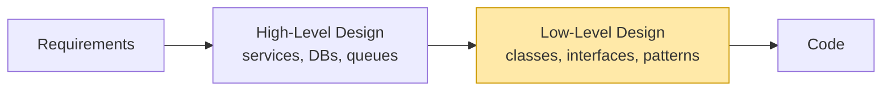

### Why do companies run LLD interviews?
Because writing code that *works today* is easy. Writing code that survives *the next ten feature requests* is the job. An LLD round simulates this: the interviewer gives a vague product ("design a parking lot", "design a notification system") and then **changes the requirements mid-interview** ("now add EV charging", "now add WhatsApp") to see whether your design bends or breaks.

### What the interviewer is actually scoring
(From the course's evaluation rubric, recurring in every section.)

| Criterion | What "good" looks like |
|---|---|
| Requirements clarification | You asked questions *before* drawing classes; you stated assumptions |
| Class design clarity | Each class has one clear responsibility and a clean interface |
| Correct use of OOP | Encapsulation, abstraction, polymorphism used *deliberately*, not as buzzwords |
| Extensibility | "Add a new X" = write one new class, modify nothing existing |
| Pattern usage | Patterns used because a problem demanded them, not to show off |
| Trade-off discussion | You can say *why* A over B (composition vs inheritance, interface vs abstract class…) |
| Code quality | Readable names, small methods, no giant `if/else` ladders |

---

## 0.2 The LLD Interview Framework (use this skeleton every time)

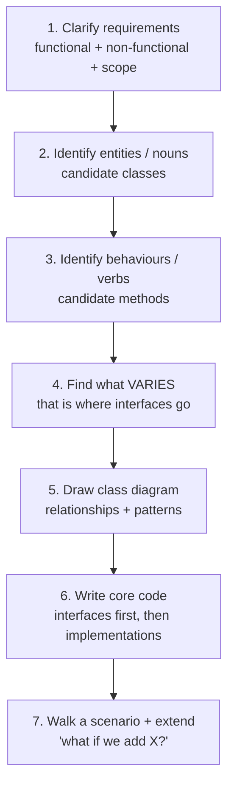

A suggested 45-minute split:

| Minutes | Step | Output |
|---|---|---|
| 0–5 | Requirements | Bullet list of must-haves, out-of-scope items, assumptions |
| 5–10 | Entities & relationships | Nouns → classes, verbs → methods |
| 10–20 | Class diagram | Interfaces, key classes, patterns chosen (with *reasons*) |
| 20–35 | Code | Core flow only; interfaces first |
| 35–45 | Extension round | Interviewer adds a requirement; you show zero modification of old classes |

**Golden rule of this whole course:** *find the axis of change, hide it behind an interface, and let callers depend on the interface.* Every OOP rule, every SOLID principle and every design pattern is a variation of that one sentence.

---

## 0.3 UML Cheat-Sheet (the only notation you need)

### Class box
```
+---------------------------+
|        BankAccount        |   <- class name
+---------------------------+
| - balance : double        |   <- fields   (- private, + public, # protected, ~ package)
| - owner   : String        |
+---------------------------+
| + deposit(amt) : void     |   <- methods
| + withdraw(amt) : void    |
+---------------------------+
```

### The six relationships (strongest coupling → weakest)

| # | Relationship | Meaning | Mermaid arrow | Lifetime link? | Code smell test |
|---|---|---|---|---|---|
| 1 | **Inheritance** (generalisation) | "is-a" | `Parent <\|-- Child` | — | `class B extends A` |
| 2 | **Realisation** | "implements a contract" | `Interface <\|.. Impl` | — | `class B implements I` |
| 3 | **Composition** | "owns / part-of"; part dies with whole | `Whole *-- Part` | **Yes** | Whole creates Part in its constructor |
| 4 | **Aggregation** | "has-a" but shared; part can outlive whole | `Whole o-- Part` | No | Part is passed in from outside and stored |
| 5 | **Association** | "knows / uses long-term" | `A --> B` | No | B is a field of A |
| 6 | **Dependency** | "uses briefly" | `A ..> B` | No | B is a parameter / local variable of A's method |

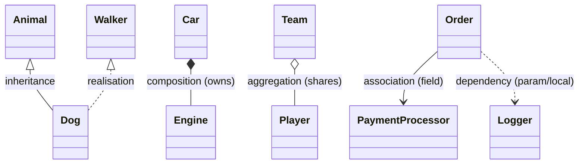

**How the six look in code (same idea, three languages):**

```java nocompile
class Car {                         // Composition: Car creates & owns Engine
    private final Engine engine = new Engine();
}
class Team {                        // Aggregation: Players come from outside
    private final List<Player> players;
    Team(List<Player> players) { this.players = players; }
}
class Order {                       // Association: long-lived reference via interface
    private final PaymentProcessor processor;
    void pay(Money m, Logger log) { // Dependency: Logger only used inside the method
        log.info("paying"); processor.charge(m);
    }
}
```

```cpp nocompile
class Car { Engine engine_; };                 // Composition: member by VALUE (dies with Car)
class Team { std::vector<Player*> players_; }; // Aggregation: non-owning pointers
class Order { PaymentProcessor& proc_; };      // Association: reference/pointer to collaborator
void Order::pay(Money m, Logger& log);         // Dependency: parameter only
```

```c nocompile
typedef struct { Engine engine; } Car;             /* Composition: struct embedded by value */
typedef struct { Player** players; int n; } Team;  /* Aggregation: array of pointers (not owned) */
typedef struct { PaymentProcessor* proc; } Order;  /* Association: pointer field */
void order_pay(Order* o, Money m, Logger* log);    /* Dependency: parameter only */
```

### Multiplicity
`1`, `0..1`, `*`, `1..*` written on the line ends (e.g. `Order "1" --> "*" LineItem`).

### Sequence diagrams
Show *who calls whom, in what order* for one scenario. In Mermaid:
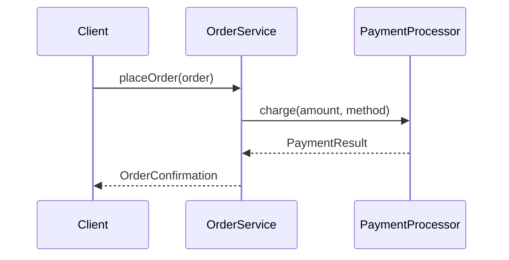

---

## 0.4 OOP in Three Languages — A Survival Primer

The course slides use **Java**. These notes add **C++** and **C** for every important example. Before diving in, here is how the same ideas map across the three languages.

| Concept | Java | C++ | C |
|---|---|---|---|
| Class | `class` | `class` / `struct` | `struct` + free functions |
| Encapsulation | `private` / `protected` / `public` | `private:` / `protected:` / `public:` | **Opaque pointer** (struct body hidden in the `.c` file) |
| Interface | `interface` | Abstract class with **pure virtual** functions (`= 0`) | Struct of **function pointers** (a hand-made vtable) |
| Abstract class | `abstract class` | Class with ≥1 pure virtual function | Struct with function pointers + shared fields |
| Inheritance | `extends` (single) | `: public Base` (multiple allowed) | **Embed** base struct as *first member* |
| Runtime polymorphism | All non-static, non-final methods are virtual | Only `virtual` methods | Call through function pointer |
| Compile-time polymorphism | Overloading, generics | Overloading, **templates** | Macros, `_Generic` (C11) |
| Memory | Garbage collected | RAII / smart pointers (`unique_ptr`) | Manual `malloc` / `free` |
| Destructor | `finalize` (avoid) / `AutoCloseable` | `~Class()` (**make base destructors `virtual`**) | Explicit `xxx_destroy()` |
| Exceptions | `throw` / `try-catch` | `throw` / `try-catch` | Return codes / `errno` |
| Null-safety | `Optional<T>` | `std::optional<T>` | `NULL` pointer return |

### How does runtime polymorphism actually work? (vtables)

Every class with virtual methods has a hidden table of function pointers (the **vtable**). Each object carries a hidden pointer (**vptr**) to its class's vtable. A call like `shape->area()` is compiled as "follow the vptr, look up slot #0, jump".

```
 object Circle (on heap)         vtable for Circle            code
+------------------+          +---------------------+      +-------------------+
| vptr  ---------------------> | [0] &Circle::area   | ---> | double area(){..} |
| radius = 2.0     |          | [1] &Circle::name   | ---> | ...               |
+------------------+          +---------------------+      +-------------------+

 object Rect (on heap)           vtable for Rect
+------------------+          +---------------------+
| vptr  ---------------------> | [0] &Rect::area     |
| w=2.0, h=3.0     |          | [1] &Rect::name     |
+------------------+          +---------------------+

  Shape* s = new Circle(2.0);   s->area();   // -> vptr -> slot 0 -> Circle::area
```

Java and C++ build this table for you. **In C you build it by hand** — which is exactly why C is the best language for *understanding* what polymorphism is. Here is the same "hello world of polymorphism" in all three languages:

**Java**
```java
interface Shape {
    double area();
    String name();
}
class Circle implements Shape {
    private final double r;
    Circle(double r) { this.r = r; }
    public double area() { return Math.PI * r * r; }
    public String name() { return "Circle"; }
}
class Rect implements Shape {
    private final double w, h;
    Rect(double w, double h) { this.w = w; this.h = h; }
    public double area() { return w * h; }
    public String name() { return "Rect"; }
}
public class Main {
    public static void main(String[] args) {
        Shape[] shapes = { new Circle(1.0), new Rect(2.0, 3.0) };
        for (Shape s : shapes)                       // same call, different behaviour
            System.out.printf("%s area=%.2f%n", s.name(), s.area());
    }
}
```

**C++**
```cpp
#include <cmath>
#include <iomanip>
#include <iostream>
#include <memory>
#include <vector>

struct Shape {                                   // "interface" = abstract class
    virtual ~Shape() = default;                  // ALWAYS virtual destructor in a base class
    virtual double area() const = 0;             // = 0  -> pure virtual
    virtual const char* name() const = 0;
};
class Circle : public Shape {
    double r_;
public:
    explicit Circle(double r) : r_(r) {}
    double area() const override { return M_PI * r_ * r_; }
    const char* name() const override { return "Circle"; }
};
class Rect : public Shape {
    double w_, h_;
public:
    Rect(double w, double h) : w_(w), h_(h) {}
    double area() const override { return w_ * h_; }
    const char* name() const override { return "Rect"; }
};
int main() {
    std::vector<std::unique_ptr<Shape>> shapes;  // smart pointers: no manual delete
    shapes.push_back(std::make_unique<Circle>(1.0));
    shapes.push_back(std::make_unique<Rect>(2.0, 3.0));
    std::cout << std::fixed << std::setprecision(2);
    for (const auto& s : shapes)
        std::cout << s->name() << " area=" << s->area() << "\n";
}
```

**C** (hand-built vtable)
```c
#include <stdio.h>
#define PI 3.14159265358979323846

typedef struct Shape Shape;
struct Shape {                                   /* the "interface": a table of function pointers */
    double      (*area)(const Shape* self);
    const char* (*name)(const Shape* self);
};

typedef struct { Shape base; double r; } Circle;       /* base MUST be the first member */
typedef struct { Shape base; double w, h; } Rect;

static double circle_area(const Shape* s) { const Circle* c = (const Circle*)s; return PI * c->r * c->r; }
static const char* circle_name(const Shape* s) { (void)s; return "Circle"; }
static double rect_area(const Shape* s) { const Rect* r = (const Rect*)s; return r->w * r->h; }
static const char* rect_name(const Shape* s) { (void)s; return "Rect"; }

int main(void) {
    Circle c = { { circle_area, circle_name }, 1.0 };
    Rect   r = { { rect_area,   rect_name   }, 2.0, 3.0 };
    Shape* shapes[] = { &c.base, &r.base };      /* pointer to first member == pointer to struct */
    for (int i = 0; i < 2; i++)
        printf("%s area=%.2f\n", shapes[i]->name(shapes[i]), shapes[i]->area(shapes[i]));
    return 0;
}
```

Expected output (all three): `Circle area=3.14` then `Rect area=6.00`.

> **Key insight.** The three programs are *the same design*. Java and C++ hide the vtable; C shows it. When these notes say "interface", in C read "a struct of function pointers".

### The three C techniques you will see throughout these notes

| Technique | What it emulates | Idiom |
|---|---|---|
| **Opaque pointer** | `private` fields | Header declares `typedef struct Foo Foo;` only; the struct body lives in `foo.c`; callers can only hold `Foo*` and call `foo_xxx()` |
| **Function-pointer struct** | `interface` / `virtual` | `struct Iface { ret (*method)(Iface* self, ...); };` |
| **Embed-as-first-member** | `extends` | `struct Derived { Base base; int extra; };` then cast `(Derived*)basePtr` |

> **Note on single-file C examples.** In real projects you split into `foo.h` / `foo.c` so the compiler *enforces* the opaque pointer. To keep each example runnable as one file, these notes put the "header part" and "implementation part" in one file separated by comments.

---

## 0.5 How to read the rest of these notes

| Marker | Meaning |
|---|---|
| 🎯 **Interview Relevance** | What the interviewer is testing at this point |
| 💡 **Interview Tip** | A phrase or move that earns points |
| ⚠️ **Pitfall** | A common mistake |
| ✅ / ❌ | Good design / bad design |
| *Runnable* code blocks | Every Java / C++ / C block with a `main` was compiled and executed while preparing these notes. Java: only `Main` is `public` so each block is one self-contained file |

**Roadmap of the notes**


Why this order? Each layer *uses* the previous one:
- **OOP** gives you the primitives (class, interface, polymorphism).
- **SOLID** tells you *how to arrange* those primitives so code survives change.
- **Design patterns** are *named, reusable arrangements* that follow SOLID. (Factory uses polymorphism, Strategy uses composition, Observer uses interfaces…)
- **Selection framework + anti-patterns** teach you *when not* to use them.

---

# PART 1 — OOP PRINCIPLES THROUGH AN INTERVIEW LENS
*(Course Sections 1 & 2 — slides 9–24)*

> **Core message of the section:** OOP is **not** a checklist of keywords to recite. Interviewers evaluate whether you can use OOP principles to make **deliberate design decisions** that produce clean, extensible, maintainable class structures — at mid-level and senior levels.

### What we will cover
1. Encapsulation — information hiding, not access modifiers
2. Abstraction — clean interface design
3. Inheritance — and its coupling risks
4. Polymorphism — extensible behaviour
5. Composition vs Inheritance — *the* most important OOD trade-off
6. Abstract classes vs Interfaces — with a decision framework

### Where OOP shows up in an LLD interview

| Interview stage | How OOP is evaluated |
|---|---|
| Requirements clarification | Can you identify the right objects and assign clear responsibilities? |
| Class design | Do your classes have well-defined boundaries and clean interfaces? |
| Extensibility probe | *"How would you add a new type of X?"* → tests polymorphism and open-closed thinking |
| Trade-off discussion | *"Why composition here instead of inheritance?"* → tests design maturity |
| Code walkthrough | Are classes encapsulated properly? Do methods express **behaviour**, not data access? |

---

## 1.1 Encapsulation — Information Hiding as a Design Decision

**Definition.** Encapsulation means a class **controls** access to its own internal state and exposes only what other classes need. The key word is *controls*. It is a **design decision about what to hide and what to reveal** — not simply marking fields `private`.

### Invariants — the reason encapsulation exists

An **invariant** is a condition that must *always* be true for an object to be in a valid state.

| Class | Invariant |
|---|---|
| `BankAccount` | `balance >= 0` |
| `UserAccount` | `failedLoginAttempts < 5` ⇒ `locked == false` |
| `NotificationPreferences` | quiet hours are in `0..23` |
| `Order` | total = Σ(line items) |

Encapsulation makes the class the **only** place where an invariant can be broken — therefore the only place you must check it.

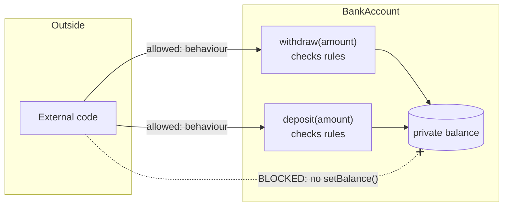

### Worked example — `BankAccount` protects `balance >= 0`

Notice: **there is no `setBalance()`**. The only ways to change the balance are `deposit()` and `withdraw()`, and both enforce the rules.

**Java**
```java
import java.util.*;

class BankAccount {
    private double balance;                        // invariant: balance >= 0
    private final String ownerName;
    private final List<String> transactions = new ArrayList<>();

    BankAccount(String ownerName, double initialBalance) {
        if (initialBalance < 0) throw new IllegalArgumentException("Initial balance cannot be negative");
        this.ownerName = ownerName;
        this.balance = initialBalance;
    }
    void deposit(double amount) {
        if (amount <= 0) throw new IllegalArgumentException("Deposit amount must be positive");
        balance += amount;
        transactions.add("deposit:" + amount);
    }
    void withdraw(double amount) {
        if (amount <= 0) throw new IllegalArgumentException("Withdrawal amount must be positive");
        if (amount > balance) throw new IllegalStateException("Insufficient funds: balance=" + balance + ", requested=" + amount);
        balance -= amount;
        transactions.add("withdrawal:" + amount);
    }
    double getBalance() { return balance; }                    // read-only; NO setBalance()
    List<String> getTransactions() { return Collections.unmodifiableList(transactions); }
}

public class Main {
    public static void main(String[] args) {
        BankAccount acc = new BankAccount("Asha", 100);
        acc.withdraw(30);
        System.out.println("Balance: " + acc.getBalance());    // 70.0
        try { acc.withdraw(500); }
        catch (IllegalStateException e) { System.out.println("Rejected: " + e.getMessage()); }
        // acc.balance = -1000;   // COMPILE ERROR: balance has private access
    }
}
```

**C++**
```cpp
#include <iostream>
#include <stdexcept>
#include <string>
#include <utility>
#include <vector>

class BankAccount {
    double balance_;                               // invariant: balance_ >= 0
    std::string owner_;
    std::vector<std::string> transactions_;
public:
    BankAccount(std::string owner, double initial) : balance_(initial), owner_(std::move(owner)) {
        if (initial < 0) throw std::invalid_argument("Initial balance cannot be negative");
    }
    void deposit(double amount) {
        if (amount <= 0) throw std::invalid_argument("Deposit amount must be positive");
        balance_ += amount;
        transactions_.push_back("deposit:" + std::to_string(amount));
    }
    void withdraw(double amount) {
        if (amount <= 0) throw std::invalid_argument("Withdrawal amount must be positive");
        if (amount > balance_) throw std::runtime_error("Insufficient funds");
        balance_ -= amount;
        transactions_.push_back("withdrawal:" + std::to_string(amount));
    }
    double balance() const { return balance_; }                              // const: cannot mutate
    const std::vector<std::string>& transactions() const { return transactions_; }  // const-ref: read-only view
};

int main() {
    BankAccount acc("Asha", 100);
    acc.withdraw(30);
    std::cout << "Balance: " << acc.balance() << "\n";      // 70
    try { acc.withdraw(500); }
    catch (const std::exception& e) { std::cout << "Rejected: " << e.what() << "\n"; }
    // acc.balance_ = -1000;   // COMPILE ERROR: 'balance_' is private
}
```

**C** — the *opaque pointer* technique: callers literally cannot see the fields.
```c
#include <stdio.h>
#include <stdlib.h>
#include <string.h>

/* ============ bank_account.h  (the PUBLIC face) ============ */
typedef struct BankAccount BankAccount;                 /* incomplete type: fields invisible to callers */
typedef enum { BA_OK = 0, BA_INVALID_AMOUNT = -1, BA_INSUFFICIENT_FUNDS = -2 } BaStatus;

BankAccount* ba_create(const char* owner, double initial);   /* NULL if initial < 0 */
BaStatus     ba_deposit(BankAccount* a, double amount);
BaStatus     ba_withdraw(BankAccount* a, double amount);
double       ba_balance(const BankAccount* a);               /* read-only accessor, no setter */
void         ba_destroy(BankAccount* a);

/* ============ bank_account.c  (PRIVATE implementation) ============ */
struct BankAccount { double balance; char owner[64]; int tx_count; };

BankAccount* ba_create(const char* owner, double initial) {
    if (initial < 0) return NULL;
    BankAccount* a = malloc(sizeof *a);
    if (!a) return NULL;
    a->balance = initial; a->tx_count = 0;
    strncpy(a->owner, owner, sizeof a->owner - 1);
    a->owner[sizeof a->owner - 1] = '\0';
    return a;
}
BaStatus ba_deposit(BankAccount* a, double amount) {
    if (amount <= 0) return BA_INVALID_AMOUNT;
    a->balance += amount; a->tx_count++;
    return BA_OK;
}
BaStatus ba_withdraw(BankAccount* a, double amount) {
    if (amount <= 0) return BA_INVALID_AMOUNT;
    if (amount > a->balance) return BA_INSUFFICIENT_FUNDS;
    a->balance -= amount; a->tx_count++;
    return BA_OK;
}
double ba_balance(const BankAccount* a) { return a->balance; }
void   ba_destroy(BankAccount* a) { free(a); }

/* ============ main.c  (a caller: can only use the functions above) ============ */
int main(void) {
    BankAccount* acc = ba_create("Asha", 100);
    ba_withdraw(acc, 30);
    printf("Balance: %.1f\n", ba_balance(acc));
    if (ba_withdraw(acc, 500) == BA_INSUFFICIENT_FUNDS) printf("Rejected: insufficient funds\n");
    /* acc->balance = -1000;  <- in a real multi-file build this is a compile error (incomplete type) */
    ba_destroy(acc);
    return 0;
}
```

> 🎯 **Interview Relevance.** Interviewers check whether your classes expose **raw state** or enforce **rules through behaviour methods**. A setter on a field that has constraints is a design red flag.

---

## 1.2 Why Getters and Setters Are NOT Encapsulation

A very common misconception: *"I made all fields private and generated getters/setters, so it is encapsulated."* **It is not.** If every field has a public getter and setter, the class exposes its whole internal structure — you added boilerplate and gained **zero** protection. `private` becomes cosmetic.

### ❌ The common mistake: exposing everything

```java nocompile
public class UserProfile {
    private String name;
    private String email;
    private String password;

    public String getPassword() { return password; }              // leaks the secret
    public void setPassword(String newPassword) {                  // accepts ANY string
        this.password = newPassword;
    }
}
```
Problems: the raw password is readable; the setter does no validation, no hashing, no policy check.

### ✅ Stronger approach: behaviour over data access

```java nocompile
public class UserProfile {
    private final String name;
    private final String email;
    private String passwordHash;

    public UserProfile(String name, String email, String rawPassword) {
        this.name = name; this.email = email;
        this.passwordHash = PasswordHasher.hash(rawPassword);
    }
    public boolean authenticate(String rawPassword) {
        return PasswordHasher.verify(rawPassword, this.passwordHash);
    }
    public void changePassword(String currentPassword, String newPassword) {
        if (!authenticate(currentPassword)) throw new AuthenticationException("Current password is incorrect");
        if (newPassword.length() < 8)        throw new ValidationException("Password must be at least 8 characters");
        this.passwordHash = PasswordHasher.hash(newPassword);
    }
}
```
The password is never exposed. External code **tells the object what to do** (*"Tell, Don't Ask"*), not how to store its data.

| | Getter/Setter "data bag" | Encapsulated object |
|---|---|---|
| External code can read the secret | Yes | No |
| Validation lives in | Every caller (duplicated, forgotten) | One place — the class |
| Can an invariant be broken from outside? | Yes | No |
| Methods are named after | Fields (`getX`, `setX`) | Business actions (`authenticate`, `changePassword`) |

> 🎯 **Interview Relevance.** When an interviewer says *"encapsulate this properly"*, they check whether you expose **behaviour or data**. A class full of getters/setters for every field is a **data bag**, not an encapsulated object.

---

## 1.3 Worked Example — `UserAccount` with Password Handling (full)

Every method enforces a business rule; no state transition can bypass validation. `failedLoginAttempts` and `locked` have **no getters or setters** — nobody can unlock an account by calling `setLocked(false)`. `changeEmail()` requires the current password, so email cannot change without identity verification. (The notes below also add `changePassword()` from the previous slide so the full picture is in one class.)

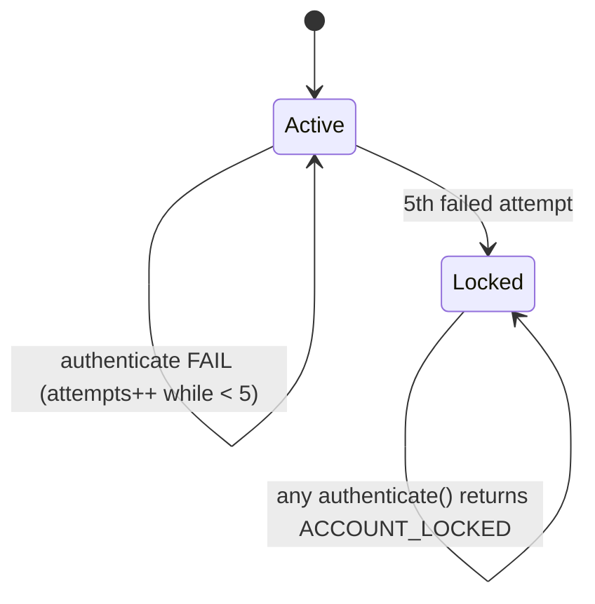

**Java**
```java
class PasswordHasher {                                   // DEMO ONLY - use bcrypt/argon2 in production
    static String hash(String raw) { return Integer.toHexString(("salt:" + raw).hashCode()); }
    static boolean verify(String raw, String hash) { return hash(raw).equals(hash); }
}
class LoginResult {
    private final String text;
    private LoginResult(String text) { this.text = text; }
    static LoginResult success(String userId)      { return new LoginResult("SUCCESS(" + userId + ")"); }
    static LoginResult accountLocked()             { return new LoginResult("ACCOUNT_LOCKED"); }
    static LoginResult invalidCredentials(int left){ return new LoginResult("INVALID(attempts left: " + left + ")"); }
    @Override public String toString() { return text; }
}
class UserAccount {
    private final String userId;
    private String email;
    private String passwordHash;
    private int failedLoginAttempts;
    private boolean locked;

    UserAccount(String userId, String email, String rawPassword) {
        this.userId = userId; this.email = email;
        this.passwordHash = PasswordHasher.hash(rawPassword);
    }
    LoginResult authenticate(String rawPassword) {
        if (locked) return LoginResult.accountLocked();
        if (!PasswordHasher.verify(rawPassword, passwordHash)) {
            failedLoginAttempts++;
            if (failedLoginAttempts >= 5) locked = true;
            return LoginResult.invalidCredentials(5 - failedLoginAttempts);
        }
        failedLoginAttempts = 0;
        return LoginResult.success(userId);
    }
    void changeEmail(String newEmail, String currentPassword) {
        if (!PasswordHasher.verify(currentPassword, passwordHash))
            throw new SecurityException("Password required to change email");
        this.email = newEmail;
    }
    void changePassword(String currentPassword, String newPassword) {
        if (!PasswordHasher.verify(currentPassword, passwordHash)) throw new SecurityException("Current password is incorrect");
        if (newPassword.length() < 8) throw new IllegalArgumentException("Password must be at least 8 characters");
        this.passwordHash = PasswordHasher.hash(newPassword);
    }
}
public class Main {
    public static void main(String[] args) {
        UserAccount u = new UserAccount("u1", "a@x.com", "correct-horse");
        for (int i = 0; i < 6; i++) System.out.println("try " + (i + 1) + ": " + u.authenticate("wrong"));
        System.out.println("right password after lock: " + u.authenticate("correct-horse"));
    }
}
```

**C++**
```cpp
#include <functional>
#include <iostream>
#include <stdexcept>
#include <string>

struct PasswordHasher {                                  // DEMO ONLY - use bcrypt/argon2 in production
    static std::size_t hash(const std::string& raw) { return std::hash<std::string>{}("salt:" + raw); }
    static bool verify(const std::string& raw, std::size_t h) { return hash(raw) == h; }
};
class LoginResult {
    std::string text_;
    explicit LoginResult(std::string t) : text_(std::move(t)) {}
public:
    static LoginResult success(const std::string& id) { return LoginResult("SUCCESS(" + id + ")"); }
    static LoginResult accountLocked()                { return LoginResult("ACCOUNT_LOCKED"); }
    static LoginResult invalidCredentials(int left)   { return LoginResult("INVALID(attempts left: " + std::to_string(left) + ")"); }
    const std::string& str() const { return text_; }
};
class UserAccount {
    std::string userId_, email_;
    std::size_t passwordHash_;
    int failedLoginAttempts_ = 0;
    bool locked_ = false;
public:
    UserAccount(std::string id, std::string email, const std::string& rawPassword)
        : userId_(std::move(id)), email_(std::move(email)), passwordHash_(PasswordHasher::hash(rawPassword)) {}

    LoginResult authenticate(const std::string& rawPassword) {
        if (locked_) return LoginResult::accountLocked();
        if (!PasswordHasher::verify(rawPassword, passwordHash_)) {
            if (++failedLoginAttempts_ >= 5) locked_ = true;
            return LoginResult::invalidCredentials(5 - failedLoginAttempts_);
        }
        failedLoginAttempts_ = 0;
        return LoginResult::success(userId_);
    }
    void changeEmail(const std::string& newEmail, const std::string& currentPassword) {
        if (!PasswordHasher::verify(currentPassword, passwordHash_)) throw std::runtime_error("Password required to change email");
        email_ = newEmail;
    }
    void changePassword(const std::string& current, const std::string& next) {
        if (!PasswordHasher::verify(current, passwordHash_)) throw std::runtime_error("Current password is incorrect");
        if (next.size() < 8) throw std::invalid_argument("Password must be at least 8 characters");
        passwordHash_ = PasswordHasher::hash(next);
    }
};
int main() {
    UserAccount u("u1", "a@x.com", "correct-horse");
    for (int i = 1; i <= 6; i++) std::cout << "try " << i << ": " << u.authenticate("wrong").str() << "\n";
    std::cout << "right password after lock: " << u.authenticate("correct-horse").str() << "\n";
}
```

**C**
```c
#include <stdio.h>
#include <stdlib.h>
#include <string.h>

/* ---------- user_account.h ---------- */
typedef struct UserAccount UserAccount;                       /* opaque */
typedef enum { LOGIN_SUCCESS, LOGIN_INVALID, LOGIN_LOCKED } LoginStatus;
typedef struct { LoginStatus status; int attempts_left; } LoginResult;

UserAccount* ua_create(const char* id, const char* email, const char* raw_password);
LoginResult  ua_authenticate(UserAccount* u, const char* raw_password);
int          ua_change_email(UserAccount* u, const char* new_email, const char* current_password);
void         ua_destroy(UserAccount* u);

/* ---------- user_account.c ---------- */
struct UserAccount {
    char id[32], email[64];
    unsigned long password_hash;
    int failed_attempts;
    int locked;
};
static unsigned long hash_pw(const char* s) {                 /* DEMO ONLY (djb2); use bcrypt/argon2 for real */
    unsigned long h = 5381; int c;
    while ((c = (unsigned char)*s++)) h = h * 33 + (unsigned long)c;
    return h;
}
UserAccount* ua_create(const char* id, const char* email, const char* raw) {
    UserAccount* u = calloc(1, sizeof *u);
    strncpy(u->id, id, sizeof u->id - 1);
    strncpy(u->email, email, sizeof u->email - 1);
    u->password_hash = hash_pw(raw);
    return u;
}
LoginResult ua_authenticate(UserAccount* u, const char* raw) {
    LoginResult r;
    if (u->locked) { r.status = LOGIN_LOCKED; r.attempts_left = 0; return r; }
    if (hash_pw(raw) != u->password_hash) {
        if (++u->failed_attempts >= 5) u->locked = 1;
        r.status = LOGIN_INVALID; r.attempts_left = 5 - u->failed_attempts; return r;
    }
    u->failed_attempts = 0;
    r.status = LOGIN_SUCCESS; r.attempts_left = -1; return r;
}
int ua_change_email(UserAccount* u, const char* new_email, const char* current_password) {
    if (hash_pw(current_password) != u->password_hash) return -1;   /* identity check first */
    strncpy(u->email, new_email, sizeof u->email - 1);
    return 0;
}
void ua_destroy(UserAccount* u) { free(u); }

/* ---------- main.c ---------- */
static const char* label(LoginStatus s) { return s == LOGIN_SUCCESS ? "SUCCESS" : s == LOGIN_LOCKED ? "ACCOUNT_LOCKED" : "INVALID"; }
int main(void) {
    UserAccount* u = ua_create("u1", "a@x.com", "correct-horse");
    for (int i = 1; i <= 6; i++) { LoginResult r = ua_authenticate(u, "wrong"); printf("try %d: %s (left=%d)\n", i, label(r.status), r.attempts_left); }
    printf("right password after lock: %s\n", label(ua_authenticate(u, "correct-horse").status));
    ua_destroy(u);
    return 0;
}
```

**What makes this encapsulated?**
- Lockout policy lives **inside** `authenticate()`; no one can reset or bypass it.
- No setter for `locked` or `failedLoginAttempts`.
- Identity is re-verified before sensitive changes.

> 💡 **Interview Tip.** While drawing your class diagram, ask for **every field**: *"Should external code read this? Change this? Under what conditions?"* If any answer involves a **rule**, that field needs a **behaviour method**, not a setter.
>
> 🎯 Interviewers evaluate the **ratio of behaviour methods to getters/setters**. Mostly-behaviour classes signal that you understand encapsulation as a design principle.

---

## 1.4 Abstraction — Designing Clean Interfaces

**Definition.** Abstraction hides **implementation complexity** behind a simplified contract. Encapsulation hides *data*; abstraction hides *how things work*. A good abstraction lets calling code say **what** it wants without knowing **how** it gets done. The interface defines the *what*; the implementing class owns the *how*.

### Abstraction in practice — `MessageSender`

`OrderConfirmationService` depends on `MessageSender`, **not** on any implementation. Email today, SMS tomorrow — **zero code change** in the service. The interface is the **abstraction boundary**; everything behind it can change freely.

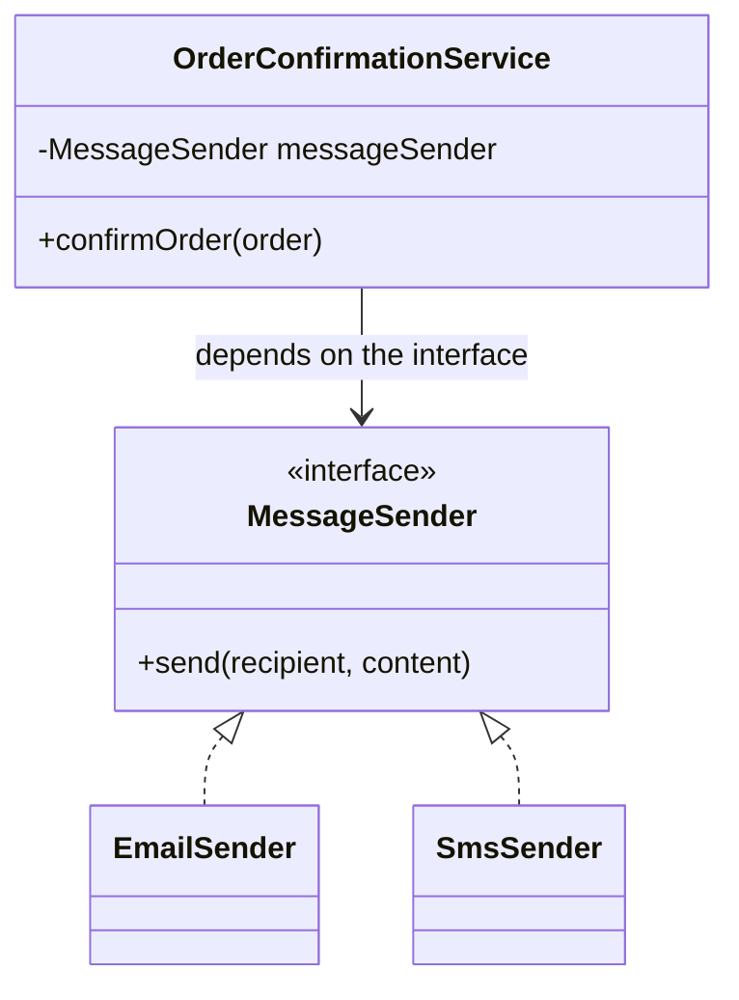

**Java**
```java
interface MessageSender {
    boolean send(String recipient, String content);
}
class EmailSender implements MessageSender {
    public boolean send(String to, String content) { System.out.println("EMAIL to " + to + ": " + content); return true; }
}
class SmsSender implements MessageSender {
    public boolean send(String to, String content) { System.out.println("SMS   to " + to + ": " + content); return true; }
}
class OrderConfirmationService {
    private final MessageSender messageSender;                    // depends on abstraction
    OrderConfirmationService(MessageSender messageSender) { this.messageSender = messageSender; }
    void confirmOrder(String orderId, String customerContact) {
        messageSender.send(customerContact, "Order " + orderId + " confirmed");
    }
}
public class Main {
    public static void main(String[] args) {
        new OrderConfirmationService(new EmailSender()).confirmOrder("A-100", "ann@x.com");
        new OrderConfirmationService(new SmsSender()).confirmOrder("A-101", "+91-90000-00000");   // swap, no service change
    }
}
```

**C++**
```cpp
#include <iostream>
#include <string>

struct MessageSender {
    virtual ~MessageSender() = default;
    virtual bool send(const std::string& to, const std::string& content) = 0;
};
struct EmailSender : MessageSender {
    bool send(const std::string& to, const std::string& c) override { std::cout << "EMAIL to " << to << ": " << c << "\n"; return true; }
};
struct SmsSender : MessageSender {
    bool send(const std::string& to, const std::string& c) override { std::cout << "SMS   to " << to << ": " << c << "\n"; return true; }
};
class OrderConfirmationService {
    MessageSender& sender_;                                       // reference to the abstraction
public:
    explicit OrderConfirmationService(MessageSender& s) : sender_(s) {}
    void confirmOrder(const std::string& orderId, const std::string& contact) {
        sender_.send(contact, "Order " + orderId + " confirmed");
    }
};
int main() {
    EmailSender email; SmsSender sms;
    OrderConfirmationService(email).confirmOrder("A-100", "ann@x.com");
    OrderConfirmationService(sms).confirmOrder("A-101", "+91-90000-00000");
}
```

**C**
```c
#include <stdio.h>

typedef struct MessageSender MessageSender;
struct MessageSender {                                           /* the abstraction = function-pointer table */
    int (*send)(MessageSender* self, const char* to, const char* content);
};
static int email_send(MessageSender* s, const char* to, const char* c) { (void)s; printf("EMAIL to %s: %s\n", to, c); return 1; }
static int sms_send  (MessageSender* s, const char* to, const char* c) { (void)s; printf("SMS   to %s: %s\n", to, c); return 1; }

typedef struct { MessageSender* sender; } OrderConfirmationService;  /* depends on abstraction only */
static void confirm_order(OrderConfirmationService* svc, const char* order_id, const char* contact) {
    char buf[64];
    snprintf(buf, sizeof buf, "Order %s confirmed", order_id);
    svc->sender->send(svc->sender, contact, buf);
}
int main(void) {
    MessageSender email = { email_send }, sms = { sms_send };
    OrderConfirmationService a = { &email }, b = { &sms };
    confirm_order(&a, "A-100", "ann@x.com");
    confirm_order(&b, "A-101", "+91-90000-00000");
    return 0;
}
```

### Encapsulation vs Abstraction — side by side

| Principle | What it hides | How it is expressed | What it protects |
|---|---|---|---|
| **Encapsulation** | Internal data and state | Private fields + behaviour methods | **Invariants** and business rules |
| **Abstraction** | Implementation complexity | Interfaces and abstract classes | **Calling code from change** |

Both together = maximum flexibility: you can change the **data representation** *and* the **implementation approach** without touching any outside code.

> 🎯 Interviewers test abstraction with: *"What if we need to swap this component?"* If swapping requires modifying existing classes, your abstraction is **leaking**.

---

## 1.5 Abstraction Leaks (and how interviewers probe them)

An **abstraction leak** happens when implementation details escape through the interface, forcing callers to know things they shouldn't.

### ❌ Leak: exposing an internal data structure

```java nocompile
public class OrderRepository {
    private final Map<String, Order> orderStore = new HashMap<>();
    public Map<String, Order> getOrderStore() { return orderStore; }   // LEAK
}
```
- Callers now depend on "orders live in a `Map`". Move to a database → **every caller changes**.
- Worse: any caller can run `getOrderStore().clear()` and wipe all data **bypassing every rule**.

### ✅ Fix: hide the storage mechanism behind intention-revealing methods

**Java**
```java
import java.util.*;
import java.util.stream.*;

class Order {
    private final String id, customerId;
    Order(String id, String customerId) { this.id = id; this.customerId = customerId; }
    String getId() { return id; }
    String getCustomerId() { return customerId; }
    @Override public String toString() { return id + "/" + customerId; }
}
class OrderRepository {
    private final Map<String, Order> orderStore = new HashMap<>();      // hidden
    Optional<Order> findById(String orderId) { return Optional.ofNullable(orderStore.get(orderId)); }
    List<Order> findByCustomer(String customerId) {
        return orderStore.values().stream().filter(o -> o.getCustomerId().equals(customerId)).collect(Collectors.toList());
    }
    void save(Order order) { orderStore.put(order.getId(), order); }
}
public class Main {
    public static void main(String[] args) {
        OrderRepository repo = new OrderRepository();
        repo.save(new Order("o1", "c1")); repo.save(new Order("o2", "c1")); repo.save(new Order("o3", "c2"));
        System.out.println(repo.findById("o2").orElse(null));
        System.out.println(repo.findByCustomer("c1").size() + " orders for c1");
    }
}
```

**C++**
```cpp
#include <iostream>
#include <optional>
#include <string>
#include <unordered_map>
#include <vector>

struct Order { std::string id, customerId; };
class OrderRepository {
    std::unordered_map<std::string, Order> store_;                  // hidden
public:
    std::optional<Order> findById(const std::string& id) const {
        auto it = store_.find(id);
        return it == store_.end() ? std::nullopt : std::optional<Order>(it->second);
    }
    std::vector<Order> findByCustomer(const std::string& cid) const {
        std::vector<Order> out;
        for (const auto& [id, o] : store_) if (o.customerId == cid) out.push_back(o);
        return out;
    }
    void save(const Order& o) { store_[o.id] = o; }
};
int main() {
    OrderRepository repo;
    repo.save({"o1", "c1"}); repo.save({"o2", "c1"}); repo.save({"o3", "c2"});
    if (auto o = repo.findById("o2")) std::cout << o->id << "/" << o->customerId << "\n";
    std::cout << repo.findByCustomer("c1").size() << " orders for c1\n";
}
```

**C**
```c
#include <stdio.h>
#include <string.h>

/* ---- public face: callers never see how orders are stored ---- */
typedef struct { char id[16]; char customer[16]; } Order;
typedef struct OrderRepository OrderRepository;                      /* opaque */
void          repo_init(OrderRepository* r);
void          repo_save(OrderRepository* r, Order o);
const Order*  repo_find_by_id(const OrderRepository* r, const char* id);          /* NULL when absent */
int           repo_find_by_customer(const OrderRepository* r, const char* c, const Order** out, int max);

/* ---- private implementation (could become a hash table or a DB without any caller changing) ---- */
struct OrderRepository { Order items[32]; int n; };
void repo_init(OrderRepository* r) { r->n = 0; }
void repo_save(OrderRepository* r, Order o) {
    for (int i = 0; i < r->n; i++) if (!strcmp(r->items[i].id, o.id)) { r->items[i] = o; return; }
    if (r->n < 32) r->items[r->n++] = o;
}
const Order* repo_find_by_id(const OrderRepository* r, const char* id) {
    for (int i = 0; i < r->n; i++) if (!strcmp(r->items[i].id, id)) return &r->items[i];
    return NULL;
}
int repo_find_by_customer(const OrderRepository* r, const char* c, const Order** out, int max) {
    int k = 0;
    for (int i = 0; i < r->n && k < max; i++) if (!strcmp(r->items[i].customer, c)) out[k++] = &r->items[i];
    return k;
}
int main(void) {
    OrderRepository repo; repo_init(&repo);
    repo_save(&repo, (Order){"o1", "c1"}); repo_save(&repo, (Order){"o2", "c1"}); repo_save(&repo, (Order){"o3", "c2"});
    const Order* o = repo_find_by_id(&repo, "o2");
    if (o) printf("%s/%s\n", o->id, o->customer);
    const Order* list[8];
    printf("%d orders for c1\n", repo_find_by_customer(&repo, "c1", list, 8));
    return 0;
}
```

### The "swap test" — a reliable leak detector
> *If I changed the internal implementation (switched databases, changed data structures, swapped libraries), would any code **outside** this class need to change?* **Yes ⇒ you have a leak.**

Say this sentence out loud in the interview and apply it to your own design.

**Other leak shapes to watch for:** returning raw collections, exposing internal types (`StripeResponse` in your public signature), forcing callers to call methods in a specific hidden order, throwing implementation-specific exceptions (`SQLException` from a repository interface).

> 🎯 Interviewers look for leaks in your class diagram: raw collections, exposed internal types, or callers that must understand implementation details are all signals of weak design.

---

## 1.6 Worked Example — Payment Processing Interface

A payment system must support **Stripe today, PayPal tomorrow, a regional provider next quarter**. Without abstraction, every class that processes payments would need each provider's API details. Abstraction defines a clean contract that hides that complexity.

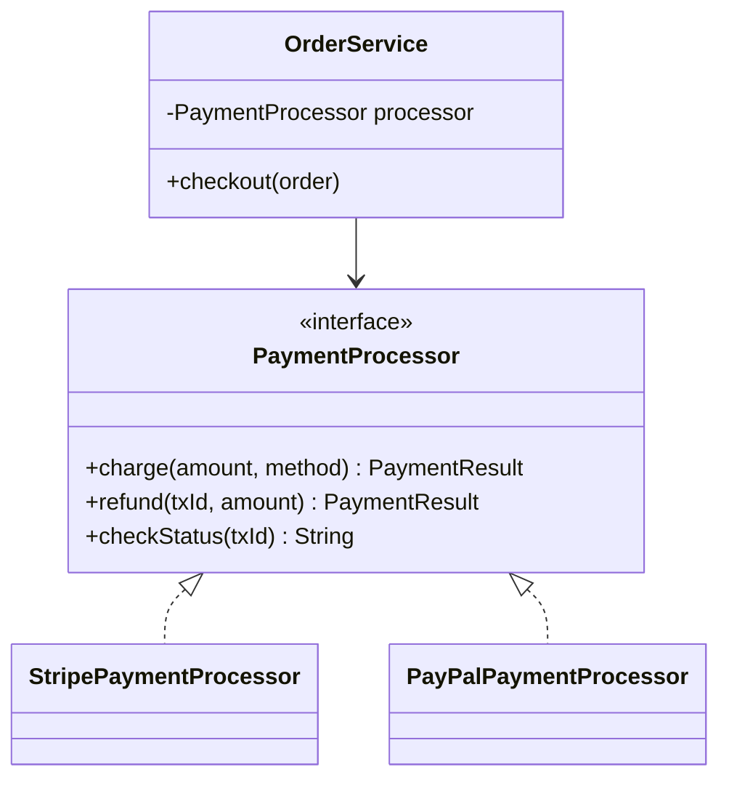

**Java**
```java
class Money {
    final long cents; final String currency;
    Money(long cents, String currency) { this.cents = cents; this.currency = currency; }
    @Override public String toString() { return String.format("%d.%02d %s", cents / 100, cents % 100, currency); }
}
class PaymentResult {
    final String transactionId, status;
    PaymentResult(String id, String status) { this.transactionId = id; this.status = status; }
    @Override public String toString() { return transactionId + ":" + status; }
}
interface PaymentProcessor {                                       // THE ABSTRACTION
    PaymentResult charge(Money amount, String methodToken);
    PaymentResult refund(String transactionId, Money amount);
    String checkStatus(String transactionId);
}
class StripePaymentProcessor implements PaymentProcessor {         // all Stripe details hidden in here
    public PaymentResult charge(Money amount, String token) { System.out.println("[Stripe] charge " + amount + " cents=" + amount.cents); return new PaymentResult("stripe_1", "SUCCEEDED"); }
    public PaymentResult refund(String tx, Money amount)    { return new PaymentResult(tx, "REFUNDED"); }
    public String checkStatus(String tx)                    { return "SUCCEEDED"; }
}
class PayPalPaymentProcessor implements PaymentProcessor {         // NEW provider = NEW class only
    public PaymentResult charge(Money amount, String token) { System.out.println("[PayPal] pay " + amount); return new PaymentResult("pp_9", "COMPLETED"); }
    public PaymentResult refund(String tx, Money amount)    { return new PaymentResult(tx, "REFUNDED"); }
    public String checkStatus(String tx)                    { return "COMPLETED"; }
}
class OrderService {
    private final PaymentProcessor processor;                      // depends on interface, never on Stripe
    OrderService(PaymentProcessor processor) { this.processor = processor; }
    PaymentResult checkout(Money total, String token) { return processor.charge(total, token); }
}
public class Main {
    public static void main(String[] args) {
        Money total = new Money(49900, "INR");
        System.out.println(new OrderService(new StripePaymentProcessor()).checkout(total, "tok_1"));
        System.out.println(new OrderService(new PayPalPaymentProcessor()).checkout(total, "tok_1"));  // zero change to OrderService
    }
}
```

**C++**
```cpp
#include <cstdio>
#include <iostream>
#include <string>

struct Money { long cents; std::string currency; };
struct PaymentResult { std::string transactionId, status; };

struct PaymentProcessor {                                            // THE ABSTRACTION
    virtual ~PaymentProcessor() = default;
    virtual PaymentResult charge(const Money& amount, const std::string& token) = 0;
    virtual PaymentResult refund(const std::string& txId, const Money& amount) = 0;
    virtual std::string checkStatus(const std::string& txId) = 0;
};
struct StripePaymentProcessor : PaymentProcessor {
    PaymentResult charge(const Money& a, const std::string&) override { std::cout << "[Stripe] charge cents=" << a.cents << "\n"; return {"stripe_1", "SUCCEEDED"}; }
    PaymentResult refund(const std::string& tx, const Money&) override { return {tx, "REFUNDED"}; }
    std::string checkStatus(const std::string&) override { return "SUCCEEDED"; }
};
struct PayPalPaymentProcessor : PaymentProcessor {
    PaymentResult charge(const Money& a, const std::string&) override { std::cout << "[PayPal] pay cents=" << a.cents << "\n"; return {"pp_9", "COMPLETED"}; }
    PaymentResult refund(const std::string& tx, const Money&) override { return {tx, "REFUNDED"}; }
    std::string checkStatus(const std::string&) override { return "COMPLETED"; }
};
class OrderService {
    PaymentProcessor& processor_;
public:
    explicit OrderService(PaymentProcessor& p) : processor_(p) {}
    PaymentResult checkout(const Money& total, const std::string& token) { return processor_.charge(total, token); }
};
int main() {
    Money total{49900, "INR"};
    StripePaymentProcessor stripe; PayPalPaymentProcessor paypal;
    auto r1 = OrderService(stripe).checkout(total, "tok_1");
    auto r2 = OrderService(paypal).checkout(total, "tok_1");
    std::cout << r1.transactionId << ":" << r1.status << "\n" << r2.transactionId << ":" << r2.status << "\n";
}
```

**C**
```c
#include <stdio.h>
#include <string.h>

typedef struct { const char* tx_id; const char* status; } PaymentResult;
typedef struct PaymentProcessor PaymentProcessor;
struct PaymentProcessor {                                                   /* THE ABSTRACTION */
    PaymentResult (*charge)(PaymentProcessor* self, long cents, const char* token);
    PaymentResult (*refund)(PaymentProcessor* self, const char* tx_id, long cents);
};
static PaymentResult stripe_charge(PaymentProcessor* s, long cents, const char* t) { (void)s; (void)t; printf("[Stripe] charge cents=%ld\n", cents); return (PaymentResult){"stripe_1", "SUCCEEDED"}; }
static PaymentResult stripe_refund(PaymentProcessor* s, const char* tx, long c)     { (void)s; (void)c; return (PaymentResult){tx, "REFUNDED"}; }
static PaymentResult paypal_charge(PaymentProcessor* s, long cents, const char* t) { (void)s; (void)t; printf("[PayPal] pay cents=%ld\n", cents); return (PaymentResult){"pp_9", "COMPLETED"}; }
static PaymentResult paypal_refund(PaymentProcessor* s, const char* tx, long c)     { (void)s; (void)c; return (PaymentResult){tx, "REFUNDED"}; }

typedef struct { PaymentProcessor* processor; } OrderService;                /* knows only the abstraction */
static PaymentResult checkout(OrderService* o, long cents, const char* token) { return o->processor->charge(o->processor, cents, token); }

int main(void) {
    PaymentProcessor stripe = { stripe_charge, stripe_refund }, paypal = { paypal_charge, paypal_refund };
    OrderService a = { &stripe }, b = { &paypal };
    PaymentResult r1 = checkout(&a, 49900, "tok_1"), r2 = checkout(&b, 49900, "tok_1");
    printf("%s:%s\n%s:%s\n", r1.tx_id, r1.status, r2.tx_id, r2.status);
    return 0;
}
```

> 💡 **Interview Tip.** In an LLD interview, define your **abstractions (interfaces) before your implementations**. It signals that you think in *contracts and dependencies*, not just concrete classes.
>
> 🎯 *"What if we need to swap this component?"* — if adding a provider requires modifying existing classes, the abstraction leaks.

---

## 1.7 Interview Practice — Encapsulation & Abstraction (`NotificationPreferences`)

**Scenario.** You are designing `NotificationPreferences` for a LinkedIn-like system. Users configure which notification types they want (email, SMS, push) and set **quiet hours** during which no notifications are sent. Interviewer: *"Show me your class design."* (Course tip: pause and design for 60 seconds before reading on.)

### ❌ Weak answer — a data bag
```java nocompile
public class NotificationPreferences {
    private Set<String> enabledChannels;                 // raw strings: "fax"? "pigeon"?
    private int quietStartHour;
    private int quietEndHour;
    public Set<String> getEnabledChannels() { return enabledChannels; }          // leaks mutable Set
    public void setEnabledChannels(Set<String> channels) { this.enabledChannels = channels; }
    public int getQuietStartHour() { return quietStartHour; }
    public void setQuietStartHour(int hour) { this.quietStartHour = hour; }     // 25? -3? accepted!
    public int getQuietEndHour() { return quietEndHour; }
    public void setQuietEndHour(int hour) { this.quietEndHour = hour; }
}
```
Why weak: quiet hours can be set to `start = 25, end = -3`; callers can add arbitrary strings like `"fax"`; **no behaviour methods**, so every business rule lives in calling code.

### ✅ Strong answer — enum + validation + behaviour method
It uses an **enum** (`NotificationChannel`) instead of strings, **validates** hours, and offers `shouldNotify()` so callers *ask* "should I notify?" instead of pulling fields out and deciding themselves.

> The quiet-hours window may wrap past midnight (e.g., 22 → 7). The slide leaves `isQuietHours` implicit; here it is spelled out.

**Java**
```java
import java.time.LocalTime;
import java.util.*;

enum NotificationChannel { EMAIL, SMS, PUSH }

class NotificationPreferences {
    private final Set<NotificationChannel> enabledChannels = EnumSet.noneOf(NotificationChannel.class);
    private int quietStartHour = 22, quietEndHour = 7;

    void enableChannel(NotificationChannel c)  { enabledChannels.add(c); }
    void disableChannel(NotificationChannel c) { enabledChannels.remove(c); }

    boolean shouldNotify(NotificationChannel channel, LocalTime now) {
        if (!enabledChannels.contains(channel)) return false;
        return !isQuietHours(now);
    }
    void setQuietHours(int startHour, int endHour) {
        if (startHour < 0 || startHour > 23 || endHour < 0 || endHour > 23)
            throw new IllegalArgumentException("Hours must be between 0 and 23");
        this.quietStartHour = startHour; this.quietEndHour = endHour;
    }
    private boolean isQuietHours(LocalTime t) {
        int h = t.getHour();
        return quietStartHour <= quietEndHour ? (h >= quietStartHour && h < quietEndHour)
                                              : (h >= quietStartHour || h < quietEndHour);   // wraps midnight
    }
}
public class Main {
    public static void main(String[] args) {
        NotificationPreferences p = new NotificationPreferences();
        p.enableChannel(NotificationChannel.PUSH);
        System.out.println(p.shouldNotify(NotificationChannel.PUSH,  LocalTime.of(14, 0)));  // true
        System.out.println(p.shouldNotify(NotificationChannel.PUSH,  LocalTime.of(23, 30))); // false (quiet)
        System.out.println(p.shouldNotify(NotificationChannel.EMAIL, LocalTime.of(14, 0)));  // false (disabled)
        try { p.setQuietHours(25, -3); } catch (IllegalArgumentException e) { System.out.println("Rejected: " + e.getMessage()); }
    }
}
```

**C++**
```cpp
#include <iostream>
#include <set>
#include <stdexcept>

enum class NotificationChannel { Email, Sms, Push };

class NotificationPreferences {
    std::set<NotificationChannel> enabled_;
    int quietStart_ = 22, quietEnd_ = 7;
    bool isQuietHours(int h) const {
        return quietStart_ <= quietEnd_ ? (h >= quietStart_ && h < quietEnd_)
                                        : (h >= quietStart_ || h < quietEnd_);       // wraps midnight
    }
public:
    void enableChannel(NotificationChannel c)  { enabled_.insert(c); }
    void disableChannel(NotificationChannel c) { enabled_.erase(c); }
    bool shouldNotify(NotificationChannel c, int hourNow) const {
        return enabled_.count(c) && !isQuietHours(hourNow);
    }
    void setQuietHours(int start, int end) {
        if (start < 0 || start > 23 || end < 0 || end > 23) throw std::invalid_argument("Hours must be between 0 and 23");
        quietStart_ = start; quietEnd_ = end;
    }
};
int main() {
    NotificationPreferences p;
    p.enableChannel(NotificationChannel::Push);
    std::cout << std::boolalpha << p.shouldNotify(NotificationChannel::Push, 14) << " "
              << p.shouldNotify(NotificationChannel::Push, 23) << " "
              << p.shouldNotify(NotificationChannel::Email, 14) << "\n";              // true false false
    try { p.setQuietHours(25, -3); } catch (const std::exception& e) { std::cout << "Rejected: " << e.what() << "\n"; }
}
```

**C** — enum values as **bit flags** make a compact, type-safe-ish channel set.
```c
#include <stdio.h>

typedef enum { CH_EMAIL = 1 << 0, CH_SMS = 1 << 1, CH_PUSH = 1 << 2 } NotificationChannel;
typedef struct { unsigned enabled; int quiet_start, quiet_end; } NotificationPreferences;   /* treat as opaque */

void prefs_init(NotificationPreferences* p) { p->enabled = 0; p->quiet_start = 22; p->quiet_end = 7; }
void prefs_enable (NotificationPreferences* p, NotificationChannel c) { p->enabled |= (unsigned)c; }
void prefs_disable(NotificationPreferences* p, NotificationChannel c) { p->enabled &= ~(unsigned)c; }
static int is_quiet(const NotificationPreferences* p, int h) {
    return p->quiet_start <= p->quiet_end ? (h >= p->quiet_start && h < p->quiet_end)
                                          : (h >= p->quiet_start || h < p->quiet_end);
}
int prefs_should_notify(const NotificationPreferences* p, NotificationChannel c, int hour_now) {
    return (p->enabled & (unsigned)c) && !is_quiet(p, hour_now);
}
int prefs_set_quiet_hours(NotificationPreferences* p, int s, int e) {
    if (s < 0 || s > 23 || e < 0 || e > 23) return -1;                    /* validation lives HERE */
    p->quiet_start = s; p->quiet_end = e; return 0;
}
int main(void) {
    NotificationPreferences p; prefs_init(&p);
    prefs_enable(&p, CH_PUSH);
    printf("%d %d %d\n", prefs_should_notify(&p, CH_PUSH, 14), prefs_should_notify(&p, CH_PUSH, 23), prefs_should_notify(&p, CH_EMAIL, 14));  /* 1 0 0 */
    if (prefs_set_quiet_hours(&p, 25, -3) != 0) printf("Rejected: hours must be between 0 and 23\n");
    return 0;
}
```

| | Weak | Strong |
|---|---|---|
| Channel type | `String` | `enum` |
| Quiet-hour validation | none | in `setQuietHours` |
| Raw collection exposed | yes | no |
| Business rule location | callers | `shouldNotify()` |

---

## 1.8 Inheritance — When It Works and When It Creates Coupling

**Definition.** Inheritance establishes an **"is-a"** relationship: a `SavingsAccount` *is a* `BankAccount`; a `Manager` *is an* `Employee`. The subclass inherits all fields and methods and may override behaviour to specialise it.

### When inheritance works well — ALL THREE must be true

1. The relationship is genuinely **"is-a"** — not "has-a" or "uses-a".
2. The subclass needs **most or all** of the parent's behaviour — not just one or two methods.
3. The parent class is **designed for inheritance**, with clear extension points (abstract methods / hooks).

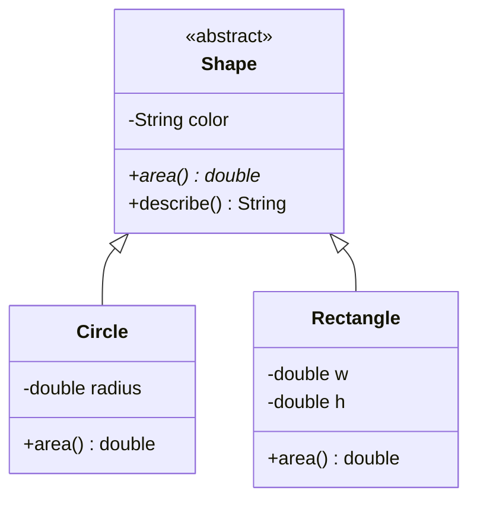

This works because `Circle` truly **is** a `Shape`, uses the inherited `describe()`, and `Shape` was designed with abstract `area()` as the extension point.

**Java**
```java
abstract class Shape {
    private final String color;
    Shape(String color) { this.color = color; }
    abstract double area();                                         // the extension point
    String describe() { return color + " shape with area " + String.format("%.2f", area()); }
}
class Circle extends Shape {
    private final double radius;
    Circle(String color, double radius) { super(color); this.radius = radius; }
    @Override double area() { return Math.PI * radius * radius; }
}
public class Main {
    public static void main(String[] args) { System.out.println(new Circle("red", 2).describe()); }
}
```

**C++**
```cpp
#include <cmath>
#include <iomanip>
#include <iostream>
#include <sstream>
#include <string>

class Shape {
    std::string color_;
public:
    explicit Shape(std::string color) : color_(std::move(color)) {}
    virtual ~Shape() = default;
    virtual double area() const = 0;                                // the extension point
    std::string describe() const {
        std::ostringstream os; os << color_ << " shape with area " << std::fixed << std::setprecision(2) << area();
        return os.str();
    }
};
class Circle : public Shape {
    double radius_;
public:
    Circle(std::string color, double r) : Shape(std::move(color)), radius_(r) {}
    double area() const override { return M_PI * radius_ * radius_; }
};
int main() { std::cout << Circle("red", 2).describe() << "\n"; }
```

**C** — "extends" = embed the parent as the **first member** and fill in its function pointer.
```c
#include <stdio.h>
#define PI 3.14159265358979323846

typedef struct Shape Shape;
struct Shape {
    const char* color;
    double (*area)(const Shape* self);                              /* "abstract method" slot */
};
static void shape_describe(const Shape* s) { printf("%s shape with area %.2f\n", s->color, s->area(s)); }  /* inherited concrete method */

typedef struct { Shape base; double radius; } Circle;               /* Circle "extends" Shape */
static double circle_area(const Shape* s) { const Circle* c = (const Circle*)s; return PI * c->radius * c->radius; }
static Circle circle_make(const char* color, double r) { Circle c = { { color, circle_area }, r }; return c; }

int main(void) { Circle c = circle_make("red", 2); shape_describe(&c.base); return 0; }
```

### When inheritance creates problems

- **Tight coupling.** The subclass depends on the parent's *implementation*, not only its interface. If the parent changes internally, every subclass can break.
- **All or nothing.** You inherit everything, including methods you do not want. You cannot selectively inherit.

> 💡 **Interview Tip.** If you use inheritance, be ready for *"what happens when requirements change?"* Interviewers probe inheritance decisions to see whether you understand the coupling risks.
>
> 🎯 Using inheritance **without justifying why it beats composition** is one of the most common LLD-interview mistakes. Always state your reasoning.

---

## 1.9 The Fragile Base Class Problem

**What it is.** Changes to a parent class break subclasses in ways that are impossible to predict from the parent alone, because the subclass depends on the parent's **internal implementation**, not just its public interface.

**Root cause: self-use.** When one method in the base class calls *another overridable method of the same class*, and the subclass overrides one or both, the subclass author must know exactly how the base implements every method — which defeats abstraction.

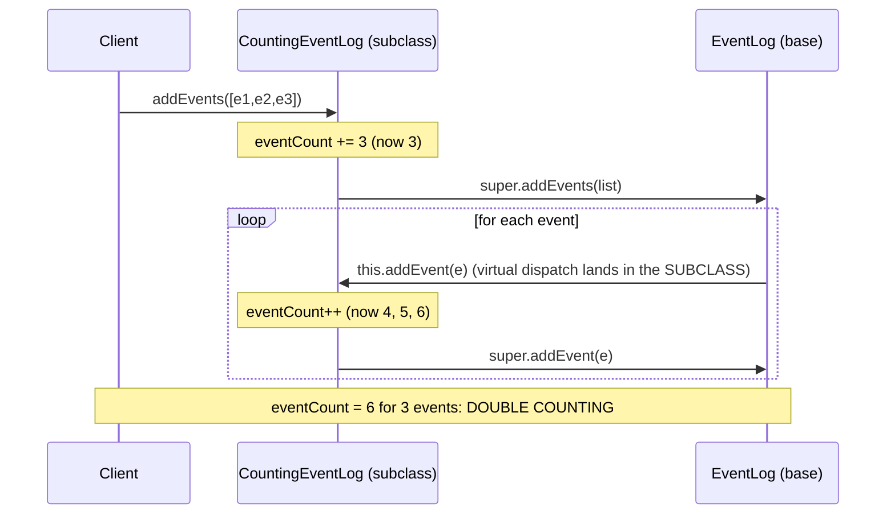

### The problem and the fix in code

`addEvents()` with 3 events yields `eventCount = 6` — each event is counted once in `addEvents()` and again in the overridden `addEvent()` that the base class calls internally.

It can break the **other way** too. Suppose the subclass author "fixes" the double count by overriding only `addEvent()` (relying on the base's `addEvents()` looping through it). That works today (count = 3). If the base author later "optimises" `addEvents()` to call `events.addAll()` directly, `addEvent()` is never called any more and the subclass silently **undercounts (0 instead of 3)** — with no compile error and no change to the public contract.

**Java**
```java
import java.util.*;

class EventLog {
    protected final List<String> events = new ArrayList<>();
    void addEvent(String e) { events.add(e); }
    void addEvents(List<String> es) { for (String e : es) addEvent(e); }   // SELF-USE of overridable addEvent
    int size() { return events.size(); }
}
class CountingEventLog extends EventLog {                                  // ❌ inheritance version
    private int eventCount = 0;
    @Override void addEvent(String e) { eventCount++; super.addEvent(e); }
    @Override void addEvents(List<String> es) { eventCount += es.size(); super.addEvents(es); }
    int getEventCount() { return eventCount; }
}
class SafeCountingEventLog {                                               // ✅ composition version
    private final EventLog delegate = new EventLog();                      // wraps, does not extend
    private int eventCount = 0;
    void addEvent(String e) { eventCount++; delegate.addEvent(e); }
    void addEvents(List<String> es) { eventCount += es.size(); delegate.addEvents(es); }
    int getEventCount() { return eventCount; }
}
public class Main {
    public static void main(String[] args) {
        List<String> three = Arrays.asList("a", "b", "c");
        CountingEventLog bad = new CountingEventLog();  bad.addEvents(three);
        SafeCountingEventLog good = new SafeCountingEventLog(); good.addEvents(three);
        System.out.println("inheritance count  = " + bad.getEventCount());   // 6  <-- BUG
        System.out.println("composition count  = " + good.getEventCount());  // 3
    }
}
```

**C++**
```cpp
#include <iostream>
#include <string>
#include <vector>

class EventLog {
protected:
    std::vector<std::string> events_;
public:
    virtual ~EventLog() = default;
    virtual void addEvent(const std::string& e) { events_.push_back(e); }
    virtual void addEvents(const std::vector<std::string>& es) { for (const auto& e : es) addEvent(e); }  // self-use
};
class CountingEventLog : public EventLog {                       // ❌ inheritance
    int count_ = 0;
public:
    void addEvent(const std::string& e) override { ++count_; EventLog::addEvent(e); }
    void addEvents(const std::vector<std::string>& es) override { count_ += (int)es.size(); EventLog::addEvents(es); }
    int count() const { return count_; }
};
class SafeCountingEventLog {                                     // ✅ composition
    EventLog delegate_;
    int count_ = 0;
public:
    void addEvent(const std::string& e) { ++count_; delegate_.addEvent(e); }
    void addEvents(const std::vector<std::string>& es) { count_ += (int)es.size(); delegate_.addEvents(es); }
    int count() const { return count_; }
};
int main() {
    std::vector<std::string> three{"a", "b", "c"};
    CountingEventLog bad;          bad.addEvents(three);
    SafeCountingEventLog good;     good.addEvents(three);
    std::cout << "inheritance count = " << bad.count() << "\n";    // 6  <-- BUG
    std::cout << "composition count = " << good.count() << "\n";   // 3
}
```

**C** — the same trap exists with a hand-made vtable, proving it is about *design*, not syntax.
```c
#include <stdio.h>

typedef struct EventLog EventLog;
struct EventLog {
    int stored;
    void (*add_event)(EventLog* self, int e);                         /* "virtual" */
    void (*add_events)(EventLog* self, const int* es, int n);         /* "virtual" */
};
static void base_add_event(EventLog* self, int e) { (void)e; self->stored++; }
static void base_add_events(EventLog* self, const int* es, int n) {
    for (int i = 0; i < n; i++) self->add_event(self, es[i]);          /* SELF-USE through the overridable slot */
}
static EventLog eventlog_make(void) { EventLog l = { 0, base_add_event, base_add_events }; return l; }

/* ❌ inheritance: embed + override */
typedef struct { EventLog base; int count; } CountingEventLog;
static void counting_add_event(EventLog* self, int e) { ((CountingEventLog*)self)->count++; base_add_event(self, e); }
static void counting_add_events(EventLog* self, const int* es, int n) { ((CountingEventLog*)self)->count += n; base_add_events(self, es, n); }

/* ✅ composition: hold a plain EventLog, delegate explicitly */
typedef struct { EventLog delegate; int count; } SafeCountingEventLog;
static void safe_add_events(SafeCountingEventLog* s, const int* es, int n) { s->count += n; s->delegate.add_events(&s->delegate, es, n); }

int main(void) {
    int three[] = { 1, 2, 3 };
    CountingEventLog bad = { { 0, counting_add_event, counting_add_events }, 0 };
    bad.base.add_events(&bad.base, three, 3);
    SafeCountingEventLog good = { eventlog_make(), 0 };
    safe_add_events(&good, three, 3);
    printf("inheritance count = %d\n", bad.count);     /* 6  <-- BUG */
    printf("composition count = %d\n", good.count);    /* 3  */
    return 0;
}
```

**Why composition fixes it:** the wrapper's counting logic is independent of how `EventLog` implements `addEvents()` internally. If the base changes tomorrow, the wrapper is unaffected.

> 🎯 **Interview Relevance.** Being able to explain the fragile base class problem **with a concrete example** separates mid-level from senior candidates. If asked *"what are the risks of this hierarchy?"*, this is your answer.
>
> Other mitigations when you *must* inherit: make the class `final` (Java) / `final` (C++), document self-use, or make methods non-overridable (`final`) unless they're designated hooks.

---

## 1.10 Polymorphism — Runtime vs Compile-Time

**Definition.** The same method call can produce **different behaviour depending on the object** it is called on.

| Aspect | **Runtime** (overriding) | **Compile-time** (overloading / generics) |
|---|---|---|
| Decided at | Runtime (virtual dispatch via vtable) | Compile time (compiler picks) |
| Enables | Extensibility, plug-in architectures | Convenience, API usability |
| Used for | Strategy, Factory, Observer… | Builder-style fluent APIs, `println(int)` / `println(String)` |
| Interview weight | **Very high** | Low |

*Runtime:* `PaymentProcessor p = new StripePaymentProcessor(); p.charge(...)` — the **declared** type is the interface, but the **actual** object's method runs. Reassign `p` to a PayPal processor and the *same line* runs completely different code.

*Compile-time:* same method name, different parameter lists; the compiler picks the version from the argument types.

**Java**
```java
interface PaymentProcessor { String charge(long cents); }
class StripeProcessor implements PaymentProcessor { public String charge(long c) { return "Stripe charged " + c; } }
class PayPalProcessor implements PaymentProcessor { public String charge(long c) { return "PayPal charged " + c; } }

class PriceCalculator {                                       // compile-time polymorphism: OVERLOADING
    long calculate(long subtotal) { return subtotal + tax(subtotal); }
    long calculate(long subtotal, int discountPercent) {
        long discounted = subtotal - subtotal * discountPercent / 100;
        return discounted + tax(discounted);
    }
    private long tax(long x) { return x * 18 / 100; }
}
public class Main {
    public static void main(String[] args) {
        PaymentProcessor p = new StripeProcessor();           // runtime polymorphism
        System.out.println(p.charge(100));
        p = new PayPalProcessor();
        System.out.println(p.charge(100));                    // same call line, different code
        PriceCalculator calc = new PriceCalculator();
        System.out.println(calc.calculate(1000));             // 1180   (compiler picks 1-arg version)
        System.out.println(calc.calculate(1000, 10));         // 1062   (compiler picks 2-arg version)
    }
}
```

**C++** — has *three* flavours: virtual (runtime), overloading, and **templates** (static polymorphism, zero vtable cost).
```cpp
#include <iostream>
#include <string>

struct PaymentProcessor { virtual ~PaymentProcessor() = default; virtual std::string charge(long c) = 0; };
struct StripeProcessor : PaymentProcessor { std::string charge(long c) override { return "Stripe charged " + std::to_string(c); } };
struct PayPalProcessor : PaymentProcessor { std::string charge(long c) override { return "PayPal charged " + std::to_string(c); } };

class PriceCalculator {                                          // compile-time: OVERLOADING
    long tax(long x) const { return x * 18 / 100; }
public:
    long calculate(long subtotal) const { return subtotal + tax(subtotal); }
    long calculate(long subtotal, int discountPercent) const {
        long d = subtotal - subtotal * discountPercent / 100;
        return d + tax(d);
    }
};
struct ConcreteStripe { std::string charge(long c) { return "(template) Stripe charged " + std::to_string(c); } };
template <typename T> void checkout(T& p, long c) { std::cout << p.charge(c) << "\n"; }   // compile-time: no vtable

int main() {
    StripeProcessor s; PayPalProcessor pp;
    PaymentProcessor* p = &s;                                    // runtime polymorphism
    std::cout << p->charge(100) << "\n";
    p = &pp;
    std::cout << p->charge(100) << "\n";
    PriceCalculator calc;
    std::cout << calc.calculate(1000) << " " << calc.calculate(1000, 10) << "\n";   // 1180 1062
    ConcreteStripe cs; checkout(cs, 100);
}
```

**C** — runtime via function pointers; compile-time via C11 `_Generic`.
```c
#include <stdio.h>

typedef struct PaymentProcessor PaymentProcessor;
struct PaymentProcessor { const char* (*charge)(PaymentProcessor*, long cents); };
static const char* stripe_charge(PaymentProcessor* p, long c) { (void)p; (void)c; return "Stripe charged"; }
static const char* paypal_charge(PaymentProcessor* p, long c) { (void)p; (void)c; return "PayPal charged"; }

/* compile-time polymorphism: _Generic picks the function by ARGUMENT TYPE at compile time */
static void show_int(int x)          { printf("int: %d\n", x); }
static void show_double(double x)    { printf("double: %.1f\n", x); }
static void show_str(const char* x)  { printf("string: %s\n", x); }
#define show(x) _Generic((x), int: show_int, double: show_double, char*: show_str, const char*: show_str)(x)

int main(void) {
    PaymentProcessor stripe = { stripe_charge }, paypal = { paypal_charge };
    PaymentProcessor* p = &stripe;                                /* runtime polymorphism */
    printf("%s 100\n", p->charge(p, 100));
    p = &paypal;
    printf("%s 100\n", p->charge(p, 100));
    show(42); show(3.5); show("hello");
    return 0;
}
```

> 🎯 When interviewers say *"design this to be extensible"* they are asking for **runtime polymorphism**: adding a new type = **write a new class, don't modify existing code**.

---

## 1.11 Designing for Polymorphic Behaviour

Polymorphism does not happen by accident — you **design** for it.

### The 4-step recipe

| Step | Action | Notification-system example |
|---|---|---|
| 1 | **Identify what varies** | The *delivery channel* varies (email / SMS / push). The act of "sending a notification" does not |
| 2 | **Define an interface** for the varying behaviour | `NotificationChannel` |
| 3 | **One implementation per variant** | `EmailChannel`, `PushChannel`, … |
| 4 | **Calling code depends on the interface** | `NotificationDispatcher` calls `channel.send()` without knowing which |

**Why it matters.** Without polymorphism, a new channel means editing the service with *another `if/else` branch*. With polymorphism the service is **closed for modification, open for extension** — the Open-Closed Principle in action (Part 2).

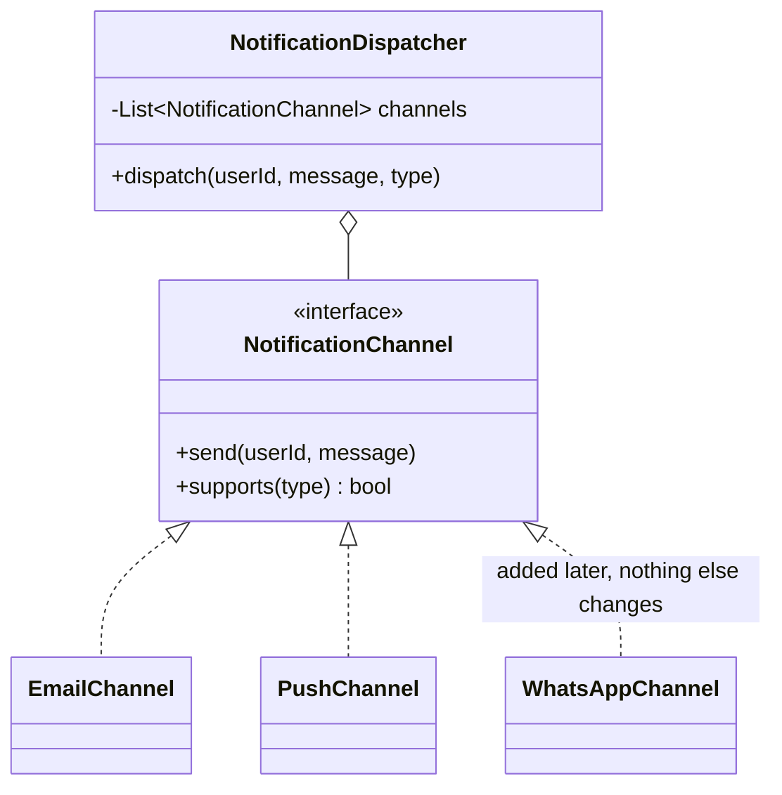

### Worked example — Notification Channel Dispatch (Slack-like platform)

The dispatcher iterates over all registered channels and sends through **every channel that `supports()` the notification type**. Adding WhatsApp = write `WhatsAppChannel` + register it. `NotificationDispatcher` is **never modified**.

**Java**
```java
import java.util.*;

enum NotificationType { MARKETING, TRANSACTIONAL, ALERT }

interface NotificationChannel {
    void send(String userId, String message);
    boolean supports(NotificationType type);
}
class EmailChannel implements NotificationChannel {
    public void send(String userId, String message) { System.out.println("[EMAIL] " + userId + "@mail.com <- " + message); }
    public boolean supports(NotificationType t) { return t == NotificationType.MARKETING || t == NotificationType.TRANSACTIONAL; }
}
class PushChannel implements NotificationChannel {
    public void send(String userId, String message) { System.out.println("[PUSH]  device-of-" + userId + " <- " + message); }
    public boolean supports(NotificationType t) { return t == NotificationType.TRANSACTIONAL || t == NotificationType.ALERT; }
}
class NotificationDispatcher {
    private final List<NotificationChannel> channels;
    NotificationDispatcher(List<NotificationChannel> channels) { this.channels = channels; }
    void dispatch(String userId, String message, NotificationType type) {
        for (NotificationChannel c : channels) if (c.supports(type)) c.send(userId, message);
    }
}
// ---- added LATER: a brand-new class, no existing class edited ----
class WhatsAppChannel implements NotificationChannel {
    public void send(String userId, String message) { System.out.println("[WHATSAPP] " + userId + " <- " + message); }
    public boolean supports(NotificationType t) { return t == NotificationType.ALERT; }
}
public class Main {
    public static void main(String[] args) {
        NotificationDispatcher d = new NotificationDispatcher(Arrays.asList(new EmailChannel(), new PushChannel(), new WhatsAppChannel()));
        d.dispatch("ravi", "Your order shipped", NotificationType.TRANSACTIONAL);
        d.dispatch("ravi", "Server down!", NotificationType.ALERT);
    }
}
```

**C++**
```cpp
#include <iostream>
#include <memory>
#include <string>
#include <vector>

enum class NotificationType { Marketing, Transactional, Alert };

struct NotificationChannel {
    virtual ~NotificationChannel() = default;
    virtual void send(const std::string& user, const std::string& msg) = 0;
    virtual bool supports(NotificationType t) const = 0;
};
struct EmailChannel : NotificationChannel {
    void send(const std::string& u, const std::string& m) override { std::cout << "[EMAIL] " << u << "@mail.com <- " << m << "\n"; }
    bool supports(NotificationType t) const override { return t == NotificationType::Marketing || t == NotificationType::Transactional; }
};
struct PushChannel : NotificationChannel {
    void send(const std::string& u, const std::string& m) override { std::cout << "[PUSH]  device-of-" << u << " <- " << m << "\n"; }
    bool supports(NotificationType t) const override { return t == NotificationType::Transactional || t == NotificationType::Alert; }
};
class NotificationDispatcher {
    std::vector<std::unique_ptr<NotificationChannel>> channels_;
public:
    void add(std::unique_ptr<NotificationChannel> c) { channels_.push_back(std::move(c)); }
    void dispatch(const std::string& user, const std::string& msg, NotificationType t) {
        for (auto& c : channels_) if (c->supports(t)) c->send(user, msg);
    }
};
// ---- added LATER, no existing class edited ----
struct WhatsAppChannel : NotificationChannel {
    void send(const std::string& u, const std::string& m) override { std::cout << "[WHATSAPP] " << u << " <- " << m << "\n"; }
    bool supports(NotificationType t) const override { return t == NotificationType::Alert; }
};
int main() {
    NotificationDispatcher d;
    d.add(std::make_unique<EmailChannel>()); d.add(std::make_unique<PushChannel>()); d.add(std::make_unique<WhatsAppChannel>());
    d.dispatch("ravi", "Your order shipped", NotificationType::Transactional);
    d.dispatch("ravi", "Server down!", NotificationType::Alert);
}
```

**C**
```c
#include <stdio.h>

typedef enum { MARKETING, TRANSACTIONAL, ALERT } NotificationType;
typedef struct NotificationChannel NotificationChannel;
struct NotificationChannel {
    void (*send)(NotificationChannel* self, const char* user, const char* msg);
    int  (*supports)(NotificationChannel* self, NotificationType t);
};
static void email_send(NotificationChannel* s, const char* u, const char* m) { (void)s; printf("[EMAIL] %s@mail.com <- %s\n", u, m); }
static int  email_supports(NotificationChannel* s, NotificationType t) { (void)s; return t == MARKETING || t == TRANSACTIONAL; }
static void push_send(NotificationChannel* s, const char* u, const char* m) { (void)s; printf("[PUSH]  device-of-%s <- %s\n", u, m); }
static int  push_supports(NotificationChannel* s, NotificationType t) { (void)s; return t == TRANSACTIONAL || t == ALERT; }

typedef struct { NotificationChannel** channels; int n; } NotificationDispatcher;
static void dispatch(NotificationDispatcher* d, const char* user, const char* msg, NotificationType t) {
    for (int i = 0; i < d->n; i++) if (d->channels[i]->supports(d->channels[i], t)) d->channels[i]->send(d->channels[i], user, msg);
}
/* ---- added LATER: new functions + new struct instance; dispatch() untouched ---- */
static void wa_send(NotificationChannel* s, const char* u, const char* m) { (void)s; printf("[WHATSAPP] %s <- %s\n", u, m); }
static int  wa_supports(NotificationChannel* s, NotificationType t) { (void)s; return t == ALERT; }

int main(void) {
    NotificationChannel email = { email_send, email_supports }, push = { push_send, push_supports }, wa = { wa_send, wa_supports };
    NotificationChannel* all[] = { &email, &push, &wa };
    NotificationDispatcher d = { all, 3 };
    dispatch(&d, "ravi", "Your order shipped", TRANSACTIONAL);
    dispatch(&d, "ravi", "Server down!", ALERT);
    return 0;
}
```

The **❌ non-polymorphic version** — every new channel edits this method:
```java nocompile
void dispatch(String user, String msg, String channelName) {
    if (channelName.equals("email"))      emailClient.sendEmail(...);
    else if (channelName.equals("sms"))   smsGateway.send(...);
    else if (channelName.equals("push"))  pushGateway.sendPush(...);
    // add WhatsApp -> edit this method again (and re-test everything)
}
```

> 💡 **Interview Tip.** Say it explicitly: **"Adding a new type of X requires writing one new class. No existing classes are modified."** It directly demonstrates extensibility.
>
> 🎯 **This exact pattern — interface + multiple implementations + dispatcher — appears in nearly every LLD interview.** Master it for notification systems, payment processing, file export and discount calculation.

---

## 1.12 Interview Practice — Inheritance & Polymorphism (`DocumentExporter`)

**Scenario.** A document-management system like Google Docs exports to **PDF, DOCX, HTML**. *"Show me your class design for the export feature."* (Pause 60 s and design before reading.)

### ❌ Weak answer — one class, one `if` per format
```java nocompile
public class DocumentExporter {
    public void export(Document doc, String format) {
        if (format.equals("pdf"))       PdfLibrary.render(doc.getContent(), doc.getStyles());
        else if (format.equals("docx")) WordLibrary.convert(doc.getContent(), doc.getMetadata());
        else if (format.equals("html")) HtmlGenerator.generate(doc.getContent(), doc.getCss());
    }
}
```
All export logic in one class; Markdown/EPUB means *modifying* it and adding another branch; it grows with every format and becomes increasingly fragile.

### ✅ Strong answer — interface + one class per format + a registry `Map`
Each format is its own class. A `Map<String, DocumentExporter>` routes format names to exporters. Adding Markdown = write `MarkdownExporter`, register it. **Zero existing code changes.**

**Java**
```java
import java.util.*;

interface DocumentExporter {
    byte[] export(String documentText);
    String getFormatName();
}
class PdfExporter implements DocumentExporter {
    public byte[] export(String doc) { return ("%PDF-1.7 " + doc).getBytes(); }
    public String getFormatName() { return "pdf"; }
}
class DocxExporter implements DocumentExporter {
    public byte[] export(String doc) { return ("PK-docx " + doc).getBytes(); }
    public String getFormatName() { return "docx"; }
}
class HtmlExporter implements DocumentExporter {
    public byte[] export(String doc) { return ("<html><body>" + doc + "</body></html>").getBytes(); }
    public String getFormatName() { return "html"; }
}
class MarkdownExporter implements DocumentExporter {                 // added later - nothing else edited
    public byte[] export(String doc) { return ("# " + doc).getBytes(); }
    public String getFormatName() { return "md"; }
}
class ExportService {
    private final Map<String, DocumentExporter> exporters = new HashMap<>();
    void register(DocumentExporter e) { exporters.put(e.getFormatName(), e); }
    byte[] export(String doc, String format) {
        DocumentExporter e = exporters.get(format);
        if (e == null) throw new IllegalArgumentException("Unsupported format: " + format);
        return e.export(doc);
    }
}
public class Main {
    public static void main(String[] args) {
        ExportService svc = new ExportService();
        svc.register(new PdfExporter()); svc.register(new DocxExporter()); svc.register(new HtmlExporter());
        svc.register(new MarkdownExporter());                         // extension = one line
        System.out.println(new String(svc.export("Hello", "html")));
        System.out.println(new String(svc.export("Hello", "md")));
    }
}
```

**C++**
```cpp
#include <iostream>
#include <memory>
#include <stdexcept>
#include <string>
#include <unordered_map>

struct DocumentExporter {
    virtual ~DocumentExporter() = default;
    virtual std::string exportDoc(const std::string& doc) const = 0;
    virtual std::string formatName() const = 0;
};
struct PdfExporter : DocumentExporter {
    std::string exportDoc(const std::string& d) const override { return "%PDF-1.7 " + d; }
    std::string formatName() const override { return "pdf"; }
};
struct HtmlExporter : DocumentExporter {
    std::string exportDoc(const std::string& d) const override { return "<html><body>" + d + "</body></html>"; }
    std::string formatName() const override { return "html"; }
};
struct MarkdownExporter : DocumentExporter {                       // added later
    std::string exportDoc(const std::string& d) const override { return "# " + d; }
    std::string formatName() const override { return "md"; }
};
class ExportService {
    std::unordered_map<std::string, std::unique_ptr<DocumentExporter>> exporters_;
public:
    void registerExporter(std::unique_ptr<DocumentExporter> e) { auto n = e->formatName(); exporters_[n] = std::move(e); }
    std::string exportDoc(const std::string& doc, const std::string& format) const {
        auto it = exporters_.find(format);
        if (it == exporters_.end()) throw std::invalid_argument("Unsupported format: " + format);
        return it->second->exportDoc(doc);
    }
};
int main() {
    ExportService svc;
    svc.registerExporter(std::make_unique<PdfExporter>());
    svc.registerExporter(std::make_unique<HtmlExporter>());
    svc.registerExporter(std::make_unique<MarkdownExporter>());    // extension = one line
    std::cout << svc.exportDoc("Hello", "html") << "\n" << svc.exportDoc("Hello", "md") << "\n";
}
```

**C**
```c
#include <stdio.h>
#include <string.h>

typedef struct DocumentExporter DocumentExporter;
struct DocumentExporter {
    const char* format;                                              /* getFormatName() as data */
    void (*export_doc)(const DocumentExporter* self, const char* doc, char* out, size_t cap);
};
static void pdf_export (const DocumentExporter* s, const char* d, char* o, size_t n) { (void)s; snprintf(o, n, "%%PDF-1.7 %s", d); }
static void html_export(const DocumentExporter* s, const char* d, char* o, size_t n) { (void)s; snprintf(o, n, "<html><body>%s</body></html>", d); }
static void md_export  (const DocumentExporter* s, const char* d, char* o, size_t n) { (void)s; snprintf(o, n, "# %s", d); }   /* added later */

typedef struct { const DocumentExporter* items[16]; int n; } ExportService;                     /* the registry */
static void svc_register(ExportService* s, const DocumentExporter* e) { if (s->n < 16) s->items[s->n++] = e; }
static int  svc_export(const ExportService* s, const char* doc, const char* fmt, char* out, size_t cap) {
    for (int i = 0; i < s->n; i++)
        if (strcmp(s->items[i]->format, fmt) == 0) { s->items[i]->export_doc(s->items[i], doc, out, cap); return 0; }
    return -1;                                                       /* unsupported format */
}
int main(void) {
    DocumentExporter pdf = { "pdf", pdf_export }, html = { "html", html_export }, md = { "md", md_export };
    ExportService svc = { {0}, 0 };
    svc_register(&svc, &pdf); svc_register(&svc, &html); svc_register(&svc, &md);
    char buf[128];
    if (svc_export(&svc, "Hello", "html", buf, sizeof buf) == 0) puts(buf);
    if (svc_export(&svc, "Hello", "md",   buf, sizeof buf) == 0) puts(buf);
    if (svc_export(&svc, "Hello", "epub", buf, sizeof buf) != 0) puts("Unsupported format: epub");
    return 0;
}
```

---

## 1.13 Composition vs Inheritance — The Core OOD Trade-Off

> This is **the single most important design trade-off in object-oriented design**, and interviewers test it directly. *"Favour composition over inheritance"* is not a slogan to memorise — it has concrete technical reasons.

### What each approach means structurally

- **Inheritance → "is-a".** The subclass is a specialised version of the parent. It inherits all fields, all methods, and **all coupling** to the parent's implementation.
- **Composition → "has-a".** The class holds a reference to another object and **delegates** work to it. The composed object can be swapped, configured or replaced without affecting the composing class.

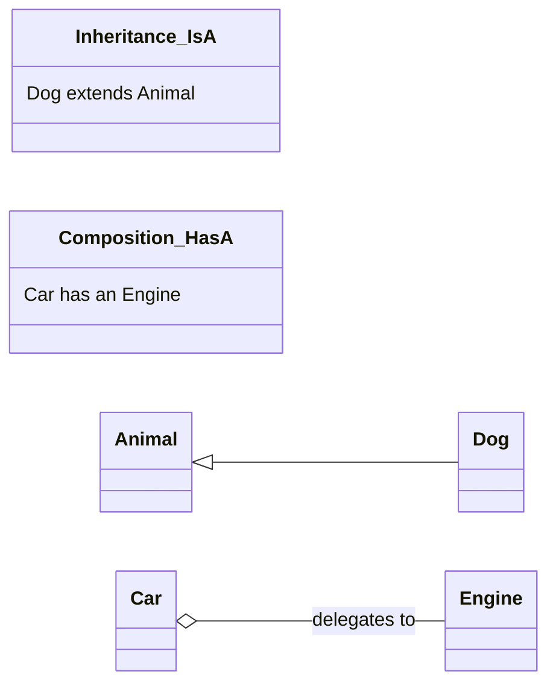

### Why composition is usually preferred

| Dimension | Inheritance | Composition |
|---|---|---|
| Coupling | **Tight** (child depends on parent internals) | **Loose** (depends only on an interface) |
| Flexibility | Fixed at **compile time** | **Swappable at runtime** |
| Reuse granularity | All or nothing | Selective — compose only what you need |
| Testing | Must construct the full parent hierarchy | Can **mock** composed dependencies |
| Multiple behaviours | Java allows only single inheritance | Compose many behaviours freely |
| Fragile-base-class risk | **Yes** | **No** |

> Inheritance locks you into a hierarchy at compile time. Composition lets you assemble behaviour at **runtime** from interchangeable parts.

> 🎯 When you choose inheritance, expect *"why not composition?"* — have a concrete reason. When you choose composition, say: *"I chose composition because the relationship is 'has-a' and I want the flexibility to swap implementations."*

---

## 1.14 Where Inheritance Breaks and Composition Saves You — "Class Explosion"

A Slack-like notification system with **3 channel types** (email, SMS, push) **× 2 priority levels** (urgent, normal) — watch what each approach does.

### ❌ Inheritance approach — class explosion
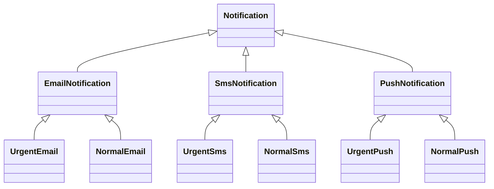
**Six leaf classes** for two dimensions. A third priority ("scheduled") adds **3** more; a fourth channel (WhatsApp) adds **3** more. Growth = **channels × priorities**.

### ✅ Composition approach — combine independent behaviours
Growth = **channels + priorities**.

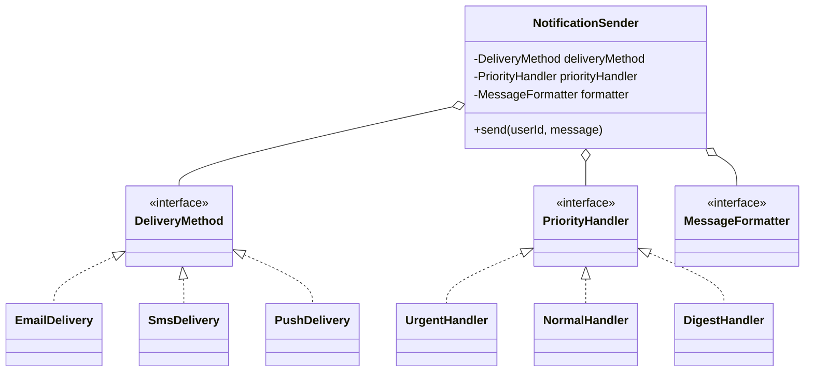

Adding WhatsApp → write **one** `DeliveryMethod`. Adding "scheduled" → write **one** `PriorityHandler`.

**Java**
```java
interface DeliveryMethod { void deliver(String userId, String msg); }
interface PriorityHandler { void schedule(Runnable task); }
interface MessageFormatter { String format(String msg); }

class EmailDelivery implements DeliveryMethod { public void deliver(String u, String m) { System.out.println("EMAIL -> " + u + ": " + m); } }
class SmsDelivery   implements DeliveryMethod { public void deliver(String u, String m) { System.out.println("SMS   -> " + u + ": " + m); } }
class UrgentHandler implements PriorityHandler { public void schedule(Runnable t) { System.out.print("(urgent: run now) "); t.run(); } }
class DigestHandler implements PriorityHandler { public void schedule(Runnable t) { System.out.print("(digest: batched at 9am) "); t.run(); } }
class PlainFormatter implements MessageFormatter { public String format(String m) { return m; } }
class ShoutFormatter implements MessageFormatter { public String format(String m) { return m.toUpperCase() + "!"; } }

class NotificationSender {
    private final DeliveryMethod deliveryMethod;
    private final PriorityHandler priorityHandler;
    private final MessageFormatter formatter;
    NotificationSender(DeliveryMethod d, PriorityHandler p, MessageFormatter f) { deliveryMethod = d; priorityHandler = p; formatter = f; }
    void send(String userId, String message) {
        String formatted = formatter.format(message);
        priorityHandler.schedule(() -> deliveryMethod.deliver(userId, formatted));
    }
}
public class Main {
    public static void main(String[] args) {
        // any combination, assembled at RUNTIME, without a class per combination
        new NotificationSender(new EmailDelivery(), new UrgentHandler(), new ShoutFormatter()).send("ravi", "server down");
        new NotificationSender(new SmsDelivery(),   new DigestHandler(), new PlainFormatter()).send("ravi", "weekly summary");
    }
}
```

**C++**
```cpp
#include <functional>
#include <iostream>
#include <string>

struct DeliveryMethod  { virtual ~DeliveryMethod() = default;  virtual void deliver(const std::string& u, const std::string& m) = 0; };
struct PriorityHandler { virtual ~PriorityHandler() = default; virtual void schedule(const std::function<void()>& task) = 0; };
struct MessageFormatter{ virtual ~MessageFormatter() = default;virtual std::string format(const std::string& m) = 0; };

struct EmailDelivery : DeliveryMethod { void deliver(const std::string& u, const std::string& m) override { std::cout << "EMAIL -> " << u << ": " << m << "\n"; } };
struct SmsDelivery   : DeliveryMethod { void deliver(const std::string& u, const std::string& m) override { std::cout << "SMS   -> " << u << ": " << m << "\n"; } };
struct UrgentHandler : PriorityHandler { void schedule(const std::function<void()>& t) override { std::cout << "(urgent: run now) "; t(); } };
struct DigestHandler : PriorityHandler { void schedule(const std::function<void()>& t) override { std::cout << "(digest: batched at 9am) "; t(); } };
struct PlainFormatter: MessageFormatter { std::string format(const std::string& m) override { return m; } };
struct ShoutFormatter: MessageFormatter { std::string format(const std::string& m) override { std::string s = m; for (auto& c : s) c = (char)toupper(c); return s + "!"; } };

class NotificationSender {
    DeliveryMethod& delivery_; PriorityHandler& priority_; MessageFormatter& formatter_;
public:
    NotificationSender(DeliveryMethod& d, PriorityHandler& p, MessageFormatter& f) : delivery_(d), priority_(p), formatter_(f) {}
    void send(const std::string& user, const std::string& message) {
        std::string formatted = formatter_.format(message);
        priority_.schedule([&, user, formatted] { delivery_.deliver(user, formatted); });
    }
};
int main() {
    EmailDelivery email; SmsDelivery sms; UrgentHandler urgent; DigestHandler digest; PlainFormatter plain; ShoutFormatter shout;
    NotificationSender(email, urgent, shout).send("ravi", "server down");
    NotificationSender(sms, digest, plain).send("ravi", "weekly summary");
}
```

**C** — C has no closures, so the priority handler receives the delivery target and arguments explicitly.
```c
#include <ctype.h>
#include <stdio.h>
#include <string.h>

typedef struct DeliveryMethod DeliveryMethod;
struct DeliveryMethod  { void (*deliver)(DeliveryMethod*, const char* user, const char* msg); };
typedef struct PriorityHandler PriorityHandler;
struct PriorityHandler { void (*run)(PriorityHandler*, DeliveryMethod* d, const char* user, const char* msg); };  /* no lambdas in C */
typedef struct MessageFormatter MessageFormatter;
struct MessageFormatter{ void (*format)(MessageFormatter*, const char* in, char* out, size_t cap); };

static void email_deliver(DeliveryMethod* d, const char* u, const char* m) { (void)d; printf("EMAIL -> %s: %s\n", u, m); }
static void sms_deliver  (DeliveryMethod* d, const char* u, const char* m) { (void)d; printf("SMS   -> %s: %s\n", u, m); }
static void urgent_run(PriorityHandler* p, DeliveryMethod* d, const char* u, const char* m) { (void)p; printf("(urgent: run now) "); d->deliver(d, u, m); }
static void digest_run(PriorityHandler* p, DeliveryMethod* d, const char* u, const char* m) { (void)p; printf("(digest: batched at 9am) "); d->deliver(d, u, m); }
static void plain_fmt(MessageFormatter* f, const char* in, char* out, size_t cap) { (void)f; snprintf(out, cap, "%s", in); }
static void shout_fmt(MessageFormatter* f, const char* in, char* out, size_t cap) {
    (void)f; size_t i = 0; for (; in[i] && i + 2 < cap; i++) out[i] = (char)toupper((unsigned char)in[i]);
    out[i++] = '!'; out[i] = '\0';
}

typedef struct { DeliveryMethod* delivery; PriorityHandler* priority; MessageFormatter* formatter; } NotificationSender;
static void sender_send(NotificationSender* s, const char* user, const char* message) {
    char formatted[128];
    s->formatter->format(s->formatter, message, formatted, sizeof formatted);
    s->priority->run(s->priority, s->delivery, user, formatted);
}
int main(void) {
    DeliveryMethod email = { email_deliver }, sms = { sms_deliver };
    PriorityHandler urgent = { urgent_run }, digest = { digest_run };
    MessageFormatter plain = { plain_fmt }, shout = { shout_fmt };
    NotificationSender a = { &email, &urgent, &shout }, b = { &sms, &digest, &plain };
    sender_send(&a, "ravi", "server down");
    sender_send(&b, "ravi", "weekly summary");
    return 0;
}
```

> 💡 **Interview Tip — the strongest signal in an LLD round.** When your class diagram has **two or more independent dimensions of variation** (channel type *and* priority; vehicle type *and* fuel type; report format *and* delivery schedule), point out that **inheritance forces you to pick one hierarchy while composition lets each dimension vary independently**.

---

## 1.15 Composition vs Inheritance — Decision Framework

### Choose **Inheritance** when ALL THREE are true
1. The relationship is genuinely **"is-a"** (`SavingsAccount` is a `BankAccount`)
2. The subclass uses **most or all** of the parent's behaviour, not just one method
3. The parent was **designed for extension** with clear abstract methods or hooks

*If any one is false → composition is safer.*

### Choose **Composition** when ANY ONE is true
1. The relationship is **"has-a" / "uses-a"** (an `Order` has a `PaymentProcessor`)
2. You must combine behaviours from **multiple sources**
3. You want to **swap behaviour at runtime** (strategies, implementations)
4. You see **two or more independent dimensions of variation**
5. You want the composed object to be **independently testable**

### Quick decision table

| Signal in the requirements | Approach | Reasoning |
|---|---|---|
| "Different types of X" with a shared core behaviour | Inheritance (cautiously) | True "is-a" with a common base |
| "Different types of X" with *different behaviours* | Composition + Interface | Plug-in architecture |
| "X can do Y in multiple ways" | Composition + **Strategy** | Swappable algorithms |
| "X needs capabilities from A and B" | Composition | Java only allows single inheritance |
| "X must work with different Z implementations" | Composition + **Dependency Injection** | Loose coupling for testability |

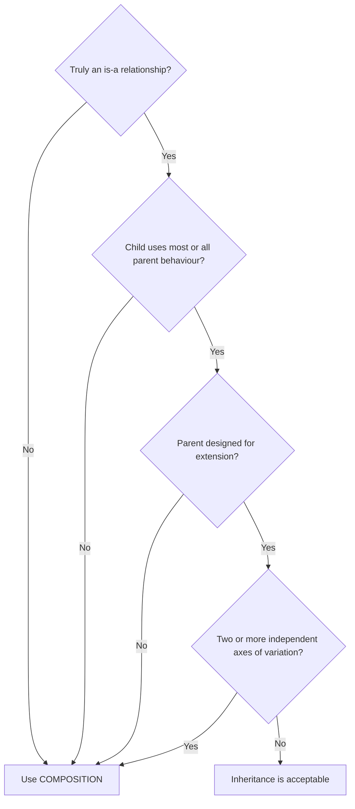

> 🎯 Stating your decision criteria out loud (*"composition here because there are two independent axes of variation"*) shows you are making a **deliberate trade-off**, not defaulting to the first thing that came to mind.

---

## 1.16 Abstract Classes vs Interfaces

Both define contracts. The difference is **what they can provide beyond the contract**.

| Dimension | Abstract class | Interface |
|---|---|---|
| Instance fields (state) | **Yes** | No |
| Constructors | **Yes** | No |
| Multiple inheritance | No (single parent) | **Yes** (implement many) |
| Default/concrete methods | Always | Since Java 8 (`default`) |
| Access modifiers on methods | Any | Public (effectively) |
| Relationship | **"Is-a"** (strong) | **"Can-do"** (capability) |
| State sharing | Can share state across subclasses | Cannot |

**Java**
```java
import java.time.*;
import java.util.*;

class DataSource { String connect() { return "conn#1"; } }

abstract class DatabaseRepository {                                   // shared STATE -> abstract class
    protected final DataSource dataSource;
    DatabaseRepository(DataSource ds) { this.dataSource = ds; }       // constructor enforces initialisation
    protected String getConnection() { return dataSource.connect(); } // shared concrete behaviour
    abstract List<String> findAll();
    abstract void save(String entity);
}
class UserRepository extends DatabaseRepository {
    private final List<String> rows = new ArrayList<>();
    UserRepository(DataSource ds) { super(ds); }
    List<String> findAll() { System.out.println("SELECT * via " + getConnection()); return rows; }
    void save(String e)   { System.out.println("INSERT via " + getConnection()); rows.add(e); }
}

interface Cacheable {                                                // pure capability; no state
    String getCacheKey();
    Duration getTimeToLive();
    default boolean isCacheable() { return !getTimeToLive().isZero(); }   // Java 8 default method
}
interface Auditable { String getLastModifiedBy(); Instant getLastModifiedAt(); }

class Product implements Cacheable, Auditable {                      // multiple contracts at once
    public String getCacheKey() { return "product:42"; }
    public Duration getTimeToLive() { return Duration.ofMinutes(10); }
    public String getLastModifiedBy() { return "admin"; }
    public Instant getLastModifiedAt() { return Instant.EPOCH; }
}
public class Main {
    public static void main(String[] args) {
        UserRepository repo = new UserRepository(new DataSource());
        repo.save("ravi"); System.out.println(repo.findAll());
        Product p = new Product();
        System.out.println(p.getCacheKey() + " cacheable=" + p.isCacheable() + " by " + p.getLastModifiedBy());
    }
}
```

**C++** — no `interface` keyword: an interface is an abstract class with only pure virtual functions; multiple inheritance is allowed.
```cpp
#include <iostream>
#include <string>
#include <vector>

struct DataSource { std::string connect() const { return "conn#1"; } };

class DatabaseRepository {                                           // abstract class: has state + ctor
protected:
    const DataSource& dataSource_;
    std::string getConnection() const { return dataSource_.connect(); }
public:
    explicit DatabaseRepository(const DataSource& ds) : dataSource_(ds) {}
    virtual ~DatabaseRepository() = default;
    virtual std::vector<std::string> findAll() = 0;
    virtual void save(const std::string& entity) = 0;
};
class UserRepository : public DatabaseRepository {
    std::vector<std::string> rows_;
public:
    using DatabaseRepository::DatabaseRepository;
    std::vector<std::string> findAll() override { std::cout << "SELECT * via " << getConnection() << "\n"; return rows_; }
    void save(const std::string& e) override { std::cout << "INSERT via " << getConnection() << "\n"; rows_.push_back(e); }
};

struct Cacheable {                                                   // C++ "interface"
    virtual ~Cacheable() = default;
    virtual std::string cacheKey() const = 0;
    virtual long ttlSeconds() const = 0;
    virtual bool isCacheable() const { return ttlSeconds() > 0; }    // like a Java default method
};
struct Auditable {
    virtual ~Auditable() = default;
    virtual std::string lastModifiedBy() const = 0;
};
class Product : public Cacheable, public Auditable {                 // multiple inheritance of contracts
public:
    std::string cacheKey() const override { return "product:42"; }
    long ttlSeconds() const override { return 600; }
    std::string lastModifiedBy() const override { return "admin"; }
};
int main() {
    DataSource ds; UserRepository repo(ds);
    repo.save("ravi"); std::cout << repo.findAll().size() << " row(s)\n";
    Product p; std::cout << p.cacheKey() << " cacheable=" << std::boolalpha << p.isCacheable() << " by " << p.lastModifiedBy() << "\n";
}
```

**C** — abstract class = struct with shared fields + function pointers; "multiple interfaces" = embed several capability structs.
```c
#include <stdio.h>

/* Abstract class: shared STATE (ds) + abstract operations */
typedef struct { const char* (*connect)(void); } DataSource;
static const char* ds_connect(void) { return "conn#1"; }

typedef struct DatabaseRepository DatabaseRepository;
struct DatabaseRepository {
    const DataSource* ds;                                            /* shared state */
    void (*save)(DatabaseRepository* self, const char* entity);     /* abstract */
    int  (*count)(DatabaseRepository* self);                        /* abstract */
};
typedef struct { DatabaseRepository base; int rows; } UserRepository;
static void user_save(DatabaseRepository* r, const char* e) { printf("INSERT %s via %s\n", e, r->ds->connect()); ((UserRepository*)r)->rows++; }
static int  user_count(DatabaseRepository* r) { return ((UserRepository*)r)->rows; }

/* Interfaces = capability structs (a pointer to the owner lets us get the object back) */
typedef struct Cacheable { void* self; const char* (*cache_key)(void* self); long (*ttl)(void* self); } Cacheable;
typedef struct Auditable { void* self; const char* (*modified_by)(void* self); } Auditable;
typedef struct { Cacheable cacheable; Auditable auditable; int id; } Product;   /* "implements Cacheable, Auditable" */
static const char* p_key(void* s) { (void)s; return "product:42"; }
static long        p_ttl(void* s) { (void)s; return 600; }
static const char* p_by (void* s) { (void)s; return "admin"; }

int main(void) {
    DataSource ds = { ds_connect };
    UserRepository repo = { { &ds, user_save, user_count }, 0 };
    repo.base.save(&repo.base, "ravi");
    printf("%d row(s)\n", repo.base.count(&repo.base));

    Product p = { {0}, {0}, 42 };
    p.cacheable = (Cacheable){ &p, p_key, p_ttl };
    p.auditable = (Auditable){ &p, p_by };
    printf("%s cacheable=%d by %s\n", p.cacheable.cache_key(p.cacheable.self), p.cacheable.ttl(p.cacheable.self) > 0, p.auditable.modified_by(p.auditable.self));
    return 0;
}
```

### Decision framework

**Choose an INTERFACE when…**
1. You define a **capability** that multiple unrelated classes can have (`Serializable`, `Comparable`, `Cacheable`)
2. A class must conform to **multiple contracts** at once
3. You want **maximum flexibility** for implementors (no forced hierarchy)
4. You define a **contract for dependency injection** — *the most common case in LLD interviews*

**Choose an ABSTRACT CLASS when…**
1. Subclasses **share state** (`dataSource`, `logger`, configuration)
2. You provide a **partial implementation with template methods** that subclasses customise
3. You need **constructors** to enforce initialisation
4. It's a genuine shared-implementation hierarchy (all DB repositories need a connection)

> ⚠️ **Common mistake.** Using an abstract class when an interface would do. Candidates default to abstract classes "to share code", which forces a single-inheritance hierarchy and limits future flexibility.

**The Java 8+ grey area.** Interfaces with `default` methods can share *behaviour* without an abstract class. The rule remains: **need shared fields → abstract class. Only shared behaviour → interface with default methods is usually enough.**

> **Decision shortcut:** *Need shared fields? Abstract class. Everything else? Interface.*

> 💡 In an LLD interview, **default to interfaces** for contracts between classes. Introduce an abstract class only when you can point to specific shared state. 🎯 This decision appears in almost every LLD interview — justify it with a specific reason, not a preference.

---

## 1.17 "Note It Down" — The Five Key OOP Decisions

| # | Check | Question to ask | If yes → |
|---|---|---|---|
| 1 | **Encapsulation** | For every field: *"Should external code change this directly?"* If it needs a rule… | Expose a **behaviour method**, not a setter |
| 2 | **Abstraction** | For every dependency: *"If I swapped the implementation, would calling code change?"* | Introduce an **interface** |
| 3 | **Inheritance vs Composition** | Default to composition. Inherit only if *is-a* **AND** child uses most of parent **AND** parent designed for extension | Compose |
| 4 | **Interface vs Abstract class** | Default to interface. Abstract class only when subclasses share **state** | Interface |
| 5 | **Polymorphism** | For every `if/else` or `switch` on type: *"Could polymorphic dispatch replace this?"* | Move behaviour **into the object** |

### Smell → Fix table

| Smell in your design | Likely fix |
|---|---|
| Getters and setters on every field | Replace with behaviour methods |
| `if/else` chain on object type | Extract interface, use polymorphism |
| Class inherits but uses only 1–2 parent methods | Switch to composition |
| Abstract class with no shared fields | Convert to interface |
| Calling code knows implementation details | Introduce an abstraction layer |

---

## 1.18 OOP Interview Practice & Common Mistakes

### Practice scenario — Ride-sharing like Uber
Multiple **vehicle types** (sedan, SUV, luxury) and multiple **pricing strategies** (flat rate, surge, subscription discount). *"Walk me through your class design."* (Sketch for 90 seconds first.)

**Key decision:** vehicle type and pricing strategy are **two independent dimensions of variation** — the composition signal from §1.14. A strong answer separates them into **two interface hierarchies composed together**, *not* an inheritance tree of `SurgePricingSedanRide` and `FlatRateLuxuryRide` (3×3 = 9 classes and growing).

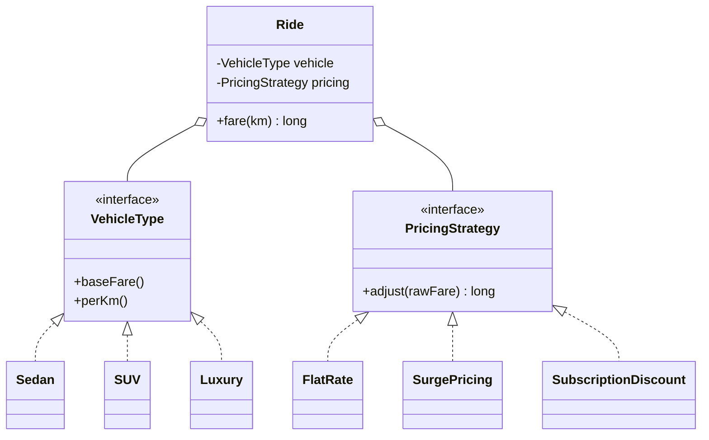
3 + 3 = **6 classes** produce **9 combinations** (and every future combination).

**Java**
```java
interface VehicleType { String name(); long baseFare(); long perKm(); }
interface PricingStrategy { long adjust(long rawFare); }

class Sedan  implements VehicleType { public String name() { return "Sedan";  } public long baseFare() { return 5000; }  public long perKm() { return 1200; } }
class SUV    implements VehicleType { public String name() { return "SUV";    } public long baseFare() { return 8000; }  public long perKm() { return 1800; } }
class Luxury implements VehicleType { public String name() { return "Luxury"; } public long baseFare() { return 15000; } public long perKm() { return 3500; } }

class FlatRate implements PricingStrategy { public long adjust(long raw) { return raw; } }
class SurgePricing implements PricingStrategy {
    private final double multiplier; SurgePricing(double m) { multiplier = m; }
    public long adjust(long raw) { return Math.round(raw * multiplier); }
}
class SubscriptionDiscount implements PricingStrategy {
    private final int percent; SubscriptionDiscount(int p) { percent = p; }
    public long adjust(long raw) { return raw - raw * percent / 100; }
}
class Ride {
    private final VehicleType vehicle; private final PricingStrategy pricing;
    Ride(VehicleType v, PricingStrategy p) { vehicle = v; pricing = p; }
    long fare(double km) { return pricing.adjust(vehicle.baseFare() + Math.round(vehicle.perKm() * km)); }
}
public class Main {
    public static void main(String[] args) {
        VehicleType[] vs = { new Sedan(), new SUV(), new Luxury() };
        PricingStrategy[] ps = { new FlatRate(), new SurgePricing(1.5), new SubscriptionDiscount(20) };
        String[] pn = { "flat", "surge x1.5", "sub -20%" };
        for (VehicleType v : vs)
            for (int i = 0; i < ps.length; i++)
                System.out.printf("%-7s %-11s 5km = %d%n", v.name(), pn[i], new Ride(v, ps[i]).fare(5));   // 9 combos, 6 classes
    }
}
```

**C++**
```cpp
#include <cmath>
#include <iomanip>
#include <iostream>
#include <memory>
#include <string>
#include <vector>

struct VehicleType { virtual ~VehicleType() = default; virtual std::string name() const = 0; virtual long baseFare() const = 0; virtual long perKm() const = 0; };
struct Sedan  : VehicleType { std::string name() const override { return "Sedan";  } long baseFare() const override { return 5000; }  long perKm() const override { return 1200; } };
struct SUV    : VehicleType { std::string name() const override { return "SUV";    } long baseFare() const override { return 8000; }  long perKm() const override { return 1800; } };
struct Luxury : VehicleType { std::string name() const override { return "Luxury"; } long baseFare() const override { return 15000; } long perKm() const override { return 3500; } };

struct PricingStrategy { virtual ~PricingStrategy() = default; virtual long adjust(long raw) const = 0; };
struct FlatRate : PricingStrategy { long adjust(long raw) const override { return raw; } };
struct SurgePricing : PricingStrategy { double m_; explicit SurgePricing(double m) : m_(m) {} long adjust(long raw) const override { return std::lround(raw * m_); } };
struct SubscriptionDiscount : PricingStrategy { int pct_; explicit SubscriptionDiscount(int p) : pct_(p) {} long adjust(long raw) const override { return raw - raw * pct_ / 100; } };

class Ride {
    const VehicleType& vehicle_; const PricingStrategy& pricing_;
public:
    Ride(const VehicleType& v, const PricingStrategy& p) : vehicle_(v), pricing_(p) {}
    long fare(double km) const { return pricing_.adjust(vehicle_.baseFare() + std::lround(vehicle_.perKm() * km)); }
};
int main() {
    Sedan sedan; SUV suv; Luxury lux;
    FlatRate flat; SurgePricing surge(1.5); SubscriptionDiscount sub(20);
    std::vector<const VehicleType*> vs{&sedan, &suv, &lux};
    std::vector<const PricingStrategy*> ps{&flat, &surge, &sub};
    const char* pn[] = {"flat", "surge x1.5", "sub -20%"};
    for (auto* v : vs) for (size_t i = 0; i < ps.size(); i++)
        std::cout << std::left << std::setw(7) << v->name() << " " << std::setw(11) << pn[i] << " 5km = " << Ride(*v, *ps[i]).fare(5) << "\n";
}
```

**C**
```c
#include <math.h>
#include <stdio.h>

typedef struct { const char* name; long base_fare, per_km; } VehicleType;     /* plain data: no behaviour varies */
typedef struct PricingStrategy PricingStrategy;
struct PricingStrategy { long (*adjust)(const PricingStrategy* self, long raw); double param; };
static long flat_adjust (const PricingStrategy* s, long raw) { (void)s; return raw; }
static long surge_adjust(const PricingStrategy* s, long raw) { return lround((double)raw * s->param); }
static long sub_adjust  (const PricingStrategy* s, long raw) { return raw - raw * (long)s->param / 100; }

typedef struct { const VehicleType* vehicle; const PricingStrategy* pricing; } Ride;
static long ride_fare(const Ride* r, double km) { return r->pricing->adjust(r->pricing, r->vehicle->base_fare + lround((double)r->vehicle->per_km * km)); }

int main(void) {
    VehicleType vs[] = { {"Sedan", 5000, 1200}, {"SUV", 8000, 1800}, {"Luxury", 15000, 3500} };
    PricingStrategy ps[] = { { flat_adjust, 0 }, { surge_adjust, 1.5 }, { sub_adjust, 20 } };
    const char* pn[] = { "flat", "surge x1.5", "sub -20%" };
    for (int v = 0; v < 3; v++) for (int p = 0; p < 3; p++) {
        Ride r = { &vs[v], &ps[p] };
        printf("%-7s %-11s 5km = %ld\n", vs[v].name, pn[p], ride_fare(&r, 5));
    }
    return 0;                                      /* compile with -lm */
}
```

### Common OOP mistakes → what earns "Strong Hire"

| Mistake | Why it's wrong | Stronger approach |
|---|---|---|
| Getters/setters on every field | Exposes state; no invariant protection | Behaviour methods that enforce business rules |
| Inheritance just for code reuse | Coupling without a genuine "is-a" | Composition with delegation |
| One massive class with all logic | Violates encapsulation; untestable | Separate classes with focused responsibilities |
| `if/else` on type strings | Fragile, not extensible, misses polymorphism | Interface with one implementation per type |
| Abstract class where an interface suffices | Forces single inheritance | Interface (with default methods if shared behaviour is needed) |
| Exposing internal collections | Callers modify state unvalidated | Return unmodifiable copies or expose behaviour methods |

> 🎯 This table maps directly to what interviewers write in feedback. Each "stronger approach" is what earns a **Strong Hire** signal.

### What you say vs what you should say

| Weak phrasing | Strong phrasing |
|---|---|
| "I used getters and setters to encapsulate the data" | "I exposed behaviour methods that enforce business rules" |
| "I used inheritance because the child reuses parent code" | "I used composition because the relationship is 'has-a' and I need runtime flexibility" |
| "I used an abstract class to define the contract" | "I used an interface because there's no shared state and implementors may need multiple contracts" |
| "I added a switch for each new type" | "I used polymorphism so adding a type is a new class, not a code change" |

---

## 1.19 Part 1 Summary & Cheat Sheet

| Concept | One-line summary | Key test |
|---|---|---|
| **Encapsulation** | Control access to state via behaviour methods, not getters/setters | *Can external code violate an invariant?* If yes → broken |
| **Abstraction** | Hide implementation complexity behind clean interfaces | *Would swapping the implementation need caller changes?* If yes → leaking |
| **Abstraction leak** | Implementation details escape through the interface | The swap test |
| **Inheritance** | "Is-a" with full coupling to the parent | *Truly is-a, and child uses most of parent?* If not → composition |
| **Fragile base class** | Subclass breaks when parent internals change | Look for self-use of overridable methods |
| **Runtime polymorphism** | Same call, different behaviour by actual object type | *Is there an if/else on type?* → extract interface |
| **Compile-time polymorphism** | Overloading, resolved by the compiler | Low design weight |
| **Composition over inheritance** | "Has-a" with loose coupling beats "is-a" with tight coupling | Two independent axes of variation? → compose |
| **Abstract class** | Shared state + partial implementation | *Is there shared state?* No → interface |
| **Interface** | Pure contract, multiple implementation, max flexibility | Default for DI contracts |

### How Part 1 connects to what's next

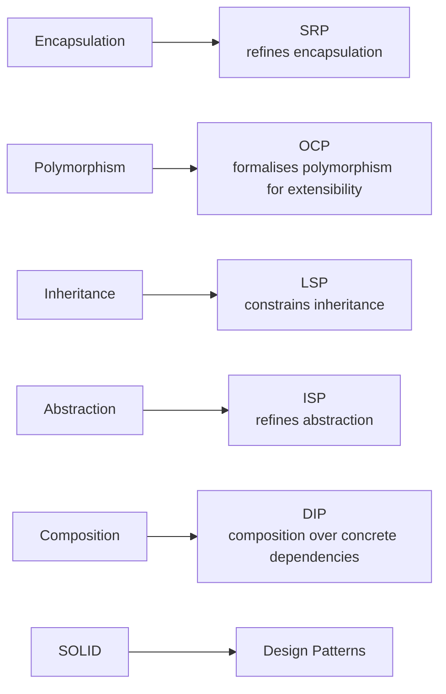

- **Part 2 — SOLID** builds directly on OOP: SRP refines encapsulation, OCP formalises polymorphism, LSP constrains inheritance, ISP refines abstraction, DIP enforces composition over concrete dependencies.
- **Parts 3–5 — Design Patterns:** every pattern is built from OOP primitives. **Factory** uses polymorphism, **Strategy** uses composition, **Observer** uses interfaces. Understanding OOP deeply makes every pattern *intuitive rather than memorised*.

---

# PART 2 — SOLID PRINCIPLES FOR INTERVIEWS
*(Course Section 3 — slides 25–40)*

> SOLID is five design principles that guide **how you structure classes and their relationships**. In LLD interviews SOLID is **not tested as theory** — interviewers check whether you *instinctively apply* the principles and can *spot violations* when they probe your design.

| Letter | Principle | One-line essence | OOP idea it builds on |
|---|---|---|---|
| **S** | Single Responsibility | One reason to change | refines **encapsulation** |
| **O** | Open-Closed | Extend by adding code, not editing code | formalises **polymorphism** |
| **L** | Liskov Substitution | Subtypes honour the parent's *behavioural* contract | constrains **inheritance** |
| **I** | Interface Segregation | No class forced to implement methods it doesn't use | refines **abstraction** |
| **D** | Dependency Inversion | Depend on abstractions, not concretions | enforces **composition** |

### Where SOLID appears in an interview

| Interview moment | What is being tested |
|---|---|
| *"How would you add a new feature?"* | **OCP** — extend without modifying existing code? |
| *"This class is doing too much"* | **SRP** — can you decompose responsibilities? |
| *"What if we swap this implementation?"* | **DIP** — do dependencies point at abstractions? |
| *"Does this subclass really belong here?"* | **LSP** — does the subclass honour the parent's contract? |
| *"Your interface is too large"* | **ISP** — can you split it into focused contracts? |
| Design review / code walkthrough | **All five** — can you spot violations in your *own* design? |

---

## 2.1 SRP — Single Responsibility Principle

> **A class should have only ONE reason to change.**

This is the most frequently misunderstood SOLID principle because "one responsibility" sounds vague. The precise definition is about **change drivers**: a class should be affected by changes from **exactly one source**.

A **change driver** is a stakeholder, a business domain or a technical concern that could independently force edits to the class. If two unrelated changes (a new pricing rule *and* a new log format) both require editing the same class, it has more than one responsibility.

### Concrete example — `InvoiceService`
It calculates totals, formats PDF output, **and** sends emails. Three change drivers hit one class:

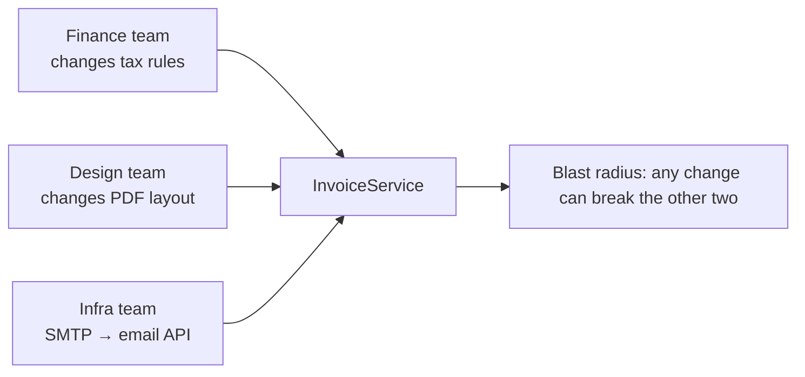

A PDF-layout edit could accidentally break tax calculation (wrong method edited, merge conflict). **SRP violations increase the blast radius of every change.**

> 💡 **Interview Tip.** When asked *"does this class have a single responsibility?"* do **not** say *"it does one thing."* Instead **name the distinct change drivers**: *"This class changes if the tax rules change OR the PDF format changes OR the email provider changes — three reasons to change, so it violates SRP."*
>
> 🎯 SRP is the **most commonly tested** SOLID principle. Interviewers hand you a class with 5–6 methods across different domains and ask you to refactor it.

### ❌ SRP violation — the God `UserService`
Handles authentication, profile management, email notifications **and** audit logging:

```java nocompile
public class UserService {
    private final UserRepository userRepository;
    private final EmailClient emailClient;
    private final Logger auditLogger;

    public boolean authenticate(String email, String password) {
        User user = userRepository.findByEmail(email);
        boolean ok = PasswordHasher.verify(password, user.getPasswordHash());
        auditLogger.info((ok ? "LOGIN_OK " : "LOGIN_FAIL ") + email);          // audit concern
        return ok;
    }
    public void updateProfile(User user, String bio) {
        user.setBio(bio);                                                        // profile concern
        userRepository.save(user);
        emailClient.send(user.getEmail(), "Profile Updated", "...");            // notification concern
        auditLogger.info("PROFILE_UPDATED " + user.getEmail());                  // audit concern
    }
    public void resetPassword(String email) {
        String temp = generateTempPassword();
        User user = userRepository.findByEmail(email);
        user.setPasswordHash(PasswordHasher.hash(temp));                         // auth concern
        emailClient.send(email, "Password Reset", temp);                         // notification concern
        auditLogger.info("PASSWORD_RESET " + email);                             // audit concern
    }
}
```

**Four distinct change drivers in one class**

| Change driver | Example change | Methods affected |
|---|---|---|
| Authentication policy | Add two-factor auth | `authenticate`, `resetPassword` |
| Profile business rules | Profile-picture upload, bio length limits | `updateProfile` |
| Notification requirements | Switch to SMS, add templates | `updateProfile`, `resetPassword` |
| Audit compliance | Change log format, retention policy | all three methods |

A change to the email-template system could introduce a bug in authentication if a careless merge touches shared state. *Every method is a minefield for unrelated changes.*

### ✅ SRP refactored — clean separation
Each responsibility lives in its own class with its **own single change driver**.

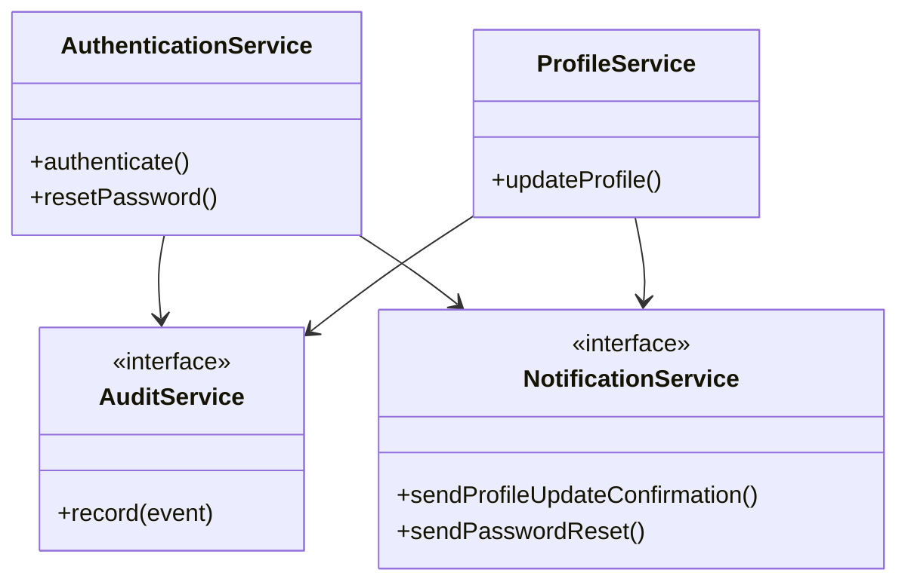

**Java**
```java
class User {
    private final String email; private String passwordHash; private String bio = "";
    User(String email, String rawPassword) { this.email = email; this.passwordHash = hash(rawPassword); }
    String email() { return email; }
    boolean passwordMatches(String raw) { return hash(raw).equals(passwordHash); }
    void replacePassword(String raw) { passwordHash = hash(raw); }
    void updateBio(String b) { if (b.length() > 160) throw new IllegalArgumentException("Bio too long"); bio = b; }
    private static String hash(String s) { return Integer.toHexString(("salt:" + s).hashCode()); }   // DEMO ONLY
}
interface AuditService { void record(String event); }
interface NotificationService {
    void sendProfileUpdateConfirmation(User u);
    void sendPasswordReset(User u, String tempPassword);
}
class ConsoleAudit implements AuditService { public void record(String e) { System.out.println("[AUDIT] " + e); } }
class ConsoleNotifier implements NotificationService {
    public void sendProfileUpdateConfirmation(User u) { System.out.println("[MAIL] " + u.email() + ": profile updated"); }
    public void sendPasswordReset(User u, String t)   { System.out.println("[MAIL] " + u.email() + ": temp password " + t); }
}
class AuthenticationService {                       // change driver: authentication policy ONLY
    private final AuditService audit; private final NotificationService notifier;
    AuthenticationService(AuditService a, NotificationService n) { audit = a; notifier = n; }
    boolean authenticate(User u, String password) {
        boolean ok = u.passwordMatches(password);
        audit.record((ok ? "successfulLogin " : "failedLogin ") + u.email());
        return ok;
    }
    void resetPassword(User u) {
        String temp = "Temp#1234";
        u.replacePassword(temp);
        notifier.sendPasswordReset(u, temp);
        audit.record("passwordReset " + u.email());
    }
}
class ProfileService {                              // change driver: profile business rules ONLY
    private final NotificationService notifier; private final AuditService audit;
    ProfileService(NotificationService n, AuditService a) { notifier = n; audit = a; }
    void updateProfile(User u, String bio) {
        u.updateBio(bio);
        notifier.sendProfileUpdateConfirmation(u);
        audit.record("profileUpdated " + u.email());
    }
}
public class Main {
    public static void main(String[] args) {
        AuditService audit = new ConsoleAudit(); NotificationService notifier = new ConsoleNotifier();
        AuthenticationService auth = new AuthenticationService(audit, notifier);
        ProfileService profile = new ProfileService(notifier, audit);
        User u = new User("ravi@x.com", "secret123");
        System.out.println("login: " + auth.authenticate(u, "wrong"));
        profile.updateProfile(u, "Backend dev");
        auth.resetPassword(u);
    }
}
```

**C++**
```cpp
#include <functional>
#include <iostream>
#include <stdexcept>
#include <string>

class User {
    std::string email_; std::size_t hash_; std::string bio_;
    static std::size_t h(const std::string& s) { return std::hash<std::string>{}("salt:" + s); }   // DEMO ONLY
public:
    User(std::string email, const std::string& pw) : email_(std::move(email)), hash_(h(pw)) {}
    const std::string& email() const { return email_; }
    bool passwordMatches(const std::string& raw) const { return h(raw) == hash_; }
    void replacePassword(const std::string& raw) { hash_ = h(raw); }
    void updateBio(const std::string& b) { if (b.size() > 160) throw std::invalid_argument("Bio too long"); bio_ = b; }
};
struct AuditService { virtual ~AuditService() = default; virtual void record(const std::string& e) = 0; };
struct NotificationService {
    virtual ~NotificationService() = default;
    virtual void sendProfileUpdateConfirmation(const User& u) = 0;
    virtual void sendPasswordReset(const User& u, const std::string& temp) = 0;
};
struct ConsoleAudit : AuditService { void record(const std::string& e) override { std::cout << "[AUDIT] " << e << "\n"; } };
struct ConsoleNotifier : NotificationService {
    void sendProfileUpdateConfirmation(const User& u) override { std::cout << "[MAIL] " << u.email() << ": profile updated\n"; }
    void sendPasswordReset(const User& u, const std::string& t) override { std::cout << "[MAIL] " << u.email() << ": temp password " << t << "\n"; }
};
class AuthenticationService {                       // change driver: authentication policy ONLY
    AuditService& audit_; NotificationService& notifier_;
public:
    AuthenticationService(AuditService& a, NotificationService& n) : audit_(a), notifier_(n) {}
    bool authenticate(const User& u, const std::string& pw) {
        bool ok = u.passwordMatches(pw);
        audit_.record((ok ? "successfulLogin " : "failedLogin ") + u.email());
        return ok;
    }
    void resetPassword(User& u) {
        std::string temp = "Temp#1234";
        u.replacePassword(temp); notifier_.sendPasswordReset(u, temp); audit_.record("passwordReset " + u.email());
    }
};
class ProfileService {                              // change driver: profile business rules ONLY
    NotificationService& notifier_; AuditService& audit_;
public:
    ProfileService(NotificationService& n, AuditService& a) : notifier_(n), audit_(a) {}
    void updateProfile(User& u, const std::string& bio) {
        u.updateBio(bio); notifier_.sendProfileUpdateConfirmation(u); audit_.record("profileUpdated " + u.email());
    }
};
int main() {
    ConsoleAudit audit; ConsoleNotifier notifier;
    AuthenticationService auth(audit, notifier); ProfileService profile(notifier, audit);
    User u("ravi@x.com", "secret123");
    bool ok = auth.authenticate(u, "wrong");
    std::cout << "login: " << std::boolalpha << ok << "\n";
    profile.updateProfile(u, "Backend dev");
    auth.resetPassword(u);
}
```

**C**
```c
#include <stdio.h>
#include <string.h>

typedef struct { char email[32]; unsigned long hash; char bio[161]; } User;
static unsigned long hash_pw(const char* s) { unsigned long h = 5381; while (*s) h = h * 33 + (unsigned char)*s++; return h; }  /* DEMO ONLY */
static void user_init(User* u, const char* email, const char* pw) { memset(u, 0, sizeof *u); strncpy(u->email, email, 31); u->hash = hash_pw(pw); }
static int  user_matches(const User* u, const char* pw) { return hash_pw(pw) == u->hash; }
static int  user_update_bio(User* u, const char* b) { if (strlen(b) > 160) return -1; strcpy(u->bio, b); return 0; }

/* two small abstractions = two single-purpose function-pointer structs */
typedef struct AuditService { void (*record)(const char* event, const char* who); } AuditService;
typedef struct NotificationService {
    void (*profile_updated)(const User* u);
    void (*password_reset)(const User* u, const char* temp);
} NotificationService;
static void console_audit(const char* e, const char* w) { printf("[AUDIT] %s %s\n", e, w); }
static void mail_profile(const User* u) { printf("[MAIL] %s: profile updated\n", u->email); }
static void mail_reset(const User* u, const char* t) { printf("[MAIL] %s: temp password %s\n", u->email, t); }

typedef struct { const AuditService* audit; const NotificationService* notifier; } AuthenticationService;   /* auth only */
static int auth_authenticate(const AuthenticationService* a, const User* u, const char* pw) {
    int ok = user_matches(u, pw); a->audit->record(ok ? "successfulLogin" : "failedLogin", u->email); return ok;
}
static void auth_reset_password(const AuthenticationService* a, User* u) {
    const char* temp = "Temp#1234"; u->hash = hash_pw(temp);
    a->notifier->password_reset(u, temp); a->audit->record("passwordReset", u->email);
}
typedef struct { const AuditService* audit; const NotificationService* notifier; } ProfileService;           /* profile only */
static int profile_update(const ProfileService* p, User* u, const char* bio) {
    if (user_update_bio(u, bio) != 0) return -1;
    p->notifier->profile_updated(u); p->audit->record("profileUpdated", u->email); return 0;
}
int main(void) {
    AuditService audit = { console_audit }; NotificationService notifier = { mail_profile, mail_reset };
    AuthenticationService auth = { &audit, &notifier }; ProfileService profile = { &audit, &notifier };
    User u; user_init(&u, "ravi@x.com", "secret123");
    printf("login: %d\n", auth_authenticate(&auth, &u, "wrong"));
    profile_update(&profile, &u, "Backend dev");
    auth_reset_password(&auth, &u);
    return 0;
}
```

Now a change to authentication policy touches only `AuthenticationService`; a change to notification delivery only `NotificationService`; to profile rules only `ProfileService`. **The blast radius of every change is contained to one class.**

> 🎯 Presenting the **refactored** version shows you can *decompose*, not just *diagnose*. Interviewers want both the diagnosis and the treatment.

### SRP ↔ Microservice thinking

SRP at class level is the same principle that drives microservice decomposition at system level.

| SRP at class level | Same principle at service level |
|---|---|
| `AuthenticationService` class | Authentication microservice |
| `ProfileService` class | User-profile microservice |
| `NotificationService` class | Notification microservice |
| `AuditService` class | Audit/logging microservice |
| Each class has **one change driver** | Each service is **owned by one team** |
| Classes communicate through **interfaces** | Services communicate through **APIs** |

**Where the analogy breaks down — cost of splitting.** Splitting a class into three adds minimal overhead. Splitting a monolith into three services adds network latency, distributed transactions, deployment infrastructure and monitoring. So **SRP does not mean "split everything"**: ask whether the *cost of coupling* (shared change drivers) exceeds the *cost of separation* (extra coordination).

> 🎯 Connecting class-level SRP to service-level decomposition shows you think across abstraction levels — a senior-level signal.

---

## 2.2 OCP — Open-Closed Principle

> **A class should be OPEN for extension but CLOSED for modification.**

In practice: you can add new behaviour **without changing existing, tested code**. It does *not* mean you never modify a class — it means you design so that the **most likely kind of change** (a new variant, a new format, a new case) is done by **writing new code rather than editing old code**.

**Why it matters.** Every edit to an existing class risks breaking something that already worked. If adding a discount type means editing `PriceCalculator`, which also does tax and currency conversion, a bug in the new discount can break tax. OCP minimises this by adding behaviour via new classes.

**Connection to polymorphism.** OCP is the *formal principle* behind the polymorphic design from Part 1: define an interface, add implementations freely. The dashed arrow to `NewDiscountType` below is the **extension point** — adding it needs zero changes to the calculator or any existing discount.

```mermaid
classDiagram
    class PriceCalculator {
        -List~Discount~ discounts
        +finalPrice(order)
    }
    class Discount {
        <<interface>>
        +isApplicable(order)
        +calculateDiscount(order)
    }
    PriceCalculator o-- Discount
    Discount <|.. FlatDiscount
    Discount <|.. PercentageDiscount
    Discount <|.. BuyOneGetOneDiscount
    Discount <|.. SeasonalDiscount : added later - nothing else edited
```

> 🎯 OCP is the **second most tested** SOLID principle. Interviewers ask *"how would you add a new type of X?"* — if your answer involves modifying existing code, you have violated OCP.

### Before OCP — the switch-statement approach
```java nocompile
public class PriceCalculator {
    public double calculate(Order order, String discountType) {
        switch (discountType) {
            case "FLAT":            return order.getSubtotal() - 100;
            case "PERCENTAGE":      return order.getSubtotal() * 0.90;
            case "BUY_ONE_GET_ONE": return order.getSubtotal() - order.getUnitPrice() * (order.getQty() / 2);
            default:                return order.getSubtotal();
        }
    }
}
```
Every new discount type = another `case`. If marketing creates promotions often, the class is edited constantly and **every edit risks breaking existing discount logic**.

### After OCP — the interface approach
`PriceCalculator` is now **closed for modification**. A "Seasonal 20% off" = one new class, registered. The calculator is **never edited**. (The "best discount wins" rule from the slide is kept: filter applicable discounts, take the maximum.)

**Java**
```java
import java.util.*;

class Order {
    final long unitPrice; final int qty;
    Order(long unitPrice, int qty) { this.unitPrice = unitPrice; this.qty = qty; }
    long subtotal() { return unitPrice * qty; }
}
interface Discount {
    boolean isApplicable(Order o);
    long calculateDiscount(Order o);
}
class FlatDiscount implements Discount {                      // Rs.100 off when subtotal >= 500
    public boolean isApplicable(Order o) { return o.subtotal() >= 500; }
    public long calculateDiscount(Order o) { return 100; }
}
class PercentageDiscount implements Discount {
    private final int pct; PercentageDiscount(int pct) { this.pct = pct; }
    public boolean isApplicable(Order o) { return true; }
    public long calculateDiscount(Order o) { return o.subtotal() * pct / 100; }
}
class BuyOneGetOneDiscount implements Discount {
    public boolean isApplicable(Order o) { return o.qty >= 2; }
    public long calculateDiscount(Order o) { return o.unitPrice * (o.qty / 2); }
}
class PriceCalculator {                                       // CLOSED for modification
    private final List<Discount> discounts;
    PriceCalculator(List<Discount> discounts) { this.discounts = discounts; }
    long finalPrice(Order o) {
        long best = discounts.stream().filter(d -> d.isApplicable(o))
                             .mapToLong(d -> d.calculateDiscount(o)).max().orElse(0);
        return o.subtotal() - best;
    }
}
class SeasonalDiscount implements Discount {                  // OPEN for extension: brand-new class
    public boolean isApplicable(Order o) { return true; }
    public long calculateDiscount(Order o) { return o.subtotal() * 20 / 100; }
}
public class Main {
    public static void main(String[] args) {
        Order order = new Order(300, 2);                      // subtotal 600
        PriceCalculator before = new PriceCalculator(Arrays.asList(new FlatDiscount(), new PercentageDiscount(10), new BuyOneGetOneDiscount()));
        System.out.println("before seasonal: " + before.finalPrice(order));    // best = BOGO 300 -> 300
        PriceCalculator after = new PriceCalculator(Arrays.asList(new FlatDiscount(), new PercentageDiscount(10), new BuyOneGetOneDiscount(), new SeasonalDiscount()));
        System.out.println("after seasonal : " + after.finalPrice(new Order(1000, 1)));  // best = 20% of 1000 = 200 -> 800
    }
}
```

**C++**
```cpp
#include <algorithm>
#include <iostream>
#include <memory>
#include <vector>

struct Order { long unitPrice; int qty; long subtotal() const { return unitPrice * qty; } };
struct Discount {
    virtual ~Discount() = default;
    virtual bool isApplicable(const Order&) const = 0;
    virtual long calculateDiscount(const Order&) const = 0;
};
struct FlatDiscount : Discount {
    bool isApplicable(const Order& o) const override { return o.subtotal() >= 500; }
    long calculateDiscount(const Order&) const override { return 100; }
};
struct PercentageDiscount : Discount {
    int pct; explicit PercentageDiscount(int p) : pct(p) {}
    bool isApplicable(const Order&) const override { return true; }
    long calculateDiscount(const Order& o) const override { return o.subtotal() * pct / 100; }
};
struct BuyOneGetOneDiscount : Discount {
    bool isApplicable(const Order& o) const override { return o.qty >= 2; }
    long calculateDiscount(const Order& o) const override { return o.unitPrice * (o.qty / 2); }
};
class PriceCalculator {                                       // CLOSED for modification
    std::vector<std::unique_ptr<Discount>> discounts_;
public:
    void add(std::unique_ptr<Discount> d) { discounts_.push_back(std::move(d)); }
    long finalPrice(const Order& o) const {
        long best = 0;
        for (const auto& d : discounts_) if (d->isApplicable(o)) best = std::max(best, d->calculateDiscount(o));
        return o.subtotal() - best;
    }
};
struct SeasonalDiscount : Discount {                          // OPEN for extension
    bool isApplicable(const Order&) const override { return true; }
    long calculateDiscount(const Order& o) const override { return o.subtotal() * 20 / 100; }
};
int main() {
    PriceCalculator calc;
    calc.add(std::make_unique<FlatDiscount>()); calc.add(std::make_unique<PercentageDiscount>(10)); calc.add(std::make_unique<BuyOneGetOneDiscount>());
    std::cout << "before seasonal: " << calc.finalPrice({300, 2}) << "\n";          // 300
    calc.add(std::make_unique<SeasonalDiscount>());                                    // extension = one line
    std::cout << "after seasonal : " << calc.finalPrice({1000, 1}) << "\n";          // 800
}
```

**C**
```c
#include <stdio.h>

typedef struct { long unit_price; int qty; } Order;
static long subtotal(const Order* o) { return o->unit_price * o->qty; }

typedef struct Discount Discount;
struct Discount { int (*is_applicable)(const Discount*, const Order*); long (*calc)(const Discount*, const Order*); int param; };
static int  always(const Discount* d, const Order* o) { (void)d; (void)o; return 1; }
static int  flat_ok(const Discount* d, const Order* o) { (void)d; return subtotal(o) >= 500; }
static long flat_calc(const Discount* d, const Order* o) { (void)d; (void)o; return 100; }
static long pct_calc(const Discount* d, const Order* o) { return subtotal(o) * d->param / 100; }
static int  bogo_ok(const Discount* d, const Order* o) { (void)d; return o->qty >= 2; }
static long bogo_calc(const Discount* d, const Order* o) { (void)d; return o->unit_price * (o->qty / 2); }
static long seasonal_calc(const Discount* d, const Order* o) { return subtotal(o) * d->param / 100; }   /* added later */

/* CLOSED for modification: this function never changes when a discount is added */
static long final_price(const Discount* const* ds, int n, const Order* o) {
    long best = 0;
    for (int i = 0; i < n; i++) if (ds[i]->is_applicable(ds[i], o)) { long v = ds[i]->calc(ds[i], o); if (v > best) best = v; }
    return subtotal(o) - best;
}
int main(void) {
    Discount flat = { flat_ok, flat_calc, 0 }, pct = { always, pct_calc, 10 }, bogo = { bogo_ok, bogo_calc, 0 };
    Discount seasonal = { always, seasonal_calc, 20 };                     /* OPEN for extension */
    const Discount* before[] = { &flat, &pct, &bogo };
    const Discount* after[]  = { &flat, &pct, &bogo, &seasonal };
    Order a = { 300, 2 }, b = { 1000, 1 };
    printf("before seasonal: %ld\n", final_price(before, 3, &a));         /* 300 */
    printf("after seasonal : %ld\n", final_price(after, 4, &b));          /* 800 */
    return 0;
}
```

### Strategy pattern preview — "OCP in action"
The discount example **is** the Strategy pattern in disguise: define a family of algorithms behind an interface; the calling code (the *context*) works with any of them interchangeably. **OCP tells you *why* to design this way; Strategy tells you *how*.** (Full treatment in Part 5.)

| Requirement phrase | Strategy interface | Implementations |
|---|---|---|
| Multiple discount types | `DiscountStrategy` | Flat, Percentage, Seasonal, Loyalty |
| Multiple payment methods | `PaymentProcessor` | Stripe, PayPal, BankTransfer |
| Multiple export formats | `DocumentExporter` | PDF, DOCX, HTML, CSV |
| Multiple notification channels | `NotificationChannel` | Email, SMS, Push, Webhook |
| Multiple compression algorithms | `CompressionStrategy` | Gzip, Snappy, LZ4, Zstd |

*Every row is a place where OCP prevents a growing `switch`.*

> 💡 **Interview Tip.** When you hear **"support multiple types of X"**, your first instinct is *define an interface for X*. Say: *"Since we need multiple types of X, I'll define an interface so we can add new types without modifying existing code."* That demonstrates OCP **without naming it**.

### 🧪 Interview practice — SRP + OCP (Shopify-like `OrderProcessor`)
*`OrderProcessor` handles validation, inventory checking, payment, shipping-label generation and confirmation emails. "What's wrong, and how would you fix it?"*

| | Answer |
|---|---|
| ❌ **Weak** | *"The class is too big. I'd split it into smaller classes."* — names the symptom, not the principle; doesn't say *why* or *where* to cut |
| ✅ **Strong** | *"This violates SRP: five change drivers — validation rules, inventory management, payment processing, shipping integration, notification delivery. A shipping-provider change shouldn't touch the class that handles payment. I'd refactor into five classes behind interfaces: `OrderValidator`, `InventoryService`, `PaymentProcessor`, `ShippingService`, `NotificationService`. `OrderProcessor` becomes an **orchestrator** that delegates through interfaces. This also enables OCP: a new payment provider = a new `PaymentProcessor` implementation; a new notification channel = a new `NotificationService` implementation. The orchestrator never changes."* |

```mermaid
flowchart LR
    OP[OrderProcessor<br/>orchestrator only] --> V[OrderValidator]
    OP --> I[InventoryService]
    OP --> P[PaymentProcessor]
    OP --> S[ShippingService]
    OP --> N[NotificationService]
```
(The full orchestrator code is the DIP worked example in §2.5.)

---

## 2.3 LSP — Liskov Substitution Principle

> **If B is a subtype of A, you can replace A with B without the program's behaviour becoming incorrect.**

It is **not** about type compatibility (will it compile). It is about **behavioural compatibility** (will it work correctly at runtime).

### The four constraints a subtype must honour

| # | Rule | Example |
|---|---|---|
| 1 | **Preconditions cannot be strengthened** | Parent accepts any positive number → child can't demand only even numbers |
| 2 | **Postconditions cannot be weakened** | Parent guarantees non-null → child can't return null |
| 3 | **Invariants must be preserved** | Parent guarantees `balance >= 0` → child must too |
| 4 | **No unexpected side effects** | Parent `save()` saves to DB → child must not also send a surprise email |

If any is violated, code that works with the parent **breaks with the subtype**, and the caller has no way to know — because the type system says the substitution is valid.

> 💡 LSP is the **least intuitive** SOLID principle. Focus your answer on the **behavioural contract**, not Java's type system.
>
> 🎯 LSP is tested via concrete examples (Rectangle–Square, read-only collections, exception-throwing overrides). **Know at least two** and explain *why* the substitution breaks.

### Example 1 — The Rectangle–Square problem, explained properly
Mathematically a square *is* a rectangle. In OOP, `Square extends Rectangle` is a **behavioural violation**.

`Rectangle` has an **implicit postcondition**: *setting the height does not change the width.* `Square` violates it. The calling code relies on it → substitution breaks. A function that sets width 5, height 10 and expects area 50 gets **100** for a `Square`.

**The fix:** make `Rectangle` and `Square` **sibling** classes implementing a `Shape` interface. Neither extends the other. *Mathematical is-a ≠ OOP is-a: OOP is-a requires **behavioural** compatibility.*

**Java**
```java
class Rectangle {
    protected int w, h;
    void setWidth(int w)  { this.w = w; }
    void setHeight(int h) { this.h = h; }
    int area() { return w * h; }
}
class Square extends Rectangle {                    // ❌ LSP violation
    @Override void setWidth(int x)  { w = x; h = x; }
    @Override void setHeight(int x) { w = x; h = x; }
}
// ✅ the fix: siblings under a Shape interface (immutable, no setters to fight over)
interface Shape { int area(); }
final class Rect implements Shape { private final int w, h; Rect(int w, int h) { this.w = w; this.h = h; } public int area() { return w * h; } }
final class Sq   implements Shape { private final int side;  Sq(int s) { side = s; } public int area() { return side * side; } }

public class Main {
    static void resizeAndCheck(Rectangle r) { r.setWidth(5); r.setHeight(10); System.out.println(r.getClass().getSimpleName() + ": expected 50, got " + r.area()); }
    public static void main(String[] args) {
        resizeAndCheck(new Rectangle());            // 50  ok
        resizeAndCheck(new Square());               // 100 <- substitution broke the caller's expectation
        Shape[] shapes = { new Rect(5, 10), new Sq(7) };
        for (Shape s : shapes) System.out.println("fixed design area = " + s.area());
    }
}
```

**C++**
```cpp
#include <iostream>
#include <memory>
#include <vector>

class Rectangle {
protected: int w_ = 0, h_ = 0;
public:
    virtual ~Rectangle() = default;
    virtual void setWidth(int w)  { w_ = w; }
    virtual void setHeight(int h) { h_ = h; }
    int area() const { return w_ * h_; }
};
class Square : public Rectangle {                   // ❌ LSP violation
public:
    void setWidth(int x) override  { w_ = h_ = x; }
    void setHeight(int x) override { w_ = h_ = x; }
};
// ✅ the fix: siblings under a Shape interface
struct Shape { virtual ~Shape() = default; virtual int area() const = 0; };
class Rect : public Shape { int w_, h_; public: Rect(int w, int h) : w_(w), h_(h) {} int area() const override { return w_ * h_; } };
class Sq   : public Shape { int s_;      public: explicit Sq(int s) : s_(s) {}      int area() const override { return s_ * s_; } };

void resizeAndCheck(Rectangle& r) { r.setWidth(5); r.setHeight(10); std::cout << "expected 50, got " << r.area() << "\n"; }
int main() {
    Rectangle r; Square s;
    resizeAndCheck(r);                              // 50
    resizeAndCheck(s);                              // 100 <- broken expectation
    std::vector<std::unique_ptr<Shape>> shapes; shapes.push_back(std::make_unique<Rect>(5, 10)); shapes.push_back(std::make_unique<Sq>(7));
    for (auto& sh : shapes) std::cout << "fixed design area = " << sh->area() << "\n";
}
```

**C**
```c
#include <stdio.h>

typedef struct Rectangle Rectangle;
struct Rectangle { int w, h; void (*set_width)(Rectangle*, int); void (*set_height)(Rectangle*, int); };
static int  rect_area(const Rectangle* r) { return r->w * r->h; }
static void rect_set_w(Rectangle* r, int x) { r->w = x; }
static void rect_set_h(Rectangle* r, int x) { r->h = x; }
static void sq_set(Rectangle* r, int x)     { r->w = r->h = x; }                   /* ❌ "Square" overrides both to keep w == h */

static void resize_and_check(Rectangle* r) { r->set_width(r, 5); r->set_height(r, 10); printf("expected 50, got %d\n", rect_area(r)); }

/* ✅ the fix: siblings sharing only an "area" capability */
typedef struct Shape Shape;
struct Shape { int (*area)(const Shape*); };
typedef struct { Shape base; int w, h; } Rect;
typedef struct { Shape base; int side; } Sq;
static int rect_shape_area(const Shape* s) { const Rect* r = (const Rect*)s; return r->w * r->h; }
static int sq_shape_area(const Shape* s)   { const Sq* q = (const Sq*)s; return q->side * q->side; }

int main(void) {
    Rectangle r = { 0, 0, rect_set_w, rect_set_h }, sq = { 0, 0, sq_set, sq_set };
    resize_and_check(&r);                           /* 50  */
    resize_and_check(&sq);                          /* 100 <- substitution broke the caller */
    Rect a = { { rect_shape_area }, 5, 10 }; Sq b = { { sq_shape_area }, 7 };
    const Shape* shapes[] = { &a.base, &b.base };
    for (int i = 0; i < 2; i++) printf("fixed design area = %d\n", shapes[i]->area(shapes[i]));
    return 0;
}
```

### Example 2 — A real production violation: `ReadOnlyRepository`

```java nocompile
interface Repository<T> { T findById(String id); void save(T entity); void delete(String id); }

class ReadOnlyRepository<T> implements Repository<T> {          // ❌ compiles, type-checks... and lies
    public T findById(String id) { return store.get(id); }
    public void save(T entity)   { throw new UnsupportedOperationException("read-only"); }
    public void delete(String id){ throw new UnsupportedOperationException("read-only"); }
}
```
Any code that takes a `Repository<T>` reasonably expects `save()` and `delete()` to work. Loop over a list of repositories calling `save()` and it **crashes at runtime** on the read-only one. *The type system lied.*

**The fix — Interface Segregation:** split `ReadableRepository` / `WritableRepository`; `ReadOnlyRepository` implements only the readable one. Code that writes asks for `WritableRepository`; code that reads asks for `ReadableRepository`. No surprises. *Notice how fixing an LSP violation naturally led us to ISP — the principles reinforce each other.*

### Why LSP violations cause production bugs
They pass **all compile-time checks**: types are fine, tests using the parent type pass, code review looks clean. The bug only appears at runtime, in a code path not tested with *that* subtype. Each developer's code is correct in isolation; the bug lives **in the gap between the interface contract and the implementation behaviour.**

**Three warning signs**
1. A subclass **overrides a method to throw** an exception
2. A subclass **overrides a method to do nothing** (empty body)
3. Calling code uses **`instanceof` checks** before calling a method on the interface type — *the type system should prevent invalid calls, not programmer vigilance*

### 🧪 Interview practice — LSP (`FileStorage` / `ArchiveStorage`)
*Base `FileStorage` has `upload`, `download`, `delete`. A teammate wrote `ArchiveStorage extends FileStorage` whose `delete()` throws `UnsupportedOperationException` (archived files must be retained for compliance). "Good design? What would you change?"*

| | Answer |
|---|---|
| ❌ **Weak** | *"Fine — archived files shouldn't be deleted; the exception tells callers not to."* Misses the violation: a batch cleanup job calling `delete()` on all `FileStorage` will crash on the archive |
| ✅ **Strong** | *"This violates LSP — any code that accepts `FileStorage` expects `delete()` to work. Split the interface: `ReadableStorage` (`download`), and `DeletableStorage extends ReadableStorage` (`upload`, `delete`). `ArchiveStorage` implements only `ReadableStorage`. Batch cleanup jobs accept `DeletableStorage`, so they can never be handed an `ArchiveStorage`. **The type system prevents the bug** instead of relying on runtime exceptions."* |

> Note: the slide places `upload()` on the deletable interface; if archives must still accept uploads, give `ReadableStorage` an additional `WritableStorage` sibling. The principle is the same: **don't promise what you can't deliver.**

**Java**
```java
import java.util.*;

interface ReadableStorage { String download(String id); }
interface DeletableStorage extends ReadableStorage { void upload(String id, String data); void delete(String id); }

class DiskStorage implements DeletableStorage {
    private final Map<String, String> files = new HashMap<>();
    public String download(String id) { return files.get(id); }
    public void upload(String id, String d) { files.put(id, d); }
    public void delete(String id) { files.remove(id); System.out.println("deleted " + id); }
}
class ArchiveStorage implements ReadableStorage {               // no delete(), so no lie
    public String download(String id) { return "archived:" + id; }
}
class CleanupJob {
    void run(DeletableStorage storage, String id) { storage.delete(id); }   // can NEVER receive an ArchiveStorage
}
public class Main {
    public static void main(String[] args) {
        DiskStorage disk = new DiskStorage(); disk.upload("f1", "data");
        new CleanupJob().run(disk, "f1");
        ReadableStorage archive = new ArchiveStorage();
        System.out.println(archive.download("f9"));
        // new CleanupJob().run(archive, "f9");   // COMPILE ERROR - the bug is impossible by construction
    }
}
```

**C++**
```cpp
#include <iostream>
#include <map>
#include <string>

struct ReadableStorage { virtual ~ReadableStorage() = default; virtual std::string download(const std::string& id) = 0; };
struct DeletableStorage : ReadableStorage {
    virtual void upload(const std::string& id, const std::string& data) = 0;
    virtual void remove(const std::string& id) = 0;
};
class DiskStorage : public DeletableStorage {
    std::map<std::string, std::string> files_;
public:
    std::string download(const std::string& id) override { return files_[id]; }
    void upload(const std::string& id, const std::string& d) override { files_[id] = d; }
    void remove(const std::string& id) override { files_.erase(id); std::cout << "deleted " << id << "\n"; }
};
struct ArchiveStorage : ReadableStorage {                       // no remove(): cannot lie
    std::string download(const std::string& id) override { return "archived:" + id; }
};
void cleanupJob(DeletableStorage& s, const std::string& id) { s.remove(id); }      // type system blocks ArchiveStorage
int main() {
    DiskStorage disk; disk.upload("f1", "data"); cleanupJob(disk, "f1");
    ArchiveStorage archive; std::cout << archive.download("f9") << "\n";
    // cleanupJob(archive, "f9");   // COMPILE ERROR
}
```

**C**
```c
#include <stdio.h>

typedef struct ReadableStorage ReadableStorage;
struct ReadableStorage { const char* (*download)(ReadableStorage*, const char* id); };
typedef struct DeletableStorage DeletableStorage;
struct DeletableStorage { ReadableStorage readable; void (*upload)(DeletableStorage*, const char*, const char*); void (*remove)(DeletableStorage*, const char*); };

static const char* disk_download(ReadableStorage* r, const char* id) { (void)r; (void)id; return "data"; }
static void disk_upload(DeletableStorage* d, const char* id, const char* data) { (void)d; (void)data; printf("uploaded %s\n", id); }
static void disk_remove(DeletableStorage* d, const char* id) { (void)d; printf("deleted %s\n", id); }
static const char* archive_download(ReadableStorage* r, const char* id) { (void)r; (void)id; return "archived"; }

static void cleanup_job(DeletableStorage* s, const char* id) { s->remove(s, id); }   /* parameter type excludes archives */

int main(void) {
    DeletableStorage disk = { { disk_download }, disk_upload, disk_remove };
    ReadableStorage archive = { archive_download };               /* has no remove slot to call */
    disk.upload(&disk, "f1", "x"); cleanup_job(&disk, "f1");
    printf("%s\n", archive.download(&archive, "f9"));
    /* cleanup_job(&archive, "f9");  <- incompatible pointer type: compiler warns/blocks */
    return 0;
}
```

---

## 2.4 ISP — Interface Segregation Principle

> **No class should be forced to implement methods it does not use.**

A **"fat" interface** bundles many capabilities into one contract, forcing implementors to provide irrelevant methods. ISP is closely tied to LSP: when a class must implement methods it doesn't need, the usual response is to throw `UnsupportedOperationException` or leave the body empty — **both are LSP violations**. ISP prevents LSP violations by keeping interfaces small enough that every implementor can genuinely fulfil the whole contract.

**The problem with fat interfaces**
- They create a **false promise**: *"any object of this type supports all these operations."*
- **Ripple cost:** adding a method to a 15-method interface forces *every* implementor to change, even ones unrelated to the new method.

**The goal:** interfaces focused on **one capability or a closely related group** — each represents a **role** an implementor plays, not a collection of everything the system might ever need.

> 🎯 ISP violations look like **10+ method interfaces** where most implementors care about 2–3. Suggest splitting by capability.

### ❌ The canonical violation — the `OfficeMachine` interface
```java nocompile
interface OfficeMachine {
    void print(Document d);  void scan(Document d);  void fax(Document d, String number);
    void staple(Document d); void copy(Document d);
}
class BasicPrinter implements OfficeMachine {
    public void print(Document d) { /* real work */ }
    public void scan(Document d)  { throw new UnsupportedOperationException(); }
    public void fax(Document d, String n) { throw new UnsupportedOperationException(); }
    public void staple(Document d) { throw new UnsupportedOperationException(); }
    public void copy(Document d)   { throw new UnsupportedOperationException(); }
}
```
`BasicPrinter` supports **1 of 5** methods; four are dead code that throws → **ISP violation** (forced irrelevant methods) *and* **LSP violation** (callers expecting `OfficeMachine` get exceptions on legitimate calls). When `emailDocument()` is added later, **every** implementor must change — *the interface becomes a growing tax*.

### ✅ Refactored into focused interfaces
```mermaid
classDiagram
    class Printer {
        <<interface>>
        +print(doc)
    }
    class Scanner {
        <<interface>>
        +scan(doc)
    }
    class FaxMachine {
        <<interface>>
        +fax(doc, number)
    }
    Printer <|.. BasicPrinter
    Printer <|.. MultiFunctionDevice
    Scanner <|.. MultiFunctionDevice
    FaxMachine <|.. MultiFunctionDevice
    class PrintService
    class DocumentArchiver
    PrintService --> Printer : needs only printing
    DocumentArchiver --> Scanner : needs only scanning
```
`BasicPrinter` implements **only** `Printer` and genuinely supports every method it declares. `MultiFunctionDevice` implements three interfaces and supports all three. **No exceptions, no empty bodies, no LSP violations.** Calling code depends only on what it needs: `PrintService` takes a `Printer` (a `BasicPrinter`, a `MultiFunctionDevice`, or any future printer); `DocumentArchiver` takes a `Scanner`.

**Java**
```java
interface Printer { void print(String doc); }
interface Scanner { String scan(); }
interface FaxMachine { void fax(String doc, String number); }

class BasicPrinter implements Printer {
    public void print(String doc) { System.out.println("BasicPrinter prints: " + doc); }
}
class MultiFunctionDevice implements Printer, Scanner, FaxMachine {
    public void print(String doc) { System.out.println("MFD prints: " + doc); }
    public String scan() { return "scanned-page"; }
    public void fax(String doc, String number) { System.out.println("MFD faxes " + doc + " to " + number); }
}
class PrintService {                                     // depends only on the capability it needs
    private final Printer printer;
    PrintService(Printer p) { printer = p; }
    void printReport(String r) { printer.print(r); }
}
class DocumentArchiver {
    private final Scanner scanner;
    DocumentArchiver(Scanner s) { scanner = s; }
    String archive() { return "archived(" + scanner.scan() + ")"; }
}
public class Main {
    public static void main(String[] args) {
        new PrintService(new BasicPrinter()).printReport("Q3");
        MultiFunctionDevice mfd = new MultiFunctionDevice();
        new PrintService(mfd).printReport("Q4");
        System.out.println(new DocumentArchiver(mfd).archive());
        mfd.fax("contract", "555-0100");
        // new DocumentArchiver(new BasicPrinter());   // COMPILE ERROR: a printer is not a scanner
    }
}
```

**C++**
```cpp
#include <iostream>
#include <string>

struct Printer    { virtual ~Printer() = default;    virtual void print(const std::string& doc) = 0; };
struct Scanner    { virtual ~Scanner() = default;    virtual std::string scan() = 0; };
struct FaxMachine { virtual ~FaxMachine() = default; virtual void fax(const std::string& doc, const std::string& number) = 0; };

struct BasicPrinter : Printer { void print(const std::string& d) override { std::cout << "BasicPrinter prints: " << d << "\n"; } };
struct MultiFunctionDevice : Printer, Scanner, FaxMachine {
    void print(const std::string& d) override { std::cout << "MFD prints: " << d << "\n"; }
    std::string scan() override { return "scanned-page"; }
    void fax(const std::string& d, const std::string& n) override { std::cout << "MFD faxes " << d << " to " << n << "\n"; }
};
class PrintService { Printer& p_; public: explicit PrintService(Printer& p) : p_(p) {} void printReport(const std::string& r) { p_.print(r); } };
class DocumentArchiver { Scanner& s_; public: explicit DocumentArchiver(Scanner& s) : s_(s) {} std::string archive() { return "archived(" + s_.scan() + ")"; } };

int main() {
    BasicPrinter bp; PrintService(bp).printReport("Q3");
    MultiFunctionDevice mfd; PrintService(mfd).printReport("Q4");
    std::cout << DocumentArchiver(mfd).archive() << "\n";
    mfd.fax("contract", "555-0100");
    // DocumentArchiver(bp);   // COMPILE ERROR: BasicPrinter is not a Scanner
}
```

**C**
```c
#include <stdio.h>

typedef struct Printer { void (*print)(const char* doc); } Printer;
typedef struct Scanner { const char* (*scan)(void); } Scanner;
typedef struct FaxMachine { void (*fax)(const char* doc, const char* number); } FaxMachine;

static void basic_print(const char* d) { printf("BasicPrinter prints: %s\n", d); }
static void mfd_print(const char* d)   { printf("MFD prints: %s\n", d); }
static const char* mfd_scan(void)      { return "scanned-page"; }
static void mfd_fax(const char* d, const char* n) { printf("MFD faxes %s to %s\n", d, n); }

typedef struct { Printer printer; Scanner scanner; FaxMachine fax; } MultiFunctionDevice;   /* offers 3 roles */

static void print_report(const Printer* p, const char* r) { p->print(r); }                   /* needs ONLY Printer */
static void archive(const Scanner* s) { printf("archived(%s)\n", s->scan()); }               /* needs ONLY Scanner */

int main(void) {
    Printer basic = { basic_print };
    MultiFunctionDevice mfd = { { mfd_print }, { mfd_scan }, { mfd_fax } };
    print_report(&basic, "Q3");
    print_report(&mfd.printer, "Q4");
    archive(&mfd.scanner);
    mfd.fax.fax("contract", "555-0100");
    return 0;
}
```

> 💡 **Interview Tip.** Aim for **2–4 methods per interface.** At 8+ ask: *"Are these all one capability, or am I bundling unrelated operations?"* If unrelated, split.
>
> 🎯 ISP is tested by asking you to design interfaces for different **device types, user roles or service tiers**. Show focused interfaces, not a single God interface.

---

## 2.5 DIP — Dependency Inversion Principle

> **1. High-level modules should not depend on low-level modules. Both should depend on abstractions.**
> **2. Abstractions should not depend on details. Details should depend on abstractions.**

In plain words: business logic should **never directly reference a specific technology, library or infrastructure component.** Define an interface for *what you need*; let the concrete implementation satisfy it.

### ❌ Without DIP — direct dependency
```java nocompile
public class OrderService {
    private final StripePaymentClient stripeClient;
    private final SendGridEmailClient sendGridClient;
    private final PostgresOrderRepository orderRepository;

    public OrderService() {
        this.stripeClient    = new StripePaymentClient("sk_live_...");     // hardwired!
        this.sendGridClient  = new SendGridEmailClient("sg_key...");
        this.orderRepository = new PostgresOrderRepository("jdbc:postgresql://...");
    }
}
```
Hardwired to Stripe, SendGrid and PostgreSQL. Switching to PayPal means **editing** `OrderService`. A unit test needs a **live Stripe account and a running PostgreSQL**. Business logic is entangled with infrastructure.

### ✅ With DIP — depend on abstractions, inject concretions
```mermaid
flowchart TB
    subgraph WITHOUT_DIP["Without DIP: arrows point DOWN to details"]
      A1[OrderService high-level] --> B1[StripeClient]
      A1 --> C1[PostgresRepo]
    end
    subgraph WITH_DIP["With DIP: both depend on abstractions"]
      A2[OrderService high-level] --> I1[PaymentProcessor interface]
      A2 --> I2[OrderRepository interface]
      B2[StripePaymentProcessor] -. implements .-> I1
      C2[PostgresOrderRepository] -. implements .-> I2
    end
```
The name says it: the dependency arrow from the low-level class to the high-level one is **inverted** — `StripePaymentProcessor` now depends on the `PaymentProcessor` abstraction that the business layer owns.

### Worked example — `OrderService` (Shopify-like)
Abstractions: `PaymentProcessor`, `OrderRepository`, `NotificationSender`. `OrderService` receives them through its **constructor** (constructor injection). Infrastructure implements them. **Tests** use in-memory fakes.

> *"Does my business class `import` a concrete infrastructure class?"* If yes → introduce an abstraction.

**Java**
```java
import java.util.*;

// ---- ABSTRACTIONS (owned by the business layer) ----
class PaymentResult {
    final boolean success; final String transactionId;
    PaymentResult(boolean s, String t) { success = s; transactionId = t; }
}
interface PaymentProcessor { PaymentResult charge(String customerId, long amount); }
class Order {
    final String id, customerId; final long total; String status;
    Order(String id, String customerId, long total, String status) { this.id = id; this.customerId = customerId; this.total = total; this.status = status; }
}
interface OrderRepository { void save(Order o); Optional<Order> findById(String id); }
interface NotificationSender { void send(String customerId, String message); }

// ---- BUSINESS LOGIC (high-level) ----
class OrderService {
    private final PaymentProcessor payments; private final OrderRepository orders; private final NotificationSender notifier;
    OrderService(PaymentProcessor p, OrderRepository r, NotificationSender n) { payments = p; orders = r; notifier = n; }
    String placeOrder(String customerId, long total) {
        PaymentResult result = payments.charge(customerId, total);
        String id = "ord-" + (int) (Math.abs(customerId.hashCode()) % 1000);
        Order order = new Order(id, customerId, total, result.success ? "PAID" : "PAYMENT_FAILED");
        orders.save(order);
        notifier.send(customerId, result.success ? "Order " + id + " confirmed" : "Payment failed for " + id);
        return id;
    }
}
// ---- INFRASTRUCTURE (low-level) ----
class StripePaymentProcessor implements PaymentProcessor {
    public PaymentResult charge(String c, long amt) { System.out.println("[Stripe] charging " + c + " " + amt); return new PaymentResult(true, "ch_123"); }
}
class InMemoryOrderRepository implements OrderRepository {
    private final Map<String, Order> store = new HashMap<>();
    public void save(Order o) { store.put(o.id, o); }
    public Optional<Order> findById(String id) { return Optional.ofNullable(store.get(id)); }
}
class ConsoleNotificationSender implements NotificationSender {
    public void send(String c, String m) { System.out.println("[notify " + c + "] " + m); }
}
// ---- TEST DOUBLES: possible ONLY because of DIP ----
class FakePaymentProcessor implements PaymentProcessor {
    private PaymentResult next = new PaymentResult(true, "fake_ok");
    void setNextResult(PaymentResult r) { next = r; }
    public PaymentResult charge(String c, long a) { return next; }
}
class RecordingNotifier implements NotificationSender {
    final List<String> sent = new ArrayList<>();
    public void send(String c, String m) { sent.add(m); }
}
public class Main {
    public static void main(String[] args) {
        // production wiring (the "composition root")
        new OrderService(new StripePaymentProcessor(), new InMemoryOrderRepository(), new ConsoleNotificationSender()).placeOrder("cust-7", 4999);

        // unit tests: no network, no database, milliseconds
        FakePaymentProcessor fake = new FakePaymentProcessor(); InMemoryOrderRepository repo = new InMemoryOrderRepository(); RecordingNotifier rec = new RecordingNotifier();
        OrderService svc = new OrderService(fake, repo, rec);
        String ok = svc.placeOrder("cust-1", 100);
        System.out.println("success path  : " + repo.findById(ok).get().status);          // PAID
        fake.setNextResult(new PaymentResult(false, null));                               // trivial to simulate failure
        String bad = svc.placeOrder("cust-2", 100);
        System.out.println("failure path  : " + repo.findById(bad).get().status);         // PAYMENT_FAILED
        System.out.println("notifications : " + rec.sent);
    }
}
```

**C++**
```cpp
#include <iostream>
#include <map>
#include <optional>
#include <string>
#include <vector>

struct PaymentResult { bool success; std::string transactionId; };
struct PaymentProcessor { virtual ~PaymentProcessor() = default; virtual PaymentResult charge(const std::string& customer, long amount) = 0; };
struct Order { std::string id, customerId; long total; std::string status; };
struct OrderRepository { virtual ~OrderRepository() = default; virtual void save(const Order&) = 0; virtual std::optional<Order> findById(const std::string&) = 0; };
struct NotificationSender { virtual ~NotificationSender() = default; virtual void send(const std::string& customer, const std::string& msg) = 0; };

class OrderService {                                          // depends ONLY on abstractions
    PaymentProcessor& payments_; OrderRepository& orders_; NotificationSender& notifier_;
public:
    OrderService(PaymentProcessor& p, OrderRepository& r, NotificationSender& n) : payments_(p), orders_(r), notifier_(n) {}
    std::string placeOrder(const std::string& customer, long total) {
        PaymentResult res = payments_.charge(customer, total);
        std::string id = "ord-" + std::to_string(std::hash<std::string>{}(customer) % 1000);
        orders_.save({id, customer, total, res.success ? "PAID" : "PAYMENT_FAILED"});
        notifier_.send(customer, res.success ? "Order " + id + " confirmed" : "Payment failed for " + id);
        return id;
    }
};
struct StripePaymentProcessor : PaymentProcessor {            // infrastructure
    PaymentResult charge(const std::string& c, long a) override { std::cout << "[Stripe] charging " << c << " " << a << "\n"; return {true, "ch_123"}; }
};
struct InMemoryOrderRepository : OrderRepository {
    std::map<std::string, Order> store;
    void save(const Order& o) override { store[o.id] = o; }
    std::optional<Order> findById(const std::string& id) override { auto it = store.find(id); if (it == store.end()) return std::nullopt; return it->second; }
};
struct ConsoleNotificationSender : NotificationSender { void send(const std::string& c, const std::string& m) override { std::cout << "[notify " << c << "] " << m << "\n"; } };
struct FakePaymentProcessor : PaymentProcessor {              // test doubles
    PaymentResult next{true, "fake_ok"};
    PaymentResult charge(const std::string&, long) override { return next; }
};
struct RecordingNotifier : NotificationSender { std::vector<std::string> sent; void send(const std::string&, const std::string& m) override { sent.push_back(m); } };

int main() {
    StripePaymentProcessor stripe; InMemoryOrderRepository realRepo; ConsoleNotificationSender console;
    OrderService(stripe, realRepo, console).placeOrder("cust-7", 4999);          // production wiring

    FakePaymentProcessor fake; InMemoryOrderRepository repo; RecordingNotifier rec;
    OrderService svc(fake, repo, rec);
    std::cout << "success path  : " << repo.findById(svc.placeOrder("cust-1", 100))->status << "\n";
    fake.next = {false, ""};                                                      // trivial failure simulation
    std::cout << "failure path  : " << repo.findById(svc.placeOrder("cust-2", 100))->status << "\n";
    std::cout << "notifications : " << rec.sent.size() << " sent\n";
}
```

**C**
```c
#include <stdio.h>
#include <string.h>

typedef struct { int success; const char* tx_id; } PaymentResult;
typedef struct PaymentProcessor PaymentProcessor;
struct PaymentProcessor { PaymentResult (*charge)(PaymentProcessor*, const char* customer, long amount); int next_ok; /* used by fakes */ };

typedef struct { char id[16], customer[16]; long total; char status[16]; } Order;
typedef struct OrderRepository OrderRepository;
struct OrderRepository { void (*save)(OrderRepository*, const Order*); const Order* (*find)(OrderRepository*, const char* id); Order store[8]; int n; };

typedef struct NotificationSender NotificationSender;
struct NotificationSender { void (*send)(NotificationSender*, const char* customer, const char* msg); int sent; };

/* high-level business logic: only abstractions in sight */
typedef struct { PaymentProcessor* payments; OrderRepository* orders; NotificationSender* notifier; } OrderService;
static void place_order(OrderService* s, const char* customer, long total, char* out_id) {
    PaymentResult r = s->payments->charge(s->payments, customer, total);
    Order o; snprintf(o.id, sizeof o.id, "ord-%d", (int)(strlen(customer) * 37 % 1000) + (int)customer[strlen(customer) - 1]);
    snprintf(o.customer, sizeof o.customer, "%s", customer); o.total = total;
    snprintf(o.status, sizeof o.status, "%s", r.success ? "PAID" : "PAYMENT_FAILED");
    s->orders->save(s->orders, &o);
    s->notifier->send(s->notifier, customer, r.success ? "Order confirmed" : "Payment failed");
    strcpy(out_id, o.id);
}
/* infrastructure + test doubles */
static PaymentResult stripe_charge(PaymentProcessor* p, const char* c, long a) { (void)p; printf("[Stripe] charging %s %ld\n", c, a); return (PaymentResult){ 1, "ch_123" }; }
static PaymentResult fake_charge(PaymentProcessor* p, const char* c, long a) { (void)c; (void)a; return (PaymentResult){ p->next_ok, "fake" }; }
static void mem_save(OrderRepository* r, const Order* o) { if (r->n < 8) r->store[r->n++] = *o; }
static const Order* mem_find(OrderRepository* r, const char* id) { for (int i = 0; i < r->n; i++) if (!strcmp(r->store[i].id, id)) return &r->store[i]; return NULL; }
static void console_send(NotificationSender* n, const char* c, const char* m) { n->sent++; printf("[notify %s] %s\n", c, m); }
static void silent_send(NotificationSender* n, const char* c, const char* m) { (void)c; (void)m; n->sent++; }

int main(void) {
    PaymentProcessor stripe = { stripe_charge, 1 };
    OrderRepository real = { mem_save, mem_find, {{0}}, 0 };
    NotificationSender console = { console_send, 0 };
    OrderService prod = { &stripe, &real, &console }; char id[16];
    place_order(&prod, "cust-7", 4999, id);                                   /* production wiring */

    PaymentProcessor fake = { fake_charge, 1 }; OrderRepository repo = { mem_save, mem_find, {{0}}, 0 }; NotificationSender rec = { silent_send, 0 };
    OrderService svc = { &fake, &repo, &rec };
    place_order(&svc, "cust-1", 100, id); printf("success path  : %s\n", repo.find(&repo, id)->status);
    fake.next_ok = 0;                                                         /* trivial failure simulation */
    place_order(&svc, "cust-2", 100, id); printf("failure path  : %s\n", repo.find(&repo, id)->status);
    printf("notifications : %d sent\n", rec.sent);
    return 0;
}
```

### What DIP made possible (testability)

| Without DIP | With DIP |
|---|---|
| Tests need a running PostgreSQL | Tests use `InMemoryOrderRepository` |
| Tests need valid Stripe API keys | Tests use `FakePaymentProcessor` |
| Tests take **seconds** (network) | Tests take **milliseconds** (in-memory) |
| Flaky tests from network timeouts | Deterministic, repeatable |
| Payment-failure scenarios hard to trigger | Trivial: `setNextResult(failure)` |

> 🎯 *"How would you test this?"* is one of the most common LLD follow-ups — it's often an **indirect DIP test**. If your answer needs real infrastructure, your design has DIP violations. If it's *"inject a mock implementation of the interface"*, you've shown DIP **and** practical testing knowledge.
>
> 🎯 Interviewers look at your diagram's **dependency arrows**. Arrows from business classes toward infrastructure = DIP violation. **Arrows should point toward abstractions.**

---

## 2.6 SOLID at a Glance — "Note It Down"

### The one-line test for each principle

| | Principle | Question to ask | If the answer is bad → |
|---|---|---|---|
| **S** | SRP | *How many reasons does this class have to change?* | More than one → **split it** |
| **O** | OCP | *To add a new type of X, do I modify existing code or write a new class?* | Modify → **extract an interface** |
| **L** | LSP | *Can I substitute a subtype without the program breaking?* | No → **the hierarchy is wrong** |
| **I** | ISP | *Does any implementor throw `UnsupportedOperationException` or leave methods empty?* | Yes → **split the interface** |
| **D** | DIP | *Does my business-logic class import a concrete infrastructure class?* | Yes → **introduce an abstraction** |

### Quick detection table (7 smells)

| Code smell | Likely violation | Fix |
|---|---|---|
| Class with 10+ methods across different domains | **SRP** | Split into focused service classes |
| `switch` / `if-else` on type to decide behaviour | **OCP** | Extract interface, one implementation per type |
| Subclass overrides method to throw `UnsupportedOperationException` | **LSP + ISP** | Split interface, adjust hierarchy |
| Subclass overrides method with an empty body | **LSP** | Remove inheritance, use composition |
| Interface with 8+ methods | **ISP** | Split into focused role-based interfaces |
| Constructor creates its own dependencies with `new` | **DIP** | Accept dependencies via constructor parameters |
| Business class imports DB driver or HTTP client | **DIP** | Depend on an interface, inject implementation |

> 💡 If you can recognise these seven smells *and name the principle* in an LLD interview, you demonstrate the **pattern recognition interviewers associate with senior candidates.** Practise scanning code for them until it's automatic.

---

## 2.7 SOLID Violations as Code Smells — Recognition Guide

Recognising the smell **and naming the fix in under 30 seconds** earns a "strong hire" signal.

| Smell | Principle | What it looks like | Fix |
|---|---|---|---|
| **God Class** | SRP | 15+ methods spanning authentication, data access, business logic, formatting | Identify change drivers; extract each into its own class with a focused interface |
| **Divergent Change** | SRP | You edit the *same class* for unrelated features ("change tax calc" **and** "change email template" both point to one file) | Split along change boundaries |
| **Shotgun Surgery** | SRP (inverted) | One logical change requires editing **10+ files** → one responsibility is scattered | **Consolidate** related logic into one class/module |
| **Switch Statements on Type** | OCP | `switch`/`if-else` on a type string or enum that grows with each new type | Interface + polymorphic dispatch |
| **Refused Bequest** | LSP | Subclass inherits methods but overrides them to do nothing / throw | Composition or split the interface |
| **Fat Interface** | ISP | Interface with 10+ methods; most implementors use 3–4 | Split into small, role-based interfaces |
| **Dependency Magnet** | DIP | Constructor does `new SomeConcreteClass()` — hardwired, untestable | Accept interface-typed dependencies via constructor |

> ⚠️ Note the **balance**: *Divergent Change* says "split", *Shotgun Surgery* says "consolidate". SRP isn't "make classes tiny" — it's "group things that change **together** for the **same reason**."

---

## 2.8 SOLID Interview Practice & Common Mistakes

### Practice — Mixpanel-like reporting system
Reports in **multiple formats** (PDF, CSV, Excel), data from **multiple sources** (PostgreSQL, Elasticsearch, Redis cache), delivered via **multiple channels** (email, Slack webhook, S3 upload). *"Walk me through your class design."*

**What the interviewer evaluates:** *three independent dimensions of variation* (format, data source, delivery channel) ⇒ **three interface hierarchies composed together.** A single `ReportGenerator` that does everything violates **SRP** (too many reasons to change), **OCP** (a new format means modifying the class), and **DIP** (directly depending on the Postgres driver, Elasticsearch client and SMTP library).

```mermaid
classDiagram
    class ReportService {
        +run(query)
    }
    class DataSource {
        <<interface>>
        +fetch(query)
    }
    class ReportFormatter {
        <<interface>>
        +format(rows)
    }
    class DeliveryChannel {
        <<interface>>
        +deliver(report)
    }
    ReportService --> DataSource
    ReportService --> ReportFormatter
    ReportService --> DeliveryChannel
    DataSource <|.. PostgresSource
    DataSource <|.. ElasticSource
    DataSource <|.. RedisCacheSource
    ReportFormatter <|.. PdfFormatter
    ReportFormatter <|.. CsvFormatter
    ReportFormatter <|.. ExcelFormatter
    DeliveryChannel <|.. EmailDelivery
    DeliveryChannel <|.. SlackWebhookDelivery
    DeliveryChannel <|.. S3Delivery
```
3 + 3 + 3 = **9 classes** cover 27 combinations.

**Java**
```java
import java.util.*;

interface DataSource { List<String> fetch(String query); }
interface ReportFormatter { String format(List<String> rows); }
interface DeliveryChannel { void deliver(String report); }

class PostgresSource implements DataSource { public List<String> fetch(String q) { return Arrays.asList("pg:" + q + ":1", "pg:" + q + ":2"); } }
class RedisCacheSource implements DataSource { public List<String> fetch(String q) { return Arrays.asList("cache:" + q); } }
class CsvFormatter implements ReportFormatter { public String format(List<String> r) { return String.join(",", r); } }
class PdfFormatter implements ReportFormatter { public String format(List<String> r) { return "%PDF[" + String.join("|", r) + "]"; } }
class EmailDelivery implements DeliveryChannel { public void deliver(String rep) { System.out.println("EMAIL <- " + rep); } }
class SlackWebhookDelivery implements DeliveryChannel { public void deliver(String rep) { System.out.println("SLACK <- " + rep); } }

class ReportService {                               // orchestrator: depends on 3 abstractions (SRP + OCP + DIP)
    private final DataSource source; private final ReportFormatter formatter; private final DeliveryChannel channel;
    ReportService(DataSource s, ReportFormatter f, DeliveryChannel c) { source = s; formatter = f; channel = c; }
    void run(String query) { channel.deliver(formatter.format(source.fetch(query))); }
}
public class Main {
    public static void main(String[] args) {
        new ReportService(new PostgresSource(),   new PdfFormatter(), new EmailDelivery()).run("signups");
        new ReportService(new RedisCacheSource(), new CsvFormatter(), new SlackWebhookDelivery()).run("dau");
    }
}
```

**C++**
```cpp
#include <iostream>
#include <string>
#include <vector>

using Rows = std::vector<std::string>;
struct DataSource      { virtual ~DataSource() = default;      virtual Rows fetch(const std::string& q) = 0; };
struct ReportFormatter { virtual ~ReportFormatter() = default; virtual std::string format(const Rows& r) = 0; };
struct DeliveryChannel { virtual ~DeliveryChannel() = default; virtual void deliver(const std::string& report) = 0; };

struct PostgresSource   : DataSource { Rows fetch(const std::string& q) override { return {"pg:" + q + ":1", "pg:" + q + ":2"}; } };
struct RedisCacheSource : DataSource { Rows fetch(const std::string& q) override { return {"cache:" + q}; } };
static std::string join(const Rows& r, const std::string& sep) { std::string s; for (size_t i = 0; i < r.size(); i++) s += (i ? sep : "") + r[i]; return s; }
struct CsvFormatter : ReportFormatter { std::string format(const Rows& r) override { return join(r, ","); } };
struct PdfFormatter : ReportFormatter { std::string format(const Rows& r) override { return "%PDF[" + join(r, "|") + "]"; } };
struct EmailDelivery        : DeliveryChannel { void deliver(const std::string& r) override { std::cout << "EMAIL <- " << r << "\n"; } };
struct SlackWebhookDelivery : DeliveryChannel { void deliver(const std::string& r) override { std::cout << "SLACK <- " << r << "\n"; } };

class ReportService {
    DataSource& source_; ReportFormatter& formatter_; DeliveryChannel& channel_;
public:
    ReportService(DataSource& s, ReportFormatter& f, DeliveryChannel& c) : source_(s), formatter_(f), channel_(c) {}
    void run(const std::string& query) { channel_.deliver(formatter_.format(source_.fetch(query))); }
};
int main() {
    PostgresSource pg; RedisCacheSource redis; PdfFormatter pdf; CsvFormatter csv; EmailDelivery email; SlackWebhookDelivery slack;
    ReportService(pg, pdf, email).run("signups");
    ReportService(redis, csv, slack).run("dau");
}
```

**C**
```c
#include <stdio.h>
#include <string.h>

typedef struct DataSource DataSource;           struct DataSource { int (*fetch)(DataSource*, const char* q, char rows[][32], int max); };
typedef struct ReportFormatter ReportFormatter; struct ReportFormatter { void (*format)(ReportFormatter*, char rows[][32], int n, char* out, size_t cap); };
typedef struct DeliveryChannel DeliveryChannel; struct DeliveryChannel { void (*deliver)(DeliveryChannel*, const char* report); };

static int pg_fetch(DataSource* d, const char* q, char rows[][32], int max) { (void)d; (void)max; snprintf(rows[0], 32, "pg:%s:1", q); snprintf(rows[1], 32, "pg:%s:2", q); return 2; }
static int cache_fetch(DataSource* d, const char* q, char rows[][32], int max) { (void)d; (void)max; snprintf(rows[0], 32, "cache:%s", q); return 1; }
static void join_into(char rows[][32], int n, const char* sep, char* out, size_t cap) { out[0] = 0; for (int i = 0; i < n; i++) { if (i) strncat(out, sep, cap - strlen(out) - 1); strncat(out, rows[i], cap - strlen(out) - 1); } }
static void csv_fmt(ReportFormatter* f, char rows[][32], int n, char* out, size_t cap) { (void)f; join_into(rows, n, ",", out, cap); }
static void pdf_fmt(ReportFormatter* f, char rows[][32], int n, char* out, size_t cap) { (void)f; char t[128]; join_into(rows, n, "|", t, sizeof t); snprintf(out, cap, "%%PDF[%s]", t); }
static void email_deliver(DeliveryChannel* c, const char* r) { (void)c; printf("EMAIL <- %s\n", r); }
static void slack_deliver(DeliveryChannel* c, const char* r) { (void)c; printf("SLACK <- %s\n", r); }

typedef struct { DataSource* source; ReportFormatter* formatter; DeliveryChannel* channel; } ReportService;
static void run_report(ReportService* s, const char* query) {
    char rows[4][32], out[160];
    int n = s->source->fetch(s->source, query, rows, 4);
    s->formatter->format(s->formatter, rows, n, out, sizeof out);
    s->channel->deliver(s->channel, out);
}
int main(void) {
    DataSource pg = { pg_fetch }, redis = { cache_fetch }; ReportFormatter pdf = { pdf_fmt }, csv = { csv_fmt };
    DeliveryChannel email = { email_deliver }, slack = { slack_deliver };
    ReportService a = { &pg, &pdf, &email }, b = { &redis, &csv, &slack };
    run_report(&a, "signups"); run_report(&b, "dau");
    return 0;
}
```

### Common SOLID mistakes in interviews

| Mistake | Principle | Stronger approach |
|---|---|---|
| One class handles validation, persistence **and** notification | SRP | Separate classes per responsibility, composed by an orchestrator |
| Adding new behaviour with `if/else` branches | OCP | Define an interface; write a new implementation class |
| Subclass throws `UnsupportedOperationException` | LSP + ISP | Split the interface so the subclass implements only what it supports |
| 12-method interface, most implementors leave half empty | ISP | Split into 3–4 focused interfaces by capability |
| Business class does `new PostgresConnection()` | DIP | Accept a `DatabaseConnection` interface through the constructor |
| *"I used SOLID"* without saying which principle or why | All | Name the specific principle **and** the specific problem it solves |

> 💡 **Interview Tip — don't name-drop.** Do **not** announce SOLID principles unprompted. **Apply them silently.** If the interviewer probes (*"why an interface here?"*) *then* name the principle. Saying *"I'm applying OCP here"* before anyone asked sounds rehearsed. Saying *"I used an interface so adding a new export format doesn't require modifying existing code"* demonstrates OCP naturally.
>
> 🎯 Interviewers care more about **whether you apply** SOLID than whether you can recite definitions.

---

## 2.9 Part 2 Summary & Cheat Sheet

| Principle | One-line summary | Violation detection test |
|---|---|---|
| **SRP** | One reason to change (one change driver) | Count distinct change drivers |
| **OCP** | Add behaviour by writing new classes, not editing old ones | Does adding a type require editing existing code? |
| **LSP** | Subtypes honour the parent's behavioural contract | Any subtype throwing or with empty overrides? |
| **ISP** | No class forced to implement methods it doesn't use | Any implementor leaving methods unimplemented? |
| **DIP** | Business logic depends on interfaces, not concrete implementations | Does business logic import concrete infrastructure? |
| **SRP ↔ Microservices** | Class-level SRP maps to service-level decomposition | — |
| **OCP + Strategy** | "Multiple types of X" ⇒ interface + implementations | — |
| **LSP + ISP** | Exception-throwing overrides signal both violations at once | — |
| **DIP + Testability** | Interface dependencies enable mock-based unit tests | — |

### Common mistakes → stronger statements

| ❌ "…" | ✅ "…" |
|---|---|
| *"This class has a single responsibility because it handles users"* | *"This class has three change drivers: authentication policy, profile rules and notification delivery. Each should be a separate class."* |
| *"I'll add a case to the switch for the new type"* | *"I'll write a new class implementing the interface. No existing code changes."* |
| *"Square extends Rectangle because a square is a rectangle"* | *"The behavioural contracts differ (setting height on a square changes width), so they should be siblings under a `Shape` interface."* |
| *"This interface has 12 methods because the system needs all of them"* | *"Not every implementor needs all 12. I'll split into focused interfaces by capability."* |
| *"I used `new StripeClient()` in my `OrderService`"* | *"`OrderService` accepts a `PaymentProcessor` interface. Stripe is injected from outside."* |

### How SOLID connects to the patterns ahead

```mermaid
flowchart LR
    SOLID --> CRE[Creational<br/>Factory Method = OCP for object creation<br/>Builder = SRP for construction]
    SOLID --> STR[Structural<br/>Adapter enables DIP<br/>Decorator enables OCP<br/>Facade applies SRP to subsystem access]
    SOLID --> BEH[Behavioral<br/>Strategy = direct OCP<br/>Observer decouples producers and consumers DIP<br/>Chain of Responsibility = SRP for request processing]
    SOLID --> SEL[Pattern Selection<br/>switch on type → Strategy<br/>fat interface → ISP refactor<br/>new in constructor → Factory + DIP]
```

---

# PART 3 — CREATIONAL DESIGN PATTERNS
*(Course Section 4 — slides 41–53)*

> **Creational patterns answer one question: *how and where do objects get created?***
> In a tiny program, `new SomeClass()` everywhere is fine. In a large system, scattered creation causes **tight coupling**, **duplicated configuration logic**, and classes that are **impossible to test in isolation**. Creational patterns **centralise and control creation** so the rest of the code depends on **abstractions, not concrete classes** — the **Dependency Inversion Principle applied to construction.**

### What we cover
1. **Factory Method** — decouple creation from usage
2. **Abstract Factory** — create *families* of related objects consistently
3. **Builder** — construct complex objects step by step
4. **Singleton** — when it's appropriate and why it is overused (+ the **Registry / DI** alternative)
5. A **decision framework** for choosing between them
6. *(Bonus, not in the slides)* **Prototype** — create objects by copying

### Interview signals → pattern

| Interview signal | Pattern | Why |
|---|---|---|
| *"Support multiple types of X"* | **Factory Method** | Decouple creation from calling code |
| *"These objects must be created together consistently"* | **Abstract Factory** | Ensure compatible object families |
| *"This object has 8+ constructor parameters"* | **Builder** | Avoid telescoping constructors |
| *"We need exactly one instance of X"* | **Singleton** (cautiously) | Controlled shared state |
| *"How would you add a new type without changing existing code?"* | **Factory Method** | OCP applied to object creation |

---

## 3.1 Factory Method — Decoupling Object Creation from Usage

**Intent.** Move object creation out of the calling code into a dedicated method or class. The caller asks the factory for an object and receives it **through an interface**, without knowing which concrete class was instantiated.

**Why it matters.** If 15 classes each call `new EmailNotification()`, switching from email to push means editing **15 files**. A factory centralises that decision in **one place**.

```mermaid
classDiagram
    class NotificationService {
        -NotificationChannelFactory factory
        +send(type, user, msg)
    }
    class NotificationChannelFactory {
        +create(type) NotificationChannel
    }
    class NotificationChannel {
        <<interface>>
        +send(userId, message)
    }
    NotificationService --> NotificationChannelFactory
    NotificationService --> NotificationChannel : uses only the interface
    NotificationChannelFactory ..> NotificationChannel : creates
    NotificationChannel <|.. EmailChannel
    NotificationChannel <|.. SmsChannel
    NotificationChannel <|.. PushChannel
```

`NotificationService` never calls `new EmailChannel()`. It asks the factory, which decides the concrete class based on configuration, user preferences or business rules.

> 🎯 Factory Method is the **most commonly tested creational pattern** — it's how interviewers check "OCP applied to creation": adding a type means updating the factory, not every class that uses the type.

### ❌ Wrong approach — creation logic in the calling code
```java nocompile
public class NotificationService {
    public void notify(String userId, String message, String channelType) {
        switch (channelType) {
            case "email":
                EmailClient emailClient = new EmailClient("smtp.prod.example.com", 587);
                String address = UserDirectory.lookupEmail(userId);
                emailClient.send(address, "Notification", message);
                break;
            case "sms":
                SmsGateway smsGateway = new SmsGateway("api-key-123");
                String phone = UserDirectory.lookupPhone(userId);
                smsGateway.send(phone, message);
                break;
            case "push":
                PushService pushService = new PushService("firebase-project");
                String token = DeviceRegistry.lookupToken(userId);
                pushService.push(token, message);
                break;
        }
    }
}
```

| Problem | Principle broken |
|---|---|
| Adding WhatsApp means editing this class | **OCP** |
| `NotificationService` knows SMTP ports, API keys, Firebase config | **SRP** — business logic mixed with infrastructure |
| Can't test without real email/SMS/push services | **DIP** — depends on concrete implementations |
| Every sender class duplicates this switch | **Shotgun surgery** — one change touches many files |
| Channel-specific setup (keys, addresses) hard-coded | Configuration scattered, not centralised |

*The code violates three SOLID principles at once; the factory method fixes all of them in one refactoring step.*

### ✅ Right approach — interface + factory + 1-line caller
`NotificationService` shrinks to **a single line of business logic**. Adding WhatsApp = **write one class + register it**; the service and factory are untouched.

**Java**
```java
import java.util.*;

interface NotificationChannel { void send(String userId, String message); }
class EmailChannel implements NotificationChannel { public void send(String u, String m) { System.out.println("[EMAIL]    " + u + ": " + m); } }
class SmsChannel   implements NotificationChannel { public void send(String u, String m) { System.out.println("[SMS]      " + u + ": " + m); } }
class PushChannel  implements NotificationChannel { public void send(String u, String m) { System.out.println("[PUSH]     " + u + ": " + m); } }

class NotificationChannelFactory {                           // creation decision lives HERE only
    private final Map<String, NotificationChannel> channels;
    NotificationChannelFactory(Map<String, NotificationChannel> channels) { this.channels = channels; }
    NotificationChannel create(String type) {
        NotificationChannel c = channels.get(type);
        if (c == null) throw new IllegalArgumentException("Unknown channel type: " + type);
        return c;
    }
}
class NotificationService {                                  // knows NOTHING about SMTP, gateways, Firebase
    private final NotificationChannelFactory factory;
    NotificationService(NotificationChannelFactory f) { factory = f; }
    void send(String channelType, String userId, String message) { factory.create(channelType).send(userId, message); }
}
// ---- Adding WhatsApp: Step 1 = ONE new class ----
class WhatsAppChannel implements NotificationChannel { public void send(String u, String m) { System.out.println("[WHATSAPP] " + u + ": " + m); } }

public class Main {
    public static void main(String[] args) {
        // application startup / configuration module
        Map<String, NotificationChannel> channels = new HashMap<>();
        channels.put("email", new EmailChannel());
        channels.put("sms", new SmsChannel());
        channels.put("push", new PushChannel());
        channels.put("whatsapp", new WhatsAppChannel());      // Step 2 = ONE new line of configuration
        NotificationService svc = new NotificationService(new NotificationChannelFactory(channels));
        svc.send("email", "ravi", "Welcome!");
        svc.send("whatsapp", "ravi", "Your OTP is 4821");
        try { svc.send("pigeon", "ravi", "hi"); } catch (IllegalArgumentException e) { System.out.println("Rejected: " + e.getMessage()); }
    }
}
```

**C++**
```cpp
#include <iostream>
#include <map>
#include <memory>
#include <stdexcept>
#include <string>

struct NotificationChannel { virtual ~NotificationChannel() = default; virtual void send(const std::string& user, const std::string& msg) = 0; };
struct EmailChannel : NotificationChannel { void send(const std::string& u, const std::string& m) override { std::cout << "[EMAIL]    " << u << ": " << m << "\n"; } };
struct SmsChannel   : NotificationChannel { void send(const std::string& u, const std::string& m) override { std::cout << "[SMS]      " << u << ": " << m << "\n"; } };
struct PushChannel  : NotificationChannel { void send(const std::string& u, const std::string& m) override { std::cout << "[PUSH]     " << u << ": " << m << "\n"; } };

class NotificationChannelFactory {                           // creation decision lives HERE only
    std::map<std::string, std::unique_ptr<NotificationChannel>> channels_;
public:
    void registerChannel(const std::string& type, std::unique_ptr<NotificationChannel> c) { channels_[type] = std::move(c); }
    NotificationChannel& create(const std::string& type) {
        auto it = channels_.find(type);
        if (it == channels_.end()) throw std::invalid_argument("Unknown channel type: " + type);
        return *it->second;
    }
};
class NotificationService {
    NotificationChannelFactory& factory_;
public:
    explicit NotificationService(NotificationChannelFactory& f) : factory_(f) {}
    void send(const std::string& type, const std::string& user, const std::string& msg) { factory_.create(type).send(user, msg); }
};
// ---- Adding WhatsApp: Step 1 = ONE new class ----
struct WhatsAppChannel : NotificationChannel { void send(const std::string& u, const std::string& m) override { std::cout << "[WHATSAPP] " << u << ": " << m << "\n"; } };

int main() {
    NotificationChannelFactory factory;
    factory.registerChannel("email", std::make_unique<EmailChannel>());
    factory.registerChannel("sms", std::make_unique<SmsChannel>());
    factory.registerChannel("push", std::make_unique<PushChannel>());
    factory.registerChannel("whatsapp", std::make_unique<WhatsAppChannel>());   // Step 2 = ONE new line
    NotificationService svc(factory);
    svc.send("email", "ravi", "Welcome!");
    svc.send("whatsapp", "ravi", "Your OTP is 4821");
    try { svc.send("pigeon", "ravi", "hi"); } catch (const std::exception& e) { std::cout << "Rejected: " << e.what() << "\n"; }
}
```

**C**
```c
#include <stdio.h>
#include <string.h>

typedef struct NotificationChannel NotificationChannel;
struct NotificationChannel { void (*send)(NotificationChannel*, const char* user, const char* msg); };
static void email_send(NotificationChannel* c, const char* u, const char* m) { (void)c; printf("[EMAIL]    %s: %s\n", u, m); }
static void sms_send  (NotificationChannel* c, const char* u, const char* m) { (void)c; printf("[SMS]      %s: %s\n", u, m); }
static void push_send (NotificationChannel* c, const char* u, const char* m) { (void)c; printf("[PUSH]     %s: %s\n", u, m); }
static void wa_send   (NotificationChannel* c, const char* u, const char* m) { (void)c; printf("[WHATSAPP] %s: %s\n", u, m); }  /* Step 1: new function */

typedef struct { const char* type; NotificationChannel* channel; } Entry;
typedef struct { Entry entries[8]; int n; } NotificationChannelFactory;
static void factory_register(NotificationChannelFactory* f, const char* type, NotificationChannel* c) { if (f->n < 8) f->entries[f->n++] = (Entry){ type, c }; }
static NotificationChannel* factory_create(const NotificationChannelFactory* f, const char* type) {   /* creation decision lives HERE only */
    for (int i = 0; i < f->n; i++) if (strcmp(f->entries[i].type, type) == 0) return f->entries[i].channel;
    return NULL;                                                                                       /* unknown type */
}
static void service_send(const NotificationChannelFactory* f, const char* type, const char* user, const char* msg) {
    NotificationChannel* c = factory_create(f, type);
    if (!c) { printf("Rejected: Unknown channel type: %s\n", type); return; }
    c->send(c, user, msg);
}
int main(void) {
    NotificationChannel email = { email_send }, sms = { sms_send }, push = { push_send }, wa = { wa_send };
    NotificationChannelFactory factory = { {{0}}, 0 };
    factory_register(&factory, "email", &email); factory_register(&factory, "sms", &sms);
    factory_register(&factory, "push", &push);   factory_register(&factory, "whatsapp", &wa);          /* Step 2: one new line */
    service_send(&factory, "email", "ravi", "Welcome!");
    service_send(&factory, "whatsapp", "ravi", "Your OTP is 4821");
    service_send(&factory, "pigeon", "ravi", "hi");
    return 0;
}
```

### Adding a new type — count the changes (say this in the interview)
| Step | Change |
|---|---|
| 1 | Write `WhatsAppChannel` (**one new file**) |
| 2 | Register it in the configuration module (**one new line**) |
| Untouched | `NotificationService`, `NotificationChannelFactory`, every existing channel |

> 🎯 Walking through *"add a new type"* step by step and **counting files changed** (one new file, one config line) is one of the strongest ways to prove OCP compliance.

### Variations you should know

**1. Static factory method on the interface** — fine for simple cases; the `switch` is now in **one** place:
```java nocompile
interface NotificationChannel {
    void send(String userId, String message);
    static NotificationChannel of(String type) {                 // the only place that knows concrete classes
        switch (type) {
            case "email": return new EmailChannel();
            case "sms":   return new SmsChannel();
            default: throw new IllegalArgumentException("Unknown: " + type);
        }
    }
}
```
**2. Classic GoF "Factory Method"** — a *method in a base class that subclasses override* to decide which product to create. Useful when a framework class has a fixed workflow but lets subclasses choose the object it works with:
```mermaid
classDiagram
    class Dialog {
        +render()
        +createButton()* Button
    }
    class WindowsDialog {
        +createButton() Button
    }
    class WebDialog {
        +createButton() Button
    }
    Dialog <|-- WindowsDialog
    Dialog <|-- WebDialog
    Button <|.. WindowsButton
    Button <|.. HtmlButton
```
`Dialog.render()` calls `createButton()` (the factory method); each subclass returns its own `Button`. The course's notification factory is the more common *registry/simple-factory* flavour; both achieve **"caller depends on the interface, creation is centralised."**

> 💡 **Interview Tip.** In an LLD interview the factory does **not** need to be a separate class — a **static factory method on the interface** works for simple cases. What the interviewer evaluates: **is creation logic centralised, and is the caller decoupled from concrete types?**
>
> 🎯 Show the **before (switch)** and **after (factory)** — it proves you understand *why* the pattern exists, not just how to type it.

---

## 3.2 Abstract Factory — Families of Related Objects

**Intent.** Create **families of related objects that must be used together.** Factory Method creates *one* type; Abstract Factory creates a *set designed to work as a group*.

**When you need it.** A UI library with themes: a **Material** theme produces Material buttons, text fields and dropdowns; a **Fluent** theme produces Fluent ones. *Mixing a Material button with a Fluent dropdown looks broken.* Components in a theme must be created **together, consistently**.

```mermaid
classDiagram
    class FormRenderer {
        -UIComponentFactory factory
        +render()
    }
    class UIComponentFactory {
        <<interface>>
        +createButton(label)
        +createTextField(hint)
        +createDropdown(options)
    }
    class MaterialFactory
    class FluentFactory
    class Button {
        <<interface>>
    }
    class TextField {
        <<interface>>
    }
    class Dropdown {
        <<interface>>
    }
    UIComponentFactory <|.. MaterialFactory
    UIComponentFactory <|.. FluentFactory
    FormRenderer --> UIComponentFactory
    MaterialFactory ..> MaterialButton : creates
    MaterialFactory ..> MaterialTextField : creates
    MaterialFactory ..> MaterialDropdown : creates
    FluentFactory ..> FluentButton : creates
    FluentFactory ..> FluentTextField : creates
    FluentFactory ..> FluentDropdown : creates
    Button <|.. MaterialButton
    Button <|.. FluentButton
    TextField <|.. MaterialTextField
    TextField <|.. FluentTextField
    Dropdown <|.. MaterialDropdown
    Dropdown <|.. FluentDropdown
```
*(solid = inheritance/implements, dashed = creates)*

`FormRenderer` doesn't know which theme is active. It creates components via the factory, and **the factory guarantees one family**. Switching Material → Fluent = **inject a different factory; zero changes to `FormRenderer`.**

### Worked example — UI component factory for themes

**Java**
```java
import java.util.*;

interface Button { String render(); }
interface TextField { String render(); }
interface Dropdown { String render(); }

interface UIComponentFactory {
    Button createButton(String label);
    TextField createTextField(String hint);
    Dropdown createDropdown(List<String> options);
}
// ---- Material family ----
class MaterialButton implements Button { final String l; MaterialButton(String l) { this.l = l; } public String render() { return "[Material Button: " + l + "]"; } }
class MaterialTextField implements TextField { final String h; MaterialTextField(String h) { this.h = h; } public String render() { return "[Material TextField: " + h + "]"; } }
class MaterialDropdown implements Dropdown { final List<String> o; MaterialDropdown(List<String> o) { this.o = o; } public String render() { return "[Material Dropdown: " + o + "]"; } }
class MaterialFactory implements UIComponentFactory {
    public Button createButton(String l) { return new MaterialButton(l); }
    public TextField createTextField(String h) { return new MaterialTextField(h); }
    public Dropdown createDropdown(List<String> o) { return new MaterialDropdown(o); }
}
// ---- Fluent family ----
class FluentButton implements Button { final String l; FluentButton(String l) { this.l = l; } public String render() { return "<Fluent Button: " + l + ">"; } }
class FluentTextField implements TextField { final String h; FluentTextField(String h) { this.h = h; } public String render() { return "<Fluent TextField: " + h + ">"; } }
class FluentDropdown implements Dropdown { final List<String> o; FluentDropdown(List<String> o) { this.o = o; } public String render() { return "<Fluent Dropdown: " + o + ">"; } }
class FluentFactory implements UIComponentFactory {
    public Button createButton(String l) { return new FluentButton(l); }
    public TextField createTextField(String h) { return new FluentTextField(h); }
    public Dropdown createDropdown(List<String> o) { return new FluentDropdown(o); }
}
class FormRenderer {                                         // theme-agnostic
    private final UIComponentFactory factory;
    FormRenderer(UIComponentFactory f) { factory = f; }
    void render() {
        System.out.println(factory.createTextField("email").render());
        System.out.println(factory.createTextField("password").render());
        System.out.println(factory.createDropdown(Arrays.asList("IN", "US")).render());
        System.out.println(factory.createButton("Submit").render());
    }
}
public class Main {
    public static void main(String[] args) {
        new FormRenderer(new MaterialFactory()).render();    // whole form is Material
        System.out.println("---");
        new FormRenderer(new FluentFactory()).render();      // swap family: inject a different factory
    }
}
```

**C++**
```cpp
#include <iostream>
#include <memory>
#include <string>
#include <vector>

struct Button    { virtual ~Button() = default;    virtual std::string render() const = 0; };
struct TextField { virtual ~TextField() = default; virtual std::string render() const = 0; };
struct Dropdown  { virtual ~Dropdown() = default;  virtual std::string render() const = 0; };

struct UIComponentFactory {
    virtual ~UIComponentFactory() = default;
    virtual std::unique_ptr<Button>    createButton(const std::string& label) const = 0;
    virtual std::unique_ptr<TextField> createTextField(const std::string& hint) const = 0;
    virtual std::unique_ptr<Dropdown>  createDropdown(const std::vector<std::string>& options) const = 0;
};
static std::string joined(const std::vector<std::string>& v) { std::string s; for (size_t i = 0; i < v.size(); i++) s += (i ? "," : "") + v[i]; return s; }

// ---- Material family ----
struct MaterialButton : Button { std::string l; explicit MaterialButton(std::string l) : l(std::move(l)) {} std::string render() const override { return "[Material Button: " + l + "]"; } };
struct MaterialTextField : TextField { std::string h; explicit MaterialTextField(std::string h) : h(std::move(h)) {} std::string render() const override { return "[Material TextField: " + h + "]"; } };
struct MaterialDropdown : Dropdown { std::vector<std::string> o; explicit MaterialDropdown(std::vector<std::string> o) : o(std::move(o)) {} std::string render() const override { return "[Material Dropdown: " + joined(o) + "]"; } };
struct MaterialFactory : UIComponentFactory {
    std::unique_ptr<Button> createButton(const std::string& l) const override { return std::make_unique<MaterialButton>(l); }
    std::unique_ptr<TextField> createTextField(const std::string& h) const override { return std::make_unique<MaterialTextField>(h); }
    std::unique_ptr<Dropdown> createDropdown(const std::vector<std::string>& o) const override { return std::make_unique<MaterialDropdown>(o); }
};
// ---- Fluent family ----
struct FluentButton : Button { std::string l; explicit FluentButton(std::string l) : l(std::move(l)) {} std::string render() const override { return "<Fluent Button: " + l + ">"; } };
struct FluentTextField : TextField { std::string h; explicit FluentTextField(std::string h) : h(std::move(h)) {} std::string render() const override { return "<Fluent TextField: " + h + ">"; } };
struct FluentDropdown : Dropdown { std::vector<std::string> o; explicit FluentDropdown(std::vector<std::string> o) : o(std::move(o)) {} std::string render() const override { return "<Fluent Dropdown: " + joined(o) + ">"; } };
struct FluentFactory : UIComponentFactory {
    std::unique_ptr<Button> createButton(const std::string& l) const override { return std::make_unique<FluentButton>(l); }
    std::unique_ptr<TextField> createTextField(const std::string& h) const override { return std::make_unique<FluentTextField>(h); }
    std::unique_ptr<Dropdown> createDropdown(const std::vector<std::string>& o) const override { return std::make_unique<FluentDropdown>(o); }
};
class FormRenderer {
    const UIComponentFactory& factory_;
public:
    explicit FormRenderer(const UIComponentFactory& f) : factory_(f) {}
    void render() const {
        std::cout << factory_.createTextField("email")->render() << "\n" << factory_.createTextField("password")->render() << "\n"
                  << factory_.createDropdown({"IN", "US"})->render() << "\n" << factory_.createButton("Submit")->render() << "\n";
    }
};
int main() {
    MaterialFactory material; FluentFactory fluent;
    FormRenderer(material).render();
    std::cout << "---\n";
    FormRenderer(fluent).render();
}
```

**C**
```c
#include <stdio.h>

typedef struct Component Component;
struct Component { const char* theme; const char* kind; const char* label; void (*render)(const Component*); };
static void material_render(const Component* c) { printf("[Material %s: %s]\n", c->kind, c->label); }
static void fluent_render(const Component* c)   { printf("<Fluent %s: %s>\n", c->kind, c->label); }

typedef struct UIComponentFactory {                         /* the Abstract Factory: one creator per product in the family */
    Component (*create_button)(const char* label);
    Component (*create_text_field)(const char* hint);
    Component (*create_dropdown)(const char* options);
} UIComponentFactory;

static Component m_button(const char* l)   { return (Component){ "Material", "Button",    l, material_render }; }
static Component m_text(const char* h)     { return (Component){ "Material", "TextField", h, material_render }; }
static Component m_dropdown(const char* o) { return (Component){ "Material", "Dropdown",  o, material_render }; }
static Component f_button(const char* l)   { return (Component){ "Fluent",   "Button",    l, fluent_render }; }
static Component f_text(const char* h)     { return (Component){ "Fluent",   "TextField", h, fluent_render }; }
static Component f_dropdown(const char* o) { return (Component){ "Fluent",   "Dropdown",  o, fluent_render }; }

static void render_form(const UIComponentFactory* f) {       /* theme-agnostic */
    Component parts[4] = { f->create_text_field("email"), f->create_text_field("password"), f->create_dropdown("IN,US"), f->create_button("Submit") };
    for (int i = 0; i < 4; i++) parts[i].render(&parts[i]);
}
int main(void) {
    UIComponentFactory material = { m_button, m_text, m_dropdown }, fluent = { f_button, f_text, f_dropdown };
    render_form(&material);
    printf("---\n");
    render_form(&fluent);                                   /* swap family: pass a different factory */
    return 0;
}
```

### Factory Method vs Abstract Factory

| Dimension | Factory Method | Abstract Factory |
|---|---|---|
| Creates | **One** type of object | A **family** of related objects |
| Interface | One creation method | **Multiple** creation methods |
| Solves | *"Which concrete class to instantiate?"* | *"Which family of classes to use together?"* |
| Example | `createNotificationChannel("email")` | `createButton()`, `createTextField()`, `createDropdown()` as a set |
| Guarantee | Correct single object | **All objects from the same family** |
| Complexity | Lower | Higher |

**Use Abstract Factory only when** objects must be created as a consistent group and mixing groups would be *incorrect*. If each object can be created independently, use individual Factory Methods.

> 💡 Do **not** reach for Abstract Factory without the *"family of related objects"* signal — using it for a single type is **over-engineering** and interviewers flag it. Ask: *"Do these objects need to be consistent with each other?"* No → Factory Method.
>
> 🎯 It appears in LLD questions involving **themes, platform-specific rendering, or environment configs (dev / staging / prod)**. The key follow-up is *"why Abstract Factory instead of Factory Method?"* — the answer is always **consistency across a family**.

### 🧪 Interview practice — DocuSign-like document generation
*Documents are generated as PDF, Word or HTML. Each format needs a **header renderer, body renderer and footer renderer** specific to that format. "How would you structure creation of these renderers?"*

| | Answer |
|---|---|
| ❌ **Weak** | *"A Factory Method that takes a format string and returns a renderer."* — misses the core problem: there are **three** renderers per format and they must be consistent; one Factory Method returns one object; three independent ones risk **a PDF header with an HTML body** |
| ✅ **Strong** | *"Each format needs a **consistent family** (header, body, footer) so I'd use **Abstract Factory**: a `DocumentRendererFactory` with `createHeaderRenderer()`, `createBodyRenderer()`, `createFooterRenderer()`. `PdfRendererFactory` creates all three PDF variants; `HtmlRendererFactory` all three HTML ones. The generation service depends on `DocumentRendererFactory`; switching format = injecting a different factory. The factory guarantees the service never mixes formats."* |

*(Renderers are reduced to simple functions here for brevity; in production each would be a class hierarchy.)*

**Java**
```java
interface HeaderRenderer { String render(String title); }
interface BodyRenderer   { String render(String text); }
interface FooterRenderer { String render(String note); }
interface DocumentRendererFactory {
    HeaderRenderer createHeaderRenderer();
    BodyRenderer createBodyRenderer();
    FooterRenderer createFooterRenderer();
}
class PdfRendererFactory implements DocumentRendererFactory {
    public HeaderRenderer createHeaderRenderer() { return t -> "%PDF-HDR(" + t + ")"; }
    public BodyRenderer createBodyRenderer()     { return t -> "%PDF-BODY(" + t + ")"; }
    public FooterRenderer createFooterRenderer() { return t -> "%PDF-FTR(" + t + ")"; }
}
class HtmlRendererFactory implements DocumentRendererFactory {
    public HeaderRenderer createHeaderRenderer() { return t -> "<header>" + t + "</header>"; }
    public BodyRenderer createBodyRenderer()     { return t -> "<main>" + t + "</main>"; }
    public FooterRenderer createFooterRenderer() { return t -> "<footer>" + t + "</footer>"; }
}
class DocumentGenerator {
    private final DocumentRendererFactory factory;
    DocumentGenerator(DocumentRendererFactory f) { factory = f; }
    String generate(String title, String body, String note) {
        return factory.createHeaderRenderer().render(title) + " " + factory.createBodyRenderer().render(body) + " " + factory.createFooterRenderer().render(note);
    }
}
public class Main {
    public static void main(String[] args) {
        System.out.println(new DocumentGenerator(new PdfRendererFactory()).generate("Contract", "Terms...", "Page 1"));
        System.out.println(new DocumentGenerator(new HtmlRendererFactory()).generate("Contract", "Terms...", "Page 1"));
    }
}
```

**C++**
```cpp
#include <functional>
#include <iostream>
#include <string>

using Renderer = std::function<std::string(const std::string&)>;
struct DocumentRendererFactory {
    virtual ~DocumentRendererFactory() = default;
    virtual Renderer createHeaderRenderer() const = 0;
    virtual Renderer createBodyRenderer() const = 0;
    virtual Renderer createFooterRenderer() const = 0;
};
struct PdfRendererFactory : DocumentRendererFactory {
    Renderer createHeaderRenderer() const override { return [](const std::string& t) { return "%PDF-HDR(" + t + ")"; }; }
    Renderer createBodyRenderer()   const override { return [](const std::string& t) { return "%PDF-BODY(" + t + ")"; }; }
    Renderer createFooterRenderer() const override { return [](const std::string& t) { return "%PDF-FTR(" + t + ")"; }; }
};
struct HtmlRendererFactory : DocumentRendererFactory {
    Renderer createHeaderRenderer() const override { return [](const std::string& t) { return "<header>" + t + "</header>"; }; }
    Renderer createBodyRenderer()   const override { return [](const std::string& t) { return "<main>" + t + "</main>"; }; }
    Renderer createFooterRenderer() const override { return [](const std::string& t) { return "<footer>" + t + "</footer>"; }; }
};
class DocumentGenerator {
    const DocumentRendererFactory& f_;
public:
    explicit DocumentGenerator(const DocumentRendererFactory& f) : f_(f) {}
    std::string generate(const std::string& title, const std::string& body, const std::string& note) const {
        return f_.createHeaderRenderer()(title) + " " + f_.createBodyRenderer()(body) + " " + f_.createFooterRenderer()(note);
    }
};
int main() {
    PdfRendererFactory pdf; HtmlRendererFactory html;
    std::cout << DocumentGenerator(pdf).generate("Contract", "Terms...", "Page 1") << "\n";
    std::cout << DocumentGenerator(html).generate("Contract", "Terms...", "Page 1") << "\n";
}
```

**C**
```c
#include <stdio.h>

typedef void (*Renderer)(const char* in, char* out, size_t cap);
typedef struct { Renderer header, body, footer; } DocumentRendererFactory;       /* the whole family travels together */

static void pdf_h(const char* t, char* o, size_t n)  { snprintf(o, n, "%%PDF-HDR(%s)", t); }
static void pdf_b(const char* t, char* o, size_t n)  { snprintf(o, n, "%%PDF-BODY(%s)", t); }
static void pdf_f(const char* t, char* o, size_t n)  { snprintf(o, n, "%%PDF-FTR(%s)", t); }
static void html_h(const char* t, char* o, size_t n) { snprintf(o, n, "<header>%s</header>", t); }
static void html_b(const char* t, char* o, size_t n) { snprintf(o, n, "<main>%s</main>", t); }
static void html_f(const char* t, char* o, size_t n) { snprintf(o, n, "<footer>%s</footer>", t); }

static void generate(const DocumentRendererFactory* f, const char* title, const char* body, const char* note) {
    char h[64], b[64], ft[64];
    f->header(title, h, sizeof h); f->body(body, b, sizeof b); f->footer(note, ft, sizeof ft);
    printf("%s %s %s\n", h, b, ft);
}
int main(void) {
    DocumentRendererFactory pdf = { pdf_h, pdf_b, pdf_f }, html = { html_h, html_b, html_f };
    generate(&pdf, "Contract", "Terms...", "Page 1");
    generate(&html, "Contract", "Terms...", "Page 1");        /* a PDF header can never be mixed with an HTML body */
    return 0;
}
```

---

## 3.3 Builder — Constructing Complex Objects Step by Step

**Intent.** Separate the **construction** of a complex object from its **representation**, so one construction process can create different configurations. Right when an object has **many parameters, most optional**, and the valid combinations are too numerous for constructor overloading.

**When Builder earns its place:** more than **4–5 constructor parameters**, many optional, and parameter order shouldn't matter — configuration objects, query objects, request objects.

```mermaid
sequenceDiagram
    participant C as Client
    participant B as Builder
    participant P as Product (immutable)
    C->>B: new Builder(required params)
    C->>B: .optionalA(x)
    C->>B: .optionalB(y)
    C->>B: .build()
    B->>B: validate cross-field rules
    B->>P: new Product(this) (private ctor)
    P-->>C: valid, immutable Product
```

Usage reads like a sentence — **self-documenting**:
```java nocompile
SearchQuery query = new SearchQuery.Builder("system design")   // required
        .maxResults(50)
        .sortOrder(SortOrder.DATE)
        .addFilter("category:engineering")
        .dateRange(LocalDate.of(2025, 1, 1), LocalDate.now())
        .includeArchived(true)
        .build();
```
Each call tells you what it means without checking parameter positions; optional parameters are simply omitted.

### The Telescoping Constructor anti-pattern
What Builder *solves*: multiple constructor overloads, each adding one more parameter.
```java nocompile
public SearchQuery(String term)                                           { this(term, 20); }
public SearchQuery(String term, int max)                                  { this(term, max, SortOrder.RELEVANCE); }
public SearchQuery(String term, int max, SortOrder s)                     { this(term, max, s, Collections.emptyList()); }
public SearchQuery(String term, int max, SortOrder s, List<String> f)     { this(term, max, s, f, null); }
public SearchQuery(String term, int max, SortOrder s, List<String> f, LocalDate from) { this(term, max, s, f, from, null); }
public SearchQuery(String term, int max, SortOrder s, List<String> f, LocalDate from, LocalDate to) { this(term, max, s, f, from, to, false); }
public SearchQuery(String term, int max, SortOrder s, List<String> f, LocalDate from, LocalDate to, boolean includeArchived) { /* real work */ }
```
| Problem | Impact |
|---|---|
| **Parameter position confusion** | `new SearchQuery("design", 50, SortOrder.DATE, filters, null, null, true)` — you must remember `true` is the 7th parameter meaning "include archived" |
| **Can't skip optional parameters** | To set `includeArchived` without dates you pass `null, null` placeholders |
| **Every new optional param adds a constructor** | Growth is linear in parameter count; existing callers may need updating |
| **Unreadable call sites** | `new SearchQuery("x", 20, null, null, null, null, true)` — what does each `null` mean? |

With 7 parameters there are **127** possible combinations of optional values — telescoping constructors cannot handle that.

> 🎯 Recognising the anti-pattern and proposing Builder shows you know when patterns solve **real problems**.

### Worked example — `HttpRequest` (the course's practice problem)
URL (required), method (required), headers (optional, 0..n), body (optional), timeout (optional, default 30000 ms), retry count (optional, default 3).

| | Approach |
|---|---|
| ❌ **Weak** | One constructor with 6 params: `new HttpRequest("https://api.example.com", "GET", null, null, 30000, 3)` — callers pass `null` for unused ones and must remember exact order |
| ✅ **Strong** | `Builder(url, method)` for required fields; chained methods for optional ones; defaults for timeout/retries; `build()` **validates** (e.g., a POST must have a body, a GET must not) |

**Java**
```java
import java.util.*;

enum HttpMethod { GET, POST, PUT, DELETE }

final class HttpRequest {                                     // immutable: all fields final, no setters
    private final String url; private final HttpMethod method;
    private final Map<String, String> headers; private final String body;
    private final int timeoutMs, retryCount;

    private HttpRequest(Builder b) {                          // private constructor: only the Builder can create one
        this.url = b.url; this.method = b.method; this.headers = Collections.unmodifiableMap(new LinkedHashMap<>(b.headers));
        this.body = b.body; this.timeoutMs = b.timeoutMs; this.retryCount = b.retryCount;
    }
    @Override public String toString() { return method + " " + url + " headers=" + headers + " body=" + body + " timeout=" + timeoutMs + " retries=" + retryCount; }

    static class Builder {
        private final String url; private final HttpMethod method;              // REQUIRED: in the Builder constructor
        private final Map<String, String> headers = new LinkedHashMap<>();
        private String body; private int timeoutMs = 30000; private int retryCount = 3;   // OPTIONAL: with defaults

        Builder(String url, HttpMethod method) {
            if (url == null || url.isEmpty()) throw new IllegalArgumentException("url is required");
            this.url = url; this.method = Objects.requireNonNull(method, "method is required");
        }
        Builder addHeader(String k, String v) { headers.put(k, v); return this; }
        Builder body(String b)       { this.body = b; return this; }
        Builder timeoutMs(int t)     { this.timeoutMs = t; return this; }
        Builder retryCount(int r)    { this.retryCount = r; return this; }
        HttpRequest build() {                                 // cross-field validation: an invalid object can NEVER exist
            if (method == HttpMethod.POST && body == null) throw new IllegalStateException("POST requires a body");
            if (method == HttpMethod.GET && body != null)  throw new IllegalStateException("GET must not have a body");
            if (timeoutMs <= 0) throw new IllegalStateException("timeout must be positive");
            return new HttpRequest(this);
        }
    }
}
public class Main {
    public static void main(String[] args) {
        HttpRequest ok = new HttpRequest.Builder("https://api.example.com", HttpMethod.POST)
                .addHeader("Authorization", "Bearer token123").addHeader("Content-Type", "application/json")
                .body("{\"key\":\"value\"}").timeoutMs(5000).build();                     // retryCount defaults to 3
        System.out.println(ok);
        try { new HttpRequest.Builder("https://api.example.com", HttpMethod.POST).build(); }
        catch (IllegalStateException e) { System.out.println("Rejected: " + e.getMessage()); }
    }
}
```

**C++**
```cpp
#include <iostream>
#include <map>
#include <optional>
#include <stdexcept>
#include <string>

enum class HttpMethod { GET, POST, PUT, DELETE_ };

class HttpRequest {                                           // immutable: const accessors only
    std::string url_; HttpMethod method_; std::map<std::string, std::string> headers_; std::optional<std::string> body_; int timeoutMs_, retryCount_;
    HttpRequest(std::string url, HttpMethod m, std::map<std::string, std::string> h, std::optional<std::string> b, int t, int r)
        : url_(std::move(url)), method_(m), headers_(std::move(h)), body_(std::move(b)), timeoutMs_(t), retryCount_(r) {}   // private ctor
public:
    class Builder {
        std::string url_; HttpMethod method_;                                              // REQUIRED
        std::map<std::string, std::string> headers_; std::optional<std::string> body_; int timeoutMs_ = 30000, retryCount_ = 3;   // OPTIONAL defaults
    public:
        Builder(std::string url, HttpMethod m) : url_(std::move(url)), method_(m) { if (url_.empty()) throw std::invalid_argument("url is required"); }
        Builder& addHeader(const std::string& k, const std::string& v) { headers_[k] = v; return *this; }
        Builder& body(const std::string& b) { body_ = b; return *this; }
        Builder& timeoutMs(int t)  { timeoutMs_ = t; return *this; }
        Builder& retryCount(int r) { retryCount_ = r; return *this; }
        HttpRequest build() const {                                                        // cross-field validation
            if (method_ == HttpMethod::POST && !body_) throw std::logic_error("POST requires a body");
            if (method_ == HttpMethod::GET && body_)   throw std::logic_error("GET must not have a body");
            if (timeoutMs_ <= 0) throw std::logic_error("timeout must be positive");
            return HttpRequest(url_, method_, headers_, body_, timeoutMs_, retryCount_);
        }
    };
    void print() const {
        std::cout << (method_ == HttpMethod::POST ? "POST " : "GET ") << url_ << " headers=" << headers_.size()
                  << " body=" << body_.value_or("<none>") << " timeout=" << timeoutMs_ << " retries=" << retryCount_ << "\n";
    }
};
int main() {
    HttpRequest ok = HttpRequest::Builder("https://api.example.com", HttpMethod::POST)
        .addHeader("Authorization", "Bearer token123").addHeader("Content-Type", "application/json")
        .body("{\"key\":\"value\"}").timeoutMs(5000).build();                              // retryCount defaults to 3
    ok.print();
    try { HttpRequest::Builder("https://api.example.com", HttpMethod::POST).build(); }
    catch (const std::logic_error& e) { std::cout << "Rejected: " << e.what() << "\n"; }
}
```

**C** — no method chaining on values, so the builder is a struct with defaults; `build` validates and returns an error code.
```c
#include <stdio.h>
#include <string.h>

typedef enum { HTTP_GET, HTTP_POST, HTTP_PUT, HTTP_DELETE } HttpMethod;
typedef struct { const char* key; const char* value; } Header;
typedef struct {                                              /* the PRODUCT */
    const char* url; HttpMethod method; Header headers[8]; int header_count; const char* body; int timeout_ms; int retry_count;
} HttpRequest;
typedef struct { HttpRequest draft; } HttpRequestBuilder;     /* the BUILDER: wraps a draft with defaults applied */

static HttpRequestBuilder hrb_new(const char* url, HttpMethod m) {          /* REQUIRED fields in the "constructor" */
    HttpRequestBuilder b; memset(&b, 0, sizeof b);
    b.draft.url = url; b.draft.method = m; b.draft.timeout_ms = 30000; b.draft.retry_count = 3;   /* OPTIONAL defaults */
    return b;
}
static HttpRequestBuilder* hrb_add_header(HttpRequestBuilder* b, const char* k, const char* v) { if (b->draft.header_count < 8) b->draft.headers[b->draft.header_count++] = (Header){ k, v }; return b; }
static HttpRequestBuilder* hrb_body(HttpRequestBuilder* b, const char* body) { b->draft.body = body; return b; }
static HttpRequestBuilder* hrb_timeout(HttpRequestBuilder* b, int ms) { b->draft.timeout_ms = ms; return b; }
static int hrb_build(const HttpRequestBuilder* b, HttpRequest* out, const char** err) {   /* cross-field validation */
    if (!b->draft.url || !*b->draft.url)                               { *err = "url is required"; return -1; }
    if (b->draft.method == HTTP_POST && !b->draft.body)                { *err = "POST requires a body"; return -1; }
    if (b->draft.method == HTTP_GET && b->draft.body)                  { *err = "GET must not have a body"; return -1; }
    if (b->draft.timeout_ms <= 0)                                      { *err = "timeout must be positive"; return -1; }
    *out = b->draft; return 0;
}
int main(void) {
    HttpRequest req; const char* err = "";
    HttpRequestBuilder b = hrb_new("https://api.example.com", HTTP_POST);
    hrb_timeout(hrb_body(hrb_add_header(hrb_add_header(&b, "Authorization", "Bearer token123"), "Content-Type", "application/json"), "{\"key\":\"value\"}"), 5000);
    if (hrb_build(&b, &req, &err) == 0) printf("POST %s headers=%d body=%s timeout=%d retries=%d\n", req.url, req.header_count, req.body, req.timeout_ms, req.retry_count);
    HttpRequestBuilder bad = hrb_new("https://api.example.com", HTTP_POST);
    if (hrb_build(&bad, &req, &err) != 0) printf("Rejected: %s\n", err);
    return 0;
}
```

### Worked example — Builder that protects invariants (`UserProfile`)
Builder + **validation** shows how Builder links back to encapsulation: **required** fields in the Builder constructor, **optional** fields as chained methods with **sensible defaults**, validation during construction ⇒ **an invalid `UserProfile` can never exist.**

```java
import java.time.ZoneId;

final class UserProfile {
    private final String userId, displayName, email, bio; private final ZoneId timezone; private final boolean emailNotificationsEnabled;
    private UserProfile(Builder b) { userId = b.userId; displayName = b.displayName; email = b.email; bio = b.bio; timezone = b.timezone; emailNotificationsEnabled = b.emailNotifications; }
    @Override public String toString() { return userId + "/" + displayName + "/" + email + " bio='" + bio + "' tz=" + timezone + " emailNotif=" + emailNotificationsEnabled; }

    static class Builder {
        private final String userId, displayName, email;                         // required
        private String bio = ""; private ZoneId timezone = ZoneId.of("UTC"); private boolean emailNotifications = true;   // optional + defaults
        Builder(String userId, String displayName, String email) { this.userId = userId; this.displayName = displayName; this.email = email; }
        Builder bio(String b) { this.bio = b; return this; }
        Builder timezone(ZoneId z) { this.timezone = z; return this; }
        Builder emailNotifications(boolean e) { this.emailNotifications = e; return this; }
        UserProfile build() {
            if (userId == null || userId.isEmpty()) throw new IllegalStateException("userId required");
            if (email == null || !email.contains("@")) throw new IllegalStateException("valid email required");
            if (bio.length() > 160) throw new IllegalStateException("bio too long");
            return new UserProfile(this);
        }
    }
}
public class Main {
    public static void main(String[] args) {
        UserProfile p = new UserProfile.Builder("user_42", "Mukul", "mukul@example.com")
                .bio("Software engineer interested in distributed systems").timezone(ZoneId.of("America/Toronto")).emailNotifications(false).build();
        System.out.println(p);
        try { new UserProfile.Builder("user_43", "Bad", "not-an-email").build(); } catch (IllegalStateException e) { System.out.println("Rejected: " + e.getMessage()); }
    }
}
```
*(The C++ and C shapes are identical to the `HttpRequest` builders above: required fields in the builder's constructor / init function, defaults for optional fields, validation in `build()`.)*

> 💡 **Interview Tip.** Put **required** parameters in the Builder constructor and **optional** ones as chained methods with defaults — it shows you use the type system to separate mandatory from optional.
>
> 🎯 Builder + validation = **encapsulation applied to construction**: the object cannot be created in an invalid state — exactly what interviewers evaluate.

### When Builder is **overkill** vs **essential**
Builder costs boilerplate: an inner class, chained setters, a `build()` method, a private constructor.

| **Essential when…** | **Overkill when…** |
|---|---|
| 5+ parameters with many optional combinations | 2–3 parameters, all required |
| Validation spans multiple fields (`endDate` after `startDate`) | No optional fields or variants |
| Object should be **immutable** (all `final`, no setters) | A simple constructor is clear and readable |
| Same construction process builds different representations | |

| Parameters | Optional fields | Recommended approach |
|---|---|---|
| 1–3 | None | **Simple constructor** |
| 3–4 | 1–2 | Constructor overloading (if clear) **or** Builder |
| 5+ | 2+ | **Builder** |
| Any | Cross-field validation | **Builder** (validate in `build()`) |
| Any | Must be immutable | **Builder** (private ctor, final fields) |

> ⚠️ **Common mistake:** Builder for a class with two required fields and no optional ones — **30+ lines of boilerplate for zero benefit.** If asked *"would you use Builder here?"* for a 2-field class, the right answer is **"no, a simple constructor is sufficient."** Knowing when *not* to use a pattern matters as much as knowing how.

---

## 3.4 Singleton — When It's Appropriate and Why It's Overused

**Intent.** Ensure a class has **exactly one instance** and provide a **global access point** to it. The most controversial pattern: simple to write, easy to misuse.

### When Singleton is genuinely appropriate
Creating multiple instances would cause **correctness or resource problems**:
1. **Connection pools** — multiple pools to the same DB waste connections and bypass pool-size limits
2. **Configuration registries** — loaded once from a file/environment, not re-parsed by every class
3. **Hardware interface controllers** — printer spooler / device driver mapping to one physical resource

In each, "exactly one instance" is a **correctness requirement**, not a convenience.

### Why it's overused
Developers use it for **easy access from anywhere** — a *replacement for dependency injection*:

| Problem | Why it matters |
|---|---|
| **Hidden dependencies** | A class calling `DatabasePool.getInstance()` has an invisible dependency that isn't in its constructor |
| **Tight coupling** | Every user is coupled to the concrete class — violates **DIP** |
| **Testing difficulty** | Can't substitute a mock; the singleton controls its own lifecycle |
| **Shared mutable state** | Global state accessed by many threads → concurrency bugs |

> **Rule of thumb.** If the reason is *"I need easy access to this object"* → the real solution is **dependency injection**. If the reason is *"two instances would cause a bug"* → Singleton may be appropriate.
>
> 🎯 *"I'd use a Singleton for the database connection pool"* is acceptable. *"I'd use a Singleton for the `UserService`"* signals a misunderstanding.

### Thread safety — the naive version is broken
```java nocompile
public class ConnectionPool {
    private static ConnectionPool instance;
    private ConnectionPool() {}
    public static ConnectionPool getInstance() {
        if (instance == null) {                  // two threads can BOTH pass this check
            instance = new ConnectionPool();     // ...and both create an instance
        }
        return instance;
    }
}
```
If two threads call `getInstance()` while `instance` is `null`, both pass the check and **two instances are created**; the second overwrites the first and anyone holding the first has a stale, possibly broken object.

```mermaid
sequenceDiagram
    participant T1 as Thread 1
    participant T2 as Thread 2
    participant S as instance field
    T1->>S: instance == null ? yes
    T2->>S: instance == null ? yes
    T1->>S: instance = new Pool() (A)
    T2->>S: instance = new Pool() (B overwrites A)
    Note over T1,T2: T1 now holds a stale object A
```

### Thread-safe approaches (Java)

| Approach | Idea | Trade-off |
|---|---|---|
| **Synchronized method** | `public static synchronized getInstance()` | Simple, but every call pays the lock cost even after initialisation |
| **Double-checked locking** | check null → synchronize → check null → create | Correct **only with `volatile`**; complex, error-prone |
| **Eager initialisation** | `static final X INSTANCE = new X();` | Created even if never used |
| **Holder idiom** | Lazy via a private static inner class | Lazy + lock-free, relies on class-loading guarantees |
| **Enum singleton** *(Joshua Bloch's recommendation)* | `enum X { INSTANCE; … }` | JVM guarantees one thread-safe instance; handles **serialisation** and **reflection** attacks |

**Java** — enum singleton, double-checked locking and holder idiom, hammered by 8 threads:
```java
import java.util.*;
import java.util.concurrent.*;

enum ConnectionPool {                                        // 1) enum: simplest + safest
    INSTANCE;
    private int handedOut = 0;
    synchronized String acquire() { return "conn-" + (++handedOut); }
}
class AppConfig {                                            // 2) double-checked locking (needs volatile!)
    private static volatile AppConfig instance;
    private AppConfig() { System.out.println("AppConfig created (once)"); }
    static AppConfig getInstance() {
        if (instance == null) {
            synchronized (AppConfig.class) { if (instance == null) instance = new AppConfig(); }
        }
        return instance;
    }
}
class MetricsRegistry {                                      // 3) holder idiom: lazy, lock-free
    private MetricsRegistry() {}
    private static class Holder { static final MetricsRegistry INSTANCE = new MetricsRegistry(); }
    static MetricsRegistry getInstance() { return Holder.INSTANCE; }
}
public class Main {
    public static void main(String[] args) throws Exception {
        ExecutorService pool = Executors.newFixedThreadPool(8);
        Set<Integer> identities = ConcurrentHashMap.newKeySet();
        List<Future<?>> fs = new ArrayList<>();
        for (int i = 0; i < 8; i++) fs.add(pool.submit(() -> { identities.add(System.identityHashCode(AppConfig.getInstance())); }));
        for (Future<?> f : fs) f.get();
        pool.shutdown();
        System.out.println("distinct AppConfig instances = " + identities.size());                    // 1
        System.out.println(ConnectionPool.INSTANCE.acquire() + ", " + ConnectionPool.INSTANCE.acquire());
        System.out.println("same registry? " + (MetricsRegistry.getInstance() == MetricsRegistry.getInstance()));
    }
}
```

**C++** — the **Meyers singleton**: a function-local `static` is initialised exactly once, thread-safely, since C++11 ("magic statics").
```cpp
#include <iostream>
#include <mutex>
#include <set>
#include <string>
#include <thread>
#include <vector>

class ConnectionPool {
    int handedOut_ = 0; std::mutex m_;
    ConnectionPool() { std::cout << "pool created (once)\n"; }
public:
    ConnectionPool(const ConnectionPool&) = delete;              // no copies
    ConnectionPool& operator=(const ConnectionPool&) = delete;
    static ConnectionPool& instance() { static ConnectionPool p; return p; }   // thread-safe lazy init
    std::string acquire() { std::lock_guard<std::mutex> g(m_); return "conn-" + std::to_string(++handedOut_); }
};
int main() {
    std::vector<std::thread> threads; std::set<const void*> addrs; std::mutex m;
    for (int i = 0; i < 8; i++) threads.emplace_back([&] { const void* p = &ConnectionPool::instance(); std::lock_guard<std::mutex> g(m); addrs.insert(p); });
    for (auto& t : threads) t.join();
    std::cout << "distinct instances = " << addrs.size() << "\n";                   // 1
    std::cout << ConnectionPool::instance().acquire() << ", " << ConnectionPool::instance().acquire() << "\n";
}
```

**C** — a file-scope instance plus `pthread_once` guarantees single, thread-safe initialisation.
```c
#define _POSIX_C_SOURCE 200809L
#include <pthread.h>
#include <stdio.h>

typedef struct { int handed_out; pthread_mutex_t lock; } ConnectionPool;
static ConnectionPool g_pool;                                   /* the ONE instance: not visible outside this file */
static pthread_once_t g_once = PTHREAD_ONCE_INIT;
static void pool_init(void) { g_pool.handed_out = 0; pthread_mutex_init(&g_pool.lock, NULL); printf("pool created (once)\n"); }
ConnectionPool* pool_instance(void) { pthread_once(&g_once, pool_init); return &g_pool; }
int pool_acquire(ConnectionPool* p) { pthread_mutex_lock(&p->lock); int id = ++p->handed_out; pthread_mutex_unlock(&p->lock); return id; }

static void* worker(void* out) { *(ConnectionPool**)out = pool_instance(); return NULL; }
int main(void) {
    pthread_t t[8]; ConnectionPool* seen[8]; int same = 1;
    for (int i = 0; i < 8; i++) pthread_create(&t[i], NULL, worker, &seen[i]);
    for (int i = 0; i < 8; i++) pthread_join(t[i], NULL);
    for (int i = 1; i < 8; i++) if (seen[i] != seen[0]) same = 0;
    printf("all threads got the same instance = %d\n", same);
    int a = pool_acquire(pool_instance()), b = pool_acquire(pool_instance());   /* sequenced: C leaves argument evaluation order unspecified */
    printf("conn-%d, conn-%d\n", a, b);
    return 0;
}
```

### The testing problem (the real cost)
Whatever thread-safety trick you use, a test calling `ConnectionPool.getInstance()` **cannot substitute a mock**. It needs a real pool or fragile reflection to reset the static field between tests. *Singleton trades testability for global access.*

> 🎯 If you use Singleton in an LLD answer, **mention thread-safety and the testing trade-off proactively** — it shows you understand the pattern's *costs*, not just its mechanics.

### Registry / Dependency-Injection alternative
Need one instance but want to avoid the coupling and testing problems? **Create it once at startup and pass it through constructors** (the *composition root*).

| | Singleton approach | Registry / DI approach |
|---|---|---|
| How `OrderService` gets the pool | `ConnectionPool.getInstance()` inside methods | Receives a `ConnectionPool` through its constructor |
| Dependency visible? | **No** (hidden in method bodies) | **Yes** (in the constructor signature) |
| Swap for tests? | No | `new OrderService(new FakeConnectionPool())` |
| Number of instances | 1 | 1 *(effectively a singleton by behaviour)* |

**Java**
```java
import java.util.*;

interface ConnectionPool { String acquire(); }
class RealConnectionPool implements ConnectionPool {
    private int next = 0; private final int size;
    RealConnectionPool(int size) { this.size = size; System.out.println("pool(" + size + ") created once at startup"); }
    public String acquire() { return "real-conn-" + (++next % size); }
}
class FakeConnectionPool implements ConnectionPool { public String acquire() { return "fake-conn"; } }

class OrderService {
    private final ConnectionPool pool;                       // dependency is VISIBLE in the constructor
    OrderService(ConnectionPool pool) { this.pool = pool; }
    String save(String order) { return "saved " + order + " via " + pool.acquire(); }
}
class InventoryService {
    private final ConnectionPool pool;
    InventoryService(ConnectionPool pool) { this.pool = pool; }
    String reserve(String sku) { return "reserved " + sku + " via " + pool.acquire(); }
}
public class Main {
    public static void main(String[] args) {
        // composition root: create ONCE, pass explicitly to everyone who needs it
        ConnectionPool pool = new RealConnectionPool(10);
        OrderService orders = new OrderService(pool);
        InventoryService inventory = new InventoryService(pool);
        System.out.println(orders.save("o-1")); System.out.println(inventory.reserve("sku-9"));
        // test: no global state, no reflection tricks
        System.out.println(new OrderService(new FakeConnectionPool()).save("o-test"));
    }
}
```

**C++**
```cpp
#include <iostream>
#include <string>

struct ConnectionPool { virtual ~ConnectionPool() = default; virtual std::string acquire() = 0; };
class RealConnectionPool : public ConnectionPool {
    int next_ = 0, size_;
public:
    explicit RealConnectionPool(int size) : size_(size) { std::cout << "pool(" << size << ") created once at startup\n"; }
    std::string acquire() override { return "real-conn-" + std::to_string(++next_ % size_); }
};
struct FakeConnectionPool : ConnectionPool { std::string acquire() override { return "fake-conn"; } };

class OrderService {
    ConnectionPool& pool_;                                   // dependency is VISIBLE
public:
    explicit OrderService(ConnectionPool& p) : pool_(p) {}
    std::string save(const std::string& o) { return "saved " + o + " via " + pool_.acquire(); }
};
class InventoryService {
    ConnectionPool& pool_;
public:
    explicit InventoryService(ConnectionPool& p) : pool_(p) {}
    std::string reserve(const std::string& s) { return "reserved " + s + " via " + pool_.acquire(); }
};
int main() {
    RealConnectionPool pool(10);                             // composition root
    OrderService orders(pool); InventoryService inventory(pool);
    std::cout << orders.save("o-1") << "\n" << inventory.reserve("sku-9") << "\n";
    FakeConnectionPool fake; std::cout << OrderService(fake).save("o-test") << "\n";
}
```

**C**
```c
#include <stdio.h>

typedef struct ConnectionPool ConnectionPool;
struct ConnectionPool { const char* (*acquire)(ConnectionPool*); int next, size; };
static const char* real_acquire(ConnectionPool* p) { static char buf[32]; snprintf(buf, sizeof buf, "real-conn-%d", ++p->next % p->size); return buf; }
static const char* fake_acquire(ConnectionPool* p) { (void)p; return "fake-conn"; }

typedef struct { ConnectionPool* pool; } OrderService;       /* dependency is VISIBLE in the struct */
typedef struct { ConnectionPool* pool; } InventoryService;
static void order_save(OrderService* s, const char* o)         { printf("saved %s via %s\n", o, s->pool->acquire(s->pool)); }
static void inventory_reserve(InventoryService* s, const char* k) { printf("reserved %s via %s\n", k, s->pool->acquire(s->pool)); }

int main(void) {
    ConnectionPool pool = { real_acquire, 0, 10 };           /* composition root: ONE pool, passed explicitly */
    printf("pool(%d) created once at startup\n", pool.size);
    OrderService orders = { &pool }; InventoryService inventory = { &pool };
    order_save(&orders, "o-1"); inventory_reserve(&inventory, "sku-9");
    ConnectionPool fake = { fake_acquire, 0, 0 }; OrderService test_orders = { &fake };
    order_save(&test_orders, "o-test");
    return 0;
}
```

**When to *still* use a Singleton:** genuinely infrastructure-level things (logging framework, metrics collector) where injecting through 50+ constructors adds noise without benefit. For **business-logic dependencies**, DI is almost always better.

> 💡 **Interview Tip.** Prefer DI over Singleton for any dependency in your class diagram. If asked *"should this be a Singleton?"*: **"I'd create one instance at startup and inject it. Same single-instance behaviour, with the added benefit of testability."**
>
> 🎯 Choosing DI over Singleton signals **senior-level thinking**; unnecessary Singletons signal a candidate who doesn't understand dependency management.

---

## 3.5 *(Bonus — not in the slides)* Prototype — Create by Copying

**Intent.** Create new objects by **cloning an existing instance** (the prototype) instead of constructing from scratch. Useful when construction is **expensive** (parsing, DB loads, heavy setup) or when you want copies of a *configured* object (templates, game units, document templates).

**The trap: shallow vs deep copy.** A shallow copy shares internal references (a copied list is the *same* list); mutating the copy corrupts the original. Always deep-copy mutable internals.

**Java**
```java
import java.util.*;

interface Prototype<T> { T copy(); }
class DocumentTemplate implements Prototype<DocumentTemplate> {
    private final String title; private final List<String> sections;
    DocumentTemplate(String title, List<String> sections) { this.title = title; this.sections = new ArrayList<>(sections); }
    void addSection(String s) { sections.add(s); }
    public DocumentTemplate copy() { return new DocumentTemplate(title, sections); }       // DEEP: new list
    @Override public String toString() { return title + sections; }
}
public class Main {
    public static void main(String[] args) {
        DocumentTemplate invoice = new DocumentTemplate("Invoice", Arrays.asList("Header", "Items", "Totals"));   // "expensive" setup, once
        DocumentTemplate copy = invoice.copy();
        copy.addSection("Notes");
        System.out.println(invoice);   // Invoice[Header, Items, Totals]   <- original untouched
        System.out.println(copy);      // Invoice[Header, Items, Totals, Notes]
    }
}
```

**C++** — copy constructors give value-semantic deep copies; `clone()` gives polymorphic copying through a base pointer.
```cpp
#include <iostream>
#include <memory>
#include <string>
#include <vector>

struct Document {
    virtual ~Document() = default;
    virtual std::unique_ptr<Document> clone() const = 0;     // virtual copy constructor
    virtual void addSection(const std::string& s) = 0;
    virtual void print() const = 0;
};
class DocumentTemplate : public Document {
    std::string title_; std::vector<std::string> sections_;  // std::vector copies deeply by default
public:
    DocumentTemplate(std::string t, std::vector<std::string> s) : title_(std::move(t)), sections_(std::move(s)) {}
    std::unique_ptr<Document> clone() const override { return std::make_unique<DocumentTemplate>(*this); }
    void addSection(const std::string& s) override { sections_.push_back(s); }
    void print() const override { std::cout << title_ << "["; for (size_t i = 0; i < sections_.size(); i++) std::cout << (i ? ", " : "") << sections_[i]; std::cout << "]\n"; }
};
int main() {
    std::unique_ptr<Document> invoice = std::make_unique<DocumentTemplate>("Invoice", std::vector<std::string>{"Header", "Items", "Totals"});
    auto copy = invoice->clone();
    copy->addSection("Notes");
    invoice->print(); copy->print();
}
```

**C** — copy by hand: allocate a new struct **and** new buffers for every pointer member.
```c
#define _POSIX_C_SOURCE 200809L          /* makes strdup() visible under strict -std=c11 */
#include <stdio.h>
#include <stdlib.h>
#include <string.h>

typedef struct { char title[32]; char** sections; int count; } DocumentTemplate;
static DocumentTemplate* doc_new(const char* title, const char** secs, int n) {
    DocumentTemplate* d = malloc(sizeof *d);
    snprintf(d->title, sizeof d->title, "%s", title);
    d->sections = malloc((size_t)n * sizeof(char*)); d->count = n;
    for (int i = 0; i < n; i++) d->sections[i] = strdup(secs[i]);
    return d;
}
static DocumentTemplate* doc_clone(const DocumentTemplate* src) {                 /* DEEP copy: new array + new strings */
    DocumentTemplate* d = malloc(sizeof *d);
    memcpy(d->title, src->title, sizeof d->title);
    d->count = src->count; d->sections = malloc((size_t)src->count * sizeof(char*));
    for (int i = 0; i < src->count; i++) d->sections[i] = strdup(src->sections[i]);
    return d;
}
static void doc_add(DocumentTemplate* d, const char* s) { d->sections = realloc(d->sections, (size_t)(d->count + 1) * sizeof(char*)); d->sections[d->count++] = strdup(s); }
static void doc_print(const DocumentTemplate* d) { printf("%s[", d->title); for (int i = 0; i < d->count; i++) printf("%s%s", i ? ", " : "", d->sections[i]); printf("]\n"); }
static void doc_free(DocumentTemplate* d) { for (int i = 0; i < d->count; i++) free(d->sections[i]); free(d->sections); free(d); }
int main(void) {
    const char* base[] = { "Header", "Items", "Totals" };
    DocumentTemplate* invoice = doc_new("Invoice", base, 3);
    DocumentTemplate* copy = doc_clone(invoice);
    doc_add(copy, "Notes");
    doc_print(invoice); doc_print(copy);
    doc_free(invoice); doc_free(copy);
    return 0;
}
```

---

## 3.6 Creational Pattern Signals & Decision Framework

### Signal → pattern quick reference ("Note It Down")

| Signal in the requirements | Pattern | Why |
|---|---|---|
| *"Create objects of different types based on configuration or input"* | **Factory Method** | Decouple the creation decision from calling code |
| *"Create a set of objects that must be consistent with each other"* | **Abstract Factory** | Guarantee family consistency |
| *"Object has 5+ parameters with many optional"* | **Builder** | Avoid telescoping constructors; self-documenting construction |
| *"Object needs cross-field validation during construction"* | **Builder** | Validate in `build()`, reject invalid states |
| *"Exactly one instance for correctness reasons"* | **Singleton** (cautiously) | Connection pools, hardware controllers |
| *"I need global access to a shared service"* | **Not Singleton → Dependency Injection** | Testability, visible dependencies, loose coupling |

### Three questions to ask yourself
1. **How many types?** *"Multiple types determined at runtime"* → **Factory Method**
2. **How many parameters?** *"5+ with optional combinations"* → **Builder**
3. **How many instances?** *"Exactly one for correctness"* → consider **Singleton**, but **prefer DI**

### Decision tree
```mermaid
flowchart TD
    S[Need to control object creation] --> Q1{Multiple types chosen at runtime?}
    Q1 -- Yes --> Q2{Must the objects form a consistent family?}
    Q2 -- Yes --> AF[Abstract Factory]
    Q2 -- No --> FM[Factory Method]
    Q1 -- No --> Q3{"5+ params, many optional, or cross-field validation?"}
    Q3 -- Yes --> B[Builder]
    Q3 -- No --> Q4{Exactly one instance needed for correctness?}
    Q4 -- Yes --> Q5{Can you create once and inject?}
    Q5 -- Yes --> DI[Dependency Injection - preferred]
    Q5 -- No --> SG[Singleton - infrastructure only]
    Q4 -- No --> C[Plain constructor]
```

### Common combinations

| Combination | When it appears |
|---|---|
| **Factory Method + Builder** | Factory decides the *type*, Builder handles *complex construction* |
| **Abstract Factory + Singleton** | The factory itself is a singleton (one factory per theme/platform) |
| **Factory Method + Strategy** (Part 5) | Factory creates Strategy objects based on configuration |
| **Builder + Validation** | `build()` enforces cross-field invariants |

> 🎯 With this tree internalised you can justify a creational choice in **under 10 seconds**: *"The object has 8 optional parameters, so I'm using Builder."*

---

## 3.7 Interview Practice — Datadog-like Logging Framework (combining patterns)

**Scenario.** Multiple output destinations (**console, file, remote server**), each with different configuration: console → colour scheme; file → path + rotation policy; remote → URL + auth token. The logger itself should exist **once** per application. *"Walk me through your class design for creating these loggers."*

**Key design decisions**
| Observation | Signal → Pattern |
|---|---|
| Destinations are *different types created from configuration* | **Factory Method** |
| `FileDestination` has 4+ optional fields (path, rotation size, rotation count, compression) | **Builder** — for *that class only* |
| The logger should be one instance | Singleton signal, but **DI is the stronger answer** |

> ✅ **Strong answer:** Factory Method to create destinations, Builder for the complex `FileDestination`, and **DI (not Singleton)** for the `Logger`.

To honour OCP the factory holds a **registry of creator functions** — adding a destination type = *register one more creator*, no edit to the factory.

```mermaid
classDiagram
    class Logger {
        -List~LogDestination~ destinations
        +info(msg)
    }
    class LogDestination {
        <<interface>>
        +write(level, msg)
    }
    class LogDestinationFactory {
        +register(type, creator)
        +create(type, config)
    }
    LogDestination <|.. ConsoleDestination
    LogDestination <|.. FileDestination
    LogDestination <|.. RemoteDestination
    FileDestination o-- Builder : built by
    Logger --> LogDestination
    LogDestinationFactory ..> LogDestination : creates
```

**Java**
```java
import java.util.*;
import java.util.function.Function;

interface LogDestination { void write(String level, String msg); }
class ConsoleDestination implements LogDestination {
    private final String colorScheme; ConsoleDestination(String c) { colorScheme = c; }
    public void write(String l, String m) { System.out.println("[console/" + colorScheme + "] " + l + " " + m); }
}
final class FileDestination implements LogDestination {      // 4+ optional fields -> Builder
    private final String path; private final int rotationMb, rotationCount; private final boolean compress;
    private FileDestination(Builder b) { path = b.path; rotationMb = b.rotationMb; rotationCount = b.rotationCount; compress = b.compress; }
    public void write(String l, String m) { System.out.println("[file " + path + " rot=" + rotationMb + "MBx" + rotationCount + (compress ? " gz" : "") + "] " + l + " " + m); }
    static class Builder {
        private final String path; private int rotationMb = 10, rotationCount = 5; private boolean compress = false;
        Builder(String path) { this.path = path; }
        Builder rotationMb(int v) { rotationMb = v; return this; }
        Builder rotationCount(int v) { rotationCount = v; return this; }
        Builder compress(boolean v) { compress = v; return this; }
        FileDestination build() { if (rotationMb <= 0 || rotationCount <= 0) throw new IllegalStateException("bad rotation policy"); return new FileDestination(this); }
    }
}
class RemoteDestination implements LogDestination {
    private final String url, token; RemoteDestination(String u, String t) { url = u; token = t; }
    public void write(String l, String m) { System.out.println("[remote " + url + " auth=" + token.charAt(0) + "***] " + l + " " + m); }
}
class LogDestinationFactory {                                // Factory Method via a registry of creators (OCP)
    private final Map<String, Function<Map<String, String>, LogDestination>> creators = new HashMap<>();
    void register(String type, Function<Map<String, String>, LogDestination> c) { creators.put(type, c); }
    LogDestination create(String type, Map<String, String> cfg) {
        Function<Map<String, String>, LogDestination> c = creators.get(type);
        if (c == null) throw new IllegalArgumentException("Unknown destination: " + type);
        return c.apply(cfg);
    }
}
class Logger {                                               // NOT a Singleton: created once, injected everywhere
    private final List<LogDestination> destinations;
    Logger(List<LogDestination> d) { destinations = d; }
    void info(String msg) { for (LogDestination d : destinations) d.write("INFO", msg); }
}
public class Main {
    public static void main(String[] args) {
        LogDestinationFactory f = new LogDestinationFactory();
        f.register("console", cfg -> new ConsoleDestination(cfg.getOrDefault("color", "plain")));
        f.register("file",    cfg -> new FileDestination.Builder(cfg.get("path")).rotationMb(Integer.parseInt(cfg.getOrDefault("rotationMb", "10"))).compress(true).build());
        f.register("remote",  cfg -> new RemoteDestination(cfg.get("url"), cfg.get("token")));
        Map<String, String> fileCfg = new HashMap<>(); fileCfg.put("path", "/var/log/app.log"); fileCfg.put("rotationMb", "50");
        Map<String, String> remoteCfg = new HashMap<>(); remoteCfg.put("url", "https://logs.example.com"); remoteCfg.put("token", "s3cret");
        Logger logger = new Logger(Arrays.asList(f.create("console", Collections.singletonMap("color", "dark")), f.create("file", fileCfg), f.create("remote", remoteCfg)));
        logger.info("service started");
    }
}
```

**C++**
```cpp
#include <functional>
#include <iostream>
#include <map>
#include <memory>
#include <stdexcept>
#include <string>
#include <vector>

using Config = std::map<std::string, std::string>;
struct LogDestination { virtual ~LogDestination() = default; virtual void write(const std::string& level, const std::string& msg) = 0; };
struct ConsoleDestination : LogDestination {
    std::string color; explicit ConsoleDestination(std::string c) : color(std::move(c)) {}
    void write(const std::string& l, const std::string& m) override { std::cout << "[console/" << color << "] " << l << " " << m << "\n"; }
};
class FileDestination : public LogDestination {              // 4+ optional fields -> Builder
    std::string path_; int rotationMb_, rotationCount_; bool compress_;
    FileDestination(std::string p, int mb, int cnt, bool c) : path_(std::move(p)), rotationMb_(mb), rotationCount_(cnt), compress_(c) {}
public:
    class Builder {
        std::string path_; int rotationMb_ = 10, rotationCount_ = 5; bool compress_ = false;
    public:
        explicit Builder(std::string p) : path_(std::move(p)) {}
        Builder& rotationMb(int v) { rotationMb_ = v; return *this; }
        Builder& rotationCount(int v) { rotationCount_ = v; return *this; }
        Builder& compress(bool v) { compress_ = v; return *this; }
        std::unique_ptr<FileDestination> build() const {
            if (rotationMb_ <= 0 || rotationCount_ <= 0) throw std::logic_error("bad rotation policy");
            return std::unique_ptr<FileDestination>(new FileDestination(path_, rotationMb_, rotationCount_, compress_));
        }
    };
    void write(const std::string& l, const std::string& m) override {
        std::cout << "[file " << path_ << " rot=" << rotationMb_ << "MBx" << rotationCount_ << (compress_ ? " gz" : "") << "] " << l << " " << m << "\n";
    }
};
struct RemoteDestination : LogDestination {
    std::string url, token; RemoteDestination(std::string u, std::string t) : url(std::move(u)), token(std::move(t)) {}
    void write(const std::string& l, const std::string& m) override { std::cout << "[remote " << url << " auth=" << token[0] << "***] " << l << " " << m << "\n"; }
};
class LogDestinationFactory {                                // registry of creators (OCP)
    std::map<std::string, std::function<std::unique_ptr<LogDestination>(const Config&)>> creators_;
public:
    void registerType(const std::string& t, std::function<std::unique_ptr<LogDestination>(const Config&)> c) { creators_[t] = std::move(c); }
    std::unique_ptr<LogDestination> create(const std::string& t, const Config& cfg) const {
        auto it = creators_.find(t);
        if (it == creators_.end()) throw std::invalid_argument("Unknown destination: " + t);
        return it->second(cfg);
    }
};
class Logger {                                               // injected, not a Singleton
    std::vector<std::unique_ptr<LogDestination>> dests_;
public:
    void add(std::unique_ptr<LogDestination> d) { dests_.push_back(std::move(d)); }
    void info(const std::string& msg) { for (auto& d : dests_) d->write("INFO", msg); }
};
int main() {
    LogDestinationFactory f;
    f.registerType("console", [](const Config& c) { return std::make_unique<ConsoleDestination>(c.count("color") ? c.at("color") : "plain"); });
    f.registerType("file",    [](const Config& c) { return FileDestination::Builder(c.at("path")).rotationMb(std::stoi(c.count("rotationMb") ? c.at("rotationMb") : "10")).compress(true).build(); });
    f.registerType("remote",  [](const Config& c) { return std::make_unique<RemoteDestination>(c.at("url"), c.at("token")); });
    Logger logger;
    logger.add(f.create("console", {{"color", "dark"}}));
    logger.add(f.create("file", {{"path", "/var/log/app.log"}, {"rotationMb", "50"}}));
    logger.add(f.create("remote", {{"url", "https://logs.example.com"}, {"token", "s3cret"}}));
    logger.info("service started");
}
```

**C**
```c
#include <stdio.h>
#include <string.h>

typedef struct { const char* a; const char* b; int n; } LogConfig;          /* generic config: meaning depends on destination type */
typedef struct LogDestination LogDestination;
struct LogDestination { void (*write)(const LogDestination*, const char* level, const char* msg); char desc[96]; };

static void write_with_desc(const LogDestination* d, const char* l, const char* m) { printf("[%s] %s %s\n", d->desc, l, m); }
static int create_console(const LogConfig* c, LogDestination* out) { out->write = write_with_desc; snprintf(out->desc, sizeof out->desc, "console/%s", c->a ? c->a : "plain"); return 0; }
static int create_remote(const LogConfig* c, LogDestination* out)  { out->write = write_with_desc; snprintf(out->desc, sizeof out->desc, "remote %s auth=%c***", c->a, c->b[0]); return 0; }

/* Builder for the complex destination (4+ optional fields) */
typedef struct { const char* path; int rotation_mb, rotation_count, compress; } FileDestBuilder;
static FileDestBuilder file_builder(const char* path) { FileDestBuilder b = { path, 10, 5, 0 }; return b; }
static int file_build(const FileDestBuilder* b, LogDestination* out) {
    if (b->rotation_mb <= 0 || b->rotation_count <= 0) return -1;                    /* validation */
    out->write = write_with_desc;
    snprintf(out->desc, sizeof out->desc, "file %s rot=%dMBx%d%s", b->path, b->rotation_mb, b->rotation_count, b->compress ? " gz" : "");
    return 0;
}
static int create_file(const LogConfig* c, LogDestination* out) { FileDestBuilder b = file_builder(c->a); if (c->n > 0) b.rotation_mb = c->n; b.compress = 1; return file_build(&b, out); }

typedef struct { const char* type; int (*create)(const LogConfig*, LogDestination*); } Creator;     /* registry entry */
typedef struct { Creator creators[8]; int n; } LogDestinationFactory;
static void factory_register(LogDestinationFactory* f, const char* t, int (*c)(const LogConfig*, LogDestination*)) { f->creators[f->n++] = (Creator){ t, c }; }
static int factory_create(const LogDestinationFactory* f, const char* t, const LogConfig* cfg, LogDestination* out) {
    for (int i = 0; i < f->n; i++) if (!strcmp(f->creators[i].type, t)) return f->creators[i].create(cfg, out);
    return -1;                                                                          /* unknown type */
}
typedef struct { LogDestination dests[4]; int n; } Logger;                              /* injected, not a global */
static void logger_info(const Logger* l, const char* msg) { for (int i = 0; i < l->n; i++) l->dests[i].write(&l->dests[i], "INFO", msg); }

int main(void) {
    LogDestinationFactory f = { {{0}}, 0 };
    factory_register(&f, "console", create_console); factory_register(&f, "file", create_file); factory_register(&f, "remote", create_remote);
    Logger logger = { {{0}}, 0 };
    LogConfig c1 = { "dark", NULL, 0 }, c2 = { "/var/log/app.log", NULL, 50 }, c3 = { "https://logs.example.com", "s3cret", 0 };
    factory_create(&f, "console", &c1, &logger.dests[logger.n++]);
    factory_create(&f, "file", &c2, &logger.dests[logger.n++]);
    factory_create(&f, "remote", &c3, &logger.dests[logger.n++]);
    logger_info(&logger, "service started");
    return 0;
}
```

### Common creational mistakes

| Mistake | Why it's wrong | Stronger approach |
|---|---|---|
| Singleton for every shared service | Hidden dependencies; blocks testability | **DI through constructors** |
| Builder for a 2-field class | 30+ lines of boilerplate for no benefit | **Simple constructor** |
| Factory Method when there's only one type | Unnecessary indirection, no extensibility benefit | **Direct constructor call** |
| Creation logic inside the calling class | Violates SRP; couples caller to all concrete types | **Extract a Factory** |
| Abstract Factory when objects are independent | Complexity without a consistency benefit | **Individual Factory Methods** |
| Every class a Singleton "just in case" | Global mutable state, testing nightmares | **Create once, inject everywhere** |

> 🎯 These map directly to the **over-engineering** and **under-engineering** signals interviewers evaluate. Patterns should solve specific problems, not be applied as default practice.

---

## 3.8 Part 3 Summary & Cheat Sheet

| Pattern | One-line summary |
|---|---|
| **Factory Method** | Centralises object creation behind a factory, decoupling callers from concrete types |
| **Abstract Factory** | Creates *families* of related objects that must be used together consistently |
| **Builder** | Constructs complex objects step by step, with optional parameters and validation |
| **Singleton** | Exactly one instance — but **prefer DI** for most use cases |
| **Telescoping Constructor** | Anti-pattern: constructor overloads grow unmanageably *(solved by Builder)* |
| **Registry / DI** | Singleton alternative: testable, visible dependencies |
| **Prototype** *(bonus)* | Create by deep-copying a configured instance |

### Pattern → recognition signal → justification phrase

| Pattern | Recognition signal | Say this |
|---|---|---|
| Factory Method | *"Multiple types determined at runtime"* | *"Adding a new type means writing one new class and updating the factory."* |
| Abstract Factory | *"Objects must be consistent as a family"* | *"The factory guarantees all components belong to the same theme/platform."* |
| Builder | *"5+ parameters with optional combinations"* | *"Builder provides self-documenting construction and validates invariants."* |
| Singleton | *"Exactly one for correctness"* | *"I prefer DI for the same single-instance behaviour with better testability."* |

### Mistakes → stronger statements

| ❌ | ✅ |
|---|---|
| *"I used Singleton because the service is shared"* | *"I create one instance at startup and inject it through constructors for testability."* |
| *"I used Builder for the `User` class"* (2 required fields) | *"A simple constructor is sufficient. Builder is for objects with many optional parameters."* |
| *"I put the creation switch in `OrderService`"* | *"I extracted a Factory so `OrderService` depends on the interface, not the creation logic."* |
| *"I used Abstract Factory for creating notifications"* | *"Notification channels are independent (not a consistent family), so Factory Method is sufficient."* |

### How Part 3 connects to the rest

| Part | Connection |
|---|---|
| **OOP (Part 1)** | Factory Method relies on **polymorphism**; Builder protects **encapsulation** by enforcing invariants during construction |
| **SOLID (Part 2)** | Factory Method = **OCP for creation**; Builder = **SRP** (construction separated from the object); DI over Singleton = **DIP** |
| **Structural (Part 4)** | **Adapter** often wraps objects created by a factory; **Decorator** chains are commonly assembled Builder-style |
| **Behavioral (Part 5)** | **Strategy** objects are frequently created by Factory Methods; **Command** objects with complex payloads are often built with Builders |
| **Selection (Part 6)** | The signal→pattern table includes all four creational patterns |

---

# PART 4 — STRUCTURAL DESIGN PATTERNS
*(Course Section 5 — slides 54–65)*

> Creational patterns solved *how objects are created*. **Structural patterns solve how classes and objects are composed and connected** — how to fit together classes never designed to work together, add behaviour without touching source code, and hide a messy subsystem behind a clean front door.

### What we cover
1. **Adapter** — integrate incompatible interfaces without modifying either
2. **Decorator** — add behaviour dynamically without subclassing
3. **Facade** — simplify a complex subsystem behind one interface
4. **Proxy** — control access: caching, lazy loading, protection
5. *(Bonus — not in the slides)* **Composite, Bridge, Flyweight**

### Where structural patterns appear in LLD interviews

| Interview signal | Pattern | Why |
|---|---|---|
| *"Integrate with a third-party API that has a different interface"* | **Adapter** | Bridge incompatible interfaces |
| *"Add logging / caching / validation without modifying the core class"* | **Decorator** | Layer behaviour dynamically |
| *"This subsystem has 6 services — simplify the API"* | **Facade** | One entry point for complex coordination |
| *"Control access to this expensive resource"* | **Proxy** | Lazy loading, caching, access control |
| *"We might swap this external dependency later"* | **Adapter** | Isolate your code from external changes |

---

## 4.1 Adapter — Integrating Incompatible Interfaces

**Intent.** Let two classes with incompatible interfaces work together by wrapping one in a **translation layer**.

**When you need it.** Your code depends on interface `A`, but the class you want to use has a different method signature, parameter types or return type — typically a **third-party library, legacy system or external API you cannot modify**.

```mermaid
classDiagram
    class OrderService {
        -PaymentProcessor processor
    }
    class PaymentProcessor {
        <<interface>>
        +charge(customerId, Money) PaymentResult
        +refund(txId, Money) PaymentResult
    }
    class StripeAdapter {
        -StripeClient client
        -CustomerTokenResolver resolver
    }
    class StripeClient {
        <<third-party - cannot modify>>
        +createCharge(cents, currency, token) StripeCharge
        +createRefund(chargeId, cents) StripeRefund
    }
    OrderService --> PaymentProcessor
    PaymentProcessor <|.. StripeAdapter
    StripeAdapter --> StripeClient : translates to
```

**Connection to earlier parts.** Adapter is a **direct application of DIP (Part 2)**: your business logic depends on *your own abstraction* (`PaymentProcessor`); the adapter handles translation to the concrete external dependency. If Stripe changes its SDK, you update the adapter — business logic is untouched.

> 🎯 Adapter appears in **any LLD question involving third-party integration**. Interviewers check whether you isolate your code behind your own interface or couple directly to the external API.

### Worked example — wrapping a third-party payment API
Stripe's SDK is shaped differently: it uses **cents (`long`)** instead of your `Money`, calls the customer a **`customerToken`** instead of `customerId`, and returns **`StripeCharge`** instead of your `PaymentResult`. The adapter performs three kinds of translation: **data format** (Money → cents), **identifier mapping** (customerId → token), **return-type mapping** (`StripeCharge` → `PaymentResult`).

**Java**
```java
class Money {
    private final long cents; private final String currency;
    Money(long cents, String currency) { this.cents = cents; this.currency = currency; }
    long toCents() { return cents; } String getCurrencyCode() { return currency; }
}
class PaymentResult {
    final boolean success; final String transactionId;
    PaymentResult(boolean s, String t) { success = s; transactionId = t; }
    @Override public String toString() { return (success ? "OK:" : "FAIL:") + transactionId; }
}
interface PaymentProcessor {                                  // YOUR interface
    PaymentResult charge(String customerId, Money amount);
    PaymentResult refund(String transactionId, Money amount);
}
// ---- third-party SDK: cannot modify ----
class StripeCharge { final String id, status; StripeCharge(String id, String status) { this.id = id; this.status = status; } }
class StripeRefund { final String id, status; StripeRefund(String id, String status) { this.id = id; this.status = status; } }
class StripeClient {
    StripeCharge createCharge(long amountInCents, String currency, String customerToken) {
        System.out.println("[StripeSDK] createCharge " + amountInCents + " " + currency + " token=" + customerToken);
        return new StripeCharge("ch_001", "succeeded");
    }
    StripeRefund createRefund(String chargeId, long amountInCents) { return new StripeRefund("re_001", "succeeded"); }
}
interface CustomerTokenResolver { String resolve(String customerId); }

class StripeAdapter implements PaymentProcessor {             // the translation layer
    private final StripeClient stripeClient; private final CustomerTokenResolver tokenResolver;
    StripeAdapter(StripeClient c, CustomerTokenResolver r) { stripeClient = c; tokenResolver = r; }
    public PaymentResult charge(String customerId, Money amount) {
        String customerToken = tokenResolver.resolve(customerId);                                   // identifier mapping
        StripeCharge ch = stripeClient.createCharge(amount.toCents(), amount.getCurrencyCode(), customerToken);   // data-format mapping
        return new PaymentResult("succeeded".equals(ch.status), ch.id);                             // return-type mapping
    }
    public PaymentResult refund(String transactionId, Money amount) {
        StripeRefund r = stripeClient.createRefund(transactionId, amount.toCents());
        return new PaymentResult("succeeded".equals(r.status), r.id);
    }
}
class OrderService {                                          // has NEVER heard of Stripe
    private final PaymentProcessor processor;
    OrderService(PaymentProcessor p) { processor = p; }
    PaymentResult checkout(String customerId, Money total) { return processor.charge(customerId, total); }
}
public class Main {
    public static void main(String[] args) {
        PaymentProcessor p = new StripeAdapter(new StripeClient(), id -> "tok_" + id);
        System.out.println(new OrderService(p).checkout("cust-9", new Money(49900, "INR")));
    }
}
```

**C++**
```cpp
#include <functional>
#include <iostream>
#include <string>

struct Money { long cents; std::string currency; long toCents() const { return cents; } };
struct PaymentResult { bool success; std::string transactionId; };
struct PaymentProcessor {                                     // YOUR interface
    virtual ~PaymentProcessor() = default;
    virtual PaymentResult charge(const std::string& customerId, const Money& amount) = 0;
    virtual PaymentResult refund(const std::string& transactionId, const Money& amount) = 0;
};
// ---- third-party SDK: cannot modify ----
struct StripeCharge { std::string id, status; };
struct StripeRefund { std::string id, status; };
struct StripeClient {
    StripeCharge createCharge(long cents, const std::string& currency, const std::string& token) {
        std::cout << "[StripeSDK] createCharge " << cents << " " << currency << " token=" << token << "\n";
        return {"ch_001", "succeeded"};
    }
    StripeRefund createRefund(const std::string&, long) { return {"re_001", "succeeded"}; }
};
class StripeAdapter : public PaymentProcessor {               // object adapter: HAS-A StripeClient
    StripeClient& client_; std::function<std::string(const std::string&)> resolveToken_;
public:
    StripeAdapter(StripeClient& c, std::function<std::string(const std::string&)> r) : client_(c), resolveToken_(std::move(r)) {}
    PaymentResult charge(const std::string& customerId, const Money& amount) override {
        StripeCharge ch = client_.createCharge(amount.toCents(), amount.currency, resolveToken_(customerId));
        return {ch.status == "succeeded", ch.id};
    }
    PaymentResult refund(const std::string& tx, const Money& amount) override {
        StripeRefund r = client_.createRefund(tx, amount.toCents());
        return {r.status == "succeeded", r.id};
    }
};
class OrderService {
    PaymentProcessor& processor_;
public:
    explicit OrderService(PaymentProcessor& p) : processor_(p) {}
    PaymentResult checkout(const std::string& c, const Money& total) { return processor_.charge(c, total); }
};
int main() {
    StripeClient stripe; StripeAdapter adapter(stripe, [](const std::string& id) { return "tok_" + id; });
    PaymentResult r = OrderService(adapter).checkout("cust-9", {49900, "INR"});
    std::cout << (r.success ? "OK:" : "FAIL:") << r.transactionId << "\n";
}
```

**C**
```c
#include <stdio.h>

typedef struct { long cents; const char* currency; } Money;
typedef struct { int success; const char* transaction_id; } PaymentResult;
typedef struct PaymentProcessor PaymentProcessor;
struct PaymentProcessor {                                      /* YOUR interface */
    PaymentResult (*charge)(PaymentProcessor*, const char* customer_id, Money amount);
    PaymentResult (*refund)(PaymentProcessor*, const char* tx_id, Money amount);
};
/* ---- third-party SDK: cannot modify ---- */
typedef struct { const char* id; const char* status; } StripeCharge;
typedef struct { const char* id; const char* status; } StripeRefund;
static StripeCharge stripe_create_charge(long cents, const char* currency, const char* token) {
    printf("[StripeSDK] createCharge %ld %s token=%s\n", cents, currency, token); return (StripeCharge){ "ch_001", "succeeded" };
}
static StripeRefund stripe_create_refund(const char* charge_id, long cents) { (void)charge_id; (void)cents; return (StripeRefund){ "re_001", "succeeded" }; }

/* ---- the adapter: embeds YOUR interface as first member + holds what it needs to translate ---- */
typedef struct { PaymentProcessor base; const char* token_prefix; } StripeAdapter;
static int is_ok(const char* status) { return status[0] == 's'; }                               /* "succeeded" */
static PaymentResult adapter_charge(PaymentProcessor* p, const char* customer_id, Money amount) {
    StripeAdapter* a = (StripeAdapter*)p; char token[48];
    snprintf(token, sizeof token, "%s%s", a->token_prefix, customer_id);                        /* identifier mapping */
    StripeCharge ch = stripe_create_charge(amount.cents, amount.currency, token);               /* data-format mapping */
    return (PaymentResult){ is_ok(ch.status), ch.id };                                          /* return-type mapping */
}
static PaymentResult adapter_refund(PaymentProcessor* p, const char* tx, Money amount) {
    (void)p; StripeRefund r = stripe_create_refund(tx, amount.cents); return (PaymentResult){ is_ok(r.status), r.id };
}
int main(void) {
    StripeAdapter adapter = { { adapter_charge, adapter_refund }, "tok_" };
    PaymentProcessor* p = &adapter.base;                                                        /* callers only see YOUR interface */
    PaymentResult r = p->charge(p, "cust-9", (Money){ 49900, "INR" });
    printf("%s:%s\n", r.success ? "OK" : "FAIL", r.transaction_id);
    return 0;
}
```

> **Object vs class adapter.** The versions above are **object adapters** (the adapter *holds* the adaptee — preferred). C++ also allows a **class adapter** using multiple inheritance (`class Adapter : public Target, private Adaptee`). Java cannot (single class inheritance), which is another reason composition wins.

> 🎯 Walking through the **specific translations** (data format, identifiers, return types) shows you understand what an Adapter *does*, not just its UML box.

### Adapter in legacy-system integration (SOAP CRM)
A modern order system must read customers from a **legacy SOAP CRM** the company cannot yet replace. Wrap it behind your modern `CustomerRepository`. When the CRM is eventually replaced by a REST API, **only the adapter changes** — every class depending on `CustomerRepository` is untouched. *The adapter creates a seam between your codebase and systems you don't control.*

**Java**
```java
import java.util.*;

class Address { final String street, city; Address(String s, String c) { street = s; city = c; } @Override public String toString() { return street + ", " + city; } }
class Customer { final String id, name; final Address address; Customer(String i, String n, Address a) { id = i; name = n; address = a; } }
interface CustomerRepository { Optional<Customer> findById(String id); void updateAddress(String id, Address a); }

// ---- legacy SOAP world ----
class SoapAddress { final String line1, town; SoapAddress(String l, String t) { line1 = l; town = t; } }
class SoapResponse { final String soapId, fullName; final SoapAddress addr; SoapResponse(String i, String n, SoapAddress a) { soapId = i; fullName = n; addr = a; } }
class LegacyCrmClient {
    SoapResponse getCustomerBySoapId(String soapId) { return soapId.equals("SOAP-7") ? new SoapResponse("SOAP-7", "Asha Rao", new SoapAddress("12 MG Road", "Pune")) : null; }
    void updateCustomerAddress(String soapId, SoapAddress a) { System.out.println("[SOAP] updateCustomerAddress " + soapId + " -> " + a.line1 + "/" + a.town); }
}
class LegacyCrmAdapter implements CustomerRepository {
    private final LegacyCrmClient crm; LegacyCrmAdapter(LegacyCrmClient c) { crm = c; }
    private String toSoapId(String id) { return "SOAP-" + id; }
    public Optional<Customer> findById(String id) {
        SoapResponse r = crm.getCustomerBySoapId(toSoapId(id));
        return r == null ? Optional.empty() : Optional.of(new Customer(id, r.fullName, new Address(r.addr.line1, r.addr.town)));
    }
    public void updateAddress(String id, Address a) { crm.updateCustomerAddress(toSoapId(id), new SoapAddress(a.street, a.city)); }
}
public class Main {
    public static void main(String[] args) {
        CustomerRepository repo = new LegacyCrmAdapter(new LegacyCrmClient());
        Customer c = repo.findById("7").get();
        System.out.println(c.name + " lives at " + c.address);
        repo.updateAddress("7", new Address("5 Park St", "Kolkata"));
    }
}
```

**C++**
```cpp
#include <iostream>
#include <optional>
#include <string>

struct Address { std::string street, city; };
struct Customer { std::string id, name; Address address; };
struct CustomerRepository {
    virtual ~CustomerRepository() = default;
    virtual std::optional<Customer> findById(const std::string& id) = 0;
    virtual void updateAddress(const std::string& id, const Address& a) = 0;
};
struct SoapAddress { std::string line1, town; };
struct SoapResponse { std::string soapId, fullName; SoapAddress addr; };
struct LegacyCrmClient {                                      // legacy: cannot modify
    std::optional<SoapResponse> getCustomerBySoapId(const std::string& id) { if (id == "SOAP-7") return SoapResponse{"SOAP-7", "Asha Rao", {"12 MG Road", "Pune"}}; return std::nullopt; }
    void updateCustomerAddress(const std::string& id, const SoapAddress& a) { std::cout << "[SOAP] updateCustomerAddress " << id << " -> " << a.line1 << "/" << a.town << "\n"; }
};
class LegacyCrmAdapter : public CustomerRepository {
    LegacyCrmClient& crm_;
    static std::string toSoapId(const std::string& id) { return "SOAP-" + id; }
public:
    explicit LegacyCrmAdapter(LegacyCrmClient& c) : crm_(c) {}
    std::optional<Customer> findById(const std::string& id) override {
        auto r = crm_.getCustomerBySoapId(toSoapId(id));
        if (!r) return std::nullopt;
        return Customer{id, r->fullName, {r->addr.line1, r->addr.town}};
    }
    void updateAddress(const std::string& id, const Address& a) override { crm_.updateCustomerAddress(toSoapId(id), {a.street, a.city}); }
};
int main() {
    LegacyCrmClient crm; LegacyCrmAdapter repo(crm);
    auto c = repo.findById("7");
    std::cout << c->name << " lives at " << c->address.street << ", " << c->address.city << "\n";
    repo.updateAddress("7", {"5 Park St", "Kolkata"});
}
```

**C**
```c
#include <stdio.h>
#include <string.h>

typedef struct { char street[32], city[32]; } Address;
typedef struct { char id[16], name[32]; Address address; } Customer;
typedef struct CustomerRepository CustomerRepository;
struct CustomerRepository {                                    /* modern interface */
    int  (*find_by_id)(CustomerRepository*, const char* id, Customer* out);       /* 0 found, -1 missing */
    void (*update_address)(CustomerRepository*, const char* id, const Address* a);
};
/* ---- legacy SOAP world: cannot modify ---- */
typedef struct { char line1[32], town[32]; } SoapAddress;
typedef struct { char soap_id[16], full_name[32]; SoapAddress addr; } SoapResponse;
static int soap_get_customer(const char* soap_id, SoapResponse* out) {
    if (strcmp(soap_id, "SOAP-7") != 0) return -1;
    *out = (SoapResponse){ "SOAP-7", "Asha Rao", { "12 MG Road", "Pune" } }; return 0;
}
static void soap_update_address(const char* soap_id, const SoapAddress* a) { printf("[SOAP] updateCustomerAddress %s -> %s/%s\n", soap_id, a->line1, a->town); }

/* ---- the adapter ---- */
static int adapter_find(CustomerRepository* r, const char* id, Customer* out) {
    (void)r; char soap_id[24]; snprintf(soap_id, sizeof soap_id, "SOAP-%s", id);
    SoapResponse s; if (soap_get_customer(soap_id, &s) != 0) return -1;
    snprintf(out->id, sizeof out->id, "%s", id); snprintf(out->name, sizeof out->name, "%s", s.full_name);
    snprintf(out->address.street, sizeof out->address.street, "%s", s.addr.line1); snprintf(out->address.city, sizeof out->address.city, "%s", s.addr.town);
    return 0;
}
static void adapter_update(CustomerRepository* r, const char* id, const Address* a) {
    (void)r; char soap_id[24]; snprintf(soap_id, sizeof soap_id, "SOAP-%s", id);
    SoapAddress s; snprintf(s.line1, sizeof s.line1, "%s", a->street); snprintf(s.town, sizeof s.town, "%s", a->city);
    soap_update_address(soap_id, &s);
}
int main(void) {
    CustomerRepository repo = { adapter_find, adapter_update };
    Customer c; if (repo.find_by_id(&repo, "7", &c) == 0) printf("%s lives at %s, %s\n", c.name, c.address.street, c.address.city);
    Address a = { "5 Park St", "Kolkata" }; repo.update_address(&repo, "7", &a);
    return 0;
}
```

> 💡 **Interview Tip.** Whenever you integrate with an external or legacy system, **wrap it in an Adapter behind your own interface**, and say: *"I am wrapping the external dependency so that if it changes, only the adapter needs to be updated."* That shows Adapter knowledge **and** DIP compliance.

---

## 4.2 Decorator — Adding Behaviour Dynamically Without Subclassing

**Intent.** Attach additional behaviour to an object **at runtime** by wrapping it in another object **with the same interface**. Each decorator adds one layer and delegates the core work to the wrapped object.

**The core idea.** A data store reads and writes data. You need *optional* extras: logging, compression, encryption. With inheritance you'd write `LoggingEncryptingCompressingDataStore` and every other combination. With Decorator you **stack what you need at runtime**.

```mermaid
classDiagram
    class DataStore {
        <<interface>>
        +write(key, data)
        +read(key)
    }
    class FileDataStore
    class LoggingDecorator {
        -DataStore inner
    }
    class CompressionDecorator {
        -DataStore inner
    }
    class EncryptionDecorator {
        -DataStore inner
    }
    DataStore <|.. FileDataStore
    DataStore <|.. LoggingDecorator
    DataStore <|.. CompressionDecorator
    DataStore <|.. EncryptionDecorator
    LoggingDecorator o-- DataStore : wraps
    CompressionDecorator o-- DataStore : wraps
    EncryptionDecorator o-- DataStore : wraps
```
Every decorator **implements** `DataStore` *and* **holds** a `DataStore` ⇒ decorators wrap the base implementation *or other decorators*, forming a chain.

```mermaid
flowchart LR
    C[Client] -->|write| L[Logging]
    L --> Z[Compression]
    Z --> E[Encryption]
    E --> F[(FileDataStore)]
    F -.->|read returns| E
    E -.->|decrypt| Z
    Z -.->|decompress| L
    L -.->|log + return| C
```

### Why Decorator beats inheritance — the 2ⁿ explosion
(The "inheritance explosion" from Part 1, slide 21.) With 3 optional behaviours inheritance needs a class per combination:

| Class | Behaviours |
|---|---|
| `FileDataStore` | none |
| `LoggingFileDataStore` | Logging |
| `CompressingFileDataStore` | Compression |
| `EncryptingFileDataStore` | Encryption |
| `LoggingCompressingFileDataStore` | Logging + Compression |
| `LoggingEncryptingFileDataStore` | Logging + Encryption |
| `CompressingEncryptingFileDataStore` | Compression + Encryption |
| `LoggingCompressingEncryptingFileDataStore` | All three |

**7 subclasses for 3 behaviours; a fourth (caching) makes it 15** — growth is **2ⁿ − 1**. With Decorator: **n classes for n behaviours**; adding caching = **one** new class.

| Dimension | Inheritance | Decorator |
|---|---|---|
| Classes needed for *n* behaviours | 2ⁿ − 1 | **n** |
| Combination flexibility | Fixed at compile time | Assembled at **runtime** |
| Adding a new behaviour | Doubles the class count | **One** new class |
| Removing a behaviour | Cannot selectively remove | Omit the decorator from the chain |
| Testing individual behaviours | Must test in the full hierarchy | Test each decorator **in isolation** |

> 🎯 If asked *"how would you add logging, caching and rate limiting to this service?"* — **Decorator**. State the **2ⁿ vs n** trade-off to show you know *why* it exists.

### Worked example — logging, compression and encryption on a data store
Write path: **Logging → Compression → Encryption → FileDataStore**. Read path reverses: file read → decrypt → decompress → log. (Compression comes *before* encryption on purpose: **encrypted data looks random and cannot be compressed**.) *Demo only: compression is run-length encoding (data must contain no digits) and "encryption" is a +3 character shift — never use that for real.*

**Java**
```java
import java.util.*;

interface DataStore { void write(String key, String data); String read(String key); }

class FileDataStore implements DataStore {                    // base: "disk" is a map
    private final Map<String, String> disk = new LinkedHashMap<>();
    public void write(String key, String data) { disk.put(key, data); }
    public String read(String key) { return disk.get(key); }
    String raw(String key) { return disk.get(key); }
}
class LoggingDecorator implements DataStore {
    private final DataStore inner; LoggingDecorator(DataStore inner) { this.inner = inner; }
    public void write(String key, String data) { System.out.println("[LOG] write " + key + " (" + data.length() + " chars)"); inner.write(key, data); }
    public String read(String key) { String d = inner.read(key); System.out.println("[LOG] read " + key + " (" + d.length() + " chars)"); return d; }
}
class CompressionDecorator implements DataStore {
    private final DataStore inner; CompressionDecorator(DataStore inner) { this.inner = inner; }
    public void write(String key, String data) { inner.write(key, rle(data)); }
    public String read(String key) { return unrle(inner.read(key)); }
    static String rle(String s) {
        StringBuilder sb = new StringBuilder();
        for (int i = 0; i < s.length(); ) { int j = i; while (j < s.length() && s.charAt(j) == s.charAt(i)) j++; sb.append(j - i).append(s.charAt(i)); i = j; }
        return sb.toString();
    }
    static String unrle(String s) {
        StringBuilder sb = new StringBuilder(); int n = 0;
        for (char c : s.toCharArray()) { if (Character.isDigit(c)) n = n * 10 + (c - '0'); else { for (int k = 0; k < n; k++) sb.append(c); n = 0; } }
        return sb.toString();
    }
}
class EncryptionDecorator implements DataStore {              // DEMO ONLY
    private final DataStore inner; EncryptionDecorator(DataStore inner) { this.inner = inner; }
    public void write(String key, String data) { inner.write(key, shift(data, 3)); }
    public String read(String key) { return shift(inner.read(key), -3); }
    private static String shift(String s, int k) { StringBuilder sb = new StringBuilder(); for (char c : s.toCharArray()) sb.append((char) (c + k)); return sb.toString(); }
}
public class Main {
    public static void main(String[] args) {
        FileDataStore file = new FileDataStore();
        DataStore store = new LoggingDecorator(new CompressionDecorator(new EncryptionDecorator(file)));   // assemble the chain at RUNTIME
        store.write("report", "aaaabbbcc");
        System.out.println("on disk  : " + file.raw("report"));    // compressed, then encrypted
        System.out.println("read back: " + store.read("report")); // decrypted, decompressed
        DataStore plainLogged = new LoggingDecorator(new FileDataStore());   // same classes, different combination
        plainLogged.write("k", "hello"); plainLogged.read("k");
    }
}
```

**C++**
```cpp
#include <iostream>
#include <map>
#include <string>

struct DataStore { virtual ~DataStore() = default; virtual void write(const std::string& key, const std::string& data) = 0; virtual std::string read(const std::string& key) = 0; };
class FileDataStore : public DataStore {
    std::map<std::string, std::string> disk_;
public:
    void write(const std::string& k, const std::string& d) override { disk_[k] = d; }
    std::string read(const std::string& k) override { return disk_[k]; }
    std::string raw(const std::string& k) { return disk_[k]; }
};
class LoggingDecorator : public DataStore {
    DataStore& inner_;
public:
    explicit LoggingDecorator(DataStore& i) : inner_(i) {}
    void write(const std::string& k, const std::string& d) override { std::cout << "[LOG] write " << k << " (" << d.size() << " chars)\n"; inner_.write(k, d); }
    std::string read(const std::string& k) override { std::string d = inner_.read(k); std::cout << "[LOG] read " << k << " (" << d.size() << " chars)\n"; return d; }
};
class CompressionDecorator : public DataStore {
    DataStore& inner_;
    static std::string rle(const std::string& s) {
        std::string out; for (size_t i = 0; i < s.size();) { size_t j = i; while (j < s.size() && s[j] == s[i]) j++; out += std::to_string(j - i) + s[i]; i = j; } return out;
    }
    static std::string unrle(const std::string& s) {
        std::string out; int n = 0; for (char c : s) { if (isdigit((unsigned char)c)) n = n * 10 + (c - '0'); else { out.append((size_t)n, c); n = 0; } } return out;
    }
public:
    explicit CompressionDecorator(DataStore& i) : inner_(i) {}
    void write(const std::string& k, const std::string& d) override { inner_.write(k, rle(d)); }
    std::string read(const std::string& k) override { return unrle(inner_.read(k)); }
};
class EncryptionDecorator : public DataStore {                // DEMO ONLY
    DataStore& inner_;
    static std::string shift(std::string s, int k) { for (auto& c : s) c = (char)(c + k); return s; }
public:
    explicit EncryptionDecorator(DataStore& i) : inner_(i) {}
    void write(const std::string& k, const std::string& d) override { inner_.write(k, shift(d, 3)); }
    std::string read(const std::string& k) override { return shift(inner_.read(k), -3); }
};
int main() {
    FileDataStore file; EncryptionDecorator enc(file); CompressionDecorator comp(enc); LoggingDecorator store(comp);   // chain assembled at runtime
    store.write("report", "aaaabbbcc");
    std::cout << "on disk  : " << file.raw("report") << "\n";
    std::string back = store.read("report");               // read first so the [LOG] line prints before our output line
    std::cout << "read back: " << back << "\n";
    FileDataStore f2; LoggingDecorator plainLogged(f2);
    plainLogged.write("k", "hello"); plainLogged.read("k");
}
```

**C**
```c
#include <ctype.h>
#include <stdio.h>
#include <string.h>

typedef struct DataStore DataStore;
struct DataStore {
    void (*write)(DataStore*, const char* key, const char* data);
    void (*read)(DataStore*, const char* key, char* out, size_t cap);
};
/* base: a tiny "disk" */
typedef struct { DataStore base; char keys[4][16]; char vals[4][128]; int n; } FileDataStore;
static void file_write(DataStore* s, const char* k, const char* d) { FileDataStore* f = (FileDataStore*)s; snprintf(f->keys[f->n], 16, "%s", k); snprintf(f->vals[f->n], 128, "%s", d); f->n++; }
static void file_read(DataStore* s, const char* k, char* out, size_t cap) { FileDataStore* f = (FileDataStore*)s; for (int i = 0; i < f->n; i++) if (!strcmp(f->keys[i], k)) { snprintf(out, cap, "%s", f->vals[i]); return; } out[0] = 0; }

typedef struct { DataStore base; DataStore* inner; } Decorator;                     /* every decorator: implements + holds DataStore */
static void log_write(DataStore* s, const char* k, const char* d) { printf("[LOG] write %s (%zu chars)\n", k, strlen(d)); Decorator* x = (Decorator*)s; x->inner->write(x->inner, k, d); }
static void log_read(DataStore* s, const char* k, char* out, size_t cap) { Decorator* x = (Decorator*)s; x->inner->read(x->inner, k, out, cap); printf("[LOG] read %s (%zu chars)\n", k, strlen(out)); }

static void rle(const char* s, char* out) { size_t o = 0; for (size_t i = 0; s[i];) { size_t j = i; while (s[j] && s[j] == s[i]) j++; o += (size_t)sprintf(out + o, "%zu%c", j - i, s[i]); i = j; } out[o] = 0; }
static void unrle(const char* s, char* out) { size_t o = 0; int n = 0; for (; *s; s++) { if (isdigit((unsigned char)*s)) n = n * 10 + (*s - '0'); else { while (n-- > 0) out[o++] = *s; n = 0; } } out[o] = 0; }
static void comp_write(DataStore* s, const char* k, const char* d) { Decorator* x = (Decorator*)s; char buf[128]; rle(d, buf); x->inner->write(x->inner, k, buf); }
static void comp_read(DataStore* s, const char* k, char* out, size_t cap) { Decorator* x = (Decorator*)s; char buf[128]; x->inner->read(x->inner, k, buf, sizeof buf); (void)cap; unrle(buf, out); }

static void shift(const char* in, char* out, int k) { size_t i = 0; for (; in[i]; i++) out[i] = (char)(in[i] + k); out[i] = 0; }   /* DEMO ONLY */
static void enc_write(DataStore* s, const char* k, const char* d) { Decorator* x = (Decorator*)s; char buf[128]; shift(d, buf, 3); x->inner->write(x->inner, k, buf); }
static void enc_read(DataStore* s, const char* k, char* out, size_t cap) { Decorator* x = (Decorator*)s; char buf[128]; x->inner->read(x->inner, k, buf, sizeof buf); (void)cap; shift(buf, out, -3); }

int main(void) {
    FileDataStore file = { { file_write, file_read }, {{0}}, {{0}}, 0 };
    Decorator enc  = { { enc_write,  enc_read  }, &file.base };
    Decorator comp = { { comp_write, comp_read }, &enc.base };
    Decorator logd = { { log_write,  log_read  }, &comp.base };                      /* chain assembled at runtime */
    DataStore* store = &logd.base;
    store->write(store, "report", "aaaabbbcc");
    printf("on disk  : %s\n", file.vals[0]);
    char out[128]; store->read(store, "report", out, sizeof out);
    printf("read back: %s\n", out);
    return 0;
}
```

> 🎯 This **interface + base + decorators + chain assembly** shape is *the* standard Decorator implementation. Showing the chain assembly in an interview proves you understand composition.

### 🧪 Interview practice — Adapter **and** Decorator (Datadog-like metrics)
*Metrics (counters, timers, gauges) must go to multiple backends: in-memory (tests), StatsD (production), a cloud monitoring API (long-term). All metrics should optionally support **tagging**, **batching** and **sampling**.*

| | Answer |
|---|---|
| ❌ **Weak** | *"A `MetricsService` with methods per backend and boolean flags for tagging, batching, sampling."* — everything in one class; any new backend/behaviour modifies it (SRP + OCP violated; untestable) |
| ✅ **Strong** | *"The multiple backends are an **Adapter** problem: a `MetricsRecorder` interface and an adapter per backend. The optional behaviours are a **Decorator** problem — cross-cutting concerns that wrap a `MetricsRecorder` without modifying it. Production chain: `Sampling → Batching → Tagging → StatsDAdapter`. In tests: just `InMemoryMetricsRecorder`, no decorators."* |

*(Sampling here keeps every 2nd metric deterministically so the demo output is reproducible; production would use a random draw.)*

**Java**
```java
import java.util.*;

interface MetricsRecorder { void record(String name, double value); }
class InMemoryMetricsRecorder implements MetricsRecorder {
    final List<String> recorded = new ArrayList<>();
    public void record(String n, double v) { recorded.add(n + "=" + v); }
}
class StatsDClient { void send(String line) { System.out.println("[StatsD UDP] " + line); } }          // third-party: different shape
class StatsDAdapter implements MetricsRecorder {                                                      // ADAPTER
    private final StatsDClient client; StatsDAdapter(StatsDClient c) { client = c; }
    public void record(String n, double v) { client.send(n + ":" + v + "|g"); }
}
class TaggingDecorator implements MetricsRecorder {                                                   // DECORATOR: tags
    private final MetricsRecorder inner; private final String tags;
    TaggingDecorator(MetricsRecorder i, String tags) { inner = i; this.tags = tags; }
    public void record(String n, double v) { inner.record(n + "#" + tags, v); }
}
class BatchingDecorator implements MetricsRecorder {                                                  // DECORATOR: buffering
    private final MetricsRecorder inner; private final int batchSize; private final List<Object[]> buffer = new ArrayList<>();
    BatchingDecorator(MetricsRecorder i, int batchSize) { inner = i; this.batchSize = batchSize; }
    public void record(String n, double v) { buffer.add(new Object[]{n, v}); if (buffer.size() >= batchSize) flush(); }
    void flush() { for (Object[] e : buffer) inner.record((String) e[0], (Double) e[1]); buffer.clear(); }
}
class SamplingDecorator implements MetricsRecorder {                                                  // DECORATOR: drops metrics
    private final MetricsRecorder inner; private final int every; private int count = 0;
    SamplingDecorator(MetricsRecorder i, int every) { inner = i; this.every = every; }
    public void record(String n, double v) { if (++count % every == 0) inner.record(n, v); }
}
public class Main {
    public static void main(String[] args) {
        BatchingDecorator batching = new BatchingDecorator(new TaggingDecorator(new StatsDAdapter(new StatsDClient()), "env:prod"), 3);
        MetricsRecorder production = new SamplingDecorator(batching, 2);                // Sampling -> Batching -> Tagging -> StatsDAdapter
        for (int i = 1; i <= 8; i++) production.record("requests", i);
        batching.flush();                                                               // flush the leftover on shutdown
        InMemoryMetricsRecorder test = new InMemoryMetricsRecorder();                  // in tests: no decorators at all
        test.record("requests", 1);
        System.out.println("test recorder saw: " + test.recorded);
    }
}
```

**C++**
```cpp
#include <iostream>
#include <memory>
#include <string>
#include <utility>
#include <vector>

struct MetricsRecorder { virtual ~MetricsRecorder() = default; virtual void record(const std::string& name, double v) = 0; };
struct InMemoryMetricsRecorder : MetricsRecorder {
    std::vector<std::string> recorded;
    void record(const std::string& n, double v) override { recorded.push_back(n + "=" + std::to_string((int)v)); }
};
struct StatsDClient { void send(const std::string& line) { std::cout << "[StatsD UDP] " << line << "\n"; } };   // third-party
class StatsDAdapter : public MetricsRecorder {                                                                  // ADAPTER
    StatsDClient& c_;
public:
    explicit StatsDAdapter(StatsDClient& c) : c_(c) {}
    void record(const std::string& n, double v) override { c_.send(n + ":" + std::to_string((int)v) + "|g"); }
};
class TaggingDecorator : public MetricsRecorder {
    MetricsRecorder& inner_; std::string tags_;
public:
    TaggingDecorator(MetricsRecorder& i, std::string t) : inner_(i), tags_(std::move(t)) {}
    void record(const std::string& n, double v) override { inner_.record(n + "#" + tags_, v); }
};
class BatchingDecorator : public MetricsRecorder {
    MetricsRecorder& inner_; size_t batchSize_; std::vector<std::pair<std::string, double>> buffer_;
public:
    BatchingDecorator(MetricsRecorder& i, size_t b) : inner_(i), batchSize_(b) {}
    void record(const std::string& n, double v) override { buffer_.emplace_back(n, v); if (buffer_.size() >= batchSize_) flush(); }
    void flush() { for (auto& e : buffer_) inner_.record(e.first, e.second); buffer_.clear(); }
};
class SamplingDecorator : public MetricsRecorder {
    MetricsRecorder& inner_; int every_, count_ = 0;
public:
    SamplingDecorator(MetricsRecorder& i, int e) : inner_(i), every_(e) {}
    void record(const std::string& n, double v) override { if (++count_ % every_ == 0) inner_.record(n, v); }
};
int main() {
    StatsDClient client; StatsDAdapter adapter(client); TaggingDecorator tagging(adapter, "env:prod");
    BatchingDecorator batching(tagging, 3); SamplingDecorator production(batching, 2);       // Sampling -> Batching -> Tagging -> Adapter
    for (int i = 1; i <= 8; i++) production.record("requests", i);
    batching.flush();
    InMemoryMetricsRecorder test; test.record("requests", 1);
    std::cout << "test recorder saw: " << test.recorded[0] << "\n";
}
```

**C**
```c
#include <stdio.h>
#include <string.h>

typedef struct MetricsRecorder MetricsRecorder;
struct MetricsRecorder { void (*record)(MetricsRecorder*, const char* name, double v); };

typedef struct { MetricsRecorder base; } StatsDAdapter;                                       /* ADAPTER around a "third-party" send() */
static void statsd_send(const char* line) { printf("[StatsD UDP] %s\n", line); }
static void adapter_record(MetricsRecorder* r, const char* n, double v) { (void)r; char line[96]; snprintf(line, sizeof line, "%s:%d|g", n, (int)v); statsd_send(line); }

typedef struct { MetricsRecorder base; MetricsRecorder* inner; const char* tags; } TaggingDecorator;
static void tagging_record(MetricsRecorder* r, const char* n, double v) { TaggingDecorator* t = (TaggingDecorator*)r; char name[64]; snprintf(name, sizeof name, "%s#%s", n, t->tags); t->inner->record(t->inner, name, v); }

typedef struct { MetricsRecorder base; MetricsRecorder* inner; int batch_size, n; char names[8][32]; double vals[8]; } BatchingDecorator;
static void batching_flush(BatchingDecorator* b) { for (int i = 0; i < b->n; i++) b->inner->record(b->inner, b->names[i], b->vals[i]); b->n = 0; }
static void batching_record(MetricsRecorder* r, const char* n, double v) { BatchingDecorator* b = (BatchingDecorator*)r; snprintf(b->names[b->n], 32, "%s", n); b->vals[b->n++] = v; if (b->n >= b->batch_size) batching_flush(b); }

typedef struct { MetricsRecorder base; MetricsRecorder* inner; int every, count; } SamplingDecorator;
static void sampling_record(MetricsRecorder* r, const char* n, double v) { SamplingDecorator* s = (SamplingDecorator*)r; if (++s->count % s->every == 0) s->inner->record(s->inner, n, v); }

int main(void) {
    StatsDAdapter adapter = { { adapter_record } };
    TaggingDecorator tagging = { { tagging_record }, &adapter.base, "env:prod" };
    BatchingDecorator batching = { { batching_record }, &tagging.base, 3, 0, {{0}}, {0} };
    SamplingDecorator production = { { sampling_record }, &batching.base, 2, 0 };           /* Sampling -> Batching -> Tagging -> Adapter */
    for (int i = 1; i <= 8; i++) production.base.record(&production.base, "requests", i);
    batching_flush(&batching);
    return 0;
}
```
Expected: sampling lets metrics 2, 4, 6, 8 through; batching flushes after 3 of them and the 4th is flushed at shutdown — **4 tagged StatsD lines** in total.

---

## 4.3 Facade — Simplifying Complex Subsystems

**Intent.** Provide a **simplified interface to a complex subsystem**. Instead of forcing callers to coordinate several services, manage sequencing and handle errors across them, wrap the subsystem behind one class with a straightforward API.

**When you need it.** A workflow coordinates **3+ services in a specific sequence** and **multiple callers** perform the same coordination. Without a Facade the coordination logic is **duplicated in every caller**.

**The problem — scattered coordination.** Placing an order: check inventory → validate/charge payment → reserve inventory → create shipping label → send confirmation. Every endpoint that places an order would repeat all steps **and** handle partial failures (*what if payment succeeded but shipping fails?*).

```mermaid
flowchart LR
    API[API Controller] -->|placeOrder request| F[OrderFacade]
    F --> I[InventoryService]
    F --> P[PaymentService]
    F --> S[ShippingService]
    F --> N[NotificationService]
    S -. on failure .-> R[refund payment +<br/>release inventory]
```

**What the Facade handles — three concerns callers shouldn't:**
1. **Sequencing** — inventory → payment → shipping → notification; order matters and the Facade enforces it
2. **Error recovery** — if shipping fails *after* payment succeeded, **refund and release the reservation** (a *compensating transaction*), in one place
3. **Simplification** — caller sees `placeOrder(request)` and gets a result

> 🎯 Facade appears whenever you design an API for a **multi-step workflow**. The multi-step flow with compensating transactions is a common LLD pattern: **Facade is the structural answer; Saga is the distributed-systems answer.**

### Worked example — `OrderFacade`
Three scenarios in `main`: success; out of stock (fails fast, nothing to undo); **shipping failure → compensation** (refund + release).

**Java**
```java
class OrderRequest {
    final String customerId, sku, address; final long total;
    OrderRequest(String c, String sku, long total, String address) { customerId = c; this.sku = sku; this.total = total; this.address = address; }
}
class OrderResult {
    final boolean success; final String message;
    OrderResult(boolean s, String m) { success = s; message = m; }
    @Override public String toString() { return (success ? "SUCCESS: " : "FAILED: ") + message; }
}
// ---- the subsystem (4 services) ----
class InventoryService {
    boolean check(String sku) { return !sku.equals("SOLD-OUT"); }
    void reserve(String sku) { System.out.println("  inventory: reserved " + sku); }
    void release(String sku) { System.out.println("  inventory: released " + sku); }
}
class PaymentService {
    String charge(String customerId, long amount) { System.out.println("  payment: charged " + amount); return "tx-1"; }
    void refund(String txId) { System.out.println("  payment: refunded " + txId); }
}
class ShippingService {
    String createLabel(String address, String sku) { if (address.equals("Nowhere")) throw new IllegalStateException("address not serviceable"); return "label-1"; }
}
class NotificationService { void sendOrderConfirmation(String customerId, String orderId) { System.out.println("  notify: confirmation sent to " + customerId); } }

class OrderFacade {                                            // ONE entry point: sequencing + recovery + simplification
    private final InventoryService inventory; private final PaymentService payment; private final ShippingService shipping; private final NotificationService notifications;
    OrderFacade(InventoryService i, PaymentService p, ShippingService s, NotificationService n) { inventory = i; payment = p; shipping = s; notifications = n; }
    OrderResult placeOrder(OrderRequest r) {
        if (!inventory.check(r.sku)) return new OrderResult(false, "out of stock");              // 1. sequencing
        String txId = payment.charge(r.customerId, r.total);
        inventory.reserve(r.sku);
        String label;
        try { label = shipping.createLabel(r.address, r.sku); }
        catch (RuntimeException e) {                                                              // 2. error recovery (compensating transaction)
            payment.refund(txId); inventory.release(r.sku);
            return new OrderResult(false, "shipping failed (" + e.getMessage() + "), payment refunded");
        }
        notifications.sendOrderConfirmation(r.customerId, "ord-" + txId);
        return new OrderResult(true, "order placed, " + label);                                   // 3. simplification
    }
}
public class Main {
    public static void main(String[] args) {
        OrderFacade facade = new OrderFacade(new InventoryService(), new PaymentService(), new ShippingService(), new NotificationService());
        System.out.println(facade.placeOrder(new OrderRequest("c1", "BOOK-1", 499, "12 MG Road")));
        System.out.println(facade.placeOrder(new OrderRequest("c2", "SOLD-OUT", 999, "12 MG Road")));
        System.out.println(facade.placeOrder(new OrderRequest("c3", "BOOK-2", 299, "Nowhere")));
    }
}
```

**C++**
```cpp
#include <iostream>
#include <stdexcept>
#include <string>

struct OrderRequest { std::string customerId, sku; long total; std::string address; };
struct OrderResult { bool success; std::string message; };
struct InventoryService {
    bool check(const std::string& sku) { return sku != "SOLD-OUT"; }
    void reserve(const std::string& sku) { std::cout << "  inventory: reserved " << sku << "\n"; }
    void release(const std::string& sku) { std::cout << "  inventory: released " << sku << "\n"; }
};
struct PaymentService {
    std::string charge(const std::string&, long amount) { std::cout << "  payment: charged " << amount << "\n"; return "tx-1"; }
    void refund(const std::string& tx) { std::cout << "  payment: refunded " << tx << "\n"; }
};
struct ShippingService {
    std::string createLabel(const std::string& address, const std::string&) { if (address == "Nowhere") throw std::runtime_error("address not serviceable"); return "label-1"; }
};
struct NotificationService { void sendOrderConfirmation(const std::string& c, const std::string&) { std::cout << "  notify: confirmation sent to " << c << "\n"; } };

class OrderFacade {
    InventoryService& inventory_; PaymentService& payment_; ShippingService& shipping_; NotificationService& notifications_;
public:
    OrderFacade(InventoryService& i, PaymentService& p, ShippingService& s, NotificationService& n) : inventory_(i), payment_(p), shipping_(s), notifications_(n) {}
    OrderResult placeOrder(const OrderRequest& r) {
        if (!inventory_.check(r.sku)) return {false, "out of stock"};
        std::string tx = payment_.charge(r.customerId, r.total);
        inventory_.reserve(r.sku);
        std::string label;
        try { label = shipping_.createLabel(r.address, r.sku); }
        catch (const std::exception& e) {                                                      // compensating transaction
            payment_.refund(tx); inventory_.release(r.sku);
            return {false, std::string("shipping failed (") + e.what() + "), payment refunded"};
        }
        notifications_.sendOrderConfirmation(r.customerId, "ord-" + tx);
        return {true, "order placed, " + label};
    }
};
static void show(const OrderResult& r) { std::cout << (r.success ? "SUCCESS: " : "FAILED: ") << r.message << "\n"; }
int main() {
    InventoryService inv; PaymentService pay; ShippingService ship; NotificationService note;
    OrderFacade facade(inv, pay, ship, note);
    show(facade.placeOrder({"c1", "BOOK-1", 499, "12 MG Road"}));
    show(facade.placeOrder({"c2", "SOLD-OUT", 999, "12 MG Road"}));
    show(facade.placeOrder({"c3", "BOOK-2", 299, "Nowhere"}));
}
```

**C**
```c
#include <stdio.h>
#include <string.h>

typedef struct { const char* customer_id; const char* sku; long total; const char* address; } OrderRequest;
typedef struct { int success; char message[96]; } OrderResult;

/* the subsystem = a table of service operations (so tests can swap fakes in) */
typedef struct {
    int         (*inventory_check)(const char* sku);
    void        (*inventory_reserve)(const char* sku);
    void        (*inventory_release)(const char* sku);
    const char* (*payment_charge)(const char* customer, long amount);
    void        (*payment_refund)(const char* tx);
    int         (*shipping_create_label)(const char* address, const char* sku, char* label, size_t cap);   /* 0 ok, -1 fail */
    void        (*notify_confirmation)(const char* customer, const char* order_id);
} OrderServices;

static OrderResult place_order(const OrderServices* s, const OrderRequest* r) {         /* the Facade */
    OrderResult res; memset(&res, 0, sizeof res);
    if (!s->inventory_check(r->sku)) { snprintf(res.message, sizeof res.message, "out of stock"); return res; }
    const char* tx = s->payment_charge(r->customer_id, r->total);
    s->inventory_reserve(r->sku);
    char label[32];
    if (s->shipping_create_label(r->address, r->sku, label, sizeof label) != 0) {         /* compensating transaction */
        s->payment_refund(tx); s->inventory_release(r->sku);
        snprintf(res.message, sizeof res.message, "shipping failed (address not serviceable), payment refunded"); return res;
    }
    s->notify_confirmation(r->customer_id, tx);
    res.success = 1; snprintf(res.message, sizeof res.message, "order placed, %s", label); return res;
}
static int  inv_check(const char* sku) { return strcmp(sku, "SOLD-OUT") != 0; }
static void inv_reserve(const char* sku) { printf("  inventory: reserved %s\n", sku); }
static void inv_release(const char* sku) { printf("  inventory: released %s\n", sku); }
static const char* pay_charge(const char* c, long a) { (void)c; printf("  payment: charged %ld\n", a); return "tx-1"; }
static void pay_refund(const char* tx) { printf("  payment: refunded %s\n", tx); }
static int  ship_label(const char* addr, const char* sku, char* label, size_t cap) { (void)sku; if (!strcmp(addr, "Nowhere")) return -1; snprintf(label, cap, "label-1"); return 0; }
static void notify(const char* c, const char* id) { (void)id; printf("  notify: confirmation sent to %s\n", c); }
static void show(OrderResult r) { printf("%s: %s\n", r.success ? "SUCCESS" : "FAILED", r.message); }

int main(void) {
    OrderServices svc = { inv_check, inv_reserve, inv_release, pay_charge, pay_refund, ship_label, notify };
    show(place_order(&svc, &(OrderRequest){ "c1", "BOOK-1", 499, "12 MG Road" }));
    show(place_order(&svc, &(OrderRequest){ "c2", "SOLD-OUT", 999, "12 MG Road" }));
    show(place_order(&svc, &(OrderRequest){ "c3", "BOOK-2", 299, "Nowhere" }));
    return 0;
}
```

> 💡 **Interview Tip.** When presenting a Facade, **point out the error-recovery logic explicitly** — interviewers are impressed when candidates think about partial failure, because that's where production systems actually break.

### When simplification helps vs when it hides complexity
**Done right:** `OrderFacade.placeOrder()` hides coordination; the simplification matches the caller's intent — *"I want to place an order."*

**Done wrong:**
```java nocompile
class DatabaseFacade {                       // TOO simplistic: no filter, sort, paginate, join
    List<Row> getAll(String table) { ... }
    void save(String table, Row row) { ... }
}
```
Any caller needing a `WHERE` clause must **bypass the Facade** — defeating its purpose.

| Signal | Facade appropriate | Facade inappropriate |
|---|---|---|
| Callers always need the same workflow | **Yes**, standardise it | No, if workflows vary significantly |
| Coordination sequence is complex | **Yes**, centralise sequencing | No, if trivial (2 calls) |
| Error recovery involves compensating actions | **Yes**, encapsulate recovery | Not needed for idempotent operations |
| Callers need fine-grained control | Expose Facade **+ direct access** | Don't force everything through the Facade |
| Subsystem is stable and well-defined | **Yes**, safe to abstract | Be cautious if it's evolving rapidly |

> **The rule.** A Facade should **simplify the common case without preventing the uncommon case.** Expose it for the 80% who want the standard workflow; keep the underlying services accessible for the 20% who need finer control.

---

## 4.4 Proxy — Controlling Access, Lazy Loading, Caching

**Intent.** Provide a **surrogate or placeholder** for another object to **control access** to it. The proxy has the **same interface** as the real object, so callers can't tell the difference. It intercepts calls and adds behaviour before/after delegating.

### Three common proxy types
| Type | What it does |
|---|---|
| **Caching Proxy** | Stores results of expensive operations; returns the cached value for repeated calls |
| **Virtual Proxy** (lazy loading) | Delays creation/loading of an expensive object until it's needed; holds a reference that starts `null`, creates the real object on first access |
| **Protection Proxy** (access control) | Checks the caller's permission before delegating; separates authorisation from business logic |

```mermaid
classDiagram
    class ProductRepository {
        <<interface>>
        +findById(id) Optional~Product~
    }
    class PostgresProductRepository
    class CachingProductRepository {
        -ProductRepository delegate
        -cache
    }
    class CatalogService
    ProductRepository <|.. PostgresProductRepository
    ProductRepository <|.. CachingProductRepository
    CachingProductRepository --> ProductRepository : delegates on miss
    CatalogService --> ProductRepository : cannot tell DB from cache
```

### How Proxy differs from Decorator
| Dimension | **Proxy** | **Decorator** |
|---|---|---|
| Primary purpose | **Controls access** to the object | **Adds behaviour** to the object |
| Relationship to wrapped object | Often **creates or manages** its lifecycle | Always **receives** it from outside |
| Typical use | Caching, lazy loading, access control | Logging, compression, encryption |
| Number of wrappers | Usually **one** proxy per object | Often **many stacked** |
| Who knows about the wrapping? | Calling code usually **doesn't** | Calling code **assembles** the chain |

*They look identical structurally (same interface + wrapped delegate). The difference is **intent**: controlling access vs enhancing behaviour.*

> 🎯 Proxy appears in LLD questions about **caching, authorisation or expensive-resource management**. Interviewers test whether you separate the access-control concern from business logic.

### Worked example — Caching Proxy for DB queries (cache-aside)
Product details are read far more often than updated. The caching proxy eliminates redundant DB queries **without modifying the repository class**. Cache-aside: **check cache → miss → query DB → populate cache**, with a **TTL**. The clock is injected so the demo (and tests) are deterministic.

**Java**
```java
import java.util.*;
import java.util.function.LongSupplier;

class Product { final String id, name; final long price; Product(String i, String n, long p) { id = i; name = n; price = p; } @Override public String toString() { return name + "@" + price; } }
interface ProductRepository { Optional<Product> findById(String id); }

class PostgresProductRepository implements ProductRepository {   // the real thing
    int queries = 0;
    public Optional<Product> findById(String id) {
        queries++; System.out.println("  [DB] SELECT ... WHERE id = " + id);
        return id.equals("p1") ? Optional.of(new Product("p1", "Keyboard", 2500)) : Optional.empty();
    }
}
class CachingProductRepository implements ProductRepository {    // the proxy: same interface
    private static class Entry { final Optional<Product> value; final long expiresAt; Entry(Optional<Product> v, long e) { value = v; expiresAt = e; } }
    private final ProductRepository delegate; private final long ttlMs; private final LongSupplier clock; private final Map<String, Entry> cache = new HashMap<>();
    CachingProductRepository(ProductRepository delegate, long ttlMs, LongSupplier clock) { this.delegate = delegate; this.ttlMs = ttlMs; this.clock = clock; }
    public Optional<Product> findById(String id) {
        Entry e = cache.get(id);
        if (e != null && clock.getAsLong() < e.expiresAt) return e.value;          // HIT
        Optional<Product> fresh = delegate.findById(id);                              // MISS -> real query
        cache.put(id, new Entry(fresh, clock.getAsLong() + ttlMs));                   // populate with TTL
        return fresh;
    }
}
class CatalogService {                                            // has no idea whether it talks to the DB or the cache
    private final ProductRepository repo; CatalogService(ProductRepository r) { repo = r; }
    String describe(String id) { return repo.findById(id).map(Product::toString).orElse("not found"); }
}
public class Main {
    public static void main(String[] args) {
        long[] now = { 0 };                                                           // controllable clock
        PostgresProductRepository db = new PostgresProductRepository();
        CatalogService catalog = new CatalogService(new CachingProductRepository(db, 5 * 60_000, () -> now[0]));
        System.out.println(catalog.describe("p1")); System.out.println(catalog.describe("p1")); System.out.println(catalog.describe("p1"));
        System.out.println("DB queries after 3 calls: " + db.queries);                // 1
        now[0] = 6 * 60_000;                                                          // 6 minutes later: TTL expired
        catalog.describe("p1");
        System.out.println("DB queries after TTL expiry: " + db.queries);             // 2
    }
}
```

**C++**
```cpp
#include <functional>
#include <iostream>
#include <map>
#include <optional>
#include <string>

struct Product { std::string id, name; long price; };
struct ProductRepository { virtual ~ProductRepository() = default; virtual std::optional<Product> findById(const std::string& id) = 0; };

struct PostgresProductRepository : ProductRepository {
    int queries = 0;
    std::optional<Product> findById(const std::string& id) override {
        ++queries; std::cout << "  [DB] SELECT ... WHERE id = " << id << "\n";
        if (id == "p1") return Product{"p1", "Keyboard", 2500};
        return std::nullopt;
    }
};
class CachingProductRepository : public ProductRepository {      // the proxy
    struct Entry { std::optional<Product> value; long expiresAt; };
    ProductRepository& delegate_; long ttlMs_; std::function<long()> clock_; std::map<std::string, Entry> cache_;
public:
    CachingProductRepository(ProductRepository& d, long ttl, std::function<long()> c) : delegate_(d), ttlMs_(ttl), clock_(std::move(c)) {}
    std::optional<Product> findById(const std::string& id) override {
        auto it = cache_.find(id);
        if (it != cache_.end() && clock_() < it->second.expiresAt) return it->second.value;   // HIT
        auto fresh = delegate_.findById(id);                                                     // MISS
        cache_[id] = {fresh, clock_() + ttlMs_};
        return fresh;
    }
};
static std::string describe(ProductRepository& r, const std::string& id) { auto p = r.findById(id); return p ? p->name + "@" + std::to_string(p->price) : "not found"; }
int main() {
    long now = 0; PostgresProductRepository db; CachingProductRepository cached(db, 5 * 60000, [&] { return now; });
    std::cout << describe(cached, "p1") << "\n" << describe(cached, "p1") << "\n" << describe(cached, "p1") << "\n";
    std::cout << "DB queries after 3 calls: " << db.queries << "\n";            // 1
    now = 6 * 60000;
    describe(cached, "p1");
    std::cout << "DB queries after TTL expiry: " << db.queries << "\n";         // 2
}
```

**C**
```c
#include <stdio.h>
#include <string.h>

typedef struct { char id[8], name[16]; long price; } Product;
typedef struct ProductRepository ProductRepository;
struct ProductRepository { int (*find_by_id)(ProductRepository*, const char* id, Product* out); };   /* 0 found, -1 absent */

typedef struct { ProductRepository base; int queries; } PostgresProductRepository;
static int db_find(ProductRepository* r, const char* id, Product* out) {
    ((PostgresProductRepository*)r)->queries++; printf("  [DB] SELECT ... WHERE id = %s\n", id);
    if (strcmp(id, "p1") != 0) return -1;
    *out = (Product){ "p1", "Keyboard", 2500 }; return 0;
}
typedef struct { char id[8]; Product value; int found; long expires_at; int used; } CacheEntry;
typedef struct { ProductRepository base; ProductRepository* delegate; long ttl_ms; long (*clock)(void*); void* clock_ctx; CacheEntry cache[8]; } CachingProductRepository;   /* the proxy */
static int cache_find(ProductRepository* r, const char* id, Product* out) {
    CachingProductRepository* c = (CachingProductRepository*)r; long now = c->clock(c->clock_ctx);
    for (int i = 0; i < 8; i++) if (c->cache[i].used && !strcmp(c->cache[i].id, id) && now < c->cache[i].expires_at) {          /* HIT */
        if (c->cache[i].found) *out = c->cache[i].value; return c->cache[i].found ? 0 : -1;
    }
    Product p; int rc = c->delegate->find_by_id(c->delegate, id, &p);                                                              /* MISS */
    int slot = 0; for (int i = 0; i < 8; i++) if (!c->cache[i].used || !strcmp(c->cache[i].id, id)) { slot = i; break; }
    c->cache[slot].used = 1; snprintf(c->cache[slot].id, 8, "%s", id); c->cache[slot].found = (rc == 0); c->cache[slot].value = p; c->cache[slot].expires_at = now + c->ttl_ms;
    if (rc == 0) *out = p; return rc;
}
static long fake_clock(void* ctx) { return *(long*)ctx; }
int main(void) {
    long now = 0; PostgresProductRepository db = { { db_find }, 0 };
    CachingProductRepository cached = { { cache_find }, &db.base, 5 * 60000, fake_clock, &now, {{{0}}} };
    Product p;
    for (int i = 0; i < 3; i++) if (cached.base.find_by_id(&cached.base, "p1", &p) == 0) printf("%s@%ld\n", p.name, p.price);
    printf("DB queries after 3 calls: %d\n", db.queries);                  /* 1 */
    now = 6 * 60000;
    cached.base.find_by_id(&cached.base, "p1", &p);
    printf("DB queries after TTL expiry: %d\n", db.queries);               /* 2 */
    return 0;
}
```

> 🎯 The caching proxy is the **most common Proxy variant** in LLD interviews. Showing cache-aside with a **TTL** demonstrates production-level thinking. (Real systems add a max size / eviction policy — mention LRU.)

### Worked example — Virtual Proxy (lazy loading) and Protection Proxy
**Virtual proxy.** A document-management system: each document has a large binary attachment. Listing documents shouldn't load all attachments. **Metadata** (type, size) loads immediately from the DB index; the **binary content loads only on first `getContent()`**.

| System | What's lazy-loaded | Why |
|---|---|---|
| Document management | File attachments (10+ MB) | Listing shouldn't load all attachments |
| Social feed | High-resolution images | Thumbnails first, full image on click |
| ORMs (Hibernate lazy loading) | Related entities | Loading an `Order` shouldn't load all `OrderItem`s |
| IDE file browser | File contents | Showing names shouldn't read contents |

**Protection proxy.** Checks the caller's permission before delegating — authorisation separated from business logic.

**Java**
```java
interface Attachment { String contentType(); long fileSize(); String content(); }
class AttachmentStore { String loadContent(String id) { System.out.println("  [STORE] loading heavy content for " + id); return "<bytes of " + id + ">"; } }

class LazyAttachment implements Attachment {                      // VIRTUAL PROXY
    private final String id, contentType; private final long fileSize; private final AttachmentStore store;
    private String cachedContent;                                  // starts null
    LazyAttachment(String id, String contentType, long fileSize, AttachmentStore store) { this.id = id; this.contentType = contentType; this.fileSize = fileSize; this.store = store; }
    public String contentType() { return contentType; }            // metadata: instant
    public long fileSize() { return fileSize; }
    public String content() { if (cachedContent == null) cachedContent = store.loadContent(id); return cachedContent; }   // loaded on FIRST access only
}
interface Document { String read(); void delete(); }
class RealDocument implements Document {
    public String read() { return "secret contract text"; }
    public void delete() { System.out.println("  document deleted"); }
}
class ProtectedDocument implements Document {                      // PROTECTION PROXY
    private final Document real; private final String role;
    ProtectedDocument(Document real, String role) { this.real = real; this.role = role; }
    public String read() { return real.read(); }
    public void delete() { if (!"ADMIN".equals(role)) throw new SecurityException("role " + role + " may not delete"); real.delete(); }
}
public class Main {
    public static void main(String[] args) {
        Attachment a = new LazyAttachment("att-1", "application/pdf", 12_000_000, new AttachmentStore());
        System.out.println("listing: " + a.contentType() + " " + a.fileSize() + " bytes");   // no heavy load
        System.out.println(a.content()); System.out.println(a.content());                    // loads ONCE
        Document viewer = new ProtectedDocument(new RealDocument(), "VIEWER");
        System.out.println(viewer.read());
        try { viewer.delete(); } catch (SecurityException e) { System.out.println("denied: " + e.getMessage()); }
        new ProtectedDocument(new RealDocument(), "ADMIN").delete();
    }
}
```

**C++**
```cpp
#include <iostream>
#include <memory>
#include <stdexcept>
#include <string>

struct Attachment { virtual ~Attachment() = default; virtual std::string contentType() const = 0; virtual long fileSize() const = 0; virtual const std::string& content() = 0; };
struct AttachmentStore { std::string loadContent(const std::string& id) { std::cout << "  [STORE] loading heavy content for " << id << "\n"; return "<bytes of " + id + ">"; } };
class LazyAttachment : public Attachment {                        // VIRTUAL PROXY
    std::string id_, type_; long size_; AttachmentStore& store_; std::unique_ptr<std::string> cached_;    // null until needed
public:
    LazyAttachment(std::string id, std::string type, long size, AttachmentStore& s) : id_(std::move(id)), type_(std::move(type)), size_(size), store_(s) {}
    std::string contentType() const override { return type_; }
    long fileSize() const override { return size_; }
    const std::string& content() override { if (!cached_) cached_ = std::make_unique<std::string>(store_.loadContent(id_)); return *cached_; }
};
struct Document { virtual ~Document() = default; virtual std::string read() = 0; virtual void remove() = 0; };
struct RealDocument : Document {
    std::string read() override { return "secret contract text"; }
    void remove() override { std::cout << "  document deleted\n"; }
};
class ProtectedDocument : public Document {                       // PROTECTION PROXY
    Document& real_; std::string role_;
public:
    ProtectedDocument(Document& r, std::string role) : real_(r), role_(std::move(role)) {}
    std::string read() override { return real_.read(); }
    void remove() override { if (role_ != "ADMIN") throw std::runtime_error("role " + role_ + " may not delete"); real_.remove(); }
};
int main() {
    AttachmentStore store; LazyAttachment a("att-1", "application/pdf", 12000000, store);
    std::cout << "listing: " << a.contentType() << " " << a.fileSize() << " bytes\n";
    std::cout << a.content() << "\n" << a.content() << "\n";                    // loads ONCE
    RealDocument real; ProtectedDocument viewer(real, "VIEWER");
    std::cout << viewer.read() << "\n";
    try { viewer.remove(); } catch (const std::exception& e) { std::cout << "denied: " << e.what() << "\n"; }
    ProtectedDocument admin(real, "ADMIN"); admin.remove();
}
```

**C**
```c
#include <stdio.h>
#include <string.h>

/* ---- virtual proxy: content pointer starts NULL, loaded on first access ---- */
typedef struct { const char* id; const char* content_type; long file_size; const char* cached; } LazyAttachment;
static const char* store_load(const char* id) { printf("  [STORE] loading heavy content for %s\n", id); static char buf[64]; snprintf(buf, sizeof buf, "<bytes of %s>", id); return buf; }
static const char* attachment_content(LazyAttachment* a) { if (!a->cached) a->cached = store_load(a->id); return a->cached; }

/* ---- protection proxy: same operations table, with a permission check in front ---- */
typedef struct Document Document;
struct Document { const char* (*read)(Document*); int (*remove_doc)(Document*); const char* role; Document* real; };
static const char* real_read(Document* d) { (void)d; return "secret contract text"; }
static int real_remove(Document* d) { (void)d; printf("  document deleted\n"); return 0; }
static const char* proxy_read(Document* d) { return d->real->read(d->real); }
static int proxy_remove(Document* d) { if (strcmp(d->role, "ADMIN") != 0) { printf("denied: role %s may not delete\n", d->role); return -1; } return d->real->remove_doc(d->real); }

int main(void) {
    LazyAttachment a = { "att-1", "application/pdf", 12000000, NULL };
    printf("listing: %s %ld bytes\n", a.content_type, a.file_size);
    printf("%s\n", attachment_content(&a)); printf("%s\n", attachment_content(&a));        /* loads ONCE */
    Document real = { real_read, real_remove, "-", NULL };
    Document viewer = { proxy_read, proxy_remove, "VIEWER", &real }, admin = { proxy_read, proxy_remove, "ADMIN", &real };
    printf("%s\n", viewer.read(&viewer));
    viewer.remove_doc(&viewer);
    admin.remove_doc(&admin);
    return 0;
}
```

> 💡 **Interview Tip.** When designing anything that manages **large objects** (files, images, blobs), mention lazy loading proactively: *"The `Document` holds a `LazyAttachment` proxy that loads the binary only when requested."* It shows you think about memory, not just correctness.

### 🧪 Interview practice — Facade **and** Proxy (LinkedIn-like registration)
*Registration: validate input, check email uniqueness, hash password, create user, send verification email, log the event to an **analytics service that is expensive to initialise** (loads ML models) and is **skipped in some regions**.*

| | Answer |
|---|---|
| ❌ **Weak** | *"Put all steps in a `RegistrationService` and add an `if` for analytics."* — six concerns in one class; lazy-loading mixed into the flow |
| ✅ **Strong** | *"The multi-step workflow is a **Facade** problem: a `RegistrationFacade` coordinates `InputValidator`, `UserRepository`, `PasswordService`, `EmailService`, `AnalyticsService` in sequence, with recovery if the email send fails after user creation. The analytics service's expensive init is a **Virtual Proxy** problem: an `AnalyticsServiceProxy` implements `AnalyticsService` but delays model loading until the first call — in regions that skip analytics the models are never loaded. The Facade handles coordination; the Proxy handles lazy loading."* |

The proxy has exactly the shape of `LazyAttachment` above (null until first use); the facade has exactly the shape of `OrderFacade`.

---

## 4.5 *(Bonus — not in the slides)* Composite, Bridge, Flyweight

These three complete the classic structural family. They rarely get a full interview of their own, but **Composite** shows up in file-system / menu / org-chart designs, **Bridge** in "two independent hierarchies" questions, and **Flyweight** in memory-heavy designs (text editors, games).

### Composite — treat a tree of objects like a single object
**Intent.** Compose objects into **tree structures** and let clients treat **leaves and groups uniformly** through one interface. Signal: *"folders contain files and folders"*, *"menu with sub-menus"*, *"organisation hierarchy"*.

```mermaid
classDiagram
    class FileSystemNode {
        <<interface>>
        +size() long
        +print(indent)
    }
    class FileNode {
        -long bytes
    }
    class DirectoryNode {
        -List~FileSystemNode~ children
        +add(node)
    }
    FileSystemNode <|.. FileNode
    FileSystemNode <|.. DirectoryNode
    DirectoryNode o-- FileSystemNode : children (leaf or composite)
```

**Java**
```java
import java.util.*;

interface FileSystemNode { long size(); void print(String indent); }
class FileNode implements FileSystemNode {
    private final String name; private final long bytes;
    FileNode(String name, long bytes) { this.name = name; this.bytes = bytes; }
    public long size() { return bytes; }
    public void print(String indent) { System.out.println(indent + name + " (" + bytes + ")"); }
}
class DirectoryNode implements FileSystemNode {
    private final String name; private final List<FileSystemNode> children = new ArrayList<>();
    DirectoryNode(String name) { this.name = name; }
    DirectoryNode add(FileSystemNode n) { children.add(n); return this; }
    public long size() { long t = 0; for (FileSystemNode c : children) t += c.size(); return t; }          // recursion through the interface
    public void print(String indent) { System.out.println(indent + name + "/ (" + size() + ")"); for (FileSystemNode c : children) c.print(indent + "  "); }
}
public class Main {
    public static void main(String[] args) {
        DirectoryNode root = new DirectoryNode("root").add(new FileNode("a.txt", 100))
            .add(new DirectoryNode("src").add(new FileNode("Main.java", 400)).add(new FileNode("Util.java", 250)));
        root.print("");
        System.out.println("total = " + root.size());          // 750
    }
}
```

**C++**
```cpp
#include <iostream>
#include <memory>
#include <string>
#include <vector>

struct FileSystemNode { virtual ~FileSystemNode() = default; virtual long size() const = 0; virtual void print(const std::string& indent) const = 0; };
class FileNode : public FileSystemNode {
    std::string name_; long bytes_;
public:
    FileNode(std::string n, long b) : name_(std::move(n)), bytes_(b) {}
    long size() const override { return bytes_; }
    void print(const std::string& i) const override { std::cout << i << name_ << " (" << bytes_ << ")\n"; }
};
class DirectoryNode : public FileSystemNode {
    std::string name_; std::vector<std::unique_ptr<FileSystemNode>> children_;
public:
    explicit DirectoryNode(std::string n) : name_(std::move(n)) {}
    DirectoryNode& add(std::unique_ptr<FileSystemNode> n) { children_.push_back(std::move(n)); return *this; }
    long size() const override { long t = 0; for (auto& c : children_) t += c->size(); return t; }
    void print(const std::string& i) const override { std::cout << i << name_ << "/ (" << size() << ")\n"; for (auto& c : children_) c->print(i + "  "); }
};
int main() {
    auto src = std::make_unique<DirectoryNode>("src");
    src->add(std::make_unique<FileNode>("Main.java", 400)).add(std::make_unique<FileNode>("Util.java", 250));
    DirectoryNode root("root"); root.add(std::make_unique<FileNode>("a.txt", 100)).add(std::move(src));
    root.print("");
    std::cout << "total = " << root.size() << "\n";              // 750
}
```

**C**
```c
#include <stdio.h>

typedef struct Node Node;
struct Node { long (*size)(const Node*); void (*print)(const Node*, int depth); const char* name; };
typedef struct { Node base; long bytes; } FileNode;
typedef struct { Node base; Node* children[8]; int n; } DirNode;

static long file_size(const Node* n) { return ((const FileNode*)n)->bytes; }
static void file_print(const Node* n, int d) { printf("%*s%s (%ld)\n", d * 2, "", n->name, ((const FileNode*)n)->bytes); }
static long dir_size(const Node* n) { const DirNode* d = (const DirNode*)n; long t = 0; for (int i = 0; i < d->n; i++) t += d->children[i]->size(d->children[i]); return t; }
static void dir_print(const Node* n, int depth) { const DirNode* d = (const DirNode*)n; printf("%*s%s/ (%ld)\n", depth * 2, "", n->name, dir_size(n)); for (int i = 0; i < d->n; i++) d->children[i]->print(d->children[i], depth + 1); }
static void dir_add(DirNode* d, Node* child) { d->children[d->n++] = child; }

int main(void) {
    FileNode a = { { file_size, file_print, "a.txt" }, 100 }, m = { { file_size, file_print, "Main.java" }, 400 }, u = { { file_size, file_print, "Util.java" }, 250 };
    DirNode src = { { dir_size, dir_print, "src" }, {0}, 0 }, root = { { dir_size, dir_print, "root" }, {0}, 0 };
    dir_add(&src, &m.base); dir_add(&src, &u.base); dir_add(&root, &a.base); dir_add(&root, &src.base);
    root.base.print(&root.base, 0);
    printf("total = %ld\n", root.base.size(&root.base));         /* 750 */
    return 0;
}
```

### Bridge — decouple an abstraction from its implementation
**Intent.** Split a class into **two independent hierarchies** (abstraction × implementation) joined by composition, so each varies on its own. Signal: *"shapes × rendering backends"*, *"remotes × devices"*, *"reports × output formats"*. Growth is **M + N** instead of **M × N**.

```mermaid
classDiagram
    class Shape {
        <<abstract>>
        #Renderer renderer
        +draw()*
    }
    class Circle
    class Square
    class Renderer {
        <<interface>>
        +renderCircle(r)
        +renderSquare(s)
    }
    class VectorRenderer
    class RasterRenderer
    Shape <|-- Circle
    Shape <|-- Square
    Shape o-- Renderer : the BRIDGE
    Renderer <|.. VectorRenderer
    Renderer <|.. RasterRenderer
```

**Java**
```java
interface Renderer { String renderCircle(double radius); String renderSquare(double side); }
class VectorRenderer implements Renderer {
    public String renderCircle(double r) { return "<circle r=" + r + "/>"; }
    public String renderSquare(double s) { return "<rect w=" + s + " h=" + s + "/>"; }
}
class RasterRenderer implements Renderer {
    public String renderCircle(double r) { return "pixels of circle(" + r + ")"; }
    public String renderSquare(double s) { return "pixels of square(" + s + ")"; }
}
abstract class Shape {
    protected final Renderer renderer;                          // the bridge
    Shape(Renderer r) { renderer = r; }
    abstract String draw();
}
class Circle extends Shape { private final double radius; Circle(Renderer r, double radius) { super(r); this.radius = radius; } String draw() { return renderer.renderCircle(radius); } }
class Square extends Shape { private final double side;   Square(Renderer r, double side)   { super(r); this.side = side; }     String draw() { return renderer.renderSquare(side); } }
public class Main {
    public static void main(String[] args) {
        Renderer[] rs = { new VectorRenderer(), new RasterRenderer() };
        for (Renderer r : rs) { System.out.println(new Circle(r, 2).draw()); System.out.println(new Square(r, 3).draw()); }   // 2 x 2 combos, 4 classes
    }
}
```

**C++**
```cpp
#include <iostream>
#include <string>

struct Renderer { virtual ~Renderer() = default; virtual std::string renderCircle(double r) const = 0; virtual std::string renderSquare(double s) const = 0; };
struct VectorRenderer : Renderer {
    std::string renderCircle(double r) const override { return "<circle r=" + std::to_string((int)r) + "/>"; }
    std::string renderSquare(double s) const override { return "<rect w=" + std::to_string((int)s) + " h=" + std::to_string((int)s) + "/>"; }
};
struct RasterRenderer : Renderer {
    std::string renderCircle(double r) const override { return "pixels of circle(" + std::to_string((int)r) + ")"; }
    std::string renderSquare(double s) const override { return "pixels of square(" + std::to_string((int)s) + ")"; }
};
class Shape {
protected: const Renderer& renderer_;                          // the bridge
public: explicit Shape(const Renderer& r) : renderer_(r) {} virtual ~Shape() = default; virtual std::string draw() const = 0;
};
class Circle : public Shape { double radius_; public: Circle(const Renderer& r, double radius) : Shape(r), radius_(radius) {} std::string draw() const override { return renderer_.renderCircle(radius_); } };
class Square : public Shape { double side_;   public: Square(const Renderer& r, double side)   : Shape(r), side_(side)     {} std::string draw() const override { return renderer_.renderSquare(side_); } };
int main() {
    VectorRenderer v; RasterRenderer r;
    for (const Renderer* rd : {static_cast<const Renderer*>(&v), static_cast<const Renderer*>(&r)})
        std::cout << Circle(*rd, 2).draw() << "\n" << Square(*rd, 3).draw() << "\n";
}
```

**C**
```c
#include <stdio.h>

typedef struct Renderer Renderer;
struct Renderer { void (*render_circle)(double r); void (*render_square)(double s); };
static void vec_circle(double r) { printf("<circle r=%.0f/>\n", r); }
static void vec_square(double s) { printf("<rect w=%.0f h=%.0f/>\n", s, s); }
static void ras_circle(double r) { printf("pixels of circle(%.0f)\n", r); }
static void ras_square(double s) { printf("pixels of square(%.0f)\n", s); }

typedef struct Shape Shape;
struct Shape { const Renderer* renderer; void (*draw)(const Shape*); double size; };   /* renderer pointer = the bridge */
static void circle_draw(const Shape* s) { s->renderer->render_circle(s->size); }
static void square_draw(const Shape* s) { s->renderer->render_square(s->size); }

int main(void) {
    Renderer vector = { vec_circle, vec_square }, raster = { ras_circle, ras_square };
    const Renderer* rs[] = { &vector, &raster };
    for (int i = 0; i < 2; i++) { Shape c = { rs[i], circle_draw, 2 }, q = { rs[i], square_draw, 3 }; c.draw(&c); q.draw(&q); }
    return 0;
}
```

### Flyweight — share the intrinsic state of many small objects
**Intent.** When you need **huge numbers of similar objects**, share the **intrinsic (immutable, shared) state** and pass **extrinsic (per-instance) state** in from outside. Signal: *"a document with a million characters"*, *"forest of 100k trees"*, *"particles"*.

**Java**
```java
import java.util.*;

final class GlyphStyle {                                         // FLYWEIGHT: intrinsic, immutable, shared
    final String font; final int size; final String color;
    GlyphStyle(String f, int s, String c) { font = f; size = s; color = c; }
}
class StyleFactory {
    private final Map<String, GlyphStyle> pool = new HashMap<>();
    GlyphStyle get(String font, int size, String color) { return pool.computeIfAbsent(font + "|" + size + "|" + color, k -> new GlyphStyle(font, size, color)); }
    int created() { return pool.size(); }
}
class CharacterGlyph {                                           // extrinsic: the char + position; intrinsic: a shared reference
    final char ch; final int position; final GlyphStyle style;
    CharacterGlyph(char ch, int position, GlyphStyle style) { this.ch = ch; this.position = position; this.style = style; }
}
public class Main {
    public static void main(String[] args) {
        StyleFactory styles = new StyleFactory(); List<CharacterGlyph> doc = new ArrayList<>();
        for (int i = 0; i < 1000; i++) doc.add(new CharacterGlyph((char) ('a' + i % 26), i, i % 10 == 0 ? styles.get("Arial", 14, "red") : styles.get("Arial", 12, "black")));
        System.out.println(doc.size() + " glyphs share only " + styles.created() + " style objects");     // 1000 glyphs, 2 styles
    }
}
```

**C++**
```cpp
#include <iostream>
#include <map>
#include <memory>
#include <string>
#include <vector>

struct GlyphStyle { std::string font; int size; std::string color; };            // FLYWEIGHT (immutable once created)
class StyleFactory {
    std::map<std::string, std::shared_ptr<const GlyphStyle>> pool_;
public:
    std::shared_ptr<const GlyphStyle> get(const std::string& font, int size, const std::string& color) {
        std::string key = font + "|" + std::to_string(size) + "|" + color;
        auto it = pool_.find(key);
        if (it == pool_.end()) it = pool_.emplace(key, std::make_shared<const GlyphStyle>(GlyphStyle{font, size, color})).first;
        return it->second;
    }
    size_t created() const { return pool_.size(); }
};
struct CharacterGlyph { char ch; int position; std::shared_ptr<const GlyphStyle> style; };
int main() {
    StyleFactory styles; std::vector<CharacterGlyph> doc;
    for (int i = 0; i < 1000; i++) doc.push_back({(char)('a' + i % 26), i, i % 10 == 0 ? styles.get("Arial", 14, "red") : styles.get("Arial", 12, "black")});
    std::cout << doc.size() << " glyphs share only " << styles.created() << " style objects\n";
}
```

**C**
```c
#include <stdio.h>
#include <string.h>

typedef struct { char font[16]; int size; char color[16]; } GlyphStyle;           /* FLYWEIGHT */
typedef struct { GlyphStyle pool[16]; int n; } StyleFactory;
static const GlyphStyle* style_get(StyleFactory* f, const char* font, int size, const char* color) {
    for (int i = 0; i < f->n; i++) if (!strcmp(f->pool[i].font, font) && f->pool[i].size == size && !strcmp(f->pool[i].color, color)) return &f->pool[i];   /* reuse */
    GlyphStyle* s = &f->pool[f->n++]; snprintf(s->font, sizeof s->font, "%s", font); s->size = size; snprintf(s->color, sizeof s->color, "%s", color); return s;  /* create once */
}
typedef struct { char ch; int position; const GlyphStyle* style; } CharacterGlyph;     /* extrinsic state + shared pointer */
int main(void) {
    StyleFactory styles = { {{{0}}}, 0 }; static CharacterGlyph doc[1000];
    for (int i = 0; i < 1000; i++) doc[i] = (CharacterGlyph){ (char)('a' + i % 26), i, i % 10 == 0 ? style_get(&styles, "Arial", 14, "red") : style_get(&styles, "Arial", 12, "black") };
    printf("1000 glyphs share only %d style objects\n", styles.n);
    return 0;
}
```

---

## 4.6 Structural Pattern Decision Framework

### Pattern comparison at a glance

| Pattern | Purpose | Same interface as wrapped? | Creates the object? | Key signal |
|---|---|---|---|---|
| **Adapter** | Translate between interfaces | **No** (that's the point) | No (wraps existing) | *"This API doesn't match our interface"* |
| **Decorator** | Add behaviour dynamically | **Yes** | No (receives from outside) | *"Add X without modifying the class"* |
| **Facade** | Simplify subsystem access | No (provides a new, simpler API) | No (coordinates existing) | *"Coordinate these 4 services in one call"* |
| **Proxy** | Control access to an object | **Yes** | Sometimes (lazy init) | *"Cache this"*, *"lazy load"*, *"check permissions"* |

### "Note It Down" — signal → pattern

| Signal in the requirements | Pattern | One-line justification |
|---|---|---|
| *"Integrate with third-party X"* | **Adapter** | "I wrap external APIs behind my own interface" |
| *"We might switch from provider A to B"* | **Adapter** | "Only the adapter changes; callers are untouched" |
| *"Legacy system has an outdated API"* | **Adapter** | "Adapter translates legacy calls to the modern interface" |
| *"Add logging / caching / metrics to existing services"* | **Decorator** | "Each concern is a separate decorator, stackable at runtime" |
| *"This operation involves coordinating 4+ services"* | **Facade** | "One entry point, centralised sequencing and error recovery" |
| *"This resource is expensive to load"* | **Virtual Proxy** | "Lazy-load on first access; skip if never needed" |
| *"Cache results of expensive queries"* | **Caching Proxy** | "Check cache first, query on miss, store result" |
| *"Check permissions before accessing this resource"* | **Protection Proxy** | "Authorisation is separate from business logic" |

### Three questions
1. **Is the interface incompatible?** → **Adapter**
2. **Do I need to add optional, stackable behaviour?** → **Decorator**
3. **Am I coordinating multiple services, or controlling access to one?** → coordinating: **Facade**; controlling access: **Proxy**

```mermaid
flowchart TD
    S[Structural problem] --> Q1{Interfaces incompatible?}
    Q1 -- Yes --> AD[Adapter]
    Q1 -- No --> Q2{Add optional stackable behaviour<br/>to an object?}
    Q2 -- Yes --> DE[Decorator]
    Q2 -- No --> Q3{Coordinate several services<br/>behind one simple API?}
    Q3 -- Yes --> FA[Facade]
    Q3 -- No --> Q4{Control access to one object?<br/>cache / lazy / permission}
    Q4 -- Yes --> PR[Proxy]
    Q4 -- No --> Q5{Tree of parts + wholes?}
    Q5 -- Yes --> CO[Composite]
    Q5 -- No --> Q6{Two independent hierarchies?}
    Q6 -- Yes --> BR[Bridge]
    Q6 -- No --> FW["Flyweight if memory-bound,<br/>else no pattern needed"]
```

> 🎯 In one design you may use **several**: Adapter for external integrations, Decorator for cross-cutting concerns, Facade for workflow coordination, Proxy for caching. Knowing when to reach for each — and **why** — is the differentiator.

---

## 4.7 Structural Interview Practice & Common Mistakes

### Practice — Salesforce-like reporting API
The API must: pull from **three internal services** (CRM, billing, usage), aggregate and format, **optionally export to PDF or CSV**, **cache results for 15 minutes** (reports are expensive), and the **CRM uses a legacy SOAP interface** while the rest are REST-style. *"Walk me through your structural design."*

| Requirement | Pattern | Role |
|---|---|---|
| Legacy SOAP CRM vs REST-style system | **Adapter** | `CrmServiceAdapter` behind your `CrmService` interface |
| Coordinate 3 services + aggregation | **Facade** | `ReportFacade.generate(request)` |
| Cache reports 15 minutes | **Caching Proxy** | `CachingReportService` wrapping the report service |
| PDF / CSV export | **Strategy** (Part 5) + **Factory** (Part 3) | `ExportStrategy`, created by `ExporterFactory` |

```mermaid
flowchart LR
    C[Client] --> P[CachingReportService<br/>Caching Proxy]
    P -->|miss| F[ReportFacade]
    F --> A[CrmServiceAdapter<br/>Adapter] --> L[(Legacy SOAP CRM)]
    F --> B[BillingService]
    F --> U[UsageService]
    F --> X[ExportStrategy<br/>from ExporterFactory]
```
**A strong answer identifies all four patterns, says where each applies, and does not over-engineer any of them.** Every piece is built from shapes already shown above: the adapter (§4.1), the facade (§4.3), the caching proxy (§4.4); the Strategy/Factory pieces come from Parts 3 and 5.

### Common structural-pattern mistakes

| Mistake | Why it's wrong | Stronger approach |
|---|---|---|
| Coupling directly to a third-party SDK | If the SDK changes, your whole codebase is affected | Wrap in an **Adapter** behind your own interface |
| Using inheritance to add logging to 5 classes | 5 subclasses, each duplicating logging | **One `LoggingDecorator`** reusable across all 5 |
| A Facade that hides everything with no direct access | Callers needing fine control must bypass it | Facade for common cases; keep services accessible |
| Caching inside the repository class | Mixes caching with data access | **Caching Proxy** wrapping the repository |
| Using Decorator when Proxy is appropriate | "Access control" ≠ "adding behaviour" | Proxy for access control; Decorator for behaviour enhancement |
| Using Proxy when you just need DI | Wrapping an object just to inject it is needless complexity | Constructor injection is sufficient |

| ❌ What you shouldn't say | ✅ What to say |
|---|---|
| *"I coupled directly to Stripe's SDK throughout my codebase"* | *"I defined my own `PaymentProcessor` interface and wrote a `StripeAdapter`."* |
| *"I added logging by subclassing every service"* | *"I wrote one `LoggingDecorator` that wraps any service implementing the interface."* |
| *"I put the caching logic inside the database repository"* | *"I wrote a `CachingProxy` that wraps the repository, separating caching from data access."* |
| *"I put all 6 steps of the workflow in the controller"* | *"I created an `OrderFacade` that coordinates all services and handles error recovery."* |

---

## 4.8 Part 4 Summary & Cheat Sheet

| Pattern | One-line summary | Recognition signal | Key benefit |
|---|---|---|---|
| **Adapter** | Translates an incompatible interface to the one you expect | *"This external API doesn't match our interface"* | Isolates your code from external changes |
| **Decorator** | Adds stackable behaviour at runtime without modifying the class | *"Add X without modifying the core class"* | **n** classes instead of **2ⁿ** |
| **Facade** | Simplifies a complex subsystem behind one coordinating class | *"Coordinate these N services in one call"* | Centralised sequencing + error recovery |
| **Caching Proxy** | Caches results of expensive calls, transparent to the caller | *"Cache this"* | Separates caching from data access |
| **Virtual Proxy** | Delays creating an expensive object until first access | *"Expensive to load, may not be needed"* | Memory/startup efficiency |
| **Protection Proxy** | Checks permissions before delegating | *"Check permissions before access"* | Authorisation separate from business logic |
| **Composite** *(bonus)* | Treat leaves and groups uniformly | *"Folders contain folders and files"* | Recursive structures, one interface |
| **Bridge** *(bonus)* | Two independent hierarchies joined by composition | *"M kinds × N backends"* | M + N classes instead of M × N |
| **Flyweight** *(bonus)* | Share intrinsic state among many objects | *"Millions of similar small objects"* | Big memory savings |

### How Part 4 connects to the rest
| Part | Connection |
|---|---|
| **OOP (Part 1)** | Decorator is composition + polymorphism (the "class explosion" fix); Adapter is composition |
| **SOLID (Part 2)** | Adapter enables **DIP**; Decorator enables **OCP**; Facade applies **SRP** to subsystem access; Proxy separates concerns (**SRP**) |
| **Creational (Part 3)** | Adapters often wrap objects built by a factory; decorator chains are assembled Builder-style |
| **Behavioral (Part 5)** | The reporting practice uses **Strategy** for export formats; Decorator/Proxy vs **Chain of Responsibility** are cousins (wrapping vs passing along) |
| **Selection (Part 6)** | The signal→pattern table includes every structural pattern |

---

# PART 5 — BEHAVIORAL DESIGN PATTERNS
*(Course Section 6 — slides 66–80)*

> Structural patterns solved *how objects are composed*. **Behavioral patterns solve how objects interact at runtime**: which object makes a decision, how events propagate, how algorithms are selected, how processing pipelines are organised. They appear in LLD interviews **more often than creational or structural patterns** because they directly model the **business logic** interviewers ask you to design.

### What we cover
1. **Strategy** — swap algorithms at runtime
2. **Observer** — event-driven decoupling
3. **Command** — encapsulate requests as objects (undo/redo, queues)
4. **State** — behaviour that depends on internal state
5. **Chain of Responsibility** — processing pipelines *(Part 5b)*
6. **Template Method** — fixed skeleton, customisable steps *(Part 5b)*
7. **Pattern combinations** in real designs *(Part 5b)*
8. *(Bonus — not in the slides)* **Iterator, Mediator, Memento, Visitor** *(Part 5b)*

### Where behavioral patterns appear in LLD interviews

| Interview signal | Pattern | Why |
|---|---|---|
| *"Support multiple algorithms/strategies for X"* | **Strategy** | Swap behaviour without modifying calling code |
| *"When X happens, notify Y and Z"* | **Observer** | Decouple event producers from consumers |
| *"Support undo/redo"* or *"queue operations"* | **Command** | Encapsulate actions as first-class objects |
| *"Object behaves differently in each state"* | **State** | Replace complex if/else chains with state objects |
| *"Process a request through a pipeline of checks"* | **Chain of Responsibility** | Sequential processing with optional short-circuit |
| *"Same algorithm structure, different steps"* | **Template Method** | Shared skeleton, customisable sub-steps |

---

## 5.1 Strategy — Swapping Algorithms at Runtime

**Intent.** Define a **family of algorithms**, encapsulate each one behind an interface, and make them **interchangeable**. The calling code (the *context*) delegates the algorithmic work to a strategy object and can swap strategies **without any code change**.

> Strategy is **the behavioural pattern you will use most** in LLD interviews. It is the **direct implementation of the Open-Closed Principle** (Part 2): a new algorithm = a new class, no modification of existing code.

```mermaid
classDiagram
    class PricingEngine {
        -PricingStrategyResolver resolver
        +quote(request) double
    }
    class PricingStrategy {
        <<interface>>
        +calculateFare(request) double
    }
    PricingEngine --> PricingStrategy : delegates
    PricingStrategy <|.. StandardFareStrategy
    PricingStrategy <|.. DynamicSurgeStrategy
    PricingStrategy <|.. SubscriptionDiscountStrategy
    DynamicSurgeStrategy o-- PricingStrategy : wraps
    SubscriptionDiscountStrategy o-- PricingStrategy : wraps
```
The `PricingEngine` holds a `PricingStrategy` reference and doesn't know which algorithm is behind it. The strategy can be set at construction, loaded from configuration, or even changed mid-request based on business rules.

### When to use Strategy — four signals
1. *"Support multiple ways to do X"* (pricing, sorting, compression, routing, validation)
2. An existing **`if/else` or `switch`** that selects behaviour by type or configuration value
3. An algorithm that **may change independently** of the code that uses it
4. **Different customers, tiers or contexts** need different behaviour for the *same* operation

> 🎯 When you hear *"support multiple types of X"*, Strategy is your **first instinct**. Say: *"Since we need multiple pricing strategies, I will define a `PricingStrategy` interface."*

### Worked example — ride-sharing pricing (Uber-like)
Pricing depends on city, time, subscription tier and demand. Three implementations; **two of them wrap another strategy** — a **Strategy + Decorator** combination: the base strategy computes the fare, the wrapping ones modify it. This composability is a direct benefit of programming to interfaces. The **resolver** (which strategy?) is separated from the **engine** (execute it).

**Java**
```java
class FareRequest {
    final double km; final int minutes; final String city; final String tier;
    FareRequest(double km, int minutes, String city, String tier) { this.km = km; this.minutes = minutes; this.city = city; this.tier = tier; }
}
interface PricingStrategy { double calculateFare(FareRequest r); }

class StandardFareStrategy implements PricingStrategy {
    public double calculateFare(FareRequest r) { return 50 + 12 * r.km + 2 * r.minutes; }          // base + per-km + per-minute
}
class DemandTracker { double getSurgeMultiplier(String city) { return city.equals("Mumbai") ? 1.5 : 1.0; } }

class DynamicSurgeStrategy implements PricingStrategy {                // wraps another strategy
    private final PricingStrategy base; private final DemandTracker tracker;
    DynamicSurgeStrategy(PricingStrategy base, DemandTracker t) { this.base = base; this.tracker = t; }
    public double calculateFare(FareRequest r) { return base.calculateFare(r) * tracker.getSurgeMultiplier(r.city); }
}
class SubscriptionDiscountStrategy implements PricingStrategy {        // wraps another strategy
    private final PricingStrategy base; private final double discountPercent;
    SubscriptionDiscountStrategy(PricingStrategy base, double pct) { this.base = base; this.discountPercent = pct; }
    public double calculateFare(FareRequest r) { return base.calculateFare(r) * (1 - discountPercent / 100.0); }
}
class PricingStrategyResolver {                                        // WHICH strategy: separated from HOW it computes
    private final DemandTracker tracker; PricingStrategyResolver(DemandTracker t) { tracker = t; }
    PricingStrategy resolve(FareRequest r) {
        PricingStrategy s = new StandardFareStrategy();
        if (tracker.getSurgeMultiplier(r.city) > 1.0) s = new DynamicSurgeStrategy(s, tracker);
        if (r.tier.equals("PREMIUM")) s = new SubscriptionDiscountStrategy(s, 20);
        return s;
    }
}
class PricingEngine {                                                  // the CONTEXT: closed for modification
    private final PricingStrategyResolver resolver; PricingEngine(PricingStrategyResolver r) { resolver = r; }
    double quote(FareRequest r) { return resolver.resolve(r).calculateFare(r); }
}
public class Main {
    public static void main(String[] args) {
        PricingEngine engine = new PricingEngine(new PricingStrategyResolver(new DemandTracker()));
        System.out.println("Delhi  BASIC   : " + engine.quote(new FareRequest(10, 20, "Delhi", "BASIC")));        // 210.0
        System.out.println("Mumbai BASIC   : " + engine.quote(new FareRequest(10, 20, "Mumbai", "BASIC")));       // 315.0 (surge x1.5)
        System.out.println("Mumbai PREMIUM : " + engine.quote(new FareRequest(10, 20, "Mumbai", "PREMIUM")));     // 252.0 (surge, then -20%)
    }
}
```

**C++**
```cpp
#include <iostream>
#include <memory>
#include <string>

struct FareRequest { double km; int minutes; std::string city, tier; };
struct PricingStrategy { virtual ~PricingStrategy() = default; virtual double calculateFare(const FareRequest&) const = 0; };

struct StandardFareStrategy : PricingStrategy { double calculateFare(const FareRequest& r) const override { return 50 + 12 * r.km + 2 * r.minutes; } };
struct DemandTracker { double surgeMultiplier(const std::string& city) const { return city == "Mumbai" ? 1.5 : 1.0; } };

class DynamicSurgeStrategy : public PricingStrategy {                  // wraps another strategy
    std::unique_ptr<PricingStrategy> base_; const DemandTracker& tracker_;
public:
    DynamicSurgeStrategy(std::unique_ptr<PricingStrategy> b, const DemandTracker& t) : base_(std::move(b)), tracker_(t) {}
    double calculateFare(const FareRequest& r) const override { return base_->calculateFare(r) * tracker_.surgeMultiplier(r.city); }
};
class SubscriptionDiscountStrategy : public PricingStrategy {          // wraps another strategy
    std::unique_ptr<PricingStrategy> base_; double pct_;
public:
    SubscriptionDiscountStrategy(std::unique_ptr<PricingStrategy> b, double pct) : base_(std::move(b)), pct_(pct) {}
    double calculateFare(const FareRequest& r) const override { return base_->calculateFare(r) * (1 - pct_ / 100.0); }
};
class PricingStrategyResolver {                                        // WHICH strategy
    const DemandTracker& tracker_;
public:
    explicit PricingStrategyResolver(const DemandTracker& t) : tracker_(t) {}
    std::unique_ptr<PricingStrategy> resolve(const FareRequest& r) const {
        std::unique_ptr<PricingStrategy> s = std::make_unique<StandardFareStrategy>();
        if (tracker_.surgeMultiplier(r.city) > 1.0) s = std::make_unique<DynamicSurgeStrategy>(std::move(s), tracker_);
        if (r.tier == "PREMIUM") s = std::make_unique<SubscriptionDiscountStrategy>(std::move(s), 20);
        return s;
    }
};
class PricingEngine {                                                  // the CONTEXT
    const PricingStrategyResolver& resolver_;
public:
    explicit PricingEngine(const PricingStrategyResolver& r) : resolver_(r) {}
    double quote(const FareRequest& r) const { return resolver_.resolve(r)->calculateFare(r); }
};
int main() {
    DemandTracker tracker; PricingStrategyResolver resolver(tracker); PricingEngine engine(resolver);
    std::cout << "Delhi  BASIC   : " << engine.quote({10, 20, "Delhi", "BASIC"}) << "\n";       // 210
    std::cout << "Mumbai BASIC   : " << engine.quote({10, 20, "Mumbai", "BASIC"}) << "\n";      // 315
    std::cout << "Mumbai PREMIUM : " << engine.quote({10, 20, "Mumbai", "PREMIUM"}) << "\n";    // 252
}
```

**C**
```c
#include <stdio.h>
#include <string.h>

typedef struct { double km; int minutes; const char* city; const char* tier; } FareRequest;
typedef struct PricingStrategy PricingStrategy;
struct PricingStrategy { double (*calculate)(const PricingStrategy*, const FareRequest*); const PricingStrategy* base; double param; };

static double standard_fare(const PricingStrategy* s, const FareRequest* r) { (void)s; return 50 + 12 * r->km + 2 * r->minutes; }
static double surge_multiplier(const char* city) { return strcmp(city, "Mumbai") == 0 ? 1.5 : 1.0; }
static double surge_fare(const PricingStrategy* s, const FareRequest* r) { return s->base->calculate(s->base, r) * surge_multiplier(r->city); }       /* wraps base */
static double subscription_fare(const PricingStrategy* s, const FareRequest* r) { return s->base->calculate(s->base, r) * (1 - s->param / 100.0); }    /* wraps base */

/* resolver: WHICH strategy. The caller supplies storage for the (up to 3) strategy objects; returns the outermost one. */
static const PricingStrategy* resolve(const FareRequest* r, PricingStrategy storage[3]) {
    storage[0] = (PricingStrategy){ standard_fare, NULL, 0 };
    const PricingStrategy* s = &storage[0];
    if (surge_multiplier(r->city) > 1.0) { storage[1] = (PricingStrategy){ surge_fare, s, 0 }; s = &storage[1]; }
    if (strcmp(r->tier, "PREMIUM") == 0) { storage[2] = (PricingStrategy){ subscription_fare, s, 20 }; s = &storage[2]; }
    return s;
}
static double quote(const FareRequest* r) { PricingStrategy storage[3]; const PricingStrategy* s = resolve(r, storage); return s->calculate(s, r); }   /* the CONTEXT */

int main(void) {
    FareRequest a = { 10, 20, "Delhi", "BASIC" }, b = { 10, 20, "Mumbai", "BASIC" }, c = { 10, 20, "Mumbai", "PREMIUM" };
    printf("Delhi  BASIC   : %.1f\n", quote(&a));      /* 210.0 */
    printf("Mumbai BASIC   : %.1f\n", quote(&b));      /* 315.0 */
    printf("Mumbai PREMIUM : %.1f\n", quote(&c));      /* 252.0 */
    return 0;
}
```

> 🎯 This example shows three things interviewers evaluate: **interface extraction**, **composability** (wrapping one strategy with another) and **separation of strategy resolution from strategy execution**.

### Strategy ↔ the Open-Closed Principle (say this explicitly)

**Without Strategy (OCP violation)** — adding a pricing type means editing this method:
```java nocompile
double calculateFare(FareRequest r) {
    if (r.getType().equals("STANDARD"))       return 50 + 12 * r.km;
    else if (r.getType().equals("SURGE"))     return (50 + 12 * r.km) * demandTracker.getSurgeMultiplier(r.city);
    else if (r.getType().equals("PREMIUM"))   return (50 + 12 * r.km) * 0.8;
    // every new business rule = edit this method again
}
```
**With Strategy** — a new pricing type is **one new class**; `PricingEngine`, the resolver and all existing strategies are untouched.

| SOLID principle | Strategy equivalent |
|---|---|
| "Open for extension" | Write a new `PricingStrategy` implementation |
| "Closed for modification" | `PricingEngine` is never edited |
| Interface abstraction | `PricingStrategy` defines the contract |
| Polymorphic dispatch | `strategy.calculateFare(request)` calls the right implementation |

> 💡 **Interview Tip.** When you extract an `if/else` chain into Strategy, say: *"This follows the Open-Closed Principle. Adding a new pricing type requires one new class. No existing code is modified."* Interviewers often present a `switch` and ask you to refactor — **the refactoring is Strategy**, and naming the OCP link shows depth beyond mechanics.

---

## 5.2 Observer — Event-Driven Decoupling

**Intent.** Define a **one-to-many dependency**: when one object (the **subject**) changes state, all its dependents (**observers / listeners**) are notified automatically. The subject doesn't know what listeners do — it just fires the event.

**The core problem.** In an order system, when an order becomes *shipped* the system must: email the customer, update inventory, log analytics, notify the warehouse system. Without Observer, `Order` must know and call **all four**; adding a fifth (loyalty points) means **modifying `Order`**. With Observer, `Order` fires a *"status changed"* event; any number of listeners subscribe; the loyalty tracker is **one more registered listener — `Order` never changes**.

```mermaid
classDiagram
    class Order {
        -List~OrderStatusListener~ listeners
        +addListener(l)
        +removeListener(l)
        +changeStatus(next)
    }
    class OrderStatusListener {
        <<interface>>
        +onStatusChanged(event)
    }
    Order o-- OrderStatusListener
    OrderStatusListener <|.. CustomerEmailListener
    OrderStatusListener <|.. AnalyticsListener
    OrderStatusListener <|.. LoyaltyPointsListener : added later, Order untouched
```

### Observer vs direct method calls
| Dimension | Direct calls | Observer |
|---|---|---|
| Coupling | `Order` knows every listener | `Order` knows only the listener **interface** |
| Adding a new reaction | Modify `Order` | **Register** a new listener |
| Removing a reaction | Modify `Order` | **Unregister** the listener |
| Testing `Order` in isolation | Must mock all listeners | Test with **zero** listeners |
| Runtime flexibility | Fixed at compile time | Listeners added/removed at runtime |

> 🎯 Signal phrase: **"when X happens, Y and Z should also happen."** If Y and Z are in different domains → Observer.

### Worked example — order status change notifications
Standard structure: **event object**, **listener interface**, **subject with a listener list**, **notify loop**. Each listener handles one concern. One listener throwing must **not** stop the others (isolate failures), and we iterate over a **snapshot** so a listener can safely unsubscribe during notification.

**Java**
```java
import java.util.*;

enum OrderStatus { CREATED, CONFIRMED, SHIPPED, DELIVERED }
class OrderEvent {
    final String orderId; final OrderStatus previous, next;
    OrderEvent(String id, OrderStatus p, OrderStatus n) { orderId = id; previous = p; next = n; }
}
interface OrderStatusListener { void onStatusChanged(OrderEvent e); }

class Order {                                                   // the SUBJECT: knows only the listener interface
    private final String id; private OrderStatus status = OrderStatus.CREATED;
    private final List<OrderStatusListener> listeners = new ArrayList<>();
    Order(String id) { this.id = id; }
    void addListener(OrderStatusListener l) { listeners.add(l); }
    void removeListener(OrderStatusListener l) { listeners.remove(l); }
    void changeStatus(OrderStatus next) {
        OrderEvent event = new OrderEvent(id, status, next);
        status = next;
        for (OrderStatusListener l : new ArrayList<>(listeners)) {         // snapshot: safe if a listener unsubscribes
            try { l.onStatusChanged(event); }
            catch (RuntimeException ex) { System.out.println("  listener failed, others continue: " + ex.getMessage()); }
        }
    }
}
class CustomerEmailListener implements OrderStatusListener {
    public void onStatusChanged(OrderEvent e) { if (e.next == OrderStatus.SHIPPED) System.out.println("  [email] your order " + e.orderId + " has shipped"); }
}
class AnalyticsListener implements OrderStatusListener {
    public void onStatusChanged(OrderEvent e) { System.out.println("  [analytics] order_status_change " + e.orderId + " " + e.previous + "->" + e.next); }
}
class FlakyListener implements OrderStatusListener {
    public void onStatusChanged(OrderEvent e) { throw new RuntimeException("warehouse system down"); }
}
// ---- added LATER: a new class + one registration; Order is never edited ----
class LoyaltyPointsListener implements OrderStatusListener {
    public void onStatusChanged(OrderEvent e) { if (e.next == OrderStatus.DELIVERED) System.out.println("  [loyalty] +50 points for " + e.orderId); }
}
public class Main {
    public static void main(String[] args) {
        Order order = new Order("ord-1");
        order.addListener(new FlakyListener()); order.addListener(new CustomerEmailListener()); order.addListener(new AnalyticsListener());
        System.out.println("-> SHIPPED"); order.changeStatus(OrderStatus.SHIPPED);
        order.addListener(new LoyaltyPointsListener());
        System.out.println("-> DELIVERED"); order.changeStatus(OrderStatus.DELIVERED);
    }
}
```

**C++**
```cpp
#include <algorithm>
#include <iostream>
#include <memory>
#include <stdexcept>
#include <string>
#include <vector>

enum class OrderStatus { Created, Confirmed, Shipped, Delivered };
static const char* name(OrderStatus s) { static const char* n[] = {"CREATED", "CONFIRMED", "SHIPPED", "DELIVERED"}; return n[(int)s]; }
struct OrderEvent { std::string orderId; OrderStatus previous, next; };
struct OrderStatusListener { virtual ~OrderStatusListener() = default; virtual void onStatusChanged(const OrderEvent&) = 0; };

class Order {                                                   // the SUBJECT
    std::string id_; OrderStatus status_ = OrderStatus::Created; std::vector<OrderStatusListener*> listeners_;   // non-owning
public:
    explicit Order(std::string id) : id_(std::move(id)) {}
    void addListener(OrderStatusListener* l) { listeners_.push_back(l); }
    void removeListener(OrderStatusListener* l) { listeners_.erase(std::remove(listeners_.begin(), listeners_.end(), l), listeners_.end()); }
    void changeStatus(OrderStatus next) {
        OrderEvent ev{id_, status_, next}; status_ = next;
        auto snapshot = listeners_;                              // copy: safe if a listener unsubscribes
        for (auto* l : snapshot) {
            try { l->onStatusChanged(ev); }
            catch (const std::exception& e) { std::cout << "  listener failed, others continue: " << e.what() << "\n"; }
        }
    }
};
struct CustomerEmailListener : OrderStatusListener { void onStatusChanged(const OrderEvent& e) override { if (e.next == OrderStatus::Shipped) std::cout << "  [email] your order " << e.orderId << " has shipped\n"; } };
struct AnalyticsListener : OrderStatusListener { void onStatusChanged(const OrderEvent& e) override { std::cout << "  [analytics] order_status_change " << e.orderId << " " << name(e.previous) << "->" << name(e.next) << "\n"; } };
struct FlakyListener : OrderStatusListener { void onStatusChanged(const OrderEvent&) override { throw std::runtime_error("warehouse system down"); } };
struct LoyaltyPointsListener : OrderStatusListener { void onStatusChanged(const OrderEvent& e) override { if (e.next == OrderStatus::Delivered) std::cout << "  [loyalty] +50 points for " << e.orderId << "\n"; } };   // added later

int main() {
    Order order("ord-1"); FlakyListener flaky; CustomerEmailListener email; AnalyticsListener analytics; LoyaltyPointsListener loyalty;
    order.addListener(&flaky); order.addListener(&email); order.addListener(&analytics);
    std::cout << "-> SHIPPED\n"; order.changeStatus(OrderStatus::Shipped);
    order.addListener(&loyalty);
    std::cout << "-> DELIVERED\n"; order.changeStatus(OrderStatus::Delivered);
}
```

**C** — a listener is a function pointer plus a context pointer (C's substitute for a lambda capture).
```c
#include <stdio.h>
#include <string.h>

typedef enum { CREATED, CONFIRMED, SHIPPED, DELIVERED } OrderStatus;
static const char* status_name(OrderStatus s) { static const char* n[] = { "CREATED", "CONFIRMED", "SHIPPED", "DELIVERED" }; return n[s]; }
typedef struct { const char* order_id; OrderStatus previous, next; } OrderEvent;
typedef struct { int (*on_status_changed)(void* ctx, const OrderEvent*); void* ctx; } OrderStatusListener;   /* returns non-zero on failure */

typedef struct { const char* id; OrderStatus status; OrderStatusListener listeners[8]; int n; } Order;           /* the SUBJECT */
static void order_add_listener(Order* o, OrderStatusListener l) { if (o->n < 8) o->listeners[o->n++] = l; }
static void order_remove_listener(Order* o, OrderStatusListener l) {
    for (int i = 0; i < o->n; i++) if (o->listeners[i].on_status_changed == l.on_status_changed && o->listeners[i].ctx == l.ctx) { o->listeners[i] = o->listeners[--o->n]; return; }
}
static void order_change_status(Order* o, OrderStatus next) {
    OrderEvent ev = { o->id, o->status, next }; o->status = next;
    OrderStatusListener snapshot[8]; int n = o->n; memcpy(snapshot, o->listeners, sizeof snapshot);               /* snapshot */
    for (int i = 0; i < n; i++) if (snapshot[i].on_status_changed(snapshot[i].ctx, &ev) != 0) printf("  listener failed, others continue\n");
}
static int email_listener(void* ctx, const OrderEvent* e) { (void)ctx; if (e->next == SHIPPED) printf("  [email] your order %s has shipped\n", e->order_id); return 0; }
static int analytics_listener(void* ctx, const OrderEvent* e) { (void)ctx; printf("  [analytics] order_status_change %s %s->%s\n", e->order_id, status_name(e->previous), status_name(e->next)); return 0; }
static int flaky_listener(void* ctx, const OrderEvent* e) { (void)ctx; (void)e; return -1; }                       /* "warehouse system down" */
static int loyalty_listener(void* ctx, const OrderEvent* e) { (void)ctx; if (e->next == DELIVERED) printf("  [loyalty] +50 points for %s\n", e->order_id); return 0; }   /* added later */

int main(void) {
    Order order = { "ord-1", CREATED, {{0}}, 0 };
    order_add_listener(&order, (OrderStatusListener){ flaky_listener, NULL }); order_add_listener(&order, (OrderStatusListener){ email_listener, NULL });
    order_add_listener(&order, (OrderStatusListener){ analytics_listener, NULL });
    printf("-> SHIPPED\n"); order_change_status(&order, SHIPPED);
    order_add_listener(&order, (OrderStatusListener){ loyalty_listener, NULL });
    printf("-> DELIVERED\n"); order_change_status(&order, DELIVERED);
    return 0;
}
```

### Observer as pub-sub at the object level
Observer at class level is the same idea as **publish-subscribe at system level**.

| Observer (class level) | Pub-Sub (system level) |
|---|---|
| Subject (`Order`) | Publisher (Order Service) |
| Observer interface | Message schema / event contract |
| Listener list | Message broker (Kafka, RabbitMQ, SNS) |
| `listener.onEvent()` | Consumer processes message from queue |
| In-process, synchronous | Cross-service, asynchronous |

| Consideration | Object-level Observer | System-level Pub-Sub |
|---|---|---|
| Listeners in the same process | **Yes** | Overkill |
| Listeners in different services | Not possible | **Required** |
| Guaranteed delivery | No (if a listener throws, the event can be lost) | Yes (broker retries) |
| Ordering guarantees | Simple (loop order) | Complex (partitioning, sequencing) |
| Latency | Microseconds | Milliseconds–seconds |
| Complexity | Low (~30 lines) | High (broker infra, serialisation, consumer groups) |

> 💡 **Interview Tip.** Say: *"At the class level I'm using Observer for in-process notification. If this scales to multiple services, the pattern maps directly to pub-sub with a message broker."* This bridge between LLD and system design impresses interviewers.

> ⚠️ **Observer pitfalls to mention:** (1) slow listeners block the subject → defer heavy work with **Command + queue** (§5.3); (2) forgotten unsubscribes keep objects alive (**lambda/listener memory leaks**); (3) listener order shouldn't be relied upon; (4) mutation of the listener list while iterating (snapshot, as above).

### 🧪 Interview practice — Strategy **and** Observer (YouTube-like content moderation)
*Uploaded content is checked by multiple moderation strategies (profanity, spam, copyright, nudity). Each produces a decision (approve / flag / reject). On rejection: notify the creator, log for compliance, update the creator's trust score.*

| | Answer |
|---|---|
| ❌ **Weak** | *"A `ContentModerator` class with a method per check and if/else for notifications."* — all moderation **and** notification logic in one class (SRP); new check or new notification modifies it |
| ✅ **Strong** | *"The multiple moderation checks are a **Strategy** problem: a `ModerationStrategy` interface with `moderate(Content)`, one implementation per check; a `ModerationPipeline` iterates all strategies and aggregates decisions. The reactions to rejection are an **Observer** problem: the pipeline fires a `ModerationDecisionEvent` on rejection; three listeners handle notification independently. A new check = one new Strategy; a new notification = one new Observer. Neither modifies existing code."* |

**Java**
```java
import java.util.*;

enum Decision { APPROVE, FLAG, REJECT }                         // ordinal order = severity
interface ModerationStrategy { Decision moderate(String content); }
interface RejectionListener { void onRejected(String contentId, String creator); }

class ModerationPipeline {
    private final List<ModerationStrategy> strategies = new ArrayList<>();
    private final List<RejectionListener> listeners = new ArrayList<>();
    void addStrategy(ModerationStrategy s) { strategies.add(s); }
    void addListener(RejectionListener l) { listeners.add(l); }
    Decision moderate(String contentId, String creator, String content) {
        Decision worst = Decision.APPROVE;
        for (ModerationStrategy s : strategies) { Decision d = s.moderate(content); if (d.ordinal() > worst.ordinal()) worst = d; }   // strictest wins
        if (worst == Decision.REJECT) for (RejectionListener l : listeners) l.onRejected(contentId, creator);                         // Observer
        return worst;
    }
}
public class Main {
    public static void main(String[] args) {
        ModerationPipeline p = new ModerationPipeline();
        p.addStrategy(c -> c.contains("badword") ? Decision.REJECT : Decision.APPROVE);          // profanity filter
        p.addStrategy(c -> c.split("http").length > 3 ? Decision.FLAG : Decision.APPROVE);        // spam detector (3+ links)
        p.addListener((id, who) -> System.out.println("  [notify] " + who + ": your content " + id + " was rejected"));
        p.addListener((id, who) -> System.out.println("  [compliance-log] rejected " + id));
        p.addListener((id, who) -> System.out.println("  [trust-score] " + who + " -10"));
        System.out.println("clean  -> " + p.moderate("v1", "asha", "a lovely video"));
        System.out.println("spam   -> " + p.moderate("v2", "ravi", "http://a http://b http://c"));
        System.out.println("badword-> " + p.moderate("v3", "kim", "this has a badword in it"));
    }
}
```

**C++**
```cpp
#include <functional>
#include <iostream>
#include <string>
#include <vector>

enum class Decision { Approve, Flag, Reject };
static const char* name(Decision d) { return d == Decision::Approve ? "APPROVE" : d == Decision::Flag ? "FLAG" : "REJECT"; }
using ModerationStrategy = std::function<Decision(const std::string&)>;
using RejectionListener  = std::function<void(const std::string& contentId, const std::string& creator)>;

class ModerationPipeline {
    std::vector<ModerationStrategy> strategies_; std::vector<RejectionListener> listeners_;
public:
    void addStrategy(ModerationStrategy s) { strategies_.push_back(std::move(s)); }
    void addListener(RejectionListener l) { listeners_.push_back(std::move(l)); }
    Decision moderate(const std::string& id, const std::string& creator, const std::string& content) {
        Decision worst = Decision::Approve;
        for (auto& s : strategies_) { Decision d = s(content); if ((int)d > (int)worst) worst = d; }          // strictest wins
        if (worst == Decision::Reject) for (auto& l : listeners_) l(id, creator);                                // Observer
        return worst;
    }
};
int main() {
    ModerationPipeline p;
    p.addStrategy([](const std::string& c) { return c.find("badword") != std::string::npos ? Decision::Reject : Decision::Approve; });
    p.addStrategy([](const std::string& c) { size_t n = 0, pos = 0; while ((pos = c.find("http", pos)) != std::string::npos) { n++; pos += 4; } return n >= 3 ? Decision::Flag : Decision::Approve; });
    p.addListener([](const std::string& id, const std::string& who) { std::cout << "  [notify] " << who << ": your content " << id << " was rejected\n"; });
    p.addListener([](const std::string& id, const std::string&) { std::cout << "  [compliance-log] rejected " << id << "\n"; });
    p.addListener([](const std::string&, const std::string& who) { std::cout << "  [trust-score] " << who << " -10\n"; });
    Decision d1 = p.moderate("v1", "asha", "a lovely video"), d2 = p.moderate("v2", "ravi", "http://a http://b http://c");
    std::cout << "clean  -> " << name(d1) << "\nspam   -> " << name(d2) << "\n";
    Decision d3 = p.moderate("v3", "kim", "this has a badword in it");      // listeners print while moderating, so call first, then print
    std::cout << "badword-> " << name(d3) << "\n";
}
```

**C**
```c
#include <stdio.h>
#include <string.h>

typedef enum { APPROVE, FLAG, REJECT } Decision;                       /* numeric order = severity */
static const char* dname(Decision d) { return d == APPROVE ? "APPROVE" : d == FLAG ? "FLAG" : "REJECT"; }
typedef Decision (*ModerationStrategy)(const char* content);
typedef void (*RejectionListener)(const char* content_id, const char* creator);

typedef struct { ModerationStrategy strategies[8]; int ns; RejectionListener listeners[8]; int nl; } ModerationPipeline;
static Decision moderate(const ModerationPipeline* p, const char* id, const char* creator, const char* content) {
    Decision worst = APPROVE;
    for (int i = 0; i < p->ns; i++) { Decision d = p->strategies[i](content); if (d > worst) worst = d; }          /* strictest wins */
    if (worst == REJECT) for (int i = 0; i < p->nl; i++) p->listeners[i](id, creator);                              /* Observer */
    return worst;
}
static Decision profanity(const char* c) { return strstr(c, "badword") ? REJECT : APPROVE; }
static Decision spam(const char* c) { int n = 0; for (const char* p = c; (p = strstr(p, "http")) != NULL; p += 4) n++; return n >= 3 ? FLAG : APPROVE; }
static void notify_creator(const char* id, const char* who) { printf("  [notify] %s: your content %s was rejected\n", who, id); }
static void compliance_log(const char* id, const char* who) { (void)who; printf("  [compliance-log] rejected %s\n", id); }
static void trust_score(const char* id, const char* who) { (void)id; printf("  [trust-score] %s -10\n", who); }

int main(void) {
    ModerationPipeline p = { { profanity, spam }, 2, { notify_creator, compliance_log, trust_score }, 3 };
    printf("clean  -> %s\n", dname(moderate(&p, "v1", "asha", "a lovely video")));
    printf("spam   -> %s\n", dname(moderate(&p, "v2", "ravi", "http://a http://b http://c")));
    printf("badword-> %s\n", dname(moderate(&p, "v3", "kim", "this has a badword in it")));
    return 0;
}
```

---

## 5.3 Command — Encapsulating Requests as Objects

**Intent.** Turn a request into a **standalone object** containing everything needed to perform the action. Instead of calling a method directly, you create a `Command` object that *represents* the call and pass it around. It can be **stored, queued, logged, undone**.

**When to use Command**
1. **Undo/redo** — each command knows how to execute *and* reverse itself
2. **Queue operations** — commands wait in a queue for later execution (task processing, job scheduling)
3. **Log operations** — persist commands for audit trails or replay
4. **Batch operations** — collect several commands and run them as a group

> *The unifying idea:* the action becomes a **first-class object** — and once it's an object you can store it, pass it, serialise it, undo it.

```mermaid
classDiagram
    class TextEditor {
        -CommandHistory history
        +type(pos, text)
        +delete(start, end)
        +undo()
        +redo()
    }
    class Command {
        <<interface>>
        +execute()
        +undo()
    }
    class CommandHistory {
        -Stack undoStack
        -Stack redoStack
        +execute(cmd)
        +undo()
        +redo()
    }
    class InsertTextCommand
    class DeleteTextCommand
    TextEditor --> CommandHistory
    CommandHistory o-- Command
    Command <|.. InsertTextCommand
    Command <|.. DeleteTextCommand
    InsertTextCommand ..> TextDocument
    DeleteTextCommand ..> TextDocument
```
The editor (**invoker**) doesn't perform text operations directly; it creates commands and executes them. Each executed command goes onto the undo stack; undo pops the last and calls its `undo()`.

> 🎯 Command appears for **text editors, drawing apps, task schedulers** — anywhere with *"support undo"* or *"queue operations for later execution."*

### Worked example — undo/redo in a text editor
Two critical details the interviewer checks:
1. `DeleteTextCommand` **saves the deleted text during `execute()`** so `undo()` can restore it — *each command captures everything it needs to reverse itself*.
2. The **redo stack is cleared whenever a new command executes** — a new action after an undo invalidates the redo history.

**Java**
```java
import java.util.*;

class TextDocument {
    private final StringBuilder text = new StringBuilder();
    void insert(int pos, String s) { text.insert(pos, s); }
    String deleteRange(int start, int end) { String removed = text.substring(start, end); text.delete(start, end); return removed; }
    int length() { return text.length(); }
    @Override public String toString() { return "\"" + text + "\""; }
}
interface Command { void execute(); void undo(); }

class InsertTextCommand implements Command {
    private final TextDocument doc; private final int position; private final String textToInsert;
    InsertTextCommand(TextDocument d, int pos, String t) { doc = d; position = pos; textToInsert = t; }
    public void execute() { doc.insert(position, textToInsert); }
    public void undo()    { doc.deleteRange(position, position + textToInsert.length()); }
}
class DeleteTextCommand implements Command {
    private final TextDocument doc; private final int start, end; private String deletedText;      // captured in execute() for undo
    DeleteTextCommand(TextDocument d, int start, int end) { doc = d; this.start = start; this.end = end; }
    public void execute() { deletedText = doc.deleteRange(start, end); }
    public void undo()    { doc.insert(start, deletedText); }
}
class CommandHistory {
    private final Deque<Command> undoStack = new ArrayDeque<>(), redoStack = new ArrayDeque<>();
    void execute(Command c) { c.execute(); undoStack.push(c); redoStack.clear(); }                  // new action invalidates redo
    void undo() { if (undoStack.isEmpty()) return; Command c = undoStack.pop(); c.undo(); redoStack.push(c); }
    void redo() { if (redoStack.isEmpty()) return; Command c = redoStack.pop(); c.execute(); undoStack.push(c); }
}
public class Main {
    public static void main(String[] args) {
        TextDocument doc = new TextDocument(); CommandHistory h = new CommandHistory();
        h.execute(new InsertTextCommand(doc, 0, "Hello"));        System.out.println("insert Hello   -> " + doc);
        h.execute(new InsertTextCommand(doc, 5, " World"));       System.out.println("insert ' World'-> " + doc);
        h.execute(new DeleteTextCommand(doc, 0, 5));              System.out.println("delete 0..5    -> " + doc);
        h.undo();                                                  System.out.println("undo           -> " + doc);   // "Hello World"
        h.undo();                                                  System.out.println("undo           -> " + doc);   // "Hello"
        h.redo();                                                  System.out.println("redo           -> " + doc);   // "Hello World"
        h.execute(new InsertTextCommand(doc, doc.length(), "!"));  System.out.println("insert !       -> " + doc);
        h.redo();                                                  System.out.println("redo (cleared) -> " + doc);   // unchanged
    }
}
```

**C++**
```cpp
#include <iostream>
#include <memory>
#include <string>
#include <vector>

class TextDocument {
    std::string text_;
public:
    void insert(size_t pos, const std::string& s) { text_.insert(pos, s); }
    std::string deleteRange(size_t start, size_t end) { std::string removed = text_.substr(start, end - start); text_.erase(start, end - start); return removed; }
    size_t length() const { return text_.size(); }
    std::string str() const { return "\"" + text_ + "\""; }
};
struct Command { virtual ~Command() = default; virtual void execute() = 0; virtual void undo() = 0; };

class InsertTextCommand : public Command {
    TextDocument& doc_; size_t pos_; std::string text_;
public:
    InsertTextCommand(TextDocument& d, size_t pos, std::string t) : doc_(d), pos_(pos), text_(std::move(t)) {}
    void execute() override { doc_.insert(pos_, text_); }
    void undo() override { doc_.deleteRange(pos_, pos_ + text_.size()); }
};
class DeleteTextCommand : public Command {
    TextDocument& doc_; size_t start_, end_; std::string deleted_;       // captured in execute() for undo
public:
    DeleteTextCommand(TextDocument& d, size_t s, size_t e) : doc_(d), start_(s), end_(e) {}
    void execute() override { deleted_ = doc_.deleteRange(start_, end_); }
    void undo() override { doc_.insert(start_, deleted_); }
};
class CommandHistory {
    std::vector<std::unique_ptr<Command>> undoStack_, redoStack_;
public:
    void execute(std::unique_ptr<Command> c) { c->execute(); undoStack_.push_back(std::move(c)); redoStack_.clear(); }   // new action invalidates redo
    void undo() { if (undoStack_.empty()) return; auto c = std::move(undoStack_.back()); undoStack_.pop_back(); c->undo(); redoStack_.push_back(std::move(c)); }
    void redo() { if (redoStack_.empty()) return; auto c = std::move(redoStack_.back()); redoStack_.pop_back(); c->execute(); undoStack_.push_back(std::move(c)); }
};
int main() {
    TextDocument doc; CommandHistory h;
    h.execute(std::make_unique<InsertTextCommand>(doc, 0, "Hello"));        std::cout << "insert Hello   -> " << doc.str() << "\n";
    h.execute(std::make_unique<InsertTextCommand>(doc, 5, " World"));       std::cout << "insert ' World'-> " << doc.str() << "\n";
    h.execute(std::make_unique<DeleteTextCommand>(doc, 0, 5));              std::cout << "delete 0..5    -> " << doc.str() << "\n";
    h.undo();                                                                std::cout << "undo           -> " << doc.str() << "\n";
    h.undo();                                                                std::cout << "undo           -> " << doc.str() << "\n";
    h.redo();                                                                std::cout << "redo           -> " << doc.str() << "\n";
    h.execute(std::make_unique<InsertTextCommand>(doc, doc.length(), "!")); std::cout << "insert !       -> " << doc.str() << "\n";
    h.redo();                                                                std::cout << "redo (cleared) -> " << doc.str() << "\n";
}
```

**C**
```c
#include <stdio.h>
#include <stdlib.h>
#include <string.h>

typedef struct { char buf[256]; } TextDocument;
static void doc_insert(TextDocument* d, size_t pos, const char* s) { size_t n = strlen(s), len = strlen(d->buf); memmove(d->buf + pos + n, d->buf + pos, len - pos + 1); memcpy(d->buf + pos, s, n); }
static void doc_delete(TextDocument* d, size_t start, size_t end, char* removed) { if (removed) { memcpy(removed, d->buf + start, end - start); removed[end - start] = 0; } memmove(d->buf + start, d->buf + end, strlen(d->buf) - end + 1); }

typedef struct Command Command;
struct Command { void (*execute)(Command*); void (*undo)(Command*); };           /* freed with free(): commands are heap-allocated */
typedef struct { Command base; TextDocument* doc; size_t pos; char text[64]; } InsertCmd;
static void insert_execute(Command* c) { InsertCmd* i = (InsertCmd*)c; doc_insert(i->doc, i->pos, i->text); }
static void insert_undo(Command* c)    { InsertCmd* i = (InsertCmd*)c; doc_delete(i->doc, i->pos, i->pos + strlen(i->text), NULL); }
static Command* make_insert(TextDocument* d, size_t pos, const char* t) { InsertCmd* i = calloc(1, sizeof *i); i->base = (Command){ insert_execute, insert_undo }; i->doc = d; i->pos = pos; snprintf(i->text, sizeof i->text, "%s", t); return &i->base; }

typedef struct { Command base; TextDocument* doc; size_t start, end; char deleted[64]; } DeleteCmd;                 /* deleted text captured in execute() */
static void delete_execute(Command* c) { DeleteCmd* d = (DeleteCmd*)c; doc_delete(d->doc, d->start, d->end, d->deleted); }
static void delete_undo(Command* c)    { DeleteCmd* d = (DeleteCmd*)c; doc_insert(d->doc, d->start, d->deleted); }
static Command* make_delete(TextDocument* d, size_t s, size_t e) { DeleteCmd* c = calloc(1, sizeof *c); c->base = (Command){ delete_execute, delete_undo }; c->doc = d; c->start = s; c->end = e; return &c->base; }

typedef struct { Command* undo_stack[16]; int nu; Command* redo_stack[16]; int nr; } CommandHistory;
static void history_execute(CommandHistory* h, Command* c) { c->execute(c); h->undo_stack[h->nu++] = c; while (h->nr > 0) free(h->redo_stack[--h->nr]); }   /* new action clears redo */
static void history_undo(CommandHistory* h) { if (!h->nu) return; Command* c = h->undo_stack[--h->nu]; c->undo(c); h->redo_stack[h->nr++] = c; }
static void history_redo(CommandHistory* h) { if (!h->nr) return; Command* c = h->redo_stack[--h->nr]; c->execute(c); h->undo_stack[h->nu++] = c; }
static void history_free(CommandHistory* h) { while (h->nu > 0) free(h->undo_stack[--h->nu]); while (h->nr > 0) free(h->redo_stack[--h->nr]); }

int main(void) {
    TextDocument doc = { "" }; CommandHistory h = { {0}, 0, {0}, 0 };
    history_execute(&h, make_insert(&doc, 0, "Hello"));       printf("insert Hello   -> \"%s\"\n", doc.buf);
    history_execute(&h, make_insert(&doc, 5, " World"));      printf("insert ' World'-> \"%s\"\n", doc.buf);
    history_execute(&h, make_delete(&doc, 0, 5));             printf("delete 0..5    -> \"%s\"\n", doc.buf);
    history_undo(&h);                                          printf("undo           -> \"%s\"\n", doc.buf);
    history_undo(&h);                                          printf("undo           -> \"%s\"\n", doc.buf);
    history_redo(&h);                                          printf("redo           -> \"%s\"\n", doc.buf);
    history_execute(&h, make_insert(&doc, strlen(doc.buf), "!")); printf("insert !       -> \"%s\"\n", doc.buf);
    history_redo(&h);                                          printf("redo (cleared) -> \"%s\"\n", doc.buf);
    history_free(&h);
    return 0;
}
```

> 🎯 The undo/redo text editor is **one of the most popular Command interview questions**. The interviewer evaluates whether each command captures *enough state to reverse itself* and whether the history handles **undo-then-new-action (clear redo)**.

### Command for task-queue processing
Command isn't only undo/redo. In production it **queues work for deferred/asynchronous execution**. After an order is confirmed, the platform must: generate an invoice PDF, update inventory across warehouses, notify the shipping provider. These shouldn't block the confirmation response. The endpoint creates three `Command` objects, **enqueues them and returns immediately**; the **processor** executes them with **retry and failure recovery**.

**Java**
```java
import java.util.*;

interface Task { String name(); void execute() throws Exception; }

class GenerateInvoiceTask implements Task {
    private final String orderId; GenerateInvoiceTask(String id) { orderId = id; }
    public String name() { return "GenerateInvoice(" + orderId + ")"; }
    public void execute() { System.out.println("    invoice PDF stored for " + orderId); }
}
class UpdateInventoryTask implements Task {                      // flaky: fails on the first attempt
    private final String orderId; private int attempts = 0; UpdateInventoryTask(String id) { orderId = id; }
    public String name() { return "UpdateInventory(" + orderId + ")"; }
    public void execute() throws Exception { if (++attempts < 2) throw new Exception("warehouse API timeout"); System.out.println("    inventory updated for " + orderId); }
}
class NotifyShippingTask implements Task {
    private final String orderId; NotifyShippingTask(String id) { orderId = id; }
    public String name() { return "NotifyShipping(" + orderId + ")"; }
    public void execute() { System.out.println("    shipping provider notified for " + orderId); }
}
class TaskQueueProcessor {
    private final Queue<Task> queue = new ArrayDeque<>(); private final int maxRetries;
    TaskQueueProcessor(int maxRetries) { this.maxRetries = maxRetries; }
    void enqueue(Task t) { queue.add(t); }
    void processAll() {
        while (!queue.isEmpty()) {
            Task t = queue.poll(); System.out.println("  running " + t.name());
            for (int attempt = 1; attempt <= maxRetries; attempt++) {
                try { t.execute(); break; }
                catch (Exception e) {
                    System.out.println("    attempt " + attempt + " failed: " + e.getMessage());
                    if (attempt == maxRetries) System.out.println("    GAVE UP on " + t.name() + " (dead-letter it)");
                }
            }
        }
    }
}
public class Main {
    public static void main(String[] args) {
        TaskQueueProcessor processor = new TaskQueueProcessor(3);
        processor.enqueue(new GenerateInvoiceTask("ord-9")); processor.enqueue(new UpdateInventoryTask("ord-9")); processor.enqueue(new NotifyShippingTask("ord-9"));
        System.out.println("order confirmed -> responding to customer immediately; processing in background:");
        processor.processAll();
    }
}
```

**C++**
```cpp
#include <iostream>
#include <memory>
#include <queue>
#include <stdexcept>
#include <string>

struct Task { virtual ~Task() = default; virtual std::string name() const = 0; virtual void execute() = 0; };
struct GenerateInvoiceTask : Task {
    std::string id; explicit GenerateInvoiceTask(std::string i) : id(std::move(i)) {}
    std::string name() const override { return "GenerateInvoice(" + id + ")"; }
    void execute() override { std::cout << "    invoice PDF stored for " << id << "\n"; }
};
struct UpdateInventoryTask : Task {                              // flaky: fails on the first attempt
    std::string id; int attempts = 0; explicit UpdateInventoryTask(std::string i) : id(std::move(i)) {}
    std::string name() const override { return "UpdateInventory(" + id + ")"; }
    void execute() override { if (++attempts < 2) throw std::runtime_error("warehouse API timeout"); std::cout << "    inventory updated for " << id << "\n"; }
};
struct NotifyShippingTask : Task {
    std::string id; explicit NotifyShippingTask(std::string i) : id(std::move(i)) {}
    std::string name() const override { return "NotifyShipping(" + id + ")"; }
    void execute() override { std::cout << "    shipping provider notified for " << id << "\n"; }
};
class TaskQueueProcessor {
    std::queue<std::unique_ptr<Task>> queue_; int maxRetries_;
public:
    explicit TaskQueueProcessor(int r) : maxRetries_(r) {}
    void enqueue(std::unique_ptr<Task> t) { queue_.push(std::move(t)); }
    void processAll() {
        while (!queue_.empty()) {
            auto t = std::move(queue_.front()); queue_.pop(); std::cout << "  running " << t->name() << "\n";
            for (int attempt = 1; attempt <= maxRetries_; attempt++) {
                try { t->execute(); break; }
                catch (const std::exception& e) {
                    std::cout << "    attempt " << attempt << " failed: " << e.what() << "\n";
                    if (attempt == maxRetries_) std::cout << "    GAVE UP on " << t->name() << " (dead-letter it)\n";
                }
            }
        }
    }
};
int main() {
    TaskQueueProcessor p(3);
    p.enqueue(std::make_unique<GenerateInvoiceTask>("ord-9")); p.enqueue(std::make_unique<UpdateInventoryTask>("ord-9")); p.enqueue(std::make_unique<NotifyShippingTask>("ord-9"));
    std::cout << "order confirmed -> responding to customer immediately; processing in background:\n";
    p.processAll();
}
```

**C**
```c
#include <stdio.h>

typedef struct Task Task;
struct Task { const char* name; int (*execute)(Task*); int attempts; };          /* returns 0 on success */
static int invoice_exec(Task* t) { (void)t; printf("    invoice PDF stored for ord-9\n"); return 0; }
static int inventory_exec(Task* t) { if (++t->attempts < 2) { printf("    attempt %d failed: warehouse API timeout\n", t->attempts); return -1; } printf("    inventory updated for ord-9\n"); return 0; }
static int shipping_exec(Task* t) { (void)t; printf("    shipping provider notified for ord-9\n"); return 0; }

typedef struct { Task* items[16]; int head, tail; int max_retries; } TaskQueueProcessor;
static void enqueue(TaskQueueProcessor* p, Task* t) { p->items[p->tail++] = t; }
static void process_all(TaskQueueProcessor* p) {
    while (p->head < p->tail) {
        Task* t = p->items[p->head++]; printf("  running %s\n", t->name);
        int ok = 0;
        for (int attempt = 1; attempt <= p->max_retries && !ok; attempt++) ok = (t->execute(t) == 0);
        if (!ok) printf("    GAVE UP on %s (dead-letter it)\n", t->name);
    }
}
int main(void) {
    Task invoice = { "GenerateInvoice(ord-9)", invoice_exec, 0 }, inventory = { "UpdateInventory(ord-9)", inventory_exec, 0 }, shipping = { "NotifyShipping(ord-9)", shipping_exec, 0 };
    TaskQueueProcessor p = { {0}, 0, 0, 3 };
    enqueue(&p, &invoice); enqueue(&p, &inventory); enqueue(&p, &shipping);
    printf("order confirmed -> responding to customer immediately; processing in background:\n");
    process_all(&p);
    return 0;
}
```

> 💡 **Interview Tip.** Asked about async processing or background jobs? *"Each task is a Command object. The queue stores commands and the processor executes them with retry logic. A new post-order task = one new Command class, enqueued."* **Command + Queue** is the standard answer.

---

## 5.4 State — Behaviour Based on Internal State

**Intent.** Let an object **change its behaviour when its internal state changes**. Instead of `if/else`/`switch` on a status field, each state's behaviour lives in **its own class**; the object **delegates** to its current state object and **transitions are explicit**.

**The problem.** An order moves through `CREATED → CONFIRMED → SHIPPED → DELIVERED` (or `CANCELLED`):
- In **CREATED**: can be confirmed or cancelled
- In **CONFIRMED**: can be shipped, or cancelled (with a **refund**)
- In **SHIPPED**: can be delivered but **cannot be cancelled**
- In **DELIVERED**: no further transitions

**Without State: the if/else nightmare.** Every method (`confirm()`, `ship()`, `cancel()`, `deliver()`) has the same `if (status == …)` ladder. Adding a state (`RETURNED`) means **modifying every method**; each state's behaviour is **scattered**. With State, everything for CONFIRMED lives in `ConfirmedState`; adding `RETURNED` = **one new class**.

```mermaid
stateDiagram-v2
    [*] --> CREATED
    CREATED --> CONFIRMED: confirm()
    CREATED --> CANCELLED: cancel()
    CONFIRMED --> SHIPPED: ship()
    CONFIRMED --> CANCELLED: cancel() + refund
    SHIPPED --> DELIVERED: deliver()
    DELIVERED --> [*]
    CANCELLED --> [*]
```

> 🎯 State appears in **lifecycle management**: order processing, document workflows, game character behaviour, connection management. Signal phrase: **"the object behaves differently depending on its state."**

### Worked example — order lifecycle with valid-transition guards
Each state class defines **exactly which transitions are valid** and the **side effects** (e.g., refund). Invalid transitions **throw explicitly** (never silently ignored). This version also fires a small event on every transition — the **State + Observer** combination (§5.7): *the State class handles the transition; listeners handle the reactions.*

**Java**
```java
import java.util.*;
import java.util.function.Consumer;

class InvalidTransitionException extends RuntimeException { InvalidTransitionException(String m) { super(m); } }

interface OrderState {
    String name();
    void confirm(Order o); void ship(Order o); void deliver(Order o); void cancel(Order o);
}
class Order {                                                    // the CONTEXT: delegates everything to the current state
    private OrderState state = new CreatedState();
    private final List<Consumer<String>> listeners = new ArrayList<>();
    void addListener(Consumer<String> l) { listeners.add(l); }
    void setState(OrderState next) { String ev = state.name() + " -> " + next.name(); state = next; for (Consumer<String> l : listeners) l.accept(ev); }   // State + Observer
    void refund() { System.out.println("  [payment] refund issued"); }
    String status() { return state.name(); }
    void confirm() { state.confirm(this); } void ship() { state.ship(this); } void deliver() { state.deliver(this); } void cancel() { state.cancel(this); }
}
abstract class BaseState implements OrderState {                 // default: every transition invalid
    private InvalidTransitionException bad(String action) { return new InvalidTransitionException("cannot " + action + " an order that is " + name()); }
    public void confirm(Order o) { throw bad("confirm"); }
    public void ship(Order o)    { throw bad("ship"); }
    public void deliver(Order o) { throw bad("deliver"); }
    public void cancel(Order o)  { throw bad("cancel"); }
}
class CreatedState extends BaseState {
    public String name() { return "CREATED"; }
    @Override public void confirm(Order o) { o.setState(new ConfirmedState()); }
    @Override public void cancel(Order o)  { o.setState(new CancelledState()); }
}
class ConfirmedState extends BaseState {
    public String name() { return "CONFIRMED"; }
    @Override public void ship(Order o)   { o.setState(new ShippedState()); }
    @Override public void cancel(Order o) { o.refund(); o.setState(new CancelledState()); }          // side effect lives with the state
}
class ShippedState extends BaseState {
    public String name() { return "SHIPPED"; }
    @Override public void deliver(Order o) { o.setState(new DeliveredState()); }                    // cancel() inherited => throws
}
class DeliveredState extends BaseState { public String name() { return "DELIVERED"; } }             // terminal: everything throws
class CancelledState extends BaseState { public String name() { return "CANCELLED"; } }             // terminal: everything throws

public class Main {
    public static void main(String[] args) {
        Order o = new Order(); o.addListener(ev -> System.out.println("  [event] " + ev));
        o.confirm(); o.ship();
        try { o.cancel(); } catch (InvalidTransitionException e) { System.out.println("  rejected: " + e.getMessage()); }
        o.deliver();
        Order o2 = new Order(); o2.addListener(ev -> System.out.println("  [event] " + ev));
        o2.confirm(); o2.cancel();                               // refund happens because CONFIRMED -> CANCELLED
        try { o2.ship(); } catch (InvalidTransitionException e) { System.out.println("  rejected: " + e.getMessage()); }
    }
}
```

**C++**
```cpp
#include <functional>
#include <iostream>
#include <memory>
#include <stdexcept>
#include <string>
#include <vector>

class Order;
struct OrderState {
    virtual ~OrderState() = default;
    virtual std::string name() const = 0;
    virtual void confirm(Order&); virtual void ship(Order&); virtual void deliver(Order&); virtual void cancel(Order&);   // defaults: invalid
protected:
    [[noreturn]] void bad(const char* action) const { throw std::logic_error(std::string("cannot ") + action + " an order that is " + name()); }
};
class Order {                                                    // the CONTEXT
    std::unique_ptr<OrderState> state_; std::vector<std::function<void(const std::string&)>> listeners_;
public:
    Order();
    void addListener(std::function<void(const std::string&)> l) { listeners_.push_back(std::move(l)); }
    void setState(std::unique_ptr<OrderState> next) { std::string ev = state_->name() + " -> " + next->name(); state_ = std::move(next); for (auto& l : listeners_) l(ev); }
    void refund() { std::cout << "  [payment] refund issued\n"; }
    void confirm() { state_->confirm(*this); } void ship() { state_->ship(*this); } void deliver() { state_->deliver(*this); } void cancel() { state_->cancel(*this); }
};
void OrderState::confirm(Order&) { bad("confirm"); }  void OrderState::ship(Order&) { bad("ship"); }
void OrderState::deliver(Order&) { bad("deliver"); }  void OrderState::cancel(Order&) { bad("cancel"); }

struct CancelledState : OrderState { std::string name() const override { return "CANCELLED"; } };
struct DeliveredState : OrderState { std::string name() const override { return "DELIVERED"; } };
struct ShippedState : OrderState {
    std::string name() const override { return "SHIPPED"; }
    void deliver(Order& o) override { o.setState(std::make_unique<DeliveredState>()); }
};
struct ConfirmedState : OrderState {
    std::string name() const override { return "CONFIRMED"; }
    void ship(Order& o) override { o.setState(std::make_unique<ShippedState>()); }
    void cancel(Order& o) override { o.refund(); o.setState(std::make_unique<CancelledState>()); }
};
struct CreatedState : OrderState {
    std::string name() const override { return "CREATED"; }
    void confirm(Order& o) override { o.setState(std::make_unique<ConfirmedState>()); }
    void cancel(Order& o) override { o.setState(std::make_unique<CancelledState>()); }
};
Order::Order() : state_(std::make_unique<CreatedState>()) {}

int main() {
    auto log = [](const std::string& ev) { std::cout << "  [event] " << ev << "\n"; };
    Order o; o.addListener(log); o.confirm(); o.ship();
    try { o.cancel(); } catch (const std::logic_error& e) { std::cout << "  rejected: " << e.what() << "\n"; }
    o.deliver();
    Order o2; o2.addListener(log); o2.confirm(); o2.cancel();
    try { o2.ship(); } catch (const std::logic_error& e) { std::cout << "  rejected: " << e.what() << "\n"; }
}
```

**C** — each state is a `static const` table of transition functions; a transition function returns the next state (or `NULL` for an invalid one).
```c
#include <stdio.h>

typedef struct Order Order;
typedef struct OrderState OrderState;
struct OrderState {
    const char* name;
    const OrderState* (*confirm)(Order*); const OrderState* (*ship)(Order*);
    const OrderState* (*deliver)(Order*); const OrderState* (*cancel)(Order*);                  /* NULL = invalid transition */
};
struct Order { const OrderState* state; void (*on_event)(const char* from, const char* to); };   /* the CONTEXT (+ one observer) */

extern const OrderState CREATED, CONFIRMED, SHIPPED, DELIVERED, CANCELLED;
static const OrderState* to_confirmed(Order* o) { (void)o; return &CONFIRMED; }
static const OrderState* to_shipped(Order* o)   { (void)o; return &SHIPPED; }
static const OrderState* to_delivered(Order* o) { (void)o; return &DELIVERED; }
static const OrderState* to_cancelled(Order* o) { (void)o; return &CANCELLED; }
static const OrderState* refund_then_cancel(Order* o) { (void)o; printf("  [payment] refund issued\n"); return &CANCELLED; }   /* side effect lives with the state */

const OrderState CREATED   = { "CREATED",   to_confirmed, NULL, NULL, to_cancelled };
const OrderState CONFIRMED = { "CONFIRMED", NULL, to_shipped, NULL, refund_then_cancel };
const OrderState SHIPPED   = { "SHIPPED",   NULL, NULL, to_delivered, NULL };                      /* cancel is NULL => cannot cancel */
const OrderState DELIVERED = { "DELIVERED", NULL, NULL, NULL, NULL };
const OrderState CANCELLED = { "CANCELLED", NULL, NULL, NULL, NULL };

static void apply(Order* o, const char* action, const OrderState* (*fn)(Order*)) {
    if (!fn) { printf("  rejected: cannot %s an order that is %s\n", action, o->state->name); return; }
    const OrderState* next = fn(o); o->on_event(o->state->name, next->name); o->state = next;
}
#define CONFIRM(o) apply(o, "confirm", (o)->state->confirm)
#define SHIP(o)    apply(o, "ship",    (o)->state->ship)
#define DELIVER(o) apply(o, "deliver", (o)->state->deliver)
#define CANCEL(o)  apply(o, "cancel",  (o)->state->cancel)

static void log_event(const char* from, const char* to) { printf("  [event] %s -> %s\n", from, to); }
int main(void) {
    Order o = { &CREATED, log_event };
    CONFIRM(&o); SHIP(&o); CANCEL(&o); DELIVER(&o);
    Order o2 = { &CREATED, log_event };
    CONFIRM(&o2); CANCEL(&o2); SHIP(&o2);
    return 0;
}
```

> 🎯 State with **valid-transition guards** is the standard answer for order-lifecycle LLD questions. Interviewers evaluate whether you **handle invalid transitions explicitly** rather than silently ignoring them.
>
> Adding `RETURNED`: write `ReturnedState`, add `returnOrder()` to the interface (default = invalid in `BaseState`), and override it in `DeliveredState`. Existing states are otherwise untouched.

### State vs Strategy — same UML, different intent
Both have an interface, several implementations and a context delegating to the current one. The difference is **intent and lifecycle**.

| Dimension | Strategy | State |
|---|---|---|
| Intent | **Choose one algorithm** from a set | Object **changes behaviour** as internal state changes |
| Who selects the implementation | **External** code or configuration | The **current state** determines the next state |
| Transitions | Typically set **once**, rarely changes | Happen **throughout** the object's lifetime |
| Awareness of other implementations | Strategies **don't know** each other | Each state **knows** which states it can transition to |
| Example | Pricing algorithm chosen by customer tier | Order moves Created → Confirmed → Shipped |
| Replaces | `if/else` selecting an algorithm | `if/else` checking current state |

**The simple test:** *"Does the object change its behaviour **over time**?"* Yes → **State**. No → **Strategy**.

> 💡 If asked *"is this State or Strategy?"*: **"In State, the current implementation determines the next implementation. In Strategy, external code selects the implementation. Here, the order's current state determines valid next states, so it's State."**

### 🧪 Interview practice — Command **and** State (Figma-like drawing tools)
*Multiple tools (pen, eraser, shape, text); each reacts differently to a canvas click. Full undo/redo for all drawing operations.*

| | Answer |
|---|---|
| ❌ **Weak** | *"`if/else` on the current tool and a list of operations for undo."* — conflates **two separate concerns** |
| ✅ **Strong** | *"Tool behaviour that changes with the selected tool is a **State** problem: a `ToolState` interface (`onCanvasClick`, `onDrag`, `onRelease`), one implementation per tool; switching tools = transitioning state. Undo/redo is a **Command** problem: every drawing action creates a command (`DrawLineCommand`, `EraseAreaCommand`) capturing what's needed to execute and reverse it; a `CommandHistory` manages the stacks. The two work together: the **current ToolState creates the Command**, and the CommandHistory manages its lifecycle."* |

**Java**
```java
import java.util.*;

class Canvas { final List<String> shapes = new ArrayList<>(); }
interface Command { void execute(); void undo(); }
class DrawCommand implements Command {
    private final Canvas canvas; private final String shape;
    DrawCommand(Canvas c, String s) { canvas = c; shape = s; }
    public void execute() { canvas.shapes.add(shape); }
    public void undo()    { canvas.shapes.remove(canvas.shapes.size() - 1); }
}
class EraseCommand implements Command {
    private final Canvas canvas; private final String target; private int index = -1;
    EraseCommand(Canvas c, String t) { canvas = c; target = t; }
    public void execute() { index = canvas.shapes.indexOf(target); if (index >= 0) canvas.shapes.remove(index); }    // remember WHERE it was
    public void undo()    { if (index >= 0) canvas.shapes.add(index, target); }
}
class CommandHistory {
    private final Deque<Command> undo = new ArrayDeque<>(), redo = new ArrayDeque<>();
    void execute(Command c) { c.execute(); undo.push(c); redo.clear(); }
    void undo() { if (!undo.isEmpty()) { Command c = undo.pop(); c.undo(); redo.push(c); } }
    void redo() { if (!redo.isEmpty()) { Command c = redo.pop(); c.execute(); undo.push(c); } }
}
interface ToolState { Command onCanvasClick(Canvas canvas, String point); }                 // STATE: behaviour depends on the tool
class PenTool    implements ToolState { public Command onCanvasClick(Canvas c, String p) { return new DrawCommand(c, "pen@" + p); } }
class EraserTool implements ToolState { public Command onCanvasClick(Canvas c, String p) { return new EraseCommand(c, "pen@" + p); } }

class Editor {
    private final Canvas canvas = new Canvas(); private final CommandHistory history = new CommandHistory(); private ToolState tool = new PenTool();
    void selectTool(ToolState t) { tool = t; }                                               // state transition
    void click(String p) { history.execute(tool.onCanvasClick(canvas, p)); }                  // current state creates the Command
    void undo() { history.undo(); } void redo() { history.redo(); }
    List<String> shapes() { return canvas.shapes; }
}
public class Main {
    public static void main(String[] args) {
        Editor e = new Editor();
        e.click("1,1"); e.click("2,2");                              System.out.println("after 2 pen clicks : " + e.shapes());
        e.selectTool(new EraserTool()); e.click("1,1");              System.out.println("eraser on 1,1      : " + e.shapes());
        e.undo();                                                    System.out.println("undo erase         : " + e.shapes());
        e.undo();                                                    System.out.println("undo 2nd draw      : " + e.shapes());
        e.redo();                                                    System.out.println("redo               : " + e.shapes());
    }
}
```

**C++**
```cpp
#include <algorithm>
#include <iostream>
#include <memory>
#include <string>
#include <vector>

struct Canvas { std::vector<std::string> shapes; };
struct Command { virtual ~Command() = default; virtual void execute() = 0; virtual void undo() = 0; };
class DrawCommand : public Command {
    Canvas& c_; std::string shape_;
public:
    DrawCommand(Canvas& c, std::string s) : c_(c), shape_(std::move(s)) {}
    void execute() override { c_.shapes.push_back(shape_); }
    void undo() override { c_.shapes.pop_back(); }
};
class EraseCommand : public Command {
    Canvas& c_; std::string target_; long index_ = -1;
public:
    EraseCommand(Canvas& c, std::string t) : c_(c), target_(std::move(t)) {}
    void execute() override { auto it = std::find(c_.shapes.begin(), c_.shapes.end(), target_); if (it != c_.shapes.end()) { index_ = it - c_.shapes.begin(); c_.shapes.erase(it); } }
    void undo() override { if (index_ >= 0) c_.shapes.insert(c_.shapes.begin() + index_, target_); }
};
class CommandHistory {
    std::vector<std::unique_ptr<Command>> undo_, redo_;
public:
    void execute(std::unique_ptr<Command> c) { c->execute(); undo_.push_back(std::move(c)); redo_.clear(); }
    void undo() { if (undo_.empty()) return; auto c = std::move(undo_.back()); undo_.pop_back(); c->undo(); redo_.push_back(std::move(c)); }
    void redo() { if (redo_.empty()) return; auto c = std::move(redo_.back()); redo_.pop_back(); c->execute(); undo_.push_back(std::move(c)); }
};
struct ToolState { virtual ~ToolState() = default; virtual std::unique_ptr<Command> onCanvasClick(Canvas& c, const std::string& p) = 0; };   // STATE
struct PenTool : ToolState { std::unique_ptr<Command> onCanvasClick(Canvas& c, const std::string& p) override { return std::make_unique<DrawCommand>(c, "pen@" + p); } };
struct EraserTool : ToolState { std::unique_ptr<Command> onCanvasClick(Canvas& c, const std::string& p) override { return std::make_unique<EraseCommand>(c, "pen@" + p); } };

class Editor {
    Canvas canvas_; CommandHistory history_; std::unique_ptr<ToolState> tool_ = std::make_unique<PenTool>();
public:
    void selectTool(std::unique_ptr<ToolState> t) { tool_ = std::move(t); }
    void click(const std::string& p) { history_.execute(tool_->onCanvasClick(canvas_, p)); }
    void undo() { history_.undo(); } void redo() { history_.redo(); }
    void show(const char* label) const { std::cout << label << ": ["; for (size_t i = 0; i < canvas_.shapes.size(); i++) std::cout << (i ? ", " : "") << canvas_.shapes[i]; std::cout << "]\n"; }
};
int main() {
    Editor e; e.click("1,1"); e.click("2,2");                        e.show("after 2 pen clicks ");
    e.selectTool(std::make_unique<EraserTool>()); e.click("1,1");   e.show("eraser on 1,1      ");
    e.undo();                                                        e.show("undo erase         ");
    e.undo();                                                        e.show("undo 2nd draw      ");
    e.redo();                                                        e.show("redo               ");
}
```

**C**
```c
#include <stdio.h>
#include <stdlib.h>
#include <string.h>

typedef struct { char shapes[8][16]; int n; } Canvas;
typedef struct Command Command;
struct Command { void (*execute)(Command*); void (*undo)(Command*); };
typedef struct { Command base; Canvas* canvas; char target[16]; int index; } CanvasCmd;     /* shared payload for draw + erase */
static void draw_exec(Command* c) { CanvasCmd* d = (CanvasCmd*)c; snprintf(d->canvas->shapes[d->canvas->n++], 16, "%s", d->target); }
static void draw_undo(Command* c) { CanvasCmd* d = (CanvasCmd*)c; d->canvas->n--; }
static void erase_exec(Command* c) {
    CanvasCmd* d = (CanvasCmd*)c; d->index = -1;
    for (int i = 0; i < d->canvas->n; i++) if (!strcmp(d->canvas->shapes[i], d->target)) { d->index = i; break; }
    if (d->index >= 0) { for (int i = d->index; i < d->canvas->n - 1; i++) strcpy(d->canvas->shapes[i], d->canvas->shapes[i + 1]); d->canvas->n--; }   /* remember WHERE it was */
}
static void erase_undo(Command* c) {
    CanvasCmd* d = (CanvasCmd*)c; if (d->index < 0) return;
    for (int i = d->canvas->n; i > d->index; i--) strcpy(d->canvas->shapes[i], d->canvas->shapes[i - 1]);
    snprintf(d->canvas->shapes[d->index], 16, "%s", d->target); d->canvas->n++;
}
static Command* make_cmd(Canvas* cv, const char* target, void (*e)(Command*), void (*u)(Command*)) { CanvasCmd* c = calloc(1, sizeof *c); c->base = (Command){ e, u }; c->canvas = cv; snprintf(c->target, 16, "%s", target); return &c->base; }

typedef struct { Command* undo_s[16]; int nu; Command* redo_s[16]; int nr; } CommandHistory;
static void h_execute(CommandHistory* h, Command* c) { c->execute(c); h->undo_s[h->nu++] = c; while (h->nr) free(h->redo_s[--h->nr]); }
static void h_undo(CommandHistory* h) { if (h->nu) { Command* c = h->undo_s[--h->nu]; c->undo(c); h->redo_s[h->nr++] = c; } }
static void h_redo(CommandHistory* h) { if (h->nr) { Command* c = h->redo_s[--h->nr]; c->execute(c); h->undo_s[h->nu++] = c; } }

typedef struct ToolState ToolState;                                                          /* STATE: tool decides which Command to create */
struct ToolState { Command* (*on_canvas_click)(Canvas*, const char* point); };
static Command* pen_click(Canvas* c, const char* p) { char s[16]; snprintf(s, 16, "pen@%s", p); return make_cmd(c, s, draw_exec, draw_undo); }
static Command* eraser_click(Canvas* c, const char* p) { char s[16]; snprintf(s, 16, "pen@%s", p); return make_cmd(c, s, erase_exec, erase_undo); }

typedef struct { Canvas canvas; CommandHistory history; const ToolState* tool; } Editor;
static void click(Editor* e, const char* p) { h_execute(&e->history, e->tool->on_canvas_click(&e->canvas, p)); }
static void show(const Editor* e, const char* label) { printf("%s: [", label); for (int i = 0; i < e->canvas.n; i++) printf("%s%s", i ? ", " : "", e->canvas.shapes[i]); printf("]\n"); }
int main(void) {
    ToolState pen = { pen_click }, eraser = { eraser_click };
    Editor e; memset(&e, 0, sizeof e); e.tool = &pen;
    click(&e, "1,1"); click(&e, "2,2");           show(&e, "after 2 pen clicks ");
    e.tool = &eraser; click(&e, "1,1");           show(&e, "eraser on 1,1      ");   /* state transition = swap the tool */
    h_undo(&e.history);                            show(&e, "undo erase         ");
    h_undo(&e.history);                            show(&e, "undo 2nd draw      ");
    h_redo(&e.history);                            show(&e, "redo               ");
    return 0;                                      /* (process exit reclaims the few leftover commands) */
}
```

---

## 5.5 Chain of Responsibility — Processing Pipelines

**Intent.** Pass a request along a **chain of handlers**. Each handler decides to **process** it, **pass it on**, or **reject** it. The request moves until a handler fully processes it or the chain ends.

**When to use**
1. Multiple checks/transformations must be applied **in sequence**
2. The set of checks **can vary** (some requests skip some checks)
3. Each check is **independent** with a **single responsibility**
4. The chain can **short-circuit** (a failed check stops further processing)

**Real-world analogy.** **HTTP middleware** in web frameworks *is* Chain of Responsibility: authentication → authorisation → rate limiting → input validation → logging. Each can handle the request and pass it forward, or reject it and return an error.

```mermaid
flowchart LR
    R[Request] --> A[AuthenticationHandler]
    A -->|ok| L[RateLimitHandler]
    L -->|ok| V[InputValidationHandler]
    V -->|ok| S[(Business logic)]
    A -. reject 401 .-> X1[Response]
    L -. reject 429 .-> X2[Response]
    V -. reject 400 .-> X3[Response]
```
Each handler holds a reference to the **next** handler. If it can't proceed (auth fails, rate limit exceeded) it **short-circuits** and returns an error — later handlers never run.

> 🎯 CoR appears for **request processing, validation pipelines, approval workflows, middleware design.** Signal phrase: **"process this request through a series of checks."**

### Worked example — request validation chain
`AuthenticationHandler → RateLimitHandler → InputValidationHandler`. Each checks **one concern** and is **independently testable and reusable** across endpoints. If authentication fails the request never reaches rate limiting; if rate limiting rejects, validation is skipped — **explicit short-circuiting** is the detail interviewers look for.

**Java**
```java
import java.util.*;

class Request { final String clientId, token, body; Request(String c, String t, String b) { clientId = c; token = t; body = b; } }
class Result {
    final boolean ok; final String message;
    private Result(boolean ok, String m) { this.ok = ok; message = m; }
    static Result accepted() { return new Result(true, "accepted"); }
    static Result rejected(String m) { return new Result(false, m); }
    @Override public String toString() { return (ok ? "OK   " : "REJECT ") + message; }
}
interface Handler { Handler setNext(Handler next); Result handle(Request r); }

abstract class BaseHandler implements Handler {                     // owns the "next" link
    private Handler next;
    public Handler setNext(Handler next) { this.next = next; return next; }          // returns next => fluent chain building
    protected Result passToNext(Request r) { return next == null ? Result.accepted() : next.handle(r); }
}
class AuthenticationHandler extends BaseHandler {
    public Result handle(Request r) { return "valid-token".equals(r.token) ? passToNext(r) : Result.rejected("401 unauthenticated"); }
}
class RateLimitHandler extends BaseHandler {
    private final Map<String, Integer> counts = new HashMap<>(); private final int limit;
    RateLimitHandler(int limit) { this.limit = limit; }
    public Result handle(Request r) {
        int n = counts.merge(r.clientId, 1, Integer::sum);
        return n <= limit ? passToNext(r) : Result.rejected("429 rate limit exceeded");
    }
}
class InputValidationHandler extends BaseHandler {
    public Result handle(Request r) { return (r.body == null || r.body.trim().isEmpty()) ? Result.rejected("400 empty body") : passToNext(r); }
}
public class Main {
    public static void main(String[] args) {
        Handler auth = new AuthenticationHandler(); Handler rate = new RateLimitHandler(2); Handler validation = new InputValidationHandler();
        auth.setNext(rate).setNext(validation);                                      // assemble the chain
        System.out.println(auth.handle(new Request("c1", "valid-token", "{\"a\":1}")));
        System.out.println(auth.handle(new Request("c1", "bad-token", "{\"a\":1}")));   // short-circuits at auth (rate limiter never sees it)
        System.out.println(auth.handle(new Request("c1", "valid-token", "")));          // passes auth + rate, fails validation
        System.out.println(auth.handle(new Request("c1", "valid-token", "{}")));        // 3rd counted request -> rate limited
    }
}
```

**C++**
```cpp
#include <iostream>
#include <map>
#include <string>

struct Request { std::string clientId, token, body; };
struct Result { bool ok; std::string message; };
static void show(const Result& r) { std::cout << (r.ok ? "OK   " : "REJECT ") << r.message << "\n"; }

class Handler {
    Handler* next_ = nullptr;                                       // non-owning link (handlers live in main)
public:
    virtual ~Handler() = default;
    Handler* setNext(Handler* n) { next_ = n; return n; }           // fluent chain building
    virtual Result handle(const Request& r) = 0;
protected:
    Result passToNext(const Request& r) { return next_ ? next_->handle(r) : Result{true, "accepted"}; }
};
struct AuthenticationHandler : Handler {
    Result handle(const Request& r) override { return r.token == "valid-token" ? passToNext(r) : Result{false, "401 unauthenticated"}; }
};
class RateLimitHandler : public Handler {
    std::map<std::string, int> counts_; int limit_;
public:
    explicit RateLimitHandler(int limit) : limit_(limit) {}
    Result handle(const Request& r) override { return ++counts_[r.clientId] <= limit_ ? passToNext(r) : Result{false, "429 rate limit exceeded"}; }
};
struct InputValidationHandler : Handler {
    Result handle(const Request& r) override { return r.body.empty() ? Result{false, "400 empty body"} : passToNext(r); }
};
int main() {
    AuthenticationHandler auth; RateLimitHandler rate(2); InputValidationHandler validation;
    auth.setNext(&rate)->setNext(&validation);                       // assemble the chain
    show(auth.handle({"c1", "valid-token", "{\"a\":1}"}));
    show(auth.handle({"c1", "bad-token", "{\"a\":1}"}));             // short-circuits at auth
    show(auth.handle({"c1", "valid-token", ""}));                    // fails validation
    show(auth.handle({"c1", "valid-token", "{}"}));                  // rate limited
}
```

**C**
```c
#include <stdio.h>
#include <string.h>

typedef struct { const char* client_id; const char* token; const char* body; } Request;
typedef struct { int ok; const char* message; } Result;
typedef struct Handler Handler;
struct Handler { Result (*handle)(Handler*, const Request*); Handler* next; };       /* base "class": function + next link */

static Result pass_to_next(Handler* h, const Request* r) { return h->next ? h->next->handle(h->next, r) : (Result){ 1, "accepted" }; }
static Result auth_handle(Handler* h, const Request* r) { return strcmp(r->token, "valid-token") == 0 ? pass_to_next(h, r) : (Result){ 0, "401 unauthenticated" }; }

typedef struct { Handler base; char clients[4][16]; int counts[4]; int n; int limit; } RateLimitHandler;
static Result rate_handle(Handler* h, const Request* r) {
    RateLimitHandler* rl = (RateLimitHandler*)h; int i;
    for (i = 0; i < rl->n; i++) if (!strcmp(rl->clients[i], r->client_id)) break;
    if (i == rl->n) { snprintf(rl->clients[i], 16, "%s", r->client_id); rl->counts[i] = 0; rl->n++; }
    return ++rl->counts[i] <= rl->limit ? pass_to_next(h, r) : (Result){ 0, "429 rate limit exceeded" };
}
static Result validation_handle(Handler* h, const Request* r) { return r->body[0] == '\0' ? (Result){ 0, "400 empty body" } : pass_to_next(h, r); }
static void show(Result r) { printf("%s%s\n", r.ok ? "OK   " : "REJECT ", r.message); }

int main(void) {
    Handler validation = { validation_handle, NULL };
    RateLimitHandler rate = { { rate_handle, &validation }, {{0}}, {0}, 0, 2 };
    Handler auth = { auth_handle, &rate.base };                                      /* chain: auth -> rate -> validation */
    Request ok = { "c1", "valid-token", "{\"a\":1}" }, bad = { "c1", "bad-token", "{\"a\":1}" }, empty = { "c1", "valid-token", "" }, last = { "c1", "valid-token", "{}" };
    show(auth.handle(&auth, &ok)); show(auth.handle(&auth, &bad)); show(auth.handle(&auth, &empty)); show(auth.handle(&auth, &last));
    return 0;
}
```

> ⚠️ **Order matters.** Putting validation *before* authentication leaks information to unauthenticated callers and wastes work. **Document ordering requirements and test the edge cases** — reordering handlers can silently break the pipeline.

**CoR vs its cousins**

| | Chain of Responsibility | Decorator | Proxy |
|---|---|---|---|
| What each link does | Check/handle, then **pass on or stop** | Add behaviour, **always delegate** | Control access, **delegate if allowed** |
| Can stop the flow? | **Yes** (short-circuit) | No | Yes (e.g., permission denied) |
| Typical use | Pipelines of independent checks, approval chains | Stackable enhancements | Caching, lazy load, protection |

---

## 5.6 Template Method — Algorithm Skeleton with Customisable Steps

**Intent.** Define the **skeleton of an algorithm in a base class**, deferring specific steps to subclasses. The **overall structure is fixed**; the implementation of individual steps varies.

**When to use**
1. Several classes share the **same algorithmic structure** but differ in specific steps
2. You want to **enforce a consistent sequence** while allowing per-step customisation
3. *"What happens and in what order"* is fixed; *"how each step is done"* varies

```mermaid
classDiagram
    class DataImportPipeline {
        <<abstract>>
        +runImport() final
        #readFromSource()* String
        #parse(raw)* List
        #transform(records)* List
        #validate(records) List
        #saveToDatabase(records)
    }
    DataImportPipeline <|-- CsvImportPipeline
    DataImportPipeline <|-- JsonApiImportPipeline
```
`runImport()` is **`final`** (Java) so subclasses cannot change the sequence. Subclasses **must** implement `readFromSource()`, `parse()`, `transform()`; they **may** override the **hooks** `validate()` and `saveToDatabase()`. (This is the *Hollywood principle*: **"don't call us, we'll call you"** — the base class calls the subclass.)

> 🎯 Signal phrase: **"the steps are always the same, but the implementation of each step varies by data type."** (data pipelines, ETL, report generation.)

### Worked example — data processing pipeline
Both imports follow **read → parse → validate → transform → save**. CSV reads "a file", JSON "fetches from an API"; the steps differ, the algorithm is identical. A new source (XML, Parquet…) = **one new subclass** implementing three methods.

**Java**
```java
import java.util.*;
import java.util.stream.*;

abstract class DataImportPipeline {
    public final int runImport() {                                              // THE TEMPLATE METHOD: fixed order, not overridable
        String raw = readFromSource();
        List<String> records = parse(raw);
        List<String> valid = validate(records);
        List<String> transformed = transform(valid);
        saveToDatabase(transformed);
        return transformed.size();
    }
    protected abstract String readFromSource();                                 // MUST implement
    protected abstract List<String> parse(String raw);
    protected abstract List<String> transform(List<String> records);
    protected List<String> validate(List<String> r) { return r.stream().filter(s -> !s.trim().isEmpty()).collect(Collectors.toList()); }   // HOOK: sensible default
    protected void saveToDatabase(List<String> r) { System.out.println("  saved " + r.size() + " records: " + r); }                       // HOOK: sensible default
}
class CsvImportPipeline extends DataImportPipeline {
    protected String readFromSource() { return "alice, 2024-01-05\n\n bob , 2024-02-10"; }                            // pretend: file read
    protected List<String> parse(String raw) { return Arrays.asList(raw.split("\n")); }
    protected List<String> transform(List<String> rs) { return rs.stream().map(s -> s.replace(" ", "")).collect(Collectors.toList()); }   // trim fields
}
class JsonApiImportPipeline extends DataImportPipeline {
    protected String readFromSource() { return "carol=212;dave=32"; }                                               // pretend: HTTP fetch (temp in Fahrenheit)
    protected List<String> parse(String raw) { return Arrays.asList(raw.split(";")); }
    protected List<String> transform(List<String> rs) {                                                               // convert units to metric
        return rs.stream().map(s -> { String[] kv = s.split("="); return kv[0] + "=" + (Integer.parseInt(kv[1]) - 32) * 5 / 9 + "C"; }).collect(Collectors.toList());
    }
    @Override protected void saveToDatabase(List<String> r) { System.out.println("  saved to the metrics table: " + r); }   // overriding a hook
}
public class Main {
    public static void main(String[] args) {
        System.out.println("CSV : " + new CsvImportPipeline().runImport() + " records");
        System.out.println("JSON: " + new JsonApiImportPipeline().runImport() + " records");
    }
}
```

**C++** — the template method is a public **non-virtual** function calling protected virtual steps (the *Non-Virtual Interface* idiom).
```cpp
#include <algorithm>
#include <iostream>
#include <sstream>
#include <string>
#include <vector>

using Records = std::vector<std::string>;
static Records split(const std::string& s, char sep) { Records out; std::stringstream ss(s); std::string item; while (std::getline(ss, item, sep)) out.push_back(item); return out; }
static void print(const Records& r) { std::cout << "["; for (size_t i = 0; i < r.size(); i++) std::cout << (i ? ", " : "") << r[i]; std::cout << "]\n"; }

class DataImportPipeline {
public:
    virtual ~DataImportPipeline() = default;
    int runImport() {                                                       // THE TEMPLATE METHOD: non-virtual => order is fixed
        Records transformed = transform(validate(parse(readFromSource())));
        saveToDatabase(transformed);
        return (int)transformed.size();
    }
protected:
    virtual std::string readFromSource() = 0;                               // MUST implement
    virtual Records parse(const std::string& raw) = 0;
    virtual Records transform(const Records& r) = 0;
    virtual Records validate(const Records& r) { Records out; for (auto& s : r) if (s.find_first_not_of(" \t") != std::string::npos) out.push_back(s); return out; }   // HOOK
    virtual void saveToDatabase(const Records& r) { std::cout << "  saved " << r.size() << " records: "; print(r); }                                                // HOOK
};
struct CsvImportPipeline : DataImportPipeline {
protected:
    std::string readFromSource() override { return "alice, 2024-01-05\n\n bob , 2024-02-10"; }
    Records parse(const std::string& raw) override { return split(raw, '\n'); }
    Records transform(const Records& rs) override { Records out; for (auto s : rs) { s.erase(std::remove(s.begin(), s.end(), ' '), s.end()); out.push_back(s); } return out; }
};
struct JsonApiImportPipeline : DataImportPipeline {
protected:
    std::string readFromSource() override { return "carol=212;dave=32"; }
    Records parse(const std::string& raw) override { return split(raw, ';'); }
    Records transform(const Records& rs) override {
        Records out; for (auto& s : rs) { auto kv = split(s, '='); out.push_back(kv[0] + "=" + std::to_string((std::stoi(kv[1]) - 32) * 5 / 9) + "C"); } return out;
    }
    void saveToDatabase(const Records& r) override { std::cout << "  saved to the metrics table: "; print(r); }
};
int main() {
    CsvImportPipeline csv; JsonApiImportPipeline json;
    int a = csv.runImport(); std::cout << "CSV : " << a << " records\n";
    int b = json.runImport(); std::cout << "JSON: " << b << " records\n";
}
```

**C** — the "subclass" is a struct of step function pointers; the template method is one function that calls them in a fixed order.
```c
#include <stdio.h>
#include <string.h>

typedef struct { char item[8][48]; int n; } Records;
typedef struct ImportPipeline ImportPipeline;
struct ImportPipeline {                                                  /* the "abstract class": steps as function pointers */
    const char* (*read_from_source)(void);                               /* MUST be set */
    void (*parse)(const char* raw, Records* out);                        /* MUST be set */
    void (*transform)(const Records* in, Records* out);                  /* MUST be set */
    void (*validate)(const Records* in, Records* out);                   /* hook: defaulted */
    void (*save)(const Records* r);                                      /* hook: defaulted */
};
static void default_validate(const Records* in, Records* out) { out->n = 0; for (int i = 0; i < in->n; i++) if (in->item[i][strspn(in->item[i], " \t")] != '\0') strcpy(out->item[out->n++], in->item[i]); }
static void print_records(const Records* r) { printf("["); for (int i = 0; i < r->n; i++) printf("%s%s", i ? ", " : "", r->item[i]); printf("]\n"); }
static void default_save(const Records* r) { printf("  saved %d records: ", r->n); print_records(r); }

static int run_import(const ImportPipeline* p) {                         /* THE TEMPLATE METHOD: fixed order */
    Records parsed, valid, transformed;
    p->parse(p->read_from_source(), &parsed);
    (p->validate ? p->validate : default_validate)(&parsed, &valid);
    p->transform(&valid, &transformed);
    (p->save ? p->save : default_save)(&transformed);
    return transformed.n;
}
static void split_into(const char* raw, char sep, Records* out) {
    out->n = 0; const char* start = raw;
    for (const char* c = raw;; c++) if (*c == sep || *c == '\0') { size_t len = (size_t)(c - start); memcpy(out->item[out->n], start, len); out->item[out->n++][len] = '\0'; if (*c == '\0') break; start = c + 1; }
}
/* ---- CSV "subclass" ---- */
static const char* csv_read(void) { return "alice, 2024-01-05\n\n bob , 2024-02-10"; }
static void csv_parse(const char* raw, Records* out) { split_into(raw, '\n', out); }
static void csv_transform(const Records* in, Records* out) { out->n = in->n; for (int i = 0; i < in->n; i++) { int o = 0; for (const char* c = in->item[i]; *c; c++) if (*c != ' ') out->item[i][o++] = *c; out->item[i][o] = 0; } }
/* ---- JSON/API "subclass" ---- */
static const char* json_read(void) { return "carol=212;dave=32"; }
static void json_parse(const char* raw, Records* out) { split_into(raw, ';', out); }
static void json_transform(const Records* in, Records* out) {
    out->n = in->n;
    for (int i = 0; i < in->n; i++) { char name[24]; int f; sscanf(in->item[i], "%23[^=]=%d", name, &f); snprintf(out->item[i], 48, "%s=%dC", name, (f - 32) * 5 / 9); }
}
static void json_save(const Records* r) { printf("  saved to the metrics table: "); print_records(r); }               /* overriding a hook */

int main(void) {
    ImportPipeline csv  = { csv_read,  csv_parse,  csv_transform,  NULL, NULL };
    ImportPipeline json = { json_read, json_parse, json_transform, NULL, json_save };
    int a = run_import(&csv);  printf("CSV : %d records\n", a);
    int b = run_import(&json); printf("JSON: %d records\n", b);
    return 0;
}
```
### Template Method vs Strategy

| Dimension | Template Method | Strategy |
|---|---|---|
| Customisation mechanism | **Inheritance** (override steps) | **Composition** (inject an interface) |
| Algorithm structure | **Fixed** in the base class | Entirely up to the strategy |
| Coupling | Subclass is **coupled to the base class** | Strategy is **independent** |
| Flexibility | Compile-time | **Runtime** |
| Use when | Structure is shared, **steps vary** | The **entire algorithm** varies |

> ⚠️ **When Template Method becomes problematic.** It uses inheritance, so it inherits the **fragile base class** risk from Part 1: if the base changes the order of steps or adds a required step, subclasses may break. If steps must be swapped **at runtime**, use **Strategy** (or CoR).

> 💡 **Interview Tip.** Mention the trade-off proactively: *"I'm using Template Method because the structure is fixed and shared. If the steps needed to vary at runtime I'd use Strategy or Chain of Responsibility."* It shows a deliberate trade-off. (Template Method is less commonly tested than Strategy/Observer — the differentiator is knowing *fixed structure, varying steps* vs *entire algorithm varies*.)

---

## 5.7 Pattern Combinations in Real Designs

Real systems rarely use one pattern. Most strong LLD answers combine **2–3**, each solving a different aspect. *Recognising which patterns to combine — and how they interact — separates strong answers from textbook recitation.*

| Combination | What each part does | When it appears |
|---|---|---|
| **Strategy + Factory** | Factory *selects* the algorithm; Strategy *executes* it. Neither knows the other's internals | Selection logic separated from algorithm logic |
| **Observer + Command** | Observer *detects* the event synchronously; Commands *do the work* asynchronously with retries | Event detection → deferred/retryable work |
| **State + Observer** | The State class handles the transition; listeners handle the reactions (adding a reaction never touches a State class) | State transitions fire events (see §5.4 example) |
| **Decorator + Strategy** | A decorator wraps a Strategy to add logging/timing/caching to *any* algorithm | Cross-cutting concerns on any algorithm |
| **Chain of Responsibility + Factory** | Pipeline handlers created dynamically per request type | Per-request pipelines |
| **Template Method + Strategy** | Fixed pipeline skeleton with interchangeable individual steps | Shared structure + runtime-swappable steps |

*Example snippets from the course:* **Observer + Command** — each listener enqueues work instead of doing it inline (`taskQueue.enqueue(new SendShippingEmailCommand(event)); taskQueue.enqueue(new UpdateInventoryCommand(event)); …`). **Decorator + Strategy** — a `TimedPricingStrategy` records `metrics.recordTiming("pricing_calculation", duration)` around any wrapped `PricingStrategy`.

> 💡 **Interview Tip.** When your design uses two or more patterns, **name them explicitly**: *"I'm combining Observer for event notification with Command for deferred execution."* It tells the interviewer you're composing patterns **deliberately**, not stumbling into a complex structure.

### 🧪 Capstone — Stripe-like payment workflow (five patterns, one design)
*The workflow must: validate the request, check fraud, select a payment method (card / bank / wallet), process, and run post-payment actions (receipt, ledger, merchant webhook). Fraud detection uses swappable strategies. Post-payment actions **must not block** the response. The payment transitions through states (initiated → processing → completed / failed → refunded).*

| Concern | Pattern |
|---|---|
| Validation pipeline (validate → fraud check) | **Chain of Responsibility** |
| Swappable fraud detection (rule-based, ML, manual review) | **Strategy** |
| Choosing card / bank / wallet | **Factory** |
| Payment lifecycle | **State** |
| Receipt / ledger / webhook that must not block | **Observer + Command** (Observer fires synchronously; Commands are queued and run after the response) |

```mermaid
flowchart LR
    REQ[PaymentRequest] --> CH[Validation -> FraudCheck<br/>Chain of Responsibility]
    CH -->|uses| FS[FraudStrategy<br/>Strategy]
    CH --> FAC[PaymentMethodFactory<br/>Factory]
    FAC --> PM[Card / Bank / Wallet]
    PM --> ST[Payment lifecycle<br/>State]
    ST -->|Completed| OBS[Listeners<br/>Observer]
    OBS -->|enqueue| Q[(Command queue<br/>receipt, ledger, webhook)]
```
> A strong answer identifies **five patterns** and explains where each applies. **Each pattern solves one problem; no pattern is forced to solve a problem outside its purpose.**

**Java**
```java
import java.util.*;
import java.util.function.Consumer;

class PaymentRequest { final long amount; final String method, merchant; PaymentRequest(long a, String m, String merch) { amount = a; method = m; merchant = merch; } }

// ---- Strategy: swappable fraud detection ----
interface FraudStrategy { boolean isFraudulent(PaymentRequest r); }
// ---- Chain of Responsibility: validate -> fraud check ----
interface Handler { Handler setNext(Handler n); String handle(PaymentRequest r); }       // returns null when everything passes, else the error
abstract class BaseHandler implements Handler {
    private Handler next;
    public Handler setNext(Handler n) { next = n; return n; }
    protected String pass(PaymentRequest r) { return next == null ? null : next.handle(r); }
}
class ValidationHandler extends BaseHandler { public String handle(PaymentRequest r) { return r.amount <= 0 ? "invalid amount" : pass(r); } }
class FraudCheckHandler extends BaseHandler {
    private final FraudStrategy strategy; FraudCheckHandler(FraudStrategy s) { strategy = s; }
    public String handle(PaymentRequest r) { return strategy.isFraudulent(r) ? "blocked by fraud check" : pass(r); }
}
// ---- Factory: choose the payment method ----
interface PaymentMethod { boolean process(PaymentRequest r); }
class PaymentMethodFactory {
    static PaymentMethod create(String type) {
        switch (type) {
            case "CARD":   return r -> { System.out.println("  card charged " + r.amount); return true; };
            case "BANK":   return r -> { System.out.println("  bank transfer initiated " + r.amount); return true; };
            case "WALLET": return r -> { System.out.println("  wallet debit failed (insufficient balance)"); return false; };
            default: throw new IllegalArgumentException("unknown method " + type);
        }
    }
}
// ---- State: payment lifecycle ----
interface PaymentState { String name(); default PaymentState start() { throw bad("start"); } default PaymentState finish(boolean ok) { throw bad("finish"); } default PaymentState refund() { throw bad("refund"); }
    default IllegalStateException bad(String a) { return new IllegalStateException("cannot " + a + " while " + name()); } }
class Initiated implements PaymentState { public String name() { return "INITIATED"; } public PaymentState start() { return new Processing(); } }
class Processing implements PaymentState { public String name() { return "PROCESSING"; } public PaymentState finish(boolean ok) { return ok ? new Completed() : new Failed(); } }
class Completed implements PaymentState { public String name() { return "COMPLETED"; } public PaymentState refund() { return new Refunded(); } }
class Failed implements PaymentState { public String name() { return "FAILED"; } }
class Refunded implements PaymentState { public String name() { return "REFUNDED"; } }
class Payment {
    final PaymentRequest request; PaymentState state = new Initiated(); final List<Consumer<Payment>> onCompleted = new ArrayList<>();   // Observer list
    Payment(PaymentRequest r) { request = r; }
    void run(PaymentMethod m) { state = state.start(); state = state.finish(m.process(request)); if (state instanceof Completed) onCompleted.forEach(l -> l.accept(this)); }
}
public class Main {
    public static void main(String[] args) {
        Queue<Runnable> commandQueue = new ArrayDeque<>();                                           // Command: post-payment work
        Handler chain = new ValidationHandler(); chain.setNext(new FraudCheckHandler(r -> r.amount > 100_000));
        for (PaymentRequest req : Arrays.asList(new PaymentRequest(500, "CARD", "shopA"), new PaymentRequest(500_000, "CARD", "shopB"), new PaymentRequest(700, "WALLET", "shopC"))) {
            System.out.println("payment of " + req.amount + " via " + req.method);
            String error = chain.handle(req);
            if (error != null) { System.out.println("  REJECTED: " + error); continue; }
            Payment p = new Payment(req);
            p.onCompleted.add(pay -> { commandQueue.add(() -> System.out.println("  [cmd] send receipt")); commandQueue.add(() -> System.out.println("  [cmd] update ledger"));
                                       commandQueue.add(() -> System.out.println("  [cmd] webhook -> " + pay.request.merchant)); });        // Observer enqueues Commands
            p.run(PaymentMethodFactory.create(req.method));
            System.out.println("  final state: " + p.state.name() + "  (response returned to caller now)");
        }
        System.out.println("background worker drains the queue:");
        while (!commandQueue.isEmpty()) commandQueue.poll().run();
    }
}
```

**C++**
```cpp
#include <functional>
#include <iostream>
#include <memory>
#include <queue>
#include <stdexcept>
#include <string>
#include <vector>

struct PaymentRequest { long amount; std::string method, merchant; };
using FraudStrategy = std::function<bool(const PaymentRequest&)>;                  // Strategy
class Handler {                                                                     // Chain of Responsibility (returns "" when OK)
    Handler* next_ = nullptr;
public:
    virtual ~Handler() = default;
    Handler* setNext(Handler* n) { next_ = n; return n; }
    virtual std::string handle(const PaymentRequest& r) = 0;
protected: std::string pass(const PaymentRequest& r) { return next_ ? next_->handle(r) : ""; }
};
struct ValidationHandler : Handler { std::string handle(const PaymentRequest& r) override { return r.amount <= 0 ? "invalid amount" : pass(r); } };
class FraudCheckHandler : public Handler {
    FraudStrategy s_;
public:
    explicit FraudCheckHandler(FraudStrategy s) : s_(std::move(s)) {}
    std::string handle(const PaymentRequest& r) override { return s_(r) ? "blocked by fraud check" : pass(r); }
};
using PaymentMethod = std::function<bool(const PaymentRequest&)>;                  // Factory
static PaymentMethod createMethod(const std::string& type) {
    if (type == "CARD")   return [](const PaymentRequest& r) { std::cout << "  card charged " << r.amount << "\n"; return true; };
    if (type == "BANK")   return [](const PaymentRequest& r) { std::cout << "  bank transfer initiated " << r.amount << "\n"; return true; };
    if (type == "WALLET") return [](const PaymentRequest&)   { std::cout << "  wallet debit failed (insufficient balance)\n"; return false; };
    throw std::invalid_argument("unknown method " + type);
}
struct PaymentState {                                                               // State
    virtual ~PaymentState() = default; virtual std::string name() const = 0;
    virtual std::unique_ptr<PaymentState> start() { bad("start"); return nullptr; }
    virtual std::unique_ptr<PaymentState> finish(bool) { bad("finish"); return nullptr; }
    void bad(const char* a) const { throw std::logic_error(std::string("cannot ") + a + " while " + name()); }
};
struct Failed : PaymentState { std::string name() const override { return "FAILED"; } };
struct Completed : PaymentState { std::string name() const override { return "COMPLETED"; } };
struct Processing : PaymentState {
    std::string name() const override { return "PROCESSING"; }
    std::unique_ptr<PaymentState> finish(bool ok) override { if (ok) return std::make_unique<Completed>(); return std::make_unique<Failed>(); }
};
struct Initiated : PaymentState { std::string name() const override { return "INITIATED"; } std::unique_ptr<PaymentState> start() override { return std::make_unique<Processing>(); } };

struct Payment {
    PaymentRequest request; std::unique_ptr<PaymentState> state = std::make_unique<Initiated>(); std::vector<std::function<void(const Payment&)>> onCompleted;   // Observer
    void run(const PaymentMethod& m) { state = state->start(); state = state->finish(m(request)); if (state->name() == "COMPLETED") for (auto& l : onCompleted) l(*this); }
};
int main() {
    std::queue<std::function<void()>> commandQueue;                                // Command queue
    ValidationHandler validation; FraudCheckHandler fraud([](const PaymentRequest& r) { return r.amount > 100000; }); validation.setNext(&fraud);
    for (PaymentRequest req : { PaymentRequest{500, "CARD", "shopA"}, PaymentRequest{500000, "CARD", "shopB"}, PaymentRequest{700, "WALLET", "shopC"} }) {
        std::cout << "payment of " << req.amount << " via " << req.method << "\n";
        std::string error = validation.handle(req);
        if (!error.empty()) { std::cout << "  REJECTED: " << error << "\n"; continue; }
        Payment p{req};
        p.onCompleted.push_back([&commandQueue](const Payment& pay) {                // Observer enqueues Commands
            commandQueue.push([] { std::cout << "  [cmd] send receipt\n"; }); commandQueue.push([] { std::cout << "  [cmd] update ledger\n"; });
            std::string m = pay.request.merchant; commandQueue.push([m] { std::cout << "  [cmd] webhook -> " << m << "\n"; });
        });
        p.run(createMethod(req.method));
        std::cout << "  final state: " << p.state->name() << "  (response returned to caller now)\n";
    }
    std::cout << "background worker drains the queue:\n";
    while (!commandQueue.empty()) { commandQueue.front()(); commandQueue.pop(); }
}
```

**C**
```c
#include <stdio.h>
#include <string.h>

typedef struct { long amount; const char* method; const char* merchant; } PaymentRequest;

/* ---- Strategy: fraud detection ---- */
typedef int (*FraudStrategy)(const PaymentRequest*);
static int rule_based(const PaymentRequest* r) { return r->amount > 100000; }
/* ---- Chain of Responsibility: returns NULL when OK, else the error text ---- */
typedef struct Handler Handler;
struct Handler { const char* (*handle)(Handler*, const PaymentRequest*); Handler* next; FraudStrategy strategy; };
static const char* pass(Handler* h, const PaymentRequest* r) { return h->next ? h->next->handle(h->next, r) : NULL; }
static const char* validation_handle(Handler* h, const PaymentRequest* r) { return r->amount <= 0 ? "invalid amount" : pass(h, r); }
static const char* fraud_handle(Handler* h, const PaymentRequest* r) { return h->strategy(r) ? "blocked by fraud check" : pass(h, r); }
/* ---- Factory: choose the payment method ---- */
typedef int (*PaymentMethod)(const PaymentRequest*);
static int card(const PaymentRequest* r)   { printf("  card charged %ld\n", r->amount); return 1; }
static int bank(const PaymentRequest* r)   { printf("  bank transfer initiated %ld\n", r->amount); return 1; }
static int wallet(const PaymentRequest* r) { (void)r; printf("  wallet debit failed (insufficient balance)\n"); return 0; }
static PaymentMethod create_method(const char* t) { return !strcmp(t, "CARD") ? card : !strcmp(t, "BANK") ? bank : !strcmp(t, "WALLET") ? wallet : NULL; }
/* ---- State: lifecycle as const tables of transitions ---- */
typedef struct PaymentState PaymentState;
struct PaymentState { const char* name; const PaymentState* (*start)(void); const PaymentState* (*finish)(int ok); };
extern const PaymentState INITIATED, PROCESSING, COMPLETED, FAILED;
static const PaymentState* to_processing(void) { return &PROCESSING; }
static const PaymentState* finish_processing(int ok) { return ok ? &COMPLETED : &FAILED; }
const PaymentState INITIATED = { "INITIATED", to_processing, NULL }, PROCESSING = { "PROCESSING", NULL, finish_processing };
const PaymentState COMPLETED = { "COMPLETED", NULL, NULL }, FAILED = { "FAILED", NULL, NULL };
/* ---- Command queue + Observer ---- */
typedef struct { const char* what; const char* arg; } Command;
typedef struct { Command items[16]; int head, tail; } CommandQueue;
static void enqueue(CommandQueue* q, const char* what, const char* arg) { q->items[q->tail++] = (Command){ what, arg }; }
static void on_completed(CommandQueue* q, const PaymentRequest* r) { enqueue(q, "send receipt", ""); enqueue(q, "update ledger", ""); enqueue(q, "webhook ->", r->merchant); }   /* Observer enqueues Commands */

int main(void) {
    Handler fraud = { fraud_handle, NULL, rule_based }, validation = { validation_handle, &fraud, NULL };
    CommandQueue queue = { {{0}}, 0, 0 };
    PaymentRequest reqs[] = { { 500, "CARD", "shopA" }, { 500000, "CARD", "shopB" }, { 700, "WALLET", "shopC" } };
    for (int i = 0; i < 3; i++) {
        printf("payment of %ld via %s\n", reqs[i].amount, reqs[i].method);
        const char* error = validation.handle(&validation, &reqs[i]);
        if (error) { printf("  REJECTED: %s\n", error); continue; }
        const PaymentState* state = &INITIATED;
        state = state->start();
        state = state->finish(create_method(reqs[i].method)(&reqs[i]));
        if (state == &COMPLETED) on_completed(&queue, &reqs[i]);
        printf("  final state: %s  (response returned to caller now)\n", state->name);
    }
    printf("background worker drains the queue:\n");
    while (queue.head < queue.tail) { Command c = queue.items[queue.head++]; printf("  [cmd] %s %s\n", c.what, c.arg); }
    return 0;
}
```

---

## 5.8 Behavioral Signals & Decision Framework ("Note It Down")

### Signal → pattern quick reference

| Signal in the requirements | Pattern | One-line justification |
|---|---|---|
| *"Support multiple algorithms for X"* | **Strategy** | Interface per algorithm, swap at runtime |
| *"When X happens, notify Y, Z and W"* | **Observer** | Subject fires events, listeners react independently |
| *"Support undo/redo"* | **Command** | Each action is an object that knows how to reverse itself |
| *"Queue operations for later execution"* | **Command** | Commands stored in a queue, executed by a processor |
| *"Object behaves differently in each state"* | **State** | Each state is a class, transitions are explicit |
| *"Process a request through a series of checks"* | **Chain of Responsibility** | Each handler checks one thing, passes or rejects |
| *"Same algorithm structure, different step implementations"* | **Template Method** | Base class owns the sequence, subclasses customise steps |
| *"Replace this growing `switch` statement"* | **Strategy** (or **State**) | Switch on **type** → Strategy. Switch on **state** → State |
| *"Add reactions to events without modifying the source"* | **Observer** | New listener, no change to the event source |

### Three questions
1. **Is the variation in the algorithm or in the object's lifecycle?** Algorithm → **Strategy**. Lifecycle → **State**.
2. **Does the action need to be stored, queued or reversed?** → **Command**.
3. **Is the processing sequential with possible short-circuits?** → **Chain of Responsibility**.

```mermaid
flowchart TD
    S[Behavioral problem] --> Q1{"Many ways to do the SAME job,<br/>chosen from outside?"}
    Q1 -- Yes --> ST[Strategy]
    Q1 -- No --> Q2{Behaviour changes as the object<br/>moves through a lifecycle?}
    Q2 -- Yes --> STA[State]
    Q2 -- No --> Q3{"One thing happens, many others react?"}
    Q3 -- Yes --> OB[Observer]
    Q3 -- No --> Q4{"Action must be undone, queued or logged?"}
    Q4 -- Yes --> CM[Command]
    Q4 -- No --> Q5{"Series of independent checks,<br/>each may stop the flow?"}
    Q5 -- Yes --> CR[Chain of Responsibility]
    Q5 -- No --> Q6{"Fixed skeleton, variable steps?"}
    Q6 -- Yes --> TM[Template Method]
    Q6 -- No --> OTH[See bonus patterns<br/>or no pattern needed]
```

### Common behavioral-pattern mistakes

| Mistake | Why it's wrong | Stronger approach |
|---|---|---|
| **Strategy** when the object changes behaviour over time | Strategy is for fixed algorithm selection, not lifecycle | **State** for objects that transition between behaviours |
| **Observer** with heavy synchronous work in listeners | Slow listeners block the subject and each other | **Observer + Command**: defer heavy work to a queue |
| **Command** without enough state to undo | Undo needs the exact data that was changed | Capture all affected data in the command *before/while* executing |
| **State** with transitions handled by the context | The context becomes a `switch` over states | Each State class handles **its own valid transitions** |
| **Chain of Responsibility** with handler-order dependencies | Reordering handlers breaks the pipeline | Document ordering requirements, test edge cases |
| Using **every** pattern in one design | Over-engineering: complexity without solving real problems | Use only the patterns that solve **specific identified problems** |

| ❌ What you shouldn't say | ✅ What to say |
|---|---|
| *"I used Strategy for the order lifecycle"* | *"The order transitions between states over time, so I used State. Strategy is for selecting an algorithm that stays fixed."* |
| *"I put all notification logic in the `Order` class"* | *"I used Observer so the `Order` fires events and listeners handle notifications independently."* |
| *"I stored undo history as strings"* | *"Each action is a Command with `execute()` and `undo()` that capture all necessary state."* |
| *"I put all validation in one handler"* | *"Separate handlers for authentication, authorisation, rate limiting and input validation."* |
| *"I combined Strategy, Observer, Command, State, CoR and Template Method in one class"* | *"I used Strategy and Observer for this specific problem. Patterns solve specific problems, not every problem."* |

---

## 5.9 *(Bonus — not in the slides)* Iterator, Mediator, Memento, Visitor, Interpreter

The course covers the six behavioral patterns that dominate interviews. The classic GoF set has five more; here they are, compactly, so no pattern is left behind.

| Pattern | One-line intent | Signal |
|---|---|---|
| **Iterator** | Traverse a collection without exposing its internals | *"Different ways to walk the same collection"* |
| **Mediator** | Objects talk through a hub instead of to each other | *"Many-to-many coupling between components"* (chat room, air-traffic control, dialog widgets) |
| **Memento** | Capture and restore an object's state without breaking encapsulation | *"Snapshots / checkpoints / restore points"* |
| **Visitor** | Add new operations to a class hierarchy without modifying the classes (double dispatch) | *"Many unrelated operations over a stable set of types"* (compilers, exporters) |
| **Interpreter** | Represent a small grammar as a class hierarchy and evaluate sentences | *"Evaluate expressions / rules / queries"* |

### Iterator
```mermaid
classDiagram
    class Iterator {
        <<interface>>
        +hasNext() bool
        +next() T
    }
    class Playlist {
        +forward() Iterator
        +reverse() Iterator
    }
    Playlist ..> Iterator : creates
    Iterator <|.. ForwardIterator
    Iterator <|.. ReverseIterator
```

**Java**
```java
import java.util.*;

class Playlist {
    private final List<String> songs = new ArrayList<>();                 // internal storage stays hidden
    void add(String s) { songs.add(s); }
    Iterator<String> forward() {
        return new Iterator<String>() { int i = 0; public boolean hasNext() { return i < songs.size(); } public String next() { return songs.get(i++); } };
    }
    Iterator<String> reverse() {
        return new Iterator<String>() { int i = songs.size() - 1; public boolean hasNext() { return i >= 0; } public String next() { return songs.get(i--); } };
    }
}
public class Main {
    public static void main(String[] args) {
        Playlist p = new Playlist(); p.add("A"); p.add("B"); p.add("C");
        StringBuilder f = new StringBuilder(), r = new StringBuilder();
        for (Iterator<String> it = p.forward(); it.hasNext(); ) f.append(it.next());
        for (Iterator<String> it = p.reverse(); it.hasNext(); ) r.append(it.next());
        System.out.println("forward: " + f + "  reverse: " + r);        // forward: ABC  reverse: CBA
    }
}
```

**C++** *(also: give your class `begin()`/`end()` and the standard range-`for` works — that is the idiomatic C++ iterator pattern)*
```cpp
#include <iostream>
#include <memory>
#include <string>
#include <vector>

struct StringIterator { virtual ~StringIterator() = default; virtual bool hasNext() const = 0; virtual std::string next() = 0; };
class Playlist {
    std::vector<std::string> songs_;
    class Forward : public StringIterator {
        const std::vector<std::string>& s_; size_t i_ = 0;
    public: explicit Forward(const std::vector<std::string>& s) : s_(s) {} bool hasNext() const override { return i_ < s_.size(); } std::string next() override { return s_[i_++]; }
    };
    class Reverse : public StringIterator {
        const std::vector<std::string>& s_; size_t i_;
    public: explicit Reverse(const std::vector<std::string>& s) : s_(s), i_(s.size()) {} bool hasNext() const override { return i_ > 0; } std::string next() override { return s_[--i_]; }
    };
public:
    void add(std::string s) { songs_.push_back(std::move(s)); }
    std::unique_ptr<StringIterator> forward() const { return std::make_unique<Forward>(songs_); }
    std::unique_ptr<StringIterator> reverse() const { return std::make_unique<Reverse>(songs_); }
};
int main() {
    Playlist p; p.add("A"); p.add("B"); p.add("C");
    std::string f, r;
    for (auto it = p.forward(); it->hasNext();) f += it->next();
    for (auto it = p.reverse(); it->hasNext();) r += it->next();
    std::cout << "forward: " << f << "  reverse: " << r << "\n";
}
```

**C**
```c
#include <stdio.h>

typedef struct { const char* const* items; int count; int index; int step; } Iterator;     /* index/step encode direction */
static Iterator forward_iter(const char* const* items, int n) { return (Iterator){ items, n, 0, +1 }; }
static Iterator reverse_iter(const char* const* items, int n) { return (Iterator){ items, n, n - 1, -1 }; }
static int iter_has_next(const Iterator* it) { return it->index >= 0 && it->index < it->count; }
static const char* iter_next(Iterator* it) { const char* s = it->items[it->index]; it->index += it->step; return s; }

int main(void) {
    const char* songs[] = { "A", "B", "C" };                                              /* storage details hidden behind the iterator */
    printf("forward: "); for (Iterator it = forward_iter(songs, 3); iter_has_next(&it);) printf("%s", iter_next(&it));
    printf("  reverse: "); for (Iterator it = reverse_iter(songs, 3); iter_has_next(&it);) printf("%s", iter_next(&it));
    printf("\n");
    return 0;
}
```

### Mediator
Components don't reference each other; they talk **only to the mediator**. N colleagues need N links to the mediator instead of N² links among themselves.
```mermaid
flowchart LR
    U1[User Asha] <--> M((ChatRoom<br/>Mediator))
    U2[User Ravi] <--> M
    U3[User Kim] <--> M
```

**Java**
```java
import java.util.*;

interface Mediator { void broadcast(String from, String msg); }
class ChatRoom implements Mediator {
    private final List<User> users = new ArrayList<>();
    void join(User u) { users.add(u); }
    public void broadcast(String from, String msg) { for (User u : users) if (!u.name.equals(from)) u.receive(from, msg); }
}
class User {
    final String name; private final Mediator room;                       // knows ONLY the mediator
    User(String name, Mediator room) { this.name = name; this.room = room; }
    void send(String msg) { room.broadcast(name, msg); }
    void receive(String from, String msg) { System.out.println("  " + name + " got '" + msg + "' from " + from); }
}
public class Main {
    public static void main(String[] args) {
        ChatRoom room = new ChatRoom();
        User asha = new User("Asha", room), ravi = new User("Ravi", room), kim = new User("Kim", room);
        room.join(asha); room.join(ravi); room.join(kim);
        asha.send("hello team");
    }
}
```

**C++**
```cpp
#include <iostream>
#include <string>
#include <vector>

struct Mediator { virtual ~Mediator() = default; virtual void broadcast(const std::string& from, const std::string& msg) = 0; };
class User {
    std::string name_; Mediator& room_;                                   // knows ONLY the mediator
public:
    User(std::string n, Mediator& r) : name_(std::move(n)), room_(r) {}
    const std::string& name() const { return name_; }
    void send(const std::string& msg) { room_.broadcast(name_, msg); }
    void receive(const std::string& from, const std::string& msg) const { std::cout << "  " << name_ << " got '" << msg << "' from " << from << "\n"; }
};
class ChatRoom : public Mediator {
    std::vector<User*> users_;
public:
    void join(User* u) { users_.push_back(u); }
    void broadcast(const std::string& from, const std::string& msg) override { for (auto* u : users_) if (u->name() != from) u->receive(from, msg); }
};
int main() {
    ChatRoom room; User asha("Asha", room), ravi("Ravi", room), kim("Kim", room);
    room.join(&asha); room.join(&ravi); room.join(&kim);
    asha.send("hello team");
}
```

**C**
```c
#include <stdio.h>
#include <string.h>

typedef struct ChatRoom ChatRoom;
typedef struct { const char* name; ChatRoom* room; } User;                /* user knows ONLY the mediator */
struct ChatRoom { User* users[8]; int n; };
static void room_join(ChatRoom* r, User* u) { r->users[r->n++] = u; }
static void room_broadcast(ChatRoom* r, const char* from, const char* msg) {
    for (int i = 0; i < r->n; i++) if (strcmp(r->users[i]->name, from) != 0) printf("  %s got '%s' from %s\n", r->users[i]->name, msg, from);
}
static void user_send(User* u, const char* msg) { room_broadcast(u->room, u->name, msg); }

int main(void) {
    ChatRoom room = { {0}, 0 }; User asha = { "Asha", &room }, ravi = { "Ravi", &room }, kim = { "Kim", &room };
    room_join(&room, &asha); room_join(&room, &ravi); room_join(&room, &kim);
    user_send(&asha, "hello team");
    return 0;
}
```
**Mediator vs Observer:** Observer is **one-to-many broadcast** (the subject doesn't know or care who listens); Mediator is **many-to-many coordination** (the hub knows its colleagues and applies logic about who talks to whom).

### Memento
The **originator** creates an opaque snapshot; the **caretaker** stores snapshots without peeking inside; the originator can restore from one.

**Java**
```java
import java.util.*;

class Editor {
    private String text = "";
    static final class Memento { private final String state; private Memento(String s) { state = s; } }     // opaque to everyone but Editor
    void type(String s) { text += s; }
    Memento save() { return new Memento(text); }
    void restore(Memento m) { text = m.state; }
    String text() { return text; }
}
public class Main {
    public static void main(String[] args) {
        Editor e = new Editor(); Deque<Editor.Memento> checkpoints = new ArrayDeque<>();   // the CARETAKER
        e.type("Hello"); checkpoints.push(e.save());
        e.type(", World"); checkpoints.push(e.save());
        e.type("!!!");
        System.out.println(e.text());                         // Hello, World!!!
        e.restore(checkpoints.pop()); System.out.println(e.text());   // Hello, World
        e.restore(checkpoints.pop()); System.out.println(e.text());   // Hello
    }
}
```

**C++**
```cpp
#include <iostream>
#include <string>
#include <vector>

class Editor {
    std::string text_;
public:
    class Memento {
        friend class Editor;                                           // only Editor can create/read it
        std::string state_;
        explicit Memento(std::string s) : state_(std::move(s)) {}
    };
    void type(const std::string& s) { text_ += s; }
    Memento save() const { return Memento(text_); }
    void restore(const Memento& m) { text_ = m.state_; }
    const std::string& text() const { return text_; }
};
int main() {
    Editor e; std::vector<Editor::Memento> checkpoints;               // the CARETAKER
    e.type("Hello"); checkpoints.push_back(e.save());
    e.type(", World"); checkpoints.push_back(e.save());
    e.type("!!!");
    std::cout << e.text() << "\n";                                     // Hello, World!!!
    e.restore(checkpoints.back()); checkpoints.pop_back(); std::cout << e.text() << "\n";   // Hello, World
    e.restore(checkpoints.back()); checkpoints.pop_back(); std::cout << e.text() << "\n";   // Hello
}
```

**C**
```c
#include <stdio.h>
#include <string.h>

typedef struct { char text[64]; } Editor;
typedef struct { char state[64]; } Memento;                              /* in real C, make this opaque via a header */
static void editor_type(Editor* e, const char* s) { strncat(e->text, s, sizeof e->text - strlen(e->text) - 1); }
static Memento editor_save(const Editor* e) { Memento m; memcpy(m.state, e->text, sizeof m.state); return m; }
static void editor_restore(Editor* e, const Memento* m) { memcpy(e->text, m->state, sizeof e->text); }

int main(void) {
    Editor e = { "" }; Memento checkpoints[4]; int n = 0;               /* the CARETAKER */
    editor_type(&e, "Hello");   checkpoints[n++] = editor_save(&e);
    editor_type(&e, ", World"); checkpoints[n++] = editor_save(&e);
    editor_type(&e, "!!!");
    printf("%s\n", e.text);                                              /* Hello, World!!! */
    editor_restore(&e, &checkpoints[--n]); printf("%s\n", e.text);       /* Hello, World */
    editor_restore(&e, &checkpoints[--n]); printf("%s\n", e.text);       /* Hello */
    return 0;
}
```
*(Memento is the "snapshot" cousin of Command-based undo: Command undoes by **reversing the action**; Memento undoes by **restoring a saved copy**. Snapshots are simpler but cost memory.)*

### Visitor — double dispatch
Add new operations (area, JSON export, …) **without touching** the shape classes. Each shape's `accept(visitor)` calls back `visitor.visit(this)` with its **concrete** type → the right overload runs (*double dispatch*).

```mermaid
classDiagram
    class Shape {
        <<interface>>
        +accept(visitor)
    }
    class ShapeVisitor {
        <<interface>>
        +visitCircle(c)
        +visitRect(r)
    }
    Shape <|.. Circle
    Shape <|.. Rect
    ShapeVisitor <|.. AreaVisitor
    ShapeVisitor <|.. PerimeterVisitor
    Circle ..> ShapeVisitor : accept calls visitCircle(this)
```

**Java**
```java
import java.util.*;

interface Shape { void accept(ShapeVisitor v); }
interface ShapeVisitor { void visitCircle(Circle c); void visitRect(Rect r); }
class Circle implements Shape { final double r; Circle(double r) { this.r = r; } public void accept(ShapeVisitor v) { v.visitCircle(this); } }
class Rect implements Shape { final double w, h; Rect(double w, double h) { this.w = w; this.h = h; } public void accept(ShapeVisitor v) { v.visitRect(this); } }

class AreaVisitor implements ShapeVisitor {                           // new operation #1: no shape class changed
    double total = 0;
    public void visitCircle(Circle c) { total += Math.PI * c.r * c.r; }
    public void visitRect(Rect r) { total += r.w * r.h; }
}
class PerimeterVisitor implements ShapeVisitor {                      // new operation #2: no shape class changed
    double total = 0;
    public void visitCircle(Circle c) { total += 2 * Math.PI * c.r; }
    public void visitRect(Rect r) { total += 2 * (r.w + r.h); }
}
public class Main {
    public static void main(String[] args) {
        List<Shape> shapes = Arrays.asList(new Circle(1), new Rect(2, 3));
        AreaVisitor area = new AreaVisitor(); PerimeterVisitor perimeter = new PerimeterVisitor();
        for (Shape s : shapes) { s.accept(area); s.accept(perimeter); }
        System.out.printf("total area = %.2f, total perimeter = %.2f%n", area.total, perimeter.total);
    }
}
```

**C++**
```cpp
#include <cmath>
#include <iostream>
#include <memory>
#include <vector>

struct Circle; struct Rect;
struct ShapeVisitor { virtual ~ShapeVisitor() = default; virtual void visit(const Circle&) = 0; virtual void visit(const Rect&) = 0; };
struct Shape { virtual ~Shape() = default; virtual void accept(ShapeVisitor& v) const = 0; };
struct Circle : Shape { double r; explicit Circle(double r) : r(r) {} void accept(ShapeVisitor& v) const override { v.visit(*this); } };
struct Rect : Shape { double w, h; Rect(double w, double h) : w(w), h(h) {} void accept(ShapeVisitor& v) const override { v.visit(*this); } };

struct AreaVisitor : ShapeVisitor {                                   // new operation #1
    double total = 0;
    void visit(const Circle& c) override { total += M_PI * c.r * c.r; }
    void visit(const Rect& r) override { total += r.w * r.h; }
};
struct PerimeterVisitor : ShapeVisitor {                              // new operation #2
    double total = 0;
    void visit(const Circle& c) override { total += 2 * M_PI * c.r; }
    void visit(const Rect& r) override { total += 2 * (r.w + r.h); }
};
int main() {
    std::vector<std::unique_ptr<Shape>> shapes; shapes.push_back(std::make_unique<Circle>(1)); shapes.push_back(std::make_unique<Rect>(2, 3));
    AreaVisitor area; PerimeterVisitor perimeter;
    for (auto& s : shapes) { s->accept(area); s->accept(perimeter); }
    std::cout.setf(std::ios::fixed); std::cout.precision(2);
    std::cout << "total area = " << area.total << ", total perimeter = " << perimeter.total << "\n";
}
```

**C**
```c
#include <stdio.h>
#define PI 3.14159265358979323846

typedef struct Shape Shape;
typedef struct { void (*visit_circle)(const Shape*, void* acc); void (*visit_rect)(const Shape*, void* acc); } ShapeVisitor;
struct Shape { void (*accept)(const Shape*, const ShapeVisitor*, void* acc); };                    /* acc = the visitor's running total */
typedef struct { Shape base; double r; } Circle;
typedef struct { Shape base; double w, h; } Rect;
static void circle_accept(const Shape* s, const ShapeVisitor* v, void* acc) { v->visit_circle(s, acc); }   /* double dispatch */
static void rect_accept(const Shape* s, const ShapeVisitor* v, void* acc)   { v->visit_rect(s, acc); }

static void area_circle(const Shape* s, void* acc) { const Circle* c = (const Circle*)s; *(double*)acc += PI * c->r * c->r; }
static void area_rect(const Shape* s, void* acc)   { const Rect* r = (const Rect*)s; *(double*)acc += r->w * r->h; }
static void perim_circle(const Shape* s, void* acc) { const Circle* c = (const Circle*)s; *(double*)acc += 2 * PI * c->r; }
static void perim_rect(const Shape* s, void* acc)   { const Rect* r = (const Rect*)s; *(double*)acc += 2 * (r->w + r->h); }

int main(void) {
    Circle c = { { circle_accept }, 1 }; Rect r = { { rect_accept }, 2, 3 };
    const Shape* shapes[] = { &c.base, &r.base };
    ShapeVisitor area = { area_circle, area_rect }, perimeter = { perim_circle, perim_rect };
    double area_total = 0, perim_total = 0;
    for (int i = 0; i < 2; i++) { shapes[i]->accept(shapes[i], &area, &area_total); shapes[i]->accept(shapes[i], &perimeter, &perim_total); }
    printf("total area = %.2f, total perimeter = %.2f\n", area_total, perim_total);
    return 0;
}
```
> ⚠️ Visitor makes **adding operations easy** but **adding new shape types hard** (every visitor must change). Use it when the **type hierarchy is stable** and the **operations keep growing**.

### Interpreter
Model a tiny grammar as a class hierarchy; each node knows how to `evaluate`. (Structurally this is **Composite** + evaluation.)

**Java**
```java
import java.util.*;

interface Expr { int eval(Map<String, Integer> ctx); }
class Num implements Expr { final int v; Num(int v) { this.v = v; } public int eval(Map<String, Integer> c) { return v; } }
class Var implements Expr { final String name; Var(String n) { name = n; } public int eval(Map<String, Integer> c) { return c.get(name); } }
class Add implements Expr { final Expr l, r; Add(Expr l, Expr r) { this.l = l; this.r = r; } public int eval(Map<String, Integer> c) { return l.eval(c) + r.eval(c); } }
class Mul implements Expr { final Expr l, r; Mul(Expr l, Expr r) { this.l = l; this.r = r; } public int eval(Map<String, Integer> c) { return l.eval(c) * r.eval(c); } }
public class Main {
    public static void main(String[] args) {
        Expr e = new Mul(new Var("x"), new Add(new Var("y"), new Num(3)));        // x * (y + 3)
        Map<String, Integer> ctx = new HashMap<>(); ctx.put("x", 4); ctx.put("y", 2);
        System.out.println("x*(y+3) with x=4,y=2 -> " + e.eval(ctx));              // 20
    }
}
```

**C++**
```cpp
#include <iostream>
#include <map>
#include <memory>
#include <string>

using Ctx = std::map<std::string, int>;
struct Expr { virtual ~Expr() = default; virtual int eval(const Ctx&) const = 0; };
using ExprPtr = std::unique_ptr<Expr>;
struct Num : Expr { int v; explicit Num(int v) : v(v) {} int eval(const Ctx&) const override { return v; } };
struct Var : Expr { std::string name; explicit Var(std::string n) : name(std::move(n)) {} int eval(const Ctx& c) const override { return c.at(name); } };
struct Add : Expr { ExprPtr l, r; Add(ExprPtr l, ExprPtr r) : l(std::move(l)), r(std::move(r)) {} int eval(const Ctx& c) const override { return l->eval(c) + r->eval(c); } };
struct Mul : Expr { ExprPtr l, r; Mul(ExprPtr l, ExprPtr r) : l(std::move(l)), r(std::move(r)) {} int eval(const Ctx& c) const override { return l->eval(c) * r->eval(c); } };
int main() {
    ExprPtr e = std::make_unique<Mul>(std::make_unique<Var>("x"), std::make_unique<Add>(std::make_unique<Var>("y"), std::make_unique<Num>(3)));   // x * (y + 3)
    Ctx ctx{{"x", 4}, {"y", 2}};
    std::cout << "x*(y+3) with x=4,y=2 -> " << e->eval(ctx) << "\n";                    // 20
}
```

**C**
```c
#include <stdio.h>
#include <string.h>

typedef struct { int x, y; } Ctx;                                         /* tiny fixed context: variables x and y */
typedef struct Expr Expr;
struct Expr { int (*eval)(const Expr*, const Ctx*); const Expr* l; const Expr* r; int value; char var; };
static int eval_num(const Expr* e, const Ctx* c) { (void)c; return e->value; }
static int eval_var(const Expr* e, const Ctx* c) { return e->var == 'x' ? c->x : c->y; }
static int eval_add(const Expr* e, const Ctx* c) { return e->l->eval(e->l, c) + e->r->eval(e->r, c); }
static int eval_mul(const Expr* e, const Ctx* c) { return e->l->eval(e->l, c) * e->r->eval(e->r, c); }

int main(void) {
    Expr x = { eval_var, NULL, NULL, 0, 'x' }, y = { eval_var, NULL, NULL, 0, 'y' }, three = { eval_num, NULL, NULL, 3, 0 };
    Expr sum = { eval_add, &y, &three, 0, 0 }, prod = { eval_mul, &x, &sum, 0, 0 };          /* x * (y + 3) */
    Ctx ctx = { 4, 2 };
    printf("x*(y+3) with x=4,y=2 -> %d\n", prod.eval(&prod, &ctx));                           /* 20 */
    return 0;
}
```

---

## 5.10 Part 5 Summary & Cheat Sheet

| Pattern | One-line summary | Recognition signal | Key question |
|---|---|---|---|
| **Strategy** | Family of algorithms behind an interface, swappable at runtime | *"Multiple algorithms for X"* | Does the algorithm need to be swappable? |
| **Observer** | One-to-many event notification; subject decoupled from listeners | *"When X happens, notify Y and Z"* | Are the listeners in different domains? |
| **Command** | Actions as objects for undo, queuing, logging | *"Undo, queue or log operations"* | Does the action need to be a first-class object? |
| **State** | Replace `if/else` on state with state objects handling their own behaviour | *"Behaviour changes based on state"* | Does the object transition through a lifecycle? |
| **Chain of Responsibility** | Request passes through handlers, with short-circuiting | *"Pipeline of checks"* | Can each check short-circuit the pipeline? |
| **Template Method** | Fixed skeleton in the base class, customisable steps in subclasses | *"Same structure, different steps"* | Is the skeleton shared across types? |
| **Iterator** *(bonus)* | Traverse without exposing internals | *"Several ways to walk a collection"* | — |
| **Mediator** *(bonus)* | Many-to-many coordination through a hub | *"Components all talking to each other"* | — |
| **Memento** *(bonus)* | Snapshot/restore state | *"Checkpoints / restore points"* | — |
| **Visitor** *(bonus)* | New operations over a stable hierarchy (double dispatch) | *"Many operations, few types"* | — |
| **Interpreter** *(bonus)* | Grammar as a class hierarchy | *"Evaluate expressions or rules"* | — |

**Combinations:** Strategy + Factory · Observer + Command · State + Observer · Decorator + Strategy · CoR + Factory · Template Method + Strategy.

### How Part 5 connects to the rest
| Part | Connection |
|---|---|
| **OOP (Part 1)** | Strategy relies on **polymorphism + composition**; State replaces `if/else` with polymorphic dispatch; Observer decouples through **interfaces**; Template Method inherits the **fragile base class** risk |
| **SOLID (Part 2)** | Strategy **implements OCP**; Observer enables **DIP** (the subject depends on the listener interface); Command applies **SRP** (each command encapsulates one action); CoR applies **SRP** to request processing |
| **Creational (Part 3)** | **Factory Method** creates Strategy objects; **Builder** constructs complex Command objects; **Singleton** (cautiously) manages event buses |
| **Structural (Part 4)** | **Decorator** wraps Strategy objects with cross-cutting concerns; **Adapter** bridges external observers; **Facade** coordinates multiple observers behind a simple API |
| **Selection (Part 6)** | The signal→pattern mapping for behavioral patterns is the **densest part** of the selection framework, because behavioral patterns are tested most frequently |

---

# PART 6 — PATTERN SELECTION FRAMEWORK & ANTI-PATTERNS
*(Course Section 7 — slides 81–96)*

> Knowing individual patterns is **necessary but not sufficient**. The real skill is **recognising which pattern to apply when you hear a requirement — and recognising when applying a pattern would make the design *worse*.** This part is the "pattern recognition" equivalent of a problem-to-algorithm mapping table in algorithm interviews.

| Without this part | With this part |
|---|---|
| You know 14+ patterns but freeze on a new problem | You hear a requirement signal and instantly know the pattern |
| You apply patterns because you *know* them | You justify each pattern with a specific problem it solves |
| You over-engineer with 6 patterns when 2 would do | You apply the **minimum set** that solves the actual requirements |
| You can't spot design flaws in your own or others' code | You recognise anti-patterns and name specific refactorings |

### What we cover
1. The five-step **pattern selection process**
2. The **complete signal → pattern mapping**
3. Worked examples: checkout, chat, file storage
4. **Over-engineering** and the **Minimum Viable Design** principle
5. Pattern **testing frequency** by company and level
6. Anti-patterns: **God Class, Feature Envy, Inappropriate Intimacy, Shotgun Surgery, Circular Dependencies, Premature Abstraction**
7. **How to present** your LLD answer (five phases + timing)
8. Two full walkthroughs: Parking Lot (MVD) and Library Management (State + Observer)

---

## 6.1 The Pattern Selection Process — five repeatable steps

Pattern selection is **not intuition**; it's a process you run out loud.

```mermaid
flowchart TD
    S1["Step 1: Identify objects + single responsibilities<br/>(OOP + SRP)"] --> S2["Step 2: Identify DIMENSIONS OF VARIATION<br/>what changes or varies?"]
    S2 --> S3["Step 3: Identify CROSS-CUTTING concerns<br/>what must be added without touching core logic?"]
    S3 --> S4["Step 4: Undo? Queue? Pipeline?"]
    S4 --> S5["Step 5: VALIDATE<br/>does the requirement actually demand each pattern?"]
    S5 -->|simpler solution works| SIMPLE[Prefer plain interface / method call / constructor]
```

**Step 1 — Objects and responsibilities.** Before any pattern, identify core objects and give each *one* responsibility (OOP, Part 1 + SRP, Part 2). *If your objects are wrong, no pattern will save the design.*

**Step 2 — Dimensions of variation** (the most important question: *"What in this system changes or varies?"*):

| What varies | Pattern |
|---|---|
| The **algorithm** | **Strategy** |
| The object's behaviour by **state** | **State** |
| The **reaction** to an event | **Observer** |
| Object **creation** | **Factory Method** |
| Construction **complexity** | **Builder** |

**Step 3 — Cross-cutting concerns** (*"What behaviours must be added without modifying core logic?"*):

| Concern | Pattern |
|---|---|
| Logging, caching, metrics, encryption | **Decorator** |
| Access control, lazy loading | **Proxy** |
| Interface translation for external systems | **Adapter** |
| Multi-service coordination | **Facade** |

**Step 4 — Undo / queue / pipeline:** undone or queued → **Command**; sequential checks → **Chain of Responsibility**; shared structure with different steps → **Template Method**.

**Step 5 — Validate.** For each pattern: *"Does the requirement actually demand this, or am I adding it because I know it?"* If a simpler solution works (a plain interface, a method call, a constructor), **prefer it**. *Patterns add indirection; indirection is justified only when it solves a specific extensibility, decoupling or maintainability problem.*

> 🎯 Walking through these steps **out loud** shows a structured thought process rather than ad-hoc pattern guessing.

### The process applied — notification service
**Requirement:** *"Send alerts through email, SMS and push. Different notification types (marketing, transactional, alert) route to different channels. When a notification is sent, log it for compliance and update analytics."*

| Step | Finding |
|---|---|
| 1. Objects | `NotificationService` (orchestrator), `NotificationChannel` (delivery), `NotificationRouter` (routing), `ComplianceLogger`, `AnalyticsTracker` |
| 2. Variation | Delivery channel varies → **Strategy**. Routing picks the channel → **Factory** |
| 3. Cross-cutting | Compliance + analytics are reactions to *"notification sent"*, not core delivery → **Observer** |
| 4. Undo/queue/pipeline | None needed |
| 5. Validate | **Three patterns**, each tied to a requirement; nothing speculative |

```mermaid
flowchart LR
    NS[NotificationService] --> R[NotificationRouter<br/>Factory]
    R --> CH["NotificationChannel<br/>Strategy: Email / SMS / Push"]
    NS -. fires sent event .-> OBS((Observers))
    OBS --> CL[ComplianceLogger]
    OBS --> AT[AnalyticsTracker]
```
*Three patterns, each justified by a specific requirement, no over-engineering.*

---

## 6.2 Complete Signal → Pattern Mapping (the master table)

### Creational
| Signal | Pattern | Justification |
|---|---|---|
| *"Create different types based on configuration"* | **Factory Method** | Centralise creation, decouple callers from concrete types |
| *"Create a family of objects that must be consistent"* | **Abstract Factory** | Guarantee all objects belong to the same family |
| *"Object has 5+ parameters, many optional"* | **Builder** | Self-documenting construction, validation in `build()` |
| *"Exactly one instance required for correctness"* | **Singleton** (prefer DI) | Connection pools, config registries |
| *"Copies of a configured/expensive object"* *(bonus)* | **Prototype** | Clone instead of rebuild |

### Structural
| Signal | Pattern | Justification |
|---|---|---|
| *"Integrate with an external API that has a different interface"* | **Adapter** | Translate between incompatible interfaces |
| *"Add logging/caching/metrics without modifying the class"* | **Decorator** | Stackable behaviours, linear class growth |
| *"Coordinate 3+ services behind a simple API"* | **Facade** | Centralised sequencing and error recovery |
| *"Cache results / lazy-load / check permissions"* | **Proxy** | Control access transparently |
| *"Tree of parts and wholes"* *(bonus)* | **Composite** | Treat leaves and groups uniformly |
| *"Two independent hierarchies"* *(bonus)* | **Bridge** | M + N instead of M × N |
| *"Millions of similar small objects"* *(bonus)* | **Flyweight** | Share intrinsic state |

### Behavioral
| Signal | Pattern | Justification |
|---|---|---|
| *"Support multiple algorithms for X"* | **Strategy** | Swap algorithms at runtime via an interface |
| *"When X happens, notify Y and Z"* | **Observer** | Decouple event source from listeners |
| *"Support undo/redo or queue operations"* | **Command** | Actions as first-class objects |
| *"Object behaves differently in each state"* | **State** | Replace if/else on state with state objects |
| *"Process through a pipeline of checks"* | **Chain of Responsibility** | Sequential handlers with short-circuiting |
| *"Same algorithm structure, different steps"* | **Template Method** | Fixed skeleton, customisable sub-steps |
| *iterate / mediate / snapshot / many ops over stable types / grammar* *(bonus)* | **Iterator / Mediator / Memento / Visitor / Interpreter** | See §5.9 |

> 💡 **You do not need to memorise pattern names.** If you hear *"support multiple types of X"* and instinctively extract an interface with one implementation per type, **you have applied Strategy, whether you name it or not.** Recognise the signal; know the structural solution.

### The three master questions
| Question | Maps to |
|---|---|
| **What varies?** | Strategy, State, Factory, Template Method |
| **What reacts?** | Observer, Command, Chain of Responsibility |
| **What wraps?** | Decorator, Proxy, Adapter, Facade |

---

## 6.3 Worked Examples — from requirements to patterns

### E-commerce checkout (Shopify-like)
*Multiple payment methods; discount codes with different types (percentage / flat / BOGO); validation through a series of checks (inventory, payment validity, address, fraud); post-checkout actions (email, inventory, invoice); the **invoice generator is expensive to initialise** and not needed for digital-only orders.*

| Requirement | Signal | Pattern | Justification |
|---|---|---|---|
| Multiple payment methods | "different types of X" | **Strategy** (`PaymentProcessor`) | Each method is a separate algorithm |
| Select the method per order | "create based on configuration" | **Factory** (`PaymentProcessorFactory`) | Decides which processor |
| Multiple discount types | "different algorithms for X" | **Strategy** (`DiscountStrategy`) | Each is a separate calculation |
| Series of validation checks | "pipeline of checks" | **Chain of Responsibility** | Each check can short-circuit |
| Post-checkout actions | "when X happens, do Y, Z, W" | **Observer** (`CheckoutEventListener`) | Decouple checkout from post-actions |
| Expensive invoice generator | "expensive resource, not always needed" | **Virtual Proxy** | Lazy-load on first use |

> **What is NOT a pattern:** the checkout *orchestration* (the sequence of steps) is just a method in `CheckoutService`. *Not every piece of coordination needs a Facade — if only one caller does checkout, a well-structured method suffices. **Patterns solve extensibility and decoupling problems, not sequencing problems.*** Six requirements → six patterns, and the seventh consideration explicitly gets **none**: that selectivity earns "strong hire".

### Chat messaging system (Slack-like)
*Multiple message types (text/image/file/code) with different rendering; states (draft, sent, delivered, read, deleted); on send: notify recipient + update unread count + index for search; edit/delete with full edit history; third-party spam-detection API with a proprietary interface; optional encryption + compression before storage.*

| Requirement | Signal | Pattern |
|---|---|---|
| Multiple message types, different rendering | "different types of X" | **Strategy** (`MessageRenderer`) + **Factory** |
| Draft → sent → delivered → read → deleted | "behaves differently by state" | **State** |
| Post-send notifications (recipient, unread count, search index) | "when X happens, notify Y, Z, W" | **Observer** |
| Edit history with undo | "store and reverse operations" | **Command** |
| Third-party spam API | "integrate with incompatible API" | **Adapter** |
| Optional encryption + compression | "add behaviour without modifying core" | **Decorator** |

```mermaid
flowchart LR
    MS[MessageService] --> F[MessageRendererFactory] --> R[MessageRenderer Strategy]
    MS --> ST[Message State machine]
    ST -. sent event .-> OBS(("Observers: notify, unread, index"))
    MS --> HIST["EditHistory: Commands"]
    MS --> SPAM[SpamDetector Adapter] --> EXT[(3rd-party API)]
    MS --> D1[Encryption Decorator] --> D2[Compression Decorator] --> DB[(MessageStore)]
```
*Six patterns, each solving a distinct requirement; the storage Decorator chain is independent of the lifecycle State machine — each is isolated and testable.*

### File storage and processing (Dropbox-like)
*Upload/download/delete; a processing pipeline (virus scan → metadata → thumbnail for images → search indexing); steps vary by file type; large files lazy-loaded; multiple cloud backends (S3, GCS, Azure Blob); all operations logged for audit.*

| Requirement | Pattern | Why not an alternative |
|---|---|---|
| Sequential processing pipeline | **Chain of Responsibility** | Not Strategy — multiple steps run in *sequence*; it isn't one algorithm chosen |
| Steps vary by file type | **Template Method** (or Strategy per step) | Template Method if the sequence is fixed; Strategy if steps are independently swappable |
| Lazy-loaded file content | **Virtual Proxy** | Not Decorator — this is *access control* (when to load), not behaviour addition |
| Multiple cloud backends | **Adapter** | Translate each SDK to your common interface |
| Audit logging of operations | **Decorator** | Independently removable |
| Upload / download / delete | **No pattern** | Simple interface methods |

> **Key insight: not every requirement needs a pattern.** The CRUD operations are methods on a `FileStorageService` interface; the Adapter wraps the cloud backends *behind* that interface and the Decorator adds logging on top. Wrapping simple calls in Command or Strategy objects when there's one algorithm is **over-engineering**.
>
> 💡 After naming your patterns, **explicitly state which requirements do NOT get one**: *"Upload and download are simple interface methods; I added no pattern because there's no variation to manage."* That restraint separates senior designers from pattern-enthusiastic juniors.

### 🧪 Rapid pattern recognition drill (answer each in < 10 seconds)

| # | Requirement | Answer |
|---|---|---|
| 1 | *"Users can export reports in PDF, CSV or Excel."* | **Strategy** (`ExportStrategy`) — three algorithms for one operation, chosen by the user |
| 2 | *"When a payment fails, alert ops, retry in 5 minutes, and update the customer's dashboard."* | **Observer** — three independent reactions to one event |
| 3 | *"Search query: term (required), filters (0–N), sort order, page size (default 20), date range, include-archived (default false)."* | **Builder** — six parameters, five optional, with defaults |
| 4 | *"Integrate a legacy inventory system that uses XML-RPC while ours uses REST-style JSON."* | **Adapter** — two incompatible interfaces |
| 5 | *"Add request timing, authentication logging and rate limiting to all API endpoints without modifying the handlers."* | **Decorator** (wrap the handler) *or* **Chain of Responsibility** (if they form a pipeline) |
| 6 | *"A support ticket moves through Open, In Progress, Waiting on Customer, Resolved, Closed; each state allows different actions."* | **State** — behaviour changes over the lifecycle, with explicit valid transitions |

---

## 6.4 Over-Engineering and the Minimum Viable Design (MVD) Principle

**Over-engineering is the *most common* anti-pattern in LLD interviews.** It's applying patterns, abstractions or extensibility that the current requirements don't justify — signalling you can't tell *"what might change someday"* from *"what the requirements demand."*

**What it looks like — a parking lot:** a `VehicleFactory` (only 3 types — an enum works), a `ParkingStrategyFactory` creating `ParkingStrategy` objects (only one strategy: nearest spot), a `SpotObserver` firing events (nobody subscribes), and a `SpotState` pattern per spot (available/occupied — a boolean suffices). **Four patterns, none justified** — harder to understand, implement and maintain than a straightforward enum-and-boolean solution.

**Root causes (mindsets):**
1. *"I want to show I know many patterns"* — interviewers **penalise** this
2. *"What if requirements change in the future?"* — design for **today's** requirements
3. *"It's best practice."* — production code uses patterns **selectively**

### The MVD process
1. Start with **plain classes, simple constructors, direct method calls**
2. Extract an **interface only when there are (or requirements state there will be) multiple implementations**
3. Apply a pattern **only when you can name the specific requirement it satisfies**
4. If the interviewer asks *"what if we need X?"* — **then** apply the pattern that enables X

| Component | MVD approach | Over-engineered |
|---|---|---|
| Vehicle types | `enum VehicleType { CAR, MOTORCYCLE, TRUCK }` | `VehicleFactory` + `Vehicle` interface + 3 implementations |
| Parking logic | A `findNearestSpot()` method | `ParkingStrategy` interface + `NearestSpotStrategy` (single implementation) |
| Spot status | `boolean isOccupied` | `SpotState` + `OccupiedState` + `AvailableState` |
| Notifications | **Not required — don't build** | `SpotObserver` interface + event system |

MVD ≈ **4 classes**; over-engineered ≈ **15 classes** solving problems that don't exist. *(MVD doesn't apply if requirements say "support multiple parking strategies" or "notify when a floor is full" — then those patterns are justified. MVD means matching design to requirements, not minimising patterns for their own sake.)*

### MVD in code — the parking lot (3 languages)

**Java**
```java
import java.util.*;

enum VehicleType { CAR, MOTORCYCLE, TRUCK }                         // an enum, not a factory + hierarchy
class ParkingSpot { final int id; final VehicleType type; boolean occupied; ParkingSpot(int id, VehicleType t) { this.id = id; type = t; } }   // a boolean, not a State pattern
class Ticket { final int spotId; final VehicleType vehicleType; Ticket(int s, VehicleType v) { spotId = s; vehicleType = v; } }
class ParkingLot {
    private final List<ParkingSpot> spots = new ArrayList<>();
    void addSpot(VehicleType t) { spots.add(new ParkingSpot(spots.size(), t)); }
    Optional<Ticket> park(VehicleType t) {                          // "nearest" = lowest id: a method, not a Strategy
        for (ParkingSpot s : spots) if (!s.occupied && s.type == t) { s.occupied = true; return Optional.of(new Ticket(s.id, t)); }
        return Optional.empty();
    }
    void leave(Ticket t) { spots.get(t.spotId).occupied = false; }
}
public class Main {
    public static void main(String[] args) {
        ParkingLot lot = new ParkingLot(); lot.addSpot(VehicleType.CAR); lot.addSpot(VehicleType.CAR); lot.addSpot(VehicleType.MOTORCYCLE);
        Optional<Ticket> a = lot.park(VehicleType.CAR), b = lot.park(VehicleType.CAR), c = lot.park(VehicleType.CAR);
        System.out.println("car 1 -> spot " + a.get().spotId + ", car 2 -> spot " + b.get().spotId + ", car 3 -> " + (c.isPresent() ? "spot " + c.get().spotId : "FULL"));
        lot.leave(a.get());
        System.out.println("after car 1 leaves, next car -> spot " + lot.park(VehicleType.CAR).get().spotId);
    }
}
```

**C++**
```cpp
#include <iostream>
#include <optional>
#include <vector>

enum class VehicleType { Car, Motorcycle, Truck };
struct ParkingSpot { int id; VehicleType type; bool occupied = false; };
struct Ticket { int spotId; VehicleType vehicleType; };
class ParkingLot {
    std::vector<ParkingSpot> spots_;
public:
    void addSpot(VehicleType t) { spots_.push_back({(int)spots_.size(), t}); }
    std::optional<Ticket> park(VehicleType t) {
        for (auto& s : spots_) if (!s.occupied && s.type == t) { s.occupied = true; return Ticket{s.id, t}; }
        return std::nullopt;
    }
    void leave(const Ticket& t) { spots_[t.spotId].occupied = false; }
};
int main() {
    ParkingLot lot; lot.addSpot(VehicleType::Car); lot.addSpot(VehicleType::Car); lot.addSpot(VehicleType::Motorcycle);
    auto a = lot.park(VehicleType::Car), b = lot.park(VehicleType::Car), c = lot.park(VehicleType::Car);
    std::cout << "car 1 -> spot " << a->spotId << ", car 2 -> spot " << b->spotId << ", car 3 -> " << (c ? "spot " + std::to_string(c->spotId) : std::string("FULL")) << "\n";
    lot.leave(*a);
    std::cout << "after car 1 leaves, next car -> spot " << lot.park(VehicleType::Car)->spotId << "\n";
}
```

**C**
```c
#include <stdio.h>

typedef enum { CAR, MOTORCYCLE, TRUCK } VehicleType;
typedef struct { int id; VehicleType type; int occupied; } ParkingSpot;
typedef struct { ParkingSpot spots[16]; int n; } ParkingLot;
static void add_spot(ParkingLot* l, VehicleType t) { l->spots[l->n] = (ParkingSpot){ l->n, t, 0 }; l->n++; }
static int park(ParkingLot* l, VehicleType t) {                    /* returns the spot id (the ticket), or -1 when full */
    for (int i = 0; i < l->n; i++) if (!l->spots[i].occupied && l->spots[i].type == t) { l->spots[i].occupied = 1; return i; }
    return -1;
}
static void leave(ParkingLot* l, int spot_id) { l->spots[spot_id].occupied = 0; }
int main(void) {
    ParkingLot lot = { {{0}}, 0 }; add_spot(&lot, CAR); add_spot(&lot, CAR); add_spot(&lot, MOTORCYCLE);
    int a = park(&lot, CAR), b = park(&lot, CAR), c = park(&lot, CAR);
    printf("car 1 -> spot %d, car 2 -> spot %d, car 3 -> ", a, b); if (c >= 0) printf("spot %d\n", c); else printf("FULL\n");
    leave(&lot, a);
    printf("after car 1 leaves, next car -> spot %d\n", park(&lot, CAR));
    return 0;
}
```
> 💡 **Interview Tip.** After presenting, say: *"This design satisfies the stated requirements with [N] patterns. If you'd like extensibility for [scenario], I can show how [pattern] enables that."* You give the interviewer the option to probe while showing the initial design is **intentionally minimal**. 🎯 Interviewers watch for over-engineering: **2 well-justified patterns beat 6 unjustified ones.**

---

## 6.5 Which Patterns Do Interviewers Actually Test?

Not all patterns are equally likely. Focus preparation where the return is highest.

| Tier | Patterns | Why |
|---|---|---|
| **Tier 1 — almost always tested** | **Strategy, Observer, Factory Method, State** | "Multiple types", "event notification", "object lifecycle" appear in nearly every question |
| **Tier 2 — frequently tested** | **Builder, Decorator, Command, Facade, Chain of Responsibility** | Complex construction, cross-cutting concerns, undo/redo, multi-service coordination |
| **Tier 3 — occasionally tested** | **Adapter, Proxy, Template Method, Abstract Factory** | Specific domains: legacy integration, caching, data pipelines, themed UIs |
| **Tier 4 — rarely tested directly** | **Singleton, Flyweight, Mediator, Memento, Visitor, Bridge** | Too simple (Singleton), too niche (Visitor), or covered by other patterns in practice |

- **Tier 1 appears in 80%+ of LLD interviews.** Master Strategy, Observer, Factory Method and State and you handle the majority of rounds.
- **Tier 2 appears in 40–60%.** These differentiate *"hire"* from *"strong hire"* because they solve secondary requirements (undo, logging, validation pipelines) many candidates overlook.
- **Tiers 3–4:** know them conceptually; don't deep-prepare until Tiers 1–2 are mastered.

> 🎯 Spending ~80% of prep time on Tiers 1–2 gives the highest coverage across companies and levels.

### By company type
| Company type | LLD focus | Most-tested patterns |
|---|---|---|
| E-commerce (Amazon, Shopify) | Order lifecycle, payment processing, inventory | State, Strategy, Observer, Facade, Factory |
| Social media (Meta, LinkedIn) | Feed systems, notifications, content moderation | Observer, Strategy, Chain of Responsibility, Decorator |
| Infrastructure (Google, Microsoft) | Data pipelines, storage systems, API design | Template Method, Adapter, Proxy, Chain of Responsibility |
| Ride-sharing (Uber, Lyft) | Pricing, matching, state machines | Strategy, State, Observer, Factory |
| Fintech (Stripe, Square) | Payment workflows, fraud detection, audit trails | State, Command, Chain of Responsibility, Observer |

### By level
| Level | Interviewer expectations |
|---|---|
| **Mid-level (L4/L5)** | Correctly apply 2–3 patterns. Demonstrate OOP and SOLID understanding |
| **Senior (L5/L6)** | Select patterns deliberately with trade-off justification. Spot anti-patterns. Combine patterns effectively |
| **Staff+ (L7+)** | Minimal viable design. Explain why you chose **not** to use a pattern. Connect class-level design to system-level architecture |

> 💡 At mid-level, knowing the patterns suffices. At senior and above, **connecting class design to broader concerns** (scalability, team ownership, deployment boundaries) earns top ratings. *Mid-level: focus on pattern mechanics. Senior: focus on selection and anti-pattern recognition.*

---

## 6.6 Production Anti-Patterns

### 6.6.1 God Class (a.k.a. Blob)
A single class handling **too many responsibilities** — typically 20+ methods across unrelated domains, 10+ constructor dependencies, and the class every developer dreads touching.

**How God Classes form.** They rarely start as one: a service with 3–4 methods gains a method per feature because adding to the existing class is the path of least resistance ("where does this go?" → "the service"). After 18 months: 1,500 lines, 12 dependencies, 25 methods spanning authentication, billing, notifications and reporting.

**Detection signals**
1. Methods from **3+ unrelated domains**
2. Constructor takes **8+ dependencies**
3. Modified **every sprint by different developers for different features**
4. Unit tests need to **mock 10+ dependencies**
5. **Vague name**: `UserService`, `AppManager`, `CoreHandler`

**Concrete refactoring (before → after).** *Before:* a God `OrderService` with **12 dependencies, 12 methods, six unrelated domains** (ordering, payment, shipping, notifications, analytics, fraud). *After:* focused services with **2–4 dependencies and 1–3 methods each** in one domain; an `OrderPlacementService` orchestrates the core flow; notifications become **Observer listeners on `OrderPlacedEvent`**; analytics and fraud detection are separate services.

```mermaid
flowchart LR
    subgraph BEFORE
      G["OrderService (12 deps, 12 methods)<br/>order + payment + shipping + notify + analytics + fraud"]
    end
    subgraph AFTER
      OPS[OrderPlacementService<br/>orchestrator] --> PAY[PaymentService]
      OPS --> DISC[DiscountEngine]
      OPS --> TAX[TaxCalculator]
      OPS --> SHIP[ShippingService]
      OPS -. OrderPlacedEvent .-> L1[Notification listener]
      OPS -. OrderPlacedEvent .-> L2[Analytics listener]
      OPS --> FRAUD[FraudService]
    end
```
*(Working code for this decomposition: §2.1 SRP refactor and §2.5 DIP `OrderService`.)* 🎯 Interviewers show a God Class and ask *"what's wrong?"* — the answer is **SRP violation**; the refactoring is **identify change drivers and extract each into a focused class.**

### 6.6.2 Feature Envy and Inappropriate Intimacy
**Feature Envy** — a method uses **more data from another class than from its own**; it probably belongs there.

```java nocompile
class ReceiptPrinter {                                    // ❌ envies Order: touches items, price, quantity, taxRate, weight...
    String print(Order order) {
        double total = order.getItems().stream().mapToDouble(i -> i.getPrice() * i.getQuantity()).sum();
        double tax = total * order.getTaxRate();
        double shipping = order.getWeight() > 10 ? 15.00 : 5.00;
        return String.format("Total with tax and shipping: $%.2f", total + tax + shipping);
    }
}
```
It uses **nothing from its own class**. **Fix: move the logic to the class whose data it uses** (or a dedicated `OrderPricingService`).

**Inappropriate Intimacy** — two classes too tightly coupled, reaching into each other's internals (through getters, mutual references, or modifying each other's internal collections).

| Smell | Signal |
|---|---|
| Feature Envy | A method calls **3+ getters** on another object and uses **0** from its own class |
| Feature Envy | Moving the method to the other class would **eliminate all the getter calls** |
| Inappropriate Intimacy | Two classes **hold references to each other** |
| Inappropriate Intimacy | A class **accesses and modifies internal collections** of another |

**Fixed version — the logic lives where the data lives** (this is encapsulation: *Tell, Don't Ask*):

**Java**
```java
import java.util.*;

class OrderItem { final double price; final int quantity; OrderItem(double p, int q) { price = p; quantity = q; } double lineTotal() { return price * quantity; } }
class Order {
    private final List<OrderItem> items = new ArrayList<>(); private final double taxRate, weight;
    Order(double taxRate, double weight) { this.taxRate = taxRate; this.weight = weight; }
    Order add(OrderItem i) { items.add(i); return this; }
    double subtotal() { double t = 0; for (OrderItem i : items) t += i.lineTotal(); return t; }
    double shipping() { return weight > 10 ? 15.00 : 5.00; }
    double grandTotal() { double s = subtotal(); return s + s * taxRate + shipping(); }                // uses its OWN data only
    String receipt() { return String.format("Total with tax and shipping: $%.2f", grandTotal()); }
}
public class Main {
    public static void main(String[] args) {
        Order o = new Order(0.10, 12).add(new OrderItem(20, 2)).add(new OrderItem(10, 1));           // subtotal 50, tax 5, shipping 15
        System.out.println(o.receipt());                                                               // $70.00
    }
}
```

**C++**
```cpp
#include <cstdio>
#include <string>
#include <vector>

struct OrderItem { double price; int quantity; double lineTotal() const { return price * quantity; } };
class Order {
    std::vector<OrderItem> items_; double taxRate_, weight_;
public:
    Order(double taxRate, double weight) : taxRate_(taxRate), weight_(weight) {}
    Order& add(OrderItem i) { items_.push_back(i); return *this; }
    double subtotal() const { double t = 0; for (auto& i : items_) t += i.lineTotal(); return t; }
    double shipping() const { return weight_ > 10 ? 15.00 : 5.00; }
    double grandTotal() const { double s = subtotal(); return s + s * taxRate_ + shipping(); }       // uses its OWN data only
    std::string receipt() const { char buf[64]; std::snprintf(buf, sizeof buf, "Total with tax and shipping: $%.2f", grandTotal()); return buf; }
};
int main() { Order o(0.10, 12); o.add({20, 2}).add({10, 1}); std::puts(o.receipt().c_str()); }       // $70.00
```

**C** — the "method" is a function that lives next to the struct it computes over (module cohesion):
```c
#include <stdio.h>

typedef struct { double price; int quantity; } OrderItem;
typedef struct { OrderItem items[16]; int n; double tax_rate, weight; } Order;
static void order_add(Order* o, double price, int qty) { o->items[o->n++] = (OrderItem){ price, qty }; }
static double order_subtotal(const Order* o) { double t = 0; for (int i = 0; i < o->n; i++) t += o->items[i].price * o->items[i].quantity; return t; }
static double order_shipping(const Order* o) { return o->weight > 10 ? 15.00 : 5.00; }
static double order_grand_total(const Order* o) { double s = order_subtotal(o); return s + s * o->tax_rate + order_shipping(o); }   /* order.c owns it */
int main(void) {
    Order o = { {{0}}, 0, 0.10, 12 }; order_add(&o, 20, 2); order_add(&o, 10, 1);
    printf("Total with tax and shipping: $%.2f\n", order_grand_total(&o));       /* $70.00 */
    return 0;
}
```
> 🎯 Interviewers show a method and ask *"is this in the right class?"* If it uses more data from another class, the answer is **"move it to the class it envies."**

### 6.6.3 Shotgun Surgery
The **opposite of God Class**: one responsibility **scattered** across too many places. Adding a **new customer-notification type** required editing:

`CustomerService` (logic) · `NotificationTemplates` (template) · `EmailFormatter` · `SmsFormatter` (formatting) · `NotificationConfig` (config entry) · `NotificationValidator` (validation) · `NotificationMetrics` (metrics) · `NotificationTest` (tests) → **eight files for one logical change.** Forget `SmsFormatter` and SMS for the new type **silently fails in production.**

**The fix:** consolidate. Each notification type is **one self-contained class** (a Strategy implementation) that encapsulates its template, formatting, validation and metrics label. **A new type = one new file, not eight edits** — OCP resolving Shotgun Surgery.

**Java**
```java
import java.util.*;

interface NotificationType {                                           // everything about ONE type lives together
    String name();
    boolean validate(Map<String, String> data);
    String render(Map<String, String> data);
}
class WelcomeNotification implements NotificationType {
    public String name() { return "welcome"; }
    public boolean validate(Map<String, String> d) { return d.containsKey("user"); }
    public String render(Map<String, String> d) { return "Welcome aboard, " + d.get("user") + "!"; }
}
class PasswordResetNotification implements NotificationType {
    public String name() { return "password_reset"; }
    public boolean validate(Map<String, String> d) { return d.containsKey("user") && d.containsKey("link"); }
    public String render(Map<String, String> d) { return "Hi " + d.get("user") + ", reset here: " + d.get("link"); }
}
class NotificationService {
    private final Map<String, NotificationType> registry = new HashMap<>();
    void register(NotificationType t) { registry.put(t.name(), t); }
    String send(String typeName, Map<String, String> data) {
        NotificationType t = registry.get(typeName);
        if (t == null || !t.validate(data)) return "REJECTED " + typeName;
        return "SENT: " + t.render(data);
    }
}
// ---- NEW type later: ONE new class + ONE register line ----
class ShippingDelayNotification implements NotificationType {
    public String name() { return "shipping_delay"; }
    public boolean validate(Map<String, String> d) { return d.containsKey("order"); }
    public String render(Map<String, String> d) { return "Order " + d.get("order") + " is delayed by a day."; }
}
public class Main {
    public static void main(String[] args) {
        NotificationService svc = new NotificationService();
        svc.register(new WelcomeNotification()); svc.register(new PasswordResetNotification());
        svc.register(new ShippingDelayNotification());                                              // the whole change
        Map<String, String> d = new HashMap<>(); d.put("order", "A-7");
        System.out.println(svc.send("shipping_delay", d));
        System.out.println(svc.send("welcome", d));                                                  // missing "user" -> rejected by its own validator
    }
}
```

**C++**
```cpp
#include <iostream>
#include <map>
#include <memory>
#include <string>

using Data = std::map<std::string, std::string>;
struct NotificationType {
    virtual ~NotificationType() = default;
    virtual std::string name() const = 0;
    virtual bool validate(const Data& d) const = 0;
    virtual std::string render(const Data& d) const = 0;
};
struct WelcomeNotification : NotificationType {
    std::string name() const override { return "welcome"; }
    bool validate(const Data& d) const override { return d.count("user"); }
    std::string render(const Data& d) const override { return "Welcome aboard, " + d.at("user") + "!"; }
};
struct ShippingDelayNotification : NotificationType {                // NEW type later: one class + one register line
    std::string name() const override { return "shipping_delay"; }
    bool validate(const Data& d) const override { return d.count("order"); }
    std::string render(const Data& d) const override { return "Order " + d.at("order") + " is delayed by a day."; }
};
class NotificationService {
    std::map<std::string, std::unique_ptr<NotificationType>> registry_;
public:
    void registerType(std::unique_ptr<NotificationType> t) { auto n = t->name(); registry_[n] = std::move(t); }
    std::string send(const std::string& type, const Data& d) const {
        auto it = registry_.find(type);
        if (it == registry_.end() || !it->second->validate(d)) return "REJECTED " + type;
        return "SENT: " + it->second->render(d);
    }
};
int main() {
    NotificationService svc;
    svc.registerType(std::make_unique<WelcomeNotification>());
    svc.registerType(std::make_unique<ShippingDelayNotification>());
    Data d{{"order", "A-7"}};
    std::cout << svc.send("shipping_delay", d) << "\n" << svc.send("welcome", d) << "\n";
}
```

**C**
```c
#include <stdio.h>
#include <string.h>

typedef struct { const char* user; const char* order; const char* link; } Data;
typedef struct NotificationType NotificationType;
struct NotificationType {                                            /* all knowledge about ONE type in ONE place */
    const char* name;
    int  (*validate)(const Data*);
    void (*render)(const Data*, char* out, size_t cap);
};
static int  welcome_ok(const Data* d) { return d->user != NULL; }
static void welcome_render(const Data* d, char* o, size_t n) { snprintf(o, n, "Welcome aboard, %s!", d->user); }
static int  delay_ok(const Data* d) { return d->order != NULL; }                                                            /* NEW type later: */
static void delay_render(const Data* d, char* o, size_t n) { snprintf(o, n, "Order %s is delayed by a day.", d->order); }  /* one struct + 2 fns */

typedef struct { const NotificationType* items[16]; int n; } NotificationService;
static void register_type(NotificationService* s, const NotificationType* t) { s->items[s->n++] = t; }
static void send(const NotificationService* s, const char* type, const Data* d) {
    for (int i = 0; i < s->n; i++) if (!strcmp(s->items[i]->name, type)) {
        if (!s->items[i]->validate(d)) break;
        char out[96]; s->items[i]->render(d, out, sizeof out); printf("SENT: %s\n", out); return;
    }
    printf("REJECTED %s\n", type);
}
int main(void) {
    NotificationType welcome = { "welcome", welcome_ok, welcome_render }, delay = { "shipping_delay", delay_ok, delay_render };
    NotificationService svc = { {0}, 0 }; register_type(&svc, &welcome); register_type(&svc, &delay);
    Data d = { NULL, "A-7", NULL };
    send(&svc, "shipping_delay", &d); send(&svc, "welcome", &d);
    return 0;
}
```
> 💡 **God Class and Shotgun Surgery are two sides of the same coin.** God Class = *too much in one place.* Shotgun Surgery = *too little in each place.* The fix for both is **finding the right boundary**: each class owns **one complete responsibility — no more, no less.**

### 6.6.4 Circular Dependencies
`OrderService` depends on `BillingService` **and** `BillingService` depends on `OrderService` (directly or via a chain). You can't instantiate, test, understand or **deploy** one without the other — a *deployment cycle* if they're in different modules/services.

```java nocompile
class OrderService   { private final BillingService billing;  OrderService(BillingService b) { billing = b; } }
class BillingService { private final OrderService orders;     BillingService(OrderService o) { orders = o; } }
// who is constructed first? Neither can exist without the other.
```
```mermaid
flowchart LR
    subgraph Cycle
      A[OrderService] --> B[BillingService]
      B --> A
    end
    subgraph Fix1["Fix 1: shared interface"]
      A1[OrderService] --> I1[OrderRepository interface]
      B1[BillingService] --> I1
    end
    subgraph Fix2["Fix 2: event"]
      A2[OrderService] -. publishes .-> E[OrderPlacedEvent]
      E -. delivered to .-> B2[BillingService]
    end
    subgraph Fix3["Fix 3: coordinator"]
      C3[OrderBillingCoordinator] --> A3[OrderService]
      C3 --> B3[BillingService]
    end
```
**Three fixes**
1. **Extract a shared interface.** `BillingService` depends on `OrderRepository` (interface), not on `OrderService`. The arrow points at an abstraction.
2. **Introduce an event.** `OrderService` publishes `OrderPlacedEvent`; `BillingService` listens. **Neither references the other** — Observer breaks the cycle.
3. **Extract a third class.** A new `OrderBillingCoordinator` depends on *both*; neither depends on the other.

**Fix 2 in code** — neither service imports the other; only the event type connects them:

**Java**
```java
import java.util.*;

class OrderPlacedEvent { final String orderId; final long amount; OrderPlacedEvent(String id, long a) { orderId = id; amount = a; } }
interface OrderPlacedListener { void onOrderPlaced(OrderPlacedEvent e); }

class OrderService {                                                    // knows NOTHING about BillingService
    private final List<OrderPlacedListener> listeners = new ArrayList<>();
    void subscribe(OrderPlacedListener l) { listeners.add(l); }
    void place(String orderId, long amount) { System.out.println("order " + orderId + " placed"); for (OrderPlacedListener l : listeners) l.onOrderPlaced(new OrderPlacedEvent(orderId, amount)); }
}
class BillingService implements OrderPlacedListener {                   // knows only the event, NOT OrderService
    public void onOrderPlaced(OrderPlacedEvent e) { System.out.println("invoice created for " + e.orderId + ": " + e.amount); }
}
public class Main {
    public static void main(String[] args) {
        OrderService orders = new OrderService(); BillingService billing = new BillingService();
        orders.subscribe(billing);                                      // wiring happens at the composition root
        orders.place("A-1", 499);
    }
}
```

**C++**
```cpp
#include <iostream>
#include <string>
#include <vector>

struct OrderPlacedEvent { std::string orderId; long amount; };
struct OrderPlacedListener { virtual ~OrderPlacedListener() = default; virtual void onOrderPlaced(const OrderPlacedEvent&) = 0; };
class OrderService {                                                    // knows NOTHING about BillingService
    std::vector<OrderPlacedListener*> listeners_;
public:
    void subscribe(OrderPlacedListener* l) { listeners_.push_back(l); }
    void place(const std::string& id, long amount) { std::cout << "order " << id << " placed\n"; for (auto* l : listeners_) l->onOrderPlaced({id, amount}); }
};
struct BillingService : OrderPlacedListener {                           // knows only the event
    void onOrderPlaced(const OrderPlacedEvent& e) override { std::cout << "invoice created for " << e.orderId << ": " << e.amount << "\n"; }
};
int main() { OrderService orders; BillingService billing; orders.subscribe(&billing); orders.place("A-1", 499); }
```

**C**
```c
#include <stdio.h>

typedef struct { const char* order_id; long amount; } OrderPlacedEvent;
typedef void (*OrderPlacedListener)(const OrderPlacedEvent*);
typedef struct { OrderPlacedListener listeners[8]; int n; } OrderService;                  /* knows NOTHING about billing */
static void order_subscribe(OrderService* s, OrderPlacedListener l) { s->listeners[s->n++] = l; }
static void order_place(OrderService* s, const char* id, long amount) {
    printf("order %s placed\n", id); OrderPlacedEvent e = { id, amount };
    for (int i = 0; i < s->n; i++) s->listeners[i](&e);
}
static void billing_on_order_placed(const OrderPlacedEvent* e) { printf("invoice created for %s: %ld\n", e->order_id, e->amount); }   /* knows only the event */
int main(void) { OrderService orders = { {0}, 0 }; order_subscribe(&orders, billing_on_order_placed); order_place(&orders, "A-1", 499); return 0; }
```
> 🎯 Circular dependencies are a smell interviewers ask you to **detect and resolve**. The three fixes — **shared interface, events, coordinator** — cover the common scenarios.

### 6.6.5 Premature Abstraction
Creating interfaces, abstract classes or pattern-based indirection **before there's evidence they're needed** — the abstraction equivalent of premature optimisation.

```java nocompile
interface UserRepository { void save(User u); }                          // ❌ the ONLY implementation, no plan for a second
class JdbcUserRepository implements UserRepository { public void save(User u) { jdbc.update("INSERT INTO users ..."); } }
// Every change must be made in the interface AND the class. The "just in case the DB changes" has not happened in 5 years.
```

| **Abstraction IS justified when…** | **Abstraction is PREMATURE when…** |
|---|---|
| There are **currently 2+ implementations** (Strategy, Factory) | A **single implementation** with no concrete plan for a second |
| The requirement **explicitly says it will be swapped** (DIP for third-party integrations) | The interface **mirrors the implementation exactly** with no behavioural contract |
| It enables **testability** otherwise impossible (mocking external services) | It's added **"for flexibility"** with no specific flexibility requirement |
| **Multiple consumers** depend on the contract (interface stabilises the API) | It makes the codebase **harder to navigate** for new developers |

> **The guideline:** *wait until you need the abstraction, then add it.* Extracting an interface takes ~30 seconds with modern IDE tooling — **no penalty for adding it later; a real cost for adding it too early.**
>
> 🎯 In an LLD interview, **don't add interfaces for every class.** Add them where requirements demand multiple implementations, or where DIP is needed for testability. The interviewer will respect the restraint.
>
> *(This is not at odds with Part 2's DIP advice: a repository/payment/notification dependency that **needs a fake in tests** or **has multiple providers** earns its interface.)*

### 🧪 Practice — spot the anti-patterns
*An interviewer shows a `ReportService` with 8 dependencies and five methods: it queries the DB (`generateReport`), emails the result with an attachment (`emailReport`), uploads to S3 (`archiveReport`), posts to Slack (`notifySlack`), and `getReportOwner` that merely delegates to `userRepository`. "What design problems do you see?"*

| Anti-pattern | Evidence | Fix |
|---|---|---|
| **God Class** | 8 dependencies, 5 methods across reporting, email, storage, messaging, user lookup | Split into `ReportGenerator`, `ReportExporter`, `NotificationService` |
| **Feature Envy** | `getReportOwner` has nothing to do with reports — it just delegates to `userRepository` | Move to the caller, or remove |
| **SRP violation** | Four change drivers: report logic, export formats, delivery channels, user lookup | Each driver → its own class |
| **DIP violation** | Direct dependency on `SmtpClient`, `S3Client`, `SlackWebhook` (concrete infrastructure) | Depend on `EmailSender`, `FileStorage`, `MessagingService` interfaces |
| **Hardcoded coupling** | `notifySlack` is hard-coded to Slack | A `NotificationChannel` interface |

> A strong answer finds **at least three**, **names the SOLID principle each violates**, and **sketches the refactored structure** with focused classes and interfaces.

---

## 6.7 How to Present Your Design in an Interview

*Knowing the patterns is not enough — how you communicate determines your score.*

### The five-phase LLD structure
```mermaid
flowchart LR
    P1["1. Clarify<br/>3-5 min"] --> P2["2. Core objects<br/>3-5 min"] --> P3["3. Interfaces +<br/>relationships<br/>5-10 min"] --> P4["4. Detailed class<br/>design<br/>10-15 min"] --> P5["5. Extensibility +<br/>trade-offs<br/>5 min"]
```

| Phase | What you do | Example phrasing |
|---|---|---|
| **1. Clarify requirements** (3–5 min) | Ask targeted questions; state assumptions for ambiguity. Don't design for every possible requirement | *"What types of X must we support? Will more be added? Do we need undo? How many concurrent users?"* |
| **2. Identify core objects** (3–5 min) | List **4–6** core classes, **one sentence each** | *"`OrderService` orchestrates checkout. `PaymentProcessor` executes payment. `NotificationService` sends post-order notifications."* |
| **3. Interfaces & relationships** (5–10 min) | Draw/describe relationships; define key interfaces. **Patterns emerge here** | *"Since we need multiple payment types, `PaymentProcessor` is an interface with one implementation per type. Since notifications shouldn't block checkout, `NotificationService` subscribes to order events via Observer."* |
| **4. Detailed class design** (10–15 min) | Key method signatures + constructors; one or two critical methods in detail. **Encapsulation, SOLID, clean code are judged here** | |
| **5. Extensibility & trade-offs** (5 min) | What you'd add if requirements changed; proactively state one trade-off | *"If we needed undo I'd introduce Command objects. I chose composition over inheritance because there are two independent dimensions of variation."* |

Each phase maps to a rubric dimension: requirements clarification, object identification, OOP/SOLID compliance, design depth, extensibility thinking.

### Common timing mistakes
1. **15 minutes on requirements.** Ask 3–5 targeted questions, state assumptions, start designing. The interviewer can redirect.
2. **Jumping straight to code.** Without the class structure you're designing *while* coding.
3. **A full UML diagram with no explanation.** Narrate: *"This is an interface because we need multiple implementations. This class depends on the interface for testability."*
4. **Designing for every future requirement** (*"50 channels and 12 providers and multilingual templates…"*). Stop. Design the stated requirements; mention extensibility points at the end.

### Time allocation for a 45-minute round
| Phase | Time | What the interviewer asks themselves |
|---|---|---|
| Clarify requirements | 3–5 min | *Do they ask smart questions?* |
| Core objects & responsibilities | 3–5 min | *Do they identify the right abstractions?* |
| Interfaces & relationships | 5–10 min | *Do they use OOP and SOLID correctly?* |
| Detailed design & key methods | 10–15 min | *Can they write clean, encapsulated code?* |
| Extensibility & trade-offs | 5 min | *Do they think about future changes?* |
| Interviewer questions | 5–10 min | *Can they defend their decisions?* |

> 💡 **Practise with a stopwatch.** Most candidates over-spend on clarification and never reach detailed design — **where the strongest evaluation signals come from.** 🎯 *A complete, well-paced answer with 2 patterns beats a perfect-but-incomplete answer with 5.*

---

## 6.8 "Note It Down" — The Selection Reference

### The danger signals — stop and reconsider
| You're about to… | Ask yourself… |
|---|---|
| Create an interface with **1 implementation** | *Is there actually a second implementation?* |
| Apply a pattern | *Which specific requirement does this solve?* |
| Add a **Factory for 1 object type** | *Is a constructor sufficient?* |
| Use **Singleton** | *Can I use dependency injection instead?* |
| Add a **Decorator** | *Is this behaviour addition (Decorator) or access control (Proxy)?* |
| Create **4+ patterns** in one design | *Am I over-engineering?* |
| Use **inheritance** | *Is this truly is-a? Would composition be safer?* |

### The anti-pattern quick check
| Smell | Anti-pattern | Fix |
|---|---|---|
| Class with **8+ dependencies** | God Class | Split by change driver |
| Method uses another class's data more than its own | Feature Envy | Move the method to the other class |
| One change touches **8+ files** | Shotgun Surgery | Consolidate the scattered responsibility |
| Class A depends on B, B depends on A | Circular Dependency | Extract interface, event, or coordinator |
| Interface with **1 implementation** | Premature Abstraction | Remove until a second implementation exists |
| Subclass overrides a method to throw or no-op | Refused Bequest (LSP) | Break the hierarchy, use composition |
| `if/else` or `switch` on a type string | Switch on Type (OCP) | Extract interface with implementations |
| Two classes access each other's internals | Inappropriate Intimacy | Extract a shared interface, or merge if one concept |

---

## 6.9 Full Walkthrough — Library Management System

**Interview prompt.** *"Design a library management system. Users can search for books, borrow, return, and reserve books that are currently checked out. Librarians can add books, remove books, and view overdue items."*

**Phase 1 — Clarify (3 min).** *Can a user borrow multiple books? Is there a maximum? Multiple copies of a book? Does a reservation expire? How are overdue books handled — just a report or automated fines?*

**Phase 2 — Core objects (3 min).** `Book`, `BookCopy`, `User`, `Librarian`, `BorrowRecord`, `Reservation`, `LibraryService`.

**Phase 3 — Relationships and patterns (7 min).**
- A book **copy** transitions through **Available → Borrowed → Reserved → Lost** ⇒ **State**
- On return: notify whoever reserved it, update inventory counts, check overdue fines ⇒ **Observer**
- Search across title/author/ISBN is a **query method**, *not* a dimension of variation ⇒ **no pattern**

**Phase 4 — Key classes (15 min).** `BookCopyState` with `AvailableState`, `BorrowedState`, `ReservedState`; `BorrowRecord` with due date and overdue detection; `LibraryEventListener` with `ReservationNotifier` and `FineCalculator`.

**Phase 5 — Extensibility (5 min).** *Multiple search strategies (keyword, full-text, fuzzy)* ⇒ extract a `SearchStrategy`. *Different borrowing policies per user tier (student/faculty/public)* ⇒ **Strategy** for `BorrowPolicy`.

> **Pattern count: 2 (State + Observer). Sufficient for the stated requirements — adding more would be over-engineering.**

```mermaid
stateDiagram-v2
    [*] --> AVAILABLE
    AVAILABLE --> BORROWED: borrow(user)
    BORROWED --> AVAILABLE: return() - no reservation
    BORROWED --> RESERVED: return() - someone reserved it
    BORROWED --> BORROWED: reserve(user) - queue a hold
    RESERVED --> BORROWED: borrow(reservedBy)
    BORROWED --> LOST: markLost()
    LOST --> [*]
```
A return fires a `BookReturned` event consumed by `ReservationNotifier` (tell the reserver) and `FineCalculator` (2 per day overdue; loans last 14 days). Borrowing is by **day number** so the demo is deterministic.

**Java**
```java
import java.util.*;

class IllegalActionException extends RuntimeException { IllegalActionException(String m) { super(m); } }
class ReturnEvent { final String copyId, returnedBy, reservedFor; final int daysLate; ReturnEvent(String c, String by, int late, String res) { copyId = c; returnedBy = by; daysLate = late; reservedFor = res; } }
interface LibraryEventListener { void onBookReturned(ReturnEvent e); }

interface BookCopyState {                                              // STATE: each state defines its valid actions
    String name();
    default void borrow(BookCopy c, String user, int day) { throw new IllegalActionException("cannot borrow a copy that is " + name()); }
    default void giveBack(BookCopy c, int day)            { throw new IllegalActionException("cannot return a copy that is " + name()); }
    default void reserve(BookCopy c, String user)         { throw new IllegalActionException("cannot reserve a copy that is " + name()); }
    default void markLost(BookCopy c)                     { throw new IllegalActionException("cannot mark lost a copy that is " + name()); }
}
class BookCopy {                                                       // the CONTEXT (+ the Observer subject)
    final String id; BookCopyState state = new AvailableState(); String borrowedBy, reservedBy; int dueDay;
    private final List<LibraryEventListener> listeners = new ArrayList<>();
    BookCopy(String id) { this.id = id; }
    void addListener(LibraryEventListener l) { listeners.add(l); }
    void fire(ReturnEvent e) { for (LibraryEventListener l : listeners) l.onBookReturned(e); }
    void borrow(String user, int day) { state.borrow(this, user, day); }  void giveBack(int day) { state.giveBack(this, day); }
    void reserve(String user) { state.reserve(this, user); }              void markLost() { state.markLost(this); }
}
class AvailableState implements BookCopyState {
    public String name() { return "AVAILABLE"; }
    public void borrow(BookCopy c, String user, int day) { c.borrowedBy = user; c.dueDay = day + 14; c.state = new BorrowedState(); }
}
class BorrowedState implements BookCopyState {
    public String name() { return "BORROWED"; }
    public void reserve(BookCopy c, String user) { if (c.reservedBy != null) throw new IllegalActionException("already reserved by " + c.reservedBy); c.reservedBy = user; }
    public void giveBack(BookCopy c, int day) {
        c.fire(new ReturnEvent(c.id, c.borrowedBy, Math.max(0, day - c.dueDay), c.reservedBy));       // Observer: reactions live elsewhere
        c.borrowedBy = null; c.state = (c.reservedBy != null) ? new ReservedState() : new AvailableState();
    }
    public void markLost(BookCopy c) { c.state = new LostState(); }
}
class ReservedState implements BookCopyState {                          // held on the shelf for the person who reserved it
    public String name() { return "RESERVED"; }
    public void borrow(BookCopy c, String user, int day) {
        if (!user.equals(c.reservedBy)) throw new IllegalActionException("held for " + c.reservedBy);
        c.reservedBy = null; c.borrowedBy = user; c.dueDay = day + 14; c.state = new BorrowedState();
    }
}
class LostState implements BookCopyState { public String name() { return "LOST"; } }
class ReservationNotifier implements LibraryEventListener { public void onBookReturned(ReturnEvent e) { if (e.reservedFor != null) System.out.println("  [notify] " + e.reservedFor + ": your reserved copy " + e.copyId + " is ready"); } }
class FineCalculator implements LibraryEventListener { public void onBookReturned(ReturnEvent e) { if (e.daysLate > 0) System.out.println("  [fine] " + e.returnedBy + " owes " + e.daysLate * 2 + " (" + e.daysLate + " days late)"); } }

public class Main {
    public static void main(String[] args) {
        BookCopy copy = new BookCopy("copy-1"); copy.addListener(new ReservationNotifier()); copy.addListener(new FineCalculator());
        copy.borrow("ravi", 0);   System.out.println("ravi borrows (day 0, due day 14)  -> " + copy.state.name());
        copy.reserve("asha");     System.out.println("asha reserves                      -> " + copy.state.name());
        copy.giveBack(20);        System.out.println("ravi returns on day 20             -> " + copy.state.name());
        try { copy.borrow("ravi", 21); } catch (IllegalActionException e) { System.out.println("  rejected: " + e.getMessage()); }
        copy.borrow("asha", 21);  System.out.println("asha borrows on day 21             -> " + copy.state.name());
        copy.giveBack(25);        System.out.println("asha returns on day 25 (on time)   -> " + copy.state.name());
    }
}
```

**C++**
```cpp
#include <algorithm>
#include <iostream>
#include <memory>
#include <stdexcept>
#include <string>
#include <vector>

struct ReturnEvent { std::string copyId, returnedBy, reservedFor; int daysLate; };
struct LibraryEventListener { virtual ~LibraryEventListener() = default; virtual void onBookReturned(const ReturnEvent&) = 0; };

class BookCopy;
struct BookCopyState {
    virtual ~BookCopyState() = default; virtual std::string name() const = 0;
    virtual void borrow(BookCopy&, const std::string&, int) { bad("borrow"); }
    virtual void giveBack(BookCopy&, int) { bad("return"); }
    virtual void reserve(BookCopy&, const std::string&) { bad("reserve"); }
    virtual void markLost(BookCopy&) { bad("mark lost"); }
    void bad(const char* a) const { throw std::logic_error(std::string("cannot ") + a + " a copy that is " + name()); }
};
class BookCopy {                                                      // the CONTEXT + Observer subject
public:
    std::string id, borrowedBy, reservedBy; int dueDay = 0; std::unique_ptr<BookCopyState> state; std::vector<LibraryEventListener*> listeners;
    explicit BookCopy(std::string id);
    void fire(const ReturnEvent& e) { for (auto* l : listeners) l->onBookReturned(e); }
    void borrow(const std::string& u, int day) { state->borrow(*this, u, day); }  void giveBack(int day) { state->giveBack(*this, day); }
    void reserve(const std::string& u) { state->reserve(*this, u); }              void markLost() { state->markLost(*this); }
};
struct LostState : BookCopyState { std::string name() const override { return "LOST"; } };
struct AvailableState : BookCopyState { std::string name() const override { return "AVAILABLE"; } void borrow(BookCopy&, const std::string&, int) override; };
struct ReservedState : BookCopyState { std::string name() const override { return "RESERVED"; } void borrow(BookCopy&, const std::string&, int) override; };
struct BorrowedState : BookCopyState {
    std::string name() const override { return "BORROWED"; }
    void reserve(BookCopy& c, const std::string& u) override { if (!c.reservedBy.empty()) throw std::logic_error("already reserved by " + c.reservedBy); c.reservedBy = u; }
    void giveBack(BookCopy& c, int day) override {
        c.fire({c.id, c.borrowedBy, c.reservedBy, std::max(0, day - c.dueDay)});                 // Observer
        c.borrowedBy.clear();
        if (!c.reservedBy.empty()) c.state = std::make_unique<ReservedState>(); else c.state = std::make_unique<AvailableState>();
    }
    void markLost(BookCopy& c) override { c.state = std::make_unique<LostState>(); }
};
void AvailableState::borrow(BookCopy& c, const std::string& u, int day) { c.borrowedBy = u; c.dueDay = day + 14; c.state = std::make_unique<BorrowedState>(); }
void ReservedState::borrow(BookCopy& c, const std::string& u, int day) {
    if (u != c.reservedBy) throw std::logic_error("held for " + c.reservedBy);
    c.reservedBy.clear(); c.borrowedBy = u; c.dueDay = day + 14; c.state = std::make_unique<BorrowedState>();
}
BookCopy::BookCopy(std::string i) : id(std::move(i)), state(std::make_unique<AvailableState>()) {}

struct ReservationNotifier : LibraryEventListener { void onBookReturned(const ReturnEvent& e) override { if (!e.reservedFor.empty()) std::cout << "  [notify] " << e.reservedFor << ": your reserved copy " << e.copyId << " is ready\n"; } };
struct FineCalculator : LibraryEventListener { void onBookReturned(const ReturnEvent& e) override { if (e.daysLate > 0) std::cout << "  [fine] " << e.returnedBy << " owes " << e.daysLate * 2 << " (" << e.daysLate << " days late)\n"; } };

int main() {
    BookCopy copy("copy-1"); ReservationNotifier notifier; FineCalculator fines; copy.listeners = {&notifier, &fines};
    copy.borrow("ravi", 0);   std::cout << "ravi borrows (day 0, due day 14)  -> " << copy.state->name() << "\n";
    copy.reserve("asha");     std::cout << "asha reserves                      -> " << copy.state->name() << "\n";
    copy.giveBack(20);        std::cout << "ravi returns on day 20             -> " << copy.state->name() << "\n";
    try { copy.borrow("ravi", 21); } catch (const std::logic_error& e) { std::cout << "  rejected: " << e.what() << "\n"; }
    copy.borrow("asha", 21);  std::cout << "asha borrows on day 21             -> " << copy.state->name() << "\n";
    copy.giveBack(25);        std::cout << "asha returns on day 25 (on time)   -> " << copy.state->name() << "\n";
}
```

**C**
```c
#include <stdio.h>
#include <string.h>

typedef struct BookCopy BookCopy;
typedef struct { const char* copy_id; const char* returned_by; const char* reserved_for; int days_late; } ReturnEvent;
typedef void (*LibraryEventListener)(const ReturnEvent*);

typedef struct CopyState CopyState;                                    /* STATE: const tables of transitions; NULL = invalid action */
struct CopyState {
    const char* name;
    const CopyState* (*borrow)(BookCopy*, const char* user, int day);
    const CopyState* (*give_back)(BookCopy*, int day);
    const CopyState* (*reserve)(BookCopy*, const char* user);
    const CopyState* (*mark_lost)(BookCopy*);
};
struct BookCopy { const char* id; const CopyState* state; const char* borrowed_by; const char* reserved_by; int due_day; LibraryEventListener listeners[4]; int n; };
extern const CopyState AVAILABLE, BORROWED, RESERVED, LOST;

static const CopyState* available_borrow(BookCopy* c, const char* u, int day) { c->borrowed_by = u; c->due_day = day + 14; return &BORROWED; }
static const CopyState* borrowed_reserve(BookCopy* c, const char* u) { if (c->reserved_by) { printf("  rejected: already reserved by %s\n", c->reserved_by); return c->state; } c->reserved_by = u; return &BORROWED; }
static const CopyState* borrowed_give_back(BookCopy* c, int day) {
    ReturnEvent e = { c->id, c->borrowed_by, c->reserved_by, day > c->due_day ? day - c->due_day : 0 };
    for (int i = 0; i < c->n; i++) c->listeners[i](&e);                /* Observer */
    c->borrowed_by = NULL; return c->reserved_by ? &RESERVED : &AVAILABLE;
}
static const CopyState* borrowed_lost(BookCopy* c) { (void)c; return &LOST; }
static const CopyState* reserved_borrow(BookCopy* c, const char* u, int day) {
    if (strcmp(u, c->reserved_by) != 0) { printf("  rejected: held for %s\n", c->reserved_by); return c->state; }
    c->reserved_by = NULL; c->borrowed_by = u; c->due_day = day + 14; return &BORROWED;
}
const CopyState AVAILABLE = { "AVAILABLE", available_borrow, NULL, NULL, NULL };
const CopyState BORROWED  = { "BORROWED",  NULL, borrowed_give_back, borrowed_reserve, borrowed_lost };
const CopyState RESERVED  = { "RESERVED",  reserved_borrow, NULL, NULL, NULL };
const CopyState LOST      = { "LOST",      NULL, NULL, NULL, NULL };

static void do_borrow(BookCopy* c, const char* u, int day) { if (!c->state->borrow) { printf("  rejected: cannot borrow a copy that is %s\n", c->state->name); return; } c->state = c->state->borrow(c, u, day); }
static void do_reserve(BookCopy* c, const char* u) { if (!c->state->reserve) { printf("  rejected: cannot reserve a copy that is %s\n", c->state->name); return; } c->state = c->state->reserve(c, u); }
static void do_give_back(BookCopy* c, int day) { if (!c->state->give_back) { printf("  rejected: cannot return a copy that is %s\n", c->state->name); return; } c->state = c->state->give_back(c, day); }

static void reservation_notifier(const ReturnEvent* e) { if (e->reserved_for) printf("  [notify] %s: your reserved copy %s is ready\n", e->reserved_for, e->copy_id); }
static void fine_calculator(const ReturnEvent* e) { if (e->days_late > 0) printf("  [fine] %s owes %d (%d days late)\n", e->returned_by, e->days_late * 2, e->days_late); }

int main(void) {
    BookCopy copy = { "copy-1", &AVAILABLE, NULL, NULL, 0, { reservation_notifier, fine_calculator }, 2 };
    do_borrow(&copy, "ravi", 0);    printf("ravi borrows (day 0, due day 14)  -> %s\n", copy.state->name);
    do_reserve(&copy, "asha");      printf("asha reserves                      -> %s\n", copy.state->name);
    do_give_back(&copy, 20);        printf("ravi returns on day 20             -> %s\n", copy.state->name);
    do_borrow(&copy, "ravi", 21);
    do_borrow(&copy, "asha", 21);   printf("asha borrows on day 21             -> %s\n", copy.state->name);
    do_give_back(&copy, 25);        printf("asha returns on day 25 (on time)   -> %s\n", copy.state->name);
    return 0;
}
```

### Another one: Jira-like task management (45 min)
*Tasks are created, assigned, commented on; states To Do → In Progress → In Review → Done; on a state change the assignee and watchers are notified; priorities affect board sorting.*

| Phase | Strong approach |
|---|---|
| 1 Clarify (3 min) | *"How many states? Are transitions restricted? Which notification channels? Is priority fixed or configurable?"* |
| 2 Core objects (3 min) | `Task`, `TaskState`, `TaskBoard`, `NotificationService`, `PriorityComparator` |
| 3 Patterns (7 min) | Lifecycle = **State**. Notify on state change = **Observer**. Priority sort = **Strategy** if configurable, else a plain `Comparator`. **No Factory** (one task type). **No Builder** (few required fields) |
| 4 Detail (15 min) | `TaskState` interface + two states; `TaskEventListener` with `EmailNotifier` and `SlackNotifier`; `Task.transition()` |
| 5 Extensibility (5 min) | *"For undo of transitions, wrap them in Command objects. For per-project workflows, make the state machine configurable."* |

The correct answer uses **2–3 patterns (State, Observer, maybe Strategy)**; more than that is an over-engineering red flag. *(The library code above is the same State + Observer skeleton.)*

---

## 6.10 Part 6 Common Mistakes & Summary

| Mistake | Why it's wrong | Stronger approach |
|---|---|---|
| Using every pattern in one design | Over-engineering makes it harder to understand | Use only patterns justified by requirements |
| Pattern memorisation, not understanding | Can't explain *why* a pattern was chosen | Name the requirement, then the pattern it demands |
| Strategy where State is correct | Confusing "algorithm selection" with "lifecycle behaviour" | Transition test: does the object change behaviour over time? |
| Ignoring anti-patterns in your own design | Missing a God Class / Feature Envy in the solution | Review your design for the six anti-patterns |
| 20 minutes on requirements | No time for design and code | 3–5 focused questions, then design |
| Naming patterns without applying them | *"I'd use Strategy and Observer"* with no code | Show the interfaces, implementations and wiring |

| ❌ What you shouldn't say | ✅ What to say |
|---|---|
| *"I used 6 patterns to make the design extensible"* | *"I used 2 patterns, each justified by a specific requirement."* |
| *"I added interfaces for every class"* | *"I added interfaces where the requirements demand multiple implementations."* |
| *"I know all the patterns"* (lists them) | *"I hear this requirement and it maps to this pattern because…"* |
| *"I jumped straight to coding"* | *"Let me start with the core objects and their responsibilities."* |
| *"I spent 15 minutes clarifying"* | *"I asked 3 targeted questions and stated my assumptions."* |

| Concept | One-line summary |
|---|---|
| **Selection process** | Five steps: objects → dimensions of variation → cross-cutting concerns → undo/queue/pipeline → validate |
| **Signal → pattern mapping** | Requirement signals map to specific patterns across all three categories |
| **Over-engineering** | Patterns without requirement justification; penalised, not rewarded |
| **MVD** | The fewest patterns that satisfy the stated requirements and enable testability |
| **God Class** | Too many responsibilities in one class — split along change drivers |
| **Feature Envy** | A method uses another class's data — move the method |
| **Shotgun Surgery** | One change touches many files — consolidate the scattered responsibility |
| **Circular dependencies** | A → B → A — shared interface, events, or coordinator |
| **Premature abstraction** | An interface with one implementation — defer until a second exists |
| **Presentation** | Five-phase structure with explicit time allocation |

### How Part 6 connects
| Part | Connection |
|---|---|
| **OOP + SOLID (Parts 1–2)** | Pattern selection is justified by OOP principles and SOLID violations: *"I chose Strategy because the if/else chain violates OCP."* |
| **All patterns (Parts 3–5)** | This part synthesises the patterns into a unified selection framework with signal mapping and worked examples |
| **Cheat sheet (Part 7)** | The master tables here are compiled with every other reference into the final cheat sheet |

---

# PART 7 — THE COMPLETE CHEAT SHEET & COURSE CLOSING
*(Course Section 8 — slides 97–111)*

> This part **introduces no new concepts**. It compiles every key idea, decision framework and recognition signal into dense reference tables for the days and hours before an interview. **Use it for final review, not first-time learning** — if anything here is unfamiliar, go back to the part where it was taught.

---

## 7.1 OOP Principles — Quick Reference

### The five OOP decisions in every LLD interview
| Decision point | Question to ask | ❌ Wrong signal | ✅ Right signal |
|---|---|---|---|
| **Encapsulation** | *Should external code change this field directly?* | Getter + setter on every field | Behaviour methods that enforce rules |
| **Abstraction** | *If I swap the implementation, does caller code change?* | Callers import concrete classes | Callers depend on interfaces |
| **Inheritance** | *Truly is-a? Does the child use most of the parent?* | Inherits for code reuse only | True is-a with shared behaviour + state |
| **Polymorphism** | *Is there an if/else on object type?* | Switch statement selecting behaviour | Interface with one implementation per type |
| **Composition over inheritance** | *Are there 2+ independent dimensions of variation?* | One deep inheritance tree | Composed objects varying independently |

### Key code shapes
| Concept | What it looks like |
|---|---|
| Encapsulation | Private fields, no setters, behaviour methods: `withdraw()` |
| Abstraction | `PaymentProcessor` interface, `StripePaymentProcessor` implementation |
| Polymorphism | `processor.charge(amount)` runs different code depending on the concrete type |
| Composition | `NotificationSender` holds `DeliveryMethod` + `PriorityHandler` + `MessageFormatter` via the constructor |
| Interface vs abstract class | **Shared state (fields) → abstract class. Everything else → interface** |

---

## 7.2 SOLID — Quick Reference

### One-line violation test
| Principle | Violation test | If violated |
|---|---|---|
| **SRP** | *How many reasons does this class have to change?* | More than one → split by change driver |
| **OCP** | *To add a new type, do I edit existing code?* | Yes → extract an interface, one implementation per type |
| **LSP** | *Can I substitute a subtype without breaking behaviour?* | No → fix the hierarchy or split the interface |
| **ISP** | *Does any implementor throw `UnsupportedOperationException`?* | Yes → split the interface by capability |
| **DIP** | *Does business logic import concrete infrastructure?* | Yes → depend on an interface, inject the implementation |

### SOLID code smells
| Code smell | Likely violation | Refactoring |
|---|---|---|
| Class with 10+ methods across different domains | SRP | Extract focused service classes |
| `switch`/`if-else` on type to decide behaviour | OCP | Strategy pattern with an interface |
| Subclass overrides a method to throw | LSP + ISP | Split the interface, fix the hierarchy |
| Interface with 8+ methods | ISP | Split into role-based interfaces |
| Constructor creates dependencies with `new` | DIP | Constructor injection with interfaces |
| Business class imports an SMTP/JDBC/HTTP client | DIP | Wrap behind your own interface |

---

## 7.3 Pattern Quick Reference

### Creational
| Pattern | Recognition signal | Structure | Key benefit |
|---|---|---|---|
| **Factory Method** | *"Create different types based on configuration/input"* | Interface + implementations + factory class/method | Adding a type = one new class, factory update only |
| **Abstract Factory** | *"Create a family of objects that must be consistent"* | Factory interface + implementations, each producing a consistent set | Guarantees family consistency (all Material, all Fluent) |
| **Builder** | *"5+ parameters, many optional, cross-field validation"* | Inner Builder class with chained methods + `build()` | Self-documenting construction, immutable objects |
| **Singleton** | *"Exactly one instance for correctness (not convenience)"* | Private constructor, static access (**prefer DI**) | Single-instance guarantee; trades testability for global access |
| **Prototype** *(bonus)* | *"Copies of a configured/expensive object"* | `clone()` with deep copy | Skips expensive re-construction |

| Question | Answer |
|---|---|
| Multiple types at runtime? | **Factory Method** |
| Objects must be created as a consistent set? | **Abstract Factory** |
| Too many constructor parameters? | **Builder** |
| Global access needed? | **Dependency injection** (not Singleton) |
| Only one type, few parameters? | **Simple constructor** (no pattern) |

### Structural
| Pattern | Recognition signal | Structure | Key benefit |
|---|---|---|---|
| **Adapter** | *"External API has an incompatible interface"* | Your interface + adapter + third-party class | Isolates your code from external changes |
| **Decorator** | *"Add behaviour without modifying the core class"* | Shared interface + base + decorator wrappers | Stackable; n behaviours = n classes (not 2ⁿ) |
| **Facade** | *"Coordinate 3+ services behind a simple API"* | A class orchestrating several services | Centralised sequencing and error recovery |
| **Proxy** | *"Cache / lazy-load / check permissions"* | Same interface as the real object + wrapper | Transparent access control |
| **Composite / Bridge / Flyweight** *(bonus)* | *tree of parts / two hierarchies / millions of objects* | See §4.5 | — |

| Confusion pair | Key difference |
|---|---|
| **Decorator vs Proxy** | Decorator **adds behaviour**. Proxy **controls access** |
| **Adapter vs Facade** | Adapter translates **one** interface. Facade simplifies a subsystem of **many** interfaces |
| **Decorator vs Adapter** | Decorator **keeps** the same interface. Adapter **changes** the interface |
| **Facade vs Adapter** | Facade creates a **new, simpler** API. Adapter maps between **two existing** APIs |

### Behavioral
| Pattern | Recognition signal | Structure | Key benefit |
|---|---|---|---|
| **Strategy** | *"Support multiple algorithms for X"* | Context + strategy interface + implementations | Swap algorithms at runtime; OCP-compliant |
| **Observer** | *"When X happens, notify Y and Z"* | Subject + listener interface + implementations | Decouples event source from reactions |
| **Command** | *"Undo/redo, queue, or log operations"* | Command interface with `execute()`/`undo()` + history/queue | Actions as first-class objects |
| **State** | *"Object behaves differently by state"* | Context + state interface + state implementations | Replaces if/else on state; explicit transitions |
| **Chain of Responsibility** | *"Process through a pipeline of checks"* | Handler interface + concrete handlers linked in a chain | Sequential processing with short-circuiting |
| **Template Method** | *"Same structure, different steps"* | Abstract base with a `final` skeleton method + hooks | Shared algorithm, customisable steps |
| **Iterator / Mediator / Memento / Visitor / Interpreter** *(bonus)* | see §5.9 | — | — |

| Confusion pair | Key difference |
|---|---|
| **Strategy vs State** | Strategy: algorithm selected **once**, stays fixed. State: behaviour changes as the object **transitions** through its lifecycle |
| **Observer vs CoR** | Observer: **all** listeners notified independently. CoR: handlers process **sequentially** and can short-circuit |
| **Command vs Strategy** | Command: **action** as an object (store, undo, queue). Strategy: **algorithm** as an object (swap, select) |
| **Template Method vs Strategy** | Template Method: fixed structure, variable steps (**inheritance**). Strategy: the **entire algorithm** varies (**composition**) |
| **Mediator vs Observer** | Mediator: many-to-many **coordination** through a hub. Observer: one-to-many **broadcast** |
| **Memento vs Command (undo)** | Memento: restore a **saved copy**. Command: **reverse the action** |

> 🎯 **Strategy, Observer and State are tested in 80%+ of LLD interviews.** Command and Chain of Responsibility are Tier 2. Template Method is Tier 3. **Factory Method and Builder** are the two creational patterns you'll use most; **Adapter and Decorator** the two most-tested structural ones.

---

## 7.4 Complete Signal → Pattern Mapping (the master table)

### "What varies?"
| Signal | Pattern |
|---|---|
| Multiple algorithms for the same operation | **Strategy** |
| Object behaviour changes by lifecycle state | **State** |
| Different object types created at runtime | **Factory Method** |
| Family of objects that must be consistent | **Abstract Factory** |
| Same algorithm structure, different step implementations | **Template Method** |

### "What reacts?"
| Signal | Pattern |
|---|---|
| Multiple independent reactions to one event | **Observer** |
| Action needs to be stored, queued, or undone | **Command** |
| Request processed through sequential checks | **Chain of Responsibility** |

### "What wraps?"
| Signal | Pattern |
|---|---|
| External API has an incompatible interface | **Adapter** |
| Add behaviour without modifying the class | **Decorator** |
| Coordinate multiple services behind one API | **Facade** |
| Cache, lazy-load, or control access | **Proxy** |

### "How is it built?"
| Signal | Pattern |
|---|---|
| 5+ parameters with many optional | **Builder** |
| Exactly one instance for correctness | **Singleton** (prefer DI) |

> 🎯 Internalising this table is the **single highest-leverage LLD preparation**: when you hear a requirement, the pattern should surface automatically.

---

## 7.5 Pattern Combination Quick Reference

| Combination | When it appears | How they interact |
|---|---|---|
| **Strategy + Factory** | Multiple algorithms selected by configuration | Factory decides *which* strategy; the strategy executes the algorithm |
| **Observer + Command** | Events trigger deferred / retryable work | Observer detects synchronously; Commands are queued for async execution |
| **State + Observer** | State transitions trigger notifications | The State class changes state and fires an event for decoupled listeners |
| **Decorator + Strategy** | Cross-cutting concerns on any algorithm | Decorator wraps the strategy interface, adding logging/timing/caching |
| **CoR + Factory** | Pipeline handlers vary by request type | Factory creates the handler chain; CoR processes sequentially |
| **Template Method + Strategy** | Fixed pipeline with swappable individual steps | Template Method owns the sequence; each step is a Strategy |
| **Adapter + Factory** | Multiple external integrations | Factory selects the right adapter based on provider configuration |
| **Builder + Factory** | Factory creates complex objects | Factory decides the type; Builder handles multi-parameter construction |

> **The two-pattern rule of thumb.** Most LLD problems are well served by **2–3 patterns**. If you reach for a fourth or fifth, ask: *"Is this solving a stated requirement or a hypothetical future one?"* If the latter — **remove it.**

---

## 7.6 Anti-Pattern Recognition — Quick Reference

| Anti-pattern | Detection signal | SOLID violation | Fix |
|---|---|---|---|
| **God Class** | 8+ dependencies, 15+ methods across domains | SRP | Split by change driver into focused classes |
| **Feature Envy** | A method calls 3+ getters on another class | Encapsulation | Move the method to the class it envies |
| **Shotgun Surgery** | One change requires editing 8+ files | SRP (inverted) | Consolidate the scattered responsibility |
| **Circular Dependency** | A depends on B, B depends on A | DIP | Extract interface, use events, or add a coordinator |
| **Premature Abstraction** | Interface with exactly one implementation | Over-engineering | Remove until a second implementation exists |
| **Refused Bequest** | Subclass overrides a method to throw or no-op | LSP | Break the hierarchy, use composition |
| **Switch on Type** | `if/else` or `switch` selecting behaviour by type string | OCP | Extract an interface with implementations |
| **Inappropriate Intimacy** | Two classes access each other's internals | Encapsulation | Extract a shared interface, or merge if truly one concept |

### The three-second check — before you submit your design
1. **Any class with 5+ dependencies?** Likely a God Class → split it.
2. **Any `if/else` on object type?** Likely an OCP violation → extract an interface.
3. **Any subclass throwing `UnsupportedOperationException`?** Likely LSP + ISP → split the interface.

---

## 7.7 Key Design Trade-Offs — The Seven Core Decisions

> **Every design decision is a trade-off. Never present a choice as "the right answer" — always state what you gain and what you give up.**

| Trade-off | Option A | Option B | Decision criteria |
|---|---|---|---|
| **Inheritance vs Composition** | Simpler for true is-a with shared state | Flexible, decoupled, runtime-swappable | Default to composition unless all three inheritance conditions are met |
| **Interface vs Abstract class** | Shared state, partial implementation | Multiple implementation, no shared state | Shared fields → abstract class. Everything else → interface |
| **Strategy vs State** | Algorithm selected once, stays fixed | Behaviour changes over the object's lifetime | Does the object transition? State. Fixed selection? Strategy |
| **Decorator vs Proxy** | Adding behaviour (logging, compression) | Controlling access (caching, auth, lazy load) | What's the primary purpose: enhance or control? |
| **Facade vs No Facade** | Simplifies multi-service coordination | Callers may need fine-grained control | Facade for the 80% common case, direct access for the 20% |
| **Pattern vs No Pattern** | Extensibility for stated requirements | Simplicity for stable requirements | Use a pattern only when a requirement demands the extensibility |
| **DI vs Singleton** | Testable, visible dependencies, loose coupling | Simple global access, no constructor threading | Default to DI unless two instances would cause a correctness bug |

### The one-line trade-off template
> **"I chose [X] over [Y] because [specific requirement]. The trade-off is [cost], which is acceptable because [justification]."**
>
> *Example:* "I chose **composition over inheritance** because there are two independent dimensions of variation (channel and priority). The trade-off is slightly more boilerplate (constructor injection), but that's acceptable because it gives runtime flexibility and avoids the class-explosion problem."

> 🎯 **Explicitly stating trade-offs is the single most effective way to signal senior-level thinking.** Interviewers note whether candidates acknowledge costs or present every decision as obviously correct.

---

## 7.8 The LLD Interview Checklist (run it mentally in the last 2 minutes)

**Requirements phase**
- [ ] Did I ask at least **3 clarifying questions**?
- [ ] Did I **state my assumptions** for anything ambiguous?
- [ ] Did I scope the design to the **stated** requirements, not hypothetical future ones?

**Object design phase**
- [ ] Does each class have a **single responsibility** (one change driver)?
- [ ] Are my classes **encapsulated** (behaviour methods, not getters/setters for every field)?
- [ ] Do any classes have **5+ dependencies**? (God Class signal)

**Interface & relationship phase**
- [ ] Did I use interfaces **where there are multiple implementations**?
- [ ] Do my dependency arrows point **toward abstractions**, not concrete classes?
- [ ] Did I **avoid** interfaces with a single implementation and no testability requirement?
- [ ] Is there an `if/else` or `switch` **on type** anywhere? (Extract an interface)

**Pattern phase**
- [ ] Can I name the **specific requirement** each pattern solves?
- [ ] Am I using **2–3 patterns**, not 6?
- [ ] Did I get **State vs Strategy** right (lifecycle vs fixed selection)?

**Trade-off phase**
- [ ] Did I state **at least one trade-off**?
- [ ] Did I mention **one extensibility point** for future requirements?
- [ ] Can I **defend every decision** if the interviewer asks "why?"

> 🎯 This 2-minute silent walkthrough catches the most common mistakes that downgrade scores from "strong hire" to "hire" or below.

---

## 7.9 What to Practise Next

### Immediate next steps
1. **Practise the five-phase structure on 3 different LLD problems with a 45-minute timer.** Record yourself if possible — most improvement comes from fixing **timing** issues.
2. **Build the signal → pattern reflex.** Take any product you use daily (Spotify, Uber, Gmail), identify 3 requirements and map them to patterns. Practise until the pattern surfaces **within 5 seconds** of hearing the signal.
3. **Practise anti-pattern recognition.** Open any codebase you can access and find **one God Class, one Feature Envy method, and one if/else chain that should be a Strategy.** Real code builds recognition faster than textbook examples.

### LLD problems to practise (ordered by pattern density)
| Problem | Primary patterns | Difficulty |
|---|---|---|
| **Parking Lot** | State, Strategy (if multi-strategy), Factory | Beginner |
| **Library Management** | State, Observer | Beginner |
| **Vending Machine** | State, Factory | Beginner |
| **Elevator System** | State, Strategy, Observer | Intermediate |
| **ATM Machine** | State, Chain of Responsibility, Command | Intermediate |
| **Online Book Store** | Strategy, Factory, Observer, Facade | Intermediate |
| **Chess Game** | State, Strategy, Command (undo), Observer | Advanced |
| **Hotel Booking** | State, Strategy, Observer, Builder | Advanced |
| **Ride-Sharing (Uber-like)** | Strategy, State, Observer, Factory, Decorator | Advanced |
| **Food Delivery (DoorDash-like)** | Strategy, State, Observer, Chain of Responsibility, Command | Advanced |

*These are the most commonly asked LLD questions across Amazon, Google, Microsoft, Meta and Uber. Practising 5–6 of them with the five-phase structure covers most of what you'll meet.* (Worked examples already in these notes: **Parking Lot** §6.4, **Library Management** §6.9, **Ride-sharing pricing** §1.18 + §5.1, **Payment workflow** §5.7, **Notification system** §1.11 + §3.1.)

---

## 7.10 The LLD Exam-Day Reference — review 30 minutes before the interview

**The three questions (pattern selection)**
1. **What varies?** → Strategy, State, Factory, Template Method
2. **What reacts?** → Observer, Command, Chain of Responsibility
3. **What wraps?** → Decorator, Proxy, Adapter, Facade

**The five phases (interview structure)**
1. Clarify requirements (3–5 min)
2. Identify core objects (3–5 min)
3. Define interfaces and relationships (5–10 min)
4. Detailed class design (10–15 min)
5. Extensibility and trade-offs (5 min)

**The three danger checks (before you finish)**
1. Any class with **5+ dependencies**? Split it.
2. Any `if/else` **on type**? Extract an interface.
3. Any subclass **throwing exceptions**? Split the interface.

**The one-line trade-off template**
> *"I chose [X] over [Y] because [specific requirement]. The trade-off is [cost], which is acceptable because [justification]."*

---

## 7.11 Bridge to Part 2 of the course — LLD Case Studies

This course gave the **foundations**: OOP, SOLID, the design patterns, selection frameworks and anti-pattern recognition. *Part 2 of the original course (not included in the files you provided) applies them to full case studies* — each one: an interview-style prompt → all five phases → a class diagram → full implementations of key classes → trade-offs and extensibility → what *hire / strong hire / weak* answers look like.

Because those slides weren't in your bundle, **Part 8 of these notes rebuilds that practice section** using the same template:

| Case study (as planned in the course) | Key patterns | Key trade-offs | In these notes |
|---|---|---|---|
| **Parking Lot System** | State, Strategy, Factory | Single vs multi-floor, pricing strategy | **§6.4** (minimum-viable design, code in 3 languages) |
| **Elevator Design** | State, Strategy, Observer, Command | Scheduling algorithms, concurrent requests | **§8.2** (code in 3 languages) |
| **Online Bookstore** | Strategy, Factory, Observer, Facade, Decorator | Payment flow, discount composition | **§8.5** (design sheet) |
| **Chess / Board Game** | State, Command, Strategy, Observer | Move validation, undo/redo, AI player | **§8.5** (design sheet) |
| **Rate Limiter** | Strategy, Chain of Responsibility, Proxy | Token bucket vs sliding window, distributed vs local | **§8.3** (code in 3 languages) |
| **Notification Service** | Strategy, Factory, Observer, Decorator, Adapter | Channel selection, retry, template rendering | **§1.11, §3.1, §6.1** |
| *Also added:* Library Management, Vending Machine, ATM | State, Observer / CoR | — | **§6.9, §8.1, §8.4** |

**How to use both:** *this course gives you the vocabulary and the decision frameworks; the case studies give you the practice.* Make the signal→pattern recognition automatic first, then work the case studies to build fluency under time pressure.

---

# PART 8 — INTERVIEW CASE STUDIES (worked end to end)

> *The course's "Part 2: Case Studies" were not in the files you uploaded, so these chapters rebuild that practice section using the exact framework from Parts 0–7.* Each case study follows the same template, so you can rehearse the **rhythm** of an interview, not just the content.

### The case-study template (the five phases from §6.7)

| Phase | What you do | Time |
|---|---|---|
| 1. Clarify | 3–5 questions + stated assumptions | 3–5 min |
| 2. Core objects | 4–6 classes, one sentence each | 3–5 min |
| 3. Interfaces + patterns | Name each pattern **with the requirement that demands it** | 5–10 min |
| 4. Detailed design | Key classes in code | 10–15 min |
| 5. Extensibility + trade-offs | Answer "what if…" with *one new class* | 5 min |

| Case study | Difficulty | Patterns used | Patterns deliberately **not** used |
|---|---|---|---|
| 8.1 Vending Machine | Beginner | State | Factory, Observer, Strategy (no variation) |
| 8.2 Elevator | Intermediate | State + Strategy | Observer (no subscribers required) |
| 8.3 Rate Limiter | Intermediate | Strategy + Proxy | Singleton (inject it instead) |
| 8.4 ATM | Intermediate | State + Chain of Responsibility | Command (no undo required) |
| 8.5 Bookstore & Chess | Advanced | *design sheets* — composed from earlier chapters | — |

---

## 8.1 Vending Machine — *State*

**Prompt.** *"Design a vending machine. Users insert money, select a product, receive the product and change, or cancel and get a refund."*

**Phase 1 — Clarify.** Coins/notes or just a numeric balance? (assume cents balance) · Is change returned? (yes) · Multiple products with stock counts? (yes) · What if the product is sold out? (reject, keep money) · Payment methods other than cash? (out of scope).

**Phase 2 — Core objects.** `VendingMachine` (context: balance + stock), `Product` (price, quantity), `VmState` (behaviour per state) with `IdleState`, `HasMoneyState`, `DispensingState`.

**Phase 3 — Patterns.** The *same* action (`select`) must behave differently depending on what has happened so far ⇒ **State**. Everything else — stock, change arithmetic — is plain code. **No Factory** (products are data), **no Strategy** (one pricing rule).

```mermaid
stateDiagram-v2
    [*] --> Idle
    Idle --> HasMoney: insertMoney
    HasMoney --> HasMoney: insertMoney (add to balance)
    HasMoney --> Dispensing: select (stock ok and balance ok)
    HasMoney --> Idle: cancel (refund)
    Dispensing --> Idle: product + change released
```

**Phase 4 — Code.** Each state defines only the actions that are valid there; the rest fall through to a default "not allowed now" message (never silently ignored).

**Java**
```java
import java.util.*;

class Product { final int price; int qty; Product(int price, int qty) { this.price = price; this.qty = qty; } }
interface VmState {
    String name();
    default void insertMoney(VendingMachine m, int cents) { System.out.println("  [" + name() + "] cannot insert money now"); }
    default void select(VendingMachine m, String code)    { System.out.println("  [" + name() + "] cannot select now"); }
    default void cancel(VendingMachine m)                 { System.out.println("  [" + name() + "] nothing to cancel"); }
}
class VendingMachine {                                         // the CONTEXT
    final Map<String, Product> stock = new HashMap<>(); int balance = 0; VmState state = new IdleState();
    void insertMoney(int c) { state.insertMoney(this, c); }  void select(String code) { state.select(this, code); }  void cancel() { state.cancel(this); }
}
class IdleState implements VmState {
    public String name() { return "Idle"; }
    public void insertMoney(VendingMachine m, int c) { m.balance += c; m.state = new HasMoneyState(); System.out.println("  balance = " + m.balance); }
    public void select(VendingMachine m, String code) { System.out.println("  insert money first"); }
}
class HasMoneyState implements VmState {
    public String name() { return "HasMoney"; }
    public void insertMoney(VendingMachine m, int c) { m.balance += c; System.out.println("  balance = " + m.balance); }
    public void select(VendingMachine m, String code) {
        Product p = m.stock.get(code);
        if (p == null || p.qty == 0) { System.out.println("  " + code + " is sold out / unknown (money kept, choose again or cancel)"); return; }
        if (m.balance < p.price) { System.out.println("  need " + (p.price - m.balance) + " more"); return; }
        new DispensingState().run(m, code, p);
    }
    public void cancel(VendingMachine m) { System.out.println("  refunded " + m.balance); m.balance = 0; m.state = new IdleState(); }
}
class DispensingState implements VmState {
    public String name() { return "Dispensing"; }
    void run(VendingMachine m, String code, Product p) {
        m.state = this; p.qty--; int change = m.balance - p.price; m.balance = 0;
        System.out.println("  dispensed " + code + ", change " + change);
        m.state = new IdleState();                                // transient state: always returns to Idle
    }
}
public class Main {
    public static void main(String[] args) {
        VendingMachine vm = new VendingMachine(); vm.stock.put("A1", new Product(150, 1)); vm.stock.put("B2", new Product(100, 0));
        System.out.println("select A1 (no money):"); vm.select("A1");
        System.out.println("insert 100:"); vm.insertMoney(100);
        System.out.println("select A1 (needs 150):"); vm.select("A1");
        System.out.println("insert 100:"); vm.insertMoney(100);
        System.out.println("select A1:"); vm.select("A1");
        System.out.println("insert 100, select A1 again (stock is now 0):"); vm.insertMoney(100); vm.select("A1");
        System.out.println("select B2 (never stocked):"); vm.select("B2");
        System.out.println("cancel:"); vm.cancel();
    }
}
```

**C++**
```cpp
#include <iostream>
#include <map>
#include <memory>
#include <string>

struct Product { int price; int qty; };
class VendingMachine;
struct VmState {
    virtual ~VmState() = default; virtual std::string name() const = 0;
    virtual void insertMoney(VendingMachine&, int) { std::cout << "  [" << name() << "] cannot insert money now\n"; }
    virtual void select(VendingMachine&, const std::string&) { std::cout << "  [" << name() << "] cannot select now\n"; }
    virtual void cancel(VendingMachine&) { std::cout << "  [" << name() << "] nothing to cancel\n"; }
};
class VendingMachine {                                         // the CONTEXT
public:
    std::map<std::string, Product> stock; int balance = 0; std::unique_ptr<VmState> state;
    VendingMachine();
    void insertMoney(int c) { state->insertMoney(*this, c); }  void select(const std::string& code) { state->select(*this, code); }  void cancel() { state->cancel(*this); }
};
struct IdleState : VmState {
    std::string name() const override { return "Idle"; }
    void insertMoney(VendingMachine& m, int c) override;
    void select(VendingMachine&, const std::string&) override { std::cout << "  insert money first\n"; }
};
struct DispensingState : VmState {
    std::string name() const override { return "Dispensing"; }
    void run(VendingMachine& m, const std::string& code, Product& p) {
        p.qty--; int change = m.balance - p.price; m.balance = 0;
        std::cout << "  dispensed " << code << ", change " << change << "\n";
        m.state = std::make_unique<IdleState>();               // transient state: always returns to Idle
    }
};
struct HasMoneyState : VmState {
    std::string name() const override { return "HasMoney"; }
    void insertMoney(VendingMachine& m, int c) override { m.balance += c; std::cout << "  balance = " << m.balance << "\n"; }
    void select(VendingMachine& m, const std::string& code) override {
        auto it = m.stock.find(code);
        if (it == m.stock.end() || it->second.qty == 0) { std::cout << "  " << code << " is sold out / unknown (money kept, choose again or cancel)\n"; return; }
        if (m.balance < it->second.price) { std::cout << "  need " << it->second.price - m.balance << " more\n"; return; }
        DispensingState d; d.run(m, code, it->second);
    }
    void cancel(VendingMachine& m) override { std::cout << "  refunded " << m.balance << "\n"; m.balance = 0; m.state = std::make_unique<IdleState>(); }
};
void IdleState::insertMoney(VendingMachine& m, int c) { m.balance += c; m.state = std::make_unique<HasMoneyState>(); std::cout << "  balance = " << m.balance << "\n"; }
VendingMachine::VendingMachine() : state(std::make_unique<IdleState>()) {}

int main() {
    VendingMachine vm; vm.stock["A1"] = {150, 1}; vm.stock["B2"] = {100, 0};
    std::cout << "select A1 (no money):\n"; vm.select("A1");
    std::cout << "insert 100:\n"; vm.insertMoney(100);
    std::cout << "select A1 (needs 150):\n"; vm.select("A1");
    std::cout << "insert 100:\n"; vm.insertMoney(100);
    std::cout << "select A1:\n"; vm.select("A1");
    std::cout << "insert 100, select A1 again (stock is now 0):\n"; vm.insertMoney(100); vm.select("A1");
    std::cout << "select B2 (never stocked):\n"; vm.select("B2");
    std::cout << "cancel:\n"; vm.cancel();
}
```

**C**
```c
#include <stdio.h>
#include <string.h>

typedef struct { const char* code; int price; int qty; } Product;
typedef struct VendingMachine VendingMachine;
typedef struct VmState VmState;
struct VmState {                                               /* NULL entry = action not allowed in this state */
    const char* name;
    const VmState* (*insert_money)(VendingMachine*, int cents);
    const VmState* (*select)(VendingMachine*, const char* code);
    const VmState* (*cancel)(VendingMachine*);
};
struct VendingMachine { Product stock[4]; int n; int balance; const VmState* state; };
extern const VmState IDLE, HAS_MONEY, DISPENSING;

static Product* find_product(VendingMachine* m, const char* code) { for (int i = 0; i < m->n; i++) if (!strcmp(m->stock[i].code, code)) return &m->stock[i]; return NULL; }
static const VmState* idle_insert(VendingMachine* m, int c) { m->balance += c; printf("  balance = %d\n", m->balance); return &HAS_MONEY; }
static const VmState* idle_select(VendingMachine* m, const char* code) { (void)m; (void)code; printf("  insert money first\n"); return &IDLE; }
static const VmState* has_insert(VendingMachine* m, int c) { m->balance += c; printf("  balance = %d\n", m->balance); return &HAS_MONEY; }
static const VmState* has_select(VendingMachine* m, const char* code) {
    Product* p = find_product(m, code);
    if (!p || p->qty == 0) { printf("  %s is sold out / unknown (money kept, choose again or cancel)\n", code); return &HAS_MONEY; }
    if (m->balance < p->price) { printf("  need %d more\n", p->price - m->balance); return &HAS_MONEY; }
    m->state = &DISPENSING;                                    /* transient state: visible while we work */
    p->qty--; printf("  dispensed %s, change %d\n", code, m->balance - p->price); m->balance = 0;
    return &IDLE;
}
static const VmState* has_cancel(VendingMachine* m) { printf("  refunded %d\n", m->balance); m->balance = 0; return &IDLE; }
const VmState IDLE       = { "Idle",       idle_insert, idle_select, NULL };
const VmState HAS_MONEY  = { "HasMoney",   has_insert,  has_select,  has_cancel };
const VmState DISPENSING = { "Dispensing", NULL, NULL, NULL };

static void insert_money(VendingMachine* m, int c) { if (!m->state->insert_money) { printf("  [%s] cannot insert money now\n", m->state->name); return; } m->state = m->state->insert_money(m, c); }
static void select_product(VendingMachine* m, const char* code) { if (!m->state->select) { printf("  [%s] cannot select now\n", m->state->name); return; } m->state = m->state->select(m, code); }
static void cancel(VendingMachine* m) { if (!m->state->cancel) { printf("  [%s] nothing to cancel\n", m->state->name); return; } m->state = m->state->cancel(m); }

int main(void) {
    VendingMachine vm = { { { "A1", 150, 1 }, { "B2", 100, 0 } }, 2, 0, &IDLE };
    printf("select A1 (no money):\n"); select_product(&vm, "A1");
    printf("insert 100:\n"); insert_money(&vm, 100);
    printf("select A1 (needs 150):\n"); select_product(&vm, "A1");
    printf("insert 100:\n"); insert_money(&vm, 100);
    printf("select A1:\n"); select_product(&vm, "A1");
    printf("insert 100, select A1 again (stock is now 0):\n"); insert_money(&vm, 100); select_product(&vm, "A1");
    printf("select B2 (never stocked):\n"); select_product(&vm, "B2");
    printf("cancel:\n"); cancel(&vm);
    return 0;
}
```

**Phase 5 — Extensibility.** *"Add card payment"* → extract a `PaymentMethod` interface (Strategy) — **only now** is there a second implementation. *"Add an out-of-service state"* → one new state class, no existing state touched. *"Notify the operator on low stock"* → Observer on the stock count.

| Hire | Strong hire |
|---|---|
| Uses State, handles the happy path | Also handles *sold out*, *insufficient money*, *cancel*, and explains why **no other pattern** is needed |

---

## 8.2 Elevator — *State + Strategy*

**Prompt.** *"Design the control logic for one elevator serving floors 0–9. People press floor buttons; the elevator serves pending requests."*

**Phase 1 — Clarify.** One elevator or a bank? (one; mention dispatching as an extension) · Requests are just floor numbers (assume) · Does it stop at pending floors it passes? (yes) · Scheduling policy fixed? (**should be swappable** — the interviewer usually asks this next).

**Phase 2 — Core objects.** `Elevator` (floor, pending requests, current state), `ElevatorState` (`Idle`, `MovingUp`, `MovingDown`), `NextStopStrategy` (which pending floor next?).

**Phase 3 — Patterns.** Behaviour of `step()` depends on the lifecycle (idle / moving up / moving down) ⇒ **State**. *Which floor to go to next* is a swappable policy (nearest-first vs SCAN, the classic disk-scheduling idea) ⇒ **Strategy**. Two patterns, two different requirements.

```mermaid
classDiagram
    class Elevator {
        -int floor
        -TreeSet pending
        +request(floor)
        +step()
    }
    class ElevatorState {
        <<interface>>
        +step(elevator)
    }
    class NextStopStrategy {
        <<interface>>
        +next(floor, dir, pending) Integer
    }
    Elevator --> ElevatorState : current
    Elevator --> NextStopStrategy : policy
    ElevatorState <|.. IdleState
    ElevatorState <|.. MovingUpState
    ElevatorState <|.. MovingDownState
    NextStopStrategy <|.. NearestFirst
    NextStopStrategy <|.. Scan
```

**Phase 4 — Code.** A pending floor on the way is served automatically (`arrive()`), and when the target is reached the strategy picks the next target. The demo uses the **same requests** with both strategies: start at floor 5, requests {8, 4, 6, 1}. **SCAN** keeps its direction while there is work that way, so it travels less (11 vs 12 floors).

**Java**
```java
import java.util.*;

interface NextStopStrategy { Integer next(int floor, int dir, TreeSet<Integer> pending); }     // dir: +1 up, -1 down, 0 idle
class NearestFirst implements NextStopStrategy {
    public Integer next(int floor, int dir, TreeSet<Integer> p) {
        Integer best = null;
        for (int f : p) if (best == null || Math.abs(f - floor) < Math.abs(best - floor)) best = f;    // ascending iteration: ties go to the lower floor
        return best;
    }
}
class Scan implements NextStopStrategy {                                                        // keep going the same way while there is work
    public Integer next(int floor, int dir, TreeSet<Integer> p) {
        Integer up = p.ceiling(floor), down = p.floor(floor);
        if (dir > 0) return up != null ? up : down;
        if (dir < 0) return down != null ? down : up;
        if (up == null) return down; if (down == null) return up;
        return (floor - down) <= (up - floor) ? down : up;
    }
}
interface ElevatorState { String name(); void step(Elevator e); }
class Elevator {                                                                                // the CONTEXT
    int floor, travelled; final TreeSet<Integer> pending = new TreeSet<>(); final List<Integer> stops = new ArrayList<>();
    ElevatorState state = new IdleState(); final NextStopStrategy strategy;
    Elevator(int floor, NextStopStrategy s) { this.floor = floor; strategy = s; }
    void request(int f) { pending.add(f); }
    void step() { state.step(this); }
    void arrive() { if (pending.remove(floor)) stops.add(floor); }                              // doors open for any pending floor we are at
    void pick(int dir) {                                                                         // ask the STRATEGY, then transition the STATE
        Integer t = strategy.next(floor, dir, pending);
        state = t == null ? new IdleState() : (t > floor ? new MovingUp(t) : new MovingDown(t));
    }
}
class IdleState implements ElevatorState {
    public String name() { return "IDLE"; }
    public void step(Elevator e) { e.arrive(); e.pick(0); }
}
class MovingUp implements ElevatorState {
    private final int target; MovingUp(int t) { target = t; }
    public String name() { return "UP"; }
    public void step(Elevator e) { e.floor++; e.travelled++; e.arrive(); if (e.floor == target) e.pick(+1); }
}
class MovingDown implements ElevatorState {
    private final int target; MovingDown(int t) { target = t; }
    public String name() { return "DOWN"; }
    public void step(Elevator e) { e.floor--; e.travelled++; e.arrive(); if (e.floor == target) e.pick(-1); }
}
public class Main {
    static void run(String label, NextStopStrategy s) {
        Elevator e = new Elevator(5, s);
        for (int f : new int[]{8, 4, 6, 1}) e.request(f);
        for (int i = 0; i < 100; i++) { e.step(); if (e.pending.isEmpty() && e.state.name().equals("IDLE")) break; }
        System.out.println(label + ": stops " + e.stops + ", floors travelled " + e.travelled);
    }
    public static void main(String[] args) { run("NearestFirst", new NearestFirst()); run("Scan        ", new Scan()); }
}
```

**C++**
```cpp
#include <algorithm>
#include <cstdlib>
#include <iostream>
#include <memory>
#include <set>
#include <vector>

struct NextStopStrategy { virtual ~NextStopStrategy() = default; virtual int next(int floor, int dir, const std::set<int>& p) const = 0; };   // -1 = none
struct NearestFirst : NextStopStrategy {
    int next(int floor, int, const std::set<int>& p) const override {
        int best = -1; for (int f : p) if (best < 0 || std::abs(f - floor) < std::abs(best - floor)) best = f; return best;      // ties -> lower floor
    }
};
struct Scan : NextStopStrategy {
    int next(int floor, int dir, const std::set<int>& p) const override {
        auto upIt = p.lower_bound(floor); int up = upIt == p.end() ? -1 : *upIt;                       // smallest >= floor
        auto dnIt = p.upper_bound(floor); int down = dnIt == p.begin() ? -1 : *std::prev(dnIt);       // largest  <= floor
        if (dir > 0) return up >= 0 ? up : down;
        if (dir < 0) return down >= 0 ? down : up;
        if (up < 0) return down; if (down < 0) return up;
        return (floor - down) <= (up - floor) ? down : up;
    }
};
class Elevator;
struct ElevatorState { virtual ~ElevatorState() = default; virtual const char* name() const = 0; virtual void step(Elevator&) = 0; };
class Elevator {                                                                                   // the CONTEXT
public:
    int floor, travelled = 0; std::set<int> pending; std::vector<int> stops; std::unique_ptr<ElevatorState> state; const NextStopStrategy& strategy;
    Elevator(int f, const NextStopStrategy& s);
    void request(int f) { pending.insert(f); }
    void step() { state->step(*this); }
    void arrive() { if (pending.erase(floor)) stops.push_back(floor); }
    void pick(int dir);
};
struct IdleState : ElevatorState { const char* name() const override { return "IDLE"; } void step(Elevator& e) override { e.arrive(); e.pick(0); } };
struct MovingUp : ElevatorState {
    int target; explicit MovingUp(int t) : target(t) {}
    const char* name() const override { return "UP"; }
    void step(Elevator& e) override { e.floor++; e.travelled++; e.arrive(); if (e.floor == target) e.pick(+1); }
};
struct MovingDown : ElevatorState {
    int target; explicit MovingDown(int t) : target(t) {}
    const char* name() const override { return "DOWN"; }
    void step(Elevator& e) override { e.floor--; e.travelled++; e.arrive(); if (e.floor == target) e.pick(-1); }
};
Elevator::Elevator(int f, const NextStopStrategy& s) : floor(f), state(std::make_unique<IdleState>()), strategy(s) {}
void Elevator::pick(int dir) {                                                                      // ask the STRATEGY, then transition the STATE
    int t = strategy.next(floor, dir, pending);
    if (t < 0) state = std::make_unique<IdleState>(); else if (t > floor) state = std::make_unique<MovingUp>(t); else state = std::make_unique<MovingDown>(t);
}
static void run(const char* label, const NextStopStrategy& s) {
    Elevator e(5, s); for (int f : {8, 4, 6, 1}) e.request(f);
    for (int i = 0; i < 100; i++) { e.step(); if (e.pending.empty() && std::string(e.state->name()) == "IDLE") break; }
    std::cout << label << ": stops ["; for (size_t i = 0; i < e.stops.size(); i++) std::cout << (i ? ", " : "") << e.stops[i];
    std::cout << "], floors travelled " << e.travelled << "\n";
}
int main() { NearestFirst nf; Scan scan; run("NearestFirst", nf); run("Scan        ", scan); }
```

**C**
```c
#include <stdio.h>
#include <stdlib.h>

#define FLOORS 10
typedef struct Elevator Elevator;
typedef struct { const char* name; void (*step)(Elevator*); } ElevatorState;
typedef int (*NextStopStrategy)(int floor, int dir, const int* pending);              /* returns -1 when nothing is pending */
struct Elevator { int floor, target, travelled; int pending[FLOORS]; int stops[16], nstops; const ElevatorState* state; NextStopStrategy strategy; };
extern const ElevatorState IDLE, UP, DOWN;

static int nearest_first(int floor, int dir, const int* p) { (void)dir; int best = -1; for (int f = 0; f < FLOORS; f++) if (p[f] && (best < 0 || abs(f - floor) < abs(best - floor))) best = f; return best; }
static int scan(int floor, int dir, const int* p) {
    int up = -1, down = -1;
    for (int f = FLOORS - 1; f >= floor; f--) if (p[f]) up = f;                       /* smallest pending >= floor */
    for (int f = 0; f <= floor; f++) if (p[f]) down = f;                              /* largest pending  <= floor */
    if (dir > 0) return up >= 0 ? up : down;
    if (dir < 0) return down >= 0 ? down : up;
    if (up < 0) return down; if (down < 0) return up;
    return (floor - down) <= (up - floor) ? down : up;
}
static void arrive(Elevator* e) { if (e->pending[e->floor]) { e->pending[e->floor] = 0; e->stops[e->nstops++] = e->floor; } }
static void pick(Elevator* e, int dir) {                                              /* ask the STRATEGY, then transition the STATE */
    int t = e->strategy(e->floor, dir, e->pending);
    if (t < 0) { e->state = &IDLE; return; }
    e->target = t; e->state = t > e->floor ? &UP : &DOWN;
}
static void idle_step(Elevator* e) { arrive(e); pick(e, 0); }
static void up_step(Elevator* e)   { e->floor++; e->travelled++; arrive(e); if (e->floor == e->target) pick(e, +1); }
static void down_step(Elevator* e) { e->floor--; e->travelled++; arrive(e); if (e->floor == e->target) pick(e, -1); }
const ElevatorState IDLE = { "IDLE", idle_step }, UP = { "UP", up_step }, DOWN = { "DOWN", down_step };

static int any_pending(const Elevator* e) { for (int f = 0; f < FLOORS; f++) if (e->pending[f]) return 1; return 0; }
static void run(const char* label, NextStopStrategy s) {
    Elevator e = { 5, 0, 0, {0}, {0}, 0, &IDLE, s };
    int reqs[] = { 8, 4, 6, 1 }; for (int i = 0; i < 4; i++) e.pending[reqs[i]] = 1;
    for (int i = 0; i < 100; i++) { e.state->step(&e); if (!any_pending(&e) && e.state == &IDLE) break; }
    printf("%s: stops [", label); for (int i = 0; i < e.nstops; i++) printf("%s%d", i ? ", " : "", e.stops[i]); printf("], floors travelled %d\n", e.travelled);
}
int main(void) { run("NearestFirst", nearest_first); run("Scan        ", scan); return 0; }
```

**Phase 5 — Extensibility.** *"Add a bank of 3 elevators"* → an `ElevatorDispatcher` Strategy that assigns a request to an elevator (nearest idle, least loaded) — same Strategy idea one level up. *"Express elevators / maintenance mode"* → new State classes. *"Show floor on a display and log trips"* → Observer on `arrive()`.

---

## 8.3 Rate Limiter — *Strategy + Proxy*

**Prompt.** *"Design a rate limiter that restricts each client to N requests per time period, usable in front of any API."*

**Phase 1 — Clarify.** Per client or global? (**per client**) · Algorithm fixed? (no — token bucket for APIs allowing bursts, fixed window for simple quotas) · Single process or distributed? (single process; mention Redis/atomic counters for distributed) · What happens when limited? (reject with *429*).

**Phase 2 — Core objects.** `RateLimiter` (interface: `allow(clientId)`), `TokenBucketLimiter`, `FixedWindowLimiter`, `ApiHandler` (interface), `RateLimitedHandler` (the guard).

**Phase 3 — Patterns.** Multiple limiting algorithms behind one question ("may this request pass?") ⇒ **Strategy**. The guard that sits in front of any `ApiHandler`, has the **same interface** and *controls access* ⇒ **Proxy** (a protection proxy — §4.4). **Not a Singleton**: create one limiter at startup and inject it (§3.4). The clock is injected so tests are deterministic.

```mermaid
flowchart LR
    C[Client request] --> P[RateLimitedHandler<br/>Proxy - same interface as ApiHandler]
    P -->|asks| L{{RateLimiter<br/>Strategy}}
    L --> TB[TokenBucketLimiter]
    L --> FW[FixedWindowLimiter]
    P -->|allowed| H[Real ApiHandler]
    P -->|denied| R[429 Too Many Requests]
```

**Phase 4 — Code.** *Token bucket:* each client has a bucket holding up to `capacity` tokens, refilled continuously at `refillPerSec`; a request costs one token — **bursts are allowed, the average rate is capped**. *Fixed window:* a counter per client per time window — simple, but allows a **boundary burst** (limit at the end of one window + limit at the start of the next).

**Java**
```java
import java.util.*;
import java.util.function.LongSupplier;

interface RateLimiter { boolean allow(String clientId); }

class TokenBucketLimiter implements RateLimiter {
    private final double capacity, refillPerSec; private final LongSupplier clock;
    private final Map<String, double[]> buckets = new HashMap<>();                    // clientId -> {tokens, lastRefillMs}
    TokenBucketLimiter(double capacity, double refillPerSec, LongSupplier clock) { this.capacity = capacity; this.refillPerSec = refillPerSec; this.clock = clock; }
    public boolean allow(String id) {
        long now = clock.getAsLong();
        double[] b = buckets.computeIfAbsent(id, k -> new double[]{capacity, now});
        b[0] = Math.min(capacity, b[0] + (now - b[1]) / 1000.0 * refillPerSec); b[1] = now;     // refill for elapsed time
        if (b[0] >= 1) { b[0] -= 1; return true; }
        return false;
    }
}
class FixedWindowLimiter implements RateLimiter {
    private final int limit; private final long windowMs; private final LongSupplier clock;
    private final Map<String, long[]> windows = new HashMap<>();                      // clientId -> {windowStart, count}
    FixedWindowLimiter(int limit, long windowMs, LongSupplier clock) { this.limit = limit; this.windowMs = windowMs; this.clock = clock; }
    public boolean allow(String id) {
        long now = clock.getAsLong(), start = now - now % windowMs;
        long[] w = windows.computeIfAbsent(id, k -> new long[]{start, 0});
        if (w[0] != start) { w[0] = start; w[1] = 0; }                                // a new window begins: reset the counter
        if (w[1] < limit) { w[1]++; return true; }
        return false;
    }
}
interface ApiHandler { String handle(String clientId, String request); }
class EchoHandler implements ApiHandler { public String handle(String c, String r) { return "200 OK: " + r; } }
class RateLimitedHandler implements ApiHandler {                                      // PROXY: same interface, guards the real handler
    private final ApiHandler delegate; private final RateLimiter limiter;
    RateLimitedHandler(ApiHandler d, RateLimiter l) { delegate = d; limiter = l; }
    public String handle(String c, String r) { return limiter.allow(c) ? delegate.handle(c, r) : "429 Too Many Requests"; }
}
public class Main {
    static String burst(RateLimiter l, String client, int n) { StringBuilder sb = new StringBuilder(); for (int i = 0; i < n; i++) sb.append(l.allow(client) ? 'A' : 'D'); return sb.toString(); }
    public static void main(String[] args) {
        long[] now = { 0 }; LongSupplier clock = () -> now[0];
        RateLimiter bucket = new TokenBucketLimiter(3, 1, clock);                    // burst of 3, refills 1 token / second
        System.out.println("token bucket, 5 requests at t=0   : " + burst(bucket, "a", 5));     // AAADD
        now[0] = 1000; System.out.println("token bucket, 1 request at t=1s    : " + burst(bucket, "a", 1));     // A
        RateLimiter window = new FixedWindowLimiter(2, 1000, clock); now[0] = 0;
        System.out.println("fixed window, 3 requests at t=0   : " + burst(window, "a", 3));     // AAD
        now[0] = 1000; System.out.println("fixed window, 1 request at t=1s    : " + burst(window, "a", 1));     // A
        now[0] = 1900; String b1 = burst(window, "b", 2); now[0] = 2000; String b2 = burst(window, "b", 2);
        System.out.println("boundary burst for client b        : " + b1 + " then " + b2 + "  (4 passed within 100 ms although the limit is 2/second)");
        ApiHandler api = new RateLimitedHandler(new EchoHandler(), new TokenBucketLimiter(1, 0.5, () -> 0));
        System.out.println(api.handle("c", "GET /a")); System.out.println(api.handle("c", "GET /b"));
    }
}
```

**C++**
```cpp
#include <algorithm>
#include <functional>
#include <iostream>
#include <map>
#include <memory>
#include <string>

struct RateLimiter { virtual ~RateLimiter() = default; virtual bool allow(const std::string& clientId) = 0; };
class TokenBucketLimiter : public RateLimiter {
    struct Bucket { double tokens; long last; };
    double capacity_, refillPerSec_; std::function<long()> clock_; std::map<std::string, Bucket> buckets_;
public:
    TokenBucketLimiter(double cap, double refill, std::function<long()> clock) : capacity_(cap), refillPerSec_(refill), clock_(std::move(clock)) {}
    bool allow(const std::string& id) override {
        long now = clock_(); auto it = buckets_.try_emplace(id, Bucket{capacity_, now}).first; Bucket& b = it->second;
        b.tokens = std::min(capacity_, b.tokens + (now - b.last) / 1000.0 * refillPerSec_); b.last = now;      // refill for elapsed time
        if (b.tokens >= 1) { b.tokens -= 1; return true; }
        return false;
    }
};
class FixedWindowLimiter : public RateLimiter {
    struct Window { long start; int count; };
    int limit_; long windowMs_; std::function<long()> clock_; std::map<std::string, Window> windows_;
public:
    FixedWindowLimiter(int limit, long windowMs, std::function<long()> clock) : limit_(limit), windowMs_(windowMs), clock_(std::move(clock)) {}
    bool allow(const std::string& id) override {
        long now = clock_(), start = now - now % windowMs_; auto it = windows_.try_emplace(id, Window{start, 0}).first; Window& w = it->second;
        if (w.start != start) { w.start = start; w.count = 0; }                                                  // new window: reset
        if (w.count < limit_) { w.count++; return true; }
        return false;
    }
};
struct ApiHandler { virtual ~ApiHandler() = default; virtual std::string handle(const std::string& client, const std::string& req) = 0; };
struct EchoHandler : ApiHandler { std::string handle(const std::string&, const std::string& r) override { return "200 OK: " + r; } };
class RateLimitedHandler : public ApiHandler {                                                                    // PROXY
    ApiHandler& delegate_; RateLimiter& limiter_;
public:
    RateLimitedHandler(ApiHandler& d, RateLimiter& l) : delegate_(d), limiter_(l) {}
    std::string handle(const std::string& c, const std::string& r) override { return limiter_.allow(c) ? delegate_.handle(c, r) : "429 Too Many Requests"; }
};
static std::string burst(RateLimiter& l, const std::string& client, int n) { std::string s; for (int i = 0; i < n; i++) s += l.allow(client) ? 'A' : 'D'; return s; }
int main() {
    long now = 0; auto clock = [&now] { return now; };
    TokenBucketLimiter bucket(3, 1, clock);
    std::cout << "token bucket, 5 requests at t=0   : " << burst(bucket, "a", 5) << "\n";           // AAADD
    now = 1000; std::cout << "token bucket, 1 request at t=1s    : " << burst(bucket, "a", 1) << "\n";   // A
    FixedWindowLimiter window(2, 1000, clock); now = 0;
    std::cout << "fixed window, 3 requests at t=0   : " << burst(window, "a", 3) << "\n";           // AAD
    now = 1000; std::cout << "fixed window, 1 request at t=1s    : " << burst(window, "a", 1) << "\n";   // A
    now = 1900; std::string b1 = burst(window, "b", 2); now = 2000; std::string b2 = burst(window, "b", 2);
    std::cout << "boundary burst for client b        : " << b1 << " then " << b2 << "  (4 passed within 100 ms although the limit is 2/second)\n";
    TokenBucketLimiter tight(1, 0.5, [] { return 0L; }); EchoHandler echo; RateLimitedHandler api(echo, tight);
    std::cout << api.handle("c", "GET /a") << "\n" << api.handle("c", "GET /b") << "\n";
}
```

**C**
```c
#include <stdio.h>
#include <string.h>

typedef struct RateLimiter RateLimiter;
struct RateLimiter { int (*allow)(RateLimiter*, const char* client); const long* clock; };      /* Strategy: function pointer + injected clock */

typedef struct { char id[16]; double tokens; long last; } Bucket;
typedef struct { RateLimiter base; double capacity, refill_per_sec; Bucket buckets[4]; int n; } TokenBucketLimiter;
static int bucket_allow(RateLimiter* r, const char* id) {
    TokenBucketLimiter* t = (TokenBucketLimiter*)r; long now = *r->clock; Bucket* b = NULL;
    for (int i = 0; i < t->n; i++) if (!strcmp(t->buckets[i].id, id)) b = &t->buckets[i];
    if (!b) { b = &t->buckets[t->n++]; snprintf(b->id, sizeof b->id, "%s", id); b->tokens = t->capacity; b->last = now; }
    b->tokens += (double)(now - b->last) / 1000.0 * t->refill_per_sec; if (b->tokens > t->capacity) b->tokens = t->capacity; b->last = now;   /* refill */
    if (b->tokens >= 1) { b->tokens -= 1; return 1; }
    return 0;
}
typedef struct { char id[16]; long start; int count; } Window;
typedef struct { RateLimiter base; int limit; long window_ms; Window windows[4]; int n; } FixedWindowLimiter;
static int window_allow(RateLimiter* r, const char* id) {
    FixedWindowLimiter* f = (FixedWindowLimiter*)r; long now = *r->clock, start = now - now % f->window_ms; Window* w = NULL;
    for (int i = 0; i < f->n; i++) if (!strcmp(f->windows[i].id, id)) w = &f->windows[i];
    if (!w) { w = &f->windows[f->n++]; snprintf(w->id, sizeof w->id, "%s", id); w->start = start; w->count = 0; }
    if (w->start != start) { w->start = start; w->count = 0; }                                /* new window: reset */
    if (w->count < f->limit) { w->count++; return 1; }
    return 0;
}
/* Proxy: same "handle" signature as the real handler, guarded by a limiter */
typedef struct ApiHandler ApiHandler;
struct ApiHandler { const char* (*handle)(ApiHandler*, const char* client, const char* req); ApiHandler* delegate; RateLimiter* limiter; };
static const char* echo_handle(ApiHandler* h, const char* c, const char* r) { static char buf[64]; (void)h; (void)c; snprintf(buf, sizeof buf, "200 OK: %s", r); return buf; }
static const char* limited_handle(ApiHandler* h, const char* c, const char* r) { return h->limiter->allow(h->limiter, c) ? h->delegate->handle(h->delegate, c, r) : "429 Too Many Requests"; }

static void burst(const char* label, RateLimiter* l, const char* client, int n, char* out) { int i; for (i = 0; i < n; i++) out[i] = l->allow(l, client) ? 'A' : 'D'; out[i] = 0; printf("%s%s\n", label, out); }
int main(void) {
    long now = 0; char out[16], b1[8], b2[8];
    TokenBucketLimiter bucket = { { bucket_allow, &now }, 3, 1, {{{0}}}, 0 };
    burst("token bucket, 5 requests at t=0   : ", &bucket.base, "a", 5, out);
    now = 1000; burst("token bucket, 1 request at t=1s    : ", &bucket.base, "a", 1, out);
    FixedWindowLimiter window = { { window_allow, &now }, 2, 1000, {{{0}}}, 0 }; now = 0;
    burst("fixed window, 3 requests at t=0   : ", &window.base, "a", 3, out);
    now = 1000; burst("fixed window, 1 request at t=1s    : ", &window.base, "a", 1, out);
    now = 1900; { int i; for (i = 0; i < 2; i++) b1[i] = window.base.allow(&window.base, "b") ? 'A' : 'D'; b1[i] = 0; }
    now = 2000; { int i; for (i = 0; i < 2; i++) b2[i] = window.base.allow(&window.base, "b") ? 'A' : 'D'; b2[i] = 0; }
    printf("boundary burst for client b        : %s then %s  (4 passed within 100 ms although the limit is 2/second)\n", b1, b2);
    long zero = 0; TokenBucketLimiter tight = { { bucket_allow, &zero }, 1, 0.5, {{{0}}}, 0 };
    ApiHandler echo = { echo_handle, NULL, NULL }, api = { limited_handle, &echo, &tight.base };
    printf("%s\n", api.handle(&api, "c", "GET /a"));            /* one call per statement: C leaves argument evaluation order unspecified */
    printf("%s\n", api.handle(&api, "c", "GET /b"));
    return 0;
}
```

**Phase 5 — Extensibility & trade-offs.** *Sliding-window log / sliding-window counter* → one more `RateLimiter` class. *Different limits per tier* → a `LimiterResolver` that picks the limiter from the client's plan (Strategy + Factory, §6.3). *Distributed* → keep the same interfaces; the limiter's state moves to Redis (atomic Lua script / `INCR` + `EXPIRE`) — say this out loud, it bridges LLD to system design. **Trade-off to state:** token bucket handles bursts smoothly but needs two numbers per client; fixed window is one counter but permits the 2× boundary burst demonstrated above.

---

## 8.4 ATM — *State + Chain of Responsibility*

**Prompt.** *"Design an ATM: insert card, enter PIN, withdraw cash (only in valid denominations), eject the card."*

**Phase 1 — Clarify.** PIN attempts? (3, then the card is retained) · Denominations? (2000 / 500 / 100 notes with limited stock) · Must the dispensed amount be exact? (yes — otherwise refuse and change nothing) · One bank account (assume).

**Phase 2 — Core objects.** `Atm` (context), `AtmState` (`Idle`, `CardInserted`, `Authenticated`), `NoteHandler` (one per denomination).

**Phase 3 — Patterns.** Valid actions depend on where the session is (cannot withdraw before authentication) ⇒ **State**. Cash dispensing hands the amount from the largest note downward, each denomination taking what it can and passing the remainder on ⇒ **Chain of Responsibility** (§5.5). Importantly the chain first **plans** and only **commits** stock changes when the whole amount is exactly payable.

```mermaid
stateDiagram-v2
    [*] --> Idle
    Idle --> CardInserted: insertCard (valid card)
    CardInserted --> Authenticated: enterPin (correct)
    CardInserted --> CardInserted: enterPin (wrong, attempts left)
    CardInserted --> Idle: 3rd wrong PIN (card retained) or eject
    Authenticated --> Authenticated: withdraw
    Authenticated --> Idle: eject
```
```mermaid
flowchart LR
    W[withdraw 2700] --> H1[2000-note handler] --> H2[500-note handler] --> H3[100-note handler] --> OK{remainder 0?}
    OK -- yes --> C[commit stock + debit account]
    OK -- no --> X["refuse, nothing changed"]
```

**Phase 4 — Code.** The scripted demo: three wrong PINs (card retained), then a correct session — withdraw 2700 (1×2000, 1×500, 2×100), 50 (not payable), 9000 (more than the balance), eject.

**Java**
```java
import java.util.*;

class NoteHandler {                                                       // Chain of Responsibility link
    final int denom; int stock; NoteHandler next;
    NoteHandler(int denom, int stock) { this.denom = denom; this.stock = stock; }
    NoteHandler then(NoteHandler n) { next = n; return n; }
    int plan(int remaining, Map<Integer, Integer> out) {                   // take what I can, pass the rest on; returns what is left over
        int n = Math.min(remaining / denom, stock);
        if (n > 0) out.put(denom, n);
        remaining -= n * denom;
        return next == null ? remaining : next.plan(remaining, out);
    }
    void commit(Map<Integer, Integer> plan) { stock -= plan.getOrDefault(denom, 0); if (next != null) next.commit(plan); }
}
interface AtmState {
    String name();
    default void insertCard(Atm a, String card) { System.out.println("  [" + name() + "] card not accepted now"); }
    default void enterPin(Atm a, String pin)    { System.out.println("  [" + name() + "] no PIN expected now"); }
    default void withdraw(Atm a, int amount)    { System.out.println("  [" + name() + "] cannot withdraw now"); }
    default void eject(Atm a)                   { System.out.println("  [" + name() + "] no card to eject"); }
}
class Atm {                                                                 // the CONTEXT
    int balance = 5000, pinFailures = 0; AtmState state = new IdleState(); final NoteHandler dispenser;
    Atm(NoteHandler head) { dispenser = head; }
    void insertCard(String c) { state.insertCard(this, c); }  void enterPin(String p) { state.enterPin(this, p); }
    void withdraw(int amt) { state.withdraw(this, amt); }      void eject() { state.eject(this); }
}
class IdleState implements AtmState {
    public String name() { return "Idle"; }
    public void insertCard(Atm a, String card) {
        if (!card.equals("C1")) { System.out.println("  unknown card, ejected"); return; }
        a.pinFailures = 0; a.state = new CardInsertedState(); System.out.println("  card accepted, enter PIN");
    }
}
class CardInsertedState implements AtmState {
    public String name() { return "CardInserted"; }
    public void enterPin(Atm a, String pin) {
        if (pin.equals("1234")) { a.state = new AuthenticatedState(); System.out.println("  PIN ok"); return; }
        if (++a.pinFailures >= 3) { a.state = new IdleState(); System.out.println("  wrong PIN: card retained"); }
        else System.out.println("  wrong PIN, " + (3 - a.pinFailures) + " attempt(s) left");
    }
    public void eject(Atm a) { a.state = new IdleState(); System.out.println("  card returned"); }
}
class AuthenticatedState implements AtmState {
    public String name() { return "Authenticated"; }
    public void withdraw(Atm a, int amount) {
        if (amount > a.balance) { System.out.println("  insufficient balance (" + a.balance + ")"); return; }
        Map<Integer, Integer> plan = new LinkedHashMap<>();
        if (a.dispenser.plan(amount, plan) != 0) { System.out.println("  cannot dispense exactly " + amount + " (nothing changed)"); return; }
        a.dispenser.commit(plan); a.balance -= amount;                      // commit ONLY after the whole chain succeeded
        System.out.println("  dispensed " + amount + " as " + plan + ", balance " + a.balance);
    }
    public void eject(Atm a) { a.state = new IdleState(); System.out.println("  card returned"); }
}
public class Main {
    public static void main(String[] args) {
        NoteHandler n2000 = new NoteHandler(2000, 1); n2000.then(new NoteHandler(500, 5)).then(new NoteHandler(100, 10));
        Atm atm = new Atm(n2000);
        System.out.println("withdraw without a card:"); atm.withdraw(100);
        System.out.println("insert card, three wrong PINs:"); atm.insertCard("C1"); atm.enterPin("0000"); atm.enterPin("1111"); atm.enterPin("2222");
        System.out.println("insert again, correct PIN:"); atm.insertCard("C1"); atm.enterPin("1234");
        System.out.println("withdraw 2700:"); atm.withdraw(2700);
        System.out.println("withdraw 50:"); atm.withdraw(50);
        System.out.println("withdraw 9000:"); atm.withdraw(9000);
        System.out.println("eject:"); atm.eject();
    }
}
```

**C++**
```cpp
#include <algorithm>
#include <iostream>
#include <map>
#include <memory>
#include <string>

struct NoteHandler {                                                      // Chain of Responsibility link
    int denom, stock; NoteHandler* next = nullptr;
    NoteHandler(int d, int s) : denom(d), stock(s) {}
    NoteHandler* then(NoteHandler* n) { next = n; return n; }
    int plan(int remaining, std::map<int, int, std::greater<int>>& out) {
        int n = std::min(remaining / denom, stock);
        if (n > 0) out[denom] = n;
        remaining -= n * denom;
        return next ? next->plan(remaining, out) : remaining;
    }
    void commit(const std::map<int, int, std::greater<int>>& plan) { auto it = plan.find(denom); if (it != plan.end()) stock -= it->second; if (next) next->commit(plan); }
};
class Atm;
struct AtmState {
    virtual ~AtmState() = default; virtual std::string name() const = 0;
    virtual void insertCard(Atm&, const std::string&) { std::cout << "  [" << name() << "] card not accepted now\n"; }
    virtual void enterPin(Atm&, const std::string&)   { std::cout << "  [" << name() << "] no PIN expected now\n"; }
    virtual void withdraw(Atm&, int)                  { std::cout << "  [" << name() << "] cannot withdraw now\n"; }
    virtual void eject(Atm&)                          { std::cout << "  [" << name() << "] no card to eject\n"; }
};
class Atm {                                                               // the CONTEXT
public:
    int balance = 5000, pinFailures = 0; std::unique_ptr<AtmState> state; NoteHandler& dispenser;
    explicit Atm(NoteHandler& head);
    void insertCard(const std::string& c) { state->insertCard(*this, c); }  void enterPin(const std::string& p) { state->enterPin(*this, p); }
    void withdraw(int a) { state->withdraw(*this, a); }                      void eject() { state->eject(*this); }
};
struct IdleState : AtmState { std::string name() const override { return "Idle"; } void insertCard(Atm&, const std::string&) override; };
struct CardInsertedState : AtmState { std::string name() const override { return "CardInserted"; } void enterPin(Atm&, const std::string&) override; void eject(Atm&) override; };
struct AuthenticatedState : AtmState {
    std::string name() const override { return "Authenticated"; }
    void withdraw(Atm& a, int amount) override {
        if (amount > a.balance) { std::cout << "  insufficient balance (" << a.balance << ")\n"; return; }
        std::map<int, int, std::greater<int>> plan;
        if (a.dispenser.plan(amount, plan) != 0) { std::cout << "  cannot dispense exactly " << amount << " (nothing changed)\n"; return; }
        a.dispenser.commit(plan); a.balance -= amount;                    // commit ONLY after the whole chain succeeded
        std::cout << "  dispensed " << amount << " as {"; bool first = true; for (auto& [d, n] : plan) { std::cout << (first ? "" : ", ") << d << "=" << n; first = false; }
        std::cout << "}, balance " << a.balance << "\n";
    }
    void eject(Atm& a) override { a.state = std::make_unique<IdleState>(); std::cout << "  card returned\n"; }
};
Atm::Atm(NoteHandler& head) : state(std::make_unique<IdleState>()), dispenser(head) {}
void IdleState::insertCard(Atm& a, const std::string& card) {
    if (card != "C1") { std::cout << "  unknown card, ejected\n"; return; }
    a.pinFailures = 0; a.state = std::make_unique<CardInsertedState>(); std::cout << "  card accepted, enter PIN\n";
}
void CardInsertedState::enterPin(Atm& a, const std::string& pin) {
    if (pin == "1234") { a.state = std::make_unique<AuthenticatedState>(); std::cout << "  PIN ok\n"; return; }
    if (++a.pinFailures >= 3) { a.state = std::make_unique<IdleState>(); std::cout << "  wrong PIN: card retained\n"; }
    else std::cout << "  wrong PIN, " << 3 - a.pinFailures << " attempt(s) left\n";
}
void CardInsertedState::eject(Atm& a) { a.state = std::make_unique<IdleState>(); std::cout << "  card returned\n"; }

int main() {
    NoteHandler n2000(2000, 1), n500(500, 5), n100(100, 10); n2000.then(&n500)->then(&n100);
    Atm atm(n2000);
    std::cout << "withdraw without a card:\n"; atm.withdraw(100);
    std::cout << "insert card, three wrong PINs:\n"; atm.insertCard("C1"); atm.enterPin("0000"); atm.enterPin("1111"); atm.enterPin("2222");
    std::cout << "insert again, correct PIN:\n"; atm.insertCard("C1"); atm.enterPin("1234");
    std::cout << "withdraw 2700:\n"; atm.withdraw(2700);
    std::cout << "withdraw 50:\n"; atm.withdraw(50);
    std::cout << "withdraw 9000:\n"; atm.withdraw(9000);
    std::cout << "eject:\n"; atm.eject();
}
```

**C**
```c
#include <stdio.h>
#include <string.h>

typedef struct NoteHandler NoteHandler;                                   /* Chain of Responsibility link */
struct NoteHandler { int denom, stock; NoteHandler* next; };
static int plan_notes(NoteHandler* h, int remaining, int* taken, int idx) {   /* taken[idx] = notes this handler would give */
    int n = remaining / h->denom; if (n > h->stock) n = h->stock;
    taken[idx] = n; remaining -= n * h->denom;
    return h->next ? plan_notes(h->next, remaining, taken, idx + 1) : remaining;
}
static void commit_notes(NoteHandler* h, const int* taken, int idx) { h->stock -= taken[idx]; if (h->next) commit_notes(h->next, taken, idx + 1); }

typedef struct Atm Atm;
typedef struct AtmState AtmState;
struct AtmState {                                                          /* NULL = action not allowed in this state */
    const char* name;
    const AtmState* (*insert_card)(Atm*, const char* card);
    const AtmState* (*enter_pin)(Atm*, const char* pin);
    const AtmState* (*withdraw)(Atm*, int amount);
    const AtmState* (*eject)(Atm*);
};
struct Atm { int balance, pin_failures; const AtmState* state; NoteHandler* dispenser; };
extern const AtmState IDLE, CARD_INSERTED, AUTHENTICATED;

static const AtmState* idle_insert(Atm* a, const char* card) {
    if (strcmp(card, "C1") != 0) { printf("  unknown card, ejected\n"); return &IDLE; }
    a->pin_failures = 0; printf("  card accepted, enter PIN\n"); return &CARD_INSERTED;
}
static const AtmState* ci_pin(Atm* a, const char* pin) {
    if (!strcmp(pin, "1234")) { printf("  PIN ok\n"); return &AUTHENTICATED; }
    if (++a->pin_failures >= 3) { printf("  wrong PIN: card retained\n"); return &IDLE; }
    printf("  wrong PIN, %d attempt(s) left\n", 3 - a->pin_failures); return &CARD_INSERTED;
}
static const AtmState* eject_card(Atm* a) { (void)a; printf("  card returned\n"); return &IDLE; }
static const AtmState* auth_withdraw(Atm* a, int amount) {
    if (amount > a->balance) { printf("  insufficient balance (%d)\n", a->balance); return &AUTHENTICATED; }
    int taken[3] = { 0, 0, 0 };
    if (plan_notes(a->dispenser, amount, taken, 0) != 0) { printf("  cannot dispense exactly %d (nothing changed)\n", amount); return &AUTHENTICATED; }
    commit_notes(a->dispenser, taken, 0); a->balance -= amount;               /* commit ONLY after the whole chain succeeded */
    printf("  dispensed %d as {2000=%d, 500=%d, 100=%d}, balance %d\n", amount, taken[0], taken[1], taken[2], a->balance);
    return &AUTHENTICATED;
}
const AtmState IDLE          = { "Idle",          idle_insert, NULL, NULL, NULL };
const AtmState CARD_INSERTED = { "CardInserted",  NULL, ci_pin, NULL, eject_card };
const AtmState AUTHENTICATED = { "Authenticated", NULL, NULL, auth_withdraw, eject_card };

static void insert_card(Atm* a, const char* c) { if (!a->state->insert_card) { printf("  [%s] card not accepted now\n", a->state->name); return; } a->state = a->state->insert_card(a, c); }
static void enter_pin(Atm* a, const char* p)   { if (!a->state->enter_pin)   { printf("  [%s] no PIN expected now\n", a->state->name); return; } a->state = a->state->enter_pin(a, p); }
static void withdraw(Atm* a, int amt)          { if (!a->state->withdraw)    { printf("  [%s] cannot withdraw now\n", a->state->name); return; } a->state = a->state->withdraw(a, amt); }
static void eject(Atm* a)                      { if (!a->state->eject)       { printf("  [%s] no card to eject\n", a->state->name); return; } a->state = a->state->eject(a); }

int main(void) {
    NoteHandler n100 = { 100, 10, NULL }, n500 = { 500, 5, &n100 }, n2000 = { 2000, 1, &n500 };
    Atm atm = { 5000, 0, &IDLE, &n2000 };
    printf("withdraw without a card:\n"); withdraw(&atm, 100);
    printf("insert card, three wrong PINs:\n"); insert_card(&atm, "C1"); enter_pin(&atm, "0000"); enter_pin(&atm, "1111"); enter_pin(&atm, "2222");
    printf("insert again, correct PIN:\n"); insert_card(&atm, "C1"); enter_pin(&atm, "1234");
    printf("withdraw 2700:\n"); withdraw(&atm, 2700);
    printf("withdraw 50:\n"); withdraw(&atm, 50);
    printf("withdraw 9000:\n"); withdraw(&atm, 9000);
    printf("eject:\n"); eject(&atm);
    return 0;
}
```

**Phase 5 — Extensibility.** *"Add 200-rupee notes"* → one new `NoteHandler` linked into the chain; nothing else changes. *"Daily withdrawal limit / fraud check"* → a new handler in a **pre-withdrawal chain** (CoR again). *"Show balance, change PIN"* → new methods on `AuthenticatedState` only. *"Transaction audit"* → Observer or a Decorator on the account.

---

## 8.5 Design sheets for two more classics (composed from earlier chapters)

These two are asked constantly; every building block already exists in the notes, so here is the **design sheet** — the part you'd say in phases 2–3 of the interview — with pointers to the code.

### Online Bookstore — *Strategy + Factory + Observer + Facade + Decorator*

| Requirement | Pattern | Where the code shape lives |
|---|---|---|
| Several payment methods, pick one per order | **Strategy + Factory** | §1.6 payment processor; §6.3 checkout table |
| Discount types (percent, flat, buy-one-get-one, seasonal) | **Strategy** (best discount wins) | §2.2 |
| Order lifecycle (placed → paid → shipped → delivered / cancelled) | **State** | §5.4 |
| "After checkout: email, update inventory, loyalty points" | **Observer** | §5.2 |
| Checkout coordinates inventory + payment + shipping with rollback | **Facade** with compensating actions | §4.3 |
| Gift wrap / express shipping as optional add-ons | **Decorator** on the price/item | §4.2 |
| Search by title/author/ISBN | *query methods — **no pattern*** | §6.4 (don't over-engineer) |

```mermaid
flowchart LR
    API[Controller] --> F[CheckoutFacade]
    F --> INV[InventoryService]
    F --> DISC[DiscountEngine<br/>Strategy list]
    F --> PAY[PaymentProcessor<br/>Strategy created by Factory]
    F --> ORD[Order<br/>State machine]
    ORD -. status events .-> L((Listeners: email, loyalty, analytics))
    F --> SHIP[ShippingService]
```
**Say out loud:** *"Six requirements, five patterns; search is a plain method because nothing varies."* That sentence is the whole "strong hire" signal for this problem.

### Chess — *State + Command + Strategy + Observer*

| Requirement | Pattern | Notes |
|---|---|---|
| Each piece has its own legal-move rule | **Polymorphism / Strategy** (`Piece.legalMoves(board)`) | One class per piece type: adding a variant piece = one new class (§1.4) |
| Game flow: whose turn / check / checkmate / draw | **State** (`InProgress`, `Check`, `Checkmate`, `Stalemate`) | Valid actions differ per state (§5.4) |
| Undo / redo moves | **Command** (`MoveCommand` stores the captured piece and the previous position) | Exactly the text-editor shape in §5.3 |
| Play against the computer | **Strategy** (`MoveChooser`: random, minimax depth N) | Swappable AI (§5.1) |
| UI / logger / clock react to moves | **Observer** | §5.2 |
| Move validation pipeline (own king not in check, path clear, turn order) | **Chain of Responsibility** | §5.5 |

```mermaid
classDiagram
    class Game {
        -Board board
        -GameState state
        -CommandHistory history
        +move(from, to)
        +undo()
    }
    class Piece {
        <<abstract>>
        +legalMoves(board)
    }
    class MoveCommand {
        +execute()
        +undo()
    }
    class GameState {
        <<interface>>
        +move(game, from, to)
    }
    class MoveChooser {
        <<interface>>
        +choose(board) Move
    }
    Game --> GameState
    Game --> CommandHistory
    Game o-- Piece
    CommandHistory o-- MoveCommand
    Piece <|-- Pawn
    Piece <|-- Rook
    Piece <|-- Knight
    GameState <|.. InProgress
    GameState <|.. Checkmate
    MoveChooser <|.. RandomMoveChooser
    MoveChooser <|.. MinimaxChooser
```
**Key trade-off to volunteer:** *`Piece.legalMoves()` per class (polymorphism) vs a central rules engine.* Per-class is simpler and obeys OCP; a central engine is better if rules depend heavily on game-wide context (castling, en passant). Naming that choice is what separates strong answers.

---

## 8.6 Part 8 Summary — what the case studies train

| Skill | Where you practised it |
|---|---|
| Recognising **State** from "valid actions depend on where we are" | Vending machine, ATM, elevator |
| Pairing **State with a second pattern** for a *different* requirement | Elevator (+Strategy), ATM (+CoR) |
| Making a policy swappable and **testable** (inject the clock, inject the strategy) | Rate limiter, elevator |
| Using **Proxy** as a guard that shares the real object's interface | Rate limiter |
| **Plan, then commit** (all-or-nothing side effects) | ATM cash dispenser |
| Saying which patterns you did **not** use, and why | Every case study's table |

> 🎯 **Rehearsal drill.** Pick one case study, close the notes, and re-derive it in 45 minutes using the five-phase template. Then compare your pattern choices to the table at the top of the chapter — differences are what to study.

---
---

# APPENDICES

## Appendix A — 30 Interview Questions with Crisp Answers

### OOP
| # | Question | Crisp answer |
|---|---|---|
| 1 | *Encapsulation vs abstraction?* | Encapsulation hides **data** (private state + behaviour methods) to protect **invariants**. Abstraction hides **implementation complexity** behind a contract so callers survive change |
| 2 | *Why aren't getters/setters encapsulation?* | They expose the structure and move rules to every caller. Encapsulation = the class is the **only** place an invariant can break → behaviour methods |
| 3 | *What's an abstraction leak?* | Implementation details escaping through the interface (raw collections, internal types, hidden call order). **Swap test:** would swapping the implementation change callers? |
| 4 | *When is inheritance OK?* | Only if **all three**: genuine is-a; child uses most of the parent; parent designed for extension. Otherwise composition |
| 5 | *Fragile base class problem?* | Subclass breaks when parent internals change — root cause is **self-use of overridable methods** (e.g., `addAll` calling overridden `add` → double counting) |
| 6 | *Runtime vs compile-time polymorphism?* | Runtime = overriding/virtual dispatch (extensibility — the one interviewers care about). Compile-time = overloading/templates (convenience) |
| 7 | *Composition vs inheritance — why prefer composition?* | Loose coupling, runtime swapping, testable (mock), selective reuse, no fragile base; avoids **class explosion** when there are 2+ independent axes of variation |
| 8 | *Abstract class vs interface?* | Shared **state** → abstract class. Pure capability/contract, multiple contracts, DI → interface |

### SOLID
| # | Question | Crisp answer |
|---|---|---|
| 9 | *Define SRP precisely.* | **One change driver** — name the stakeholders/concerns that could independently force edits; don't say "does one thing" |
| 10 | *How does OCP relate to polymorphism?* | OCP is the *why*, polymorphism the *how*: new behaviour = new class implementing an interface, no edits to old code |
| 11 | *Why is Square-extends-Rectangle wrong?* | Behavioural contract differs (set height shouldn't change width). Substitution breaks callers → siblings under `Shape` |
| 12 | *Three LSP warning signs?* | Override that throws; override that's empty; `instanceof` checks before calling an interface method |
| 13 | *How do LSP and ISP connect?* | Fat interface forces `UnsupportedOperationException` overrides (LSP violation). Splitting the interface fixes both |
| 14 | *What does DIP "invert"?* | The dependency arrow: low-level classes depend on abstractions owned by the high-level layer, not vice versa |
| 15 | *"How would you test this?"* | Inject fakes/mocks through the constructor against interfaces — an indirect DIP test |

### Patterns
| # | Question | Crisp answer |
|---|---|---|
| 16 | *Factory Method vs Abstract Factory?* | One product chosen at runtime vs a **family** that must be mutually consistent |
| 17 | *When is Builder overkill?* | 2–3 required params, no optionals, no cross-field validation → plain constructor |
| 18 | *Singleton — good or bad?* | Valid only when two instances = correctness bug (pool, hardware). For convenience use **DI**: one instance created at startup and injected |
| 19 | *Make a Singleton thread-safe.* | Java enum / holder idiom / DCL with `volatile`; C++ function-local static (Meyers); C `pthread_once` |
| 20 | *Adapter vs Facade vs Decorator vs Proxy?* | Adapter changes an interface; Facade simplifies a subsystem; Decorator adds behaviour (same interface); Proxy controls access (same interface) |
| 21 | *Decorator vs inheritance?* | n classes vs 2ⁿ − 1; runtime vs compile-time composition |
| 22 | *Strategy vs State?* | Same UML. Strategy: externally selected, fixed. State: the current state decides the next one; behaviour changes over time |
| 23 | *Observer pitfalls?* | Slow listeners block the subject (use Command+queue), forgotten unsubscribe leaks, exceptions in one listener, concurrent modification, no guaranteed delivery |
| 24 | *What must a Command capture to support undo?* | Everything needed to reverse itself (e.g., deleted text + position). New command clears the redo stack |
| 25 | *CoR vs Decorator?* | CoR links may **stop** the flow (short-circuit); decorators always delegate |
| 26 | *Template Method vs Strategy?* | Inheritance + fixed skeleton vs composition + whole algorithm swappable |
| 27 | *Facade — how can it go wrong?* | Over-simplified so callers must bypass it; or hides evolving subsystems. Keep direct access for the 20% |

### Judgement
| # | Question | Crisp answer |
|---|---|---|
| 28 | *You used 5 patterns — why?* | Be ready to justify each with a requirement; otherwise cut. 2–3 patterns is the norm; more = over-engineering |
| 29 | *Where's the God Class in this code?* | Count dependencies and change drivers; refactor by extracting one class per driver, orchestrate, publish events for reactions |
| 30 | *What would you change if requirements grew?* | Name the extension point concretely (new strategy/listener/handler class), state that **no existing class changes**, and state one trade-off |

---

## Appendix B — Glossary

| Term | Meaning |
|---|---|
| **Abstraction** | Hiding implementation complexity behind a simplified contract |
| **Abstraction leak** | Implementation detail visible through the interface |
| **Aggregation / Composition** | "Has-a" relationships: shared vs owned lifetime |
| **Cohesion** | How strongly a class's members belong together (high = good) |
| **Coupling** | How much one class depends on another's details (low = good) |
| **Change driver** | A stakeholder/concern that can independently force edits to a class |
| **Composition root** | The single place (startup) where objects are created and wired together |
| **Dependency Injection (DI)** | Passing dependencies in (usually via the constructor) instead of creating/looking them up inside |
| **Double dispatch** | Choosing behaviour by the runtime types of two objects (Visitor) |
| **Encapsulation** | A class controls access to its state; exposes behaviour, not data |
| **Fragile base class** | A base-class change breaks subclasses because of implementation coupling |
| **Hook method** | An optional step in a Template Method with a sensible default |
| **Hollywood principle** | "Don't call us, we'll call you" — the framework/base calls your code |
| **Invariant** | A condition that must always hold for an object to be valid |
| **Liskov substitutability** | A subtype can replace its parent without breaking the program's correctness |
| **Minimum Viable Design** | The fewest patterns/abstractions that satisfy the requirements and enable testing |
| **Opaque pointer** | C technique: header exposes only an incomplete struct type, hiding fields |
| **Polymorphism** | Same call, different behaviour depending on the actual object |
| **RAII** | C++ idiom: resource lifetime tied to object lifetime (destructors release) |
| **Saga** | Distributed-systems pattern of compensating steps for multi-service workflows |
| **Short-circuit** | A pipeline stage stopping further processing |
| **Tell, Don't Ask** | Tell objects what to do rather than pulling their data to decide yourself |
| **Telescoping constructor** | Chain of ever-longer constructor overloads (anti-pattern solved by Builder) |
| **vtable / vptr** | The hidden table of function pointers (and the pointer to it) behind virtual dispatch |

---

## Appendix C — The Concept Map: how everything connects

```mermaid
flowchart TD
    GOLD["Golden rule:<br/>find the axis of change, hide it behind an interface,<br/>let callers depend on the interface"]
    GOLD --> OOP
    subgraph OOP["Part 1 - OOP"]
      ENC[Encapsulation] --- ABS[Abstraction]
      POLY[Polymorphism] --- COMP[Composition over Inheritance]
    end
    OOP --> SOLID
    subgraph SOLID["Part 2 - SOLID"]
      SRP --- OCP --- LSP --- ISP --- DIP
    end
    SOLID --> CRE["Part 3 Creational<br/>Factory Method, Abstract Factory, Builder, Singleton/DI"]
    SOLID --> STR["Part 4 Structural<br/>Adapter, Decorator, Facade, Proxy"]
    SOLID --> BEH["Part 5 Behavioral<br/>Strategy, Observer, Command, State, CoR, Template Method"]
    CRE --> SEL
    STR --> SEL
    BEH --> SEL
    SEL["Part 6 Selection + anti-patterns<br/>what varies? what reacts? what wraps?"] --> INT["Interview execution<br/>5 phases, 2-3 patterns, state trade-offs"]
```

**Pattern ↔ principle map**

| Pattern | Builds on (OOP) | Embodies (SOLID) |
|---|---|---|
| Factory Method | Polymorphism | OCP (creation), DIP |
| Abstract Factory | Polymorphism, abstraction | OCP, DIP |
| Builder | Encapsulation (valid-by-construction) | SRP (construction separated) |
| Singleton → DI | Encapsulation | DIP (when replaced by DI) |
| Adapter | Composition | DIP, SRP |
| Decorator | Composition, polymorphism | OCP, SRP |
| Facade | Abstraction | SRP, DIP |
| Proxy | Composition, polymorphism | SRP |
| Strategy | Polymorphism, composition | **OCP** |
| Observer | Abstraction (interfaces) | DIP, OCP |
| Command | Encapsulation of a request | SRP |
| State | Polymorphism | OCP, SRP |
| Chain of Responsibility | Composition | SRP |
| Template Method | Inheritance | (watch the fragile base class) |

---

## Appendix D — Java ↔ C++ ↔ C: how each idiom translates

| Idea | Java | C++ | C |
|---|---|---|---|
| Interface | `interface X { … }` | `struct X { virtual … = 0; };` | `struct X { ret (*fn)(X* self, …); };` |
| Implementation | `class Y implements X` | `class Y : public X` | A struct embedding `X` as **first member** + functions assigned to the pointers |
| Dependency injection | Constructor parameter of interface type | Constructor takes `X&` / `std::unique_ptr<X>` | A struct field `X*` set at init |
| Lambda / callback | Lambda, functional interface | `std::function`, lambda | Function pointer **+ `void* ctx`** (no closures) |
| Observer list | `List<Listener>` | `std::vector<Listener*>` / `std::function` | Array of `{fn, ctx}` |
| State pattern | State classes | State classes / `std::variant` | `static const` tables of transition functions |
| Factory registry | `Map<String, Supplier>` | `std::map<string, std::function>` | Array of `{name, create_fn}` |
| Singleton | Enum / holder | Function-local `static` | File-scope instance + `pthread_once` |
| Builder | Inner `Builder` class | Nested `Builder` returning `*this` | Struct with defaults + `build()` returning an error code |
| Optional result | `Optional<T>` | `std::optional<T>` | `NULL` return or `int` status + out-parameter |
| Errors | Exceptions | Exceptions | Return codes |
| Memory | GC | RAII, smart pointers | `malloc`/`free`, explicit `destroy()` |
| Deep copy (Prototype) | Copy constructor / `copy()` | Copy ctor / `clone()` | Manual allocation per pointer member |
| Generics | Generics (type-erased) | Templates (compile-time) | `void*` / `_Generic` / macros |

---

## Appendix E — Coverage map: what the slides covered, and where it lives in these notes

| Course section (slides) | Topic | Where in these notes |
|---|---|---|
| Section 1 (not in the provided bundle — the files start at slide 9) | Mental model / how LLD interviews work | **Part 0** (written from standard LLD interview practice + the rubric the later sections reference) |
| Sections 1–2 (slides 9–24) | OOP through an interview lens | **Part 1** |
| Section 3 (slides 25–40) | SOLID | **Part 2** |
| Section 4 (slides 41–53) | Creational patterns | **Part 3** |
| Section 5 (slides 54–65) | Structural patterns | **Part 4** |
| Section 6 (slides 66–80) | Behavioral patterns | **Part 5** |
| Section 7 (slides 81–96) | Pattern selection + anti-patterns + presenting | **Part 6** |
| Section 8 (slides 97–111) | Cheat sheet + closing | **Part 7** |
| Course "Part 2" case studies (not in the provided bundle) | Full interview walkthroughs | **Part 8** *(rebuilt from the course's own template)* |

### What was **added** beyond the slides (so you're not left with gaps)
| Addition | Where |
|---|---|
| **C++ and C versions** of every key example (the slides are Java only), with C's hand-built vtables, opaque pointers and function-pointer interfaces explained | Throughout; primer in §0.4 |
| UML / relationship primer, vtable explanation | Part 0 |
| **Prototype** pattern | §3.5 |
| **Composite, Bridge, Flyweight** | §4.5 |
| **Iterator, Mediator, Memento, Visitor, Interpreter** | §5.9 |
| Parking Lot (MVD) and Library Management **full walkthroughs** | §6.4, §6.9 |
| **Four full case studies** (Vending Machine, Elevator, Rate Limiter, ATM) + design sheets for Bookstore and Chess | Part 8 |
| 30-question interview Q&A, glossary, concept map, Java↔C++↔C table | Appendices |

> **Verification note.** Every Java, C++ and C code block with a `main` in these notes was compiled and run while preparing them (`javac` 21 · `g++ -std=c++17 -Wall` · `gcc -std=c11 -Wall`). Blocks marked `nocompile` are deliberate fragments (anti-pattern snippets or signatures).

---

*End of notes. Good luck with the interviews — pattern recognition is a skill: drill the signals, practise the five phases, and always say the trade-off out loud.*
