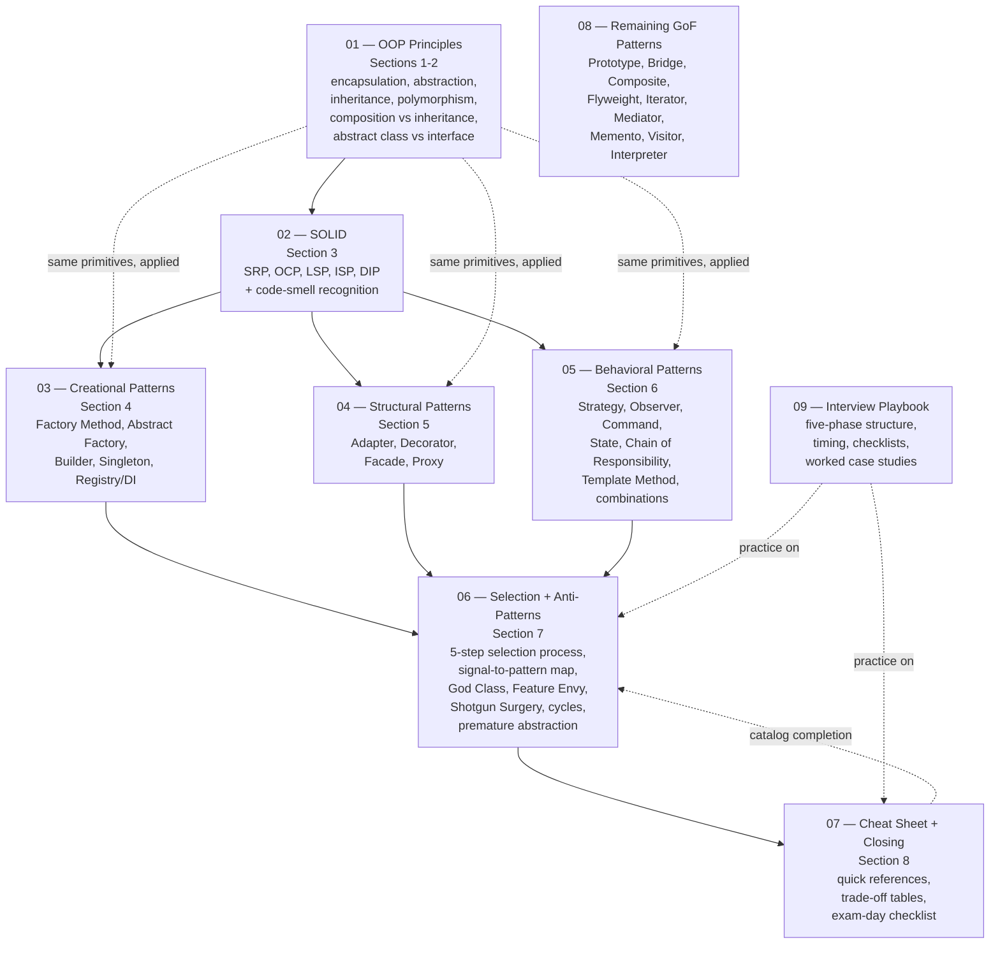

# LLD Course — Complete Notes (OOP → SOLID → Patterns → Interviews)

> Complete, expanded notes built from the **5-hour LLD course by Mukul Raina** (PDF lecture slides, Sections 1–8), rewritten from scratch, expanded with **C++, C, and Java implementations of every pattern**, diagrams, interview practice, and the remaining Gang-of-Four patterns the course marks as "rarely tested."

---

## What This Folder Is

This is a complete self-contained LLD course. The slide decks are the **source material and the backbone**; these notes keep that structure but add:

1. **From-scratch explanations** — every concept starts at "why does this exist, what breaks without it" before any pattern is named.
2. **Tri-language code** — every concept and every pattern has a runnable **C++**, **C**, and **Java** implementation. (C has no classes, so its examples use the *struct + function-pointer table* ("vtable in C") idiom — the same technique the Linux kernel uses in `file_operations`. This connects directly to the kernel notes elsewhere in this repo.)
3. **Diagrams** — UML-style class diagrams and flow diagrams as Mermaid, which GitHub renders inline.
4. **Interview lens** — every section ends with the weak-answer vs strong-answer walkthroughs, signal tables, and common mistakes from the slides, expanded with Q&A.
5. **The rest of the GoF catalog** — the course explicitly covers 14 patterns and marks Bridge, Flyweight, Mediator, Memento, Visitor, Iterator, Interpreter as low-frequency. File `08` completes the catalog anyway, in the same tri-language depth, so nothing is left unreached.
6. **An exam-day playbook** — five-phase interview structure, timing, checklists, worked case studies (file `09`).

## Source Fidelity & Markers

Every file states where its content comes from, using these markers:

| Marker | Meaning |
|---|---|
| **[SLIDE n]** / **[SLIDE nB]** | Content taken from the course slides (n = the slide number printed in the deck). |
| **[COURSE FRAMEWORK]** | Structure/frameworks that are the course's own (five-phase answer, signal-to-pattern tables, MVD). |
| **[BEYOND THE COURSE]** | Material added here that the slides do not contain (C implementations, language internals, extra GoF patterns, extra exercises). |
| **[INTERVIEW]** | Direct interview guidance (weak vs strong answers, timing, evaluation rubric). |

The slides are an **example and backbone, not a ceiling** — where the slides stop at a Java snippet, these notes carry the same idea to full tri-language implementations, and where the slides only sketch a UML box, these notes show real code.

## The One-Page Course Map



**Two ways any pattern appears in these notes:**

1. **As a named pattern file** (files 03–06, 08): structure, intent, tri-language code, when/when-not, interview questions.
2. **As an instance of an OOP primitive** (file 01) or a **SOLID principle made concrete** (file 02). The course is explicit that this is the same material at different zoom levels: *Strategy is OCP made executable; Factory Method is DIP applied to construction; Observer is DIP applied to events; State is polymorphism applied to lifecycle.* The notes repeat these bridges at every pattern.

## Files

| # | File | Covers (slides) | You will be able to... |
|---|---|---|---|
| 00 | `00_INDEX.md` | — | Navigate the course, pick a study path, track progress. |
| 01 | `01_OOP_PRINCIPLES.md` | SLIDE 9–24 (Sections 1–2) | Explain and *use* encapsulation, abstraction, inheritance, polymorphism, composition-over-inheritance, abstract-class-vs-interface — with code in 3 languages and a memory-level view of vtables. |
| 02 | `02_SOLID_PRINCIPLES.md` | SLIDE 25–40 (Section 3) | Detect SRP/OCP/LSP/ISP/DIP violations in under 30 seconds and refactor them. |
| 03 | `03_CREATIONAL_PATTERNS.md` | SLIDE 41–53 (Section 4) | Choose between Factory Method / Abstract Factory / Builder / Singleton / DI and implement each in 3 languages. Includes thread-safe Singleton in all three languages. |
| 04 | `04_STRUCTURAL_PATTERNS.md` | SLIDE 54–65 (Section 5) | Wrap, translate, simplify, and control access — Adapter, Decorator, Facade, Proxy — and justify each against its lookalikes. |
| 05 | `05_BEHAVIORAL_PATTERNS.md` | SLIDE 66–80 (Section 6) | Swap algorithms (Strategy), decouple events (Observer), queue/undo actions (Command), model lifecycles (State), build pipelines (Chain of Responsibility), fix skeletons (Template Method), and combine them. |
| 06 | `06_PATTERN_SELECTION_AND_ANTIPATTERNS.md` | SLIDE 81–96 (Section 7) | Run the 5-step selection process, use the full signal-to-pattern table, apply the Minimum Viable Design principle, and recognize the six production anti-patterns. |
| 07 | `07_CHEATSHEET_AND_CLOSING.md` | SLIDE 97–111 (Section 8) | Revise the entire course in one sitting; run the LLD interview checklist; state trade-offs with the one-line template. |
| 08 | `08_REMAINING_GOF_PATTERNS.md` | Tier-4 patterns named in SLIDE 87 | Prototype, Bridge, Composite, Flyweight, Iterator, Mediator, Memento, Visitor, Interpreter — same depth as the core patterns. **[BEYOND THE COURSE]** (catalog completion) |
| 09 | `09_INTERVIEW_PLAYBOOK.md` | SLIDE 93–95, 107–109 + [BEYOND THE COURSE] | Run a 45-minute LLD round with the five-phase structure, work two full case studies (Parking Lot, Library Management), and practice the problem list. |

### Suggested study paths

**First-time learner (from scratch).** Read 01 → 02 → 03 → 04 → 05 in order. Do not pattern-hop. Every pattern file assumes the previous ones. Then 06 (selection), 08 (catalog completion), 09 (practice), 07 (revision).

**Revision sprint (interview in a week).**
- Day 1: 02 (SOLID) + 07 Section "OOP quick reference".
- Day 2: 03 + 04 skim code, focus on "when to use / when not".
- Day 3: 05 — this is where 80% of interview value lives (Strategy, Observer, State first).
- Day 4: 06 + 07 — signal-to-pattern tables until automatic.
- Day 5: 09 — run two timed mock designs out loud.
- Day 6: 08 skim (know they exist and their one-line signal).
- Day 7: 07 again, 30 minutes before the interview.

**Systems background (C/kernel readers).** The C sections of 01 (vtable in C) and 05 (Observer as callback lists) connect to the `file_operations` dispatch you already know from the kernel; read 01 §"Polymorphism in C" first, then everything else maps quickly.

### How to compile the code in these notes

```bash
# C++  (examples use C++17 features like std::optional, std::function, <memory>)
g++ -std=c++17 -Wall -Wextra -O2 file.cpp -o prog && ./prog

# C    (examples use C11, pthreads where noted)
gcc -std=c11 -Wall -Wextra -O2 file.c -o prog -lpthread && ./prog

# Java (examples target Java 17+; the slides use switch expressions => Java 14+)
javac File.java && java File
```

Snippets shown in the notes are compilable as-is unless marked **[SKETCH]** (used only when a class is deliberately abbreviated).

---

## The Course's Core Mental Model (worth internalizing before file 01)

The whole course is one idea applied at threezoom levels:

```
LEVEL 1 — OOP (file 01)      : hide data, program to contracts, compose objects.
LEVEL 2 — SOLID (file 02)    : the rules that say WHEN level-1 constructs are healthy.
                               SRP  refines encapsulation
                               OCP  formalizes polymorphism
                               LSP  constrains inheritance
                               ISP  refines abstraction
                               DIP  enforces composition over concrete dependencies
LEVEL 3 — PATTERNS (files 03-06): named, reusable combinations of level 1,
                               justified by level 2. Every pattern = lifebuoy for a
                               specific SOLID violation at a specific place:
                               - growing switch on type        -> Strategy (OCP)
                               - creation logic scattered      -> Factory (OCP+DIP)
                               - telescoping constructors      -> Builder (SRP for construction)
                               - forced irrelevant methods     -> split interface (ISP)
                               - events hardwired into source  -> Observer (DIP)
                               - if/else on state              -> State (OCP)
                               - multi-service coordination    -> Facade (SRP)
                               - cross-cutting behavior        -> Decorator (OCP)
```

**The course's three questions for pattern selection [COURSE FRAMEWORK, SLIDE 94/110]:**

| Question | Patterns it maps to |
|---|---|
| **What varies?** | Strategy, State, Factory Method, Template Method |
| **What reacts?** | Observer, Command, Chain of Responsibility |
| **What wraps?** | Decorator, Proxy, Adapter, Facade |

**The course's one-line trade-off template [SLIDE 106]:**

> *"I chose **[X]** over **[Y]** because **[specific requirement]**. The trade-off is **[cost]**, which is acceptable because **[justification]**."*

---

## Progress Tracker

- [ ] 01 — OOP Principles (Sections 1–2)
- [ ] 02 — SOLID Principles (Section 3)
- [ ] 03 — Creational Patterns (Section 4)
- [ ] 04 — Structural Patterns (Section 5)
- [ ] 05 — Behavioral Patterns (Section 6)
- [ ] 06 — Pattern Selection & Anti-Patterns (Section 7)
- [ ] 07 — Complete Cheat Sheet (Section 8)
- [ ] 08 — Remaining GoF Patterns
- [ ] 09 — Interview Playbook & Case Studies

---

## Source

- **Course:** "Low Level Design (LLD) — 5 Hour Course", Mukul Raina — https://www.youtube.com/watch?v=VSABVEBDhf0
- **Slides:** `LLD Course_ PDF Lecture Slides/` (this folder), Sections 1–8.
- Slides cover Part 1 (foundations). Part 2 (case studies: Parking Lot, Elevator, Online Bookstore, Chess, Rate Limiter, Notification Service) is sketched at SLIDE 111 and re-created here as file 09.
