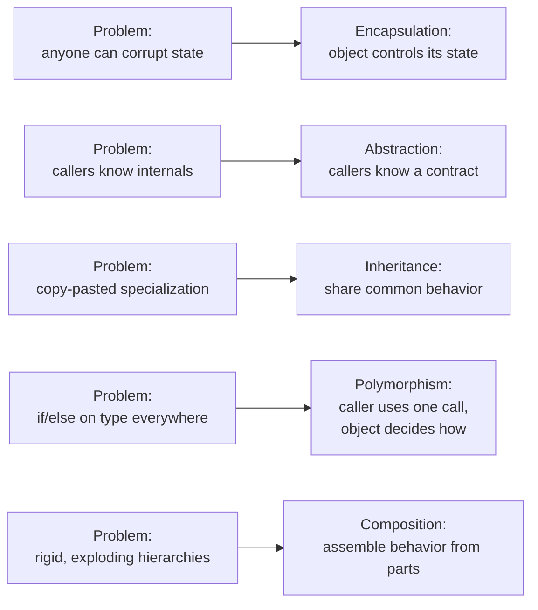
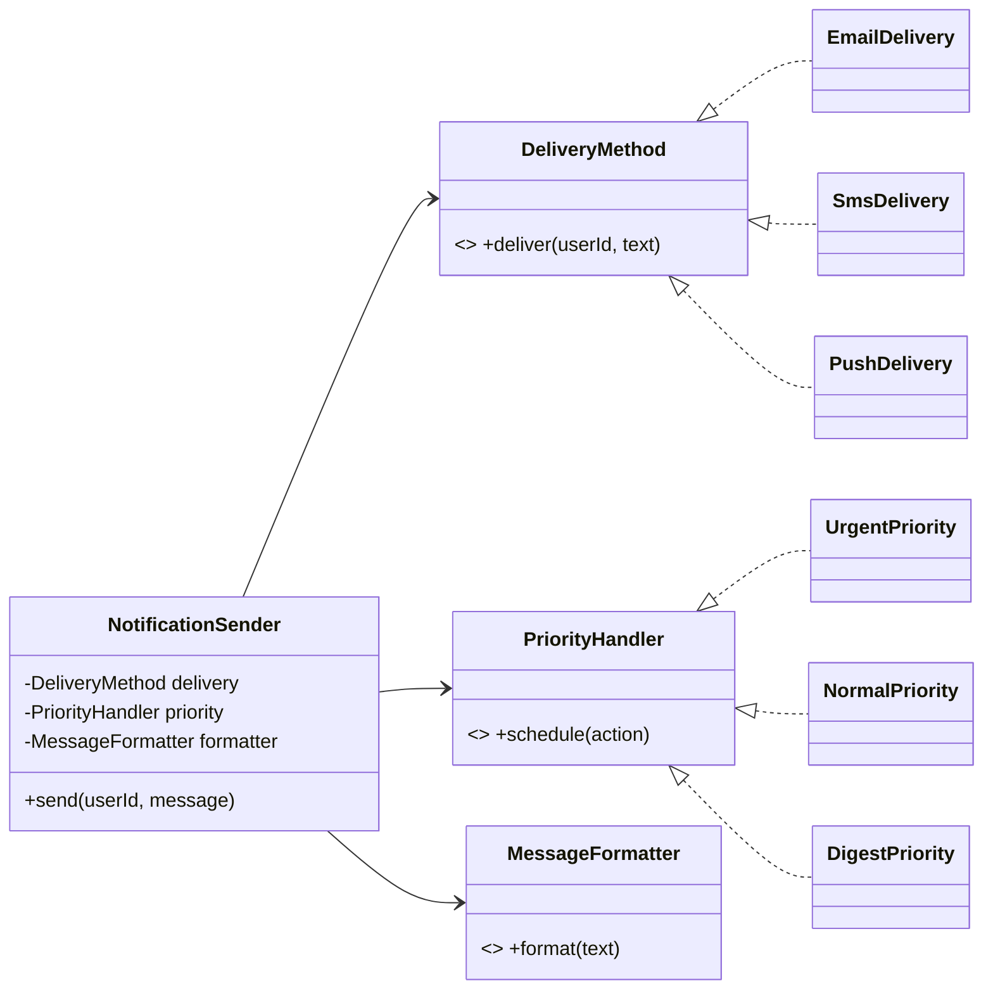
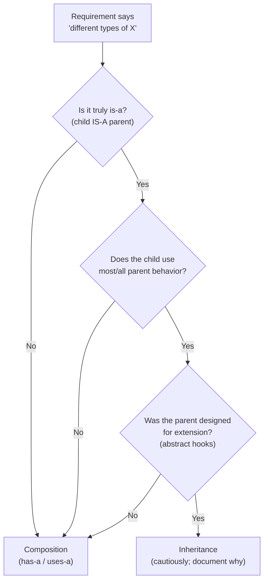
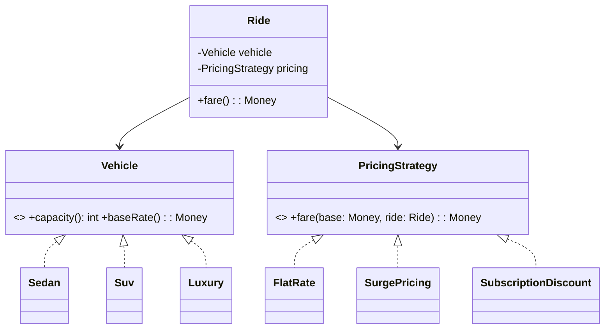

# 01 — OOP Principles Through an Interview Lens

> **Source:** Course Sections 1–2 (SLIDE 9 – SLIDE 24). Structure and interview guidance follow the slides; all code is expanded to runnable **C++, C, and Java** versions. Markers: **[SLIDE n]** = from the slides, **[BEYOND THE COURSE]** = added here.

---

## 0. What This Section Is About

OOP is not a checklist of keywords to recite. Interviewers evaluate whether you use OOP principles to make **deliberate design decisions** that produce clean, extensible, maintainable class structures. This section covers each principle at the depth LLD interviews demand at mid and senior level:

1. **Encapsulation** — information hiding as a design decision (not access modifiers).
2. **Abstraction** — clean interface design, and how abstractions *leak*.
3. **Inheritance** — when it works, and the fragile base class problem.
4. **Polymorphism** — runtime vs compile-time, and designing for extension.
5. **Composition vs Inheritance** — the single most important OOD trade-off.
6. **Abstract Classes vs Interfaces** — with a decision framework.

**Where OOP appears in LLD interviews [SLIDE 9]:**

| Interview Stage | How OOP Is Evaluated |
|---|---|
| Requirements / Clarification | Do you identify the right objects and assign clear responsibilities? |
| Class Design | Do your classes have well-defined boundaries and clean interfaces? |
| Extensibility Probe — *"How would you add a new type of X?"* | Tests polymorphism and open-closed thinking. |
| Trade-off Discussion — *"Why composition here instead of inheritance?"* | Tests design maturity. |
| Code Walkthrough | Are classes encapsulated properly? Do methods express behavior, not data access? |

**Two ground rules for reading this file [BEYOND THE COURSE]:**

- Every OOP rule in this file is earned from a *failure mode*: something concrete breaks without it. If you can remember the failure mode, you can't forget the rule.
- Every concept gets code in three languages because the three languages expose different parts of the same idea:
  - **Java** hides the machinery: `virtual` is implicit, all objects are references.
  - **C++** shows the machinery: you must write `virtual`, you choose value vs reference semantics, and the vtable is exposed as a consequence.
  - **C** *is* the machinery: no classes, no inheritance, no `virtual` keyword — objects are structs, methods are functions taking a `this` pointer, and polymorphism is a struct of function pointers that you assemble by hand. This is exactly how the Linux kernel implements `file_operations`, `super_operations`, etc. (see the kernel notes in this repo).

---

## 1. Why OOP Exists At All (From Scratch)

Imagine the same program written as plain functions over plain data:

```c
/* Procedural style: data and functions live separately. */
struct account { double balance; char owner[64]; };

void withdraw(struct account *a, double amount) {
    a->balance -= amount;          /* any caller, any amount, any order */
}
```

Everything is public, nothing enforces the rules, and any function in the codebase can put the object into an invalid state. As a program grows:

1. **Invariants get violated.** "Balance never negative" is a rule that lives in *every caller's head* instead of *in one place*. One missed check → a bug somewhere random.
2. **Behavior is duplicated.** Every caller that wants a safe withdraw re-implements the check. Copies drift apart.
3. **Changes radiate.** Add a new account rule → find and edit every caller. (This is the "Shotgun Surgery" anti-pattern you'll meet in file 06.)
4. **Variation explodes.** "Different account types behave differently" becomes an `if (type == ...)` chain duplicated everywhere.
5. **Nothing is a stable contract.** Callers depend on the *memory layout* of `struct account`, so the layout can never change.

OOP is a set of answers to exactly these five problems:

| Failure mode | OOP answer | Principle |
|---|---|---|
| Invariants violated | The object owns its state; only its own methods touch it | **Encapsulation** |
| Behavior duplicated / changes radiate | Define a contract (interface/types); callers depend on it, not on internals | **Abstraction** |
| Variation explodes across *kinds of thing* | Specialize behavior along an is-a axis | **Inheritance** |
| Variation in behavior at runtime | Same call, different implementation based on actual type | **Polymorphism** |
| One hierarchy can't express all variation | Assemble behavior from parts | **Composition** |



Keeping the above table in mind is the difference between answering an interview question with a definition and answering it with a *reason*.

---

## 2. Encapsulation — Information Hiding as a Design Decision

### 2.1 The idea [SLIDE 10]

Encapsulation means a class **controls access to its own internal state** and exposes only what other classes need. The key word is *controls*. Encapsulation is a decision about **what to hide and what to reveal**, not about marking fields `private`.

Its real job: **protect invariants**. An *invariant* is a condition that must always be true for the object to be valid:

- `balance >= 0`
- `failedLoginAttempts` is only incremented through `authenticate()`
- an account that is `locked` cannot authenticate until a reset

If external code can violate an invariant, encapsulation is broken — regardless of how many getters/setters you wrote.

**Not encapsulation:**

```java
// A "data bag": private fields, but every field has a public getter AND setter.
// SLIDE 11: boilerplate without protection.
public class UserProfile {
    private String password;                       // stored raw
    public String getPassword() { return password; }              // leaks it
    public void setPassword(String p) { this.password = p; }      // no rules
}
```

**Encapsulation:**

```java
// SLIDE 11 (stronger): behavior instead of data access.
public class UserProfile {
    private final String name;
    private final String email;
    private String passwordHash;                  // derived, never exposed

    public UserProfile(String name, String email, String rawPassword) {
        this.name = name;
        this.email = email;
        this.passwordHash = PasswordHasher.hash(rawPassword);
    }
    public boolean authenticate(String raw) { return PasswordHasher.verify(raw, passwordHash); }
    public void changePassword(String current, String next) {
        if (!authenticate(current)) throw new AuthenticationException("wrong current password");
        if (next.length() < 8)      throw new ValidationException("password too short");
        this.passwordHash = PasswordHasher.hash(next);
    }
}
```

Note what changed: the object now exposes **verbs** (`authenticate`, `changePassword`), not **nouns** (`getPassword`). External code says *what* it wants done; the object decides *how* and enforces the rules.

### 2.2 The canonical worked example: an account with an invariant [SLIDE 10, SLIDE 12]

The slides' `BankAccount` has no `setBalance()`. The only ways to change the balance are `deposit()` and `withdraw()`, and both enforce business rules. The invariant `balance >= 0` is maintained **by the class itself**.

Below is the same class in all three languages. Watch how the invariant is enforced identically while the language mechanics differ.

#### Java

```java
// BankAccount.java — javac BankAccount.java && java BankAccount
import java.util.ArrayList;
import java.util.List;

public class BankAccount {
    private final String ownerName;
    private double balance;                        // invariant: >= 0
    private final List<String> ledger = new ArrayList<>();

    public BankAccount(String ownerName, double initialBalance) {
        if (ownerName == null || ownerName.isBlank())
            throw new IllegalArgumentException("owner name required");
        if (initialBalance < 0)
            throw new IllegalArgumentException("initial balance cannot be negative");
        this.ownerName = ownerName;
        this.balance = initialBalance;
        ledger.add("open " + initialBalance);
    }

    public void deposit(double amount) {
        if (amount <= 0) throw new IllegalArgumentException("deposit must be positive");
        balance += amount;
        ledger.add("deposit " + amount);
    }

    public void withdraw(double amount) {
        if (amount <= 0) throw new IllegalArgumentException("withdrawal must be positive");
        if (amount > balance) throw new IllegalStateException(
            "insufficient funds: balance=" + balance + " requested=" + amount);
        balance -= amount;
        ledger.add("withdraw " + amount);
    }

    // Read-only access to derived data: defensive copy — see §2.4
    public List<String> statement() { return List.copyOf(ledger); }
    public double getBalance() { return balance; }

    public static void main(String[] args) {
        BankAccount acct = new BankAccount("rita", 100.0);
        acct.deposit(50.0);
        try { acct.withdraw(500.0); } catch (IllegalStateException e) { System.out.println("blocked: " + e.getMessage()); }
        System.out.println("balance = " + acct.getBalance());   // 150.0, invariant intact
    }
}
```

#### C++

```cpp
// bank_account.cpp — g++ -std=c++17 -Wall -Wextra bank_account.cpp -o bank_account && ./bank_account
#include <cstdio>
#include <stdexcept>
#include <string>
#include <utility>
#include <vector>

class BankAccount {
public:
    BankAccount(std::string owner, double initial)
        : owner_(std::move(owner)), balance_(initial) {
        if (owner_.empty())     throw std::invalid_argument("owner name required");
        if (initial < 0)        throw std::invalid_argument("initial balance cannot be negative");
        ledger_.push_back("open " + std::to_string(initial));
    }

    void deposit(double amount) {
        if (amount <= 0) throw std::invalid_argument("deposit must be positive");
        balance_ += amount;
        ledger_.push_back("deposit " + std::to_string(amount));
    }

    void withdraw(double amount) {
        if (amount <= 0) throw std::invalid_argument("withdrawal must be positive");
        if (amount > balance_) throw std::logic_error("insufficient funds");
        balance_ -= amount;
        ledger_.push_back("withdraw " + std::to_string(amount));
    }

    double balance() const { return balance_; }             // const: read-only promise
    const std::vector<std::string>& statement() const { return ledger_; }

private:                                                    // <-- the barrier
    std::string owner_;
    double balance_;
    std::vector<std::string> ledger_;
};

int main() {
    BankAccount acct("rita", 100.0);
    acct.deposit(50.0);
    try { acct.withdraw(500.0); } catch (const std::logic_error& e) {
        std::printf("blocked: %s\n", e.what());
    }
    std::printf("balance = %.1f\n", acct.balance());
}
```

**C++-specific notes [BEYOND THE COURSE]**

- `private:` is enforced by the *compiler* at compile time — accessing `acct.balance_` is a compile error, not a runtime check.
- `const` member functions (`balance() const`) are a second, finer encapsulation: they promise not to mutate the object.
- `friend` can punch a hole in the barrier; treat every `friend` declaration as a design smell that needs justification.

#### C — encapsulation without classes

C has no `private`. The idiomatic equivalent is the **opaque type**: callers see only a forward-declared struct and functions; the layout lives in a `.c` file they never include. This is precisely how file descriptors, `FILE*`, and most kernel objects work.

```c
/* bank_account.c — gcc -std=c11 -Wall -Wextra bank_account.c -o bank_account && ./bank_account
 *
 * Real projects split this into bank_account.h (declarations only, no struct body)
 * and bank_account.c (this file). It is kept in one file so you can compile it directly.
 *
 *   bank_account.h would contain ONLY:
 *     typedef struct bank_account bank_account;                 // opaque handle
 *     bank_account *ba_create(const char *owner, double initial, const char **err);
 *     int  ba_deposit(bank_account *acct, double amount, const char **err);
 *     int  ba_withdraw(bank_account *acct, double amount, const char **err);
 *     double ba_balance(const bank_account *acct);
 *     void ba_destroy(bank_account *acct);
 */
#include <stdio.h>
#include <stdlib.h>
#include <string.h>

typedef struct bank_account bank_account;

struct bank_account {                 /* layout hidden from callers */
    char  *owner;
    double balance;                   /* invariant: >= 0 */
    double ledger[64];
    int    ledger_len;
};

bank_account *ba_create(const char *owner, double initial, const char **err) {
    if (!owner || !*owner)      { *err = "owner name required"; return NULL; }
    if (initial < 0)            { *err = "initial balance cannot be negative"; return NULL; }
    bank_account *a = calloc(1, sizeof *a);
    if (!a)                     { *err = "out of memory"; return NULL; }
    a->owner = strdup(owner);
    a->balance = initial;
    a->ledger[a->ledger_len++] = initial;
    return a;
}

int ba_deposit(bank_account *a, double amount, const char **err) {
    if (amount <= 0) { *err = "deposit must be positive"; return -1; }
    a->balance += amount;
    a->ledger[a->ledger_len++] = amount;
    return 0;
}

int ba_withdraw(bank_account *a, double amount, const char **err) {
    if (amount <= 0)    { *err = "withdrawal must be positive"; return -1; }
    if (amount > a->balance) { *err = "insufficient funds"; return -1; }
    a->balance -= amount;
    a->ledger[a->ledger_len++] = -amount;
    return 0;
}

double ba_balance(const bank_account *a) { return a->balance; }

void ba_destroy(bank_account *a) {
    if (!a) return;
    free(a->owner);
    free(a);
}

int main(void) {
    const char *err = NULL;
    bank_account *acct = ba_create("rita", 100.0, &err);
    if (!acct) { printf("create failed: %s\n", err); return 1; }

    ba_deposit(acct, 50.0, &err);
    if (ba_withdraw(acct, 500.0, &err) != 0)
        printf("blocked: %s\n", err);

    printf("balance = %.1f\n", ba_balance(acct));
    ba_destroy(acct);
    return 0;
}
```

**C-specific notes [BEYOND THE COURSE]**

- The opaque struct gives you the *same* invariant protection: there is no way for a caller to write `acct->balance = -1` without including the internal header — and in real projects callers can't, because the struct body is not in the public header at all.
- Every function takes the object explicitly (`this` as a parameter). This is exactly what C++ compilers do invisibly.
- Error handling is conventions (`int` return + out-param message) instead of exceptions. Interview tip: mention that C uses **return codes** while C++/Java use **exceptions**; the *design* (behavior methods enforcing rules) is identical.
- Compare with the kernel: `struct file` fields are never poked by user code; callers go through `vfs_read()` etc. — encapsulation at the syscall boundary.

### 2.3 The worked example with *more* invariants: `UserAccount` [SLIDE 12]

The slides show a class where every method enforces a business rule:

- `failedLoginAttempts` and `locked` have **no** getters or setters. Nobody can call `setLocked(false)`.
- The only way login state changes is `authenticate()`, which enforces the lockout policy (5 failures → lock).
- `changeEmail()` requires the current password — identity verification is built into the method.

```java
// [SLIDE 12] — with the lockout policy made explicit.
public class UserAccount {
    private final String userId;
    private String email;
    private String passwordHash;
    private int failedLoginAttempts;   // no getter, no setter
    private boolean locked;            // no getter, no setter

    public UserAccount(String userId, String email, String rawPassword) {
        this.userId = userId;
        this.email = email;
        this.passwordHash = PasswordHasher.hash(rawPassword);
    }

    public LoginResult authenticate(String rawPassword) {
        if (locked) return LoginResult.accountLocked();
        if (!PasswordHasher.verify(rawPassword, passwordHash)) {
            if (++failedLoginAttempts >= 5) locked = true;
            return LoginResult.invalidCredentials(5 - failedLoginAttempts);
        }
        failedLoginAttempts = 0;                 // success resets the counter
        return LoginResult.success(userId);
    }

    public void changeEmail(String newEmail, String currentPassword) {
        if (!PasswordHasher.verify(currentPassword, passwordHash))
            throw new AuthenticationException("password required to change email");
        this.email = newEmail;
    }
}
```

**Interview tip [SLIDE 12].** For each field on your class diagram, ask three questions: *Should external code be able to read this? change this? Under what conditions?* If any answer contains a rule, that field needs a **behavior method**, not a setter.

### 2.4 Abstraction leaks in the small: don't expose your internals

Even a "private" field leaks if you hand its contents out by reference:

```java
// [SLIDE 14] — the leak: callers now depend on HashMap AND can wipe it.
public class OrderRepository {
    private final Map<String, Order> orderStore = new HashMap<>();
    public Map<String, Order> getOrderStore() { return orderStore; }   // LEAK
}
```

`getOrderStore().clear()` destroys all data without validation, and switching storage to a database would force every caller to change.

```java
// [SLIDE 14] — fixed: storage hidden behind intent-revealing methods.
public class OrderRepository {
    private final Map<String, Order> orderStore = new HashMap<>();
    public Optional<Order> findById(String orderId) { return Optional.ofNullable(orderStore.get(orderId)); }
    public List<Order> findByCustomer(String customerId) {
        return orderStore.values().stream()
                .filter(o -> o.getCustomerId().equals(customerId))
                .toList();
    }
    public void save(Order order) { orderStore.put(order.getId(), order); }
}
```

The same leak, in C++ and C — plus their fixes:

```cpp
// C++ leak vs fix
class BadRepo {
public:
    std::map<std::string, Order>& store() { return store_; }   // callers can clear() it
private:
    std::map<std::string, Order> store_;
};

class GoodRepo {
public:
    std::optional<Order> findById(const std::string& id) const;      // intent
    std::vector<Order> findByCustomer(const std::string& cid) const; // returns copies
    void save(const Order& o);
private:
    std::map<std::string, Order> store_;
};

// If you ever must return a reference for performance, return a const reference
// AND accept that you have made a lifetime/changeability promise.
```

```c
/* C: the leak is handing out the internal array pointer. */
typedef struct order_repo order_repo;

/* BAD: exposes the array; the first caller to realloc/free corrupts everything. */
Order *repo_raw_array(order_repo *r, int *count);

/* GOOD: copy semantics at the boundary. */
int repo_find_by_customer(order_repo *r, const char *cid, Order *out, int max_out);
```

**The abstraction-leak test [SLIDE 14].** *If I changed the internal implementation (swapped the data structure, switched databases, changed libraries), would any code outside this class need to change?* If yes, you have a leak. Say this test out loud in interviews and apply it to your own design.

### 2.5 Encapsulation — interview lens

| Weak answer | Strong answer |
|---|---|
| "I made all fields private and added getters and setters." | "I exposed behavior methods that enforce business rules; fields with constraints have no setters." |
| "`getOrderStore()` so callers can read the orders." | "Callers use `findById`/`findByCustomer`; the storage choice is invisible." |

**Q&A drills:**

1. *Is `private` + getter/setter for every field encapsulation?* — No. It's a data bag with ceremony. Encapsulation is about who controls state transitions, not who can read/write data syntactically.
2. *Can a field be public and still "encapsulated"?* — If it's a pure value with no invariants and no attachment to a lifetime (e.g. a `record Point(int x, int y)`), yes — but in an LLD interview, justify it explicitly, because interviewers track the ratio of behavior methods to accessors [SLIDE 12 relevance note].
3. *Why hide a collection field even with a getter?* — Java/C++ collections are mutable references; a getter is an open door to `clear()`/`push_back()`. Return copies (`List.copyOf`, by-value vectors) or intent methods.

---

## 3. Abstraction — Designing Clean Interfaces

### 3.1 The idea [SLIDE 13]

Abstraction hides *implementation complexity* behind a simplified contract. While encapsulation hides **data**, abstraction hides **how things work**. A well-designed abstraction lets calling code say **what it wants** without knowing **how the work gets done**.

| Principle | What it hides | How it's expressed | What it protects |
|---|---|---|---|
| **Encapsulation** | Internal data and state | Private fields, behavior methods | Invariants and business rules |
| **Abstraction** | Implementation complexity | Interfaces and abstract classes | Calling code from change |

They compose: a well-encapsulated class behind a clean interface lets you change *both* the data representation *and* the implementation without touching callers.

### 3.2 Worked example: `PaymentProcessor` [SLIDE 15]

A payment system must support Stripe today, PayPal tomorrow, a regional provider next quarter. Without the abstraction, every class that processes payments knows each provider's API. With it, callers know one contract.

**Java**

```java
// payment.java — javac payment.java (single-file program is fine)
public interface PaymentProcessor {
    PaymentResult charge(String customerId, long amountCents);
    PaymentResult refund(String transactionId, long amountCents);
}

final class PaymentResult {
    private final String transactionId; private final boolean success; private final String error;
    private PaymentResult(String t, boolean s, String e) { transactionId = t; success = s; error = e; }
    static PaymentResult ok(String t)  { return new PaymentResult(t, true, null); }
    static PaymentResult fail(String e){ return new PaymentResult(null, false, e); }
    boolean isSuccess() { return success; } String getTransactionId() { return transactionId; }
    String getError() { return error; }
}

class StripePaymentProcessor implements PaymentProcessor {          // adapter to a 3rd-party SDK
    @Override public PaymentResult charge(String customerId, long amountCents) {
        // real code: return new PaymentResult(StripeClient.createCharge(amountCents, customerId), true, null);
        return PaymentResult.ok("stripe_txn_123");
    }
    @Override public PaymentResult refund(String transactionId, long amountCents) {
        return PaymentResult.ok("stripe_refund_456");
    }
}

// The caller depends on the INTERFACE, never on a provider.
class OrderService {
    private final PaymentProcessor processor;
    OrderService(PaymentProcessor processor) { this.processor = processor; }   // injected (DIP, file 02)

    String placeOrder(String customerId, long totalCents) {
        PaymentResult result = processor.charge(customerId, totalCents);
        return result.isSuccess() ? result.getTransactionId() : "FAILED: " + result.getError();
    }
}

public class payment {
    public static void main(String[] args) {
        OrderService svc = new OrderService(new StripePaymentProcessor());
        System.out.println("order -> " + svc.placeOrder("cust_1", 1999));
        // Switching to PayPal: write one new class, change ONE wiring line. Zero changes to OrderService.
    }
}
```

**C++**

```cpp
// payment.cpp — g++ -std=c++17 -Wall -Wextra payment.cpp -o payment && ./payment
#include <cstdio>
#include <memory>
#include <string>

struct PaymentResult {                     // small value type
    std::string transactionId;
    bool success = false;
    std::string error;
    static PaymentResult ok(std::string t)   { return {std::move(t), true, {}}; }
    static PaymentResult fail(std::string e) { return {{}, false, std::move(e)}; }
};

class PaymentProcessor {                   // the abstraction
public:
    virtual ~PaymentProcessor() = default; // ALWAYS: deleting via base pointer must work
    virtual PaymentResult charge(const std::string& customerId, long amountCents) = 0;
    virtual PaymentResult refund(const std::string& transactionId, long amountCents) = 0;
};

class StripePaymentProcessor final : public PaymentProcessor {
public:
    PaymentResult charge(const std::string&, long) override { return PaymentResult::ok("stripe_txn_123"); }
    PaymentResult refund(const std::string&, long) override { return PaymentResult::ok("stripe_refund_456"); }
};

class OrderService {                        // depends on the abstraction only
public:
    explicit OrderService(PaymentProcessor& processor) : processor_(processor) {}
    std::string placeOrder(const std::string& customerId, long totalCents) {
        PaymentResult r = processor_.charge(customerId, totalCents);
        return r.success ? r.transactionId : "FAILED: " + r.error;
    }
private:
    PaymentProcessor& processor_;           // non-owning reference; injected, not created here
};

int main() {
    StripePaymentProcessor stripe;
    OrderService svc(stripe);
    std::printf("order -> %s\n", svc.placeOrder("cust_1", 1999).c_str());
}
```

**C — the abstraction is a function-pointer table**

```c
/* payment.c — gcc -std=c11 -Wall -Wextra payment.c -o payment && ./payment
 *
 * This is how real C code (and the kernel) defines abstractions:
 *   1. a result/value struct,
 *   2. an interface struct  =  data pointer + vtable pointer,
 *   3. a generic entry point that dispatches through the vtable.
 *
 * Compare with struct file + file_operations in the kernel: same shape.
 */
#include <stdio.h>
#include <string.h>

typedef struct payment_result { char transaction_id[64]; int success; char error[128]; } payment_result;

typedef struct payment_processor payment_processor;      /* the "interface" handle */

typedef struct payment_processor_ops {                   /* the "interface methods" */
    payment_result (*charge)(void *impl, const char *customer_id, long amount_cents);
    payment_result (*refund)(void *impl, const char *transaction_id, long amount_cents);
    void (*destroy)(void *impl);
} payment_processor_ops;

struct payment_processor {                               /* handle = impl + vtable */
    const payment_processor_ops *ops;
    void *impl;
};

/* Generic entry points: the C equivalent of virtual calls. */
static payment_result payment_charge(payment_processor *p, const char *cid, long cents) {
    return p->ops->charge(p->impl, cid, cents);
}
static payment_result payment_refund(payment_processor *p, const char *txn, long cents) {
    return p->ops->refund(p->impl, txn, cents);
}
static void payment_destroy(payment_processor *p) {
    p->ops->destroy(p->impl);
    p->impl = NULL;
}

/* ---------------- One concrete implementation: "stripe" ---------------- */
typedef struct { int dummy; } stripe_impl;

static payment_result stripe_charge(void *impl, const char *cid, long cents) {
    (void)impl; (void)cid; (void)cents;
    payment_result r = { .success = 1 };
    snprintf(r.transaction_id, sizeof r.transaction_id, "stripe_txn_123");
    return r;
}
static payment_result stripe_refund(void *impl, const char *txn, long cents) {
    (void)impl; (void)txn; (void)cents;
    payment_result r = { .success = 1 };
    snprintf(r.transaction_id, sizeof r.transaction_id, "stripe_refund_456");
    return r;
}
static void stripe_destroy(void *impl) { free(impl); }

static const payment_processor_ops stripe_ops = {
    .charge = stripe_charge, .refund = stripe_refund, .destroy = stripe_destroy,
};

static payment_processor stripe_processor_create(void) {
    payment_processor p;
    p.ops = &stripe_ops;
    p.impl = malloc(sizeof(stripe_impl));
    return p;
}

/* The "business logic" — depends only on the generic payment_processor. */
static const char *place_order(payment_processor *p, const char *customer_id, long total_cents) {
    static char out[128];
    payment_result r = payment_charge(p, customer_id, total_cents);
    if (r.success) snprintf(out, sizeof out, "%s", r.transaction_id);
    else           snprintf(out, sizeof out, "FAILED: %s", r.error);
    return out;
}

int main(void) {
    payment_processor stripe = stripe_processor_create();
    printf("order -> %s\n", place_order(&stripe, "cust_1", 1999));
    payment_destroy(&stripe);
    return 0;
}
```

Notice the pattern across all three languages — it is *the same design*:

| Concept | Java | C++ | C |
|---|---|---|---|
| Contract | `interface` | abstract class / pure virtual | vtable struct |
| Implementation | `implements` | `: public` + `override` | functions + ops table instance |
| Dispatch | JVM method table | vtable pointer hidden in object | explicit `ops->charge(...)` |
| Caller depends on | interface type | abstract base reference | `payment_processor*` handle |

**[INTERVIEW]** When designing class diagrams, define your **abstractions (interfaces) before your implementations**. It signals you think in contracts and dependencies, not concrete classes [SLIDE 15].

### 3.3 Abstraction leaks in the large [SLIDE 14]

An *abstraction leak* is when implementation details escape through the interface, forcing callers to know things they shouldn't. Interview probes worth recognizing:

- The interface exposes a type from a specific library (`Map`, `HttpResponse`, `StripeCharge`).
- Changing providers requires touching callers.
- Callers must call methods in a specific order (callers now know the implementation's sequencing).
- Callers must catch implementation-specific exceptions (e.g. `SQLException` escaping a repository).

**Test to say out loud [SLIDE 14]:** *"If I swapped the implementation, would calling code need to change? If yes, my abstraction is leaking."*

### 3.4 Interview practice: `NotificationPreferences` [SLIDE 15B]

**Scenario (LinkedIn-style).** Design `NotificationPreferences`: users configure channels (email, SMS, push) and quiet hours during which no notifications are sent.

**Weak answer — a data bag:**

```java
// WRONG: raw Set exposed, quiet hours unvalidated, no behavior.
public class NotificationPreferences {
    private Set<String> enabledChannels;      // callers can add "fax", "pigeon"
    private int quietStartHour;
    private int quietEndHour;
    public Set<String> getEnabledChannels() { return enabledChannels; }
    public void setEnabledChannels(Set<String> c) { this.enabledChannels = c; }
    public void setQuietStartHour(int h) { this.quietStartHour = h; }   // h = 47? fine!
    // ...
}
```

**Strong answer — behavior + validated invariants:**

```java
// [SLIDE 15B] strong answer: enum instead of raw strings, validation, one behavior method.
public enum NotificationChannel { EMAIL, SMS, PUSH }

public class NotificationPreferences {
    private final Set<NotificationChannel> enabledChannels = EnumSet.noneOf(NotificationChannel.class);
    private int quietStartHour = -1;   // -1 = no quiet hours
    private int quietEndHour = -1;

    public void enable(NotificationChannel c)  { enabledChannels.add(c); }
    public void disable(NotificationChannel c) { enabledChannels.remove(c); }

    /** The calling code asks a question; the object owns the policy. */
    public boolean shouldNotify(NotificationChannel channel, LocalTime now) {
        if (!enabledChannels.contains(channel)) return false;
        if (quietStartHour < 0) return true;
        int h = now.getHour();
        boolean wrapped = quietStartHour > quietEndHour;     // e.g. 22 -> 7
        boolean quiet = wrapped ? (h >= quietStartHour || h < quietEndHour)
                                : (h >= quietStartHour && h < quietEndHour);
        return !quiet;
    }

    public void setQuietHours(int startHour, int endHour) {
        if (startHour < 0 || startHour > 23 || endHour < 0 || endHour > 23)
            throw new IllegalArgumentException("hours must be 0-23");
        this.quietStartHour = startHour;
        this.quietEndHour = endHour;
    }
}
```

Why this is stronger: the enum makes invalid channels unrepresentable (abstraction + type safety); the quiet-hours invariant is enforced in one place (encapsulation); `shouldNotify()` is a *behavior* — the caller says "should I notify?" instead of pulling fields and re-implementing the policy.

**Same design in C++ / C [BEYOND THE COURSE]:**

```cpp
// C++: enum class + std::bitset-style set; behavior method owns the policy.
#include <optional>
enum class Channel { EMAIL, SMS, PUSH };

class NotificationPreferences {
public:
    void enable(Channel c)  { enabled_ |= mask(c); }
    void disable(Channel c) { enabled_ &= ~mask(c); }
    void setQuietHours(int start, int end) {
        if (start < 0 || start > 23 || end < 0 || end > 23)
            throw std::invalid_argument("hours must be 0-23");
        quietStart_ = start; quietEnd_ = end;
    }
    bool shouldNotify(Channel c, int hour) const {
        if (!(enabled_ & mask(c))) return false;
        if (!quietStart_) return true;
        int s = *quietStart_, e = *quietEnd_;
        bool quiet = (s > e) ? (hour >= s || hour < e) : (hour >= s && hour < e);
        return !quiet;
    }
private:
    static unsigned mask(Channel c) { return 1u << static_cast<int>(c); }
    unsigned enabled_ = 0;
    std::optional<int> quietStart_, quietEnd_;
};
```

```c
/* C: enum + bitmask + a single policy function. The struct is public here for brevity,
 * but real code would make it opaque (see §2.2). */
typedef enum { CH_EMAIL = 0, CH_SMS, CH_PUSH, CH_COUNT } channel_t;

typedef struct {
    unsigned enabled_mask;        /* bit i set = channel i enabled */
    int quiet_start, quiet_end;   /* -1 = disabled */
} notif_prefs;

int notif_set_quiet(notif_prefs *p, int start, int end) {
    if (start < 0 || start > 23 || end < 0 || end > 23) return -1;
    p->quiet_start = start; p->quiet_end = end;
    return 0;
}

int notif_should_notify(const notif_prefs *p, channel_t c, int hour) {
    if (!(p->enabled_mask & (1u << c))) return 0;
    if (p->quiet_start < 0) return 1;
    int s = p->quiet_start, e = p->quiet_end;
    int quiet = (s > e) ? (hour >= s || hour < e) : (hour >= s && hour < e);
    return !quiet;
}
```

> **Cross-link:** the `shouldNotify` policy is a *Strategy-shaped decision* hiding inside one method. If business later demands "different policies per user tier", §6 Strategy (file 05) shows how to extract it. That is the natural evolution the course means when it says patterns are OOP primitives applied.

---

## 4. Inheritance — When It Works and When It Creates Coupling

### 4.1 When inheritance works [SLIDE 16]

Inheritance is an **is-a** relationship. It is appropriate only when *all three* hold:

1. The relationship is genuinely is-a (not has-a / uses-a).
2. The subclass needs **most or all** of the parent's behavior — not one method.
3. The parent was **designed for extension** (clear extension points: abstract methods, hooks).

```java
// Works: Circle genuinely is a Shape, uses describe(), and area() is a designed hook.
public abstract class Shape {
    private final String color;
    protected Shape(String color) { this.color = color; }
    public abstract double area();                       // extension point (design intent)
    public final String describe() {                      // shared, fixed behavior
        return color + " shape with area " + String.format("%.2f", area());
    }
}
class Circle extends Shape {
    private final double radius;
    Circle(String color, double radius) { super(color); this.radius = radius; }
    @Override public double area() { return Math.PI * radius * radius; }
}
```

Same example in C++ — plus one C++-specific trap to notice:

```cpp
class Shape {
public:
    explicit Shape(std::string color) : color_(std::move(color)) {}
    virtual ~Shape() = default;                 // trap #1: virtual destructor (see §5.4)
    virtual double area() const = 0;            // extension point
    std::string describe() const;               // shared behavior, NOT virtual
private:
    std::string color_;
};
class Circle final : public Shape {
public:
    Circle(std::string c, double r) : Shape(std::move(c)), radius_(r) {}
    double area() const override { return 3.14159265358979 * radius_ * radius_; }
private:
    double radius_;
};
```

**C: there is no inheritance.** The is-a relationship is expressed as *containment of the base struct as the first member* plus a shared vtable. That is exactly the machinery C++ emits for you:

```c
/* Emulating what C++ does: base-first embedding + shared ops table. */
typedef struct { const shape_ops *ops; const char *color; } shape;

typedef struct shape_ops {
    double (*area)(const shape *self);
} shape_ops;

double shape_area(const shape *s) { return s->ops->area(s); }   /* dynamic dispatch, by hand */

typedef struct { shape base; double radius; } circle;           /* base must be FIRST member */

static double circle_area(const shape *self) {
    const circle *c = (const circle *)self;                     /* upcast = pointer cast */
    return 3.14159265358979 * c->radius * c->radius;
}
static const shape_ops circle_ops = { .area = circle_area };
```

This "base first member" trick is not exotic — it is how `struct socket`, file descriptors, and many kernel subsystems implement inheritance in plain C. The lesson for interviews: *inheritance is a technique you can implement anywhere; the question is whether the design earns it.*

### 4.2 Why inheritance creates problems [SLIDE 16]

Inheritance creates **tight coupling** between parent and child:

- The subclass depends on the parent's *implementation*, not just its interface.
- The child inherits **everything** — you cannot selectively inherit. All-or-nothing.
- A parent change can silently break children compiled against the old assumptions.

**Interview tip [SLIDE 16]:** if you use inheritance in an LLD answer, expect *"what happens when requirements change?"* Have a reason.

### 4.3 The fragile base class problem [SLIDE 17, 17B]

The fragile base class problem: **changes to a parent class break subclasses in ways that are unpredictable from the parent's own code**, because subclasses depend on the parent's *internal* implementation (specifically, on **self-use**: the parent calling its own methods).

The slides' concrete example:

```java
// [SLIDE 17B] — the problem
public class EventLog {
    private final List<Event> events = new ArrayList<>();
    public void addEvent(Event e)          { events.add(e); }
    public void addEvents(List<Event> es)  { for (Event e : es) addEvent(e); }  // self-use!
}

public class CountingEventLog extends EventLog {
    private int eventCount = 0;
    @Override public void addEvent(Event e)     { eventCount++; super.addEvent(e); }
    @Override public void addEvents(List<Event> es) { eventCount += es.size(); super.addEvents(es); }
}
```

**What happens:** `addEvents(3 events)` → subclass counts 3 → calls `super.addEvents` → base loops calling `addEvent(e)` → each call re-enters the *overridden* `addEvent` → counts again. Final count: **6, not 3**. The subclass author had to know the base's *implementation detail* (that `addEvents` delegates to `addEvent`) — which is not part of the base's contract.

Worse, the failure is bidirectional: if the base later rewrites `addEvents` to use `events.addAll(es)`, the count silently becomes **3** and the subclass's other override never runs — a behavior change caused by a base optimization.

**The fix: composition [SLIDE 17B].**

```java
public class CountingEventLog {                 // no longer extends EventLog
    private final EventLog delegate = new EventLog();
    private int eventCount = 0;
    public void addEvent(Event e)          { eventCount++; delegate.addEvent(e); }
    public void addEvents(List<Event> es)  { eventCount += es.size(); delegate.addEvents(es); }
    public int getEventCount()             { return eventCount; }
}
```

Now the counting wrapper is immune to how `EventLog` implements its internals. If `addEvents` changes tomorrow, counting still means exactly "how many events passed through this wrapper".

**The same story in C++ — with the extra trap that C++ makes this *worse* when you forget `virtual`:**

```cpp
// [BEYOND THE COURSE] C++ has two failure modes here.
struct EventLog {
    void addEvent(const Event& e) { events_.push_back(e); }          // NOT virtual
    void addEvents(const std::vector<Event>& es) {                   // calls its own addEvent
        for (const auto& e : es) addEvent(e);                        // statically bound!
    }
protected:
    std::vector<Event> events_;
};

struct BrokenCountingLog : EventLog {
    int count = 0;
    void addEvent(const Event& e) { count++; EventLog::addEvent(e); }  // HIDES, not overrides
    void addEvents(const std::vector<Event>& es) { count += (int)es.size(); EventLog::addEvents(es); }
};

// BrokenCountingLog b; b.addEvents({a,b,c});
//   -> count == 3, and EventLog::addEvents's internal call to addEvent(e) calls
//      EventLog::addEvent (static binding), NOT BrokenCountingLog::addEvent.
//      The "6" bug never appears -- instead an inconsistency appears if callers
//      call b.addEvent(e) directly (count increments) vs through addEvents (it doesn't).
```

Making `addEvent` virtual reproduces the Java bug exactly (count = 6). Not making it virtual creates a *different*, equally surprising bug. Either way: **subclassing over self-use is fragile**. C++ simply lets you choose which flavor of surprise you get.

**And in C, the problem cannot exist** — because C has no inheritance. The counting wrapper is composition by construction:

```c
typedef struct { event_log *delegate; int count; } counting_event_log;
void counting_add_event(counting_event_log *l, const event *e) {
    l->count++;
    event_log_add(l->delegate, e);          /* delegates to the real log */
}
```

**[INTERVIEW]** If an interviewer probes your inheritance decision with *"what if the base class implementation changes?"*, the fragile base class problem is the answer they're fishing for. Naming it (and its fix) separates memorized OOP from understood OOP [SLIDE 17 relevance].

### 4.4 When to use inheritance — the short version

Use it only when all three conditions from §4.1 hold. Otherwise default to composition (§7 below), interfaces, or plain delegation. The decision framework in §7.5 operationalizes this.

---

## 5. Polymorphism — Runtime vs Compile-Time

### 5.1 The idea [SLIDE 18]

Polymorphism: *the same method call produces different behavior depending on the actual object it is called on.* Two forms:

| | Runtime (overriding) | Compile-time (overloading) |
|---|---|---|
| Decided at | Runtime (dispatch table / vtable) | Compile time (compiler picks) |
| Enables | Extensibility, plug-in architectures | Convenience, API usability |
| Used for | Strategy, Factory, Observer patterns | Builder-style fluent APIs |
| Interview weight | **Very high** | Low |

```java
// Runtime polymorphism: the actual implementation depends on the object behind the reference.
PaymentProcessor p = new StripePaymentProcessor();
p.charge(...);                     // StripePaymentProcessor.charge runs
p = new PayPalPaymentProcessor();  // reassign
p.charge(...);                     // PayPalPaymentProcessor.charge runs — same call site, no change
```

```java
// Compile-time polymorphism: the compiler picks overload by parameter types.
public Money calculate(Order o) { ... }
public Money calculate(Order o, DiscountCode d) { ... }
```

Design matters for the *runtime* form: interviewers saying "design this to be extensible" mean *adding a new type is writing a new class, not editing existing code*.

### 5.2 What runtime dispatch actually is [BEYOND THE COURSE]

**Java.** The JVM loads the class of the actual object and looks up the method in the class's method table (`invokevirtual`). Single inheritance + interfaces make this lookup cacheable (inline caches); it is extremely fast.

**C++.** If a class has any `virtual` function, the compiler adds one hidden pointer member to the object — the **vptr** — which points to the class's **vtable**: an array of function pointers, one per virtual method.

```
Object memory (64-bit)                    Vtable (one per class)
+---------------------+                  +---------------------------+
| vptr  ------------->|-----------------> | +0: area  -> Circle::area |
| color (std::string) |                  | +8: destroy -> ~Circle()  |
| radius (double)     |                  +---------------------------+
+---------------------+                  Image also contains Shape's vtable (for Shape-typed
                                         objects) and each other subclass's vtable.
A virtual call = load vptr, load slot, indirect call.   [Same shape as the C ops table in §3.2.]
```

**C.** You build the vtable yourself (ops struct + impl pointer). No hidden costs, no hiding: dispatch cost is explicit.

### 5.3 Worked example: notification channel dispatch [SLIDE 19B]

The canonical design exercise: identify the **dimension of variation** and extract it.

**The design recipe [SLIDE 19]:**
1. Identify what varies (delivery channel: email / SMS / push). The *act of sending* doesn't vary.
2. Define an interface for the varying behavior.
3. Write one implementation per variant.
4. Caller depends on the interface — not any implementation.

**Java**

```java
// channels.java — javac channels.java && java channels
import java.util.List;

interface NotificationChannel {
    void send(String userId, String message);
    boolean supports(NotificationType type);
}
enum NotificationType { MARKETING, TRANSACTIONAL, ALERT }

class EmailChannel implements NotificationChannel {
    public void send(String userId, String message) {
        System.out.println("email to " + userId + ": " + message);
    }
    public boolean supports(NotificationType t) {
        return t == NotificationType.MARKETING || t == NotificationType.TRANSACTIONAL;
    }
}
class PushChannel implements NotificationChannel {
    public void send(String userId, String message) {
        System.out.println("push to " + userId + ": " + message);
    }
    public boolean supports(NotificationType t) {
        return t == NotificationType.TRANSACTIONAL || t == NotificationType.ALERT;
    }
}

class NotificationDispatcher {
    private final List<NotificationChannel> channels;
    NotificationDispatcher(List<NotificationChannel> channels) { this.channels = channels; }

    void dispatch(String userId, String message, NotificationType type) {
        for (NotificationChannel c : channels)
            if (c.supports(type)) c.send(userId, message);
    }
}

public class channels {
    public static void main(String[] args) {
        var dispatcher = new NotificationDispatcher(List.of(new EmailChannel(), new PushChannel()));
        dispatcher.dispatch("u42", "your order shipped", NotificationType.TRANSACTIONAL);
        // Adding WhatsApp = one new class + one registration line. Dispatcher unchanged.
    }
}
```

**C++**

```cpp
// channels.cpp — g++ -std=c++17 -Wall -Wextra channels.cpp -o channels && ./channels
#include <cstdio>
#include <memory>
#include <string>
#include <vector>

enum class NotificationType { Marketing, Transactional, Alert };

class NotificationChannel {
public:
    virtual ~NotificationChannel() = default;
    virtual void send(const std::string& userId, const std::string& message) = 0;
    virtual bool supports(NotificationType type) const = 0;
};

class EmailChannel final : public NotificationChannel {
public:
    void send(const std::string& userId, const std::string& message) override {
        std::printf("email to %s: %s\n", userId.c_str(), message.c_str());
    }
    bool supports(NotificationType t) const override {
        return t == NotificationType::Marketing || t == NotificationType::Transactional;
    }
};

class PushChannel final : public NotificationChannel {
public:
    void send(const std::string& userId, const std::string& message) override {
        std::printf("push to %s: %s\n", userId.c_str(), message.c_str());
    }
    bool supports(NotificationType t) const override {
        return t == NotificationType::Transactional || t == NotificationType::Alert;
    }
};

class NotificationDispatcher {
public:
    explicit NotificationDispatcher(std::vector<std::unique_ptr<NotificationChannel>> channels)
        : channels_(std::move(channels)) {}
    void dispatch(const std::string& u, const std::string& m, NotificationType t) const {
        for (const auto& c : channels_)
            if (c->supports(t)) c->send(u, m);
    }
private:
    std::vector<std::unique_ptr<NotificationChannel>> channels_;   // owns the channels
};

int main() {
    std::vector<std::unique_ptr<NotificationChannel>> all;
    all.push_back(std::make_unique<EmailChannel>());
    all.push_back(std::make_unique<PushChannel>());
    NotificationDispatcher dispatcher(std::move(all));
    dispatcher.dispatch("u42", "your order shipped", NotificationType::Transactional);
}
```

**C — the dispatcher iterates a table of vtables**

```c
/* channels.c — gcc -std=c11 -Wall -Wextra channels.c -o channels && ./channels */
#include <stdio.h>
#include <string.h>

typedef enum { NT_MARKETING, NT_TRANSACTIONAL, NT_ALERT } notification_type;

typedef struct notification_channel notification_channel;
typedef struct channel_ops {
    void (*send)(void *impl, const char *uid, const char *msg);
    int  (*supports)(void *impl, notification_type t);
} channel_ops;

struct notification_channel { const channel_ops *ops; void *impl; };

static void channel_send(notification_channel *c, const char *uid, const char *msg) {
    c->ops->send(c->impl, uid, msg);
}
static int channel_supports(notification_channel *c, notification_type t) {
    return c->ops->supports(c->impl, t);
}

/* email channel */
static void email_send(void *impl, const char *uid, const char *msg) {
    (void)impl; printf("email to %s: %s\n", uid, msg);
}
static int email_supports(void *impl, notification_type t) {
    (void)impl; return t == NT_MARKETING || t == NT_TRANSACTIONAL;
}
static const channel_ops email_ops = { email_send, email_supports };

/* push channel */
static void push_send(void *impl, const char *uid, const char *msg) {
    (void)impl; printf("push to %s: %s\n", uid, msg);
}
static int push_supports(void *impl, notification_type t) {
    (void)impl; return t == NT_TRANSACTIONAL || t == NT_ALERT;
}
static const channel_ops push_ops = { push_send, push_supports };

/* dispatcher */
static void dispatch(notification_channel *channels, int n,
                     const char *uid, const char *msg, notification_type t) {
    for (int i = 0; i < n; i++)
        if (channel_supports(&channels[i], t))
            channel_send(&channels[i], uid, msg);
}

int main(void) {
    notification_channel all[2] = {
        { &email_ops, NULL },
        { &push_ops,  NULL },
    };
    dispatch(all, 2, "u42", "your order shipped", NT_TRANSACTIONAL);
    return 0;
}
```

**Why this matters [SLIDE 19]:** without polymorphism, adding a channel means editing `NotificationService` with another `if/else`. With it, the service is closed for modification, open for extension — the **Open-Closed Principle** (file 02) in action, and the seed of **Strategy**, **Factory**, and **Observer** (file 05).

### 5.4 C++/Java polymorphism pitfalls worth naming in interviews [BEYOND THE COURSE]

| Pitfall | What happens | Fix |
|---|---|---|
| Missing `virtual` in C++ | Call through base pointer uses the *base* implementation (static binding) | Mark the method `virtual` (and use `override`) |
| **Object slicing** | `Shape s = circle;` copies only the base part; virtual calls now behave as base | Pass by reference/pointer; keep base types abstract |
| Non-virtual destructor | `delete basePtr` runs only base destructor → leaks subclass resources | `virtual ~Base() = default;` |
| Overload vs override confusion in C++ | Wrong signatures silently *hide* base methods rather than override | Always write `override`; it turns silent bugs into compile errors |
| Java: calling overridable methods from constructors | Subclass fields not yet initialized; overridden method sees half-built object | Don't call overridable methods from constructors |
| Comparing objects with `==` (Java) | Reference identity, not value | Override/`equals`; use records/`equals` |

**Interview sound-bite:** *"In C++ the vtable is an implementation you can see and pay for explicitly; in Java the method table is hidden but has the same shape; in C you assemble the vtable yourself — the design question (what varies, who depends on the contract) is identical in all three."*

---

## 6. Composition vs Inheritance — The Core OOD Trade-off [SLIDE 20, 21, 21B]

### 6.1 Structurally

- **Inheritance** = *is-a*: the child is a special version of the parent, inheriting fields, methods, **and coupling** to parent internals. Fixed at compile time.
- **Composition** = *has-a*: the class holds references to other objects and delegates work. Parts are swappable at runtime.

**The trade-off table [SLIDE 20]:**

| Dimension | Inheritance | Composition |
|---|---|---|
| Coupling | Tight (child depends on parent internals) | Loose (depends only on interfaces) |
| Flexibility | Fixed at compile time | Swappable at runtime |
| Reuse granularity | All or nothing | Selective — compose only what you need |
| Testing | Must construct full parent hierarchy | Can mock composed dependencies |
| Multiple behaviors | Java: single inheritance only | Compose as many as you like |
| Fragile base class risk | Yes | No |

### 6.2 The explosion example: notifications [SLIDE 21]

Requirements: channels (email, SMS, push) × priorities (urgent, normal, digest). With inheritance: a class per combination — 3 × 2 = **6 leaf classes**; add "scheduled" priority → +3; add WhatsApp → +3; the count grows **multiplicatively** (channels × priorities). This is the classic *inheritance explosion*.

With composition: compose a `DeliveryMethod` (what varies) with a `PriorityHandler` (what else varies). Class count grows **additively** (channels + priorities = 5), and each dimension is independently extendable.



**Java** (the slides' shape, made runnable):

```java
// notification_sender.java — javac notification_sender.java && java notification_sender
interface DeliveryMethod { void deliver(String userId, String text); }
interface PriorityHandler { void schedule(Runnable action); }
interface MessageFormatter { String format(String message); }

class EmailDelivery implements DeliveryMethod {
    public void deliver(String userId, String text) { System.out.println("email -> " + userId + ": " + text); }
}
class SmsDelivery implements DeliveryMethod {
    public void deliver(String userId, String text) { System.out.println("sms -> " + userId + ": " + text); }
}
class PushDelivery implements DeliveryMethod {
    public void deliver(String userId, String text) { System.out.println("push -> " + userId + ": " + text); }
}

class UrgentPriority implements PriorityHandler {
    public void schedule(Runnable action) { action.run(); }                 // immediate
}
class DigestPriority implements PriorityHandler {
    public void schedule(Runnable action) { System.out.println("[queued for digest] "); action.run(); }
}
class PlainFormatter implements MessageFormatter {
    public String format(String message) { return message; }
}
class UpperCaseFormatter implements MessageFormatter {
    public String format(String message) { return message.toUpperCase(); }
}

class NotificationSender {
    private final DeliveryMethod deliveryMethod;
    private final PriorityHandler priorityHandler;
    private final MessageFormatter formatter;

    NotificationSender(DeliveryMethod d, PriorityHandler p, MessageFormatter f) {
        deliveryMethod = d; priorityHandler = p; formatter = f;
    }
    void send(String userId, String message) {
        String formatted = formatter.format(message);
        priorityHandler.schedule(() -> deliveryMethod.deliver(userId, formatted));
    }
}

public class notification_sender {
    public static void main(String[] args) {
        // 3 channels x N priorities x M formats — all combinations from the SAME three classes.
        new NotificationSender(new EmailDelivery(), new UrgentPriority(), new PlainFormatter())
                .send("u1", "server down");
        new NotificationSender(new SmsDelivery(), new DigestPriority(), new UpperCaseFormatter())
                .send("u2", "weekly report ready");
        // Add WhatsApp: one new DeliveryMethod class. Add "scheduled": one new PriorityHandler class.
    }
}
```

**C++ [BEYOND THE COURSE]**

```cpp
// notification_sender.cpp — g++ -std=c++17 -Wall -Wextra notification_sender.cpp -o ns && ./ns
#include <cstdio>
#include <functional>
#include <memory>
#include <string>
#include <utility>

class DeliveryMethod { public: virtual ~DeliveryMethod() = default;
    virtual void deliver(const std::string&, const std::string&) = 0; };
class PriorityHandler { public: virtual ~PriorityHandler() = default;
    virtual void schedule(std::function<void()> action) = 0; };
class MessageFormatter { public: virtual ~MessageFormatter() = default;
    virtual std::string format(const std::string&) = 0; };

class EmailDelivery final : public DeliveryMethod { public:
    void deliver(const std::string& u, const std::string& t) override {
        std::printf("email -> %s: %s\n", u.c_str(), t.c_str()); } };
class UrgentPriority final : public PriorityHandler { public:
    void schedule(std::function<void()> a) override { a(); } };
class DigestPriority final : public PriorityHandler { public:
    void schedule(std::function<void()> a) override { std::printf("[queued for digest] "); a(); } };

class NotificationSender {
public:
    NotificationSender(std::unique_ptr<DeliveryMethod> d, std::unique_ptr<PriorityHandler> p)
        : delivery_(std::move(d)), priority_(std::move(p)) {}
    void send(const std::string& u, const std::string& msg) {
        priority_->schedule([this, u, msg] { delivery_->deliver(u, msg); });
    }
private:
    std::unique_ptr<DeliveryMethod> delivery_;
    std::unique_ptr<PriorityHandler> priority_;
};

int main() {
    NotificationSender a(std::make_unique<EmailDelivery>(), std::make_unique<UrgentPriority>());
    a.send("u1", "server down");
    NotificationSender b(std::make_unique<EmailDelivery>(), std::make_unique<DigestPriority>());
    b.send("u2", "weekly report");
}
```

**C [BEYOND THE COURSE]** — composition is what C always does; here it is with vtables:

```c
/* notification_sender.c — gcc -std=c11 -Wall -Wextra notification_sender.c -o ns && ./ns */
#include <stdio.h>

typedef struct { void (*deliver)(void *impl, const char *uid, const char *text); void *impl; } delivery_method;
typedef struct { void (*schedule)(void *impl, void (*action)(void *), void *ctx); void *impl; } priority_handler;

static void email_deliver(void *impl, const char *uid, const char *text) {
    (void)impl; printf("email -> %s: %s\n", uid, text);
}
static void urgent_schedule(void *impl, void (*action)(void *), void *ctx) {
    (void)impl; action(ctx);
}
static void digest_schedule(void *impl, void (*action)(void *), void *ctx) {
    (void)impl; printf("[queued for digest] "); action(ctx);
}

/* sender = composed of two behavior handles (composition of vtables). */
typedef struct { delivery_method delivery; priority_handler priority; } notification_sender;

static void sender_send(notification_sender *s, const char *uid, const char *msg) {
    /* capture the send as a thunk */
    struct thunk { notification_sender *s; const char *uid; const char *msg; };
    struct thunk t = { s, uid, msg };
    void run(void *ctx) {
        struct thunk *x = ctx;
        x->s->delivery.deliver(x->s->delivery.impl, x->uid, x->msg);
    }
    s->priority.schedule(s->priority.impl, run, &t);
}

int main(void) {
    notification_sender a = {
        .delivery = { email_deliver, NULL },
        .priority = { urgent_schedule, NULL },
    };
    sender_send(&a, "u1", "server down");

    notification_sender b = {
        .delivery = { email_deliver, NULL },
        .priority = { digest_schedule, NULL },
    };
    sender_send(&b, "u2", "weekly report");
    return 0;
}
```

*(Nested functions are a GCC extension; a strictly standard C version passes a context struct through a top-level function. Shown compactly here for readability — see the Mini Project in file 09 for a standard version.)*

### 6.3 Decision framework [SLIDE 21B]

**Choose inheritance when all three are true:**
1. The relationship is genuinely is-a.
2. The subclass uses most or all of the parent's behavior.
3. The parent was designed for extension (abstract methods/hooks).

**Choose composition when any is true:**
- The relationship is has-a / uses-a.
- You must combine behaviors from multiple sources.
- You want to swap behavior at runtime.
- There are **two or more independent dimensions of variation**.
- You want the composed object to be independently testable.

**Quick decision table [SLIDE 21B]:**

| Signal in requirements | Approach | Reasoning |
|---|---|---|
| "Different types of X" with shared core behavior | Inheritance (cautiously) | True is-a with a common base |
| "Different types of X" with different behaviors | Composition + interface | Plug-in architecture |
| "X can do Y in multiple ways" | Composition + Strategy | Swappable algorithms |
| "X needs capabilities from A and B" | Composition | No multiple inheritance |
| "X must work with different Z implementations" | Composition + DI | Loose coupling, testability |



---

## 7. Abstract Classes vs Interfaces [SLIDE 22, 22B]

Both define contracts. The difference is what they can provide beyond the contract.

| Dimension | Abstract class | Interface |
|---|---|---|
| Instance fields | Yes | No |
| Constructors | Yes | No |
| Multiple inheritance | No (single parent) | Yes (implement many) |
| Default methods | Always supported | Since Java 8 |
| Access modifiers | Any | Public (effectively) |
| Relationship flavor | "Is-a" (strong) | "Can-do" (capability) |
| State sharing | Can share state across subclasses | Cannot share state |

**Java abstract class — shared *state* + partial implementation:**

```java
public abstract class DatabaseRepository {
    protected final DataSource dataSource;                       // shared state
    protected DatabaseRepository(DataSource ds) { dataSource = ds; }
    protected Connection getConnection() throws SQLException { return dataSource.getConnection(); }
    public abstract List<Map<String, Object>> findAll();
    public abstract void save(Map<String, Object> entity);
}
```

**Java interface — pure capability; a class can implement several:**

```java
public interface Cacheable { String cacheKey(); Duration timeToLive(); }
public interface Auditable { String lastModifiedBy(); Instant lastModifiedAt(); }
public class Product implements Cacheable, Auditable { /* ... */ }   // multiple contracts
```

**C++ equivalents [BEYOND THE COURSE]:**

```cpp
// Abstract class with state + partial behavior:
class DatabaseRepository {
public:
    explicit DatabaseRepository(DataSource& ds) : ds_(ds) {}
    virtual ~DatabaseRepository() = default;
    virtual std::vector<Row> findAll() = 0;
    virtual void save(const Row&) = 0;
protected:
    Connection connection() { return ds_.connect(); }            // shared implementation
private:
    DataSource& ds_;                                             // shared state
};

// "Interface": an abstract class with ONLY pure virtuals and no state.
struct Cacheable { virtual ~Cacheable() = default; virtual std::string cacheKey() const = 0; };
struct Auditable { virtual ~Auditable() = default; virtual std::string lastModifiedBy() const = 0; };
class Product : public Cacheable, public Auditable { /* multiple "interfaces" — fine in C++ */ };
```

**C: there is no distinction** — every contract is a vtable struct; "shared state" is simply a struct embedded first (§4.1), and "capability" is an ops-only table (§3.2 `payment_processor_ops`). The *design* question — shared state or not? — still decides the shape.

**Decision framework [SLIDE 22B]:**

- **Interface when:** defining a capability multiple unrelated classes can have; a class needs multiple contracts; maximum implementor flexibility; DI contracts (the most common LLD case).
- **Abstract class when:** subclasses share **state** (fields); you want partial implementation with template methods; constructors must enforce initialization.

**Decision shortcut [SLIDE 22B]:** *Need shared fields → abstract class. Everything else → interface.*

**Common mistake [SLIDE 22B]:** defaulting to an abstract class just to share code — this forces a single-inheritance hierarchy and limits flexibility. Since Java 8, default methods let interfaces carry shared *behavior*; only shared *state* still requires an abstract class.

---

## 8. The Five Key OOP Decisions (Screenshot Slide — SLIDE 22C / 24)

| # | Decision | Your check | Wrong signal | Right signal |
|---|---|---|---|---|
| 1 | **Encapsulation** | For every field: "should external code change this directly?" If the answer contains a rule → behavior method, not a setter. | Getters+setters on every field | Behavior methods that enforce rules |
| 2 | **Abstraction** | For every dependency: "if I swapped the implementation, would caller code change?" → introduce interface. | Callers import concrete classes | Callers depend on interfaces |
| 3 | **Inheritance vs Composition** | Default to composition. Inherit only if truly is-a AND most behavior reused AND parent designed for extension. | Inherits only for code reuse | Composition with delegation |
| 4 | **Interface vs Abstract Class** | Shared **state** → abstract class. Otherwise → interface. | Abstract class with no shared fields | Interface (+ default methods if shared behavior) |
| 5 | **Polymorphism** | For every `if/else`/`switch` on type: "could this be polymorphic dispatch?" | `switch`/`if` chains selecting behavior | Interface with one implementation per type |

**Quick reference — smell → fix [SLIDE 22C]:**

| Smell in your design | Likely fix |
|---|---|
| Getters and setters on every field | Replace with behavior methods |
| `if/else` chain on object type | Extract interface, use polymorphism |
| Class inherits but only uses 1–2 parent methods | Switch to composition |
| Abstract class with no shared fields | Convert to interface |
| Calling code knows implementation details | Introduce an abstraction layer |

---

## 9. Worked Interview Scenarios

### 9.1 Ride-sharing (Uber) [SLIDE 23]

**Prompt:** vehicles (sedan, SUV, luxury) × pricing strategies (flat, surge, subscription discount). "Walk me through your class design."

**What the interviewer evaluates [SLIDE 23]:** vehicle type and pricing strategy are **two independent dimensions of variation**. The strong answer separates them into two interface hierarchies composed together — *not* an inheritance tree of `SurgeSedanRide`, `FlatRateLuxuryRide`, …



**Strong-answer script:** *"Two axes of variation → two interfaces. `Ride` composes a `Vehicle` and a `PricingStrategy`. Adding a vehicle or a pricing model is one new class each; nothing existing changes. I chose composition over inheritance because a 3×3 matrix of rides would otherwise become nine classes growing multiplicatively."*

### 9.2 File export (Google Docs) [SLIDE 19C]

**Weak answer:** one `DocumentExporter` class with `if (format.equals("pdf")) … else if …` — adding Markdown edits the class (OCP violation), and the class grows without bound.

**Strong answer:**

```java
public interface DocumentExporter {
    byte[] export(Document document);
    String formatName();
}
public class PdfExporter implements DocumentExporter {
    public byte[] export(Document d) { return PdfLibrary.render(d); }
    public String formatName() { return "pdf"; }
}
// wiring: Map<String, DocumentExporter> exporters; add Markdown => new MarkdownExporter class,
// register it, zero changes to existing code.
```

**Script:** *"Each format is its own class. A `Map<String, DocumentExporter>` routes format names to exporters. Adding Markdown means writing `MarkdownExporter`. Zero existing code changes."*

### 9.3 NotificationPreferences (§3.4) — recap

Weak: data bag with raw `Set<String>` and unchecked hours. Strong: enum + behavior + one validation point. (Full code above.)

---

## 10. Common OOP Mistakes [SLIDE 23]

| Mistake | Why it's wrong | Stronger approach |
|---|---|---|
| Getters/setters on every field | Exposes state, no invariant protection | Behavior methods that enforce rules |
| Inheritance used only for code reuse | Coupling without a true is-a | Composition with delegation |
| One massive class with all logic | Encapsulation/ SRP violation; untestable | Separate classes with focused responsibilities |
| `if/else`/`switch` on type strings | Fragile, not extensible; misses polymorphism | Interface + one implementation per type |
| Abstract class where interface suffices | Forces single inheritance, limits flexibility | Interface, default methods if needed |
| Exposing internal collections | Callers mutate state without validation | Return copies or expose behavior methods |

**"Common interview mistakes" refinement [SLIDE 24]:**

| Weak quote | Strong quote |
|---|---|
| "I used getters and setters to encapsulate the data." | "I exposed behavior methods that enforce business rules." |
| "I used inheritance because the child reuses parent code." | "I used composition because the relationship is has-a and I need runtime flexibility." |
| "I used an abstract class to define the contract." | "I used an interface because there is no shared state and implementors may need multiple contracts." |
| "I added a switch statement for each new type." | "I used polymorphism so adding a new type is a new class, not a code change." |

---

## 11. Active Recall

Answer these before expanding the details block. If you can answer all 12 without looking, Sections 1–2 are internalized.

1. Encapsulation is about `private`, true or false? What is it actually about?
2. What is an invariant? Give two from this file.
3. What single test tells you whether an abstraction is leaking?
4. Why is a getter returning `Map` a leak even though the field is `private`?
5. Fragile base class: what is the root cause, and what is the standard fix?
6. Why does the counting `EventLog` example produce 6 instead of 3?
7. Runtime vs compile-time polymorphism: which one matters for extensibility, and why?
8. What does a `virtual ~Base()` protect against? What breaks without it?
9. Two independent dimensions of variation — which approach (inheritance or composition) and why?
10. Name the three conditions for justified inheritance.
11. Abstract class vs interface: the one-line decision shortcut?
12. In C, how do you express (a) encapsulation, (b) an interface, (c) inheritance?

<details>
<summary>Answers</summary>

1. False — it is about controlling state transitions and protecting invariants; `private` is one mechanic among several.
2. A condition that must always hold for the object to be valid; e.g. `balance >= 0`, "a locked account cannot authenticate successfully".
3. "If I swapped the implementation, would calling code need to change?" If yes → leak.
4. Java collections are mutable references; the caller can `clear()`/mutate, bypassing all rules — and now depends on `Map` as the storage type.
5. Root cause: self-use — a base method calling another base method that subclasses override; the subclass becomes coupled to the base's internal call structure. Fix: composition (wrap and delegate).
6. `addEvents` (base) loops calling `addEvent`; each iteration re-enters the *overridden* `addEvent`, which counts again — 3 + 3.
7. Runtime (overriding) — adding a new type means writing a new class, no edits to existing dispatch code (OCP).
8. Deleting a derived object through a base pointer: without a virtual destructor only the base destructor runs → resource leaks in the derived part.
9. Composition (e.g. notifications: channel × priority) — inheritance would need a class per combination (multiplicative); composition grows additively.
10. Genuinely is-a; child uses most/all parent behavior; parent designed for extension.
11. Shared state (fields) → abstract class; everything else → interface.
12. (a) opaque struct (struct body hidden in the .c); (b) ops-vtable struct + impl pointer; (c) embed the base struct as the *first member* + share the ops table.

</details>

---

## 12. Knowledge Graph — Chapter 1 Contribution

```
LLD Foundations (course Sections 1-2)
+-- Why OOP exists ................ procedural failure modes (invariants, duplication, change radiation)
+-- Encapsulation
|    +-- Invariants; behavior methods > getters/setters
|    +-- Leak: returning internal collections / storage types
|    +-- C: opaque struct     C++: private + const      Java: private + no setters
+-- Abstraction
|    +-- Contract hides "how"; swap test for leaks
|    +-- C: ops vtable struct  C++: abstract class       Java: interface
+-- Inheritance
|    +-- Is-a + most-behavior + designed-for-extension (all three)
|    +-- Fragile base class (self-use) -> composition fix
|    +-- C: base-first embed + shared vtable (no language support)
+-- Polymorphism
|    +-- Runtime (vtable / method table) vs compile-time (overloads)
|    +-- Recipe: identify what varies -> interface -> one impl per variant -> caller depends on interface
|    +-- Pitfalls: slicing, virtual dtor, override keyword, ctor calls, == in Java
+-- Composition vs Inheritance
|    +-- is-a vs has-a; additive vs multiplicative growth
|    +-- Decision tree (3 inheritance conditions; else compose)
+-- Abstract Class vs Interface
|    +-- Shared state -> abstract class; else interface
+-- The 5 interview decisions (encapsulation, abstraction, inheritance/composition, iface/ABC, polymorphism)
+-- -> Section 3 (SOLID formalizes all of the above)
+-- -> Section 4/5/6 patterns: each pattern is one of these primitives, named and pre-packaged
```

**Bridges to the rest of the course:**

- **→ SOLID (file 02):** SRP refines encapsulation; OCP formalizes this file's polymorphism recipe; LSP constrains inheritance; ISP refines abstraction; DIP enforces composition over concrete dependencies.
- **→ Patterns (files 03–06):** Factory uses polymorphism; Strategy uses composition + interface; Observer uses interfaces at both ends; Decorator is composition of the *same* interface.
- **→ Kernel/system notes (elsewhere in this repo):** the C ops-table idiom you met here in `payment_processor`/`channel_ops` is the literal design of `struct file { const struct file_operations *f_op; }` — OOP primitives are not a Java thing; they are a *design* thing.

---

### Companion pointers (for course maintainers)

- File 02 (`02_SOLID_PRINCIPLES.md`) references these examples: `PriceCalculator` (OCP), `ReadOnlyRepository` (LSP→ISP), `OfficeMachine` (ISP), `OrderService` (DIP) — all consistent with the slide decks.
- File 05 (`05_BEHAVIORAL_PATTERNS.md`) picks up the `NotificationChannel` example as full **Strategy** and the dispatcher as **Observer**.
