# 02 — SOLID Principles for Interviews

> **Source:** Course Section 3 (SLIDE 25 – SLIDE 40). Structure and interview guidance follow the slides; all code is expanded to runnable **C++, C, and Java** versions. Markers: **[SLIDE n]** = from the slides, **[BEYOND THE COURSE]** = added here, **[INTERVIEW]** = how this is tested.

---

## 0. What This Section Is About

SOLID is not trivia. In an LLD interview it is a **diagnostic toolkit**: five lenses you point at any class design to find what will hurt when the design grows. The interviewer is not asking "list the principles" — they are watching whether:

1. You instinctively **structure classes so they don't rot** as requirements change.
2. You can **spot violations in your own design** when probed ("what happens when we add a third payment provider?").
3. You can **refactor a bad design live**, explaining the change drivers and trade-offs as you go.

### 0.1 Where SOLID appears in LLD interviews [SLIDE 25]

| Interview moment | What the interviewer is really testing |
|---|---|
| *"How would you add a new feature/type?"* | **OCP** — can you extend without modifying existing code? |
| *"This class is doing too much."* | **SRP** — can you decompose responsibilities along change drivers? |
| *"What if we swap this implementation?"* | **DIP** — are your dependencies on abstractions? |
| *"Does this subclass really belong here?"* | **LSP** — does the subclass honor the parent's behavioral contract? |
| *"Your interface is too large."* | **ISP** — can you break it into focused contracts? |
| Design review / code walkthrough | All five — can you spot violations in your own design? |

### 0.2 SOLID builds directly on the OOP foundations (file 01) [SLIDE 25]

The principles are not new topics — each one is a *discipline layer* on top of a mechanism you already know:

| SOLID principle | OOP mechanism it disciplines | One-phrase memory hook |
|---|---|---|
| **SRP** | Encapsulation | One class ⇔ one change driver |
| **OCP** | Polymorphism | New behavior = new class, not new `case` |
| **LSP** | Inheritance | A subtype must keep the parent's *promises* |
| **ISP** | Abstraction | Interfaces are *roles*, not dumpsters |
| **DIP** | Composition | Business logic owns the interfaces it needs |

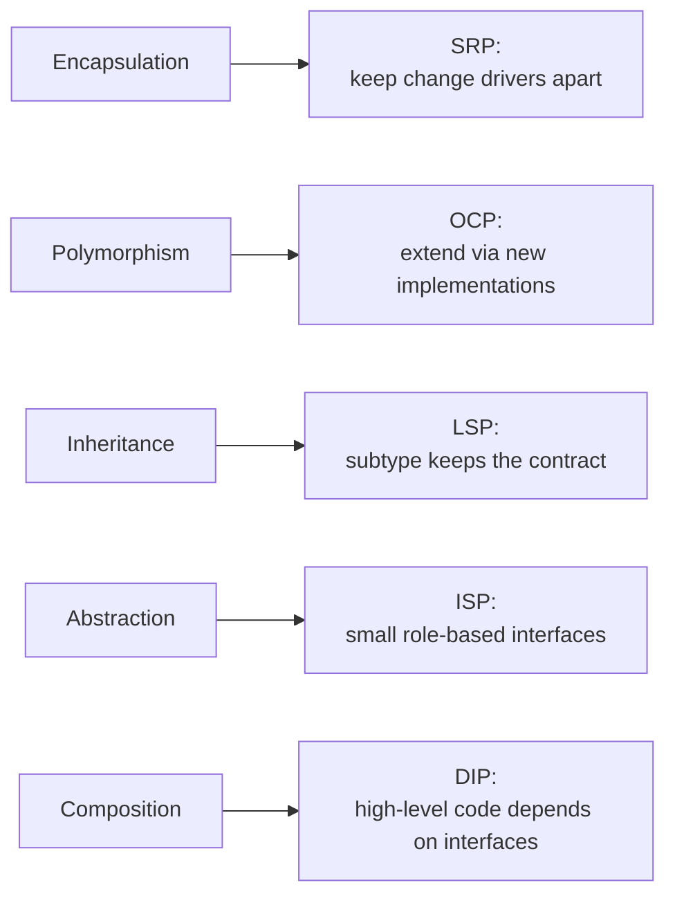

### 0.3 How to read this file

Every principle is covered in the same four-layer pattern:

1. **The definition, precisely** — including the *precise* version, not the classroom slogan.
2. **Violation → refactor on a concrete example** — the exact examples from the slides.
3. **The same design in C++, C, and Java** — because the principle is about *dependencies and contracts*, not language syntax. The C versions prove it: you can violate or honor every SOLID principle with nothing but structs and function pointers.
4. **Interview drill** — weak answer vs strong answer, plus the 30-second version.

---

## 1. Single Responsibility Principle (SRP) — "One Reason to Change"

### 1.1 The precise definition [SLIDE 26]

> **A class should have only one reason to change.**

"One responsibility" sounds vague — that is why the principle is so often *wrongly* applied (people split classes by method count, or merge by convenience). The precise definition is about **change drivers**:

> A **change driver** is a stakeholder, a business domain, or a technical concern that can *independently* require modifications to the class.

A class has one reason to change if it is affected by exactly one source of change. If **two unrelated changes both require editing the same class**, the class has more than one responsibility — no matter how "small" it looks.

**Concrete example [SLIDE 26]** — an `InvoiceService` that:

1. Calculates totals (tax rules),
2. Formats PDF output (layout),
3. Sends emails (delivery).

Three change drivers touch one class:

| Change driver (stakeholder) | Example change | Methods affected |
|---|---|---|
| Finance team | New tax exemption rules | `calculateTotals()` |
| Design team | New PDF invoice layout | `formatPdf()` |
| Infrastructure team | Switch SMTP → third-party email API | `sendEmail()` |

Because all three edits land in the same file, a **PDF layout change can break tax calculation** — one careless edit, one bad merge, one shared helper mutated "just for the PDF". This is the real harm of an SRP violation: it **increases the blast radius of every change**.

> **[INTERVIEW]** When asked *"does this class have a single responsibility?"*, never answer "it does one thing." Answer with **change drivers**: *"This class must change if the tax rules change, OR if the PDF format changes, OR if the email provider changes. That is three reasons to change, so it violates SRP."*

### 1.2 Violation: the God `UserService` [SLIDE 27]

A realistic production/interview class. It handles authentication, profile management, password reset, notifications, and audit logging:

```java
// SLIDE 27 — One class, four stakeholders. Find the change drivers.
public class UserService {

    private final UserRepository userRepository;
    private final EmailClient emailClient;
    private final AuditLogger auditLogger;

    public UserService(UserRepository userRepository,
                       EmailClient emailClient,
                       AuditLogger auditLogger) {
        this.userRepository = userRepository;
        this.emailClient = emailClient;
        this.auditLogger = auditLogger;
    }

    public boolean authenticate(String email, String password) {
        User user = userRepository.findByEmail(email);
        if (user == null || !PasswordHasher.verify(password, user.getPasswordHash())) {
            auditLogger.log("FAILED_LOGIN", email);
            return false;
        }
        auditLogger.log("SUCCESSFUL_LOGIN", email);
        return true;
    }

    public void updateProfile(String userId, String newName, String newBio) {
        User user = userRepository.findById(userId);
        user.setName(newName);
        user.setBio(newBio);
        userRepository.save(user);
        emailClient.send(user.getEmail(), "Profile Updated",
                "Your profile has been updated successfully.");
        auditLogger.log("PROFILE_UPDATED", userId);
    }

    public void resetPassword(String email) {
        User user = userRepository.findByEmail(email);
        String tempPassword = PasswordGenerator.generate();
        user.setPasswordHash(PasswordHasher.hash(tempPassword));
        userRepository.save(user);
        emailClient.send(email, "Password Reset",
                "Your temporary password is: " + tempPassword);
        auditLogger.log("PASSWORD_RESET", email);
    }
}
```

**Four distinct change drivers in one class [SLIDE 27]:**

| Change driver | Example change | Methods affected |
|---|---|---|
| Authentication policy | Add two-factor authentication | `authenticate`, `resetPassword` |
| Profile business rules | Profile picture upload; bio length limits | `updateProfile` |
| Notification requirements | Switch to SMS; add email templates | `updateProfile`, `resetPassword` |
| Audit compliance | Change log format; add retention policy | All three methods |

Notice the **cross-cutting ties**: changing the email template system could introduce a bug in authentication, because both go through the same class and potentially shared state. Every method is a minefield for unrelated changes.

> **[INTERVIEW]** If an interviewer shows you a class like this and asks *"what is wrong with this design?"* — the answer is **SRP violation**, and the follow-up they want is *"here is how I would decompose it"*. Diagnosis without treatment is half an answer.

### 1.3 Refactored: clean separation [SLIDE 27B]

Each change driver gets its own class:

```java
// SLIDE 27B — One class per change driver.
public class AuthenticationService {

    private final UserRepository userRepository;
    private final AuditService auditService;

    public AuthenticationService(UserRepository userRepository,
                                 AuditService auditService) {
        this.userRepository = userRepository;
        this.auditService = auditService;
    }

    public AuthResult authenticate(String email, String password) {
        User user = userRepository.findByEmail(email);
        if (user == null || !PasswordHasher.verify(password, user.getPasswordHash())) {
            auditService.record(AuditEvent.failedLogin(email));
            return AuthResult.failure("Invalid credentials");
        }
        auditService.record(AuditEvent.successfulLogin(email));
        return AuthResult.success(user.getId());
    }
}

public class ProfileService {

    private final UserRepository userRepository;
    private final NotificationService notificationService;

    public ProfileService(UserRepository userRepository,
                          NotificationService notificationService) {
        this.userRepository = userRepository;
        this.notificationService = notificationService;
    }

    public void updateProfile(String userId, ProfileUpdateRequest request) {
        User user = userRepository.findById(userId);
        user.updateName(request.getName());
        user.updateBio(request.getBio());
        userRepository.save(user);
        notificationService.sendProfileUpdateConfirmation(user);
    }
}

public class PasswordResetService {

    private final UserRepository userRepository;
    private final NotificationService notificationService;
    private final AuditService auditService;

    public PasswordResetService(UserRepository userRepository,
                                NotificationService notificationService,
                                AuditService auditService) {
        this.userRepository = userRepository;
        this.notificationService = notificationService;
        this.auditService = auditService;
    }

    public void resetPassword(String email) {
        User user = userRepository.findByEmail(email);
        String tempPassword = PasswordGenerator.generate();
        user.changePassword(tempPassword);
        userRepository.save(user);
        notificationService.sendPasswordReset(user, tempPassword);
        auditService.record(AuditEvent.passwordReset(email));
    }
}
```

The blast radius of each change is now **contained in one class**:

- Authentication policy change → `AuthenticationService` only.
- Notification delivery change → `NotificationService` only (the two services just *call* it).
- Profile rules change → `ProfileService` only.

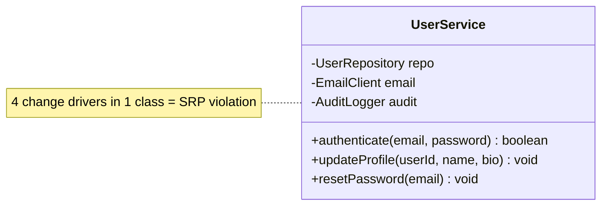

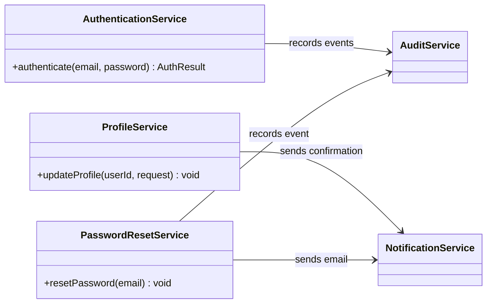

> **[INTERVIEW]** Presenting the *refactored* version demonstrates that you can both **diagnose and treat**. Interviewers consistently rate candidates higher who take a bad class and decompose it live, explaining *where* they draw the boundaries (the change drivers) and *why* they drew them there.

### 1.4 The same refactor in C++ (BEYOND THE COURSE)

The mechanics change, the principle does not. In C++ the same decomposition looks like this:

```cpp
#include <string>
#include <stdexcept>

struct User {
    std::string id;
    std::string email;
    std::string passwordHash;
    std::string name;
    std::string bio;
};

class UserRepository {                 // interface: data access concern
public:
    virtual User* findById(const std::string& id) = 0;
    virtual User* findByEmail(const std::string& email) = 0;
    virtual void save(const User& user) = 0;
    virtual ~UserRepository() = default;
};

class NotificationService {            // interface: notification concern
public:
    virtual void sendProfileUpdateConfirmation(const User& user) = 0;
    virtual void sendPasswordReset(const User& user, const std::string& tempPassword) = 0;
    virtual ~NotificationService() = default;
};

class AuditService {                   // interface: audit concern
public:
    virtual void record(const std::string& eventType, const std::string& subject) = 0;
    virtual ~AuditService() = default;
};

// One change driver per class, dependencies injected via references.
class AuthenticationService {
public:
    AuthenticationService(UserRepository& repo, AuditService& audit)
        : repo_(repo), audit_(audit) {}

    bool authenticate(const std::string& email, const std::string& password) {
        User* user = repo_.findByEmail(email);
        if (user == nullptr || !passwordMatches(password, user->passwordHash)) {
            audit_.record("FAILED_LOGIN", email);
            return false;
        }
        audit_.record("SUCCESSFUL_LOGIN", email);
        return true;
    }
private:
    static bool passwordMatches(const std::string& raw, const std::string& hash);
    UserRepository& repo_;
    AuditService&  audit_;
};

class ProfileService {
public:
    ProfileService(UserRepository& repo, NotificationService& notify)
        : repo_(repo), notify_(notify) {}

    void updateProfile(const std::string& userId,
                       const std::string& newName,
                       const std::string& newBio) {
        User* user = repo_.findById(userId);
        if (user == nullptr) throw std::runtime_error("user not found");
        user->name = newName;
        user->bio  = newBio;
        repo_.save(*user);
        notify_.sendProfileUpdateConfirmation(*user);
    }
private:
    UserRepository& repo_;
    NotificationService& notify_;
};
```

Two C++-specific notes:

- **Dependencies are references to pure-virtual interfaces.** The service classes *cannot even see* whether the success notification goes over SMTP, a message queue, or a stub — that is the SRP boundary enforced by the compiler.
- C++ gives you the same **blast-radius containment**: changing `NotificationService`'s implementation cannot touch `AuthenticationService`'s translation unit.

### 1.5 The same refactor in C — the kernel style vtable (BEYOND THE COURSE)

C has no classes, so *every* C codebase that survives larger than a toy is a debate about SRP. The standard technique — used by the Linux kernel with `file_operations`, `super_operations`, `net_device_ops`, etc. — is **structs of function pointers**: the "vtable in C" from file 01.

**The God object, C edition:**

```c
/* user_service.h — One struct, four stakeholders. The C version of SLIDE 27. */
typedef struct {
    user_repo_t   *repo;     /* data access        */
    email_client_t *email;   /* notification       */
    audit_logger_t *audit;   /* compliance         */
} user_service_t;

bool user_service_authenticate(user_service_t *svc,
                               const char *email, const char *password);

void user_service_update_profile(user_service_t *svc, const char *user_id,
                                 const char *new_name, const char *new_bio);

void user_service_reset_password(user_service_t *svc, const char *email);
```

**Decomposed into one module per change driver** — each module is a struct plus functions that operate only on its own concern:

```c
/* audit.h — the audit concern, defined once. */
typedef struct audit_ops {
    void (*record)(void *self, const char *event, const char *subject);
} audit_ops_t;

typedef struct audit_service {
    const audit_ops_t *ops;   /* swappable: file logger, syslog, stub for tests */
    void *impl;               /* implementation-private state                 */
} audit_service_t;

/* auth_service.h — authentication concern only. */
typedef struct auth_service {
    user_repo_t     *users;
    audit_service_t *audit;
} auth_service_t;

bool auth_service_authenticate(auth_service_t *svc,
                               const char *email, const char *password);

/* profile_service.h — profile concern only. */
typedef struct profile_service {
    user_repo_t        *users;
    notify_service_t   *notify;
} profile_service_t;

void profile_service_update(profile_service_t *svc, const char *user_id,
                            const char *new_name, const char *new_bio);
```

Each `.c` file now has **one reason to change**:

- `auth_service.c` changes when authentication policy changes.
- `profile_service.c` changes when profile rules change.
- `audit_logger.c` changes when compliance logging changes.
- `notify_smtp.c` changes when the delivery mechanism changes.

> **[BEYOND THE COURSE]** The parallel to the kernel is exact. In the kernel, a change to *how block I/O is logged* never requires touching *how filesystems interpret reads*; responsibility is split by **ops struct** (`file_operations`, `address_space_operations`, `super_operations`), each owning a narrow contract. SRP didn't come from OOP — it came from the same engineering economics the kernel learned at scale: **contain the blast radius of change**.

### 1.6 SRP at system scale: microservices [SLIDE 28]

Class-level SRP is the *same principle* as service-level decomposition:

| SRP at class level | Same principle at service level |
|---|---|
| `AuthenticationService` | Authentication microservice |
| `ProfileService` | User Profile microservice |
| `NotificationService` | Notification microservice |
| `AuditService` | Audit/Logging microservice |
| Each class has one change driver | Each service is owned by one team |
| Classes communicate through interfaces | Services communicate through APIs |

The refactored `UserService` maps **directly** onto four microservices — each independently deployable, independently testable, owned by a separate team. That is not a coincidence; it is the same boundary drawn at a different scale [SLIDE 28].

**Where the analogy breaks down [SLIDE 28]:** splitting a class into three classes adds *minimal* overhead. Splitting a monolith into three services adds:

- Network latency and partial failure (a call that used to be a method call can now fail).
- Distributed transactions / consistency problems.
- Deployment infrastructure, service discovery, monitoring, on-call.

So SRP does **not** mean "split everything." At both scales the real question is economic: *does the cost of coupling (shared change drivers, merge conflicts, regression risk) exceed the cost of separation (coordination, indirection, deployment)?*

> **[INTERVIEW]** Making the class-level → service-level connection shows you think across abstraction levels — a senior-level signal. The follow-up they often ask: *"Which of these would you NOT split into a microservice, and why?"* Good answer names a pair with a **tight temporal coupling** (e.g., authentication + password reset share the credential store and are updated together) and explains that splitting it would force a distributed transaction for zero independent-deployment benefit.

### 1.7 SRP in 30 seconds + drills

**The 30-second version:** *"SRP says a class should have exactly one change driver. I check it by listing the independent sources of change that could touch the class — if two unrelated stakeholders can both demand edits, I split the class along those lines."*

**Drill 1 — spot the change drivers.** A `ReportGenerator` with methods `fetchData()`, `renderPdf()`, `renderCsv()`, `emailToStakeholders()`, `uploadToS3()`. Answer: formats (design/marketing), data sources (infra), delivery channels (ops). Three drivers; file 06's "shotgun surgery" is the sibling failure mode.

**Drill 2 — the trick question.** *"Isn't a class with 5 methods always violating SRP?"* No — **method count is irrelevant**. A `Money` value class with `add`, `subtract`, `multiplyBy`, `isGreaterThan`, `isZero` has one change driver (the semantics of money) and is perfectly SRP-compliant. Conversely, a class with *two* methods (`applyTax()`, `renderInvoicePdf()`) has two drivers and violates SRP. **Count drivers, not methods.**

**Drill 3 — when NOT to split.** *"Would you split a 200-line class with one change driver?"* No. Cohesive code that changes together should stay together; premature splitting creates "shotgun surgery" (one logical change forces edits in ten files). SRP is a boundary discipline, not a line-count rule.

---

## 2. Open-Closed Principle (OCP) — Extension Without Modification

### 2.1 The definition [SLIDE 29]

> **A class should be open for extension but closed for modification.**

In practice: **you should be able to add new behavior to a system by writing new code, without changing existing, tested code.**

The principle does **not** say "never modify a class." It says: design so that the *most likely kind of change* — adding a new variant, supporting a new format, handling a new case — is done by writing a **new class**, not by editing an **old one**.

**Why it matters [SLIDE 29]:** every time you modify an existing class you risk breaking behavior that already worked. If adding a new discount type requires editing `PriceCalculator` — a class that *also* handles tax calculation and currency conversion — a bug in the new discount logic can break tax calculations. OCP minimizes this risk by making new behavior arrive through new classes.

**The connection to polymorphism:** OCP is the formal principle behind the polymorphic design from Section 2 (file 01, §5). When you define an interface and add new implementations:

- The interface is **closed** — its contract does not change.
- The system is **open** — new implementations can be added freely.

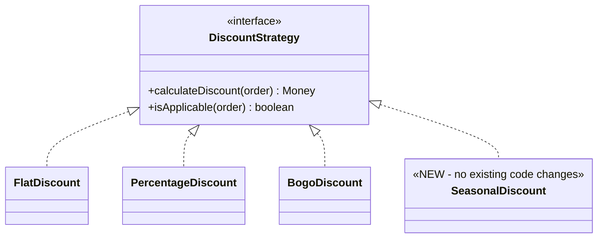

The dashed line to `SeasonalDiscount` represents the extension point: adding it requires **zero changes** to `PriceCalculator` or any existing discount class.

> **[INTERVIEW]** OCP is the second most tested SOLID principle after SRP. The probe is always: *"How would you add a new type of X?"* If your answer involves editing existing code — a new `case` in a switch, an extra `if` branch — you have violated OCP. The expected answer: **"I'd add a new class implementing the existing interface; nothing else changes."**

### 2.2 Before OCP: the switch statement [SLIDE 30]

```java
// SLIDE 30 — BEFORE: every new discount type edits this class.
public class PriceCalculator {
    public Money calculateDiscount(Order order, String discountType) {
        switch (discountType) {
            case "FLAT":
                return Money.of(10.00);
            case "PERCENTAGE":
                return order.getSubtotal().multiplyBy(0.15);
            case "BUY_ONE_GET_ONE":
                return order.getCheapestItemPrice();
            default:
                return Money.zero();
        }
    }
}
```

Every new discount type requires **adding a new `case`** — the class is modified for every new business requirement. If marketing creates promotions frequently (as they do), this class is edited constantly, and *every edit risks breaking existing discount logic*. This exact smell — "switch/if-else on type to decide behavior" — is the canonical OCP violation [SLIDE 30, 38].

### 2.3 After OCP: the interface approach [SLIDE 30]

```java
// SLIDE 30 — AFTER: the calculator is closed; new discounts are new classes.
public interface DiscountStrategy {
    Money calculateDiscount(Order order);
    boolean isApplicable(Order order);
}

public class FlatDiscount implements DiscountStrategy {
    private final Money discountAmount;

    public FlatDiscount(Money discountAmount) {
        this.discountAmount = discountAmount;
    }

    @Override
    public Money calculateDiscount(Order order) {
        return discountAmount;
    }

    @Override
    public boolean isApplicable(Order order) {
        return order.getSubtotal().isGreaterThan(Money.of(50.00));
    }
}

public class PercentageDiscount implements DiscountStrategy {
    private final double percent;

    public PercentageDiscount(double percent) { this.percent = percent; }

    @Override
    public Money calculateDiscount(Order order) {
        return order.getSubtotal().multiplyBy(percent / 100.0);
    }

    @Override
    public boolean isApplicable(Order order) { return true; }
}

public class PriceCalculator {
    private final List<DiscountStrategy> availableDiscounts;

    public PriceCalculator(List<DiscountStrategy> availableDiscounts) {
        this.availableDiscounts = availableDiscounts;
    }

    public Money calculateBestDiscount(Order order) {
        return availableDiscounts.stream()
                .filter(discount -> discount.isApplicable(order))
                .map(discount -> discount.calculateDiscount(order))
                .max(Comparator.naturalOrder())
                .orElse(Money.zero());
    }
}
```

`PriceCalculator` is now **closed for modification**. Adding a "Seasonal 20% Off" discount means writing one `SeasonalDiscount` class and registering it (in the constructor call, a config, or a registry). `PriceCalculator` is never edited again.

> **[INTERVIEW]** This before/after transformation is exactly what interviewers expect for *"how would you make this extensible?"*: show the switch statement, explain *why* it violates OCP (modification required per type; edit risk), then show the interface-based solution. You can even say the magic sentence: *"This is OCP — the calculator is closed for modification, and each new discount is an extension."* **But only name the principle if asked about principles** (see §6.4 on naming discipline).

### 2.4 The same extension point in C++ (BEYOND THE COURSE)

```cpp
#include <memory>
#include <vector>
#include <algorithm>

class DiscountStrategy {
public:
    virtual ~DiscountStrategy() = default;
    virtual Money calculateDiscount(const Order& order) const = 0;
    virtual bool  isApplicable(const Order& order) const = 0;
};

class FlatDiscount final : public DiscountStrategy {
public:
    explicit FlatDiscount(Money amount) : amount_(amount) {}

    Money calculateDiscount(const Order&) const override { return amount_; }

    bool isApplicable(const Order& order) const override {
        return order.subtotal() > Money::of(50.0);
    }
private:
    Money amount_;
};

class PriceCalculator {
public:
    explicit PriceCalculator(std::vector<std::unique_ptr<DiscountStrategy>> discounts)
        : discounts_(std::move(discounts)) {}

    Money calculateBestDiscount(const Order& order) const {
        Money best = Money::zero();
        for (const auto& d : discounts_) {
            if (d->isApplicable(order)) {
                best = std::max(best, d->calculateDiscount(order));
            }
        }
        return best;
    }
private:
    std::vector<std::unique_ptr<DiscountStrategy>> discounts_;
};
```

C++ details worth naming in an interview:

- `std::unique_ptr<DiscountStrategy>` gives you **ownership + polymorphism** without slicing; the vector is the registration point.
- `override` makes the contract explicit and turns a signature mismatch into a compile error — a language-level reminder that OCP extensions really are *instances of the same contract*.
- `final` on the concrete strategies is optional, but signals the class is not an extension point itself.

### 2.5 The same extension point in C — an ops table registry (BEYOND THE COURSE)

In C, "closed for modification" means: **the dispatcher never changes; new behavior is a new struct of function pointers**:

```c
/* discount.h */
typedef struct discount_ops {
    const char *name;
    bool  (*is_applicable)(const void *state, const order_t *order);
    money_t (*calculate)(const void *state, const order_t *order);
} discount_ops_t;

typedef struct discount {
    const discount_ops_t *ops;   /* the "vtable"                    */
    const void *state;           /* strategy-private configuration */
} discount_t;

/* price_calculator.c — CLOSED. Written once; never edited to add a discount. */
money_t price_calculator_best_discount(const discount_t *discounts, size_t count,
                                       const order_t *order)
{
    money_t best = money_zero();
    for (size_t i = 0; i < count; i++) {
        const discount_t *d = &discounts[i];
        if (d->ops->is_applicable(d->state, order)) {
            money_t candidate = d->ops->calculate(d->state, order);
            if (money_cmp(candidate, best) > 0) {
                best = candidate;
            }
        }
    }
    return best;
}

/* seasonal_discount.c — EXTENSION: a new file, new ops, new state. */
static bool seasonal_applicable(const void *state, const order_t *order);
static money_t seasonal_calculate(const void *state, const order_t *order);

static const discount_ops_t SEASONAL_OPS = {
    .name          = "SEASONAL_20_OFF",
    .is_applicable = seasonal_applicable,
    .calculate     = seasonal_calculate,
};
```

**This is precisely the kernel's extensibility model.** Adding a filesystem to Linux means writing a new `file_operations` table in a new file; the VFS dispatcher never changes. Adding a network driver means a new `net_device_ops`; the networking core never changes. Kernel developers call it "pluggable operations"; LLD calls it OCP; the mechanism is the same struct-of-function-pointers vtable.

### 2.6 OCP ↔ Strategy preview [SLIDE 30B]

The discount refactor *is* the **Strategy pattern** in disguise. Strategy is the most direct implementation of OCP: define a family of algorithms behind an interface, let the caller work with any of them interchangeably.

- `PriceCalculator` is the **context** (holds a reference to the strategy interface, delegates the work).
- Each concrete class (`FlatDiscount`, `PercentageDiscount`, …) is a **strategy** (one encapsulated algorithm).

Full coverage of Strategy is in file 05 — but recognizing this connection *now* matters because it is your reflex for interviews: **OCP tells you *why* to design this way; Strategy tells you *how*.**

**The same structure applies to any "support multiple types of X" requirement [SLIDE 30B]:**

| Requirement | Strategy interface | Implementations |
|---|---|---|
| Multiple discount types | `DiscountStrategy` | Flat, Percentage, Seasonal, Loyalty |
| Multiple payment methods | `PaymentProcessor` | Stripe, PayPal, BankTransfer |
| Multiple export formats | `DocumentExporter` | PDF, DOCX, HTML, CSV |
| Multiple notification channels | `NotificationChannel` | Email, SMS, Push, Webhook |
| Multiple compression algorithms | `CompressionStrategy` | Gzip, Snappy, LZ4, Zstd |

Every row is a place where OCP prevents a growing `switch` statement. (The `NotificationChannel` row is picked up again in file 05 as the running Strategy example.)

> **[INTERVIEW]** When you hear **"support multiple types of X"**, your first instinct should be to define an interface for X. Say it out loud: *"Since we need multiple types of X, I'll define an interface so we can add new types without modifying existing code."* That demonstrates OCP thinking *without* reciting the principle — exactly the tone interviewers reward.

### 2.7 [INTERVIEW] practice: SRP + OCP combined [SLIDE 30C]

**Scenario.** You are designing order processing for a Shopify-like platform. `OrderProcessor` currently handles: order validation, inventory checking, payment processing, shipping label generation, and sending confirmation emails. *"What is wrong with this design, and how would you fix it?"*

**Weak answer [SLIDE 30C]:**
> "The class is too big. I would split it into smaller classes."

This identifies the *symptom* but not the principle — and gives no rule for **where** the boundaries go.

**Strong answer [SLIDE 30C]:**
> "This class violates SRP because it has **five distinct change drivers**: validation rules, inventory management, payment processing, shipping integration, and notification delivery. A change to the shipping provider should not require editing the same class that handles payments.
>
> I would refactor into five classes, each behind an interface: `OrderValidator`, `InventoryService`, `PaymentProcessor`, `ShippingService`, `NotificationService`. `OrderProcessor` becomes an **orchestrator** that delegates to each service through its interface.
>
> This also enables OCP: adding a new payment provider is a new `PaymentProcessor` implementation; adding a new notification channel is a new `NotificationService` implementation. **The orchestrator never changes.**"

The strong answer (a) names the principle, (b) identifies *specific* change drivers, (c) explains how the refactor enables *future* extension — the SRP fix and the OCP property arrive together.

**Try it yourself:** write the five interfaces in Java. Then answer the follow-up: *"The orchestrator still calls five services in sequence — is IT violating SRP now?"* (Answer: no — orchestration is its single responsibility; the *sequence of steps* is the order domain's change driver, while the *content* of each step lives elsewhere. File 05's Chain of Responsibility explores when orchestration itself becomes configurable.)

---

## 3. Liskov Substitution Principle (LSP) — Behavioral Subtyping

### 3.1 The definition: contracts, not categories [SLIDE 31]

> **If class B is a subtype of class A, you should be able to replace instances of A with instances of B without the program's behavior becoming incorrect.**

The critical qualifier: *behavior*. LSP is **not** about type compatibility ("will it compile?") — it is about **behavioral compatibility** ("will it still work correctly at runtime?"). The compiler checks the former; only you can check the latter.

**Formal statement (Liskov & Wing, 1994) [BEYOND THE COURSE]:**

> Let `q(x)` be a property provable about objects `x` of type `T`. Then `q(y)` should be true for objects `y` of type `S` where `S` is a subtype of `T`.

Translation: *Everything the caller knows about the parent must remain true for the child.* In Design-by-Contract terms, a subtype must honor four constraints [SLIDE 31]:

| Constraint | Rule | Violation example |
|---|---|---|
| **Preconditions** | Cannot be *strengthened* (subtype cannot demand more than the parent) | Parent accepts any positive number; subtype accepts only even numbers |
| **Postconditions** | Cannot be *weakened* (subtype cannot promise less than the parent) | Parent guarantees non-null; subtype returns `null` |
| **Invariants** | Must be preserved | Parent guarantees `balance >= 0`; subtype allows it to go negative |
| **Side effects** | No unexpected side effects | Parent's `save()` writes to the DB; subtype's `save()` also sends an email "as a surprise" |

Memory hook: **the child may be more generous in what it accepts, and never less generous in what it delivers.** Weaken preconditions ✔, strengthen postconditions ✔; the reverse in either direction is a violation.

When any constraint is broken, code that works correctly with the parent type **will break when handed the subtype** — and the calling code *cannot know* it is broken because the type system officially approved the substitution.

> **[INTERVIEW]** LSP is the least intuitive SOLID principle, so it is the best discriminator. The interviewer is testing whether you understand the difference between *type-level compatibility* (compiler says fine) and *behavioral compatibility* (program actually works). Focus your answer on the **behavioral contract**, not on the type system.

### 3.2 The Rectangle–Square problem, explained properly [SLIDE 32]

Mathematically a square **is a** rectangle. In OOP, making `Square extends Rectangle` creates a behavioral violation. Here is the classic demonstration [SLIDE 32]:

```java
// SLIDE 32 — The famous LSP violation.
public class Rectangle {
    protected int width;
    protected int height;

    public void setWidth(int width)  { this.width = width; }
    public void setHeight(int height) { this.height = height; }
    public int area()                 { return width * height; }
}

public class Square extends Rectangle {
    @Override
    public void setWidth(int width) {
        this.width = width;
        this.height = width;     // a square must keep sides equal
    }

    @Override
    public void setHeight(int height) {
        this.width = height;
        this.height = height;
    }
}
```

**Where the substitution breaks:**

```java
// Works correctly for ANY Rectangle. Fails for Square.
public void resizeAndVerify(Rectangle rectangle) {
    rectangle.setWidth(5);
    rectangle.setHeight(10);
    assert rectangle.area() == 50;   // 5 * 10
}
```

Walk the state table:

| Step | `Rectangle` state | `Square` state |
|---|---|---|
| `setWidth(5)` | w=5, h=0 | w=5, h=5 |
| `setHeight(10)` | w=5, h=10 | w=10, h=10 ← *surprise!* |
| `area()` | 50 ✓ | **100** ✗ |

The assertion fails even though `Square` passed every compile-time type check.

**Why this happens:** `Rectangle` carries an *implicit postcondition* — **setting the height does not change the width**. `Square.setHeight()` violates that postcondition. The calling code relies on the postcondition (it expects width to still be 5), so the substitution breaks. Note that nobody wrote the postcondition down — that is exactly why LSP violations hide so well: **the contract lives in the caller's assumptions**.

**The fix [SLIDE 32]:** make `Rectangle` and `Square` *siblings* that both implement a `Shape` interface. Neither extends the other.

```java
public interface Shape {
    int area();
}

public class Rectangle implements Shape {
    private int width;
    private int height;

    public Rectangle(int width, int height) {
        this.width = width;
        this.height = height;
    }

    public void setWidth(int width)   { this.width = width; }
    public void setHeight(int height) { this.height = height; }
    @Override public int area()       { return width * height; }
}

public class Square implements Shape {
    private int side;

    public Square(int side) { this.side = side; }

    public void setSide(int side) { this.side = side; }
    @Override public int area()   { return side * side; }
}
```

No caller can "accidentally" treat a `Square` as a `Rectangle` anymore — **the type system now prevents the bug instead of a runtime assertion catching it.**

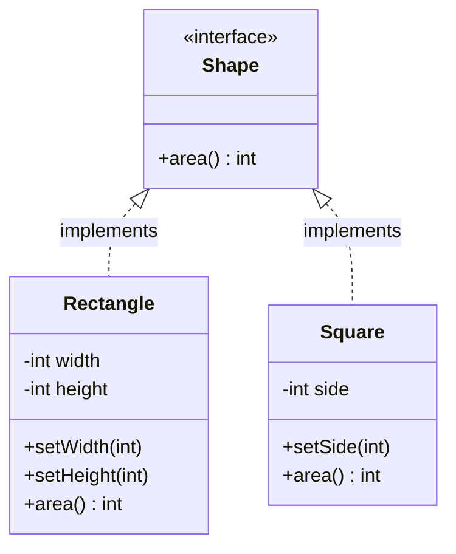

**The deep insight [SLIDE 32]:** *Mathematical is-a and OOP is-a are not the same thing.* OOP is-a requires **behavioral compatibility**, not just logical categorization. A square is mathematically a rectangle; it is **not substitutable** for the `Rectangle` object of our design, because that object's contract includes "width and height move independently."

### 3.3 The same failure in C++ and C (BEYOND THE COURSE)

**C++** reproduces the Java story exactly — the language is irrelevant to the principle:

```cpp
class Rectangle {
public:
    virtual ~Rectangle() = default;
    virtual void setWidth(int w)  { width_  = w; }
    virtual void setHeight(int h) { height_ = h; }
    virtual int  area() const     { return width_ * height_; }
protected:
    int width_  = 0;
    int height_ = 0;
};

class Square : public Rectangle {   // the trap is identical
public:
    void setWidth(int w)  override { width_ = w; height_ = w; }
    void setHeight(int h) override { width_ = h; height_ = h; }
};

void resizeAndVerify(Rectangle& r) {
    r.setWidth(5);
    r.setHeight(10);
    assert(r.area() == 50);         // passes for Rectangle, fails for Square
}
```

**C** has no inheritance at all — and the trap still exists, which proves LSP is not about inheritance keyword mechanics but about **substitutable contracts**:

```c
/* rectangle.h — a base "type" as struct + ops (vtable in C). */
typedef struct rectangle rectangle_t;

typedef struct rectangle_ops {
    void (*set_width)(rectangle_t *self, int width);
    void (*set_height)(rectangle_t *self, int height);
    int  (*area)(const rectangle_t *self);
} rectangle_ops_t;

struct rectangle {
    const rectangle_ops_t *ops;   /* behavioral contract chosen at runtime  */
    int width;
    int height;
};

/* ---- Rectangular behavior: honest implementation of the contract ---- */
static void rect_set_width(rectangle_t *self, int w)  { self->width = w; }
static void rect_set_height(rectangle_t *self, int h) { self->height = h; }
static int  rect_area(const rectangle_t *self)        { return self->width * self->height; }

static const rectangle_ops_t RECT_OPS = {
    .set_width = rect_set_width,
    .set_height = rect_set_height,
    .area = rect_area,
};

/* ---- "Square": overrides the ops, breaks the implicit postcondition ---- */
static void square_set_width(rectangle_t *self, int w)  { self->width = w; self->height = w; }
static void square_set_height(rectangle_t *self, int h) { self->width = h; self->height = h; }

static const rectangle_ops_t SQUARE_OPS = {
    .set_width = square_set_width,
    .set_height = square_set_height,
    .area = rect_area,
};

/* Caller written against the Rectangle contract: */
static int resize_and_verify(rectangle_t *r)
{
    r->ops->set_width(r, 5);
    r->ops->set_height(r, 10);
    return r->ops->area(r);       /* RECT_OPS: 50 ✔ | SQUARE_OPS: 100 ✘ */
}
```

The C version makes the lesson unusually crisp: **there is no hierarchy here at all — just a struct of function pointers.** Whoever hands `SQUARE_OPS` to `resize_and_verify()` has violated LSP, with no compiler, no keywords, and no type checker to blame. Substituteability is a property of the **implementation of a contract**.

### 3.4 A real production LSP violation: `ReadOnlyRepository` [SLIDE 32B]

Rectangle–Square feels academic. Here is the violation that shows up in real codebases and LLD interviews [SLIDE 32B]:

```java
public interface Repository<T> {
    T findById(String id);
    List<T> findAll();
    void save(T entity);
    void delete(String id);
}

public class ReadOnlyRepository<T> implements Repository<T> {
    private final DataSource dataSource;

    public ReadOnlyRepository(DataSource dataSource) { this.dataSource = dataSource; }

    @Override public T findById(String id)  { return dataSource.query(id); }
    @Override public List<T> findAll()      { return dataSource.queryAll(); }

    @Override
    public void save(T entity) {
        throw new UnsupportedOperationException("This repository is read-only");
    }

    @Override
    public void delete(String id) {
        throw new UnsupportedOperationException("This repository is read-only");
    }
}
```

**Why this violates LSP:** any code that accepts a `Repository<T>` **reasonably expects** `save()` and `delete()` to work. `ReadOnlyRepository` compiles, passes type checks, and throws for operations the interface promises. Code that loops over a list of repositories and calls `save()` on each will crash at runtime on the read-only one.

> The type system lied.

**The fix: interface segregation** [SLIDE 32B]:

```java
public interface ReadableRepository<T> {
    T findById(String id);
    List<T> findAll();
}

public interface WritableRepository<T> extends ReadableRepository<T> {
    void save(T entity);
    void delete(String id);
}
```

Now:

- `ReadOnlyRepository implements ReadableRepository` — and genuinely supports every method it declares.
- Code that needs to write takes `WritableRepository`; code that only reads takes `ReadableRepository`.
- **No surprises, no exceptions, no LSP violation — the type system prevents invalid calls.**

Notice how fixing the LSP violation naturally led us to **ISP**: the root cause was a fat interface pretending every repository is writable. The principles reinforce each other [SLIDE 32B].

**The same fix in C++ (brief):**

```cpp
template <typename T>
class ReadableRepository {
public:
    virtual T findById(const std::string& id) = 0;
    virtual std::vector<T> findAll() = 0;
    virtual ~ReadableRepository() = default;
};

template <typename T>
class WritableRepository : public ReadableRepository<T> {
public:
    virtual void save(const T& entity) = 0;
    virtual void deleteById(const std::string& id) = 0;
};
```

...and in C, exactly the same split at the ops level:

```c
typedef struct readable_repo_ops {
    void *(*find_by_id)(void *self, const char *id);
    void  (*find_all)(void *self, void (*visit)(void *entity, void *ctx), void *ctx);
} readable_repo_ops_t;

typedef struct writable_repo_ops {
    readable_repo_ops_t read;                       /* extends by embedding   */
    void (*save)(void *self, const void *entity);   /* genuinely supported    */
    void (*remove)(void *self, const char *id);
} writable_repo_ops_t;
```

A read-only data source simply **has no `writable_repo_ops_t`** to hand out. Nothing to throw, nothing to lie about.

> **[INTERVIEW]** Interviewers use the **"exception-throwing override"** pattern to test LSP. Rule: *if a subclass throws `UnsupportedOperationException` for a parent's method, flag it as an LSP violation and propose splitting the interface.* Same for empty-bodied overrides ("refused bequest" in file 06's anti-patterns).

### 3.5 Why LSP violations cause production bugs [SLIDE 33]

LSP violations are dangerous precisely because **they pass all compile-time checks**:

1. The type system says the substitution is valid.
2. The code compiles.
3. The tests that use the *parent type* pass (they never instantiate the bad subtype).
4. Code review looks clean.
5. The bug appears **only at runtime**, in a code path that was never tested with that specific subtype.

**How the bug reaches production [SLIDE 33]:**

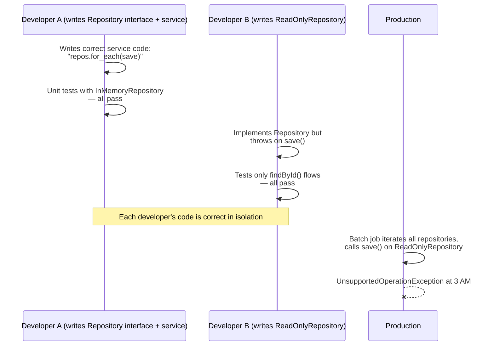

The developer who wrote the service never anticipated a `Repository` that does not support `save()`. The developer who created `ReadOnlyRepository` never tested it in the context where `save()` is called. **The bug exists in the gap between the interface contract and the implementation behavior** [SLIDE 33].

**Three warning signs of LSP violations [SLIDE 33]:**

1. A subclass **overrides a method to throw** an exception.
2. A subclass **overrides a method to do nothing** (empty body).
3. Calling code uses **`instanceof` checks before calling a method** on the interface type.

Sign 3 is the most telling. When you see this:

```java
if (repo instanceof WritableRepository) {
    ((WritableRepository<?>) repo).save(entity);
}
```

...it means **the interface hierarchy is wrong**. The type system should prevent invalid calls, not the programmer's vigilance. `instanceof` before a call is a design smell — someone has drawn the hierarchy so that a "valid" static type is invalid at runtime.

> **[INTERVIEW]** Explaining *why* LSP violations are dangerous (not just what they are) separates candidates who *understand* SOLID from candidates who *memorized* definitions. Lead with: **"An LSP violation is a broken promise the compiler cannot see."**

### 3.6 [INTERVIEW] practice: the archive storage trap [SLIDE 33B]

**Scenario.** File storage system. Base class `FileStorage` with `upload(file)`, `download(fileId)`, `delete(fileId)`. A teammate added `ArchiveStorage extends FileStorage` whose `delete()` throws `UnsupportedOperationException` — archived files must be retained for compliance. *"Is this a good design? What would you change?"*

**Weak answer [SLIDE 33B]:**
> "It is fine because archived files should not be deleted. The exception tells callers not to delete."

This misses the violation entirely: **the calling code does not know it is working with `ArchiveStorage`.** A batch cleanup job that calls `delete()` on every `FileStorage` will crash on the archive.

**Strong answer [SLIDE 33B]:**
> "This violates the Liskov Substitution Principle. Any code that accepts `FileStorage` expects `delete()` to work; `ArchiveStorage` breaks that contract by throwing. The fix is to split the interface:
>
> - `ReadableStorage` — `download()`
> - `DeletableStorage extends ReadableStorage` — adds `upload()` and `delete()`
> - `ArchiveStorage` implements only `ReadableStorage`.
>
> Batch cleanup jobs accept `DeletableStorage`, so they **can never be passed an `ArchiveStorage` by mistake**. The type system prevents the bug instead of relying on runtime exceptions."

Note the bonus in the strong answer: the fix is not just "which methods exist" — it is that **every caller's type declares exactly the capabilities it uses.** Cleanup job: `DeletableStorage`. Viewer: `ReadableStorage`. The compiler enforces the compliance rule requiring an explicit *design* decision to delete an archived file, not a runtime crash.

### 3.7 LSP in 30 seconds + drills

**The 30-second version:** *"LSP says a subtype must be usable everywhere the parent type is used, without the caller noticing. I check it by asking: what does the caller *assume* about the parent — what does it accept, what does it return, what invariants and side effects does it rely on? A subtype that narrows inputs, weakens outputs, breaks invariants, or springs new side effects is a violation — even if it compiles."*

**Drill 1 — the immutable list.** *"A class implements `List` but `add()` throws `UnsupportedOperationException`. Violation?"* Yes — classic LSP violation (this is why Guava has a separate `ImmutableList` that simply does not offer mutation instead of extending `List`... and why `Collections.unmodifiableList()` *differs* from `List.copyOf()`: the wrapper still implements `List`, so it technically violates LSP; copy-based immutables do not). Fix: split read-only vs mutable interfaces (`ReadableRepository` / `WritableRepository` as above).

**Drill 2 — equals().** *"Does adding a field in a subclass and overriding `equals` only for that subclass violate LSP?"* Yes — `Object.equals` has a *contract* (reflexive, symmetric, transitive, consistent, non-null). A subclass that breaks symmetry (`point.equals(coloredPoint)` true, reverse false) breaks the contract of a method every caller relies on. This is why `instanceof` vs `getClass()` in `equals` is a famous Java debate. Same principle.

**Drill 3 — allowed vs forbidden changes.** Classify each: (a) subtype accepts `null` in a method the parent rejected → *allowed* (weaker precondition); (b) subtype throws a new checked exception → *forbidden* (new side effect / stronger failure); (c) subtype returns a non-null more-specific type → *allowed* (stronger postcondition); (d) subtype logs to a file in a method that didn't before → *forbidden* (unexpected side effect). If you can classify these instantly, you *understand* LSP rather than reciting it.

---

## 4. Interface Segregation Principle (ISP) — Fat vs Focused Interfaces

### 4.1 The definition [SLIDE 34]

> **No class should be forced to implement methods it does not use.**

A **fat interface** bundles many capabilities into a single contract, forcing implementors to provide methods irrelevant to their purpose. The problem:

1. **A fat interface creates a false promise.** It tells calling code: "any object of this type supports *all* of these operations." When an implementor cannot support all of them, *the calling code has been lied to*.
2. **It creates a recompilation/redeployment tax.** Add a method to a 15-method interface and **every** implementing class must be updated — even the ones with nothing to do with the new method.
3. **It forces LSP violations.** When a class is forced to implement methods it does not need, the most common response is `throw new UnsupportedOperationException()` or an empty method body — both are LSP violations. **ISP prevents LSP violations** by keeping interfaces small enough that every implementor can genuinely fulfill the entire contract.

**The goal [SLIDE 34]:** interfaces focused on a *single capability* (or a tightly related group of capabilities). Each interface should represent a **role** an implementor plays — `Printer`, `Scanner`, `Refunder` — not "everything the system might ever need."

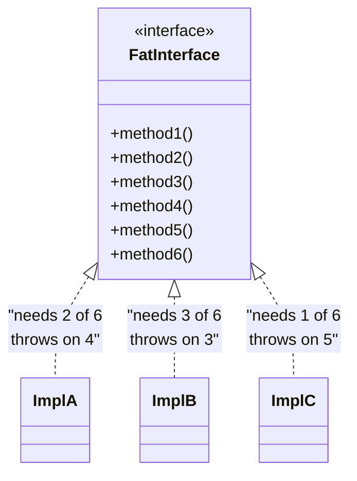

> **[INTERVIEW]** ISP violations show up as **large interfaces (10+ methods) where most implementors only care about 2–3**. When you spot this in an interview — especially in *your own* design from ten minutes ago — suggest splitting the interface **by capability**, not by convenience.

### 4.2 Violation: the `OfficeMachine` interface [SLIDE 35]

An office equipment management system defines one interface for all machines [SLIDE 35]:

```java
public interface OfficeMachine {
    void print(Document document);
    void scan(Document document);
    void fax(Document document);
    void staple(Document document);
    void copy(Document document, int numberOfCopies);
}
```

Now implement a basic printer:

```java
public class BasicPrinter implements OfficeMachine {
    @Override
    public void print(Document document) {
        PrinterDriver.send(document.getContent());
    }

    @Override
    public void scan(Document document) {
        throw new UnsupportedOperationException("Basic printer cannot scan");
    }

    @Override
    public void fax(Document document) {
        throw new UnsupportedOperationException("Basic printer cannot fax");
    }

    @Override
    public void staple(Document document) {
        throw new UnsupportedOperationException("Basic printer cannot staple");
    }

    @Override
    public void copy(Document document, int numberOfCopies) {
        throw new UnsupportedOperationException("Basic printer cannot copy");
    }
}
```

`BasicPrinter` genuinely supports **one out of five** methods. The other four are dead code that throws. This is a **double violation**:

- **ISP**: the class was forced to implement methods it does not use.
- **LSP**: calling code that expects an `OfficeMachine` gets exceptions on legitimate method calls.

**Impact on the codebase [SLIDE 35]:** when the team adds a new capability to `OfficeMachine` — say `void emailDocument(Document document, String recipient)` — **every implementor must be updated**, even `BasicPrinter`, which will simply add another `UnsupportedOperationException()`. The fat interface becomes a growing tax on every implementor, forever.

> **[INTERVIEW]** The machine interface is the canonical ISP example — know it cold. But the interviewer will immediately follow up with *"show me the refactored version."* Have it ready (§4.3), and be able to explain *how you'd decide the split* (by capability/role: things that print, things that scan, things that fax, things that copy).

### 4.3 Refactored: focused, role-based interfaces [SLIDE 35B]

Split `OfficeMachine` into interfaces that each represent **one capability** [SLIDE 35B]:

```java
public interface Printer {
    void print(Document document);
}

public interface Scanner {
    Document scan(String documentName);
}

public interface FaxMachine {
    void fax(Document document, String faxNumber);
}

public interface Copier {
    void copy(Document document, int numberOfCopies);
}
```

Implement machines with the right set of capabilities:

```java
public class BasicPrinter implements Printer {
    @Override
    public void print(Document document) {
        PrinterDriver.send(document.getContent());
    }
}

public class MultiFunctionDevice implements Printer, Scanner, Copier {
    @Override
    public void print(Document document) {
        PrinterDriver.send(document.getContent());
    }

    @Override
    public Document scan(String documentName) {
        return ScannerDriver.capture(documentName);
    }

    @Override
    public void copy(Document document, int numberOfCopies) {
        Document scanned = scan(document.getName());
        for (int i = 0; i < numberOfCopies; i++) {
            print(scanned);
        }
    }
}
```

Now:

- `BasicPrinter` implements **only `Printer`** and provides a real implementation for every method it declares.
- `MultiFunctionDevice` implements **three interfaces** and genuinely supports all three capabilities.
- **No exceptions thrown, no empty method bodies, no LSP violations.**

**Calling code depends only on what it needs [SLIDE 35B]:**

```java
public class PrintService {
    private final Printer printer;

    public PrintService(Printer printer) { this.printer = printer; }

    public void printAll(List<Document> documents) {
        for (Document d : documents) printer.print(d);
    }
}

public class DocumentArchiver {
    private final Scanner scanner;

    public DocumentArchiver(Scanner scanner) { this.scanner = scanner; }

    public Document archive(String name) { return scanner.scan(name); }
}
```

`PrintService` depends only on `Printer` — it accepts a `BasicPrinter`, a `MultiFunctionDevice`, **or any future class that can print**. `DocumentArchiver` depends only on `Scanner`. **Each service declares exactly what capability it needs, nothing more.**

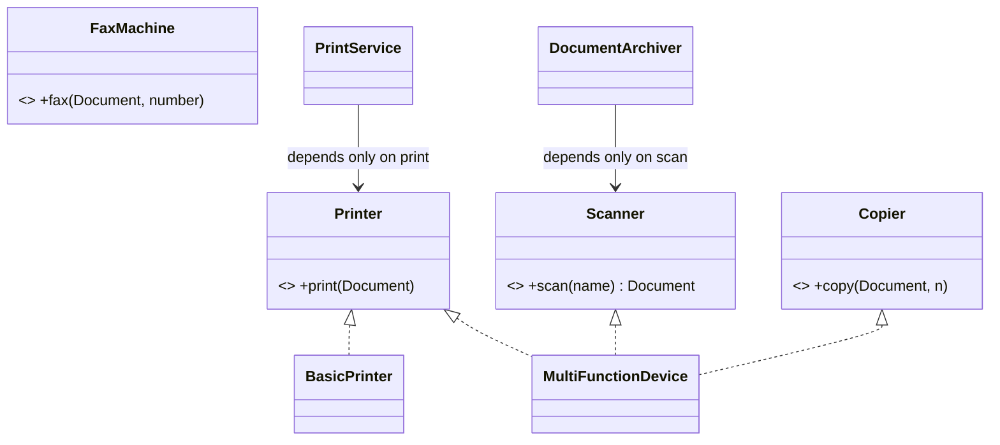

> **[INTERVIEW — the sizing heuristic from SLIDE 35B]** When you define interfaces in your answer, **aim for 2–4 methods per interface**. If you catch yourself defining one with 8+ methods, ask: *"Are these all part of the same capability, or am I bundling unrelated operations?"* If unrelated → split. (Caveat: some interfaces *are* legitimately cohesive at 5+ methods — e.g., a `Repository` with `findById`, `findAll`, `findByCriteria`. The test is not the count; the count is a *smell alarm* that makes you run the test: *can every implementor honor every method?*)

### 4.4 The same split in C++ and C (BEYOND THE COURSE)

**C++** — each capability is an abstract class; a device inherits exactly the ones it supports:

```cpp
class Printer {
public:
    virtual void print(const Document& document) = 0;
    virtual ~Printer() = default;
};

class Scanner {
public:
    virtual Document scan(const std::string& name) = 0;
    virtual ~Scanner() = default;
};

// A device supports a capability by inheriting ONLY that interface.
class BasicPrinter final : public Printer {
public:
    void print(const Document& document) override {
        PrinterDriver::send(document.content());
    }
};

class MultiFunctionDevice final : public Printer, public Scanner {
public:
    void print(const Document& document) override { /* ... */ }
    Document scan(const std::string& name) override { /* ... */ }
};
```

C++ interview point: multiple inheritance of **interfaces only** (pure abstract classes) is widely accepted as good practice; multiple inheritance of *implementation* is not. ISP is what keeps it that way.

**C** — one ops table per capability:

```c
typedef struct printer_ops {
    void (*print)(void *self, const document_t *doc);
} printer_ops_t;

typedef struct printer {
    const printer_ops_t *ops;
    void *impl;
} printer_t;

typedef struct scanner_ops {
    document_t *(*scan)(void *self, const char *name);
} scanner_ops_t;

/* A "multi-function device" simply owns BOTH ops tables. */
typedef struct mfd {
    printer_t printer;
    scanner_t scanner;
} mfd_t;
```

In C the split is even more visible: **capabilities are interfaces, interfaces are structs of function pointers**. A `basic_printer_t` never contains a scan pointer at all — there is nothing to "throw" because there is nothing to call.

### 4.5 ISP in 30 seconds + drills

**The 30-second version:** *"ISP says clients should not depend on methods they don't use — interfaces should be role-based and small. I check it by asking: can every implementor honor every method? Any `UnsupportedOperationException` or empty override is a signal that the interface bundles capabilities that should be split."*

**Drill 1 — user roles.** Design permissions for a document system: `Admin`, `Editor`, `Viewer`. Weak design: one `User` interface with `read()`, `write()`, `delete()`, `manageUsers()`. Strong design: `CanRead`, `CanWrite`, `CanDelete`, `CanManageUsers` — with roles composed from capabilities as needed. Follow-up: *"What if a role needs a new capability at runtime?"* → composition of capability objects (file 04's Decorator territory) rather than a fatter interface.

**Drill 2 — the interface that is NOT too fat.** *"Is a `PaymentProcessor` interface with `charge`, `refund`, `capture` too fat?"* No — those are one capability (card acquisition lifecycle) with a single reason to change. ISP splits by **capability boundaries**, not by method count. A `PaymentProcessor` that also had `sendInvoiceEmail()` *would* be too fat — because email is a different capability with a different change driver.

**Drill 3 — the refactor direction.** Given a 12-method `OrderOperations` interface where implementors leave half empty, sketch the split in 60 seconds. Expected: group methods by *who calls them and why they'd change*, name each group after the role (`OrderPricing`, `OrderFulfillment`, `OrderHistory`), and show two implementations that suddenly get honest (each implements exactly one or two role interfaces).

---

## 5. Dependency Inversion Principle (DIP) — Depending on Abstractions

### 5.1 The definition [SLIDE 36]

DIP has two parts:

1. **High-level modules should not depend on low-level modules. Both should depend on abstractions.**
2. **Abstractions should not depend on details. Details should depend on abstractions.**

In simpler terms: **your business logic should never directly reference a specific technology, library, or infrastructure component.** Instead, define an interface that represents *what you need*, and let the concrete implementation satisfy that interface.

**Without DIP — direct dependency [SLIDE 36]:**

```java
// SLIDE 36 — Every technology choice is welded into the business logic.
public class OrderService {
    private final StripePaymentClient stripeClient;
    private final SendGridEmailClient sendGridClient;
    private final PostgresOrderRepository orderRepository;

    public OrderService() {
        this.stripeClient    = new StripePaymentClient("sk_live_abc123");
        this.sendGridClient  = new SendGridEmailClient("sg_key_xyz");
        this.orderRepository = new PostgresOrderRepository("jdbc:postgresql://prod:5432/orders");
    }
}
```

Problems, in interview language:

- Switching to PayPal requires **editing `OrderService`** (and retesting it).
- Writing a unit test requires a **live Stripe account and a running PostgreSQL** — because the constructor *creates* its own dependencies.
- The business logic (processing orders) is **entangled with infrastructure details** (Stripe, SendGrid, Postgres).

**With DIP — depending on abstractions [SLIDE 36]:**

```java
// SLIDE 36 — The same class, decoupled from every technology choice.
public class OrderService {
    private final PaymentProcessor paymentProcessor;
    private final NotificationSender notificationSender;
    private final OrderRepository orderRepository;

    public OrderService(PaymentProcessor paymentProcessor,
                        NotificationSender notificationSender,
                        OrderRepository orderRepository) {
        this.paymentProcessor    = paymentProcessor;
        this.notificationSender  = notificationSender;
        this.orderRepository     = orderRepository;
    }
}
```

`OrderService` depends on three interfaces. It **does not know or care** whether payments go through Stripe or PayPal, notifications through SendGrid or Twilio, or orders into PostgreSQL or MongoDB. The concrete implementations are **injected from outside**.

**Why the principle is called "inversion":** look at the *source-code dependency arrows*, not the runtime control flow. Runtime, the business logic still calls infrastructure — that never changes. But the **compile-time knowledge** is inverted:

- **Without DIP:** `OrderService` (high-level) → `StripePaymentClient` (low-level). The business layer knows about the infrastructure layer.
- **With DIP:** `OrderService` → `PaymentProcessor` ← `StripePaymentProcessor`. Both layers point at an **interface that the high-level layer owns**. The infrastructure layer now conforms to the business layer's needs, not the reverse.

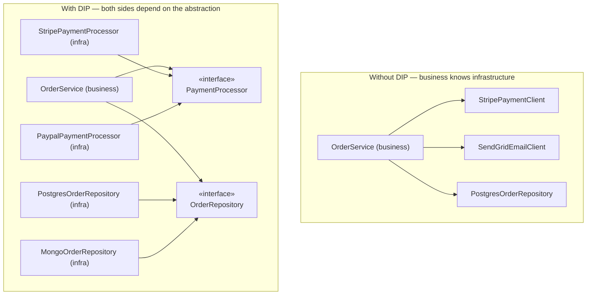

> **[INTERVIEW]** DIP is tested every time an interviewer looks at your class diagram's **dependency arrows**. If arrows point from business logic classes *toward* infrastructure classes, you have violated DIP. Arrows should point **toward abstractions**. Some interviewers will literally trace the arrows with their finger — plan your diagram so the answer is obvious.

### 5.2 Worked example: order service and the payment interface [SLIDE 37]

Full DIP-compliant design for a Shopify-like order system [SLIDE 37].

**The abstractions** (owned by — and living with — the business layer):

```java
public interface PaymentProcessor {
    PaymentResult charge(String customerId, Money amount);
    PaymentResult refund(String transactionId);
}

public interface OrderRepository {
    void save(Order order);
    Optional<Order> findById(String orderId);
    List<Order> findByCustomer(String customerId);
}
```

**The business logic** (high-level module):

```java
public class OrderService {
    private final PaymentProcessor paymentProcessor;
    private final OrderRepository orderRepository;

    public OrderService(PaymentProcessor paymentProcessor,
                        OrderRepository orderRepository) {
        this.paymentProcessor = paymentProcessor;
        this.orderRepository  = orderRepository;
    }

    public OrderResult placeOrder(String customerId, List<OrderItem> items) {
        Money total = calculateTotal(items);
        PaymentResult paymentResult = paymentProcessor.charge(customerId, total);

        if (!paymentResult.isSuccessful()) {
            return OrderResult.paymentFailed(paymentResult.getErrorMessage());
        }

        Order order = new Order(customerId, items, total,
                                paymentResult.getTransactionId());
        orderRepository.save(order);
        return OrderResult.success(order.getId());
    }

    private Money calculateTotal(List<OrderItem> items) {
        Money total = Money.zero();
        for (OrderItem item : items) {
            total = total.add(item.getPrice().multiplyBy(item.getQuantity()));
        }
        return total;
    }
}
```

**The infrastructure** (low-level modules — written to *satisfy* the abstraction):

```java
public class StripePaymentProcessor implements PaymentProcessor {
    private final StripeClient stripeClient;

    public StripePaymentProcessor(StripeClient stripeClient) {
        this.stripeClient = stripeClient;
    }

    @Override
    public PaymentResult charge(String customerId, Money amount) {
        StripeCharge charge = stripeClient.createCharge(amount.toCents(), customerId);
        return new PaymentResult(charge.getId(),
                                 charge.getStatus().equals("succeeded"));
    }

    @Override
    public PaymentResult refund(String transactionId) {
        StripeRefund refund = stripeClient.refund(transactionId);
        return new PaymentResult(refund.getId(), refund.getStatus().equals("succeeded"));
    }
}
```

**The dependency direction [SLIDE 37]:**

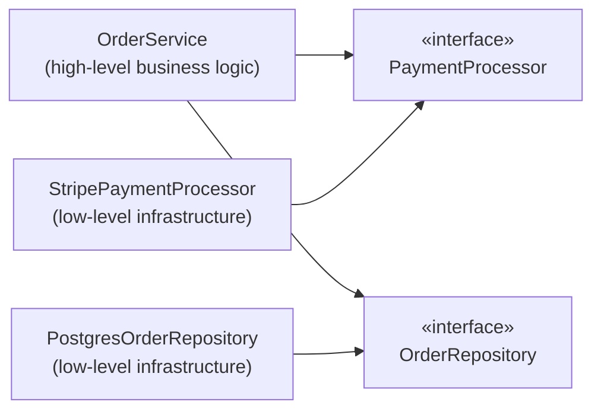

Both the high-level module and the low-level modules depend on the abstractions. **The abstractions own the dependency direction.** A subtle but interview-winning point: the interfaces are shaped by *what OrderService needs* (`charge`, `refund`), not by what Stripe offers (`createCharge`, `refundCharge`, `createIntent`, `confirmIntent`, ...). Detail leaks get trapped in the adapter (`StripePaymentProcessor`), never reach the business logic.

> **[INTERVIEW]** Drawing this diagram with dependency arrows pointing toward interfaces rather than toward concrete classes is one of the clearest signals of design maturity an interviewer can observe. Mention *where the interfaces live*: "The `PaymentProcessor` interface belongs to the order module, not to the Stripe module" — that's the inversion.

### 5.3 How DIP enables testability [SLIDE 37B]

DIP's most immediate practical benefit: **when business logic depends on interfaces, you can substitute mock implementations in tests** without real databases, payment APIs, or email servers.

```java
// SLIDE 37B — testing order logic with zero infrastructure.
public class OrderServiceTest {
    private OrderService orderService;
    private FakePaymentProcessor fakePaymentProcessor;
    private InMemoryOrderRepository inMemoryOrderRepository;

    public void setUp() {
        fakePaymentProcessor    = new FakePaymentProcessor();
        inMemoryOrderRepository = new InMemoryOrderRepository();
        orderService = new OrderService(fakePaymentProcessor, inMemoryOrderRepository);
    }

    public void testSuccessfulOrder() {
        fakePaymentProcessor.setNextResult(PaymentResult.success("txn_001"));
        List<OrderItem> items = List.of(new OrderItem("widget", Money.of(25.00), 2));

        OrderResult result = orderService.placeOrder("customer_123", items);

        assert result.isSuccessful();
        assert inMemoryOrderRepository.findById(result.getOrderId()).isPresent();
    }

    public void testPaymentFailure() {
        fakePaymentProcessor.setNextResult(PaymentResult.failure("Card declined"));
        List<OrderItem> items = List.of(new OrderItem("widget", Money.of(25.00), 2));

        OrderResult result = orderService.placeOrder("customer_123", items);

        assert !result.isSuccessful();
        assert inMemoryOrderRepository.count() == 0;   // no order persisted on failure
    }
}
```

**What DIP made possible [SLIDE 37B]:**

| Without DIP | With DIP |
|---|---|
| Tests need a running PostgreSQL instance | Tests use `InMemoryOrderRepository` |
| Tests need valid Stripe API keys | Tests use `FakePaymentProcessor` |
| Tests take seconds (network calls) | Tests take milliseconds (in-memory) |
| Flaky tests from network timeouts | Deterministic, repeatable tests |
| Cannot test payment-failure paths easily | Trivial: `setNextResult(failure)` |

> **[INTERVIEW]** *"How would you test this?"* is one of the most common follow-up questions in LLD interviews — and it is usually **DIP in disguise**. If your answer requires real infrastructure to unit-test business logic, your design has DIP violations. If your answer is *"I'd inject a fake implementation of the interface"*, you have demonstrated both DIP compliance and practical engineering sense.

### 5.4 The same design in C++ (BEYOND THE COURSE)

```cpp
#include <memory>
#include <optional>
#include <vector>
#include <string>

// Abstractions (owned by the business layer).
class PaymentProcessor {
public:
    virtual ~PaymentProcessor() = default;
    virtual PaymentResult charge(const std::string& customerId, Money amount) = 0;
    virtual PaymentResult refund(const std::string& transactionId) = 0;
};

class OrderRepository {
public:
    virtual ~OrderRepository() = default;
    virtual void save(const Order& order) = 0;
    virtual std::optional<Order> findById(const std::string& orderId) = 0;
};

// High-level module: emits NO infrastructure names.
class OrderService {
public:
    OrderService(PaymentProcessor& payments, OrderRepository& orders)
        : payments_(payments), orders_(orders) {}

    OrderResult placeOrder(const std::string& customerId,
                           const std::vector<OrderItem>& items) {
        Money total = calculateTotal(items);
        PaymentResult pr = payments_.charge(customerId, total);
        if (!pr.success) return OrderResult::paymentFailed(pr.errorMessage);

        Order order{customerId, items, total, pr.transactionId};
        orders_.save(order);
        return OrderResult::success(order.id);
    }
private:
    PaymentProcessor& payments_;
    OrderRepository&  orders_;
};
```

Wiring happens at the **composition root** (`main()` or an app container):

```cpp
int main() {
    StripeClient stripe{"sk_live_abc123"};
    StripePaymentProcessor payments{stripe};
    PostgresOrderRepository orders{"postgresql://prod:5432/orders"};

    OrderService service{payments, orders};   // inject, don't create
    // ...
}
```

This is the entire "framework" you need: **business classes take interfaces by reference; one place at the top chooses the concretes.** Interviewers like the phrase: *"construction happens once, at the composition root."*

### 5.5 The same design in C — injecting ops tables (BEYOND THE COURSE)

```c
/* payment.h — abstraction shaped by what the business layer needs. */
typedef struct payment_result {
    bool ok;
    char transaction_id[64];
    char error_message[128];
} payment_result_t;

typedef struct payment_ops {
    payment_result_t (*charge)(void *self, const char *customer_id, money_t amount);
    payment_result_t (*refund)(void *self, const char *transaction_id);
} payment_ops_t;

typedef struct payment_processor {
    const payment_ops_t *ops;
    void *impl;                      /* the concrete processor's state */
} payment_processor_t;

/* order_service.c — high-level module. References NO stripe_* symbol. */
typedef struct order_service {
    payment_processor_t payment;     /* injected */
    order_repo_t        orders;      /* injected (same discipline)      */
} order_service_t;

order_result_t order_service_place(order_service_t *svc,
                                   const char *customer_id,
                                   const order_item_t *items, size_t count)
{
    money_t total = order_calculate_total(items, count);

    payment_result_t pr = svc->payment.ops->charge(svc->payment.impl,
                                                   customer_id, total);
    if (!pr.ok) {
        return order_result_payment_failed(pr.error_message);
    }
    return order_result_save_and_succeed(&svc->orders, customer_id, items, count, pr.transaction_id);
}
```

And the test fake — **no Stripe, no network, no database**:

```c
/* test_order_service.c */
typedef struct {
    int charge_calls;
    payment_result_t next_result;
} fake_payment_state_t;

static payment_result_t fake_charge(void *self, const char *customer_id, money_t amount)
{
    fake_payment_state_t *st = self;
    (void)customer_id; (void)amount;
    st->charge_calls++;
    return st->next_result;
}

static const payment_ops_t FAKE_PAYMENT_OPS = { .charge = fake_charge, .refund = NULL };

void test_payment_failure_persists_nothing(void)
{
    fake_payment_state_t st = {
        .next_result = { .ok = false, .error_message = "Card declined" },
    };
    order_service_t svc = {
        .payment = { .ops = &FAKE_PAYMENT_OPS, .impl = &st },
        .orders  = test_in_memory_repo(),
    };

    order_result_t r = order_service_place(&svc, "customer_123", items, 1);

    assert(!r.ok);
    assert(st.charge_calls == 1);
    assert(repo_count(&svc.orders) == 0);
}
```

This is the same pattern as the kernel again: the block layer defines `submit_bio` semantics and every driver *implements the ops*; the core never knows which device is underneath until the ops table is plugged in.

### 5.6 DIP vs Dependency Injection vs IoC — get the vocabulary right [BEYOND THE COURSE]

Interviewers notice when you use these interchangeably. They are related but distinct:

| Term | What it is | One-liner |
|---|---|---|
| **DIP** | A **principle** | Depend on abstractions, not concretions; high-level owns the interfaces |
| **Dependency Injection (DI)** | A **technique** | Don't call `new` for your collaborators; receive them from outside (constructor / setter / parameter) |
| **IoC (Inversion of Control)** | A **broader pattern** | The framework calls you, not the other way around (event loops, callbacks, templates) |
| **DI container/framework** | A **tool** | Automated wiring of the object graph (Spring, Guice, Dagger) |

Key points:

- **DI is one way to achieve DIP** (the most common one). But DIP is the *goal*; DI is a *mechanism*.
- **You don't need a framework.** Manual constructor injection at a composition root satisfies DIP completely. A 40-line `main()` beats 400 lines of XML for a small system — say this if asked, it shows judgment.
- **A container doesn't fix a bad design.** Injecting `StripePaymentClient` directly into `OrderService` is still a DIP violation — now with extra ceremony.
- **Constructor injection is preferred**: dependencies are explicit, the object is never in a half-wired state, and the constructor signature documents the class's needs.

### 5.7 DIP in 30 seconds + drills

**The 30-second version:** *"DIP says business logic should depend on interfaces it owns, not on concretions. I check it by looking at the dependency arrows: does `OrderService` mention `StripeClient` anywhere? If yes, I extract a `PaymentProcessor` interface, have the service hold that, and inject the concrete from a composition root — which also makes the class unit-testable with fakes."*

**Drill 1 — *"Isn't `new` inside a class always a DIP violation?"* ** No. DIP targets **volatile, external dependencies** (I/O, network, time, randomness, third-party SDKs). Instantiating a value object (`new Money(25.00)`, `new OrderItem(...)`) inside business logic is normal and healthy — abstracting *everything* is over-engineering. The test: *does this dependency have a reason to vary in tests or deployments?* (Money doesn't. Payment gateways do.)

**Drill 2 — *"Where should the interface live?"* ** With the **consumer** (the high-level module), not the implementor. `PaymentProcessor` lives in the order module; `StripePaymentProcessor` lives in the stripe-adapter module and *imports* the order module — never the reverse. Same dependency direction as the kernel: subsystems implement interfaces *defined by the core* (`file_operations` is defined by VFS, implemented by filesystems).

**Drill 3 — *"We use Spring. Are we DIP-compliant?"* ** Only if the code depends on interfaces. A DI container wires whatever you declare — if you declare concrete classes everywhere, you have automated your violations. The audit is on the **classes**: what do their fields and constructor parameters mention?

---

## 6. SOLID at a Glance, Code Smells, and Guardrails

### 6.1 The one-line test for each principle [SLIDE 37C]

Distilled to the single question that detects a violation:

| Principle | The one-line test | If it fails... |
|---|---|---|
| **SRP** | *"How many reasons does this class have to change?"* | More than one → split by change driver |
| **OCP** | *"To add a new type of X, do I modify existing code or write a new class?"* | Modify → extract an interface |
| **LSP** | *"Can I substitute a subtype without the program breaking?"* | No → the hierarchy is wrong |
| **ISP** | *"Does any implementor throw `UnsupportedOperationException` or leave methods empty?"* | Yes → split the interface |
| **DIP** | *"Does my business logic import a concrete infrastructure class?"* | Yes → introduce an abstraction |

**Quick-detection table [SLIDE 37C]:**

| Code smell | Likely violation | Fix |
|---|---|---|
| Class with 10+ methods across different domains | SRP | Split into focused service classes |
| Switch/if-else on type to decide behavior | OCP | Extract interface, one implementation per type |
| Subclass overrides method to throw exception | LSP (+ISP) | Split interface, adjust hierarchy |
| Subclass overrides method with empty body | LSP | Remove inheritance → composition |
| Interface with 8+ methods | ISP | Split into focused role-based interfaces |
| Constructor creates its own dependencies with `new` | DIP | Accept dependencies through constructor parameters |
| Business class imports a database driver or HTTP client | DIP | Depend on an interface, inject the implementation |

> **[INTERVIEW]** If you can recognize these seven smells during an LLD interview and name the corresponding SOLID violation, you demonstrate the **pattern recognition interviewers associate with senior candidates**. Practice scanning code for these until recognition is automatic — ideally under 30 seconds each.

### 6.2 The classic code smells, in full [SLIDE 38]

**God Class (SRP).** A class with 15+ methods spanning authentication, data access, business logic, and formatting. *Refactor:* identify change drivers; extract each into its own class with a focused interface. (The `UserService` from §1 is this smell.)

**Divergent Change (SRP).** You find yourself editing the same class for completely unrelated feature requests: "We need to change the tax calculation" *and* "we need to change the email template" both point to the same file. *Refactor:* split along change boundaries — one edit reason per class.

**Shotgun Surgery (SRP, inverted).** A single logical change requires editing 10+ files. A responsibility got **scattered** across too many classes. *Refactor:* consolidate the related logic into one class or module. This is the failure mode of *over*-splitting — SRP means "one driver per class", not "one method per class".

**Switch Statements on Type (OCP).** A `switch`/`if-else` chain that selects behavior based on a type string or enum — and grows every time a new type arrives. *Replace with:* an interface and polymorphic dispatch. (Section §2.2's `PriceCalculator` before-state.)

**Refused Bequest (LSP).** A subclass inherits methods from the parent but overrides them to do nothing or throw. *The subclass is refusing its inheritance.* *Fix:* break the hierarchy; use composition or split the interface. (Both `ReadOnlyRepository` and `BasicPrinter` are refused bequests in the wild.)

**Fat Interface (ISP).** An interface with 10+ methods where most implementors use only 3–4. *Refactor:* split into smaller, role-based interfaces, each representing a capability.

**Dependency Magnet (DIP).** A class whose constructor creates its own dependencies with `new SomeConcreteClass()`. Hardwires the class to specific implementations and makes testing impossible without real infrastructure. *Fix:* accept dependencies as constructor parameters typed to interfaces.

**How the smells relate — one diagram:**

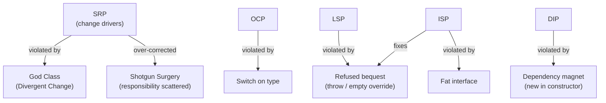

### 6.3 [INTERVIEW] the reporting system drill [SLIDE 39]

**Scenario.** A reporting system for an analytics platform (Mixpanel-like) must:

- Generate reports in **multiple formats** (PDF, CSV, Excel),
- Pull data from **multiple sources** (PostgreSQL, Elasticsearch, Redis cache),
- Deliver through **multiple channels** (email, Slack webhook, S3 upload).

*"Walk me through your class design."*

**What the interviewer is evaluating [SLIDE 39]:** **three independent dimensions of variation** (format × data source × delivery channel) means **three interface hierarchies composed together**. A single `ReportGenerator` class handling all three violates:

- **SRP** — three change drivers (format owners, data team, delivery/ops).
- **OCP** — adding a format requires modifying the class.
- **DIP** — it directly depends on the PostgreSQL driver, Elasticsearch client, and SMTP library.

**Reference design (sketch):**

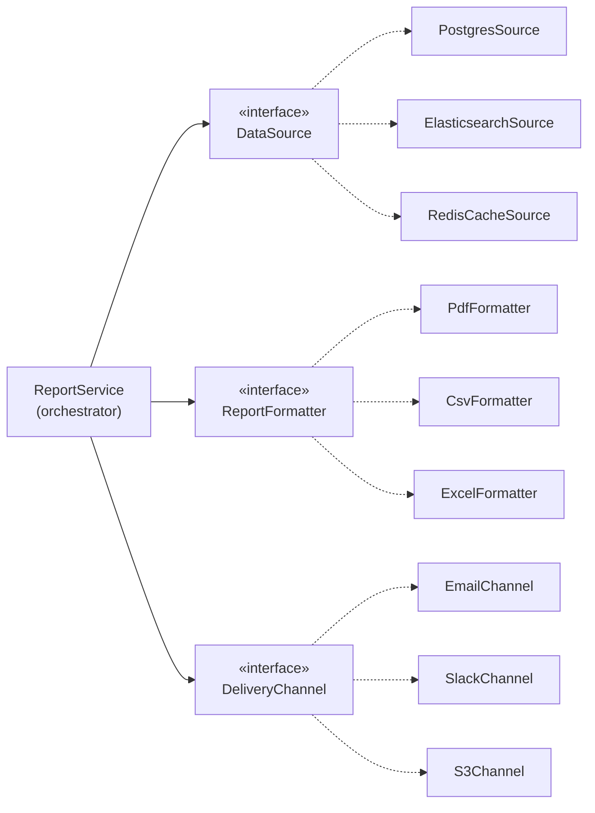

```java
public interface DataSource {
    ReportData fetch(ReportRequest request);
}

public interface ReportFormatter {
    FormattedReport format(ReportData data);
    String fileExtension();
}

public interface DeliveryChannel {
    DeliveryResult deliver(FormattedReport report, Recipient recipient);
}

public class ReportService {                 // orchestrator: one responsibility
    private final DataSource dataSource;      // chosen from registry by request
    private final ReportFormatter formatter;  // chosen from registry by format
    private final DeliveryChannel channel;    // chosen from registry by channel

    public ReportService(DataSource dataSource,
                         ReportFormatter formatter,
                         DeliveryChannel channel) {
        this.dataSource = dataSource;
        this.formatter  = formatter;
        this.channel    = channel;
    }

    public DeliveryResult generateAndDeliver(ReportRequest request, Recipient recipient) {
        ReportData data            = dataSource.fetch(request);
        FormattedReport formatted  = formatter.format(data);
        return channel.deliver(formatted, recipient);
    }
}
```

The three failures become three properties: **SRP** (each axis in its own type), **OCP** (9 combinations arrive as 9 new classes + registration, zero edits to `ReportService`), **DIP** (drivers/clients live behind the interfaces; `ReportService` never imports them). And the follow-up — *"how would you test the orchestration?"* — is answered by §5.3: inject three fakes.

### 6.4 Common SOLID mistakes in LLD interviews [SLIDE 39]

| Mistake | Principle | Stronger approach |
|---|---|---|
| One class handles validation, persistence, and notification | SRP | Separate classes per responsibility, composed by an orchestrator |
| Adding new behavior with if/else branches | OCP | Define interface, write new implementation class |
| Subclass throws `UnsupportedOperationException` | LSP + ISP | Split interface so the subclass only implements what it supports |
| 12-method interface with most implementors leaving half empty | ISP | Split into 3–4 focused interfaces by capability |
| Business logic class creates `new PostgresConnection()` | DIP | Accept a `DatabaseConnection` interface through the constructor |
| *"I used SOLID"* without explaining which principle or why | All | Name the specific principle and the specific problem it solves |

**Naming discipline [SLIDE 39] — read this twice:**

> Do **not** name SOLID principles unprompted unless the interviewer asks about design principles. Apply them **silently** through your design decisions. If the interviewer probes — *"Why did you use an interface here?"* — **then** name the principle. Saying "I am applying OCP here" before anyone asked can sound rehearsed. Saying *"I used an interface so that adding a new export format does not require modifying the existing code"* demonstrates OCP **naturally**.

### 6.5 Applying SOLID under time pressure — a checklist [BEYOND THE COURSE]

When you have 10 minutes to produce a class diagram and the interviewer is watching, run this sweep:

1. **List the change drivers** you heard in the requirements ("pricing rules, payment providers, notification channels..."). Each becomes a knifeline through your design — classes, modules, or interfaces.
2. **For every noun that has variants** ("payment methods", "report formats"), draw an `«interface»` and at least two implementations — even on the whiteboard. That is OCP + Strategy, pre-loaded.
3. **Trace every dependency arrow** out of your business classes. Any arrow to a concrete infrastructure name → convert to an interface + injected implementation. (Arrow audit = DIP.)
4. **Read every interface you drew** and ask *"can the smallest implementor honor all of this?"* If not, split (ISP), because the smallest implementor will otherwise throw (LSP).
5. **Say the trade-off out loud** for at least one decision: *"I used X here instead of Y because the change driver is Z."* SOLID applied with a stated trade-off reads as engineering judgment; SOLID recited reads as a memorized mnemonic.

---

## 7. Section Summary [SLIDE 40]

### 7.1 Concepts covered

| Principle | One-line summary |
|---|---|
| **SRP** | A class should have only one reason to change (one change driver) |
| **OCP** | Add new behavior by writing new classes, not modifying existing ones |
| **LSP** | Subtypes must honor the behavioral contract of the parent type |
| **ISP** | No class should be forced to implement methods it does not use |
| **DIP** | Business logic depends on interfaces, not concrete implementations |
| **SRP + microservices** | Class-level SRP maps to service-level decomposition |
| **OCP ↔ Strategy** | "Multiple types of X" maps to interface + implementations |
| **LSP → ISP** | Exception-throwing overrides signal both violations simultaneously |
| **DIP → testability** | Interface dependencies enable mock-based unit testing |

### 7.2 How SOLID connects to the rest of the course [SLIDE 40]

| Next section | Connection |
|---|---|
| **Section 2 — OOP (file 01)** | SOLID *builds directly* on OOP: SRP refines encapsulation; OCP formalizes polymorphism; LSP constrains inheritance; ISP refines abstraction; DIP enforces composition over concrete dependencies |
| **Section 4 — Creational patterns (file 03)** | Factory Method is *OCP applied to object creation*; Builder isolates construction from representation (*SRP for construction*) |
| **Section 5 — Structural patterns (file 04)** | Adapter enables DIP by wrapping incompatible interfaces; Decorator enables OCP by adding behavior without modification; Facade applies SRP to subsystem access |
| **Section 6 — Behavioral patterns (file 05)** | Strategy is the direct implementation of OCP; Observer decouples event producers from consumers (DIP); Chain of Responsibility applies SRP to request processing |
| **Section 7 — Pattern selection (file 06)** | The SOLID violation-detection tests become the **signal-to-pattern mapping**: "switch on type" → Strategy (OCP); "fat interface" → ISP refactoring; "`new` in constructor" → Factory + DIP |

**The signal-to-pattern table [SLIDE 40], promoted for memorization:**

| Smell / signal | Pattern that addresses it |
|---|---|
| Switch on type | **Strategy** (or State, if the object's behavior changes with its own lifecycle state) |
| Fat interface | **ISP refactor** into role interfaces |
| `new` in constructor; type chosen at runtime | **Factory Method / Abstract Factory** + DIP |
| Subclass throws for inherited methods | **Composition**; split interfaces (ISP/LSP) |
| "Multiple types of X" | **Strategy** for behavior, **Factory** for creation |
| One class touching DB + email + formatting | **SRP split**; **Facade** for the use-case boundary |

### 7.3 The mental model in one paragraph

> **SRP** draws the *vertical* boundaries (which code answers to which stakeholder). **LSP** guards the *vertical substitutions* (can a child stand in for its parent). **OCP** keeps the boundaries *porous in the right direction* (new code flows in; old code stays still). **ISP** keeps the *connection points* honest (interfaces only promise what every implementor delivers). **DIP** keeps the *dependency direction* sane (things that change often — infrastructure — depend on things that change rarely — business abstractions). Put together: make change cheap, local, and safe.

---

## 8. Interview Drill Pack

Ten drills, ordered from warm-up to full simulation. Do them away from the screen — say the answers out loud, 60–90 seconds each.

**D1. Vocabulary check.** Distinguish: change driver, precondition, postcondition, invariant, refuse bequest, dependency magnet. *(Answers: §1.1, §3.1, §3.1, §6.2, §6.2, §6.2.)*

**D2. Rapid-fire smell classification.** For each, name the violated principle: (a) `if (orderType.equals("RUSH")) ... else if ...`; (b) a 14-method `UserOperations` interface that notification services leave 9 methods empty on; (c) `new StripeClient()` inside `CheckoutService`; (d) `PremiumReport extends Report` where `render()` throws "premium only" when a flag is false; (e) one class edited for both tax-rule and PDF-layout changes. *(a: OCP; b: ISP (+LSP); c: DIP; d: LSP; e: SRP.)*

**D3. Refactor on demand.** Here is a 30-line `OrderManager` with `validate()`, `chargeCard()`, `sendEmail()`, `logAudit()`. Explain the SRP split in 90 seconds: name each new class, its single change driver, and how the orchestrator composes them. *(Model: §2.7 strong answer.)*

**D4. The OCP probe.** *"We need to support two more payment methods by next sprint."* Answer in a way that demonstrates OCP without saying OCP. *(Model: "Each method becomes a new `PaymentProcessor` implementation; the checkout flow depends on the interface, so adding PayPal is a new class plus a registration entry. Nothing in the checkout logic changes.")*

**D5. The LSP trap.** *"Our `AdminUser extends User` — `AdminUser.deleteAccount()` works, but `User.deleteAccount()` throws when the user is a guest. Fine?"* No — substitution of a `GuestUser` where `User` is expected breaks callers. Fix via capability interfaces (`DeletableAccount`) or a state that the API can query (`canDelete()`), not exceptions. Note: `canDelete()` alone is a band-aid if callers forget it — the *type-level* fix is preferred; mention both, recommend the type-level one.

**D6. ISP split.** Draw `IStorage` with `upload/download/delete/list/share/setQuota`. Split it into role interfaces and show two implementations that become honest. *(Roles: `ReadableStorage`, `WritableStorage`, `ShareableStorage`, `QuotaManaged` — exact names secondary; the reasoning is what matters.)*

**D7. DIP archaeology.** Given the constructor `new OrderService(new StripeClient(key), new PostgresRepo(url))`, list every test you currently cannot write, then rewrite the constructor under DIP and list what each fake looks like. *(Model: §5.3.)*

**D8. Design a use case with all five.** Design checkout for a food-delivery app (order validation, pricing with promos, payment, dispatch, notifications). In 3 minutes: list change drivers (SRP), mark the "multiple types of X" axes (promos, payments, couriers) as interfaces (OCP), inject them (DIP), keep each interface role-focused (ISP), and state one contract you must not break in any subtype (LSP).

**D9. The trade-off question.** *"Aren't you over-engineering by drawing interfaces for everything?"* Model answer: "I draw interfaces where *variation is expected* — the requirements name multiple payment providers and formats, so those axes get interfaces. For things with one implementation and no expected variation (the `Money` type), I use concrete classes; abstraction there would add indirection with no benefit. The test I use is: does this dependency have a plausible second implementation or a reason to be faked in tests?"

**D10. Full simulation.** 45 minutes, whiteboard: parking lot (from file 09's case studies) but *explicitly* narrate: the change drivers you identify, the extension points you create, the contract each hierarchy implies, and the dependency arrows you draw. Record yourself; then check each SOLID principle off: did you *show* all five?

**Flashcard recap (last-minute review):**

| | SRP | OCP | LSP | ISP | DIP |
|---|---|---|---|---|---|
| **Soundbite** | One reason to change | Open to extend, closed to edit | Subtypes must keep promises | Many small roles, not one big blob | Depend on abstractions, not concretes |
| **Smell** | God class; divergent change | Switch on type | Throw / empty override | Fat interface | `new` in constructor |
| **Fix** | Split by change driver | New class implements interface | Composition / split hierarchy | Split by capability | Inject interface; compose at root |
| **Pays off as** | Contained blast radius | Zero-risk extensions | No 3 AM surprises | Honest contracts | Testability + swappable infra |

---

*Next: `03_CREATIONAL_PATTERNS.md` — Factory Method, Abstract Factory, Builder, Singleton, and how the sections build on the SRP/OCP/DIP muscles from this file (Factory Method is OCP for `new`; Builder is SRP for construction).*
