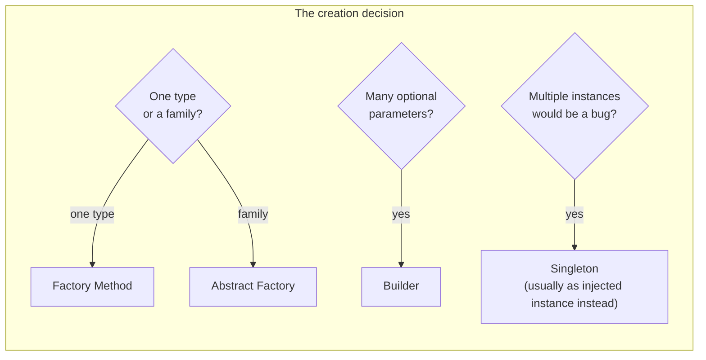
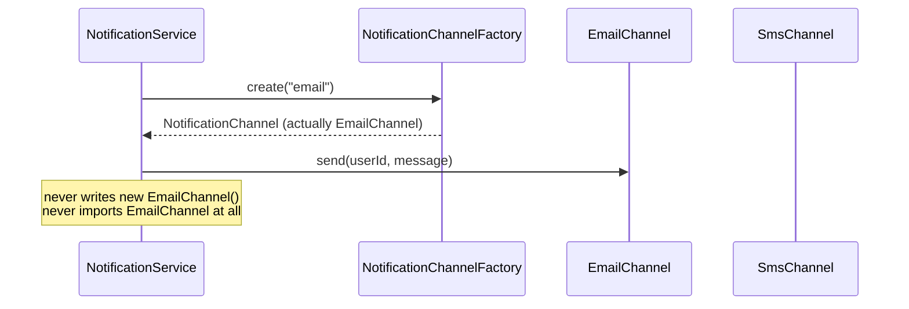
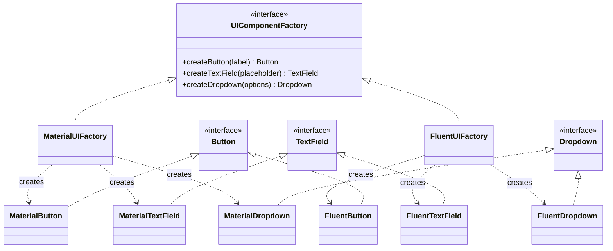
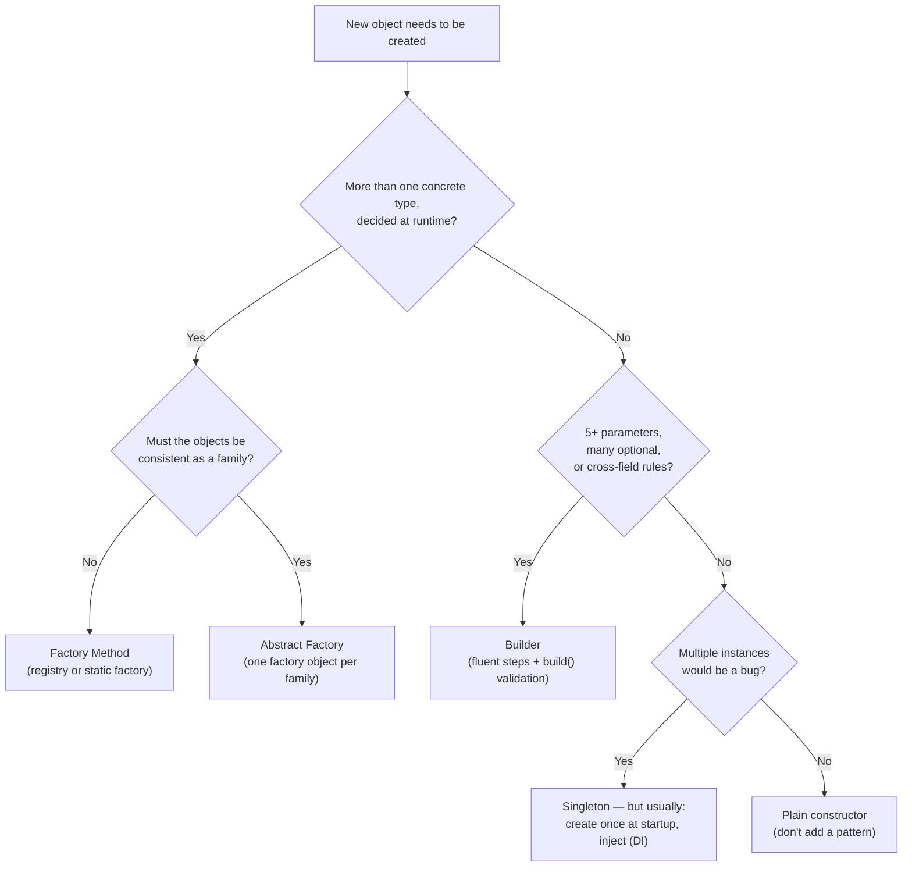

# 03 — Creational Design Patterns

> **Source:** Course Section 4 (SLIDE 41 – SLIDE 53). Structure and interview guidance follow the slides; all code is expanded to runnable **C++, C, and Java** versions. Markers: **[SLIDE n]** = from the slides, **[BEYOND THE COURSE]** = added here, **[INTERVIEW]** = how this is tested.

---

## 0. What This Section Is About

Creational patterns answer one question: **how and where do objects get created?** [SLIDE 41]

In a small codebase, `new SomeClass()` sprinkled everywhere is fine. In a larger system, scattered object creation causes:

- **Tight coupling** — every class that runs `new EmailClient("smtp...", 587)` is welded to `EmailClient` and its configuration.
- **Duplicated configuration** — SMTP hosts, API keys, Firebase tokens repeated across files.
- **Untestable classes** — a class that constructs its own dependencies cannot be given a fake.

Creational patterns centralize and control creation so the rest of the code depends on **abstractions rather than concrete classes**. This is the **Dependency Inversion Principle from file 02 applied specifically to construction** [SLIDE 41]. The connection to make explicitly in your head:

| File 02 principle | Creational pattern that implements it |
|---|---|
| OCP — extend without modifying | **Factory Method**: new type = new class + one registration |
| SRP — one reason to change | **Builder**: construction separated from representation |
| DIP — depend on abstractions | **DI over Singleton**: one instance, injected everywhere |
| LSP/ISP — honest contracts | **Factory returns interfaces**: callers can trust every implementor |

### 0.1 Where creational patterns appear in LLD interviews [SLIDE 41]

| Interview signal | Pattern | Why |
|---|---|---|
| "Support multiple types of X" | **Factory Method** | Decouple creation from the calling code |
| "These objects must be created together consistently" | **Abstract Factory** | Ensure compatible object families |
| "This object has 8+ constructor parameters" | **Builder** | Avoid telescoping constructors |
| "We need exactly one instance of X" | **Singleton** (cautiously) | Controlled shared state — but prefer DI |
| "How would you add a new type without changing existing code?" | **Factory Method** | OCP applied to object creation |

### 0.2 The four patterns at a glance [BEYOND THE COURSE]

| Pattern | Question it answers | One-line mechanism |
|---|---|---|
| **Factory Method** | *Which* concrete class do I instantiate? | A creation function/method returns an interface; decision made in one place |
| **Abstract Factory** | Which *family* of classes must come together? | One factory object creates a consistent set of related products |
| **Builder** | How do I assemble a complex object safely? | Step-by-step construction with defaults + validation, then `build()` |
| **Singleton** | How do I guarantee exactly one instance? | Control construction and hand out one shared instance (with caveats) |



---

## 1. Factory Method — Decoupling Object Creation from Usage

### 1.1 The problem: creation scattered across the codebase [SLIDE 42]

> The Factory Method pattern moves object creation out of the calling code and into a dedicated method or class. The calling code requests an object through the factory and receives it through an interface, without knowing which concrete class was instantiated.

**Why this matters [SLIDE 42]:** when creation logic is scattered, **every class that creates objects is coupled to the concrete implementations**. If you have 15 classes that each call `new EmailNotification()`, switching to push notifications requires editing 15 files. A factory centralizes the decision into one place.

**The core idea [SLIDE 42]:**



> **[INTERVIEW]** Factory Method is **the most commonly tested creational pattern**. Interviewers use it to evaluate whether you understand **OCP applied to object creation**: adding a new type means updating the factory, not every class that uses the type.

### 1.2 Wrong approach: the switch statement in calling code [SLIDE 43]

Creation logic living directly in the caller:

```java
// SLIDE 43 — What NOT to write.
public class NotificationService {
    public void sendNotification(String userId, String message, String channelType) {
        if (channelType.equals("email")) {
            EmailClient emailClient = new EmailClient("smtp.provider.com", 587);
            String address = UserDirectory.lookupEmail(userId);
            emailClient.send(address, "Notification", message);

        } else if (channelType.equals("sms")) {
            SmsGateway smsGateway = new SmsGateway("api-key-123");
            String phoneNumber = UserDirectory.lookupPhone(userId);
            smsGateway.sendText(phoneNumber, message);

        } else if (channelType.equals("push")) {
            PushService pushService = new PushService("firebase-key");
            String deviceToken = DeviceRegistry.lookupToken(userId);
            pushService.sendPush(deviceToken, message);
        }
    }
}
```

**What is wrong [SLIDE 43]** — this code violates **three SOLID principles simultaneously**:

| Problem | Violated principle |
|---|---|
| Adding WhatsApp requires editing this class | **OCP** — not closed for modification |
| `NotificationService` knows SMTP ports, API keys, Firebase config | **SRP** — business logic mixed with infrastructure details |
| Cannot test notification logic without real email/SMS/push services | **DIP** — depends on concrete implementations |
| Every class that sends notifications duplicates this switch logic | **Shotgun surgery** — one change ripples across many files |
| Channel-specific setup (API keys, addresses) is hardcoded | Configuration scattered, not centralized |

> **[INTERVIEW]** Interviewers often present exactly this code and ask *"what would you improve?"* A strong response **names the multiple SOLID violations and proposes a factory** — diagnosis + treatment in one move.

### 1.3 Right approach: Factory Method implementation [SLIDE 43B]

**The interface:**

```java
public interface NotificationChannel {
    void send(String userId, String message);
}
```

**Concrete implementations** (each owns exactly one delivery mechanism — note they still hold *their own* client, injected):

```java
public class EmailChannel implements NotificationChannel {
    private final EmailClient emailClient;

    public EmailChannel(EmailClient emailClient) {
        this.emailClient = emailClient;
    }

    @Override
    public void send(String userId, String message) {
        String address = UserDirectory.lookupEmail(userId);
        emailClient.send(address, "Notification", message);
    }
}

public class SmsChannel implements NotificationChannel {
    private final SmsGateway smsGateway;

    public SmsChannel(SmsGateway smsGateway) {
        this.smsGateway = smsGateway;
    }

    @Override
    public void send(String userId, String message) {
        String phoneNumber = UserDirectory.lookupPhone(userId);
        smsGateway.sendText(phoneNumber, message);
    }
}
```

**The factory** — a registry map from type name to ready channel:

```java
public class NotificationChannelFactory {
    private final Map<String, NotificationChannel> channels;

    public NotificationChannelFactory(Map<String, NotificationChannel> channels) {
        this.channels = channels;
    }

    public NotificationChannel create(String channelType) {
        NotificationChannel channel = channels.get(channelType);
        if (channel == null) {
            throw new UnsupportedChannelException("Unknown channel: " + channelType);
        }
        return channel;
    }
}
```

**The calling code** — business logic, three lines, zero infrastructure knowledge:

```java
public class NotificationService {
    private final NotificationChannelFactory channelFactory;

    public NotificationService(NotificationChannelFactory channelFactory) {
        this.channelFactory = channelFactory;
    }

    public void sendNotification(String userId, String message, String channelType) {
        NotificationChannel channel = channelFactory.create(channelType);
        channel.send(userId, message);
    }
}
```

`NotificationService` **knows nothing about email servers, SMS gateways, or push services**. Adding WhatsApp means writing a `WhatsAppChannel` class and registering it in the factory's map. **Zero changes to `NotificationService`** [SLIDE 43B].

Three implementation variants worth knowing [BEYOND THE COURSE]:

| Variant | Mechanism | When |
|---|---|---|
| **Registry map (slide version)** | Pre-built instances in a `Map<String, Channel>` | Channels are stateless/wired once; fastest |
| **Creator map** | `Map<String, Supplier<Channel>>` — constructs on demand | Objects are cheap and should be per-request |
| **Subclassed factory (classic GoF)** | Abstract factory class with a `createChannel()` method overridden by subclasses | The factory itself varies per environment |

> **[INTERVIEW tip from SLIDE 43B]** The factory does **not need to be a separate class**. A static factory method on the interface (`NotificationChannel.create("email", config)`) works for simple cases. What the interviewer evaluates is whether **creation logic is centralized** and the **calling code is decoupled from concrete types**.

### 1.4 The same factory in C++ (BEYOND THE COURSE)

```cpp
#include <functional>
#include <memory>
#include <stdexcept>
#include <string>
#include <unordered_map>

class NotificationChannel {
public:
    virtual ~NotificationChannel() = default;
    virtual void send(const std::string& userId, const std::string& message) = 0;
};

class EmailChannel final : public NotificationChannel {
public:
    explicit EmailChannel(EmailClient client) : client_(std::move(client)) {}

    void send(const std::string& userId, const std::string& message) override {
        std::string address = UserDirectory::lookupEmail(userId);
        client_.send(address, "Notification", message);
    }
private:
    EmailClient client_;
};

class SmsChannel final : public NotificationChannel {
public:
    explicit SmsChannel(SmsGateway gateway) : gateway_(std::move(gateway)) {}

    void send(const std::string& userId, const std::string& message) override {
        std::string phone = UserDirectory::lookupPhone(userId);
        gateway_.sendText(phone, message);
    }
private:
    SmsGateway gateway_;
};

// Registry of creators: construction happens on demand, one place knows the types.
class NotificationChannelFactory {
public:
    using Creator = std::function<std::unique_ptr<NotificationChannel>()>;

    void registerChannel(const std::string& type, Creator creator) {
        creators_[type] = std::move(creator);
    }

    std::unique_ptr<NotificationChannel> create(const std::string& type) const {
        auto it = creators_.find(type);
        if (it == creators_.end()) {
            throw std::invalid_argument("Unknown channel: " + type);
        }
        return it->second();               // <- the only creation call site
    }
private:
    std::unordered_map<std::string, Creator> creators_;
};

// Wiring at the composition root:
NotificationChannelFactory makeFactory(const AppConfig& config) {
    NotificationChannelFactory factory;
    factory.registerChannel("email", [&config] {
        return std::make_unique<EmailChannel>(
            EmailClient{config.smtpHost, config.smtpPort});
    });
    factory.registerChannel("sms", [&config] {
        return std::make_unique<SmsChannel>(SmsGateway{config.smsApiKey});
    });
    return factory;
}
```

C++ notes for the interview:

- **`std::unique_ptr<NotificationChannel>` is the return type** — ownership explicit, no slicing, no leaks.
- The `Creator` lambda captures config **at wiring time**, so channel classes never see `AppConfig`.
- `create()` is the *single* `make_unique<...Channel>` decision — the C++ echo of "creation centralized."

### 1.5 The same factory in C — ops + registry (BEYOND THE COURSE)

```c
/* notification_channel.h — the interface: one ops table per capability. */
typedef struct notification_channel_ops {
    void (*send)(void *self, const char *user_id, const char *message);
    void (*destroy)(void *self);
} notification_channel_ops_t;

typedef struct notification_channel {
    const notification_channel_ops_t *ops;
    void *impl;                        /* channel-private state */
} notification_channel_t;

/* notification_factory.c — the single place that knows every channel type. */
typedef notification_channel_t *(*channel_creator_fn)(const app_config_t *cfg, status_t *err);

typedef struct {
    const char *type;
    channel_creator_fn create;
} channel_registration_t;

static const channel_registration_t CHANNEL_REGISTRY[] = {
    { "email", email_channel_create },
    { "sms",   sms_channel_create },
    { "push",  push_channel_create },
    /* Extension point: add a row, add a file. Nothing else changes. */
};

notification_channel_t *notification_channel_create(const char *type,
                                                    const app_config_t *cfg,
                                                    status_t *err)
{
    for (size_t i = 0; i < sizeof(CHANNEL_REGISTRY) / sizeof(CHANNEL_REGISTRY[0]); i++) {
        if (strcmp(CHANNEL_REGISTRY[i].type, type) == 0) {
            return CHANNEL_REGISTRY[i].create(cfg, err);
        }
    }
    *err = STATUS_UNKNOWN_CHANNEL;
    return NULL;
}
```

And the calling code stays tiny:

```c
status_t notification_service_send(notification_service_t *svc,
                                   const char *user_id,
                                   const char *message,
                                   const char *channel_type)
{
    status_t err = STATUS_OK;
    notification_channel_t *channel =
        notification_channel_create(channel_type, svc->config, &err);
    if (channel == NULL) {
        return err;
    }
    channel->ops->send(channel->impl, user_id, message);
    channel->ops->destroy(channel->impl);
    return STATUS_OK;
}
```

This is the kernel's device registration model in miniature (`platform_driver_register`, `register_filesystem`): **a static table of name → constructor, iterated by a generic dispatcher.**

### 1.6 Worked example: wiring the notification system [SLIDE 44]

How the factory-based system is assembled at application startup for a Slack-like platform [SLIDE 44]:

```java
public class NotificationModule {
    public static NotificationService create(AppConfig config) {
        Map<String, NotificationChannel> channels = new HashMap<>();

        channels.put("email", new EmailChannel(
                new EmailClient(config.getSmtpHost(), config.getSmtpPort())));
        channels.put("sms", new SmsChannel(
                new SmsGateway(config.getSmsApiKey())));
        channels.put("push", new PushChannel(
                new PushService(config.getFirebaseKey())));

        NotificationChannelFactory factory = new NotificationChannelFactory(channels);
        return new NotificationService(factory);
    }
}
```

**Adding a new channel (WhatsApp) [SLIDE 44] — exactly two changes:**

**Step 1** — write the new implementation:

```java
public class WhatsAppChannel implements NotificationChannel {
    private final WhatsAppClient whatsAppClient;

    public WhatsAppChannel(WhatsAppClient whatsAppClient) {
        this.whatsAppClient = whatsAppClient;
    }

    @Override
    public void send(String userId, String message) {
        String phoneNumber = UserDirectory.lookupPhone(userId);
        whatsAppClient.sendMessage(phoneNumber, message);
    }
}
```

**Step 2** — register it in the configuration module:

```java
channels.put("whatsapp", new WhatsAppChannel(
        new WhatsAppClient(config.getWhatsAppApiKey())));
```

**Total: one new class, one new configuration line.** `NotificationService`, `NotificationChannelFactory`, and all existing channels are untouched.

> **[INTERVIEW]** Walk through the "add a new type" scenario **step by step** and **count the files changed** out loud: *"One new file, one line in the configuration module — nothing else."* This is the cleanest possible demonstration of OCP compliance in a creational question.

### 1.7 When NOT to use Factory Method [BEYOND THE COURSE, from SLIDE 52's mistake table]

| Situation | Don't use a factory | Why |
|---|---|---|
| There is only one type and no expected variation | Direct constructor call | Indirection with zero extensibility benefit |
| The caller genuinely needs type-specific behavior | Direct construction of the concrete type | A factory that hides the type forces `instanceof`/casts later |
| Creation is trivial (`new Money(1.0)`) | Constructor | Factories are for *decisions*, not for ceremony |

**The reflex to build instead:** when you hear *"multiple types decided at configuration/run time"* → factory. When every object in the domain is the same concrete class → plain `new`.

### 1.8 Factory Method drills

**Drill 1 — count the changes.** *"We want to add USPS as a carrier in a shipping system where creation currently lives in `ShippingService`'s if/else."* Answer with: how many files change *today* (problem), and how many would change *after the factory refactor* (new class + one registration = 2). Say both numbers explicitly.

**Drill 2 — name the exact violations.** For the SLIDE 43 switch code, name: OCP (edit per type), SRP (infra knowledge in business class), DIP (depends on concretes), and shotgun surgery (duplicated creation elsewhere). Four for four is a senior-grade answer.

**Drill 3 — factory vs constructor injection tension.** *"If the factory itself is created at startup and injected, aren't we just moving `new` around?"* Answer: yes — deliberately. All `new` for a given axis of variation now happens at **one composition point**; every other class receives interfaces. That is exactly what DIP asks for: *construction is a startup concern, behavior is a runtime concern.*

---

## 2. Abstract Factory — Families of Related Objects

### 2.1 The definition and the family signal [SLIDE 45]

> The Abstract Factory pattern creates **families of related objects that must be used together**. While Factory Method creates one type of object, Abstract Factory creates a set of objects **designed to work as a group**.

**When you need it [SLIDE 45]:** consider a UI component library that supports multiple themes. Each theme defines its own versions of buttons, text fields, and dropdowns:

- A **Material** theme produces Material-styled components.
- A **Fluent** theme produces Fluent-styled components.

**Mixing a Material button with a Fluent dropdown looks broken.** The components within a theme must be created *together consistently* — and "consistently" is exactly the guarantee a single factory object can make and three independent factories cannot.

**The structure [SLIDE 45]:**

```java
public interface UIComponentFactory {
    Button createButton(String label);
    TextField createTextField(String placeholder);
    Dropdown createDropdown(List<String> options);
}

public class MaterialUIFactory implements UIComponentFactory {
    @Override public Button createButton(String label) {
        return new MaterialButton(label);
    }
    @Override public TextField createTextField(String placeholder) {
        return new MaterialTextField(placeholder);
    }
    @Override public Dropdown createDropdown(List<String> options) {
        return new MaterialDropdown(options);
    }
}

public class FluentUIFactory implements UIComponentFactory {
    @Override public Button createButton(String label) {
        return new FluentButton(label);
    }
    @Override public TextField createTextField(String placeholder) {
        return new FluentTextField(placeholder);
    }
    @Override public Dropdown createDropdown(List<String> options) {
        return new FluentDropdown(options);
    }
}
```

**The calling code [SLIDE 45]:**

```java
public class FormRenderer {
    private final UIComponentFactory componentFactory;

    public FormRenderer(UIComponentFactory componentFactory) {
        this.componentFactory = componentFactory;
    }

    public Form renderLoginForm() {
        Button submitButton     = componentFactory.createButton("Sign In");
        TextField emailField    = componentFactory.createTextField("Enter email");
        TextField passwordField = componentFactory.createTextField("Enter password");
        return new Form(emailField, passwordField, submitButton);
    }
}
```

`FormRenderer` **does not know which theme is active**. It creates components through the factory, and the factory guarantees all components belong to the same theme. Switching Material → Fluent means **injecting a different factory. Zero changes to `FormRenderer`** [SLIDE 45].



> **[INTERVIEW]** Abstract Factory is **less commonly tested than Factory Method**, but it appears in any question involving **themes, platform-specific rendering, or environment-specific configuration** (dev vs staging vs production). The moment you hear *"each variant of X has its own variant of Y and Z, and they must match"* — reach for Abstract Factory.

### 2.2 Factory Method vs Abstract Factory [SLIDE 45B]

| Dimension | Factory Method | Abstract Factory |
|---|---|---|
| Creates | One type of object | A **family** of related objects |
| Interface | One creation method | **Multiple** creation methods |
| Solves | "Which concrete class to instantiate" | "Which family of classes to use **together**" |
| Example | `createNotificationChannel("email")` | `createButton()`, `createTextField()`, `createDropdown()` **as a set** |
| Guarantee | Correct single object | All objects are from the **same family** |
| Complexity | Lower | Higher |
| Reach for it when | Multiple types determined at runtime | Objects must be created as a **consistent group** and mixing groups would be incorrect |

**When to use Abstract Factory [SLIDE 45B]:** use it when objects must be created as a consistent group and mixing objects from different groups would be *incorrect*. If each object can be created independently without consistency concerns → use individual Factory Methods.

> **[INTERVIEW]** Do **not** reach for Abstract Factory unless you see the **"family of related objects"** signal. Using Abstract Factory for a single object type is over-engineering, and interviewers will flag it. Ask yourself: *"Do these objects need to be consistent with each other?"* If no → Factory Method is sufficient. The key interview question is *"why Abstract Factory instead of Factory Method?"* — and the answer is **always** about consistency across a family.

### 2.3 The same family guarantee in C++ and C (BEYOND THE COURSE)

**C++** — the factory is an abstract class; each theme is one concrete factory producing its whole family:

```cpp
class Button    { public: virtual ~Button() = default; virtual void render() = 0; };
class TextField { public: virtual ~TextField() = default; virtual void render() = 0; };

class UIComponentFactory {
public:
    virtual ~UIComponentFactory() = default;
    virtual std::unique_ptr<Button>    createButton(const std::string& label) = 0;
    virtual std::unique_ptr<TextField> createTextField(const std::string& placeholder) = 0;
};

class MaterialUIFactory final : public UIComponentFactory {
public:
    std::unique_ptr<Button> createButton(const std::string& label) override {
        return std::make_unique<MaterialButton>(label);
    }
    std::unique_ptr<TextField> createTextField(const std::string& placeholder) override {
        return std::make_unique<MaterialTextField>(placeholder);
    }
};
```

Selection happens once, at the top:

```cpp
std::unique_ptr<UIComponentFactory> chooseFactory(const Theme& theme) {
    if (theme.name() == "material") return std::make_unique<MaterialUIFactory>();
    return std::make_unique<FluentUIFactory>();
}
```

**C** — the family is a struct of ops tables (or of creator functions):

```c
typedef struct button     { const button_ops_t *ops; void *impl; } button_t;
typedef struct text_field { const text_field_ops_t *ops; void *impl; } text_field_t;

/* One ops table per family; the struct itself is the "abstract factory". */
typedef struct ui_factory_ops {
    button_t     *(*create_button)(const char *label);
    text_field_t *(*create_text_field)(const char *placeholder);
} ui_factory_ops_t;

typedef struct ui_factory {
    const ui_factory_ops_t *ops;
    void *impl;
} ui_factory_t;
```

The *whole family* arrives via one pointer — the caller literally cannot mix themes because it holds exactly one `ui_factory_t`.

### 2.4 [INTERVIEW] practice: Factory Method vs Abstract Factory [SLIDE 45C]

**Scenario.** A document generation system (DocuSign-like) creates documents in **multiple formats** (PDF, Word, HTML). Each format requires a **header renderer, body renderer, and footer renderer** specific to that format. *"How would you structure the creation of these renderers?"*

**Weak answer [SLIDE 45C]:**
> "I would use a Factory Method that takes a format string and returns a renderer."

Misses the core problem: there are **three renderers per format**, and they must be **consistent**. A single Factory Method returns one object, not a coordinated set. Three *independent* Factory Methods risk mixing a PDF header renderer with an HTML body renderer.

**Strong answer [SLIDE 45C]:**
> "Since each format requires a **consistent family of renderers** (header, body, footer), I would use **Abstract Factory**. A `DocumentRendererFactory` interface defines `createHeaderRenderer()`, `createBodyRenderer()`, and `createFooterRenderer()`. `PdfRendererFactory` creates all three PDF variants; `HtmlRendererFactory` creates all three HTML variants.
>
> The document generation service depends on `DocumentRendererFactory`. Switching formats means injecting a different factory. **The service never mixes renderers from different formats because the factory guarantees consistency.**"

The strong answer: (a) identifies the **family signal**, (b) names the correct pattern, (c) explains **why Factory Method alone is insufficient**.

**Your 45-second follow-up drill:** *"Where does the concrete factory get chosen?"* → At the composition root / request entry point, once, based on the requested format — after that everything downstream sees only `DocumentRendererFactory` + the three renderer interfaces. Never inside the rendering service.

### 2.5 Abstract Factory drills

**Drill 1 — family or not?** Classify each as Factory Method or Abstract Factory: (a) payment providers (Stripe/PayPal), each producing a `PaymentProcessor`; (b) a cloud deployment where a provider produces a matching `Compute`, `Storage`, `Network`; (c) notification channels. *(a: FM; b: AF — consistency between compute/storage/network is required [think: can't pair AWS compute with GCP IAM]; c: FM — channels are independent.)*

**Drill 2 — the mixing catastrophe.** Explain *concretely* what breaks if you mix families: an iOS `Button` with an Android `AlertDialog`, or a PDF header with an HTML footer in the same rendered document. Interviewers love the concrete break.

**Drill 3 — the count.** *"Does Abstract Factory violate OCP when we add a new product type (e.g., `createTooltip()`)?"* Honest answer: **yes, partially** — adding a *product* to the family forces every factory implementation to change. Adding a new *family* (new theme) is pure extension. Say this trade-off out loud; it shows you understand the pattern's actual cost, not its marketing.

---

## 3. Builder — Constructing Complex Objects Step by Step

### 3.1 The pattern [SLIDE 46]

> The Builder pattern **separates the construction of a complex object from its representation**, allowing the same construction process to create different configurations.

Builder is the right pattern when an object has **many parameters, most of which are optional**, and the valid combinations are too numerous for constructor overloading [SLIDE 46].

**When Builder is appropriate:** the object has **4–5+ constructor parameters, many optional**, the order of parameter specification does not matter, and you want self-documenting construction. The classic examples: any **configuration object, query object, or request object** with a mix of required and optional fields [SLIDE 46].

**The pattern — the `SearchQuery` example [SLIDE 46]:**

```java
public class SearchQuery {
    private final String searchTerm;        // required
    private final int maxResults;           // default 20
    private final SortOrder sortOrder;      // default RELEVANCE
    private final List<String> filters;     // default empty
    private final LocalDate fromDate;       // optional
    private final LocalDate toDate;         // optional
    private final boolean includeArchived;  // default false

    private SearchQuery(Builder builder) {              // private: only the Builder constructs
        this.searchTerm      = builder.searchTerm;
        this.maxResults      = builder.maxResults;
        this.sortOrder       = builder.sortOrder;
        this.filters         = List.copyOf(builder.filters);
        this.fromDate        = builder.fromDate;
        this.toDate          = builder.toDate;
        this.includeArchived = builder.includeArchived;
    }

    public static class Builder {
        private final String searchTerm;                // required field: final, set once

        private int maxResults = 20;                    // optional fields: defaults
        private SortOrder sortOrder = SortOrder.RELEVANCE;
        private List<String> filters = new ArrayList<>();
        private LocalDate fromDate = null;
        private LocalDate toDate = null;
        private boolean includeArchived = false;

        public Builder(String searchTerm) {             // required params in constructor
            this.searchTerm = searchTerm;
        }

        public Builder maxResults(int maxResults) {
            this.maxResults = maxResults;
            return this;                                // fluent: return this
        }

        public Builder sortOrder(SortOrder sortOrder) {
            this.sortOrder = sortOrder;
            return this;
        }

        public Builder addFilter(String filter) {
            this.filters.add(filter);
            return this;
        }

        public Builder dateRange(LocalDate from, LocalDate to) {
            this.fromDate = from;
            this.toDate = to;
            return this;
        }

        public Builder includeArchived(boolean include) {
            this.includeArchived = include;
            return this;
        }

        public SearchQuery build() {                    // validation point + construction
            if (fromDate != null && toDate != null && toDate.isBefore(fromDate)) {
                throw new IllegalArgumentException("toDate must be after fromDate");
            }
            return new SearchQuery(this);
        }
    }
}
```

**Usage [SLIDE 46]:**

```java
SearchQuery query = new SearchQuery.Builder("system design")
        .maxResults(50)
        .sortOrder(SortOrder.DATE)
        .addFilter("category:engineering")
        .dateRange(LocalDate.of(2025, 1, 1), LocalDate.now())
        .includeArchived(true)
        .build();
```

Each method call is **self-documenting**: the reader knows exactly what each parameter means *without checking parameter positions*. Optional parameters are simply omitted.

**The three structural rules of a well-built Builder [BEYOND THE COURSE]:**

1. **Required parameters go in the Builder constructor.** The type system then makes it impossible to build the object without them — you cannot even start the chain.
2. **Optional parameters are fluent methods with defaults.** Omitted means "use the default", not "pass `null` in position 5".
3. **`build()` is the validation gate.** Cross-field rules (date ranges, "POST needs a body") live there, so **an invalid object can never exist**. This is encapsulation (file 01 §2) applied to construction [SLIDE 47B].

### 3.2 The telescoping constructor anti-pattern [SLIDE 47]

Telescoping constructors are the problem Builder solves: a class supports many combinations of optional parameters by creating **overloaded constructors** that chain to each other:

```java
// SLIDE 47 — The anti-pattern: every optional parameter doubles the constructor count.
public class SearchQuery {
    public SearchQuery(String searchTerm) {
        this(searchTerm, 20);
    }

    public SearchQuery(String searchTerm, int maxResults) {
        this(searchTerm, maxResults, SortOrder.RELEVANCE);
    }

    public SearchQuery(String searchTerm, int maxResults, SortOrder sortOrder) {
        this(searchTerm, maxResults, sortOrder, Collections.emptyList());
    }

    public SearchQuery(String searchTerm, int maxResults, SortOrder sortOrder,
                       List<String> filters) {
        this(searchTerm, maxResults, sortOrder, filters, null, null);
    }

    public SearchQuery(String searchTerm, int maxResults, SortOrder sortOrder,
                       List<String> filters, LocalDate fromDate, LocalDate toDate) {
        this(searchTerm, maxResults, sortOrder, filters, fromDate, toDate, false);
    }

    public SearchQuery(String searchTerm, int maxResults, SortOrder sortOrder,
                       List<String> filters, LocalDate fromDate, LocalDate toDate,
                       boolean includeArchived) {
        this.searchTerm = searchTerm;
        this.maxResults = maxResults;
        this.sortOrder = sortOrder;
        this.filters = filters;
        this.fromDate = fromDate;
        this.toDate = toDate;
        this.includeArchived = includeArchived;
    }
}
```

**Why this is harmful [SLIDE 47]:**

| Problem | Impact |
|---|---|
| **Parameter position confusion** | `new SearchQuery("design", 50, SortOrder.DATE, filters, null, null, true)` requires remembering that `true` is the 7th parameter and means "include archived" |
| **Cannot skip optional parameters** | To set `includeArchived` without `fromDate`, you must pass `null, null` as placeholders |
| **Growth is linear with parameter count** | Every new optional parameter adds a constructor; existing callers may need updating |
| **Code is unreadable at the call site** | `new SearchQuery("x", 20, null, null, null, null, true)` gives no indication what each `null` means |

**The combinatorics [SLIDE 47]:** with 7 parameters, there are **127 possible combinations** of optional values (2⁷ − 1). Telescoping constructors cannot cover that without an explosion of overloads — and even if they could, nobody could read the call sites.

> **[INTERVIEW]** Recognizing the telescoping constructor anti-pattern and proposing Builder demonstrates that you understand **when patterns solve real problems** rather than adding abstraction. The trigger sentence to listen for: *"the constructor takes eight parameters and most callers pass null for half of them."*

### 3.3 Builder with validation: the `UserProfile` example [SLIDE 47B]

Builder can **enforce invariants during construction** — connecting back to encapsulation from Section 2 (file 01 §2):

```java
// SLIDE 47B — Required fields enforced by the constructor; options by chained setters;
// every field validated before the object exists.
public class UserProfile {
    private final String userId;
    private final String displayName;
    private final String email;
    private final String bio;
    private final String avatarUrl;
    private final Locale preferredLanguage;
    private final ZoneId timezone;
    private final boolean emailNotificationsEnabled;
    private final boolean profilePublic;

    private UserProfile(Builder builder) {
        this.userId                    = builder.userId;
        this.displayName               = builder.displayName;
        this.email                     = builder.email;
        this.bio                       = builder.bio;
        this.avatarUrl                 = builder.avatarUrl;
        this.preferredLanguage         = builder.preferredLanguage;
        this.timezone                  = builder.timezone;
        this.emailNotificationsEnabled = builder.emailNotificationsEnabled;
        this.profilePublic             = builder.profilePublic;
    }

    public static class Builder {
        private final String userId;                     // required
        private final String displayName;                // required
        private final String email;                      // required

        private String bio = "";                         // optional, defaulted
        private String avatarUrl = null;
        private Locale preferredLanguage = Locale.ENGLISH;
        private ZoneId timezone = ZoneId.of("UTC");
        private boolean emailNotificationsEnabled = true;
        private boolean profilePublic = true;

        public Builder(String userId, String displayName, String email) {
            if (userId == null || userId.isBlank()) {
                throw new IllegalArgumentException("User ID is required");
            }
            if (email == null || !email.contains("@")) {
                throw new IllegalArgumentException("Valid email is required");
            }
            this.userId = userId;
            this.displayName = displayName;
            this.email = email;
        }

        public Builder bio(String bio) {
            if (bio.length() > 500) {
                throw new IllegalArgumentException("Bio cannot exceed 500 characters");
            }
            this.bio = bio;
            return this;
        }

        public Builder timezone(ZoneId timezone) {
            this.timezone = timezone;
            return this;
        }

        public Builder emailNotifications(boolean enabled) {
            this.emailNotificationsEnabled = enabled;
            return this;
        }

        public Builder profileVisibility(boolean isPublic) {
            this.profilePublic = isPublic;
            return this;
        }

        public UserProfile build() {
            return new UserProfile(this);
        }
    }
}
```

**Usage [SLIDE 47B]:**

```java
UserProfile profile = new UserProfile.Builder("user_42", "Mukul", "mukul@example.com")
        .bio("Software engineer interested in distributed systems")
        .timezone(ZoneId.of("America/Toronto"))
        .emailNotifications(false)
        .build();
```

**The properties this design guarantees [SLIDE 47B]:**

- **Required parameters** (`userId`, `displayName`, `email`) are enforced in the Builder constructor — no way to start building without them.
- **Optional parameters** have sensible defaults — callers set only what differs.
- **Validation happens during construction**, so an **invalid `UserProfile` can never exist** — on any code path, ever.

> **[INTERVIEW tip from SLIDE 47B]** Put required parameters in the **Builder constructor** and optional parameters as **chained methods with defaults**. This shows the interviewer you understand the mandatory-vs-optional distinction *and* that you use the type system (constructor signature) to enforce it. And say the encapsulation sentence out loud once: *"The object cannot be created in an invalid state."*

### 3.4 The same Builder in C++ and C (BEYOND THE COURSE)

**C++** — private constructor + nested `Builder` as the only door in:

```cpp
class SearchQuery {
public:
    class Builder {
    public:
        explicit Builder(std::string term) : searchTerm_(std::move(term)) {}

        Builder& maxResults(int n)              { maxResults_ = n; return *this; }
        Builder& sortOrder(SortOrder order)     { sortOrder_ = order; return *this; }
        Builder& addFilter(std::string f)       { filters_.push_back(std::move(f)); return *this; }
        Builder& dateRange(LocalDate from, LocalDate to) {
            from_ = from; to_ = to; hasRange_ = true; return *this;
        }
        Builder& includeArchived(bool include)  { includeArchived_ = include; return *this; }

        SearchQuery build() const {
            if (hasRange_ && to_ < from_) {
                throw std::invalid_argument("toDate must be after fromDate");
            }
            return SearchQuery(*this);
        }
    private:
        friend class SearchQuery;
        std::string searchTerm_;
        int maxResults_ = 20;
        SortOrder sortOrder_ = SortOrder::Relevance;
        std::vector<std::string> filters_;
        LocalDate from_{}, to_{};
        bool hasRange_ = false;
        bool includeArchived_ = false;
    };

    // read-only accessors...
private:
    explicit SearchQuery(const Builder& b)
        : searchTerm_(b.searchTerm_), maxResults_(b.maxResults_),
          sortOrder_(b.sortOrder_), filters_(b.filters_),
          fromDate_(b.from_), toDate_(b.to_), includeArchived_(b.includeArchived_) {}

    std::string searchTerm_;
    int maxResults_;
    SortOrder sortOrder_;
    std::vector<std::string> filters_;
    LocalDate fromDate_, toDate_;
    bool includeArchived_;
};

// usage
auto query = SearchQuery::Builder("system design")
                 .maxResults(50)
                 .addFilter("category:engineering")
                 .build();
```

C++ details: `Builder&` returns `*this` for chaining; `friend class SearchQuery` closes the constructor; the whole thing is **stack-allocated and zero-overhead** — no reflection, no annotation magic.

**C** — a builder struct is a mutable scratchpad; `build()` validates and copies into an immutable query:

```c
/* search_query.h */
typedef struct {
    const char  *search_term;      /* required           */
    int          max_results;      /* default 20         */
    sort_order_t sort_order;       /* default RELEVANCE  */
    const char **filters;
    size_t       filter_count;
    date_t       from_date, to_date;
    bool         has_range;
    bool         include_archived;
} search_query_builder_t;

void search_query_builder_init(search_query_builder_t *b, const char *term);

/* The query itself: immutable once built. */
typedef struct {
    char         search_term[128];
    int          max_results;
    sort_order_t sort_order;
    /* ... */
} search_query_t;

status_t search_query_build(const search_query_builder_t *b, search_query_t *out);
```

```c
/* search_query.c — the validation gate. */
status_t search_query_build(const search_query_builder_t *b, search_query_t *out)
{
    if (b->has_range && date_before(b->to_date, b->from_date)) {
        return STATUS_INVALID_DATE_RANGE;      /* validation gate */
    }
    if (b->filter_count > MAX_FILTERS) {
        return STATUS_TOO_MANY_FILTERS;
    }
    memset(out, 0, sizeof(*out));              /* start from a clean immutable value */
    strncpy(out->search_term, b->search_term, sizeof(out->search_term) - 1);
    out->max_results = b->max_results > 0 ? b->max_results : 20;
    out->sort_order  = b->sort_order;
    return STATUS_OK;
}
```

The C lesson: **Builder is a protocol, not a language feature** — a mutable staging struct + a validating build function + an immutable result. Every "options struct with an init function" you meet in C libraries (from `pthread_attr_t` to kernel structure initialization) is this same shape.

### 3.5 When Builder is essential vs when it is overkill [SLIDE 48]

Builder adds real boilerplate: an inner class, chained methods, a `build()` method, and a private constructor on the outer class. That cost is justified **only when the object is genuinely complex** [SLIDE 48].

**Builder is essential when [SLIDE 48]:**

- The object has **5+ parameters with many optional combinations**.
- The object has **validation rules that span multiple fields** (e.g., `endDate` must be after `startDate`).
- The object should be **immutable once constructed** (all fields final/`const`, no setters).
- The **same construction process needs to create different representations**.

**Builder is overkill when [SLIDE 48]:**

- The object has **2–3 parameters, all required**.
- There are **no optional fields or variant configurations**.
- A **simple constructor is clear and readable**.

**Decision framework [SLIDE 48]:**

| Parameters | Optional fields | Recommended approach |
|---|---|---|
| 1–3 | None | Simple constructor |
| 3–4 | 1–2 | Constructor overloading (if clear) *or* Builder |
| 5+ | 2+ | **Builder** |
| Any count | Cross-field validation | **Builder** (validate in `build()`) |
| Any count | Object must be immutable | **Builder** (private constructor, final fields) |

**Common mistake [SLIDE 48]:** using Builder for a class with two required fields and no optional fields — 30+ lines of boilerplate for zero benefit. The interviewer will flag this as **over-engineering**.

> **[INTERVIEW]** Knowing **when not to use a pattern** is as important as knowing how to use it. If asked *"would you use Builder here?"* for a simple 2-field class, the correct answer is: *"No — a simple constructor is sufficient; Builder earns its boilerplate when there are 5+ parameters with optional combinations and validation."*

### 3.6 [INTERVIEW] practice: the `HttpRequest` builder [SLIDE 48B]

**Scenario.** An `HttpRequest` for an HTTP client library:

- **Required:** URL, HTTP method.
- **Optional:** headers (zero or more), body, timeout (default 30000 ms), retry count (default 3).

*"How would you design the construction of this object?"*

**Weak answer [SLIDE 48B]** — one all-parameters constructor:

```java
public class HttpRequest {
    private final String url;
    private final String method;
    private final Map<String, String> headers;
    private final String body;
    private final int timeoutMs;
    private final int retryCount;

    public HttpRequest(String url, String method, Map<String, String> headers,
                       String body, int timeoutMs, int retryCount) { /* ... */ }
}
```

Six parameters, four optional. Callers must pass `null` for unused parameters and remember exact positions. `new HttpRequest("https://api.example.com", "GET", null, null, 30000, 3)` is unreadable — which `null` is what? Which number is the timeout?

**Strong answer [SLIDE 48B]:**

```java
HttpRequest request = new HttpRequest.Builder("https://api.example.com", HttpMethod.GET)
        .addHeader("Authorization", "Bearer token123")
        .addHeader("Content-Type", "application/json")
        .body("{\"key\":\"value\"}")
        .timeoutMs(5000)
        .build();
```

- Required (`url`, `method`) in the Builder constructor.
- Optional parameters chained with **clear method names**.
- Retry count **defaults to 3** without being mentioned.
- `build()` can enforce cross-field rules: *a POST must have a body; a GET must not* — a validation the all-args constructor cannot express.

The strong answer is shorter *and* safer: defaults live in one place, each call site reads like prose, and invalid combinations are rejected before the object exists.

### 3.7 Builder drills

**Drill 1 — trigger recognition.** For each, say Builder or plain constructor: (a) `new Point(x, y)`; (b) a `ClusterConfig` with 12 fields, 9 optional, plus "replica count must be odd"; (c) `new Money(amount)`; (d) a `Pizza` with size, crust, 15 toppings; (e) `new IllegalArgumentException("msg")`. *(plain, Builder, plain, Builder [classic!], plain.)*

**Drill 2 — where does validation go?** *"Should `bio()` reject a 600-char bio, or should `build()`?"* Either is defensible; the key is **fail before the object exists**. Argue the trade-off: validating in the setter fails fast at the offending line (better DX); validating in `build()` allows setting fields in any order and checking cross-field rules together. Mature answer: field-level rules in setters (fail fast), cross-field rules in `build()`.

**Drill 3 — immutability handoff.** *"Why does the outer class copy the `filters` list (`List.copyOf`) instead of keeping the Builder's list?"* Because the Builder is mutable and long-lived (the caller holds a reference); without the copy, a caller could do `builder.addFilter(...)` **after** `build()` and mutate the "immutable" query. Defensive copy at the boundary = encapsulation.

---

## 4. Singleton — When Genuinely Appropriate and Why It Is Overused

### 4.1 The definition and the honest use cases [SLIDE 49]

> The Singleton pattern ensures a class has **exactly one instance** and provides a global point of access to it. It is the most controversial pattern: simultaneously simple to implement and easy to misuse.

**When Singleton is genuinely appropriate [SLIDE 49]** — when creating multiple instances would cause **correctness or resource problems**:

| Use case | Why one instance matters |
|---|---|
| **Connection pools** | Multiple pools to the same database waste connections and bypass pool size limits |
| **Configuration registries** | Config loaded once from a file/environment should not be re-parsed by every class |
| **Hardware interface controllers** | A printer spooler or device driver maps to a single physical resource |

**In each case, the "exactly one instance" constraint is a correctness requirement, not a convenience choice** [SLIDE 49].

### 4.2 Why Singleton is overused [SLIDE 49]

Developers reach for Singleton when they want a class to be **easily accessible from anywhere**. That is using Singleton as a **replacement for dependency injection**, which causes three problems [SLIDE 49]:

| Problem | Why it matters |
|---|---|
| **Hidden dependencies** | Classes that call `DatabasePool.getInstance()` have an invisible dependency that does not appear in their constructor |
| **Tight coupling** | Every class that uses the singleton is coupled to the concrete implementation — **violating DIP** |
| **Testing difficulty** | You cannot substitute a mock, because the singleton controls its own lifecycle |
| **Shared mutable state** | Global state touched from multiple threads creates concurrency bugs |

**The rule of thumb [SLIDE 49]:**

> If the reason for using Singleton is **"I need easy access to this object"** → the real solution is **dependency injection**, not Singleton.
> If the reason is **"creating two instances would cause a bug"** → Singleton *may* be appropriate.

> **[INTERVIEW]** Saying *"I would use Singleton for the database connection pool"* is acceptable. Saying *"I would use Singleton for `UserService`"* signals a **misunderstanding of the pattern** — `UserService` doesn't become broken with two instances; you just wanted it findable from anywhere, which is what DI is for.

### 4.3 Thread safety — the naive version and the fixes [SLIDE 49B]

**The naive implementation (not thread-safe) [SLIDE 49B]:**

```java
public class ConnectionPool {
    private static ConnectionPool instance;
    private final List<Connection> pool = new ArrayList<>();

    private ConnectionPool() {
        for (int i = 0; i < 10; i++) {
            pool.add(DataSource.createConnection());
        }
    }

    public static ConnectionPool getInstance() {
        if (instance == null) {              // <-- check
            instance = new ConnectionPool(); // <-- act  (not atomic!)
        }
        return instance;
    }
}
```

**The race [SLIDE 49B]:** if two threads call `getInstance()` simultaneously when `instance` is null, **both pass the null check**, and **two instances are created**. The second assignment overwrites the first — and any thread holding a reference to the first instance now has a **stale, potentially broken object** (e.g., a pool whose connections are never returned to anyone else).

```mermaid
sequenceDiagram
    participant T1 as Thread 1
    participant T2 as Thread 2
    participant F as instance (static)

    T1->>F: reads null
    T2->>F: reads null
    T1->>T1: new ConnectionPool()  (instance A)
    T2->>T2: new ConnectionPool()  (instance B)
    T1->>F: writes A
    T2->>F: writes B — A is LOST
    Note over T1,T2: two pools created; one thread may hold the zombie pool
```

**Thread-safe approaches [SLIDE 49B]:**

| Approach | Code | Trade-off |
|---|---|---|
| **Synchronized method** | `public static synchronized ConnectionPool getInstance()` | Simple, but **every call pays synchronization cost**, even after initialization |
| **Double-checked locking** | check null → synchronize → check null again → create | Correct **only with `volatile`**; complex and error-prone |
| **Eager initialization** | `private static final ConnectionPool INSTANCE = new ConnectionPool();` | Simple and thread-safe (JVM class-init is thread-safe), but the instance is created **even if never used**, and constructor exceptions become hard class-init errors |
| **Enum singleton** | `public enum ConnectionPool { INSTANCE; ... }` | **Recommended (Joshua Bloch)** — handles serialization and reflection attacks |

**The double-checked locking subtlety [BEYOND THE COURSE]:** without `volatile`, another thread can observe a **partially constructed object** (the reference can be assigned before constructor writes are visible — the classic broken DCL). With `volatile`, the fix is correct in Java 5+:

```java
public final class ConnectionPool {
    private static volatile ConnectionPool instance;   // volatile is REQUIRED

    private ConnectionPool() { /* ... */ }

    public static ConnectionPool getInstance() {
        ConnectionPool local = instance;
        if (local == null) {
            synchronized (ConnectionPool.class) {
                local = instance;
                if (local == null) {
                    local = new ConnectionPool();
                    instance = local;
                }
            }
        }
        return local;
    }
}
```

**The enum approach (recommended in Java) [SLIDE 49B]:**

```java
public enum ConnectionPool {
    INSTANCE;

    private final List<Connection> connections = new ArrayList<>();

    ConnectionPool() {                          // enum constructor runs exactly once
        for (int i = 0; i < 10; i++) {
            connections.add(createConnection());
        }
    }

    public synchronized Connection acquire() {
        if (connections.isEmpty()) {
            throw new PoolExhaustedException("No available connections");
        }
        return connections.remove(connections.size() - 1);
    }

    public synchronized void release(Connection connection) {
        connections.add(connection);
    }
}
```

The JVM guarantees enum values are **instantiated exactly once, in a thread-safe manner**, and are **immune to reflection-based attacks** that bypass private constructors (and to serialization creating a second instance) [SLIDE 49B].

**The testing problem [SLIDE 49B]:** regardless of the thread-safety approach, **Singleton makes unit testing difficult**. A test that uses `ConnectionPool.getInstance()` cannot substitute a mock. The test must either use a real pool or **use reflection to reset the static field between tests** — fragile and error-prone. That is the fundamental tension: **Singleton trades testability for global access.**

> **[INTERVIEW]** If you use a Singleton in your LLD answer, **proactively mention the thread-safety approach and the testing trade-off**. This shows you understand the pattern's *costs*, not just its mechanics. Sample phrasing: *"For the connection pool I need exactly one instance for correctness; I'd use the enum form for safe initialization — but everything else in the system receives it through constructor injection so tests can fake it."*

### 4.4 Thread-safe singletons in C++ and C (BEYOND THE COURSE)

**C++ — the Meyers singleton** (the idiomatic modern choice):

```cpp
class ConnectionPool {
public:
    static ConnectionPool& instance() {
        static ConnectionPool pool{10};   // C++11 guarantees thread-safe init ("magic statics")
        return pool;
    }

    ConnectionPool(const ConnectionPool&) = delete;             // no copies
    ConnectionPool& operator=(const ConnectionPool&) = delete;

    Connection acquire() { /* ... */ }
    void release(Connection c) { /* ... */ }

private:
    explicit ConnectionPool(int size);
    std::vector<Connection> connections_;
};
```

Why it is the good one:

- **Lazy** — created on first use.
- **Thread-safe construction** — C++11 guarantees a single, fully-initialized construction even under concurrent first calls (the compiler inserts the guard).
- **No heap, no leak** — destruction is deterministic at program exit, unlike a `new`-ed singleton.
- **Copy/move deleted** — "exactly one" is enforced by the type system.

The `std::call_once` variant (pre-C++11 style / explicit control):

```cpp
static std::once_flag pool_flag;
static ConnectionPool* pool = nullptr;

ConnectionPool& instance() {
    std::call_once(pool_flag, [] { pool = new ConnectionPool(10); });
    return *pool;
}
```

Reminder: this makes **construction** thread-safe. It does nothing for the **shared mutable state** inside — `acquire()`/`release()` still need a `std::mutex`.

**C — `pthread_once`:**

```c
static pthread_once_t pool_once = PTHREAD_ONCE_INIT;
static connection_pool_t *pool_instance = NULL;

static void pool_create(void) {
    pool_instance = connection_pool_new(10);
}

connection_pool_t *connection_pool_instance(void) {
    pthread_once(&pool_once, pool_create);   /* runs exactly once, even across threads */
    return pool_instance;
}
```

In C the "Singleton" is just **one global pointer + a one-time init gate**. Note that C makes the testing problem completely visible: `pool_instance` is a file-scope global — to test you must either introduce a `set_pool_for_test()` backdoor or compile a test version. That is why the DI alternative below matters in every language.

### 4.5 The registry / DI alternative [SLIDE 50]

> When you need a single instance of a class but want to avoid the testing and coupling problems of Singleton, use a **registry** or **dependency injection container**: the instance is created once during application startup and **passed to every class that needs it through constructor injection** [SLIDE 50].

**Singleton approach (tight coupling) [SLIDE 50]:**

```java
public class OrderService {
    public void placeOrder(Order order) {
        ConnectionPool pool = ConnectionPool.getInstance();      // hidden dependency
        Connection conn = pool.acquire();
        PreparedStatement stmt = conn.prepareStatement("INSERT INTO orders VALUES (?, ?)");
        stmt.setString(1, order.getId());
        stmt.setDouble(2, order.getTotal());
        stmt.executeUpdate();
        pool.release(conn);
    }
}
```

`OrderService` has a **hidden dependency** on `ConnectionPool`. It controls when it accesses the pool, and there is **no way to substitute a different pool for testing** [SLIDE 50].

**Registry/DI approach (loose coupling) [SLIDE 50]:**

```java
public class OrderService {
    private final ConnectionPool connectionPool;                 // visible dependency

    public OrderService(ConnectionPool connectionPool) {
        this.connectionPool = connectionPool;
    }

    public void placeOrder(Order order) {
        Connection conn = connectionPool.acquire();
        PreparedStatement stmt = conn.prepareStatement("INSERT INTO orders VALUES (?, ?)");
        stmt.setString(1, order.getId());
        stmt.setDouble(2, order.getTotal());
        stmt.executeUpdate();
        connectionPool.release(conn);
    }
}
```

**Application startup — the composition root [SLIDE 50]:**

```java
public class Application {
    public static void main(String[] args) {
        ConnectionPool connectionPool    = new ConnectionPool(10);        // created ONCE
        OrderRepository orderRepository  = new PostgresOrderRepository(connectionPool);
        PaymentProcessor paymentProcessor = new StripePaymentProcessor(stripeConfig);
        OrderService orderService = new OrderService(connectionPool);     // injected
        WebServer server = new WebServer(orderService);
        server.start(8080);
    }
}
```

**The properties this buys you [SLIDE 50]:**

- The `ConnectionPool` is created **once** (effectively a singleton *in behavior*) — the correctness requirement is met.
- It is passed **explicitly through constructors** — every class declares its dependencies **visibly**.
- Tests inject a `FakeConnectionPool` — testability restored.
- **No global state, no hidden coupling, no thread-safety concerns** beyond the pool itself.

**When to still use Singleton [SLIDE 50]:** if the class is genuinely **infrastructure-level** (logging framework, metrics collector) and injecting it through 50+ constructors would add noise without benefit, Singleton remains **pragmatic**. For business-logic dependencies, the registry/DI approach is almost always better.

**The memory for the interview — "one instance is a lifetime decision, not an access pattern":**

| You actually need... | Reach for... |
|---|---|
| Exactly one instance, created at startup, injected everywhere | **DI**: one instance in the composition root, constructor parameters thereafter *(default answer)* |
| Lazy single instance with global access and no framework in sight | Singleton (enum / Meyers), with the trade-offs stated |
| The same single instance across a whole cluster/service fleet | **Not** Singleton — that is a distributed-systems problem (leader election, locks, idempotency) |

> **[INTERVIEW tip from SLIDE 50]** In an LLD interview, **prefer dependency injection over Singleton** in your class diagram. If asked *"should this be a Singleton?"*, the model answer: *"I would create one instance at startup and inject it. Same single-instance behavior, plus testability."* Choosing DI over Singleton signals **senior-level thinking**; unnecessary Singletons signal the candidate does not understand dependency management.

### 4.6 Singleton drills

**Drill 1 — classify the singleton.** Justified or not: (a) metrics collector used by hundreds of call sites; (b) `UserService`; (c) the config object loaded from `application.yml`; (d) a `Random` wrapper; (e) a payment gateway client. *(a: pragmatic Singleton or injected global [logging-style infrastructure]; b: NO — DI; c: single instance created at startup and injected [tests want to override it]; d: injectable, and often should be per-test seeded; e: DI with one instance in prod, fake in tests.)*

**Drill 2 — why is enum safe but the naive lazy version not?** Answer in two clauses: the JVM class-init lock serializes enum constant construction; and enum constants are protected against reflection and serialization duplicating instances.

**Drill 3 — the double-checked locking trap.** *"Write double-checked locking for Java."* Then: *"What happens if you drop `volatile`?"* Answer: another thread may see a non-null reference to a **partially constructed** object (JMM reordering), so it can use a half-initialized pool. `volatile` orders the constructor writes before the reference publication.

---

## 5. The Creational Decision Framework

### 5.1 Signal-to-pattern quick reference [SLIDE 50B]

Memorize the mapping from **requirement signal** to **pattern**:

| Signal in the requirements | Pattern | Why |
|---|---|---|
| "Create objects of different types based on configuration or input" | **Factory Method** | Decouple creation decision from calling code |
| "Create a set of objects that must be consistent with each other" | **Abstract Factory** | Guarantee family consistency |
| "Object has 5+ parameters with many optional" | **Builder** | Avoid telescoping constructors; self-documenting construction |
| "Object needs cross-field validation during construction" | **Builder** | Validate in `build()`, reject invalid states |
| "Exactly one instance for correctness reasons" | **Singleton** (cautiously) | Connection pools, hardware controllers |
| "I need global access to a shared service" | **Not Singleton — use DI** | Testability, visible dependencies, loose coupling |

**The three questions to ask yourself [SLIDE 50B]:**

1. **How many types?** If "multiple types determined at runtime" → **Factory Method**.
2. **How many parameters?** If "5+ with optional combinations" → **Builder**.
3. **How many instances?** If "exactly one for correctness" → consider **Singleton**, but prefer **DI**.

### 5.2 The decision tree [SLIDE 51]

The slides present a decision tree; here it is as a flow that you can replay in an interview in under ten seconds:



### 5.3 Common combinations [SLIDE 51]

Creational patterns are often used together:

| Combination | When it appears |
|---|---|
| **Factory Method + Builder** | Factory decides the type; Builder handles complex construction of each |
| **Abstract Factory + Singleton** | The factory itself is a single instance per theme/platform (i.e., created once at startup and injected) |
| **Factory Method + Strategy** (file 05) | The factory creates Strategy objects based on configuration |
| **Builder + Validation** | `build()` enforces cross-field invariants |

> **[INTERVIEW]** Having this decision tree internalized means you can justify a creational choice in under 10 seconds: *"The object has 8 optional parameters, so I am using Builder"* — concise, correct, and visibly derived from the requirements rather than from pattern-of-the-week energy.

---

## 6. Interview Practice and Common Mistakes

### 6.1 [INTERVIEW] the logging framework scenario [SLIDE 52]

**Scenario.** A logging framework for a Datadog-like platform:

- Multiple **output destinations**: console, file, remote server.
- Different configuration per destination: console → color scheme; file → path + rotation policy; remote → URL + auth token.
- The **logger itself should exist as a single instance per application**.

*"Walk me through your class design for creating these loggers."*

**Key design decisions [SLIDE 52] — decompose the scenario into signals:**

| Requirement fragment | Signal | Pattern |
|---|---|---|
| "output destinations are different types created based on configuration" | multiple types at runtime | **Factory Method** |
| "file destination has 4+ optional fields (path, rotation size, rotation count, compression)" | many optional parameters | **Builder** (for `FileDestination` specifically) |
| "logger exists as a single instance per application" | exactly one instance | **Singleton signal → but DI is the stronger approach** |

**A strong answer [SLIDE 52]:**

> "I'd use three creational decisions:
> 1. A **`DestinationFactory`** (Factory Method) that creates the destination based on configuration — console, file, or remote are different types decided at runtime.
> 2. A **`FileDestination.Builder`**, because the file destination has path, rotation size, rotation count, and compression — four optional fields with validation (e.g., rotation size must be positive). The other destinations are simple enough for constructors.
> 3. For the **`Logger` instance**, I'd create one at application startup in the composition root and **inject it** wherever needed — same single-instance behavior as a Singleton, but testable and with visible dependencies."

**Why this answer scores:** it (a) decomposes the requirement into *three different creation problems*, (b) picks a **different pattern per problem** with the signal that justifies it, and (c) needs no prompting to reach for DI over Singleton. Interviewers explicitly note the layout: *Factory Method to create destinations, Builder for the complex configuration, DI (not Singleton) for the Logger instance.*

### 6.2 Common creational pattern mistakes [SLIDE 52]

| Mistake | Why it is wrong | Stronger approach |
|---|---|---|
| **Using Singleton for every shared service** | Creates hidden dependencies, blocks testability | Dependency injection through constructors |
| **Using Builder for a 2-field class** | Adds 30 lines of boilerplate for no benefit | Simple constructor |
| **Using Factory Method when there is only one type** | Unnecessary indirection with no extensibility benefit | Direct constructor call |
| **Putting creation logic in the calling class** | Violates SRP; couples caller to all concrete types | Extract into a Factory |
| **Using Abstract Factory when objects are independent** | Adds complexity without a consistency benefit | Individual Factory Methods |
| **Making every class a Singleton "just in case"** | Global mutable state, testing nightmares, hidden coupling | Create once, inject everywhere |

> **[INTERVIEW]** These mistakes map directly to the **over-engineering** and **under-engineering** signals interviewers evaluate. Patterns should solve *specific problems*, not be applied as default practice. When in doubt, say which signal you're responding to — if you can't name a signal, you probably don't need the pattern.

---

## 7. Section Summary [SLIDE 53]

### 7.1 Concepts covered

| Pattern | One-line summary |
|---|---|
| **Factory Method** | Centralizes object creation behind a factory, decoupling callers from concrete types |
| **Abstract Factory** | Creates families of related objects that must be used together consistently |
| **Builder** | Constructs complex objects step by step with optional parameters and validation |
| **Singleton** | Ensures exactly one instance, but prefer DI for most use cases |
| **Telescoping Constructor** | Anti-pattern where constructor overloads grow unmanageably (solved by Builder) |
| **Registry/DI** | Alternative to Singleton that provides testability and visible dependencies |

### 7.2 Key points to remember [SLIDE 53]

| Pattern | Recognition signal | Justification phrase |
|---|---|---|
| **Factory Method** | "Multiple types determined at runtime" | "Adding a new type means writing one new class and updating the factory" |
| **Abstract Factory** | "Objects must be consistent as a family" | "The factory guarantees all components belong to the same theme/platform" |
| **Builder** | "5+ parameters with optional combinations" | "Builder provides self-documenting construction and validates invariants" |
| **Singleton** | "Exactly one for correctness" | "I prefer DI for the same single-instance behavior with better testability" |

### 7.3 Common interview mistakes and their fixes [SLIDE 53]

| Mistake | Stronger approach |
|---|---|
| *"I used Singleton because the service is shared"* | *"I create one instance at startup and inject it through constructors for testability"* |
| *"I used Builder for the `User` class"* (2 required fields) | *"A simple constructor is sufficient. Builder is for objects with many optional parameters"* |
| *"I put the creation switch in `OrderService`"* | *"I extracted a Factory so `OrderService` depends on the interface, not the creation logic"* |
| *"I used Abstract Factory for creating notifications"* | *"Since notification channels are independent (not a consistent family), Factory Method is sufficient"* |

### 7.4 How this connects to other sections [SLIDE 53]

| Section | Connection |
|---|---|
| **Section 2 — OOP (file 01)** | Factory Method relies on **polymorphism**; Builder protects **encapsulation** by enforcing invariants during construction |
| **Section 3 — SOLID (file 02)** | Factory Method implements **OCP for object creation**; Builder applies **SRP** by separating construction from the object; **DI over Singleton** applies **DIP** |
| **Section 5 — Structural (file 04)** | Adapter often wraps objects created by a factory; Decorator chains are assembled with a Builder-like approach |
| **Section 6 — Behavioral (file 05)** | Strategy objects are frequently created by Factory Methods; Command objects are often constructed with Builders when they carry complex payloads |
| **Section 7 — Pattern selection (file 06)** | The signal-to-pattern table includes all four creational patterns with their recognition signals |

---

## 8. Interview Drill Pack

**D1. One-sentence pattern picks.** For each requirement, name the pattern in under 5 seconds: (a) "support Stripe and PayPal behind one interface"; (b) "the mobile app needs an iOS-styled button, dialog, and menu that match"; (c) "the API request object has 9 headers, 3 of them required"; (d) "only one rate limiter should exist per process". *(FM; AF; Builder; one instance created at startup + injected — "Singleton if forced, DI in practice".)*

**D2. The 3-violation code.** Reproduce the SLIDE 43 switch mentally and name its OCP + SRP + DIP violations plus the shotgun surgery risk. Then state the refactor in one sentence: *"extract `NotificationChannel` + registry factory; service depends on the factory only."*

**D3. Count-the-files drill.** *"Adding WhatsApp took 2 changes. Which ones?"* — new `WhatsAppChannel` class, one registration line in the composition module. Be able to draw the before/after of the factory map.

**D4. Family detector.** Given "CloudProvider factory with createCompute(), createStorage(), createNetwork()": why is this Abstract Factory and what breaks when mixed (AWS compute + GCP IAM = invalid credentials/regions)? Then: which part changes when adding a new provider (new family = pure extension ✔) vs adding a new product like `createCDN()` (all factories change ✘ — LSP-style interface growth trade-off).

**D5. Builder boundaries.** Design `Pizza.Builder` (size required; crust default Regular; toppings 0..N; stuffedCrust only valid for Large). Answer: where does "stuffed only for Large" live? (`build()` — cross-field rule.) Where does "max 10 toppings" live? (either, but say why you chose one.)

**D6. Singleton under pressure.** *"Our metrics client is a Singleton. Convince me it's fine."* Defensible answer: infrastructure-level, used at 100+ call sites, immutability of its config, and a documented test hook; **plus** the honest caveat: "if I were designing fresh, I'd inject it; I'd keep the Singleton as a deprecated façade and migrate call sites."

**D7. The DI reflex.** *"Where do you call `new` in your design?"* Correct answer structure: *"Only in the composition root / module wiring. Domain classes receive interfaces. Factories encapsulate the remaining `new`s behind one registration point. Tests call `new` with fakes."* This single answer demonstrates Factory + DI + DIP simultaneously.

**D8. Full simulation (45 min).** Design a notification subsystem for a food-delivery app: order events in, channels out (push/SMS/email), per-channel config with optional fields, one dispatcher used app-wide. Narrate: signals → patterns (event routing → Observer from file 05; channel creation → Factory; channel config → Builder; dispatcher lifetime → DI), draw the class diagram, then run the "add a new channel" and "add a new event type" scenarios to prove OCP.

**Flashcard recap (last-minute review):**

| | Factory Method | Abstract Factory | Builder | Singleton |
|---|---|---|---|---|
| **Question** | Which type? | Which family? | How to assemble? | How many instances? |
| **Signal** | multiple types at runtime | objects must match | 5+ params, optional, validation | exactly one for correctness |
| **Default answer** | registry/static factory | one factory per family | fluent + `build()` validation | "create once, inject" (DI) |
| **Watch out** | factory for one type = over-engineering | family of one = over-engineering | 2-field classes | hidden deps, testing, threads |

---

*Next: `04_STRUCTURAL_PATTERNS.md` — Adapter, Decorator, Facade, Proxy, plus how Factory-created objects get wrapped and composed (Adapter enables DIP; Decorator enables OCP; Facade applies SRP to subsystem access).*