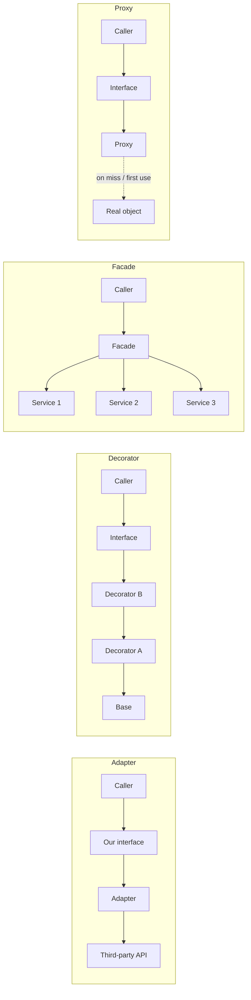
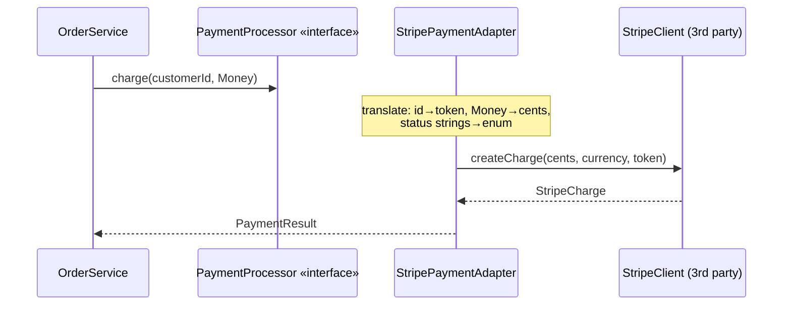
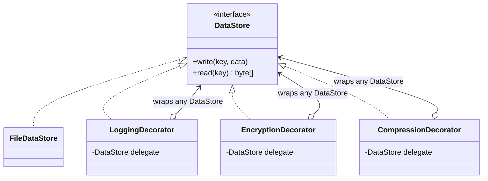
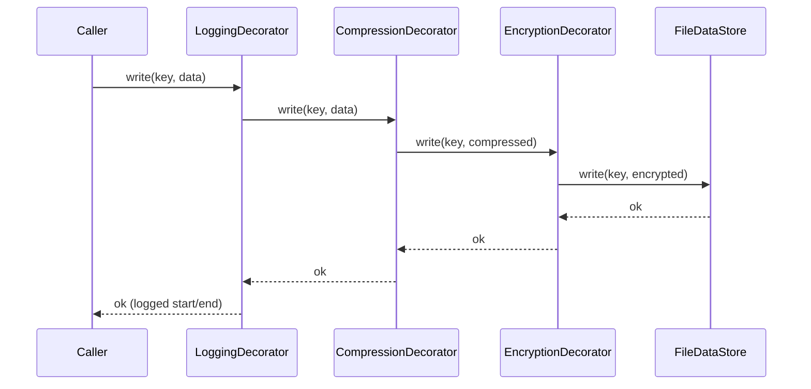
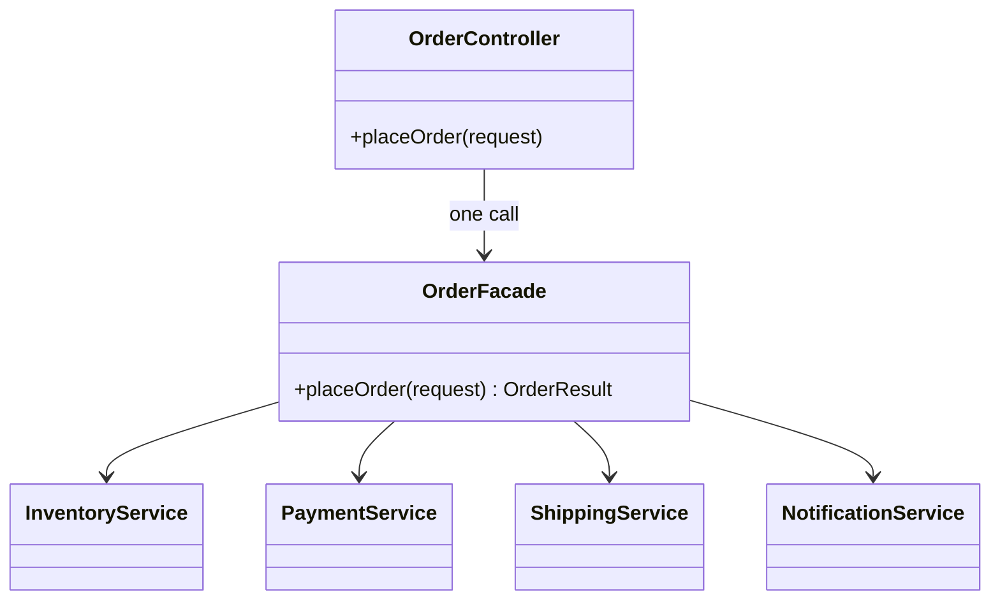
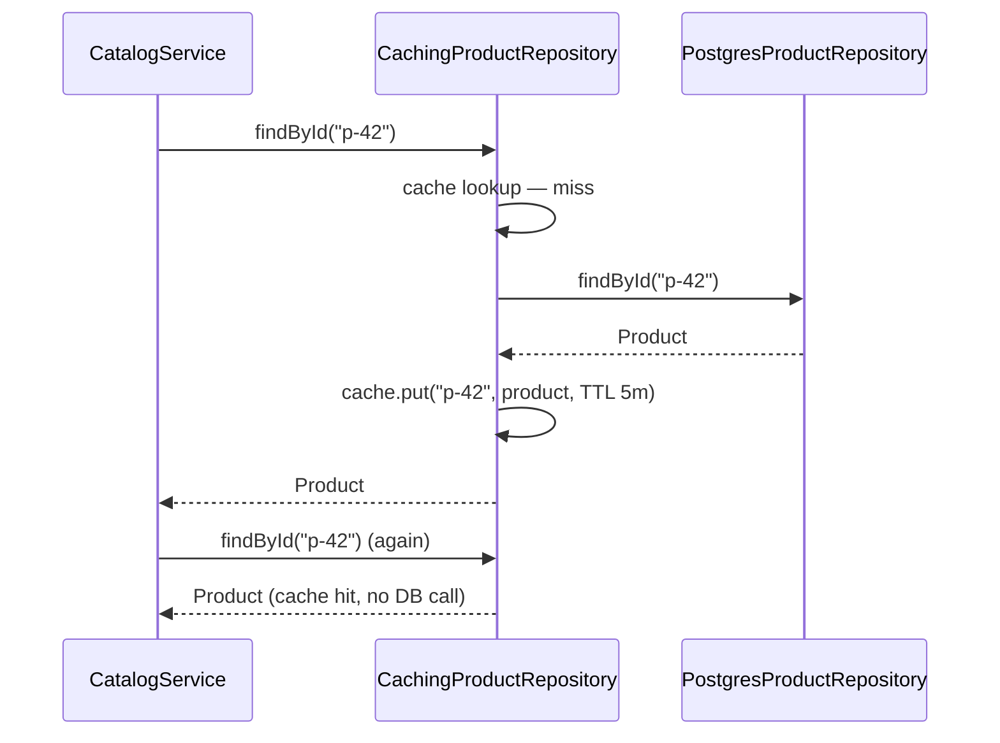
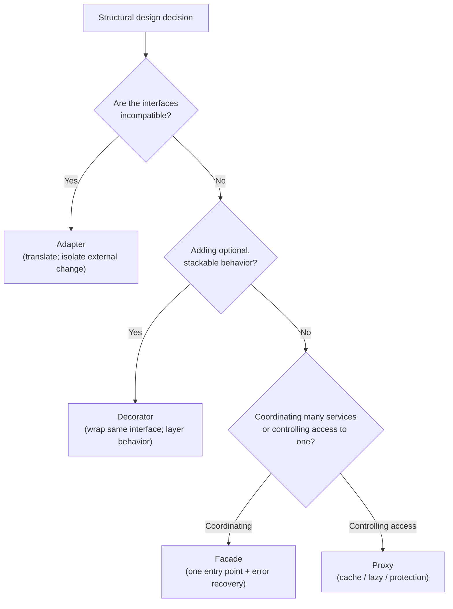

# 04 — Structural Design Patterns

> **Source:** Course Section 5 (SLIDE 54 – SLIDE 65). Structure and interview guidance follow the slides; all code is expanded to runnable **C++, C, and Java** versions. Markers: **[SLIDE n]** = from the slides, **[BEYOND THE COURSE]** = added here, **[INTERVIEW]** = how this is tested.

---

## 0. What This Section Is About

Creational patterns (file 03) solved **how objects are created**. Structural patterns solve **how objects are connected** — how their interfaces relate, how behavior is layered, how subsystems are presented, and how access is controlled [SLIDE 54].

They let you:

- Fit together classes that were **not designed to work with each other** (Adapter),
- **Add behavior to objects without modifying their source code** (Decorator),
- **Simplify complex subsystems** behind clean entry points (Facade),
- **Control access** to expensive or sensitive objects (Proxy).

### 0.1 Where structural patterns appear in LLD interviews [SLIDE 54]

| Interview signal | Pattern | Why |
|---|---|---|
| "Integrate with a third-party API that has a different interface" | **Adapter** | Bridge incompatible interfaces |
| "Add logging/caching/validation without modifying the core class" | **Decorator** | Layer behavior dynamically |
| "This subsystem has 6 services, simplify the API" | **Facade** | One entry point for complex coordination |
| "Control access to this expensive resource" | **Proxy** | Lazy loading, caching, access control |
| "We might swap this external dependency later" | **Adapter** | Isolate your code from external changes |

### 0.2 How structural patterns connect to SOLID [SLIDE 65]

| Pattern | SOLID principle it implements |
|---|---|
| **Adapter** | **DIP** — your business logic depends on *your* interface; the adapter absorbs the external concrete type |
| **Decorator** | **OCP** — new behavior without modifying the core class (extension by wrapping) |
| **Facade** | **SRP** — subsystem coordination is one responsibility, isolated in one class |
| **Proxy** | **SRP + DIP** — the cross-cutting concern (cache, auth, lazy load) is a separate class behind the same interface |

### 0.3 The four patterns at a glance

| Pattern | Wraps? | Same interface as wrapped? | One-line job |
|---|---|---|---|
| **Adapter** | An existing incompatible object | **No — that's the point** (translates) | Convert interface A → interface B |
| **Decorator** | An object of the *same* interface | **Yes** | Stack behavior at runtime |
| **Facade** | Coordinates *many* objects | **No** (offers a new, simpler API) | Present one entry point |
| **Proxy** | An object of the *same* interface | **Yes** | Intercept access (cache / lazy / auth) |



---

## 1. Adapter — Integrating Incompatible Interfaces

### 1.1 The definition and when you need one [SLIDE 55]

> The Adapter pattern allows two classes with **incompatible interfaces** to work together by wrapping one class in a **translation layer**. The adapter converts the interface of the wrapped class into the interface the calling code expects.

You need an Adapter when [SLIDE 55]:

- Your code depends on an **interface you control**, but
- The implementation you want to use has a **different method signature, parameter types, or return types**,
- And you **cannot modify** that implementation — third-party libraries, legacy systems, external APIs.

**The structure [SLIDE 55]:** `OrderService` depends on `PaymentProcessor` (your interface). `StripeClient` is the third-party class you cannot modify. `StripeAdapter` sits between them, translating calls from your interface to the third-party interface.

**How Adapter connects to previous sections [SLIDE 55]:** Adapter is a **direct application of DIP** (file 02 §5). Your business logic depends on **your own abstraction** (`PaymentProcessor`); the adapter handles the translation to the concrete external dependency (`StripeClient`). If Stripe changes their SDK, **you update the Adapter. Your business logic is untouched.**

> **[INTERVIEW]** Adapter appears in any LLD question involving **third-party integrations**. Interviewers evaluate whether you isolate your code from external dependencies using your own interface — or couple directly to the third-party API. If your class diagram shows `OrderService` importing `StripeClient`, that is the red flag they are hunting for.

### 1.2 Worked example: wrapping Stripe's payment API [SLIDE 56]

**Your interface:**

```java
public interface PaymentProcessor {
    PaymentResult charge(String customerId, Money amount);
    PaymentResult refund(String transactionId, Money amount);
}
```

**Stripe's SDK (third-party — cannot modify) [SLIDE 56]:**

```java
public class StripeClient {
    public StripeCharge createCharge(long amountInCents, String currency,
                                     String customerToken) { ... }

    public StripeRefund createRefund(String chargeId, long amountInCents) { ... }
}
```

Compare the two:

| Your interface | Stripe SDK |
|---|---|
| `String customerId` | `String customerToken` — Stripe wants a *token*, not your ID |
| `Money amount` (object) | `long amountInCents` + separate `String currency` |
| Returns `PaymentResult` | Returns `StripeCharge` / `StripeRefund` |
| `refund(String transactionId, Money amount)` | `createRefund(String chargeId, long amountInCents)` — and "transaction id" here is a *charge* id |

**Every parameter and return type is different.**

**The Adapter [SLIDE 56]:**

```java
public class StripePaymentAdapter implements PaymentProcessor {
    private final StripeClient stripeClient;
    private final CustomerTokenResolver tokenResolver;

    public StripePaymentAdapter(StripeClient stripeClient,
                                CustomerTokenResolver tokenResolver) {
        this.stripeClient = stripeClient;
        this.tokenResolver = tokenResolver;
    }

    @Override
    public PaymentResult charge(String customerId, Money amount) {
        String customerToken = tokenResolver.resolve(customerId);   // identifier mapping
        StripeCharge charge = stripeClient.createCharge(
                amount.toCents(),                                   // data format conversion
                amount.getCurrencyCode(),
                customerToken);
        return mapToPaymentResult(charge);                          // return type mapping
    }

    @Override
    public PaymentResult refund(String transactionId, Money amount) {
        StripeRefund refund = stripeClient.createRefund(
                transactionId, amount.toCents());
        return new PaymentResult(refund.getId(), mapStatus(refund.getStatus()));
    }

    private PaymentResult mapToPaymentResult(StripeCharge charge) {
        return new PaymentResult(charge.getId(), mapStatus(charge.getStatus()));
    }

    private PaymentStatus mapStatus(String stripeStatus) {
        return switch (stripeStatus) {
            case "succeeded" -> PaymentStatus.COMPLETED;
            case "pending"   -> PaymentStatus.PENDING;
            default          -> PaymentStatus.FAILED;
        };
    }
}
```

**The Adapter handles three kinds of translation [SLIDE 56]** — memorize this triple, it is the best way to *describe* an adapter in an interview:

1. **Data format conversion** — `Money` → cents (`long`) + currency code.
2. **Identifier mapping** — your `customerId` → Stripe's `customerToken`.
3. **Return type mapping** — `StripeCharge` → your `PaymentResult`; Stripe's status strings → your `PaymentStatus` enum.

And the outcome: **`OrderService` sees only `PaymentProcessor` and is completely unaware that Stripe exists** [SLIDE 56].



### 1.3 The same adapter in C++ and C (BEYOND THE COURSE)

**C++:**

```cpp
class PaymentProcessor {
public:
    virtual ~PaymentProcessor() = default;
    virtual PaymentResult charge(const std::string& customerId, Money amount) = 0;
    virtual PaymentResult refund(const std::string& transactionId, Money amount) = 0;
};

// Third-party SDK: different types everywhere. Cannot modify.
class StripeClient {
public:
    StripeCharge createCharge(long amountInCents,
                              const std::string& currency,
                              const std::string& customerToken);
    StripeRefund createRefund(const std::string& chargeId, long amountInCents);
};

class StripePaymentAdapter final : public PaymentProcessor {
public:
    StripePaymentAdapter(StripeClient& client, CustomerTokenResolver& resolver)
        : client_(client), resolver_(resolver) {}

    PaymentResult charge(const std::string& customerId, Money amount) override {
        std::string token = resolver_.resolve(customerId);
        StripeCharge charge = client_.createCharge(
            amount.toCents(), amount.currencyCode(), token);
        return mapToPaymentResult(charge);
    }

    PaymentResult refund(const std::string& transactionId, Money amount) override {
        StripeRefund refund = client_.createRefund(transactionId, amount.toCents());
        return PaymentResult{refund.id(), mapStatus(refund.status())};
    }

private:
    static PaymentResult mapToPaymentResult(const StripeCharge& charge) {
        return PaymentResult{charge.id(), mapStatus(charge.status())};
    }
    static PaymentStatus mapStatus(const std::string& stripeStatus) { /* ... */ }

    StripeClient& client_;
    CustomerTokenResolver& resolver_;
};
```

C++ detail worth naming: the adapter holds the third-party client **by reference** and the domain never includes the Stripe header beyond the adapter's own translation unit — the seam is enforced by the *header graph*, not just by good intentions.

**C — the adapter is just another implementation of the ops table:**

```c
/* payment.h — our interface (from file 03). */
typedef struct payment_ops {
    payment_result_t (*charge)(void *self, const char *customer_id, money_t amount);
    payment_result_t (*refund)(void *self, const char *transaction_id, money_t amount);
} payment_ops_t;

/* stripe_sdk.h — third party, cannot modify. */
stripe_charge_t stripe_client_create_charge(stripe_client_t *client,
                                            long amount_in_cents,
                                            const char *currency,
                                            const char *customer_token);

/* stripe_adapter.c — the ONLY file that includes both headers. */
typedef struct {
    stripe_client_t    *stripe;
    token_resolver_t   *tokens;
} stripe_adapter_state_t;

static payment_result_t stripe_adapter_charge(void *self,
                                              const char *customer_id,
                                              money_t amount)
{
    stripe_adapter_state_t *st = self;

    char token[128];
    token_resolver_resolve(st->tokens, customer_id, token, sizeof(token));

    stripe_charge_t charge = stripe_client_create_charge(
        st->stripe, money_to_cents(amount), money_currency(amount), token);

    return map_stripe_charge_via_status_enum(&charge);
}

const payment_ops_t STRIPE_ADAPTER_OPS = {
    .charge = stripe_adapter_charge,
    .refund = stripe_adapter_refund,
};
```

The `stripe_adapter.c` file is the **seam**: it is the only translation unit in the entire program that knows both vocabularies. A kernel analogy: that is exactly what a device driver does — it translates between the kernel's `file_operations`/`net_device_ops` vocabulary and a device's register-level reality.

### 1.4 Adapter in legacy system integration [SLIDE 56B]

Adapter is equally valuable for **legacy internal systems**. A modern order management system must read customer data from a legacy SOAP-based CRM the company cannot yet replace:

**The legacy system [SLIDE 56B]:**

```java
public class LegacySoapCrmClient {
    public SoapResponse getCustomerBySoapId(String soapCustomerId) { ... }
    public SoapResponse updateCustomerAddress(String soapCustomerId,
                                              SoapAddress address) { ... }
}
```

**Your modern interface [SLIDE 56B]:**

```java
public interface CustomerRepository {
    Optional<Customer> findById(String customerId);
    void updateAddress(String customerId, Address address);
}
```

**The adapter [SLIDE 56B]:**

```java
public class LegacyCrmAdapter implements CustomerRepository {
    private final LegacySoapCrmClient crmClient;
    private final CustomerIdMapper idMapper;

    public LegacyCrmAdapter(LegacySoapCrmClient crmClient, CustomerIdMapper idMapper) {
        this.crmClient = crmClient;
        this.idMapper = idMapper;
    }

    @Override
    public Optional<Customer> findById(String customerId) {
        String soapId = idMapper.toSoapId(customerId);
        SoapResponse response = crmClient.getCustomerBySoapId(soapId);
        if (response.isNotFound()) {
            return Optional.empty();
        }
        return Optional.of(mapToCustomer(response));
    }

    @Override
    public void updateAddress(String customerId, Address address) {
        String soapId = idMapper.toSoapId(customerId);
        SoapAddress soapAddress = new SoapAddress(
                address.getStreet(), address.getCity(),
                address.getState(), address.getPostalCode());
        crmClient.updateCustomerAddress(soapId, soapAddress);
    }

    private Customer mapToCustomer(SoapResponse response) { /* translate SOAP → domain */ }
}
```

**The payoff:** when the company eventually replaces the legacy CRM with a modern REST API, **only the Adapter changes**. Every class that depends on `CustomerRepository` is untouched. This is the real-world value of Adapter: **it creates a seam between your codebase and systems you cannot control** [SLIDE 56B].

> **[INTERVIEW tip from SLIDE 56B]** Whenever you integrate with an external or legacy system, **wrap it in an Adapter behind your own interface** — and say the sentence explicitly: *"I'm wrapping the external dependency so that if it changes, only the adapter needs to be updated."* That single sentence demonstrates both Adapter knowledge **and** DIP compliance.

### 1.5 Object adapter vs class adapter [BEYOND THE COURSE]

GoF describes two forms; know the distinction, recommend one:

| Form | Mechanism | Verdict |
|---|---|---|
| **Object adapter** (used everywhere in this file) | Adapter **holds a reference** to the adaptee (composition) | ✅ Preferred — works with subclasses of the adaptee, testable, no inheritance coupling |
| **Class adapter** | Adapter **inherits from** the adaptee (in C++; impossible in Java) | ❌ Rarely right — couples you to the adaptee's class, exposes its whole surface, blocks mocking |

If an interviewer asks "does Adapter use inheritance or composition?", the correct answer is: *"Object adapter uses composition — an adapter *has-a* adaptee. Class adapters via multiple inheritance exist in C++ but are rarely the right choice."*

### 1.6 Adapter drills

**Drill 1 — the three translations.** Given your `NotificationSender.sendTemplate(userId, templateId, variables)` and Twilio's `messages.create(to, body)`, list the three translation categories for this adapter: data format (template+vars → rendered body), identifier (userId → phone number), return (Twilio response → `DeliveryResult` with your status enum). Practice saying all three.

**Drill 2 — the red flag.** In a class diagram, draw `OrderService` with a field of type `StripeClient`. The interviewer asks "what's wrong?" Answer: DIP violation and zero seam — a Stripe SDK upgrade or provider switch touches business logic. Fix: `PaymentProcessor` + `StripePaymentAdapter`; adapter created by the factory from file 03.

**Drill 3 — adapter vs facade.** *"Both wrap things — what's the difference?"* Adapter **changes the interface** to match an expectation (1:1 translation to one adaptee). Facade **simplifies many underlying objects** behind a new API (N:1 coordination). Adapter: interface fix. Facade: entry-point fix.

**Drill 4 — where does the adapter live?** Answer: in the outermost integration layer; both headers it bridges meet **only inside the adapter's translation unit** — the rest of the codebase depends on `PaymentProcessor` alone.

---

## 2. Decorator — Adding Behavior Dynamically Without Subclassing

### 2.1 The core idea [SLIDE 57]

> The Decorator pattern lets you **attach additional behavior to an object at runtime** by wrapping it in another object that has the same interface. Each decorator adds one layer of behavior and **delegates the core work to the wrapped object**.

**The motivating example [SLIDE 57]:** a data storage service. The basic version reads and writes data. You need to add *optional* capabilities: logging every operation, compressing data before storage, encrypting sensitive data.

- With **inheritance**, you would need classes like `LoggingEncryptingCompressingDataStore` — and **every combination** would be a separate class.
- With **Decorator**, you **stack the behaviors you need at runtime**.

**The structure [SLIDE 57]:** every decorator **implements the same `DataStore` interface** and **holds a reference to another `DataStore`**. This means decorators can wrap the base implementation **or wrap other decorators**, creating a chain.



**The key difference from inheritance [SLIDE 57]:** with inheritance the combination is **fixed at compile time**. With Decorator you choose **at runtime**:

- One context: `LoggingDecorator` wrapping `FileDataStore`.
- Another context: `LoggingDecorator` wrapping `CompressionDecorator` wrapping `EncryptionDecorator` wrapping `FileDataStore`.

...all using the same four classes.

> **[INTERVIEW]** Decorator is tested when an interviewer asks: *"How would you add cross-cutting concerns like logging or caching without modifying the core class?"* The answer is **Decorator, not inheritance**. Follow-ups will probe the class-count trade-off (§2.2) and the wrapping order (§2.3).

### 2.2 Why Decorator beats inheritance for combining behaviors [SLIDE 58]

**The inheritance explosion problem [SLIDE 58]** (first seen in file 01 §6): one base class + **3 optional behaviors** (logging, compression, encryption) requires a class for **every combination**:

| Class | Behaviors |
|---|---|
| `FileDataStore` | None |
| `LoggingFileDataStore` | Logging |
| `CompressingFileDataStore` | Compression |
| `EncryptingFileDataStore` | Encryption |
| `LoggingCompressingFileDataStore` | Logging + Compression |
| `LoggingEncryptingFileDataStore` | Logging + Encryption |
| `CompressingEncryptingFileDataStore` | Compression + Encryption |
| `LoggingCompressingEncryptingFileDataStore` | All three |

**That is 7 subclasses for 3 optional behaviors.** Add a fourth behavior (caching) → **15 subclasses**. The count grows as **2ⁿ − 1** where n is the number of optional behaviors.

**Decorator: linear growth [SLIDE 58]** — one class per behavior (3 decorators for 3 behaviors, 4 for 4). Combinations are assembled at runtime:

```java
DataStore simpleStore = new FileDataStore("/data");

DataStore loggedStore = new LoggingDecorator(new FileDataStore("/data"));

DataStore fullStore = new LoggingDecorator(
        new CompressionDecorator(
                new EncryptionDecorator(
                        new FileDataStore("/data"))));
```

**Three decorators handle all 7 combinations. Adding a fourth behavior (caching) means writing one new class, not 8.**

**Why this matters for design [SLIDE 58]:**

| Dimension | Inheritance | Decorator |
|---|---|---|
| Classes needed for n behaviors | **2ⁿ − 1** | **n** |
| Combination flexibility | Fixed at compile time | Assembled at runtime |
| Adding a new behavior | Doubles the class count | One new class |
| Removing a behavior | Cannot selectively remove | Omit the decorator from the chain |
| Testing individual behaviors | Must test in full hierarchy | Test each decorator in isolation |

> **[INTERVIEW]** If asked *"how would you add logging, caching, and rate limiting to this service?"*, Decorator is the answer — and you should **state the 2ⁿ vs n class-count trade-off** to demonstrate you understand *why* the pattern exists, not just how it's built.

### 2.3 Worked example: logging, encryption, compression on a data stream [SLIDE 58B]

**The interface [SLIDE 58B]:**

```java
public interface DataStore {
    void write(String key, byte[] data);
    byte[] read(String key);
}
```

**The base implementation [SLIDE 58B]:**

```java
public class FileDataStore implements DataStore {
    private final String basePath;

    public FileDataStore(String basePath) { this.basePath = basePath; }

    @Override
    public void write(String key, byte[] data) {
        Path filePath = Path.of(basePath, key);
        Files.write(filePath, data);
    }

    @Override
    public byte[] read(String key) {
        Path filePath = Path.of(basePath, key);
        return Files.readAllBytes(filePath);
    }
}
```

**The decorators [SLIDE 58B]:**

```java
public class LoggingDecorator implements DataStore {
    private final DataStore delegate;
    private final Logger logger;

    public LoggingDecorator(DataStore delegate, Logger logger) {
        this.delegate = delegate;
        this.logger = logger;
    }

    @Override
    public void write(String key, byte[] data) {
        logger.info("Writing {} bytes to key: {}", data.length, key);
        long startTime = System.currentTimeMillis();
        delegate.write(key, data);
        long duration = System.currentTimeMillis() - startTime;
        logger.info("Write completed in {} ms", duration);
    }

    @Override
    public byte[] read(String key) {
        logger.info("Reading key: {}", key);
        byte[] data = delegate.read(key);
        logger.info("Read {} bytes from key: {}", data.length, key);
        return data;
    }
}

public class EncryptionDecorator implements DataStore {
    private final DataStore delegate;
    private final EncryptionService encryptionService;

    public EncryptionDecorator(DataStore delegate, EncryptionService encryptionService) {
        this.delegate = delegate;
        this.encryptionService = encryptionService;
    }

    @Override
    public void write(String key, byte[] data) {
        byte[] encrypted = encryptionService.encrypt(data);
        delegate.write(key, encrypted);
    }

    @Override
    public byte[] read(String key) {
        byte[] encrypted = delegate.read(key);
        return encryptionService.decrypt(encrypted);
    }
}

public class CompressionDecorator implements DataStore {
    private final DataStore delegate;

    public CompressionDecorator(DataStore delegate) { this.delegate = delegate; }

    @Override
    public void write(String key, byte[] data) {
        byte[] compressed = GzipCompressor.compress(data);
        delegate.write(key, compressed);
    }

    @Override
    public byte[] read(String key) {
        byte[] compressed = delegate.read(key);
        return GzipCompressor.decompress(compressed);
    }
}
```

**Assembling the chain [SLIDE 58B]:**

```java
DataStore store = new LoggingDecorator(
        new CompressionDecorator(
                new EncryptionDecorator(
                        new FileDataStore("/data"),
                        new AesEncryptionService(secretKey))),
        LoggerFactory.getLogger("DataStore"));

store.write("user-profile-42", profileBytes);
```

**Execution order — this is the detail interviewers probe [SLIDE 58B]:**

- **Write:** Logging logs the call → Compression compresses → Encryption encrypts → FileDataStore writes to disk.
- **Read:** FileDataStore reads → Encryption decrypts → Compression decompresses → Logging logs.

**The chain order is a design decision.** Put encryption *outside* compression and you encrypt the compressed bytes (smaller ciphertext, but you cannot decompress before decrypting); put compression *outside* encryption and you compress ciphertext (which doesn't compress — usually a bug). Either way, the important properties hold: **each decorator is independently testable, independently removable, and independently reusable** [SLIDE 58B].



> **[INTERVIEW]** This exact shape — interface + base implementation + decorators + runtime chain assembly — is the standard Decorator implementation. Showing the full chain assembly demonstrates that you understand how decorators compose, and discussing **order** shows you understand that a chain is a *pipeline with semantics*, not just a guess.

### 2.4 The same decorators in C++ and C (BEYOND THE COURSE)

**C++** — `std::unique_ptr` chains express ownership of the wrapped object cleanly:

```cpp
class DataStore {
public:
    virtual ~DataStore() = default;
    virtual void write(const std::string& key, const std::vector<std::uint8_t>& data) = 0;
    virtual std::vector<std::uint8_t> read(const std::string& key) = 0;
};

class LoggingDecorator final : public DataStore {
public:
    LoggingDecorator(std::unique_ptr<DataStore> inner, Logger& logger)
        : inner_(std::move(inner)), logger_(logger) {}

    void write(const std::string& key, const std::vector<std::uint8_t>& data) override {
        logger_.info("Writing " + std::to_string(data.size()) + " bytes to " + key);
        inner_->write(key, data);
    }

    std::vector<std::uint8_t> read(const std::string& key) override {
        logger_.info("Reading " + key);
        return inner_->read(key);
    }

private:
    std::unique_ptr<DataStore> inner_;   // the wrapped component
    Logger& logger_;
};

// Assembly: ownership flows up the chain.
std::unique_ptr<DataStore> store =
    std::make_unique<LoggingDecorator>(
        std::make_unique<CompressionDecorator>(
            std::make_unique<EncryptionDecorator>(
                std::make_unique<FileDataStore>("/data"),
                aes)),
        logger);
```

C++ notes: each decorator *owns* its inner component (`unique_ptr`), so destroying the outermost object tears down the whole chain; and the same decorator works on any `DataStore`, including future implementations. Zero virtual-dispatch surprises — the chain is just virtual calls.

**C — decorators wrap `data_store_t` by value, ops chain inward:**

```c
typedef struct data_store_ops {
    void  (*write)(void *self, const char *key, const uint8_t *data, size_t len);
    size_t (*read)(void *self, const char *key, uint8_t *out, size_t out_cap);
    void  (*destroy)(void *self);
} data_store_ops_t;

typedef struct data_store {
    const data_store_ops_t *ops;
    void *impl;
} data_store_t;

/* ---- Logging decorator: wraps any inner data_store_t ---- */
typedef struct {
    data_store_t inner;
    logger_t    *logger;
} logging_decorator_state_t;

static void logging_write(void *self, const char *key,
                          const uint8_t *data, size_t len)
{
    logging_decorator_state_t *st = self;
    logger_info(st->logger, "writing %zu bytes to key %s", len, key);
    st->inner.ops->write(st->inner.impl, key, data, len);   /* delegate inward */
    logger_info(st->logger, "write complete");
}

static const data_store_ops_t LOGGING_OPS = {
    .write = logging_write,
    .read  = logging_read,
};

/* Assembly: each layer embeds the previous one. */
data_store_t file_store    = file_data_store_create("/data");
data_store_t enc_store     = encryption_decorator_create(file_store, aes);
data_store_t comp_store    = compression_decorator_create(enc_store);
data_store_t logging_store = logging_decorator_create(comp_store, logger);

logging_store.ops->write(logging_store.impl, "profile", bytes, n);
```

The C lesson: a decorator is simply **a struct that holds the inner ops + impl and implements the same ops by calling inward** — the ops-struct version of "same interface, wraps a peer." This is how the kernel stacks behaviors too (e.g., device-mapper layers over block devices: each target implements the same block-layer ops and forwards `submit_bio` inward).

### 2.5 [INTERVIEW] practice: the metrics system [SLIDE 58C]

**Scenario.** A metrics collection system (Datadog-like) must record metrics (counters, timers, gauges) to **multiple backends**: an in-memory store for testing, a StatsD server for production, and a cloud monitoring API for long-term storage. Additionally, **all metrics should optionally support**: **tagging** (add key-value labels), **batching** (buffer and flush periodically), and **sampling** (record only a percentage to reduce load). *"How would you structure this?"*

**Weak answer [SLIDE 58C]:**
> "I would create a `MetricsService` class with methods for each backend and boolean flags for tagging, batching, and sampling."

Combines all backends AND all optional behaviors into one class. Adding a backend or behavior modifies the same class — violates SRP and OCP, and it is untestable.

**Strong answer [SLIDE 58C]:**

> "These are **two distinct problems**:
>
> 1. **Multiple backends** (in-memory, StatsD, cloud API) are an **Adapter problem**: define a `MetricsRecorder` interface and write an **adapter per backend**, each translating from my interface to the backend's API.
> 2. **Optional behaviors** (tagging, batching, sampling) are a **Decorator problem** — each is a cross-cutting concern wrapping a `MetricsRecorder` without modifying it: `TaggingDecorator` adds labels, `BatchingDecorator` buffers and flushes, `SamplingDecorator` probabilistically drops metrics.
>
> In production the chain would be `SamplingDecorator` wrapping `BatchingDecorator` wrapping `TaggingDecorator` wrapping `StatsDAdapter`. In tests: just `InMemoryMetricsRecorder` with no decorators."

The strong answer identifies **two distinct problems**, applies the correct pattern to each, and explains **how they compose** — exactly what the interviewer is scoring [SLIDE 58C].

### 2.6 Decorator drills

**Drill 1 — order matters: argue it.** *"In the DataStore chain, should Compression wrap Encryption or the reverse?"* Model: "For storage efficiency we want compression applied to plaintext — so Encryption wraps the inner FileDataStore, and Compression wraps Encryption: compressing ciphertext is useless. But if security policy requires never letting plaintext touch *any* buffer shared with compression code, the order flips and we accept larger writes. The point: **the chain order encodes semantics; I state mine explicitly.**"

**Drill 2 — count classes.** 5 optional behaviors, inheritance: 31 classes. Decorators: 5. Being able to produce that pair of numbers instantly is the mark of having internalized the pattern.

**Drill 3 — decorator vs inheritance in a sentence.** *"Decorator converts 'which behaviors does this thing have' from a class-identity question into a runtime composition question."*

**Drill 4 — find the decorators in your own design.** In the reporting system from file 02 §6.3, where would you decorate? (Metrics/logging decorators around `DataSource` calls, caching decorator around `DataSource`, retry decorator around `DeliveryChannel`.) Name each concern and which layer it wraps — then confirm no *core* class was modified (the OCP check).

---

## 3. Facade — Simplifying Complex Subsystems

### 3.1 The definition and when you need one [SLIDE 59]

> The Facade pattern provides a **simplified interface to a complex subsystem**. Instead of forcing calling code to coordinate multiple services, manage sequencing, and handle error cases across several classes, the Facade wraps the subsystem behind **a single class with a straightforward API**.

**When you need a Facade [SLIDE 59]:** when a workflow involves **coordinating 3+ services in a specific sequence** and **multiple callers need to perform the same coordination**. Without a Facade, the coordination logic is **duplicated across every caller**.

**The problem — scattered coordination [SLIDE 59]:** placing an order on a Shopify-like platform requires:

1. Checking inventory,
2. Validating the payment method,
3. Charging the payment,
4. Reserving inventory,
5. Creating a shipping label,
6. Sending a confirmation email.

Without a Facade, **every endpoint or service that places an order** must coordinate all six steps and handle partial failures — *what if payment succeeds but shipping-label creation fails?* That question alone is why every codebase eventually grows a Facade: without one, each caller re-implements the compensation logic (badly, differently, and incompletely).

**The solution:** the API controller calls **one method** on `OrderFacade`. The Facade coordinates all subsystems, handles sequencing, and manages error recovery. **The controller does not know how many services are involved or in what order they are called** [SLIDE 59].



> **[INTERVIEW]** Facade appears whenever you are asked to design **an API for a multi-step workflow**. The key signal: *"this operation involves coordinating multiple services."* Extracting a Facade shows the interviewer that you think about **API simplicity**, not just internal design.

### 3.2 Worked example: `OrderFacade` coordinating services [SLIDE 60]

```java
public class OrderFacade {
    private final InventoryService inventoryService;
    private final PaymentService paymentService;
    private final ShippingService shippingService;
    private final NotificationService notificationService;

    public OrderFacade(InventoryService inventoryService,
                       PaymentService paymentService,
                       ShippingService shippingService,
                       NotificationService notificationService) {
        this.inventoryService    = inventoryService;
        this.paymentService      = paymentService;
        this.shippingService     = shippingService;
        this.notificationService = notificationService;
    }

    public OrderResult placeOrder(OrderRequest request) {
        // Step 1: inventory check
        InventoryCheck inventoryCheck = inventoryService.checkAvailability(request.getItems());
        if (!inventoryCheck.isAvailable()) {
            return OrderResult.outOfStock(inventoryCheck.getUnavailableItems());
        }

        // Step 2: charge payment
        PaymentResult paymentResult = paymentService.charge(
                request.getCustomerId(), request.getTotalAmount());
        if (!paymentResult.isSuccessful()) {
            return OrderResult.paymentFailed(paymentResult.getErrorMessage());
        }

        // Step 3: reserve inventory
        inventoryService.reserve(request.getItems());

        // Step 4: shipping label — with compensation on failure
        ShippingLabel label;
        try {
            label = shippingService.createLabel(
                    request.getShippingAddress(), request.getItems());
        } catch (ShippingException e) {
            paymentService.refund(paymentResult.getTransactionId());   // compensate payment
            inventoryService.release(request.getItems());              // compensate reservation
            return OrderResult.shippingFailed(e.getMessage());
        }

        // Step 5: create order + notify
        Order order = new Order(request, paymentResult.getTransactionId(),
                                label.getTrackingNumber());
        notificationService.sendOrderConfirmation(request.getCustomerId(), order);

        return OrderResult.success(order.getId(), label.getTrackingNumber());
    }
}
```

**What the Facade handles — three concerns the calling code should not deal with [SLIDE 60]:**

1. **Sequencing** — inventory must be checked before payment; payment before shipping; shipping before notification. The order matters, and the Facade enforces it.
2. **Error recovery** — if shipping fails after payment succeeds, the Facade **refunds the payment and releases the inventory reservation**. This **compensating transaction** logic lives in **one place**, not in every caller.
3. **Simplification** — the caller sees `placeOrder(request)` and gets back a result. It does not know about inventory checks, payment processing, shipping labels, or error-recovery sequences.

> **[INTERVIEW tip from SLIDE 60]** When presenting a Facade, **explicitly point out the error recovery logic**. Interviewers are impressed when candidates think about **partial failure** scenarios (*"what happens if step 3 fails after step 2 succeeded?"*) because this is where production systems actually break. Bonus: this is a mini-Saga — the distributed-systems version of the same idea (compensating actions for multi-step workflows). The Facade is the in-process answer; Saga/outbox is the cross-service answer. Knowing both, and when each applies, demonstrates cross-domain thinking [SLIDE 60].

### 3.3 The same Facade in C++ and C (BEYOND THE COURSE)

**C++:**

```cpp
class OrderFacade {
public:
    OrderFacade(InventoryService& inventory, PaymentService& payments,
                ShippingService& shipping, NotificationService& notifications)
        : inventory_(inventory), payments_(payments),
          shipping_(shipping), notifications_(notifications) {}

    OrderResult placeOrder(const OrderRequest& request) {
        InventoryCheck check = inventory_.checkAvailability(request.items());
        if (!check.isAvailable()) {
            return OrderResult::outOfStock(check.unavailableItems());
        }

        PaymentResult payment = payments_.charge(request.customerId(),
                                                 request.totalAmount());
        if (!payment.success) {
            return OrderResult::paymentFailed(payment.errorMessage);
        }

        inventory_.reserve(request.items());

        ShippingLabel label;
        try {
            label = shipping_.createLabel(request.shippingAddress(), request.items());
        } catch (const ShippingException& e) {
            payments_.refund(payment.transactionId);       // compensate
            inventory_.release(request.items());           // compensate
            return OrderResult::shippingFailed(e.what());
        }

        Order order{request, payment.transactionId, label.trackingNumber};
        notifications_.sendOrderConfirmation(request.customerId(), order);
        return OrderResult::success(order.id(), label.trackingNumber);
    }

private:
    InventoryService&    inventory_;
    PaymentService&      payments_;
    ShippingService&     shipping_;
    NotificationService& notifications_;
};
```

RAII note: in C++ the same compensation logic can be expressed with a scope guard (`gsl::finally` / a small RAII type) so that an early `return` or an exception unwinds the reservations automatically — a distinctly C++ way to keep the Facade's recovery logic from being duplicated across `catch` blocks.

**C** — the facade holds subsystem ops structs and sequences calls with explicit error codes (C's version of exceptions):

```c
typedef struct order_facade {
    inventory_service_t *inventory;
    payment_service_t   *payments;
    shipping_service_t  *shipping;
    notify_service_t    *notifications;
} order_facade_t;

order_result_t order_facade_place(order_facade_t *f, const order_request_t *req)
{
    inventory_check_t check;
    if (inventory_check(f->inventory, req, &check) != STATUS_OK || !check.available) {
        return order_result_out_of_stock(&check);
    }

    payment_result_t payment;
    if (payment_charge(f->payments, req->customer_id, req->total, &payment) != STATUS_OK) {
        return order_result_payment_failed(&payment);
    }

    inventory_reserve(f->inventory, req);

    shipping_label_t label;
    status_t ship_status = shipping_create_label(f->shipping, req, &label);
    if (ship_status != STATUS_OK) {
        payment_refund(f->payments, payment.transaction_id);   /* compensate */
        inventory_release(f->inventory, req);                  /* compensate */
        return order_result_shipping_failed(ship_status);
    }

    order_t order;
    order_init(&order, req, payment.transaction_id, label.tracking_number);
    notify_send_order_confirmation(f->notifications, req->customer_id, &order);

    return order_result_success(&order, label.tracking_number);
}
```

In C the compensation pattern is unmistakable: explicit calls after a failed step, in reverse order. **Keep this shape in mind for system-design interviews — it is the single-process version of the Saga pattern** (steps + compensations).

### 3.4 When simplification helps vs when it hides complexity [SLIDE 60B]

Facade simplifies the interface to a subsystem — but **simplification has limits**. A Facade that hides too much **prevents callers from doing legitimate work** [SLIDE 60B].

**Facade done right [SLIDE 60B]:** `OrderFacade.placeOrder()` exposes and hides coordination details. The caller does not need to know about inventory checks or shipping-label creation. **The simplification matches the caller's intent: "I want to place an order."**

**Facade done wrong [SLIDE 60B]:**

```java
public class DatabaseFacade {
    public List<Map<String, Object>> getData(String entity) {
        return database.query("SELECT * FROM " + entity);
    }
}
```

This Facade is **too simplistic**. It hides the ability to filter, sort, paginate, or join. Any caller that needs a `WHERE` clause must **bypass the Facade entirely** — which defeats its purpose. A useful Facade **still exposes enough control for the caller to express its intent**. (It also demonstrates SQL injection by string concatenation — a second bug in four lines.)

**Decision framework [SLIDE 60B]:**

| Signal | Facade appropriate | Facade inappropriate |
|---|---|---|
| Callers always need the same workflow | Yes, standardize it | No, if workflows vary significantly |
| Coordination sequence is complex | Yes, centralize sequencing | No, if the sequence is trivial (2 calls) |
| Error recovery involves compensating actions | Yes, encapsulate recovery | Not needed for idempotent operations |
| Callers need fine-grained control | Expose Facade **+ direct access** | Do not force everything through the Facade |
| Subsystem is stable and well-defined | Yes, safe to abstract | Be cautious if the subsystem is evolving rapidly |

**The rule [SLIDE 60B]:**

> **A Facade should simplify the common case without preventing the uncommon case.** Expose the Facade for the 80% of callers who want the standard workflow. Keep the underlying services accessible for the 20% who need finer control.

> **[INTERVIEW]** Interviewers sometimes probe whether your Facade is **too rigid**. Being able to articulate when a Facade helps versus when it over-simplifies shows **nuanced design judgment** — the "80% through the Facade, 20% get the services" framing is a compact way to show it.

### 3.5 Facade vs the other three (quick distinctions)

| Question | Adapter | Decorator | Facade | Proxy |
|---|---|---|---|---|
| How many objects does it front? | One adaptee | One wrapped component | **Many subsystem services** | One real subject |
| Same interface as what it fronts? | No (translates) | Yes | **No** (offers simpler API) | Yes |
| Is it about interface shape? | Yes | No (behavior) | Yes (simplification) | No (access control) |
| Typical signal | third-party/legacy API | cross-cutting behavior | multi-step workflow | cache/lazy/auth |

### 3.6 Facade drills

**Drill 1 — locate the facade in a familiar system.** *"What is the Facade in a web framework?"* Answer examples: a controller's service method that coordinates auth → validation → persistence → queue publish → response mapping; or `@Transactional` service methods — the annotation wraps a facade-shaped unit of work with commit/rollback = sequencing + error recovery.

**Drill 2 — too-simple facade surgery.** Take `DatabaseFacade.getData(entity)` and repair it: `findById`, `findByCriteria(Filter, Pageable)` etc., or expose the query builder. State the 80/20 rule while you do it.

**Drill 3 — facade or orchestration service?** *"Isn't a Facade just an application service?"* Honest answer: yes — in most architectures the Facade *is* the application/use-case service layer's entry point. The pattern name describes the structural role (single simplified entry to a subsystem); the same class in DDD vocabulary is an application service. Naming both vocabularies scores well.

**Drill 4 — compensate.** *"Payment succeeded, then shipping label failed. Walk the recovery."* Mirror the slide: refund payment, release inventory reservation, return a structured failure — and note that the next step would be to make the compensations idempotent so retries are safe.

---

## 4. Proxy — Controlling Access, Lazy Loading, and Caching

### 4.1 The definition and the three common types [SLIDE 61]

> The Proxy pattern provides a **surrogate or placeholder for another object to control access to it**. The proxy has the **same interface** as the real object, so calling code cannot tell the difference. The proxy intercepts calls and adds behavior **before or after** delegating to the real object.

**Three common proxy types [SLIDE 61]:**

| Type | What it does | Mechanism |
|---|---|---|
| **Caching proxy** | Stores results of expensive operations and returns the cached value for repeated calls | Check cache → on miss, call real object → store result |
| **Virtual proxy (lazy loading)** | Delays creation/loading of an expensive object until actually needed | Holds a null/pending reference; creates/loads the real object on first access |
| **Protection proxy (access control)** | Checks whether the caller has permission before delegating | Authorization check inside the same interface call |

### 4.2 How Proxy differs from Decorator [SLIDE 61]

They look structurally identical (both wrap a same-interface object) — interviewers ask this comparison constantly. The differences are **purpose and lifecycle**:

| Dimension | Proxy | Decorator |
|---|---|---|
| **Primary purpose** | **Controls access** to the object | **Adds behavior** to the object |
| **Relationship to wrapped object** | Often **creates or manages** the wrapped object's lifecycle | Always **receives** the wrapped object from outside |
| **Typical use case** | Caching, lazy loading, access control | Logging, compression, encryption |
| **Number of wrappers** | Usually **one proxy** per object | Often **multiple decorators stacked** |
| **Who knows about the wrapping?** | Calling code usually **does not know** | Calling code **assembles** the decorator chain |

The memory hook: **Decorator = you compose a pipeline; Proxy = you hide a stand-in.** The distinction decides the pattern choice, so always be ready to justify it [SLIDE 61].

### 4.3 Worked example: caching proxy for database queries [SLIDE 62]

Product catalog (Amazon-like): product details are read far more frequently than updated. Without caching, **every product page view hits the database**. A caching proxy eliminates redundant queries **without modifying the repository class** [SLIDE 62].

**The interface [SLIDE 62]:**

```java
public interface ProductRepository {
    Optional<Product> findById(String productId);
    List<Product> findByCategory(String category);
}
```

**The real implementation [SLIDE 62]:**

```java
public class PostgresProductRepository implements ProductRepository {
    private final DataSource dataSource;

    public PostgresProductRepository(DataSource dataSource) {
        this.dataSource = dataSource;
    }

    @Override
    public Optional<Product> findById(String productId) {
        Connection conn = dataSource.getConnection();
        PreparedStatement stmt = conn.prepareStatement(
                "SELECT id, name, price, category FROM products WHERE id = ?");
        stmt.setString(1, productId);
        ResultSet rs = stmt.executeQuery();
        if (rs.next()) {
            return Optional.of(mapToProduct(rs));
        }
        return Optional.empty();
    }

    @Override
    public List<Product> findByCategory(String category) {
        Connection conn = dataSource.getConnection();
        PreparedStatement stmt = conn.prepareStatement(
                "SELECT id, name, price, category FROM products WHERE category = ?");
        stmt.setString(1, category);
        return mapToProducts(stmt.executeQuery());
    }
}
```

**The caching proxy [SLIDE 62]:**

```java
public class CachingProductRepository implements ProductRepository {
    private final ProductRepository delegate;
    private final Cache<String, Optional<Product>> productCache;
    private final Cache<String, List<Product>> categoryCache;

    public CachingProductRepository(ProductRepository delegate, Duration cacheDuration) {
        this.delegate = delegate;
        this.productCache = CacheBuilder.newBuilder()
                .expireAfterWrite(cacheDuration)
                .maximumSize(10_000)
                .build();
        this.categoryCache = CacheBuilder.newBuilder()
                .expireAfterWrite(cacheDuration)
                .maximumSize(500)
                .build();
    }

    @Override
    public Optional<Product> findById(String productId) {
        Optional<Product> cached = productCache.getIfPresent(productId);   // 1. check
        if (cached != null) {
            return cached;                                                 // 2. hit
        }
        Optional<Product> product = delegate.findById(productId);          // 3. miss: real call
        productCache.put(productId, product);                              // 4. populate
        return product;
    }

    @Override
    public List<Product> findByCategory(String category) {
        List<Product> cached = categoryCache.getIfPresent(category);
        if (cached != null) {
            return cached;
        }
        List<Product> products = delegate.findByCategory(category);
        categoryCache.put(category, products);
        return products;
    }
}
```

**Wiring [SLIDE 62]:**

```java
ProductRepository repository = new CachingProductRepository(
        new PostgresProductRepository(dataSource),
        Duration.ofMinutes(5));
```

`CatalogService` depends on `ProductRepository`. **It does not know whether it is talking to the database or the cache.** The caching logic is completely separate from the database logic — each independently testable and modifiable [SLIDE 62].

**This is the cache-aside pattern** — check cache → miss → query source → populate cache — with TTL (`expireAfterWrite`) and a size bound (`maximumSize`). Mentioning **TTL and eviction bounds** during an interview demonstrates production-level thinking, not just pattern recall [SLIDE 62].



### 4.4 Virtual proxy for lazy-loading large objects [SLIDE 62B]

A virtual proxy **delays the creation of an expensive object until it is first accessed**. Useful when loading is costly (large file, remote API call, complex initialization) and the object **may not always be needed** [SLIDE 62B].

**The problem [SLIDE 62B]:** a document management system where each document has a large binary attachment (PDF, image). Loading all attachments into memory when *listing* documents wastes resources — most users only preview titles and metadata.

**The virtual proxy [SLIDE 62B]:**

```java
public interface DocumentAttachment {
    byte[] getContent();
    String getContentType();
    long getFileSize();
}

public class LazyDocumentAttachment implements DocumentAttachment {
    private final String attachmentId;
    private final String contentType;
    private final long fileSize;
    private final AttachmentStore attachmentStore;
    private byte[] cachedContent;                       // initially null: not loaded yet

    public LazyDocumentAttachment(String attachmentId, String contentType,
                                  long fileSize, AttachmentStore attachmentStore) {
        this.attachmentId    = attachmentId;
        this.contentType     = contentType;
        this.fileSize        = fileSize;
        this.attachmentStore = attachmentStore;
    }

    @Override
    public byte[] getContent() {
        if (cachedContent == null) {                    // first access: load
            cachedContent = attachmentStore.loadContent(attachmentId);
        }
        return cachedContent;
    }

    @Override
    public String getContentType() {
        return contentType;                             // metadata: always available
    }

    @Override
    public long getFileSize() {
        return fileSize;                                // metadata: always available
    }
}
```

**The key design [SLIDE 62B]:** metadata fields (`contentType`, `fileSize`) are available **immediately** because they come from the database index; the actual binary content is loaded **only when `getContent()` is called for the first time**. **If the user never opens the attachment, the content is never loaded.**

**Where virtual proxy appears [SLIDE 62B]:**

| System | What is lazy-loaded | Why |
|---|---|---|
| Document management | File attachments (10 MB each) | Listing documents should not load all attachments |
| Social media feed | High-resolution images | Thumbnails load first; full image on click |
| ORM frameworks (Hibernate) | Related entities | Loading an `Order` should not load all `OrderItems` automatically — the notorious N+1/lazy-loading trade-off |
| IDE file browsers | File contents | Showing file names should not read all file contents |

> **[INTERVIEW tip from SLIDE 62B]** When designing a system that manages large objects (files, images, blobs), **mention lazy loading proactively**: *"The `Document` holds a proxy that loads the binary content only when the user requests it."* This shows you consider **memory efficiency**, not just correctness.

### 4.5 The same proxies in C++ and C (BEYOND THE COURSE)

**C++ — caching proxy with ownership of the real subject:**

```cpp
class ProductRepository {
public:
    virtual ~ProductRepository() = default;
    virtual std::optional<Product> findById(const std::string& id) = 0;
    virtual std::vector<Product> findByCategory(const std::string& category) = 0;
};

class CachingProductRepository final : public ProductRepository {
public:
    CachingProductRepository(std::unique_ptr<ProductRepository> inner,
                             std::chrono::seconds ttl)
        : inner_(std::move(inner)), ttl_(ttl) {}

    std::optional<Product> findById(const std::string& id) override {
        auto now = std::chrono::steady_clock::now();
        if (auto it = byId_.find(id); it != byId_.end() && it->second.expires > now) {
            return it->second.value;                        // cache hit
        }
        auto product = inner_->findById(id);                // miss → real object
        byId_[id] = CacheEntry{product, now + ttl_};
        return product;
    }

    std::vector<Product> findByCategory(const std::string& category) override {
        // same cache-aside shape
        auto it = byCategory_.find(category);
        if (it != byCategory_.end()) return it->second;
        auto products = inner_->findByCategory(category);
        byCategory_.emplace(category, products);
        return products;
    }

private:
    struct CacheEntry { std::optional<Product> value; std::chrono::steady_clock::time_point expires; };
    std::unique_ptr<ProductRepository> inner_;   // proxy OWNS the real subject
    std::chrono::seconds ttl_;
    std::unordered_map<std::string, CacheEntry> byId_;
    std::unordered_map<std::string, std::vector<Product>> byCategory_;
};
```

Note the lifecycle difference from Decorator: **the proxy owns/creates the real subject** (`unique_ptr`), consistent with "proxy manages lifecycle" from the comparison table.

**Virtual proxy in C++** is often just a hand-rolled lazy member — the pattern's simplest form:

```cpp
class LazyDocumentAttachment final : public DocumentAttachment {
public:
    LazyDocumentAttachment(std::string id, std::string contentType,
                           long fileSize, AttachmentStore& store)
        : id_(std::move(id)), contentType_(std::move(contentType)),
          fileSize_(fileSize), store_(store) {}

    const std::vector<std::byte>& content() override {
        if (!content_) content_ = store_.load(id_);     // load on first access
        return *content_;
    }
    const std::string& contentType() override { return contentType_; }
    long fileSize() override { return fileSize_; }

private:
    std::string id_;
    std::string contentType_;
    long fileSize_;
    AttachmentStore& store_;
    std::optional<std::vector<std::byte>> content_;     // "not loaded yet" = nullopt
};
```

**C — the proxy is an ops table that checks its cache before delegating:**

```c
typedef struct product_repo_ops {
    product_t *(*find_by_id)(void *self, const char *id);       /* NULL if absent */
    void       (*find_by_category)(void *self, const char *category,
                                   void (*visit)(const product_t *, void *), void *ctx);
} product_repo_ops_t;

typedef struct {
    product_repo_t inner;         /* the real repository */
    lru_cache_t   *by_id;         /* cache of product_t* */
    int            ttl_seconds;
} caching_repo_state_t;

static product_t *caching_find_by_id(void *self, const char *id)
{
    caching_repo_state_t *st = self;

    product_t *cached = lru_cache_get(st->by_id, id);
    if (cached != NULL) {
        return cached;                                    /* hit — no DB call */
    }
    product_t *product = st->inner.ops->find_by_id(st->inner.impl, id);
    if (product != NULL) {
        lru_cache_put(st->by_id, id, product, st->ttl_seconds);
    }
    return product;
}

const product_repo_ops_t CACHING_REPO_OPS = {
    .find_by_id = caching_find_by_id,
    .find_by_category = caching_find_by_category,
};
```

Same shape as the kernel's page cache in front of block devices: the cache layer implements the **same operations** as the layer beneath and intercepts reads before they reach the slower medium.

### 4.6 The protection proxy, briefly [BEYOND THE COURSE]

The third proxy flavor from SLIDE 61: **check permission before delegating**.

```java
public class AuthorizedDocumentService implements DocumentService {
    private final DocumentService delegate;
    private final PermissionChecker permissions;

    public AuthorizedDocumentService(DocumentService delegate, PermissionChecker permissions) {
        this.delegate = delegate;
        this.permissions = permissions;
    }

    @Override
    public Document getDocument(String documentId, UserContext user) {
        if (!permissions.canRead(user, documentId)) {          // access check stays OUT of business logic
            throw new AccessDeniedException(user.id(), documentId);
        }
        return delegate.getDocument(documentId, user);
    }
}
```

Why it matters: **authorization is a cross-cutting concern**. Without the proxy, every service method grows its own permission checks (duplicated, inconsistent, easy to forget on new methods). With it, the check lives in one place, in front of the same interface — and a forgotten check is visible as "wrapping missing," not "line missing in a method." This is the same family of problem that Spring Security solves with method-level AOP — which is structurally a proxy.

### 4.7 [INTERVIEW] practice: Facade + Proxy together [SLIDE 62C]

**Scenario.** User registration for a LinkedIn-like platform:

1. Validate input fields,
2. Check if the email is already registered,
3. Hash the password,
4. Create the user record,
5. Send a verification email,
6. Log the registration event to an analytics service.

The analytics service is **expensive to initialize** (loads ML models for user segmentation) and is **not needed on every registration path** (some regions skip analytics). *"How would you structure this?"*

**Weak answer [SLIDE 62C]:**
> "I would put all the steps in a `RegistrationService` class and add an `if` check for analytics."

Six concerns in one class — **SRP violation** — and the analytics lazy-loading concern is entangled with the registration flow.

**Strong answer [SLIDE 62C]:**

> "Two different problems, two different patterns:
>
> 1. **The multi-step registration workflow is a Facade problem.** I would create a `RegistrationFacade` that coordinates `InputValidator`, `UserRepository`, `PasswordService`, `EmailService`, and `AnalyticsService` **in sequence, with error recovery** if the email send fails after user creation (e.g., mark the account `pending-verification` and surface a retryable failure rather than deleting the user).
> 2. **The analytics service's expensive initialization is a Virtual Proxy problem.** I would create an `AnalyticsServiceProxy` that implements `AnalyticsService` but **delays ML model loading until the first analytics call**. In regions where analytics is skipped, the models are **never loaded**.
>
> The Facade handles coordination and sequencing. The Proxy handles the lazy-loading concern. **Each pattern solves a different problem in the same system.**"

That last sentence is the scoring line: the interviewer is testing whether you can **decompose a requirement into distinct structural problems and match a pattern to each** [SLIDE 62C].

### 4.8 Proxy drills

**Drill 1 — classify the wrapper.** For each, name Proxy (and which kind) or Decorator: (a) a component that checks read permissions before returning a document; (b) a component that gzips data before storage; (c) a component that returns a cached list of products; (d) a component that loads a 40 MB video on `play()` only; (e) a component that adds retries around network calls. *(Proxy-protection; Decorator; Proxy-caching; Proxy-virtual; Decorator — retry is added behavior, nothing about access to a specific object.)*

**Drill 2 — justification sentence.** Complete: *"I chose Proxy over Decorator because ______."* Model: *"…because this concern is about controlling access to this particular object (cache/lazy/auth), not about stacking optional behaviors; and the proxy manages the real object's lifecycle rather than receiving it from the caller."*

**Drill 3 — the cache correctness question.** *"What invalidates `CachingProductRepository` when a product is updated?"* Expected: TTL bounds staleness; for correctness you either (a) add `update()` to the same interface and **evict on write through the proxy**, or (b) publish invalidation events. Say both; note that (a) keeps the caching proxy the single choke point for a given repository — that is exactly why access control belongs in the proxy.

**Drill 4 — the N+1 trap.** *"Why do Hibernate lazy-loading complaints exist if Virtual Proxy is good?"* Expected: lazy loading trades memory for **N+1 queries** — iterating 100 orders and touching `order.items()` issues 100 extra queries. The proxy is working as designed; the *access pattern* is wrong. Fixes: fetch joins/batch fetching, or explicitly initialize what the use case needs. Interviewers love this nuance because it shows the pattern's cost is real.

---

## 5. The Structural Decision Framework

### 5.1 Pattern comparison at a glance [SLIDE 63]

| Pattern | Purpose | Same interface? | Creates/wraps the object? | Key signal |
|---|---|---|---|---|
| **Adapter** | Translate between interfaces | **No** (that's the point) | Wraps an existing object | "This API does not match our interface" |
| **Decorator** | Add behavior dynamically | **Yes** | Receives it from outside | "Add X without modifying the class" |
| **Facade** | Simplify subsystem access | **No** (provides a new, simpler API) | Coordinates existing objects | "Coordinate these 4 services in one call" |
| **Proxy** | Control access to an object | **Yes** | Sometimes creates/manages it (lazy init) | "Cache this," "lazy load," "check permissions" |

### 5.2 Signal-to-pattern quick reference [SLIDE 63B]

| Signal in the requirements | Pattern | One-line justification |
|---|---|---|
| "Integrate with third-party X" | **Adapter** | "I wrap external APIs behind my own interface" |
| "We might switch from provider A to provider B" | **Adapter** | "Only the adapter changes, all callers are untouched" |
| "Add logging/caching/metrics to existing services" | **Decorator** | "Each concern is a separate decorator, stackable at runtime" |
| "This operation involves coordinating 4+ services" | **Facade** | "One entry point, centralized sequencing and error recovery" |
| "This resource is expensive to load" | **Virtual Proxy** | "Lazy-load on first access, skip if never needed" |
| "Cache results of expensive queries" | **Caching Proxy** | "Check cache first, query on miss, store result" |
| "Check permissions before accessing this resource" | **Protection Proxy** | "Authorization is separate from business logic" |
| "Legacy system has an outdated API" | **Adapter** | "Adapter translates legacy calls to modern interface" |

**The three questions to ask yourself [SLIDE 63B]:**

1. **Is the interface incompatible?** → **Adapter.**
2. **Do I need to add optional, stackable behavior?** → **Decorator.**
3. **Am I coordinating multiple services, or controlling access to one?** → Coordinating: **Facade**. Controlling access: **Proxy**.



> **[INTERVIEW]** In a single design you may use **multiple structural patterns at once** — Adapter for external integrations, Decorator for cross-cutting concerns, Facade for workflow coordination, Proxy for caching. Knowing when to reach for each, and being able to explain **why**, is the differentiator [SLIDE 63].

### 5.3 The composition playbook [BEYOND THE COURSE]

Structural patterns compose — literally. The standard production stack for one subsystem:

```text
Caller
  └── Facade            (one workflow entry point, sequencing + recovery)
        └── Caching Proxy      (avoid repeat work)
              └── Adapter      (translate to the external provider)
                    └── Third-party SDK
```

...and cross-cutting concerns wrap **around or inside** any layer:

```text
Facade
  └── LoggingDecorator        (metrics/logging: wrap whatever runs)
        └── CachingProxy
              └── MetricsDecorator? / RetryDecorator?
                    └── Adapter → provider
```

The rule for interviews: **name each layer's single concern and the interface it implements.** If two layers share a concern, you have duplicated responsibility; if a layer has two concerns, it should be split.

---

## 6. Interview Practice and Common Mistakes

### 6.1 [INTERVIEW] the reporting API scenario [SLIDE 64]

**Scenario.** A reporting API for a Salesforce-like platform must:

- Pull data from **three internal services** (CRM, billing, usage analytics),
- **Aggregate and format** the data,
- **Optionally export** to PDF or CSV,
- **Cache results for 15 minutes** (reports are expensive to generate),
- Integrate with a **legacy SOAP CRM** while the rest of the system uses REST-style interfaces.

*"Walk me through your structural design."*

**Key design decisions [SLIDE 64] — four patterns, each matched to its signal:**

| Problem in the scenario | Pattern | Where it goes |
|---|---|---|
| Legacy SOAP CRM interface vs modern REST-style interfaces | **Adapter** | `LegacyCrmAdapter implements CrmClient` |
| Coordinating three services + aggregation + error handling | **Facade** | `ReportFacade.generateReport(request)` |
| Reports are expensive; cache for 15 minutes | **Caching Proxy** | `CachingReportRepository`/`CachingReportService` wrapping the real generator |
| Optional PDF or CSV export | **Strategy** (file 05) + **Factory** (file 03) | `ReportExporter` interface; factory selects by format |

**A strong answer identifies all four patterns and explains where each applies without over-engineering any of them** [SLIDE 64]. Note the pattern this scenario does *not* need: nothing here requires Abstract Factory (formats are independent) or Decorator (no stack of cross-cutting behaviors was requested — unless you propose a metrics decorator as an optional enhancement and label it as such).

### 6.2 Common structural pattern mistakes [SLIDE 64]

| Mistake | Why it is wrong | Stronger approach |
|---|---|---|
| **Coupling directly to a third-party SDK** | If the SDK changes, your entire codebase is affected | Wrap in an **Adapter** behind your own interface |
| **Using inheritance to add logging to 5 classes** | Creates 5 subclasses, each duplicating logging logic | One **LoggingDecorator** reusable across all 5 |
| **Facade that hides everything with no direct access** | Callers needing fine-grained control must bypass the Facade | Expose Facade for common cases; keep services accessible |
| **Caching inside the repository class** | Mixes caching concern with data access | **Caching Proxy** wrapping the repository |
| **Using Decorator when access control is needed** | "Access control" is not the same as "adding behavior" enhancement | Use **Proxy** for access control, Decorator for behavior |
| **Using Proxy when you just need DI** | Wrapping an object just to inject it is unnecessary complexity | Constructor injection is sufficient |

> **[INTERVIEW]** Structural pattern mistakes most often come from **choosing the wrong pattern for the problem** — not from implementing the right one badly. When two patterns seem to fit, decide by the *purpose*: interface shape (Adapter), behavior stacking (Decorator), entry-point simplification (Facade), access control (Proxy).

---

## 7. Section Summary [SLIDE 65]

### 7.1 Concepts covered

| Pattern | One-line summary |
|---|---|
| **Adapter** | Translates an incompatible interface to match your expected interface |
| **Decorator** | Adds stackable behavior at runtime without modifying the wrapped class |
| **Facade** | Simplifies a complex subsystem behind a single coordinating class |
| **Caching Proxy** | Caches results of expensive calls, transparent to the caller |
| **Virtual Proxy** | Delays creation of expensive objects until first access |
| **Protection Proxy** | Checks permissions before delegating to the real object |

### 7.2 Common interview mistakes [SLIDE 65]

| Mistake | Stronger approach |
|---|---|
| *"I coupled directly to Stripe's SDK throughout my codebase"* | *"I defined my own `PaymentProcessor` interface and wrote a `StripeAdapter`"* |
| *"I added logging by subclassing every service"* | *"I wrote one `LoggingDecorator` that wraps any service implementing the interface"* |
| *"I put the caching logic inside the database repository"* | *"I wrote a `CachingProxy` that wraps the repository, separating caching from data access"* |
| *"I put all 6 steps of the workflow in the controller"* | *"I created an `OrderFacade` that coordinates all services and handles error recovery"* |

### 7.3 Key points to remember [SLIDE 65]

| Pattern | Recognition signal | Key benefit |
|---|---|---|
| **Adapter** | "This external API does not match our interface" | Isolates your code from external changes |
| **Decorator** | "Add X behavior without modifying the core class" | Stackable, linear growth (n) instead of exponential (2ⁿ) |
| **Facade** | "Coordinate these N services in the right sequence" | Centralized sequencing, error recovery, simple API |
| **Proxy** | "Cache this / lazy-load this / check permissions for this" | Transparent to callers; separates the cross-cutting concern |

### 7.4 How this connects to other sections [SLIDE 65]

| Section | Connection |
|---|---|
| **Section 2 — OOP (file 01)** | Decorator relies on **polymorphism and composition over inheritance**; Adapter applies **abstraction** to isolate external dependencies |
| **Section 3 — SOLID (file 02)** | Adapter enables **DIP** by wrapping external dependencies; Decorator enables **OCP** by adding behavior without modification; Facade applies **SRP** to subsystem coordination |
| **Section 4 — Creational (file 03)** | Adapters are often created by **Factory Methods**; Decorator chains can be assembled with a **Builder-like** fluent API |
| **Section 6 — Behavioral (file 05)** | Strategy objects often sit **behind an Adapter** when they wrap external algorithms; **Chain of Responsibility is structurally similar to Decorator** (a pipeline of handlers) |
| **Section 7 — Pattern selection (file 06)** | The structural signals from this section feed directly into the signal-to-pattern mapping for rapid pattern recognition |

---

## 8. Interview Drill Pack

**D1. Five-second pattern picks.** (a) "Our code calls Stripe directly"; (b) "every service needs request logging"; (c) "checkout calls five services in a specific order with refunds on failure"; (d) "product pages hammer the DB"; (e) "the 40 MB video should load only on play"; (f) "only admins may download this report." *(Adapter; Decorator; Facade; Caching Proxy; Virtual Proxy; Protection Proxy.)*

**D2. The adapter triple.** For any integration you know (payments, SMS, CRM), recite the three translation categories: data format, identifier mapping, return/status mapping. If you can do this for an arbitrary pair of APIs in 30 seconds, Adapter is fully internalized.

**D3. The 2ⁿ vs n count.** State both numbers for 4 optional behaviors without hesitating (15 vs 4) and the sentence that explains why: *"inheritance multiplies combinations; decorators add them."*

**D4. Chain order semantics.** Design a `DataStore` chain for "compress then encrypt then cache." Argue where each decorator sits and what the read path does (reverse order). Note which layers are decorators vs proxy (cache = proxy; compress+encrypt = decorators) and why.

**D5. Facade pressure test.** For the `OrderFacade`, the interviewer asks: *"What if a VIP path needs to skip shipping-label creation and reserve inventory longer?"* Model: keep `placeOrder` for the standard workflow; expose the underlying services (or an alternate facade method like `placeOrderForPickup`) — recite the 80/20 rule.

**D6. Compensation walkthrough.** Payment ok → inventory reserved → shipping fails. List the compensations in reverse order **and** say the word "idempotent" once: compensations must be retry-safe because the crash may have happened mid-failure-handling.

**D7. Proxy vs Decorator in one breath.** *"Proxy controls access; Decorator adds behavior. The proxy often owns the real object's lifecycle; the decorator always gets its inner object handed in. Often one proxy, often many decorators."*

**D8. Full simulation (45 min).** Design an e-commerce product page backend: external pricing service (different interface), product data (cache 5 min), media (lazy), checkout workflow (5 services + compensation), and audit logging everywhere. Narrate each structural pattern as you place it: Adapter → Facade → Caching Proxy → Virtual Proxy → Decorators; then run the "swap pricing provider" and "add rate limiting" scenarios to prove the seams hold.

**Flashcard recap (last-minute review):**

| | Adapter | Decorator | Facade | Proxy |
|---|---|---|---|---|
| **Job** | Translate interface | Add behavior | Simplify access | Control access |
| **Same interface?** | No | Yes | No | Yes |
| **How many wrapped?** | 1 adaptee | 1 inner (or chain) | Many services | 1 real subject |
| **Signal** | external/legacy API | cross-cutting concern | multi-step workflow | cache/lazy/auth |
| **SOLID tie** | DIP | OCP | SRP | SRP (+DIP) |

---

*Next: `05_BEHAVIORAL_PATTERNS.md` — Strategy, Observer, and the behavioral core: how objects talk to each other. The `NotificationChannel` example from file 03 returns as the canonical Strategy, and the dispatcher becomes the Observer.*