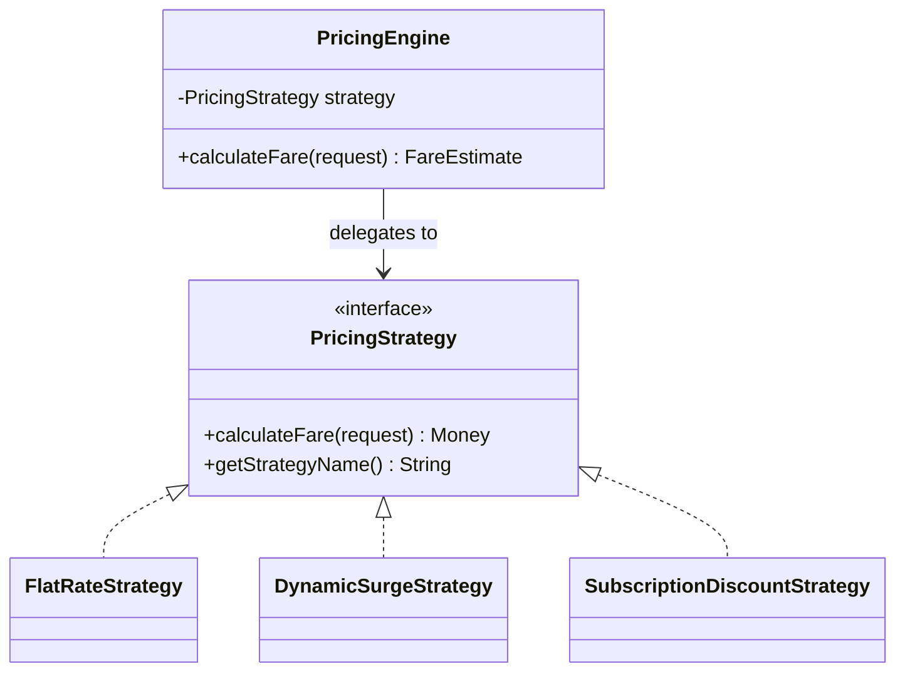
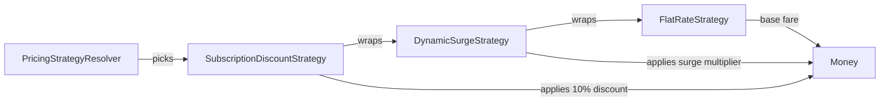
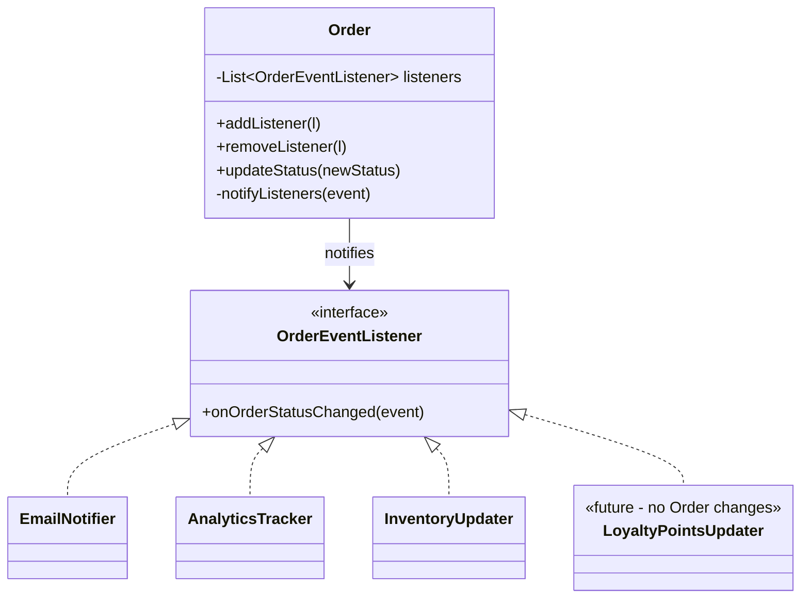
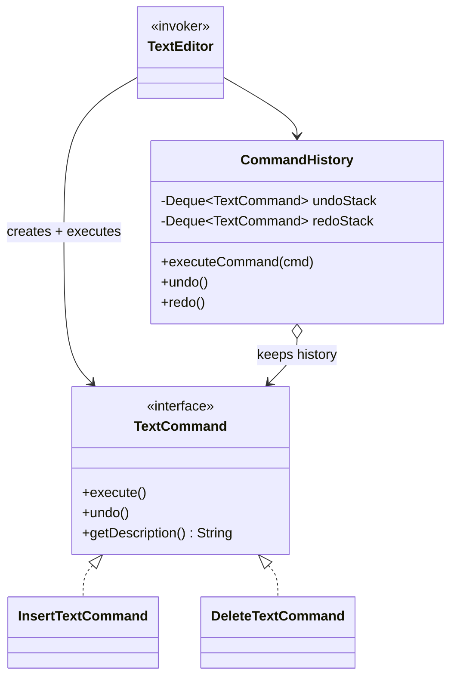
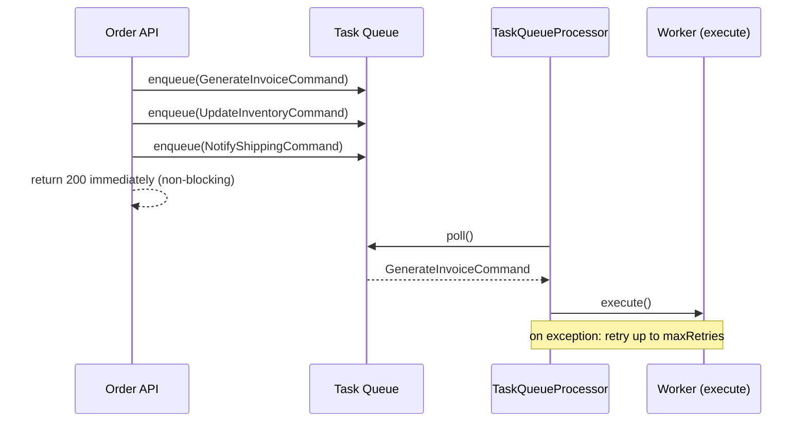
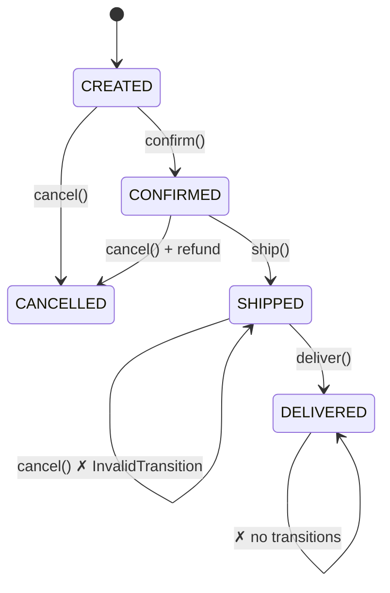
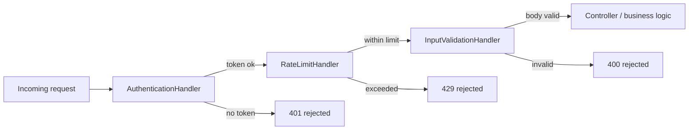
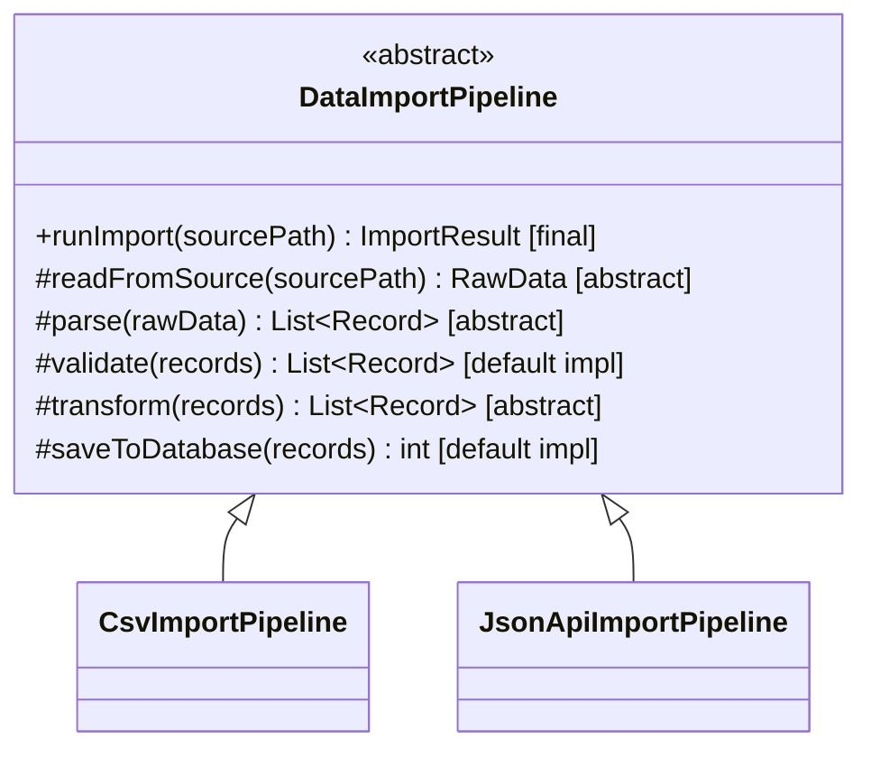
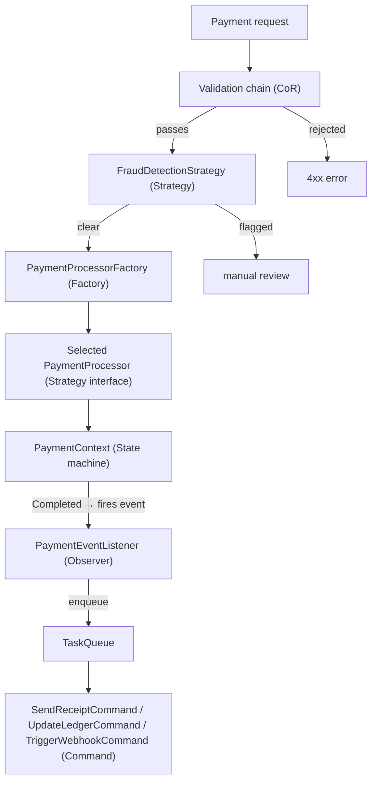

# 05 — Behavioral Design Patterns

> **Source:** Course Section 6 (SLIDE 66 – SLIDE 80). Structure and interview guidance follow the slides; all code is expanded to runnable **C++, C, and Java** versions. Markers: **[SLIDE n]** = from the slides, **[BEYOND THE COURSE]** = added here, **[INTERVIEW]** = how this is tested.

---

## 0. What This Section Is About

Structural patterns (file 04) solved how objects are **composed**. Behavioral patterns solve how objects **interact at runtime** [SLIDE 66]:

- **Which object makes a decision** (Strategy),
- **How events are propagated** (Observer),
- **How actions are wrapped, queued, and reversed** (Command),
- **How behavior changes with lifecycle** (State),
- **How requests flow through pipelines** (Chain of Responsibility),
- **How algorithms share a skeleton but vary their steps** (Template Method).

> **These patterns appear in LLD interviews *more frequently* than creational or structural patterns because they directly model the business logic interviewers ask you to design** [SLIDE 66]. If you are short on study time, this is the file to know best.

### 0.1 Where behavioral patterns appear in LLD interviews [SLIDE 66]

| Interview signal | Pattern | Why |
|---|---|---|
| "Support multiple algorithms/strategies for X" | **Strategy** | Swap behavior without modifying calling code |
| "When X happens, notify Y and Z" | **Observer** | Decouple event producers from consumers |
| "Support undo/redo" or "queue operations" | **Command** | Encapsulate actions as first-class objects |
| "Object behaves differently in each state" | **State** | Replace complex if/else chains with state objects |
| "Process request through a pipeline of checks" | **Chain of Responsibility** | Sequential processing with optional short-circuiting |
| "Same algorithm structure, different steps" | **Template Method** | Shared skeleton, customizable sub-steps |

### 0.2 How behavioral patterns connect to SOLID

| Pattern | SOLID principle it implements |
|---|---|
| **Strategy** | **OCP** — the direct implementation: new algorithm = new class |
| **Observer** | **DIP** — subject depends on the listener *interface*, not on concretes |
| **Command** | **SRP** — each command encapsulates exactly one action |
| **State** | **OCP + SRP** — each state's behavior in one class; new state = new class |
| **Chain of Responsibility** | **SRP** — each handler checks one thing |
| **Template Method** | **OCP (partially)** — new variant = new subclass; but the skeleton is closed |

---

## 1. Strategy — Swapping Algorithms at Runtime

### 1.1 The definition and when to use it [SLIDE 67]

> The Strategy pattern **defines a family of algorithms, encapsulates each one behind an interface, and makes them interchangeable**. The calling code (the **context**) delegates the algorithmic work to a **strategy** object and can swap strategies without any code change.

**The structure [SLIDE 67]:** `PricingEngine` holds a reference to a `PricingStrategy` interface. It does not know or care which algorithm is behind the interface. The strategy can be:

- Set at construction time,
- Loaded from configuration,
- Or even **changed mid-request** based on business rules.

**When to use Strategy [SLIDE 67] — the signals:**

- "Support multiple ways to do X" (pricing, sorting, compression, routing, validation).
- An existing **if/else or switch statement** that selects behavior based on a type or configuration value.
- An algorithm that may change **independently** of the code that uses it.
- Different customers, tiers, or contexts need different behavior for the same operation.



> **[INTERVIEW]** Strategy is **the most commonly tested behavioral pattern**. When you hear *"support multiple types of X"*, Strategy should be your first instinct — and you should state it: *"Since we need multiple pricing strategies, I will define a `PricingStrategy` interface."* This is the same sentence from file 02 §2.6 — the reflex is worth its own muscle memory.

### 1.2 Worked example: pricing strategies for a ride-sharing platform [SLIDE 68]

A platform like Uber needs multiple pricing models. The model depends on city, time of day, subscription tier, and demand.

**The interface [SLIDE 68]:**

```java
public interface PricingStrategy {
    Money calculateFare(RideRequest request);
    String getStrategyName();
}
```

**Three implementations [SLIDE 68]:**

```java
public class FlatRateStrategy implements PricingStrategy {
    private final Money baseFare;
    private final Money perKilometerRate;

    public FlatRateStrategy(Money baseFare, Money perKilometerRate) {
        this.baseFare = baseFare;
        this.perKilometerRate = perKilometerRate;
    }

    @Override
    public Money calculateFare(RideRequest request) {
        double distance = request.getDistanceKm();
        return baseFare.add(perKilometerRate.multiplyBy(distance));
    }

    @Override
    public String getStrategyName() { return "FLAT_RATE"; }
}

public class DynamicSurgeStrategy implements PricingStrategy {
    private final PricingStrategy baseStrategy;          // wraps another strategy!
    private final DemandTracker demandTracker;

    public DynamicSurgeStrategy(PricingStrategy baseStrategy, DemandTracker demandTracker) {
        this.baseStrategy = baseStrategy;
        this.demandTracker = demandTracker;
    }

    @Override
    public Money calculateFare(RideRequest request) {
        Money baseFare = baseStrategy.calculateFare(request);
        double surgeMultiplier = demandTracker.getSurgeMultiplier(request.getPickupZone());
        return baseFare.multiplyBy(surgeMultiplier);
    }

    @Override
    public String getStrategyName() { return "DYNAMIC_SURGE"; }
}

public class SubscriptionDiscountStrategy implements PricingStrategy {
    private final PricingStrategy baseStrategy;          // wraps another strategy!
    private final double discountPercentage;

    public SubscriptionDiscountStrategy(PricingStrategy baseStrategy, double discountPercentage) {
        this.baseStrategy = baseStrategy;
        this.discountPercentage = discountPercentage;
    }

    @Override
    public Money calculateFare(RideRequest request) {
        Money baseFare = baseStrategy.calculateFare(request);
        return baseFare.multiplyBy(1.0 - discountPercentage);
    }

    @Override
    public String getStrategyName() { return "SUBSCRIPTION_DISCOUNT"; }
}
```

**The context [SLIDE 68]:**

```java
public class PricingEngine {
    private final PricingStrategyResolver strategyResolver;

    public PricingEngine(PricingStrategyResolver strategyResolver) {
        this.strategyResolver = strategyResolver;
    }

    public FareEstimate calculateFare(RideRequest request) {
        PricingStrategy strategy = strategyResolver.resolve(request);
        Money fare = strategy.calculateFare(request);
        return new FareEstimate(fare, strategy.getStrategyName());
    }
}
```

**Three details interviewers evaluate in this example [SLIDE 68]:**

1. **The interface extraction** — the algorithm family lives behind `PricingStrategy`.
2. **The composability of strategies** — `DynamicSurgeStrategy` and `SubscriptionDiscountStrategy` **wrap another `PricingStrategy`**. The base strategy calculates the fare; the wrapping strategies modify it. *This is Strategy + Decorator in one shape* — a direct benefit of programming to interfaces.
3. **The separation of resolution from execution** — `PricingStrategyResolver` chooses *which* strategy; `PricingEngine` (context) just executes it. **Selection logic and algorithm logic are separate responsibilities.**

**The composition, drawn:**



Runtime chain for a subscriber in a surge zone: `FlatRate` computes base fare → `DynamicSurge` multiplies by demand → `SubscriptionDiscount` applies the tier discount. Same three classes serve every combination — nothing is fixed at compile time.

### 1.3 Strategy ↔ Open-Closed Principle [SLIDE 68B]

**Strategy is OCP made concrete.** The mapping is direct and worth stating in interviews [SLIDE 68B]:

**Without Strategy (OCP violation) [SLIDE 68B]:**

```java
public Money calculateFare(RideRequest request, String pricingType) {
    if (pricingType.equals("FLAT_RATE")) {
        return baseFare.add(perKmRate.multiplyBy(request.getDistanceKm()));
    } else if (pricingType.equals("PER_MINUTE")) {
        return baseFare.add(perMinuteRate.multiplyBy(request.getDurationMinutes()));
    } else if (pricingType.equals("SURGE")) {
        double multiplier = demandTracker.getSurgeMultiplier(request.getPickupZone());
        return baseFare.add(perKmRate.multiplyBy(request.getDistanceKm()))
                .multiplyBy(multiplier);
    }
    throw new IllegalArgumentException("Unknown pricing type: " + pricingType);
}
```

**Adding a new pricing type means editing this method.** The class is modified for every new business requirement — the OCP violation from file 02 §2.

**With Strategy (OCP compliant) [SLIDE 68B]:** adding a new pricing type means writing **one new class** implementing `PricingStrategy`. `PricingEngine`, `PricingStrategyResolver`, and all existing strategies are untouched.

**The mapping [SLIDE 68B]:**

| SOLID phrase | Strategy pattern equivalent |
|---|---|
| "Open for extension" | Write a new `PricingStrategy` implementation |
| "Closed for modification" | `PricingEngine` is never edited |
| Interface abstraction | `PricingStrategy` interface defines the contract |
| Polymorphic dispatch | `strategy.calculateFare(request)` calls the right implementation |

> **[INTERVIEW tip from SLIDE 68B]** When you extract an if/else chain into Strategy, say the sentence: *"This follows the Open-Closed Principle. Adding a new pricing type requires one new class. No existing code is modified."* Connecting the pattern to the SOLID principle shows the interviewer you understand **why**, not just **how**. Interviewers frequently present a switch statement and ask you to refactor it — **the refactoring is Strategy**.

### 1.4 The same Strategy in C++ and C (BEYOND THE COURSE)

**C++:**

```cpp
class PricingStrategy {
public:
    virtual ~PricingStrategy() = default;
    virtual Money calculateFare(const RideRequest& request) const = 0;
    virtual std::string name() const = 0;
};

class FlatRateStrategy final : public PricingStrategy {
public:
    FlatRateStrategy(Money baseFare, Money perKm)
        : baseFare_(baseFare), perKm_(perKm) {}

    Money calculateFare(const RideRequest& request) const override {
        return baseFare_ + perKm_ * request.distanceKm();
    }
    std::string name() const override { return "FLAT_RATE"; }
private:
    Money baseFare_, perKm_;
};

class SubscriptionDiscountStrategy final : public PricingStrategy {
public:
    SubscriptionDiscountStrategy(std::shared_ptr<const PricingStrategy> base,
                                 double discount)
        : base_(std::move(base)), discount_(discount) {}

    Money calculateFare(const RideRequest& request) const override {
        return base_->calculateFare(request) * (1.0 - discount_);
    }
    std::string name() const override { return "SUBSCRIPTION_DISCOUNT"; }
private:
    std::shared_ptr<const PricingStrategy> base_;   // wrapping another strategy
    double discount_;
};
```

The C++ shape highlights the composition explicitly: a strategy that **holds another strategy** — `shared_ptr<const PricingStrategy>` because the wrapped algorithm is a shared, immutable collaborator.

**C — strategy as an ops table; the resolver as a registry:**

```c
typedef struct pricing_ops {
    money_t (*calculate_fare)(const void *state, const ride_request_t *request);
    const char *name;
} pricing_ops_t;

typedef struct pricing_strategy {
    const pricing_ops_t *ops;
    const void *state;               /* strategy-private configuration */
} pricing_strategy_t;

/* ---- flat rate strategy ---- */
typedef struct { money_t base_fare; money_t per_km; } flat_rate_state_t;

static money_t flat_rate_calculate(const void *state, const ride_request_t *req)
{
    const flat_rate_state_t *st = state;
    return money_add(st->base_fare,
                     money_mul(st->per_km, ride_distance_km(req)));
}

static const pricing_ops_t FLAT_RATE_OPS = {
    .calculate_fare = flat_rate_calculate,
    .name = "FLAT_RATE",
};

/* ---- the context: exactly as language-neutral as the Java version ---- */
fare_estimate_t pricing_engine_calculate(pricing_strategy_t strategy,
                                         const ride_request_t *request)
{
    money_t fare = strategy.ops->calculate_fare(strategy.state, request);
    return fare_estimate_new(fare, strategy.ops->name);
}
```

And the resolver — note how "selection logic separate from algorithm logic" translates literally:

```c
/* pricing_resolver.c — the ONLY place that maps a request to an algorithm. */
pricing_strategy_t pricing_resolver_resolve(const ride_request_t *request,
                                            const pricing_registry_t *registry)
{
    const char *tier = ride_customer_tier(request);
    pricing_strategy_t strategy = pricing_registry_get(registry, tier);
    if (strategy.ops == NULL) {
        strategy = pricing_registry_get(registry, "DEFAULT");
    }
    return strategy;
}
```

### 1.5 The `NotificationChannel` example — Strategy you have already built [BEYOND THE COURSE]

File 03's notification system is **the same pattern** with different vocabulary:

| Strategy role | Notification system |
|---|---|
| Strategy interface | `NotificationChannel` (`send(userId, message)`) |
| Concrete strategies | `EmailChannel`, `SmsChannel`, `PushChannel`, `WhatsAppChannel` |
| Context | `NotificationService` — delegates `channel.send(...)` |
| Selection logic | `NotificationChannelFactory` / channel registry |

`NotificationService` never changes; adding WhatsApp is a new class + registration. That is **Strategy (behavior swapping) created by Factory (selection), i.e. the Strategy + Factory combination** you will formalize in §8 — and it is the answer to *"support multiple notification channels"* whenever it appears in a system-design-adjacent interview.

### 1.6 Strategy drills

**Drill 1 — extract it live.** Given the `calculateFare(request, String pricingType)` if/else, name: the interface, the implementations, the context, and the resolver — four boxes, 45 seconds. Then say the OCP sentence.

**Drill 2 — the wrapping insight.** *"How would you model 'all prices get surge, then loyalty discounts?'"* Answer: wrapping strategies (surge wraps base; discount wraps surge) — the composability detail from SLIDE 68. This also sets up Decorator + Strategy from file 04 §2: a `TimedPricingStrategy` decorator wraps *any* strategy without knowing which.

**Drill 3 — where does selection live?** *"Should `PricingEngine` know the customer tier rules?"* No — a resolver or a factory owns selection; the engine owns execution. Give the SRP reason: tier rules change on a different schedule than pricing math.

**Drill 4 — strategy vs if/else honesty.** *"When would you keep the if/else?"* If there are two branches, they are stable, and the logic is trivial, an if/else is fine — Strategy earns its interface when the number of variants grows or variants change independently. State this nuance; interviewers read reflexive "always Strategy" as patternitis.

---

## 2. Observer — Event-Driven Decoupling

### 2.1 The definition and the problem it solves [SLIDE 69]

> The Observer pattern defines a **one-to-many dependency** between objects so that when one object (**the subject**) changes state, all its dependents (**the observers**) are notified automatically. The subject does not know what the observers do with the notification. **It just fires the event.**

**The core problem Observer solves [SLIDE 69]:** an order management system. When an order's status changes to "shipped", the system must:

1. Send an email to the customer,
2. Update the inventory count,
3. Log the event for analytics,
4. Notify the warehouse management system.

**Without Observer:** the `Order` class must know about **all four** of these systems and call them directly. Adding a fifth action (update a loyalty points tracker) requires **modifying `Order`**.

**With Observer:** `Order` fires a "status changed" event. **Any number** of listeners can subscribe. Adding the loyalty points tracker means **registering a new listener. The `Order` class never changes** [SLIDE 69].



**Observer vs direct method calls [SLIDE 69]:**

| Dimension | Direct calls | Observer |
|---|---|---|
| **Coupling** | `Order` knows about every listener | `Order` knows only the **listener interface** |
| **Adding a new reaction** | Modify the `Order` class | **Register a new listener** |
| **Removing a reaction** | Modify the `Order` class | Unregister the listener |
| **Testing `Order` in isolation** | Must mock all listeners | **Can test with zero listeners** |
| **Runtime flexibility** | Fixed at compile time | Listeners added/removed at runtime |

> **[INTERVIEW]** Observer appears in any question where *an event in one part of the system triggers reactions in other parts*. The signal phrase: **"when X happens, Y and Z should also happen"** — and if Y and Z are in *different domains*, Observer is the answer.

### 2.2 Worked example: order status change notifications [SLIDE 70]

**The event and listener interface [SLIDE 70]:**

```java
public class OrderEvent {
    private final String orderId;
    private final OrderStatus previousStatus;
    private final OrderStatus newStatus;
    private final Instant timestamp;

    public OrderEvent(String orderId, OrderStatus previousStatus, OrderStatus newStatus) {
        this.orderId = orderId;
        this.previousStatus = previousStatus;
        this.newStatus = newStatus;
        this.timestamp = Instant.now();
    }

    public String getOrderId()            { return orderId; }
    public OrderStatus getPreviousStatus() { return previousStatus; }
    public OrderStatus getNewStatus()      { return newStatus; }
    public Instant getTimestamp()          { return timestamp; }
}

public interface OrderEventListener {
    void onOrderStatusChanged(OrderEvent event);
}
```

**The subject — `Order` [SLIDE 70]:**

```java
public class Order {
    private final String orderId;
    private OrderStatus status;
    private final List<OrderEventListener> listeners = new ArrayList<>();

    public Order(String orderId) {
        this.orderId = orderId;
        this.status = OrderStatus.CREATED;
    }

    public void addListener(OrderEventListener listener) {
        listeners.add(listener);
    }

    public void removeListener(OrderEventListener listener) {
        listeners.remove(listener);
    }

    public void updateStatus(OrderStatus newStatus) {
        OrderStatus previousStatus = this.status;
        this.status = newStatus;
        OrderEvent event = new OrderEvent(orderId, previousStatus, newStatus);
        notifyListeners(event);
    }

    private void notifyListeners(OrderEvent event) {
        for (OrderEventListener listener : listeners) {
            listener.onOrderStatusChanged(event);
        }
    }
}
```

**Two listeners [SLIDE 70]:**

```java
public class EmailNotifier implements OrderEventListener {
    private final EmailService emailService;
    private final CustomerRepository customerRepository;

    public EmailNotifier(EmailService emailService, CustomerRepository customerRepository) {
        this.emailService = emailService;
        this.customerRepository = customerRepository;
    }

    @Override
    public void onOrderStatusChanged(OrderEvent event) {
        if (event.getNewStatus() == OrderStatus.SHIPPED) {
            Customer customer = customerRepository.findByOrderId(event.getOrderId());
            emailService.send(customer.getEmail(), "Your order has shipped",
                              buildShippingEmailBody(event));
        }
    }
}

public class AnalyticsTracker implements OrderEventListener {
    private final AnalyticsClient analyticsClient;

    public AnalyticsTracker(AnalyticsClient analyticsClient) {
        this.analyticsClient = analyticsClient;
    }

    @Override
    public void onOrderStatusChanged(OrderEvent event) {
        analyticsClient.track("order_status_change", Map.of(
                "order_id", event.getOrderId(),
                "from_status", event.getPreviousStatus().name(),
                "to_status", event.getNewStatus().name(),
                "timestamp", event.getTimestamp().toString()));
    }
}
```

**Each listener handles one concern.** The `Order` class does **not** know that emails are sent or that analytics are tracked. **It fires events and moves on** [SLIDE 70].

> **[INTERVIEW]** This exact structure — **event object, listener interface, subject with listener list, notify loop** — is the standard Observer implementation. Showing it with a realistic domain (order management) rather than a toy example signals production experience. Follow-ups to be ready for: listener throwing an exception (§2.6 drill), ordering guarantees, and thread safety of the listener list.

### 2.3 The same Observer in C++ and C (BEYOND THE COURSE)

**C++ — interface-based listeners with `std::shared_ptr` registration:**

```cpp
struct OrderEvent {
    std::string orderId;
    OrderStatus previousStatus;
    OrderStatus newStatus;
    std::chrono::system_clock::time_point timestamp;
};

class OrderEventListener {
public:
    virtual ~OrderEventListener() = default;
    virtual void onOrderStatusChanged(const OrderEvent& event) = 0;
};

class Order {
public:
    explicit Order(std::string id) : orderId_(std::move(id)), status_(OrderStatus::Created) {}

    void addListener(std::shared_ptr<OrderEventListener> listener) {
        listeners_.push_back(std::move(listener));
    }

    void updateStatus(OrderStatus newStatus) {
        OrderStatus previous = status_;
        status_ = newStatus;
        OrderEvent event{orderId_, previous, newStatus, std::chrono::system_clock::now()};
        for (const auto& listener : listeners_) {
            listener->onOrderStatusChanged(event);
        }
    }

private:
    std::string orderId_;
    OrderStatus status_;
    std::vector<std::shared_ptr<OrderEventListener>> listeners_;
};
```

For lighter-weight callbacks, modern C++ frequently uses `std::function<void(const OrderEvent&)>` instead of an interface — same Observer, one fewer class per listener. Mention both; the interface version is better when listeners carry state and need identity (for unregistering).

**C — the kernel's *notifier chain* is exactly this pattern:**

```c
typedef struct order_event {
    const char *order_id;
    order_status_t previous_status;
    order_status_t new_status;
    uint64_t timestamp_ns;
} order_event_t;

typedef void (*order_listener_fn)(const order_event_t *event, void *ctx);

typedef struct order_listener {
    order_listener_fn fn;
    void *ctx;                     /* listener state: services it needs */
} order_listener_t;

typedef struct order {
    const char *order_id;
    order_status_t status;
    order_listener_t listeners[MAX_LISTENERS];
    size_t listener_count;
} order_t;

static void order_notify_listeners(order_t *order, const order_event_t *event)
{
    for (size_t i = 0; i < order->listener_count; i++) {
        order->listeners[i].fn(event, order->listeners[i].ctx);
    }
}
```

This is **the Linux kernel notifier chain pattern** (`blocking_notifier_call_chain`, etc.) — a list of `(function, context)` pairs invoked in registration order. The kernel uses it for the same reason the slide does: the subsystem that *fires* the event must not know which subsystems *react* to it.

### 2.4 Observer as pub-sub at the object level [SLIDE 70B]

Observer at the class level is the **same concept** as pub-sub at the system level. The mapping helps in both LLD and system-design interviews [SLIDE 70B]:

| Observer (class level) | Pub-Sub (system level) |
|---|---|
| Subject (`Order`) | Publisher (Order service) |
| Observer interface | Message schema / event contract |
| Listener list | Message broker (Kafka, RabbitMQ, SNS) |
| `notifyListeners()` | `broker.publish(event)` |
| `listener.onEvent()` | Consumer processes message from queue |
| In-process, synchronous | Cross-service, asynchronous |

**When to use each [SLIDE 70B]:**

| Consideration | Object-level Observer | System-level Pub-Sub |
|---|---|---|
| Listeners are in the **same process** | Yes | Overkill |
| Listeners are in **different services** | Not possible | Required |
| Need **guaranteed delivery** | No (if listener throws, event is lost) | Yes (broker retries) |
| Need **ordering guarantees** | Simple (loop order) | Complex (partitioning, sequencing) |
| **Latency** requirement | Microseconds | Milliseconds to seconds |
| **Complexity** | Low (30 lines of code) | High (broker infra, serialization, consumer groups) |

> **[INTERVIEW tip from SLIDE 70B]** In an LLD interview you design within a single service → **object-level Observer is appropriate**. Say the bridge sentence anyway: *"At the class level I'm using Observer for in-process event notification. If this system scales to multiple services, this pattern maps directly to a pub-sub architecture with a message broker."* This cross-abstraction-level thinking impresses interviewers — and it is the standard answer to the follow-up *"how would this scale?"*

### 2.5 [INTERVIEW] practice: Strategy + Observer in content moderation [SLIDE 70C]

**Scenario.** A content moderation system (YouTube-like):

- Content is checked against **multiple moderation strategies**: profanity filter, spam detection, copyright check, nudity detection.
- Each strategy produces a **moderation decision**: approve, flag for review, reject.
- When content is **rejected**, the system must: **notify the creator**, **log the decision for compliance**, and **update the creator's trust score**.

*"How would you structure this?"*

**Weak answer [SLIDE 70C]:**
> "I would create a `ContentModerator` class with methods for each check type and if/else logic for notifications."

All moderation logic **and** all notification logic in one class — **SRP violation**. Adding a new moderation strategy or a new notification type requires modifying the same class.

**Strong answer [SLIDE 70C]:**

> "Two distinct problems:
>
> 1. **The moderation strategies are a Strategy problem.** A `ModerationStrategy` interface with a `moderate(Content)` method; each check (profanity, spam, copyright, nudity) is a separate implementation. A `ModerationPipeline` iterates through all registered strategies and aggregates their decisions.
> 2. **The notification reactions are an Observer problem.** The `ModerationPipeline` fires a `ModerationDecisionEvent` when content is rejected. Three listeners — notify creator, compliance log, trust-score update — handle the reactions independently.
>
> **Adding a new moderation check means writing one new Strategy. Adding a new notification means registering one new Observer. Neither change modifies existing code.**"

That closing sentence is the scoring line: **two problems, two patterns, both OCP-clean** [SLIDE 70C].

### 2.6 Observer drills

**Drill 1 — the exception question.** *"A listener throws. What happens to the other listeners?"* Honest answer depends on policy, and you should say which policy you choose: (a) fail-fast — exception propagates, later listeners skipped (simple, but one bad listener kills the event); (b) isolate — wrap each `listener.onEvent` in try/catch and log; (c) async — hand off to a queue (Observer + Command, §8). Production systems choose (b) or (c); the slides' simple loop is (a). Interviewers love this question because it separates pattern recall from production judgment.

**Drill 2 — ordering and re-entrancy.** *"Listener A removes listener B while the event is being dispatched. Is B still called?"* In the simple loop, you are iterating a list that is being mutated — Java throws `ConcurrentModificationException`; C++ iterators invalidate. Standard fixes: iterate over a **snapshot** copy, or dispatch to a **copy-on-write** list. Say "snapshot the listener list before dispatch" and you sound like you have shipped event code.

**Drill 3 — Observer vs pub-sub classification.** For each, say object-level or system-level: (a) UI updates when a model changes (MVC); (b) order service → analytics service in another deployment; (c) a cache invalidation within one JVM; (d) email service consumes from Kafka. *(object; system; object; system.)*

**Drill 4 — when Observer is wrong.** *"Should the inventory decrement happen via Observer on OrderPlaced?"* Careful answer: only if eventual inconsistency is acceptable. If the order placement must **atomically** guarantee inventory decrement (a hard business invariant), direct call / transaction / synchronously-invoked listener is required — fire-and-forget events trade guarantee for decoupling. Naming that trade-off is a senior signal.

---

## 3. Command — Encapsulating Requests as Objects

### 3.1 The definition and when to use it [SLIDE 71]

> The Command pattern turns a request or operation into a **standalone object** that contains everything needed to perform the action. Instead of calling a method directly, you create a **Command object** that represents the method call, and pass that object around. The Command can be **stored, queued, logged, or undone**.

**When to use Command [SLIDE 71]:**

| Need | What the Command object provides |
|---|---|
| **Undo/redo** | Each command knows how to `execute()` itself **and how to `undo()` itself** |
| **Queue operations** | Commands stored in a queue, executed later (task processing, job scheduling) |
| **Log operations** | Commands persisted for audit trails or **replay** |
| **Batch operations** | Multiple commands collected and executed as a group |

**The unifying idea [SLIDE 71]: the action becomes a first-class object rather than just a method call.** Once it is an object, you can do everything with it that you can do with any other object: **store it, pass it, serialize it, undo it.**



**The invoker [SLIDE 71]:** `TextEditor` does **not** perform text operations directly. It creates Command objects and executes them. Each executed command is **pushed onto the undo stack**. Undoing pops the last command and calls its `undo()`.

> **[INTERVIEW]** Command appears for **text editors, drawing applications, task schedulers**, and any system that needs **undo/redo or operation queuing**. The signal phrases: *"support undo"* and *"queue operations for later execution."*

### 3.2 Worked example: undo and redo in a text editor [SLIDE 72]

**The command interface [SLIDE 72]:**

```java
public interface TextCommand {
    void execute();
    void undo();
    String getDescription();
}
```

**Two concrete commands [SLIDE 72]:**

```java
public class InsertTextCommand implements TextCommand {
    private final TextDocument document;
    private final int position;
    private final String textToInsert;

    public InsertTextCommand(TextDocument document, int position, String textToInsert) {
        this.document = document;
        this.position = position;
        this.textToInsert = textToInsert;
    }

    @Override
    public void execute() {
        document.insertAt(position, textToInsert);
    }

    @Override
    public void undo() {
        document.deleteRange(position, position + textToInsert.length());
    }

    @Override
    public String getDescription() {
        return "Insert '" + textToInsert + "' at position " + position;
    }
}

public class DeleteTextCommand implements TextCommand {
    private final TextDocument document;
    private final int startPosition;
    private final int endPosition;
    private String deletedText;               // captured during execute()

    public DeleteTextCommand(TextDocument document, int startPosition, int endPosition) {
        this.document = document;
        this.startPosition = startPosition;
        this.endPosition = endPosition;
    }

    @Override
    public void execute() {
        deletedText = document.getTextRange(startPosition, endPosition);   // SAVE
        document.deleteRange(startPosition, endPosition);
    }

    @Override
    public void undo() {
        document.insertAt(startPosition, deletedText);                     // RESTORE
    }

    @Override
    public String getDescription() {
        return "Delete text from " + startPosition + " to " + endPosition;
    }
}
```

**The command history (undo/redo stacks) [SLIDE 72]:**

```java
public class CommandHistory {
    private final Deque<TextCommand> undoStack = new ArrayDeque<>();
    private final Deque<TextCommand> redoStack = new ArrayDeque<>();

    public void executeCommand(TextCommand command) {
        command.execute();
        undoStack.push(command);
        redoStack.clear();                  // new action invalidates the redo history
    }

    public void undo() {
        if (undoStack.isEmpty()) {
            throw new IllegalStateException("Nothing to undo");
        }
        TextCommand command = undoStack.pop();
        command.undo();
        redoStack.push(command);
    }

    public void redo() {
        if (redoStack.isEmpty()) {
            throw new IllegalStateException("Nothing to redo");
        }
        TextCommand command = redoStack.pop();
        command.execute();
        undoStack.push(command);
    }
}
```

**The critical details [SLIDE 72] — these are what the interviewer is checking:**

1. **`DeleteTextCommand.execute()` saves the deleted text in `deletedText` so `undo()` can restore it.** Each command captures **everything it needs to reverse itself** — undo does not "figure out" how to reverse; the command carries the exact prior state.
2. **The redo stack is cleared whenever a new command is executed**, because a new action after an undo **invalidates the redo history** (you cannot "redo" a future that was replaced).
3. **`undo()` re-executes nothing blindly** — it inverts the *specific* change captured at execution time (right position, right text).

**The lifecycle, drawn:**

```mermaid
sequenceDiagram
    participant E as TextEditor (invoker)
    participant C as InsertTextCommand
    participant D as TextDocument
    participant H as CommandHistory

    E->>H: executeCommand(cmd)
    H->>C: execute()
    C->>D: insertAt(position, text)
    H->>H: undoStack.push(cmd); redoStack.clear()
    E->>H: undo()
    H->>C: undo()
    C->>D: deleteRange(position, position+len)
    H->>H: redoStack.push(cmd)
```

> **[INTERVIEW]** The undo/redo text editor is **one of the most popular Command interview questions**. The interviewer evaluates: (a) whether you **capture enough state in each command** to support reversal, and (b) whether your history handles the **undo-then-new-action edge case** (clearing redo). Both details appear on the slide for a reason.

### 3.3 The same commands in C++ and C (BEYOND THE COURSE)

**C++ — commands own their undo state; history owns the commands:**

```cpp
class TextCommand {
public:
    virtual ~TextCommand() = default;
    virtual void execute() = 0;
    virtual void undo() = 0;
    virtual std::string description() const = 0;
};

class DeleteTextCommand final : public TextCommand {
public:
    DeleteTextCommand(TextDocument& document, int start, int end)
        : document_(document), start_(start), end_(end) {}

    void execute() override {
        deletedText_ = document_.textRange(start_, end_);   // capture for undo
        document_.deleteRange(start_, end_);
    }

    void undo() override {
        document_.insertAt(start_, deletedText_);
    }

    std::string description() const override {
        return "Delete from " + std::to_string(start_) + " to " + std::to_string(end_);
    }

private:
    TextDocument& document_;
    int start_, end_;
    std::string deletedText_;
};

class CommandHistory {
public:
    void execute(std::unique_ptr<TextCommand> command) {
        command->execute();
        undoStack_.push_back(std::move(command));
        redoStack_.clear();
    }

    void undo() {
        if (undoStack_.empty()) return;
        auto command = std::move(undoStack_.back());
        undoStack_.pop_back();
        command->undo();
        redoStack_.push_back(std::move(command));
    }

    void redo() {
        if (redoStack_.empty()) return;
        auto command = std::move(redoStack_.back());
        redoStack_.pop_back();
        command->execute();
        undoStack_.push_back(std::move(command));
    }

private:
    std::vector<std::unique_ptr<TextCommand>> undoStack_;
    std::vector<std::unique_ptr<TextCommand>> redoStack_;
};
```

C++ detail: `undo()` moves the command between stacks with `std::move` — ownership transfers without copying, and the unique_ptr discipline guarantees a command is never leaked or double-owned while sitting in history.

**C — commands as structs of function pointers; history as two stacks of pointers:**

```c
typedef struct text_command_ops {
    void (*execute)(void *self);
    void (*undo)(void *self);
    const char *(*describe)(const void *self);
    void (*destroy)(void *self);
} text_command_ops_t;

typedef struct text_command {
    const text_command_ops_t *ops;
    void *impl;
} text_command_t;

/* The history: two fixed stacks of command_t (ownership travels with the command). */
typedef struct command_history {
    text_command_t undo_stack[MAX_HISTORY];
    text_command_t redo_stack[MAX_HISTORY];
    size_t undo_count;
    size_t redo_count;
} command_history_t;

void command_history_execute(command_history_t *h, text_command_t command)
{
    command.ops->execute(command.impl);
    h->undo_stack[h->undo_count++] = command;
    command_history_clear_redo(h);          /* new action invalidates redo */
}

void command_history_undo(command_history_t *h)
{
    if (h->undo_count == 0) {
        return;
    }
    text_command_t command = h->undo_stack[--h->undo_count];
    command.ops->undo(command.impl);
    h->redo_stack[h->redo_count++] = command;
}
```

In C the "command object" is, as always, **a struct + an ops table**, and the history is just two arrays of those structs. Undo/redo, queuing, and logging all work because the *action* is now data.

### 3.4 Command for task queue processing [SLIDE 72B]

Command is not limited to undo/redo. In production it is frequently used to **queue operations for deferred or asynchronous execution** [SLIDE 72B].

**The scenario [SLIDE 72B]:** a Shopify-like platform must process post-order tasks: **generate an invoice PDF**, **update inventory across warehouses**, and **notify the shipping provider** — queued and processed **asynchronously** rather than blocking the order-confirmation response.

**The command interface for queuing [SLIDE 72B]:**

```java
public interface TaskCommand {
    void execute();
    String getTaskType();
    int getMaxRetries();
}
```

**A concrete task [SLIDE 72B]:**

```java
public class GenerateInvoiceCommand implements TaskCommand {
    private final String orderId;
    private final InvoiceGenerator invoiceGenerator;
    private final DocumentStore documentStore;

    public GenerateInvoiceCommand(String orderId,
                                  InvoiceGenerator invoiceGenerator,
                                  DocumentStore documentStore) {
        this.orderId = orderId;
        this.invoiceGenerator = invoiceGenerator;
        this.documentStore = documentStore;
    }

    @Override
    public void execute() {
        byte[] invoicePdf = invoiceGenerator.generate(orderId);
        documentStore.store(orderId + "-invoice.pdf", invoicePdf);
    }

    @Override
    public String getTaskType() { return "GENERATE_INVOICE"; }

    @Override
    public int getMaxRetries() { return 3; }
}
```

**The task queue processor [SLIDE 72B]:**

```java
public class TaskQueueProcessor {
    private final BlockingQueue<TaskCommand> taskQueue;

    public TaskQueueProcessor(BlockingQueue<TaskCommand> taskQueue) {
        this.taskQueue = taskQueue;
    }

    public void enqueue(TaskCommand task) {
        taskQueue.offer(task);
    }

    public void processNext() {
        TaskCommand task = taskQueue.poll();
        if (task == null) {
            return;
        }
        int attempts = 0;
        while (attempts < task.getMaxRetries()) {
            try {
                task.execute();
                return;                                 // success
            } catch (Exception e) {
                attempts++;
                if (attempts >= task.getMaxRetries()) {
                    handleFailedTask(task, e);          // dead-letter / alert
                }
            }
        }
    }
}
```

**The flow [SLIDE 72B]:** the order-confirmation endpoint creates three Command objects (`GenerateInvoiceCommand`, `UpdateInventoryCommand`, `NotifyShippingCommand`), **enqueues them, and returns immediately**. The processor handles execution, retries, and failure recovery separately.



> **[INTERVIEW tip from SLIDE 72B]** When asked about **asynchronous processing or background jobs**, Command is the pattern that encapsulates the work. Say: *"Each task is a Command object. The queue stores commands and the processor executes them with retry logic. Adding a new post-order task means creating one new Command class and enqueuing it."* Bonus points for adding: *"Commands must be idempotent, because retries can execute them more than once."* — that one sentence carries more weight than the pattern itself.

### 3.5 Command drills

**Drill 1 — enough state?** *"Your `MoveTextCommand` needs undo. What exactly do you capture?"* Expected: source range, destination position, **and the moved text itself** (or a way to re-read it safely); the test question is *"can undo be executed after ten other commands have changed the document?"* — if any captured state can be invalidated by later commands, the command does not capture enough.

**Drill 2 — the redo nuance.** *"Why clear the redo stack on a new action?"* Because redo means "re-apply the most recently undone command **in a history that still matches**". After a new action, the undone future never happened — the timeline branches and the old branch is discarded. (Version-control analogies help: redo applies a patch; a new commit invalidates the stale patch.)

**Drill 3 — Command vs Strategy.** *"Both are objects hiding behavior — difference?"* Strategy is **stateless algorithm selection** (same operation, different math); Command is a **request object** (knows *what to do* to *which receiver*, often capturing parameters and undo state, and is stored/queued/logged). Strategy: "how to compute." Command: "what to do, and how to take it back."

**Drill 4 — Command vs Observer + Command.** *"What is the difference between firing events and enqueuing commands?"* Events are **facts** (past tense: OrderShipped) with many independent listeners; commands are **instructions** (imperative: SendShippingEmail) addressed to one executor, with retry semantics and a single owner. The Observer + Command combination (fact → queued instruction) is the standard production bridge, formalized in §8.

---

## 4. State — Behavior Based on Internal State

### 4.1 The definition and the problem it solves [SLIDE 73]

> The State pattern allows an object to **change its behavior when its internal state changes**. Instead of a series of if/else or switch statements checking the current state, you **encapsulate each state's behavior in a separate class**. The object delegates to its current state object, and **transitions between states are explicit**.

**The problem State solves [SLIDE 73]:** an order moves through `CREATED → CONFIRMED → SHIPPED → DELIVERED / CANCELLED`, and its behavior depends on its current state:

- **CREATED:** can be confirmed or cancelled.
- **CONFIRMED:** can be shipped or cancelled (**with a refund**).
- **SHIPPED:** can be delivered but **cannot be cancelled**.
- **DELIVERED:** no further transitions allowed.

**Without State — the if/else nightmare [SLIDE 73]:**

```java
public void cancel(Order order) {
    if (order.getStatus().equals("CREATED")) {
        order.setStatus("CANCELLED");
    } else if (order.getStatus().equals("CONFIRMED")) {
        order.setStatus("CANCELLED");
        paymentService.refund(order.getTransactionId());
    } else if (order.getStatus().equals("SHIPPED")) {
        throw new IllegalStateException("Cannot cancel a shipped order");
    } else if (order.getStatus().equals("DELIVERED")) {
        throw new IllegalStateException("Cannot cancel a delivered order");
    }
}
```

**What is wrong:**

- **Every method** that operates on the order (`confirm()`, `ship()`, `cancel()`, `deliver()`) has a similar if/else chain.
- The behavior for each state is **scattered across the entire class**.
- Adding a new state (`RETURNED`) requires **modifying every method**.

**With State:** all behavior for the CONFIRMED state lives in one `ConfirmedState` class; all behavior for SHIPPED lives in `ShippedState`. **Adding a RETURNED state means writing one new class** [SLIDE 73].

> **[INTERVIEW]** State appears in any question involving **lifecycle management**: order processing, document workflows, game character behavior, connection management (TCP states), payment flows. The signal phrase: **"object behaves differently depending on its state."**

### 4.2 Worked example: order lifecycle with valid transitions [SLIDE 74]

**The state interface [SLIDE 74]:**

```java
public interface OrderState {
    void confirm(OrderContext context);
    void ship(OrderContext context);
    void deliver(OrderContext context);
    void cancel(OrderContext context);
    String getStateName();
}
```

**The context — `Order` [SLIDE 74]:**

```java
public class OrderContext {
    private OrderState currentState;
    private final String orderId;
    private final PaymentService paymentService;
    private String transactionId;

    public OrderContext(String orderId, PaymentService paymentService) {
        this.orderId = orderId;
        this.paymentService = paymentService;
        this.currentState = new CreatedState();          // initial state
    }

    public void setState(OrderState newState) {
        this.currentState = newState;
    }

    public void confirm(String transactionId) {
        this.transactionId = transactionId;
        currentState.confirm(this);
    }

    public void ship()    { currentState.ship(this); }
    public void deliver() { currentState.deliver(this); }
    public void cancel()  { currentState.cancel(this); }

    public PaymentService getPaymentService() { return paymentService; }
    public String getTransactionId()          { return transactionId; }
    public String getOrderId()                { return orderId; }
}
```

Every public operation **delegates to the current state** — the context contains no transition logic itself.

**Two state implementations [SLIDE 74]:**

```java
public class CreatedState implements OrderState {
    @Override
    public void confirm(OrderContext context) {
        context.setState(new ConfirmedState());          // valid transition
    }

    @Override
    public void ship(OrderContext context) {
        throw new InvalidTransitionException("Cannot ship an unconfirmed order");
    }

    @Override
    public void deliver(OrderContext context) {
        throw new InvalidTransitionException("Cannot deliver an unconfirmed order");
    }

    @Override
    public void cancel(OrderContext context) {
        context.setState(new CancelledState());          // valid transition
    }

    @Override
    public String getStateName() { return "CREATED"; }
}

public class ConfirmedState implements OrderState {
    @Override
    public void confirm(OrderContext context) {
        throw new InvalidTransitionException("Order is already confirmed");
    }

    @Override
    public void ship(OrderContext context) {
        context.setState(new ShippedState());            // valid transition
    }

    @Override
    public void deliver(OrderContext context) {
        throw new InvalidTransitionException("Cannot deliver before shipping");
    }

    @Override
    public void cancel(OrderContext context) {
        context.getPaymentService().refund(context.getTransactionId());  // side effect
        context.setState(new CancelledState());
    }

    @Override
    public String getStateName() { return "CONFIRMED"; }
}
```

**The key properties [SLIDE 74]:**

- Each state class defines **exactly which transitions are valid from that state** and **what side effects accompany each transition** (the refund lives in `ConfirmedState.cancel` — precisely where that knowledge belongs).
- **Invalid transitions throw exceptions with clear messages** instead of being silently ignored.
- Adding a `RETURNED` state means **writing one class** (and adding `return()` to the interface); existing states simply throw `InvalidTransitionException` for the new operation unless the transition is valid from their state.



> **[INTERVIEW]** The State pattern with **valid transition guards** is the standard answer for order-lifecycle LLD questions. The interviewer evaluates whether you **handle invalid transitions explicitly** (throw with a clear message) rather than silently ignoring them — silent ignores are how state machines corrupt data in production.

### 4.3 The same State in C++ and C (BEYOND THE COURSE)

**C++:**

```cpp
class OrderState {
public:
    virtual ~OrderState() = default;
    virtual void confirm(OrderContext& ctx) = 0;
    virtual void ship(OrderContext& ctx) = 0;
    virtual void cancel(OrderContext& ctx) = 0;
    virtual std::string name() const = 0;
};

class OrderContext {
public:
    explicit OrderContext(PaymentService& payments)
        : state_(std::make_unique<CreatedState>()), payments_(payments) {}

    void setState(std::unique_ptr<OrderState> newState) { state_ = std::move(newState); }
    void confirm(std::string transactionId) {
        transactionId_ = std::move(transactionId);
        state_->confirm(*this);
    }
    void ship()   { state_->ship(*this); }
    void cancel() { state_->cancel(*this); }

    PaymentService& payments() { return payments_; }
    const std::string& transactionId() const { return transactionId_; }

private:
    std::unique_ptr<OrderState> state_;   // current state OWNS the behavior
    PaymentService& payments_;
    std::string transactionId_;
};

class ConfirmedState final : public OrderState {
public:
    void confirm(OrderContext&) override { throw InvalidTransition{"already confirmed"}; }
    void ship(OrderContext& ctx) override { ctx.setState(std::make_unique<ShippedState>()); }
    void cancel(OrderContext& ctx) override {
        ctx.payments().refund(ctx.transactionId());        // side effect at the transition
        ctx.setState(std::make_unique<CancelledState>());
    }
    std::string name() const override { return "CONFIRMED"; }
};
```

`std::make_unique<NextState>()` at each transition is the C++ way of "state transitions are explicit": there is literally one expression where the new state becomes current.

**C — states as ops tables, the context as a struct holding the current table:**

```c
typedef struct order_context order_context_t;

typedef struct order_state_ops {
    void (*confirm)(order_context_t *ctx);
    void (*ship)(order_context_t *ctx);
    void (*cancel)(order_context_t *ctx);
    const char *name;
} order_state_ops_t;

struct order_context {
    const order_state_ops_t *state;      /* current state = current ops table */
    payment_service_t       *payments;
    const char              *order_id;
    const char              *transaction_id;
};

/* transitions in C are assignments of ops tables */
static void confirmed_ship(order_context_t *ctx)
{
    ctx->state = &SHIPPED_STATE_OPS;
}

static void confirmed_cancel(order_context_t *ctx)
{
    payment_refund(ctx->payments, ctx->transaction_id);    /* side effect */
    ctx->state = &CANCELLED_STATE_OPS;
}

static void confirmed_confirm(order_context_t *ctx)
{
    order_invalid_transition(ctx, "already confirmed");
}

static const order_state_ops_t CONFIRMED_STATE_OPS = {
    .confirm = confirmed_confirm,
    .ship    = confirmed_ship,
    .cancel  = confirmed_cancel,
    .name    = "CONFIRMED",
};
```

**A TCP-connection analogy:** the kernel models TCP states with function tables per state (`tcp_state`-driven operations) for the same reason: a state machine with explicit transition functions is verifiable and testable; interleaved if/else in one giant function is not.

### 4.4 State vs Strategy: when each applies [SLIDE 74B]

State and Strategy have **identical structure** — an interface, multiple implementations, a context that delegates. The difference is **intent and lifecycle** [SLIDE 74B]:

| Dimension | Strategy | State |
|---|---|---|
| **Intent** | Choose one algorithm from a set | Object changes behavior as internal state changes |
| **Who selects the implementation** | **External code or configuration** | **The current state determines the next state** |
| **Transitions** | Typically set once, rarely changes | Transitions happen **throughout the object's lifetime** |
| **Awareness of other implementations** | Strategies do **not** know about each other | Each state **knows which states it can transition to** |
| **Example** | Pricing algorithm chosen based on customer tier | Order moves through Created, Confirmed, Shipped |
| **Replaces** | If/else selecting **an algorithm** | If/else checking **current state** |

**The simple test [SLIDE 74B]:**

> Ask: **"Does the object change its behavior over time?"**
>
> - **Yes → State.** The order starts CREATED, transitions to CONFIRMED, then SHIPPED; behavior changes as it progresses.
> - **No → Strategy.** The pricing algorithm is selected once based on configuration and does not change during the request.

**Common interview mistake [SLIDE 74B]:** candidates confuse the two because the **UML diagrams look identical**. The differentiator: if the object **transitions between implementations during its lifetime** and **each implementation knows which other implementations it can transition to**, it is State. If the implementation is **selected externally and stays fixed**, it is Strategy.

> **[INTERVIEW tip from SLIDE 74B]** Answer with the **transition test**: *"In State, the current implementation determines the next implementation. In Strategy, external code selects the implementation. Here, the order's current state determines valid next states, so this is State."* The State-vs-Strategy distinction is a direct interview question at mid-to-senior levels; having the transition test ready demonstrates precision in design vocabulary.

### 4.5 [INTERVIEW] practice: Command + State in a drawing app [SLIDE 74C]

**Scenario.** A Figma-like drawing application:

- Multiple **tools** (pen, eraser, shape tool, text tool); each behaves differently when the user clicks on the canvas.
- Full **undo/redo** support for all drawing operations.

*"How would you structure the tool behavior and the undo system?"*

**Weak answer [SLIDE 74C]:**
> "I would use if/else to check the current tool and create a list of operations for undo."

Conflates two separate concerns: **tool behavior selection** and **the undo system** need different patterns.

**Strong answer [SLIDE 74C]:**

> "Two problems, two patterns:
>
> 1. **Tool behavior that changes with the selected tool is a State problem.** A `ToolState` interface defines `onCanvasClick(Point)`, `onCanvasDrag(Point, Point)`, and `onCanvasRelease(Point)`. Each tool (pen, eraser, shape, text) is a separate State implementation. When the user switches tools, the application transitions to the corresponding state.
> 2. **The undo/redo system is a Command problem.** Each drawing action creates a Command object (`DrawLineCommand`, `EraseAreaCommand`, `InsertShapeCommand`) that captures all information needed to execute and reverse the action. A `CommandHistory` manages the undo and redo stacks.
>
> The patterns work together: **the current `ToolState` creates the appropriate Command when the user interacts with the canvas, and the `CommandHistory` manages the lifecycle of those commands.**"

That final sentence — showing **how the two patterns collaborate** — is the difference between "knows two patterns" and "can compose them" [SLIDE 74C].

### 4.6 State drills

**Drill 1 — enumerate the transitions.** For a payment: `INITIATED → PROCESSING → COMPLETED/FAILED`, plus `COMPLETED → REFUNDED`. Write the transition table (state × operation → next state or error) before writing any classes. If you can produce the table in 60 seconds, the classes write themselves.

**Drill 2 — where does side-effect logic go?** *"Where does the refund belong — in the context's `cancel()` or in `ConfirmedState.cancel()`?"* In the state class: the refund is a **transition rule specific to CONFIRMED**. If it lived in the context, the context would need to know which state it is in — the exact if/else the pattern exists to remove.

**Drill 3 — State vs "just an enum + switch".** *"Why not keep an enum and a switch?"* For 4 stable states with 1–2 transitions, an enum is fine. State earns its classes when: transitions carry **different side effects per state**, the transition matrix is large, **multiple operations** share the state dimension, or states evolve (RETURNED, DISPUTED) — each new state multiplies through every switch otherwise.

**Drill 4 — persistence.** *"How do you save an order mid-lifecycle?"* Persist the **state name** (string/enum), not the state object; on reload, reconstruct the state object from the name (a small factory — file 03). This tiny follow-up shows you think about the pattern beyond one process lifetime.

---

## 5. Chain of Responsibility — Processing Pipelines

### 5.1 The definition and when to use it [SLIDE 75]

> The Chain of Responsibility pattern **passes a request along a chain of handlers**. Each handler decides either to **process** the request, **pass it to the next handler**, or **reject it**. The request moves through the chain until a handler fully processes it or the chain ends.

**When to use Chain of Responsibility [SLIDE 75]:**

- Multiple checks or transformations must be applied to a request **in sequence**.
- The **set of checks can vary** (some requests skip certain checks).
- Each check is **independent** and has a **single responsibility**.
- The chain can **short-circuit** (a failed check stops further processing).

**The real-world analogy [SLIDE 75]: HTTP middleware in web frameworks is Chain of Responsibility.** A request passes through authentication → authorization → rate limiting → input validation → logging middleware. Each middleware can process the request and pass it forward, or reject it and return an error response.



**The structure [SLIDE 75]:** each handler has a reference to the **next** handler in the chain. If a handler cannot process the request (auth fails, rate limit exceeded), it **short-circuits** and returns an error. If the handler succeeds, it passes the request to the next handler.

> **[INTERVIEW]** Chain of Responsibility appears for **request processing, validation pipelines, approval workflows, middleware design**. The signal phrase: *"process this request through a series of checks."*

### 5.2 Worked example: request validation chain [SLIDE 76]

**The handler interface [SLIDE 76]:**

```java
public interface RequestHandler {
    HandlerResult handle(ApiRequest request);
    void setNext(RequestHandler nextHandler);
}
```

**Abstract base handler [SLIDE 76] — the "next" plumbing written once:**

```java
public abstract class AbstractRequestHandler implements RequestHandler {
    private RequestHandler nextHandler;

    @Override
    public void setNext(RequestHandler nextHandler) {
        this.nextHandler = nextHandler;
    }

    protected HandlerResult passToNext(ApiRequest request) {
        if (nextHandler == null) {
            return HandlerResult.success();          // end of chain = success
        }
        return nextHandler.handle(request);
    }
}
```

**Concrete handlers [SLIDE 76]:**

```java
public class AuthenticationHandler extends AbstractRequestHandler {
    private final TokenValidator tokenValidator;

    public AuthenticationHandler(TokenValidator tokenValidator) {
        this.tokenValidator = tokenValidator;
    }

    @Override
    public HandlerResult handle(ApiRequest request) {
        String token = request.getHeader("Authorization");
        if (token == null || token.isBlank()) {
            return HandlerResult.rejected(401, "Missing authentication token");
        }
        TokenValidationResult validation = tokenValidator.validate(token);
        if (!validation.isValid()) {
            return HandlerResult.rejected(401, "Invalid or expired token");
        }
        request.setAuthenticatedUser(validation.getUserId());
        return passToNext(request);                   // success → forward
    }
}

public class RateLimitHandler extends AbstractRequestHandler {
    private final RateLimiter rateLimiter;

    public RateLimitHandler(RateLimiter rateLimiter) {
        this.rateLimiter = rateLimiter;
    }

    @Override
    public HandlerResult handle(ApiRequest request) {
        String userId = request.getAuthenticatedUser();
        if (!rateLimiter.allowRequest(userId)) {
            return HandlerResult.rejected(429, "Rate limit exceeded");
        }
        return passToNext(request);
    }
}

public class InputValidationHandler extends AbstractRequestHandler {
    private final RequestValidator requestValidator;

    public InputValidationHandler(RequestValidator requestValidator) {
        this.requestValidator = requestValidator;
    }

    @Override
    public HandlerResult handle(ApiRequest request) {
        ValidationResult validation = requestValidator.validate(request.getBody());
        if (!validation.isValid()) {
            return HandlerResult.rejected(400, validation.getErrorMessage());
        }
        return passToNext(request);
    }
}
```

**Assembling the chain [SLIDE 76]:**

```java
AuthenticationHandler authHandler = new AuthenticationHandler(tokenValidator);
RateLimitHandler rateLimitHandler = new RateLimitHandler(rateLimiter);
InputValidationHandler validationHandler = new InputValidationHandler(requestValidator);

authHandler.setNext(rateLimitHandler);
rateLimitHandler.setNext(validationHandler);

HandlerResult result = authHandler.handle(incomingRequest);
```

**The properties [SLIDE 76]:**

- Each handler checks **one concern** (SRP).
- **Short-circuiting:** if authentication fails, the request **never reaches** rate limiting; if rate limiting rejects, **validation is skipped**. Failed checks stop the pipeline.
- Each handler is **independently testable** (call it with a fake `next`) and **independently reusable** across different API endpoints.

> **[INTERVIEW]** The request validation chain is the most common Chain of Responsibility example. The key detail interviewers look for is **explicit short-circuiting** — rejected requests skip remaining handlers — and the ability to say **where ordering matters** (auth before rate limiting: you need an identity to rate-limit; rate limit before expensive validation: reject abuse early).

### 5.3 The same chain in C++ and C (BEYOND THE COURSE)

**C++ — modern style often uses a `std::function` chain or a pipeline vector; classic style mirrors the slide:**

```cpp
class RequestHandler {
public:
    virtual ~RequestHandler() = default;
    virtual HandlerResult handle(ApiRequest& request) = 0;
};

class Chain {
public:
    // Handlers are executed in order; the first rejection short-circuits.
    HandlerResult run(ApiRequest& request) const {
        for (const auto& handler : handlers_) {
            HandlerResult result = handler->handle(request);
            if (!result.ok()) {
                return result;                    // short-circuit
            }
        }
        return HandlerResult::success();
    }

    void add(std::unique_ptr<RequestHandler> handler) {
        handlers_.push_back(std::move(handler));
    }

private:
    std::vector<std::unique_ptr<RequestHandler>> handlers_;
};
```

Two C++ implementation choices worth naming: the **linked-list style** (each handler holds `next`, as in the Java slide) and the **pipeline-vector style** above (the chain *is* a collection, handlers never hold pointers). The vector style makes ordering explicit at construction and is easier to test; the linked style supports truly dynamic insertion/middle-out construction. Both are Chain of Responsibility; say which you chose and why.

**C — the kernel notifier/subscriber chain again, with short-circuit return codes:**

```c
typedef enum {
    HANDLER_PASS,        /* pass to next handler */
    HANDLER_STOP_OK,     /* processed; stop chain, success */
    HANDLER_REJECT,      /* processed; stop chain, error  */
} handler_status_t;

typedef struct request_handler request_handler_t;

typedef struct handler_ops {
    handler_status_t (*handle)(request_handler_t *self, api_request_t *request,
                               handler_result_t *result);
} handler_ops_t;

struct request_handler {
    const handler_ops_t *ops;
    request_handler_t   *next;      /* NULL = end of chain */
    void                *impl;
};

handler_result_t chain_run(request_handler_t *first, api_request_t *request)
{
    handler_result_t result = handler_result_success();
    for (request_handler_t *h = first; h != NULL; h = h->next) {
        handler_status_t status = h->ops->handle(h, request, &result);
        if (status != HANDLER_PASS) {
            return result;          /* short-circuit (ok or reject) */
        }
    }
    return result;
}
```

The `HANDLER_PASS / HANDLER_STOP / HANDLER_REJECT` tri-state is the C idiom for "each handler decides to continue, accept, or reject" — exactly the semantics of the Java `HandlerResult` in the slide, with success/rejection folded into the return channel.

### 5.4 Chain of Responsibility drills

**Drill 1 — ordering logic.** *"Why is authentication before rate limiting?"* Because rate limiting needs an identity (the authenticated user) to count against. And *"why rate limiting before heavy validation/deserialization?"* Because cheap, abuse-focused checks should reject early — the pipeline is ordered by **dependency first, cost second**.

**Drill 2 — the chain that never ends.** *"What happens if no handler processes the request?"* The slide's `passToNext` returns `HandlerResult.success()` when `nextHandler == null`. That policy choice should be explicit in your design: is "end of chain with no processor" a success (middleware-only pipeline) or an error (no handler matched the request)? Real frameworks expose both; interviewers like to hear you state your choice.

**Drill 3 — CoR vs Decorator (structure twins).** *"Both chain objects with the same interface — difference?"* Decorator: **every** layer always runs (adds behavior) and calls inward. Chain of Responsibility: **one or more** handlers may stop the chain (decision + short-circuit). Decorator = pipeline of behavior; CoR = pipeline of gates/handlers with decisions. (File 04 §2 made the same point from the other side.)

**Drill 4 — dynamic pipelines.** *"Per-endpoint, different check sets — how?"* Build the chain from a **list/config per request type** (this is the Chain of Responsibility + Factory combination from §8): a factory assembles handler instances in the configured order for each endpoint. Nothing about the handlers changes; only assembly does.

---

## 6. Template Method — Algorithm Skeleton with Customizable Steps

### 6.1 The definition and when to use it [SLIDE 77]

> The Template Method pattern defines the **skeleton of an algorithm in a base class**, with specific steps deferred to subclasses. The algorithm's overall structure is **fixed**, but the implementation of individual steps **varies**.

**When to use Template Method [SLIDE 77]:**

- Multiple classes share the **same algorithmic structure but differ in specific steps**.
- You want to **enforce a consistent sequence** of operations while allowing customization of individual operations.
- The **"what happens and in what order" is fixed**, but **"how each step is performed" varies**.

**The structure [SLIDE 77]:**

```java
public abstract class DataImportPipeline {

    public final ImportResult runImport(String sourcePath) {      // THE template method
        RawData rawData                 = readFromSource(sourcePath);
        List<Record> parsedRecords      = parse(rawData);
        List<Record> validRecords       = validate(parsedRecords);
        List<Record> transformedRecords = transform(validRecords);
        int savedCount                  = saveToDatabase(transformedRecords);
        return new ImportResult(parsedRecords.size(), validRecords.size(), savedCount);
    }

    protected abstract RawData readFromSource(String sourcePath);
    protected abstract List<Record> parse(RawData rawData);

    protected List<Record> validate(List<Record> records) {        // default: usable as-is
        return records.stream()
                .filter(Record::isValid)
                .collect(Collectors.toList());
    }

    protected abstract List<Record> transform(List<Record> records);

    protected int saveToDatabase(List<Record> records) {           // default: batch insert
        return recordRepository.batchInsert(records);
    }
}
```

**The critical detail [SLIDE 77]: `runImport()` is `final`.** Subclasses **cannot change the algorithm's sequence**. Subclasses **must** implement `readFromSource()`, `parse()`, and `transform()`; they **may optionally override** `validate()` and `saveToDatabase()` if the default behavior is not appropriate.



> **[INTERVIEW]** Template Method appears for **data processing pipelines, report generation, ETL workflows**. The signal phrase: *"the steps are always the same, but the implementation of each step varies by data type."* The `final` keyword on the template method is a detail worth stating: it is how the language **enforces** "the skeleton is closed."

### 6.2 Worked example: data processing pipeline [SLIDE 77B]

**Three data import implementations [SLIDE 77B]:**

```java
public class CsvImportPipeline extends DataImportPipeline {
    @Override
    protected RawData readFromSource(String sourcePath) {
        return FileReader.readFile(sourcePath);
    }

    @Override
    protected List<Record> parse(RawData rawData) {
        return CsvParser.parse(rawData.getContent(), ",");
    }

    @Override
    protected List<Record> transform(List<Record> records) {
        return records.stream()
                .map(record -> record.trimFields())
                .map(record -> record.normalizeDate("yyyy-MM-dd"))
                .collect(Collectors.toList());
    }
}

public class JsonApiImportPipeline extends DataImportPipeline {
    private final HttpClient httpClient;

    public JsonApiImportPipeline(HttpClient httpClient) {
        this.httpClient = httpClient;
    }

    @Override
    protected RawData readFromSource(String sourcePath) {
        HttpResponse response = httpClient.get(sourcePath);
        return new RawData(response.getBody());
    }

    @Override
    protected List<Record> parse(RawData rawData) {
        JsonArray jsonArray = JsonParser.parseArray(rawData.getContent());
        return jsonArray.stream()
                .map(JsonMapper::toRecord)
                .collect(Collectors.toList());
    }

    @Override
    protected List<Record> transform(List<Record> records) {
        return records.stream()
                .map(record -> record.flattenNestedFields())
                .map(record -> record.convertUnits("metric"))
                .collect(Collectors.toList());
    }
}
```

**Both pipelines follow the same sequence: read → parse → validate → transform → save** [SLIDE 77B]. The steps differ:

| Step | CSV pipeline | JSON API pipeline |
|---|---|---|
| `readFromSource` | Read a local file | HTTP GET |
| `parse` | Split by comma | Map JSON objects |
| `validate` | *default* (filter invalid) | *default* (filter invalid) |
| `transform` | Trim fields, normalize dates | Flatten nested fields, convert units |
| `saveToDatabase` | *default* (batch insert) | *default* (batch insert) |

**Adding a new data source (XML, Parquet, database dump) means writing one new subclass that implements the three abstract methods** [SLIDE 77B].

**When Template Method becomes problematic [SLIDE 77B]:** Template Method uses **inheritance**, so it inherits the **fragile base class risk** from file 01 §4. If the base class changes the order of steps, or adds a new required step, **all subclasses may break**. For systems where the pipeline steps themselves need to be swapped **at runtime**, **Strategy or Chain of Responsibility is a better fit**.

> **[INTERVIEW tip from SLIDE 77B]** When you use Template Method, **mention the inheritance trade-off proactively**: *"I'm using Template Method because the algorithm structure is fixed and shared. If the pipeline steps needed to vary at runtime, I would use Strategy or Chain of Responsibility instead."* This shows a **deliberate trade-off** rather than a default choice.

### 6.3 Template Method vs Strategy [SLIDE 77]

| Dimension | Template Method | Strategy |
|---|---|---|
| **Customization mechanism** | **Inheritance** (override methods) | **Composition** (inject interface) |
| **Algorithm structure** | Fixed in the base class | Entirely up to the strategy |
| **Coupling** | Subclass is **coupled to the base class** | Strategy is **independent** |
| **Flexibility** | Compile-time customization | **Runtime** customization |
| **When to use** | Algorithm structure is shared, steps vary | Entire algorithm varies |

**The reading of this table:** both patterns let you vary *part* of a computation, but along different axes. Template Method varies **the steps within a fixed skeleton** (the base class is in charge); Strategy varies **the entire algorithm** (the caller is in charge). If you need to change the *skeleton* per case, neither inheritance nor a single strategy fits — that is when you graduate to Chain of Responsibility (a skeleton made of swappable handlers).

### 6.4 The same Template Method in C++ and C (BEYOND THE COURSE)

**C++** — the NVI (Non-Virtual Interface) idiom is the C++-canonical form of Template Method:

```cpp
class DataImportPipeline {
public:
    // The template method: public, non-virtual, FINAL in practice.
    ImportResult runImport(const std::string& sourcePath) {
        RawData raw = readFromSource(sourcePath);
        std::vector<Record> parsed = parse(raw);
        std::vector<Record> valid = validate(parsed);
        std::vector<Record> transformed = transform(valid);
        int saved = saveToDatabase(transformed);
        return ImportResult{parsed.size(), valid.size(), saved};
    }

    virtual ~DataImportPipeline() = default;

protected:
    virtual RawData readFromSource(const std::string& sourcePath) = 0;
    virtual std::vector<Record> parse(const RawData& raw) = 0;
    virtual std::vector<Record> transform(const std::vector<Record>& records) = 0;

    // "Virtual with default": optional override points.
    virtual std::vector<Record> validate(const std::vector<Record>& records) {
        std::vector<Record> valid;
        std::copy_if(records.begin(), records.end(), std::back_inserter(valid),
                     [](const Record& r) { return r.isValid(); });
        return valid;
    }

    virtual int saveToDatabase(const std::vector<Record>& records) {
        return repository_.batchInsert(records);
    }

private:
    RecordRepository& repository_;
};
```

NVI note: making the template method **non-virtual** (and the steps virtual/protected) is the mainstream C++ advice — it prevents a subclass from redefining the whole algorithm and keeps pre/post-step invariants possible around each step.

**C** — Template Method without inheritance is just **a function that takes step-function pointers**:

```c
typedef struct import_steps {
    raw_data_t       (*read_from_source)(const char *source_path, status_t *err);
    void             (*parse)(const raw_data_t *raw, record_list_t *out, status_t *err);
    void             (*validate)(record_list_t *records);            /* optional  */
    void             (*transform)(record_list_t *records);
    int              (*save_to_database)(const record_list_t *records);
} import_steps_t;

/* THE template method: the sequence is fixed in ONE place. */
import_result_t run_import(const import_steps_t *steps, const char *source_path)
{
    status_t err = STATUS_OK;

    raw_data_t raw = steps->read_from_source(source_path, &err);
    if (err != STATUS_OK) return import_result_failure(err);

    record_list_t parsed, valid, transformed;
    steps->parse(&raw, &parsed, &err);
    if (err != STATUS_OK) return import_result_failure(err);

    valid = parsed;
    if (steps->validate != NULL) {
        steps->validate(&valid);              /* default: no-op when NULL */
    }

    transformed = valid;
    steps->transform(&transformed);

    int saved = steps->save_to_database(&transformed);
    return import_result_success(parsed.count, valid.count, saved);
}

/* A "subclass" is a step table. */
static const import_steps_t CSV_IMPORT_STEPS = {
    .read_from_source = csv_read_file,
    .parse            = csv_parse,
    .validate         = NULL,                  /* use default */
    .transform        = csv_transform,
    .save_to_database = repo_batch_insert,
};
```

This is the C idiom you will meet in the real world (plugins, driver skeletons, protocol state machines): **the skeleton is a function; the customizable steps are a struct of function pointers.** Same pattern, no inheritance required — Template Method is about *who owns the sequence*, not about class syntax.

### 6.5 Template Method drills

**Drill 1 — skeleton ownership.** *"Who decides the order of steps?"* The base class — that is the entire point. If callers or subclasses could reorder steps, you would have Strategy/CoR. Say the sentence: *"the skeleton is fixed and final; only steps vary."*

**Drill 2 — pick the pattern.** For each, say Template Method vs Strategy: (a) three report exporters all following load → compute → format → write, differing per format; (b) choosing among pricing formulas per request; (c) ETL jobs with identical stage order, different parsers and loaders; (d) compression algorithm selection. *(TM; Strategy; TM; Strategy.)*

**Drill 3 — spot the fragile base class.** *"You add storageType parameterization to `saveToDatabase` and change its signature."* All subclasses that overrode it break. Mitigations: provide default implementations, add new hooks instead of changing existing signatures, or migrate the pipeline to a step-table/strategy design. Demonstrating awareness of the fragility (file 01 §4) is the point.

**Drill 4 — hooks framing.** *"What is the difference between an abstract method and a hook?"* Abstract steps are **mandatory** (subclass must supply); hooks are **virtual with defaults** (override only if the default is wrong) — `validate()` and `saveToDatabase()` in the slide are hooks. Naming "hooks" shows familiarity with framework design vocabulary (Spring, JUnit lifecycle, servlet lifecycle are all hook-based template methods).

---

## 7. Behavioral Pattern Signals — The Quick Reference [SLIDE 77C]

| Signal in the requirements | Pattern | One-line justification |
|---|---|---|
| "Support multiple algorithms for X" | **Strategy** | Interface per algorithm, swap at runtime |
| "When X happens, notify Y, Z, and W" | **Observer** | Subject fires events, listeners react independently |
| "Support undo/redo" | **Command** | Each action is an object that knows how to reverse itself |
| "Queue operations for later execution" | **Command** | Commands stored in a queue, executed by a processor |
| "Object behaves differently in each state" | **State** | Each state is a class, transitions are explicit |
| "Process request through a series of checks" | **Chain of Responsibility** | Each handler checks one thing, passes or rejects |
| "Same algorithm structure, different step implementations" | **Template Method** | Base class owns the sequence, subclasses customize steps |
| "Replace this growing switch statement" | **Strategy (or State)** | Switch on type = Strategy; switch on state = State |
| "Add reactions to events without modifying the source" | **Observer** | New listener, no changes to the event source |

**The three questions to ask yourself [SLIDE 77C]:**

1. **Is the variation in the algorithm or in the object's lifecycle?** → Algorithm = **Strategy**. Lifecycle = **State**.
2. **Does the action need to be stored, queued, or reversed?** → **Command**.
3. **Is the processing sequential with possible short-circuits?** → **Chain of Responsibility**.

---

## 8. Pattern Combinations in Real Designs [SLIDE 78, 78B]

> Real systems rarely use a single design pattern. Most LLD interview solutions **combine two or three patterns**, each solving a different aspect of the problem. Recognizing which patterns to combine, and how they interact, is what separates strong LLD answers from textbook recitations [SLIDE 78].

### 8.1 Combination 1: Strategy + Factory [SLIDE 78]

**The division of labor:** the **Factory creates the right Strategy** based on configuration or input; the Strategy executes it. This separates the *"which algorithm to use"* decision from the *"how the algorithm works"* implementation.

```java
public class PricingStrategyFactory {
    private final Map<String, PricingStrategy> strategies;

    public PricingStrategyFactory(Map<String, PricingStrategy> strategies) {
        this.strategies = strategies;
    }

    public PricingStrategy resolveStrategy(RideRequest request) {
        String tier = request.getCustomerTier();
        PricingStrategy strategy = strategies.get(tier);
        if (strategy == null) {
            return strategies.get("DEFAULT");
        }
        return strategy;
    }
}
```

**The Factory owns the selection logic. The Strategy owns the calculation logic. Neither knows about the other's internals** [SLIDE 78]. This is exactly the connection made in §1.2 when the resolver was introduced, and it is the same shape as file 03's `NotificationChannelFactory` + `NotificationChannel` pair.

### 8.2 Combination 2: Observer + Command [SLIDE 78]

**The division of labor:** events are fired as Observer notifications (**synchronous** — the subject only hands off the news), and each event handler **creates and enqueues a Command for deferred execution** (**asynchronous** — with retry support). This decouples *event detection* from *event processing*.

```java
public class OrderShippedListener implements OrderEventListener {
    private final TaskQueue taskQueue;

    public OrderShippedListener(TaskQueue taskQueue) {
        this.taskQueue = taskQueue;
    }

    @Override
    public void onOrderStatusChanged(OrderEvent event) {
        if (event.getNewStatus() == OrderStatus.SHIPPED) {
            taskQueue.enqueue(new SendShippingEmailCommand(event.getOrderId()));
            taskQueue.enqueue(new UpdateInventoryCommand(event.getOrderId()));
            taskQueue.enqueue(new NotifyWarehouseCommand(event.getOrderId()));
        }
    }
}
```

**The Observer detects the event synchronously. The Commands handle the work asynchronously with retry support** [SLIDE 78]. This composition also answers §2.6's Drill 4 (the exception/blocking question): slow or failing work never blocks the event source — it becomes queue entries with their own retry policy.

### 8.3 Combination 3: State + Observer [SLIDE 78B]

**The division of labor:** state transitions fire Observer events. This separates *"what happens during a transition"* (State) from *"who reacts to the transition"* (Observer).

```java
public class ConfirmedState implements OrderState {
    @Override
    public void ship(OrderContext context) {
        context.setState(new ShippedState());                    // the transition
        context.fireEvent(new OrderEvent(                       // the reaction trigger
                context.getOrderId(),
                OrderStatus.CONFIRMED,
                OrderStatus.SHIPPED));
    }
}
```

**The State class handles the transition logic and the state change. The Observer listeners handle the reactions** (send email, update analytics, notify warehouse). **Adding a new reaction to shipping does not require modifying any State class** [SLIDE 78B] — the OCP check passes.

> **[INTERVIEW]** This is the cleanest two-pattern composition for order/workflow questions, because it lands the *two most common follow-ups* at once: *"what are the valid transitions?"* (State) and *"what must happen when shipping fires?"* (Observer). Draw the state diagram, then hang listeners off it.

### 8.4 Combination 4: Decorator + Strategy [SLIDE 78B]

**The division of labor:** decorators wrap a Strategy to add **cross-cutting concerns** (logging, timing, caching) to any algorithm — without the algorithm knowing.

```java
public class TimedPricingStrategy implements PricingStrategy {
    private final PricingStrategy delegate;
    private final MetricsRecorder metrics;

    public TimedPricingStrategy(PricingStrategy delegate, MetricsRecorder metrics) {
        this.delegate = delegate;
        this.metrics = metrics;
    }

    @Override
    public Money calculateFare(RideRequest request) {
        long start = System.nanoTime();
        Money result = delegate.calculateFare(request);
        long duration = System.nanoTime() - start;
        metrics.recordTiming("pricing_calculation", duration);
        return result;
    }

    @Override
    public String getStrategyName() {
        return delegate.getStrategyName();          // delegate the identity too
    }
}
```

**Any pricing strategy can be wrapped with timing. The timing decorator does not know or care which algorithm it wraps. The algorithm does not know it is being timed** [SLIDE 78B]. This is file 04's Decorator pointed at the strategy axis, and it is the practical answer to *"how would you add metrics to pricing without touching pricing code?"*

### 8.5 The remaining combinations [SLIDE 78B]

| Combination | When it appears | Mechanism |
|---|---|---|
| **Strategy + Factory** | Selection logic separated from algorithm logic | Factory/registry picks the strategy; context executes it |
| **Observer + Command** | Event detection triggers deferred/retryable work | Listeners enqueue Commands instead of doing work inline |
| **State + Observer** | State transitions fire events for decoupled reactions | States `fireEvent(...)`; listeners react |
| **Decorator + Strategy** | Cross-cutting concerns added to any algorithm | Decorator implements the strategy interface and wraps a strategy |
| **Chain of Responsibility + Factory** | Pipeline handlers created dynamically per request type | Factory assembles the handler chain from config per endpoint |
| **Template Method + Strategy** | Fixed pipeline with interchangeable individual steps | Skeleton fixed; a "step" is itself a strategy object |

**Canonical code for the last two (beyond the slides):** the CoR + Factory assembly is the per-endpoint chain from §5.4 Drill 4 — `chainFactory.build("POST /payments")` returns `AuthenticationHandler → RateLimitHandler → PaymentValidationHandler`. The Template Method + Strategy hybrid replaces one protected abstract step with a Strategy field: the skeleton keeps its fixed order, but `transform()` delegates to an injected `TransformStrategy`, letting that one step vary at runtime.

> **[INTERVIEW tip from SLIDE 78B]** When your LLD design uses two or more patterns, **name them explicitly**: *"I am combining Observer for event notification with Command for deferred execution."* This tells the interviewer you are **composing patterns deliberately**, not **accidentally arriving at a complex structure**. The failure mode to avoid is the opposite: a tangle of wrappers and handlers where you cannot name which pattern is doing what.

---

## 9. Interview Practice and Common Mistakes [SLIDE 79]

### 9.1 [INTERVIEW] the payment processing workflow [SLIDE 79]

**Scenario.** A payment platform like Stripe. The workflow must:

- **Validate** the payment request and **check for fraud**,
- **Select the appropriate payment method** (credit card, bank transfer, digital wallet),
- **Process the payment**,
- **Handle post-payment actions** (send receipt, update ledger, trigger merchant webhook) — which **must not block the payment response**,
- The payment itself **transitions through states** (initiated → processing → completed / failed → refunded).

*"Walk me through your class design."*

**The five patterns and where each applies [SLIDE 79]:**

| Requirement fragment | Pattern | Placement |
|---|---|---|
| "Validate the request, check for fraud" — a pipeline of gates that can short-circuit | **Chain of Responsibility** | `RequestValidationChain`: `SchemaValidationHandler → FraudCheckHandler` |
| "Fraud detection uses multiple strategies that can be swapped" | **Strategy** | `FraudDetectionStrategy`: `RuleBasedFraudCheck`, `MlModelFraudCheck`, `ManualReviewCheck` |
| "Select the appropriate payment method" | **Factory** | `PaymentProcessorFactory.create(methodType)` |
| "The payment transitions through states (initiated, processing, completed, failed, refunded)" | **State** | `PaymentState`: `InitiatedState`, `ProcessingState`, `CompletedState`, `FailedState`, `RefundedState` |
| "Post-payment actions should not block the payment response" | **Observer + Command** | State transition fires `PaymentCompletedEvent`; `ReceiptListener` etc. **enqueue** `SendReceiptCommand`, `UpdateLedgerCommand`, `TriggerWebhookCommand` |

**A strong answer identifies five patterns and explains where each applies. Each pattern solves one problem. No pattern is forced to solve a problem outside its purpose** [SLIDE 79].

**The design, drawn:**



**The walkthrough in interview order:**

1. *"The request first passes through a **Chain of Responsibility**: schema validation, then fraud check. Either can short-circuit with an error response."*
2. *"The fraud check itself is a **Strategy** — rule-based, ML-based, or manual review — so the detection algorithm can be swapped or combined without touching the pipeline."*
3. *"The payment method is chosen by a **Factory**, which returns the right `PaymentProcessor` — card, bank transfer, or wallet — behind one interface."*
4. *"The payment lifecycle is a **State machine** — initiated, processing, completed, failed, refunded — with valid transitions enforced per state and invalid ones rejected."*
5. *"When the state becomes completed, it **fires an event** (Observer). Listeners don't do the work inline — they **enqueue Commands** for receipt, ledger, and webhook processing, so the payment response is never blocked and failures retry."*

> **[INTERVIEW]** The payment workflow is the densest pattern-composition scenario in the course — five patterns, one system. Practicing it end-to-end builds the ability to **compose patterns under pressure** [SLIDE 79]. Do it on a whiteboard until the five placements (CoR → Strategy → Factory → State → Observer+Command) flow in one pass.

**Your 60-second self-test variant:** *"Okay — the manual-review fraud path exists. What fires when a human approves the payment?"* Expected: the review result feeds back as a state transition (`Processing → Completed`) and the same Observer+Command machinery runs — nothing new is invented, which is exactly why the five-pattern decomposition holds.

### 9.2 Common behavioral pattern mistakes [SLIDE 79]

| Mistake | Why it is wrong | Stronger approach |
|---|---|---|
| **Using Strategy when the object changes behavior over time** | Strategy is for fixed algorithm selection, not lifecycle transitions | **State** for objects that transition between behaviors |
| **Observer with synchronous heavy processing in listeners** | Slow listeners block the subject and each other | **Observer + Command** — defer heavy work to a queue |
| **Command without enough state to undo** | Undo requires the exact data that was changed | **Capture all affected data in the command before executing** |
| **State with transitions handled by the context** | The context becomes a switch statement over states | Each **State class handles its own valid transitions** |
| **Chain of Responsibility with a fragile handler order** | Reordering handlers breaks the pipeline | **Document ordering requirements and test edge cases** |
| **Using every pattern in one design** | Over-engineering creates complexity without solving real problems | **Use only the patterns that solve specific identified problems** |

> **[INTERVIEW]** The last row is the most important warning in the entire section: **pattern count is not a score multiplier.** Interviewers reward the *minimum* set of patterns that cleanly maps to the requirements. If you cannot tie a pattern to a requirement sentence, delete it from the design.

---

## 10. Section Summary [SLIDE 80]

### 10.1 Concepts covered

| Pattern | One-line summary |
|---|---|
| **Strategy** | Define a family of algorithms behind an interface, swap them at runtime |
| **Observer** | One-to-many event notification, decoupling subject from listeners |
| **Command** | Encapsulate actions as objects for undo, queuing, or logging |
| **State** | Replace if/else on state with state objects that handle their own behavior |
| **Chain of Responsibility** | Pass a request through a pipeline of handlers with short-circuiting |
| **Template Method** | Fixed algorithm skeleton in base class, customizable steps in subclasses |
| **Strategy + Factory** | Factory selects algorithm, Strategy executes it |
| **Observer + Command** | Observer detects events, Commands defer processing |
| **State + Observer** | State transitions fire events for decoupled reactions |
| **Decorator + Strategy** | Cross-cutting concerns added to any algorithm transparently |

### 10.2 The cheat-sheet table [SLIDE 80]

| Pattern | Recognition signal | Key question |
|---|---|---|
| **Strategy** | "Multiple algorithms for X" | Does the algorithm need to be swappable? |
| **Observer** | "When X happens, notify Y and Z" | Are the listeners in different domains? |
| **Command** | "Undo, queue, or log operations" | Does the action need to be a first-class object? |
| **State** | "Behavior changes based on state" | Does the object transition through a lifecycle? |
| **Chain of Responsibility** | "Pipeline of checks" | Can each check short-circuit the pipeline? |
| **Template Method** | "Same structure, different steps" | Is the algorithm skeleton shared across types? |

### 10.3 Common mistakes → stronger answers [SLIDE 80]

| Mistake | Stronger answer |
|---|---|
| *"I used Strategy for the order lifecycle"* | *"The order transitions between states over time, so I used State. Strategy is for selecting an algorithm that stays fixed."* |
| *"I put all notification logic in the Order class"* | *"I used Observer so the Order fires events and listeners handle notifications independently."* |
| *"I stored undo history as strings"* | *"Each action is a Command object with `execute()` and `undo()` methods that capture all necessary state."* |
| *"I put all validation in one handler"* | *"I used Chain of Responsibility with separate handlers for authentication, authorization, rate limiting, and input validation."* |
| *"I combined Strategy, Observer, Command, State, Chain of Responsibility, and Template Method in one class"* | *"I used Strategy and Observer for this specific problem. Patterns solve specific problems, not every problem."* |

### 10.4 How this connects to other sections [SLIDE 80]

| Section | Connection |
|---|---|
| **Section 2 — OOP (file 01)** | Strategy relies on **polymorphism and composition**. State replaces if/else chains with **polymorphic dispatch**. Observer decouples through **interfaces**. |
| **Section 3 — SOLID (file 02)** | Strategy implements **OCP**. Observer enables **DIP** (subject depends on the listener interface). Command applies **SRP** (each command encapsulates one action). Chain of Responsibility applies **SRP** to request processing. |
| **Section 4 — Creational (file 03)** | **Factory Method creates Strategy objects. Builder constructs complex Command objects.** Singleton (cautiously) manages event buses. |
| **Section 5 — Structural (file 04)** | **Decorator wraps Strategy objects** with cross-cutting concerns. **Adapter bridges external observers.** Facade coordinates multiple observers behind a simple API. |
| **Section 7 — Pattern selection (file 06)** | The signal-to-pattern mapping for behavioral patterns is the **densest part** of the selection framework because behavioral patterns are tested most frequently in LLD interviews. |

---

## 11. Interview Drill Pack

**D1. Five-second picks.** (a) "Swap between rule-based and ML fraud checks"; (b) "when the order ships, email + analytics + warehouse"; (c) "undo typing in an editor"; (d) "payment goes initiated → processing → completed"; (e) "auth, then rate limit, then validate"; (f) "import from CSV or JSON, same stages." *(Strategy; Observer; Command; State; Chain of Responsibility; Template Method.)*

**D2. State-vs-Strategy litmus.** For each, say which and why: (a) a player character that behaves differently when healthy/wounded/dead; (b) selecting a compression algorithm for backup jobs; (c) a document that is draft → in review → published; (d) choosing tax calculation by country. *(State; Strategy; State; Strategy. The litmus: does *the object's own lifecycle* drive the change, and does the current implementation determine the next one?)*

**D3. Observer follow-up barrage.** Answer in order: Who holds the listener list? Does notification happen sync or async? What if a listener throws? What if a listener subscribes during dispatch? How does this map to Kafka at system level? (Model answers: subject; sync in simple form, async via queue in production [Observer + Command]; policy choice — isolate or fail-fast; snapshot the list; pub-sub mapping from §2.4.)

**D4. Command capture drill.** *"Design `ResizeShapeCommand` for a drawing app with undo."* Must capture: shape id, old size, new size — and handle the question *"what if the shape was deleted and re-added between execute and undo?"* (the honest answer involves either command invalidation or scoped histories per document version).

**D5. CoR ordering argument.** Build the payment chain: *schema → fraud → rate limit → auth* is wrong. Ask: where does rate limiting belong? (Before fraud: fraud checks are expensive; reject abuse cheaply first. But after auth: you need identity to rate-limit per user — tighten to *auth → rate limit → schema → fraud* and justify each adjacency.)

**D6. Template Method danger.** *"When is Template Method the wrong tool?"* (When steps must vary per request at runtime → Strategy/CoR; when subclasses must reorder steps → the skeleton assumption is broken; when the hierarchy is shallow and one-shot → plain functions.)

**D7. Name the combination.** For the file-05 payment workflow, recite all five: Chain of Responsibility (validation), Strategy (fraud detection), Factory (processor selection), State (lifecycle), Observer + Command (post-payment). Then delete one and explain what breaks — exercises the "minimum set" principle.

**D8. Full simulation (60 min).** *"Design a food-delivery order tracking system."* Required behaviors: order lifecycle with refunds on cancel; customer notifications per status change; retryable background work (SMS, driver dispatch, invoice); promo pricing with surge and membership discounts; fraud/abuse checks before placement. Whiteboard it, then narrate the pattern placement and run the extension scenarios: add a new status, add a new notification, add a new pricing rule, add a new fraud check — each should be one new class + one registration.

**Flashcard recap (last-minute review):**

| | Strategy | Observer | Command | State | CoR | Template Method |
|---|---|---|---|---|---|---|
| **Job** | Swap algorithms | Broadcast events | Action as object | Lifecycle behavior | Gate pipeline | Fixed skeleton |
| **Mechanism** | Interface + implementations | Listener list + notify | execute()/undo() | State objects + transitions | next pointers | Inheritance / step hooks |
| **Signal** | "multiple algorithms" | "when X, notify Y" | "undo/queue/log" | "behaves per state" | "series of checks" | "same steps, different impls" |
| **SOLID tie** | OCP | DIP | SRP | OCP+SRP | SRP | OCP (partially) |
| **Classic follow-up** | selection location | listener failure | enough undo state | invalid transitions | handler order | fragile base class |

---

*Next: `06_PATTERN_SELECTION_AND_ANTIPATTERNS.md` — the selection framework that ties all 23 patterns into one decision map, plus the anti-patterns that keep appearing in production code reviews.*