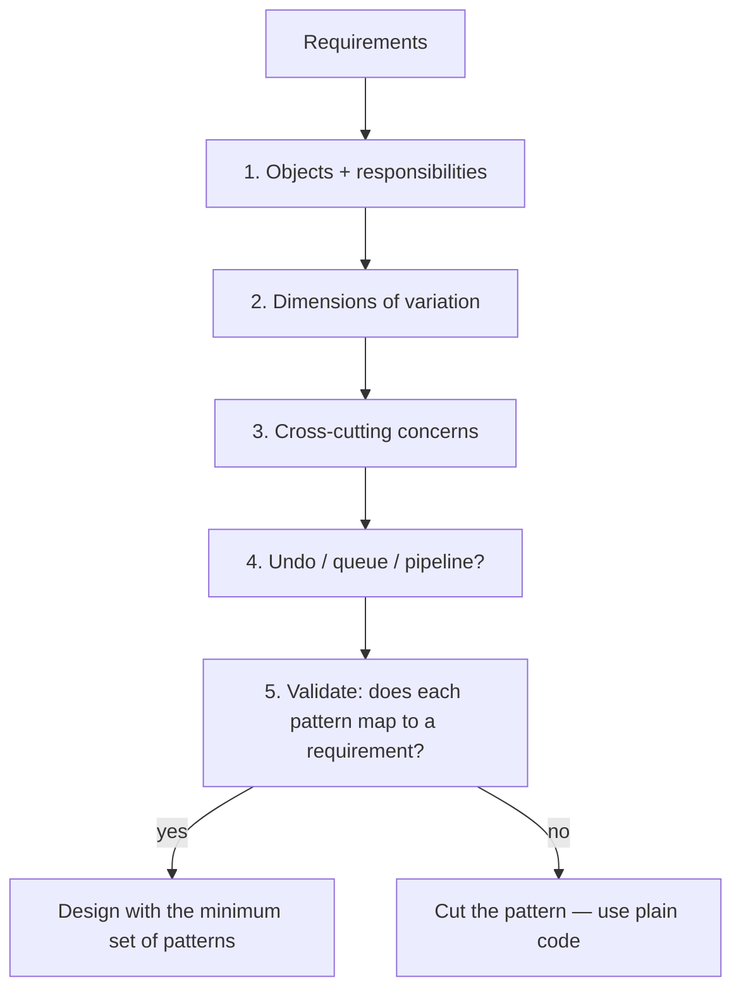
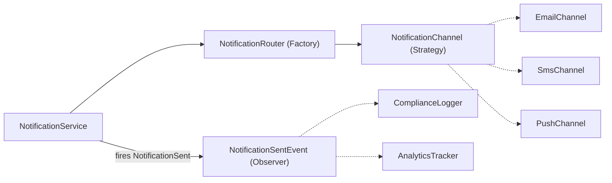
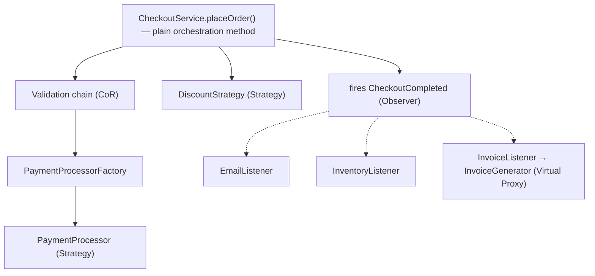
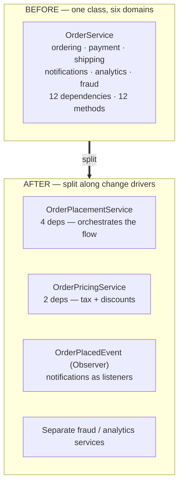
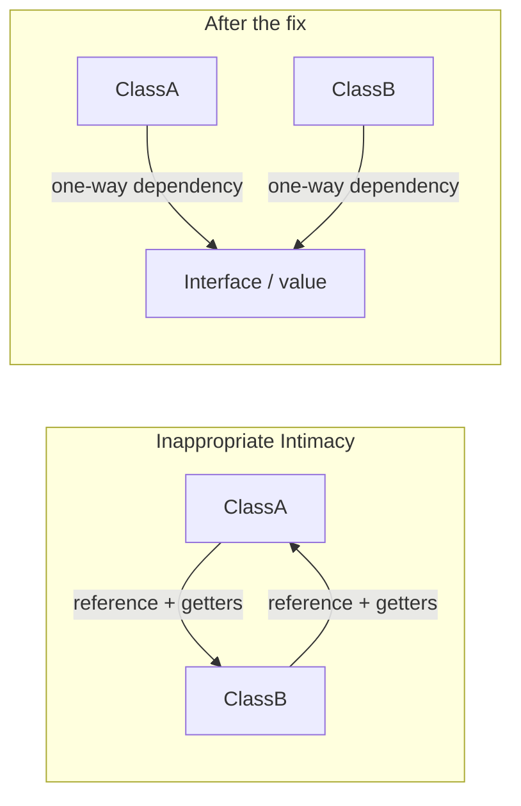
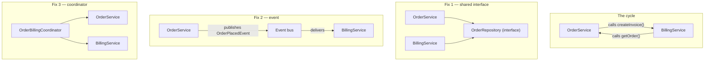
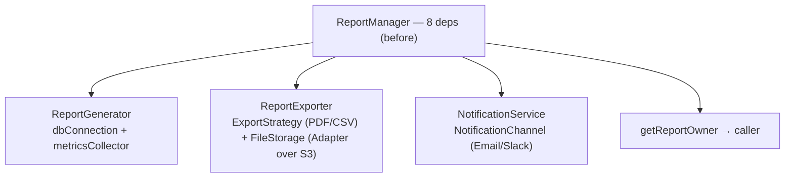
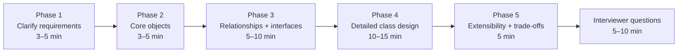

# 06 — Pattern Selection Framework and Anti-Patterns

> **Source:** Course Section 7 (SLIDE 81 – SLIDE 96). Structure and interview guidance follow the slides; code is expanded to **C++, C, and Java** versions. Markers: **[SLIDE n]** = from the slides, **[BEYOND THE COURSE]** = added here, **[INTERVIEW]** = how this is tested.

---

## 0. What This Section Is About

Knowing individual design patterns is necessary but **not sufficient** for LLD interviews. The real skill has two halves [SLIDE 81]:

1. **Recognition** — hearing a requirement and instantly knowing which pattern (if any) applies.
2. **Restraint** — recognizing when applying a pattern would make the design **worse**.

Think of this section as the **pattern-recognition equivalent of the problem-pattern mapping you use in algorithm interviews**: just as "find shortest path" maps to BFS/Dijkstra, "multiple types of X decided at runtime" maps to Strategy + Factory.

**Without this section vs with it [SLIDE 81]:**

| Without this section | With this section |
|---|---|
| You know 14 patterns but freeze when given a new problem | You hear a requirement signal and instantly know which pattern applies |
| You apply patterns because you know them, not because they fit | You justify each pattern with a specific problem it solves |
| You over-engineer with 6 patterns when 2 would suffice | You apply the minimum set of patterns that solves the actual requirements |
| You cannot spot design flaws in your own or others' code | You recognize anti-patterns and name specific refactorings |

**What this file covers:** the five-step selection process, the complete signal-to-pattern mapping across all patterns from files 03–05, three full worked examples of multi-pattern selection, over-engineering and minimum viable design, pattern testing frequency by company/level, six production anti-patterns (with tri-language code), how to present your design in an interview, and the master reference tables.

---

## 1. The Pattern Selection Process [SLIDE 82]

Pattern selection is **not intuition**. It is a repeatable five-step process you can apply systematically during an interview.

### Step 1 — Identify the objects and their responsibilities

Before reaching for **any** pattern, identify the core objects in the system and assign each **a single responsibility** (OOP fundamentals from file 01, SRP from file 02).

> If your objects are wrong, no pattern will save the design. [SLIDE 82]

### Step 2 — Identify the dimensions of variation

Ask: **"What in this system changes or varies?"** This is the most important question for pattern selection [SLIDE 82]:

| What varies | Pattern signal |
|---|---|
| The **algorithm** varies | **Strategy** |
| The object's **behavior varies by state** | **State** |
| The **reaction to an event** varies | **Observer** |
| The **object creation** varies | **Factory Method** |
| The **construction complexity** varies | **Builder** |

### Step 3 — Identify the cross-cutting concerns

Ask: **"What behaviors need to be added without modifying core logic?"** [SLIDE 82]:

| Cross-cutting need | Pattern signal |
|---|---|
| Logging, caching, metrics, encryption | **Decorator** |
| Access control, lazy loading | **Proxy** |
| Interface translation for external systems | **Adapter** |
| Multi-service coordination | **Facade** |

### Step 4 — Check for undo, queuing, or pipeline needs

| Need | Pattern signal |
|---|---|
| Operations need to be **undone or queued** | **Command** |
| Requests pass through **sequential checks** | **Chain of Responsibility** |
| Algorithm structure is **shared but steps differ** | **Template Method** |

### Step 5 — Validate against the requirements

For each pattern you selected, verify: **"Does the requirement actually demand this pattern, or am I adding it because I know it?"** If a simpler solution works — a plain interface, a simple method call, a constructor — **prefer that**. Patterns add indirection, and **indirection is only justified when it solves a specific extensibility, decoupling, or maintainability problem** [SLIDE 82].



> **[INTERVIEW]** Walking through these steps **out loud** during your interview shows the interviewer a **structured thought process**, not ad-hoc pattern guessing [SLIDE 82]. Make the process audible: *"First, what varies here? ... The algorithm varies, so that's a Strategy signal."*

### 1.1 The five-step process applied: the notification service [SLIDE 82B]

**Requirement.** *"Design a notification service that sends alerts through email, SMS, and push. Different notification types (marketing, transactional, alert) should be routed to different channels. When a notification is sent, log it for compliance and update analytics."*

**Step 1 — Core objects:**

- `NotificationService` — orchestrator.
- `NotificationChannel` — delivery.
- `NotificationRouter` — routing logic.
- `ComplianceLogger` — logging.
- `AnalyticsTracker` — analytics.

**Step 2 — Dimensions of variation:**

- The **delivery channel** varies (email, SMS, push) → **Strategy** signal.
- The **routing logic** selects which channel to use → **Factory** signal.

**Step 3 — Cross-cutting concerns:**

- Compliance logging and analytics tracking are **reactions to the "notification sent" event**, not part of the core delivery logic → **Observer** signal.

**Step 4 — Undo/queuing/pipeline:**

- No undo needed. No pipeline of checks. No shared algorithm structure. **Nothing here.**

**Step 5 — Validate:**

- Three patterns identified: **Strategy** (channels), **Factory** (routing), **Observer** (post-send reactions). **Each solves a specific requirement. No pattern is added speculatively.** [SLIDE 82B]



> **[INTERVIEW]** This walkthrough is exactly what interviewers want to see: a **structured approach that maps requirements to patterns with explicit justification**, not a memorized pattern list applied to every problem [SLIDE 82B]. Note how this file's example and file 03's notification factory are the same system at different levels of description — consistent naming across your answer is part of the signal.

### 1.2 The three questions — the portable version [SLIDE 94]

The five steps compress to **three questions** you can ask of any requirement:

| Question | Maps to |
|---|---|
| **What varies?** | Strategy, State, Factory, Template Method |
| **What reacts?** | Observer, Command, Chain of Responsibility |
| **What wraps?** | Decorator, Proxy, Adapter, Facade |

And the **danger signals** — when you are about to do one of these, stop and ask [SLIDE 94]:

| You are about to… | Ask yourself… |
|---|---|
| Create an interface with 1 implementation | Is there actually a second implementation? |
| Apply a pattern | Which specific requirement does this solve? |
| Add a Factory for 1 object type | Is a constructor sufficient? |
| Use Singleton | Can I use dependency injection instead? |
| Add a Decorator | Is this a behavior addition (Decorator) or access control (Proxy)? |
| Create 4+ patterns in one design | Am I over-engineering? |
| Use inheritance | Is this truly is-a? Would composition be safer? |

---

## 2. Complete Signal-to-Pattern Mapping [SLIDE 83]

This is **the master reference table** — every pattern from files 03–05 with its recognition signal and one-line justification. This is the single most valuable table in the entire course for interview preparation.

### 2.1 Creational patterns

| Signal | Pattern | Justification |
|---|---|---|
| "Create different types based on configuration" | **Factory Method** | Centralize creation, decouple callers from concrete types |
| "Create a family of objects that must be consistent" | **Abstract Factory** | Guarantee all objects belong to the same family |
| "Object has 5+ parameters, many optional" | **Builder** | Self-documenting construction, validation in `build()` |
| "Exactly one instance required for correctness" | **Singleton** (prefer DI) | Connection pools, config registries |

### 2.2 Structural patterns

| Signal | Pattern | Justification |
|---|---|---|
| "Integrate with an external API that has a different interface" | **Adapter** | Translate between incompatible interfaces |
| "Add logging/caching/metrics without modifying the class" | **Decorator** | Stackable behaviors, linear class growth |
| "Coordinate 3+ services behind a simple API" | **Facade** | Centralized sequencing and error recovery |
| "Cache results / lazy-load / check permissions" | **Proxy** | Control access transparently |

### 2.3 Behavioral patterns

| Signal | Pattern | Justification |
|---|---|---|
| "Support multiple algorithms for X" | **Strategy** | Swap algorithms at runtime via interface |
| "When X happens, notify Y and Z" | **Observer** | Decouple event source from listeners |
| "Support undo/redo or queue operations" | **Command** | Actions as first-class objects |
| "Object behaves differently in each state" | **State** | Replace if/else on state with state objects |
| "Process through a pipeline of checks" | **Chain of Responsibility** | Sequential handlers with short-circuiting |
| "Same algorithm structure, different steps" | **Template Method** | Fixed skeleton, customizable sub-steps |

> **[INTERVIEW tip from SLIDE 83]** **You do not need to memorize pattern names to succeed.** You need to **recognize the signal** in the requirements and know the **structural solution**. If you hear *"support multiple types of X"* and instinctively extract an interface with one implementation per type, **you have applied Strategy, whether you name it or not.** Names are for communication; recognition is for design.

> **[INTERVIEW]** Internalizing these signals is the **single highest-leverage preparation for LLD interviews** [SLIDE 83] — the equivalent of an algorithm pattern-recognition table. In the interview itself, use the signals as your script: *"These three requirements are 'multiple types of X', 'when X happens notify Y', and 'several expensive operations with optional behavior' — so I'll structure them as Strategy, Observer, and a couple of Decorators."*

---

## 3. Worked Examples: From Requirements to Patterns

### 3.1 E-commerce checkout system [SLIDE 84]

**Requirements** (Shopify-like):

1. Support multiple payment methods (credit card, bank transfer, digital wallet).
2. Apply discount codes with different discount types (percentage, flat amount, buy-one-get-one).
3. Validate the order through a series of checks (inventory, payment method validity, shipping address, fraud detection).
4. Process post-checkout actions (send confirmation email, update inventory, generate invoice).
5. The invoice generator is expensive to initialize and not needed for every order (some orders are digital-only).

**Pattern selection walkthrough [SLIDE 84]:**

| Requirement | Signal | Pattern | Justification |
|---|---|---|---|
| Multiple payment methods | "Different types of X" | **Strategy** | Each payment method is a separate `PaymentProcessor` algorithm |
| Select payment method based on order | "Create based on configuration" | **Factory** | `PaymentProcessorFactory` decides which processor to use |
| Multiple discount types | "Different algorithms for X" | **Strategy** | Each discount type is a separate `DiscountStrategy` calculation |
| Series of validation checks | "Pipeline of checks" | **Chain of Responsibility** | Each check can short-circuit the flow |
| Post-checkout actions | "When X happens, do Y, Z, W" | **Observer** | `CheckoutEventListener` decouples checkout from post-actions |
| Expensive invoice generator | "Expensive resource, not always needed" | **Virtual Proxy** | Lazy-load on first use |

**What is NOT a pattern [SLIDE 84]:** the **checkout orchestration** (the sequence of steps) is just a method in `CheckoutService`. **Not every piece of coordination needs a Facade.** If only one caller performs the checkout, a well-structured method is sufficient. **Patterns solve extensibility and decoupling problems, not sequencing problems.**



> **[INTERVIEW]** This example demonstrates **selective pattern application**: six requirements map to six patterns, and the seventh consideration (orchestration) **explicitly does not get a pattern**. That selectivity — naming where you *chose not* to use a pattern — is what earns a "strong hire" signal [SLIDE 84]. Say it explicitly: *"The checkout sequence itself is just a method; I don't need a Facade because there's a single caller."*

### 3.2 Chat messaging system [SLIDE 84B]

**Requirements** (Slack-like):

1. Support multiple message types (text, image, file, code snippet) with different rendering.
2. Messages transition through states (draft, sent, delivered, read, deleted).
3. When a message is sent, notify the recipient, update the unread count, and index for search.
4. Messages can be edited and deleted, with full edit history.
5. The system integrates with a third-party spam detection API that has a proprietary interface.
6. Message content should be optionally encrypted and compressed before storage.

**Pattern selection [SLIDE 84B]:**

| Requirement | Signal | Pattern |
|---|---|---|
| Multiple message types with different rendering | "Different types of X" | **Strategy** (`MessageRenderer`) + **Factory** |
| Message state transitions | "Object behaves differently by state" | **State** |
| Post-send notifications (recipient, unread count, search index) | "When X happens, notify Y, Z, W" | **Observer** |
| Edit history with undo capability | "Store and reverse operations" | **Command** |
| Third-party spam API with proprietary interface | "Integrate with incompatible API" | **Adapter** |
| Optional encryption and compression | "Add behavior without modifying core" | **Decorator** |

**The architecture [SLIDE 84B]:** six patterns, each solving a distinct requirement. **The Decorator chain for storage (encryption wrapping compression wrapping database) is independent of the State machine for message lifecycle. Each pattern is isolated and testable.**

> **[INTERVIEW]** Chat messaging is one of the most common LLD questions at companies like **Meta and Slack** [SLIDE 84B]. Having this mapping pre-practiced saves interview time — and the *editing with history* requirement is the one candidates most often fumble: it is **Command**, and if you also had undo/redo you would ride the exact `CommandHistory` structure from file 05 §3.2.

### 3.3 File storage and processing service [SLIDE 85]

**Requirements** (Dropbox-like):

1. Support uploading, downloading, and deleting files.
2. Files pass through a processing pipeline: virus scan, metadata extraction, thumbnail generation (for images), and indexing for search.
3. Processing steps vary by file type (images get thumbnails, documents get text extraction, videos get transcoding).
4. Large files should be lazy-loaded (metadata first, content on demand).
5. Integrate with multiple cloud storage backends (AWS S3, Google Cloud Storage, Azure Blob Storage).
6. All operations should be logged for audit compliance.

**Pattern selection [SLIDE 85]:**

| Requirement | Pattern | Why not the alternative |
|---|---|---|
| Processing pipeline with sequential steps | **Chain of Responsibility** | Not Strategy, because multiple steps run in sequence, not one algorithm selected |
| Steps vary by file type | **Template Method** (or Strategy per step) | Template Method if the sequence is fixed; Strategy if steps are independently swappable |
| Lazy-loaded file content | **Virtual Proxy** | Not Decorator, because this is access control (when to load), not behavior addition |
| Multiple cloud storage backends | **Adapter** | Each backend has a different SDK; Adapter translates to your common interface |
| Audit logging on all operations | **Decorator** | Wraps the storage interface; independently removable |
| Upload/download/delete operations | **No pattern needed** | Simple interface methods |

**Key insight — not every requirement needs a pattern [SLIDE 85]:** the core CRUD operations are just methods on a `FileStorageService` interface. The **Adapter** wraps cloud backends behind the interface. The **Decorator** adds logging on top. But the operations themselves don't get patterns: **wrapping simple method calls in Command or Strategy objects when there is only one algorithm is over-engineering.**

> **[INTERVIEW tip from SLIDE 85]** After identifying which patterns you will use, **explicitly state which requirements do NOT get a pattern**: *"Upload and download are simple interface methods. I did not add a pattern here because there is no extensibility requirement and no variation to manage."* This demonstrates the restraint that separates senior designers from pattern-enthusiastic juniors. Also note the pipeline fork in the table: a fixed skeleton with varying steps is **Template Method**; freely reorderable/swappable steps are **Chain of Responsibility + Factory** (file 05 §5.4) — say which and why.

### 3.4 Rapid pattern recognition drill [SLIDE 85B]

From the slides — identify the primary pattern in **under 10 seconds** each, then check:

**1.** *"Users can export reports in PDF, CSV, or Excel format."*
→ **Strategy** (`ExportStrategy`) — three algorithms for the same operation, selected based on user choice.

**2.** *"When a payment fails, send an alert to the operations team, retry the payment in 5 minutes, and update the customer's dashboard."*
→ **Observer** — three independent reactions to a single event. The payment system should not know about ops alerts, retries, or dashboards.

**3.** *"The search query object has: search term (required), filters (optional, 0..N), sort order (optional), page size (optional, default 20), date range (optional), and include-archived flag (optional, default false)."*
→ **Builder** — six parameters, five optional, with defaults.

**4.** *"We need to integrate with a legacy inventory system that uses XML-RPC while our system uses REST-style JSON interfaces."*
→ **Adapter** — two incompatible interfaces that need to work together.

**5.** *"Add request timing, authentication logging, and rate limiting to all API endpoints without modifying the endpoint handlers."*
→ **Decorator (or Chain of Responsibility)** — three cross-cutting concerns layered on top of existing handlers. **Decorator** if they wrap the handler; **Chain of Responsibility** if they form a pipeline with short-circuit decisions. (Interviewers accept either with the reasoning stated.)

**6.** *"A support ticket moves through states: Open, In Progress, Waiting on Customer, Resolved, Closed. Each state allows different actions."*
→ **State** — object behavior changes based on lifecycle state, with explicit valid transitions.

> **[INTERVIEW]** Six requirements, six answers — practice until you can beat the 10-second target **while narrating the signal**: *"Optional everything plus defaults — Builder."* The signal-first narration is what interviewers score; pattern names are the byproduct.

---

## 4. Over-Engineering: The #1 Interview Anti-Pattern [SLIDE 86]

Over-engineering is **the most common anti-pattern in LLD interviews**. It occurs when a candidate applies patterns, abstractions, or extensibility mechanisms **that are not justified by the current requirements**. It signals to the interviewer that the candidate **cannot distinguish between "what might change someday" and "what the requirements actually demand"** [SLIDE 86].

### 4.1 What over-engineering looks like [SLIDE 86]

The slides' canonical example: a candidate designing a **parking lot** creates:

- a `VehicleFactory` — **but there are only 3 vehicle types, and a simple enum works**;
- a `ParkingStrategyFactory` that creates `ParkingStrategy` objects — **but there is only one strategy: find the nearest spot**;
- a `SpotObserver` that fires events when spots are taken — **but no one subscribes to these events**;
- a `SpotStatePattern` for each spot — **but spots are either available or occupied; a boolean suffices**.

Four patterns applied, **none justified by requirements**. The design is harder to understand, harder to implement, and harder to maintain than a straightforward solution with **enums, simple classes, and boolean fields** [SLIDE 86].

### 4.2 The root cause [SLIDE 86]

Over-engineering usually comes from one of three mindsets:

| Mindset | Reality |
|---|---|
| *"I want to show the interviewer that I know many patterns."* | Interviewers **penalize** this, not reward it |
| *"What if the requirements change in the future?"* | Design for **today's** requirements, not hypothetical future ones |
| *"This is how I was taught to do it."* | Textbooks teach patterns in isolation; production code uses them **selectively** |

> **[INTERVIEW]** Interviewers specifically watch for over-engineering. **A design with 2 well-justified patterns scores higher than a design with 6 unjustified patterns.** Less is more when each choice is deliberate [SLIDE 86].

### 4.3 The Minimum Viable Design (MVD) principle [SLIDE 86B]

> **MVD: apply the fewest patterns and abstractions that satisfy the stated requirements and make the design testable.** Add more only when the interviewer explicitly asks for extensibility or when a requirement demands it [SLIDE 86B].

**The MVD process:**

1. **Start with plain classes, simple constructors, and direct method calls.**
2. **Extract an interface only when there are (or the requirements state there will be) multiple implementations.**
3. **Apply a pattern only when you can name the specific requirement it satisfies.**
4. **If the interviewer says "what if we need to add X?"** — *then* apply the pattern that enables X.

**MVD applied: parking lot [SLIDE 86B]:**

| Component | MVD approach | Over-engineered approach |
|---|---|---|
| Vehicle types | `enum VehicleType { CAR, MOTORCYCLE, TRUCK }` | `VehicleFactory` + interface + 3 `Vehicle` implementations |
| Parking logic | `findNearestSpot()` method (single implementation) | `ParkingStrategy` interface + `NearestSpotStrategy` |
| Spot status | `boolean isOccupied` | `SpotState` interface + `OccupiedState` + `AvailableState` |
| Notifications | Not required — do not build | `SpotObserver` interface + event system |

**The number that lands the point [SLIDE 86B]: the MVD approach has 4 classes. The over-engineered approach has 15 classes solving problems that do not exist.**

**The MVD in C++, C, and Java — literally:**

```java
// Java — plain, minimal, testable
public enum VehicleType { CAR, MOTORCYCLE, TRUCK }

public class ParkingSpot {
    private final String id;
    private boolean occupied;

    public boolean isOccupied() { return occupied; }
    public void occupy()        { this.occupied = true; }
    public void vacate()        { this.occupied = false; }
}

public class ParkingLot {
    private final List<ParkingSpot> spots;

    public ParkingSpot findNearestSpot(VehicleType type) {
        return spots.stream()
                .filter(spot -> !spot.isOccupied())
                .findFirst()
                .orElseThrow(() -> new IllegalStateException("Parking lot full"));
    }
}
```

```cpp
// C++ — same idea, no vtable anywhere
enum class VehicleType { Car, Motorcycle, Truck };

struct ParkingSpot {
    std::string id;
    bool occupied = false;
};

class ParkingLot {
    std::vector<ParkingSpot> spots_;
public:
    ParkingSpot& findNearestSpot(VehicleType type) {
        for (auto& spot : spots_) {
            if (!spot.occupied) return spot;
        }
        throw std::runtime_error("Parking lot full");
    }
};
```

```c
/* C — a struct and a function. No ops table, no indirection. */
enum vehicle_type { VEHICLE_CAR, VEHICLE_MOTORCYCLE, VEHICLE_TRUCK };

struct parking_spot {
    char id[16];
    int  occupied;               /* "boolean" */
};

struct parking_lot {
    struct parking_spot spots[MAX_SPOTS];
    size_t              spot_count;
};

struct parking_spot *parking_lot_find_nearest(struct parking_lot *lot,
                                              enum vehicle_type type)
{
    for (size_t i = 0; i < lot->spot_count; i++) {
        if (!lot->spots[i].occupied)
            return &lot->spots[i];
    }
    return NULL;                 /* lot full */
}
```

> **[BEYOND THE COURSE]** The three snippets are deliberately *pattern-free* — and that is the lesson. Notice the C version: no `struct parking_strategy_ops`, no function-pointer table. **The moment a requirement names a second implementation, the table appears** — e.g. "support multiple parking strategies" turns `parking_lot_find_nearest` into:

```c
/* C — the SAME code, graduated to Strategy by a NAMED requirement */
struct parking_strategy_ops {
    struct parking_spot *(*find)(struct parking_lot *, enum vehicle_type);
};

struct parking_lot {
    struct parking_spot     spots[MAX_SPOTS];
    size_t                  spot_count;
    struct parking_strategy_ops *strategy;   /* now justified */
};
```

**The graduation table — when MVD stops applying [SLIDE 86B]:**

| New requirement sentence | Now justified |
|---|---|
| "Support multiple parking strategies (hourly, flat, event pricing)" | **Strategy** emerges from the named variation |
| "Notify security when a floor becomes full" | **Observer** for the named reaction |
| "Vehicle classes have reserved zones with different allocation rules" | Extract interfaces along the named second implementation |
| "Spots hold state beyond occupied/free (reserved, EV-charging, out-of-service)" | **State** only once the third state exists and behavior differs — a boolean stops being enough |

> **[INTERVIEW tip from SLIDE 86B]** After presenting your design, tell the interviewer: *"This design satisfies the stated requirements with N patterns. If you would like me to add extensibility for [specific scenario], I can show how [specific pattern] would enable that."* This gives the interviewer the option to probe deeper **while demonstrating that your initial design is intentionally minimal**.

> **[INTERVIEW]** The MVD approach is what senior engineers practice in production. Interviewers reward it because it demonstrates **the judgment to apply patterns selectively rather than reflexively** [SLIDE 86B]. At senior levels, this single habit — naming what you deliberately did *not* abstract — is the most common difference between "hire" and "strong hire" feedback.

---

## 5. Pattern Testing Frequency: Where to Spend Your Preparation Time [SLIDE 87, 87B]

Not all patterns are equally likely to appear in LLD interviews. **Focusing your preparation on high-frequency patterns gives the best return on study time** [SLIDE 87].

### 5.1 The four tiers of interview frequency [SLIDE 87]

| Tier | Patterns | Why |
|---|---|---|
| **Tier 1 — almost always tested** | **Strategy, Observer, Factory Method, State** | Core to every LLD problem. "Multiple types," "event notification," "object lifecycle" appear in nearly every question |
| **Tier 2 — frequently tested** | **Builder, Decorator, Command, Facade, Chain of Responsibility** | Appear when the problem involves complex construction, cross-cutting concerns, undo/redo, or multi-service coordination |
| **Tier 3 — occasionally tested** | **Adapter, Proxy, Template Method, Abstract Factory** | Appear in specific domains: legacy integration, caching, data pipelines, themed UIs |
| **Tier 4 — rarely tested directly** | **Singleton, Flyweight, Mediator, Memento, Visitor, Bridge** | Too simple (Singleton), too niche (Visitor), or covered by other patterns in practice |

**Where to focus [SLIDE 87]:**

- **Tier 1 patterns appear in 80%+ of LLD interviews.** Deeply understanding Strategy, Observer, Factory Method, and State — and recognizing their signals instantly — handles **the majority of LLD rounds**.
- **Tier 2 patterns appear in 40–60% of interviews**. They are what differentiates a *"hire"* from a *"strong hire"* because they solve the secondary requirements (undo, logging, validation pipelines) **many candidates overlook**.
- **Tiers 3–4 are worth knowing conceptually** but not deep preparation — unless you have already mastered Tiers 1 and 2.

> **[INTERVIEW]** Spending **80% of your prep time on Tier 1 and Tier 2 patterns gives the highest coverage across companies and levels** [SLIDE 87]. If you are short on time: Strategy, Observer, Factory Method, State, Builder, Decorator, Command, Facade, Chain of Responsibility — nine patterns, vast majority of coverage.

### 5.2 Frequency by company type and level [SLIDE 87B]

**By company type:**

| Company type | LLD focus | Most tested patterns |
|---|---|---|
| **E-commerce** (Amazon, Shopify) | Order lifecycle, payment processing, inventory | **State, Strategy, Observer, Facade, Factory** |
| **Social media** (Meta, LinkedIn) | Feed systems, notifications, content moderation | **Observer, Strategy, Chain of Responsibility, Decorator** |
| **Infrastructure** (Google, Microsoft) | Data pipelines, storage systems, API design | **Template Method, Adapter, Proxy, Chain of Responsibility** |
| **Ride-sharing** (Uber, Lyft) | Pricing, matching, state machines | **Strategy, State, Observer, Factory** |
| **Fintech** (Stripe, Square) | Payment workflows, fraud detection, audit trails | **State, Command, Chain of Responsibility, Observer** |

**By level [SLIDE 87B]:**

| Level | Interviewer expectations |
|---|---|
| **Mid-level (L4/L5)** | Correctly apply 2–3 patterns. Demonstrate OOP and SOLID understanding |
| **Senior (L5/L6)** | Select patterns deliberately with **trade-off justification**. **Spot anti-patterns. Combine patterns effectively** |
| **Staff+ (L7)** | **Minimum viable design. Explain why you chose NOT to use a pattern.** Connect class-level design to system-level architecture |

> **[INTERVIEW tip from SLIDE 87B]** **At mid-level, showing you know the patterns is sufficient. At senior level and above, showing restraint (not using a pattern when unnecessary) and connecting class design to broader system concerns (scalability, team ownership, deployment boundaries) is what earns top ratings.**

### 5.3 Mapping the tiers onto this course

| Tier | Covered in | Study priority |
|---|---|---|
| Tier 1 (Strategy, Observer, Factory Method, State) | file 03 §3 (Factory Method), file 05 §1/§2/§4 | **Master completely** — including the combined scenarios in file 05 §8 |
| Tier 2 (Builder, Decorator, Command, Facade, CoR) | file 03 §4, file 04 §2/§3, file 05 §3/§5 | **Practice until fluent** — they win the "strong hire" |
| Tier 3 (Adapter, Proxy, Template Method, Abstract Factory) | file 03 §5, file 04 §1/§4, file 05 §6 | Know signals + structure; less rehearsal time needed |
| Tier 4 (Singleton, Flyweight, Mediator, Memento, Visitor, Bridge) | file 03 §6 (Singleton), file 08 (rest) | Conceptual knowledge; recognize the signal |

> **[INTERVIEW]** Calibrate to your target level [SLIDE 87B]. Interviewing mid-level? Pattern mechanics + correct OOP/SOLID carries you. Interviewing senior+? The differentiators are all in this file: **selective application (§4), anti-pattern detection (§6–7), and presentation discipline (§9)**.

---

## 6. The Anti-Patterns: Design Smells Interviewers Hunt For [SLIDE 88–91B]

An **anti-pattern** is a solution that *looks* reasonable, is *commonly reached for*, and *produces damage*: coupling, fragility, and costs that compound. Interviewers use anti-patterns in two ways: they **show you smelly code and ask "what is wrong here?"** — and they **watch whether your own design walks into the same traps**. This section covers the six anti-patterns from the slides, each with tri-language code showing the smell and the refactoring.

### 6.1 God Class [SLIDE 88, 88B]

> The **God Class** (also called a **Blob class**) is a single class that has grown to handle too many responsibilities. It typically has **20+ methods across unrelated domains**, **10+ dependencies injected through its constructor**, and is the class **every developer dreads modifying** because changes to any feature risk breaking unrelated features [SLIDE 88].

**How God Classes form [SLIDE 88]** — they rarely *start* as God Classes. The lifecycle is always the same:

1. A reasonable service class with **3–4 methods**.
2. The product evolves. Developers add methods to the *existing* class rather than creating new classes — it is faster and avoids the "where does this go?" decision.
3. After 18 months: **1500 lines, 12 dependencies, 25 methods** spanning authentication, billing, notifications, and reporting.

> **[INTERVIEW]** This is a *gravity* phenomenon, not a stupidity phenomenon. Say that in the interview: *"God Classes are a predictable failure mode of incremental development — every shortcut moves one more method into the popular class. The counter-force is deciding boundaries deliberately when the second change driver appears."*

**Detection signals [SLIDE 88]:**

| Signal | Threshold |
|---|---|
| Methods from **3+ unrelated domains** | authentication + billing + notifications in one class |
| Constructor takes **8+ dependencies** | most will belong to extracted services |
| Class **modified in every sprint by different developers** for different features | merge-conflict magnet |
| Unit tests require mocking **10+ dependencies** | test setup longer than the test |
| **Vague class name** | `UserService`, `AppManager`, `CoreHandler` |

**The concrete example — before [SLIDE 88B]:** the slide shows the god `OrderService` with **twelve dependencies, twelve methods, six unrelated domains** (ordering, payment, shipping, notifications, analytics, fraud):

```java
// BEFORE — the God OrderService [SLIDE 88B]
public class OrderService {
    private final OrderRepository orderRepository;
    private final PaymentGateway paymentGateway;
    private final InventoryService inventoryService;
    private final ShippingService shippingService;
    private final EmailClient emailClient;
    private final SmsGateway smsGateway;
    private final AnalyticsTracker analyticsTracker;
    private final FraudDetector fraudDetector;
    private final TaxCalculator taxCalculator;
    private final DiscountEngine discountEngine;
    private final InvoiceGenerator invoiceGenerator;
    private final AuditLogger auditLogger;

    public OrderResult placeOrder(OrderRequest request) { ... }
    public void cancelOrder(String orderId) { ... }
    public RefundResult processRefund(String orderId) { ... }
    public void updateShippingAddress(String orderId, Address address) { ... }
    public InvoiceDocument generateInvoice(String orderId) { ... }
    public void sendOrderConfirmation(String orderId) { ... }
    public void sendShippingNotification(String orderId) { ... }
    public List<Order> getOrderHistory(String customerId) { ... }
    public OrderAnalytics getOrderAnalytics(DateRange range) { ... }
    public FraudCheckResult checkForFraud(OrderRequest request) { ... }
    public Money calculateTax(OrderRequest request) { ... }
    public Money applyDiscounts(OrderRequest request) { ... }
}
```

**After — focused services [SLIDE 88B]:** each service ends with **2–4 dependencies and 1–3 methods in a single domain**. The `OrderPlacementService` orchestrates the core flow; notifications become **Observer listeners on `OrderPlacedEvent`**; analytics and fraud detection become separate services:

```java
// AFTER — focused services [SLIDE 88B]
public class OrderPlacementService {
    private final OrderRepository orderRepository;
    private final PaymentService paymentService;
    private final InventoryService inventoryService;
    private final OrderEventPublisher eventPublisher;

    public OrderResult placeOrder(OrderRequest request) {
        inventoryService.reserve(request.getItems());
        PaymentResult payment = paymentService.charge(request);
        Order order = Order.create(request, payment.getTransactionId());
        orderRepository.save(order);
        eventPublisher.publish(new OrderPlacedEvent(order));
        return OrderResult.success(order.getId());
    }
}

public class OrderPricingService {
    private final TaxCalculator taxCalculator;
    private final DiscountEngine discountEngine;

    public PricingBreakdown calculatePricing(OrderRequest request) {
        Money subtotal = request.calculateSubtotal();
        Money discount = discountEngine.bestDiscount(request);
        Money tax = taxCalculator.calculate(subtotal.subtract(discount));
        return new PricingBreakdown(subtotal, discount, tax);
    }
}
```



**The same refactoring in C++ and C:**

```cpp
// C++ — focused services; every dependency is visible and single-purpose
class OrderPlacementService {
    OrderRepository&     orders_;
    PaymentService&      payments_;
    InventoryService&    inventory_;
    OrderEventPublisher& events_;
public:
    OrderPlacementService(OrderRepository& orders, PaymentService& payments,
                          InventoryService& inventory, OrderEventPublisher& events)
        : orders_(orders), payments_(payments),
          inventory_(inventory), events_(events) {}

    OrderResult placeOrder(const OrderRequest& request) {
        inventory_.reserve(request.items());
        PaymentResult payment = payments_.charge(request);
        Order order = Order::create(request, payment.transactionId());
        orders_.save(order);
        events_.publish(OrderPlacedEvent{order});
        return OrderResult::success(order.id());
    }
};
```

```c
/* C — the god struct decomposes into per-domain structs wired in main() */
struct order_placement_service {
    struct order_repository  *orders;
    struct payment_service   *payments;
    struct inventory_service *inventory;
    struct order_event_bus   *events;
};

int order_placement_place_order(struct order_placement_service *svc,
                                const struct order_request *req,
                                struct order_result *out)
{
    if (inventory_reserve(svc->inventory, &req->items) != 0)
        return -1;
    struct payment_result pay;
    if (payment_charge(svc->payments, req, &pay) != 0)
        return -1;
    struct order order = order_create(req, pay.transaction_id);
    if (order_repository_save(svc->orders, &order) != 0)
        return -1;
    order_event_bus_publish(svc->events, &(struct order_placed_event){ .order = order });
    out->order_id = order.id;
    return 0;
}
```

> **[INTERVIEW]** God Class questions almost always take the shape *"what is wrong with this design?"* — the graded answer is: **"SRP violation"** (file 02 §1). The refactoring is to **identify the change drivers and extract each into a focused class** [SLIDE 88]. Count the dependencies out loud — *"twelve dependencies spanning six domains"* — evidence-backed refactoring is what "practical refactoring skill" means to an interviewer [SLIDE 88B].

### 6.2 Feature Envy [SLIDE 89]

> **Feature Envy** occurs when **a method in one class uses more data from another class than from its own**. The method is *envious* of the other class's data and **should probably live there instead** [SLIDE 89].

The slides' example — a method that reads `items`, `price`, `quantity`, `taxRate`, and `weight` **from `Order`** while using **nothing** from its own class:

```java
// BEFORE — the method lives where its data does not [SLIDE 89]
public class OrderReportGenerator {
    public String generateSummary(Order order) {
        double total = order.getItems().stream()
                .mapToDouble(item -> item.getPrice() * item.getQuantity())
                .sum();
        double tax = total * order.getTaxRate();
        double shipping = order.getWeight() > 10 ? 15.00 : 5.00;
        return String.format("Total: $%.2f, Tax: $%.2f, Shipping: $%.2f",
                total, tax, shipping);
    }
}
```

```java
// AFTER — the calculation lives with the data it needs
public class Order {
    public Money calculateSubtotal() { /* items, price, quantity */ }
    public Money calculateTax()      { /* taxRate */ }
    public Money calculateShipping() { /* weight thresholds */ }
}
// OrderReportGenerator becomes a thin caller, or disappears.
```

The **general rule of thumb**: if moving the method to the other class **would eliminate all the getter calls**, the move is the right fix [SLIDE 89]. The "envy" metric: **3+ getters on another object and 0 on your own**.

Tri-language versions of the same smell and fix:

```cpp
// C++ — smell: a free function that envies Order through getters
std::string generateSummary(const Order& order) {
    Money total = 0;
    for (const auto& item : order.items())
        total += item.price() * item.quantity();
    Money tax = total * order.taxRate();
    Money shipping = order.weight() > 10.0 ? 15.00 : 5.00;
    return format("Total: %m, Tax: %m, Shipping: %m", total, tax, shipping);
}
// FIX: make it a member — Order::summary() — and delete the getter-only access path.
```

```c
/* C — smell: the function pulls five fields out of struct order */
double order_report_summary(const struct order *o)
{
    double total = 0.0;
    for (size_t i = 0; i < o->item_count; i++)
        total += o->items[i].price * o->items[i].quantity;
    double tax = total * o->tax_rate;
    double shipping = o->weight > 10 ? 15.00 : 5.00;
    return total + tax + shipping;
}
/* FIX: move it into order.c — the module that owns the struct — and expose
 * only "double order_summary(const struct order *o);" in order.h. The kernel
 * does exactly this: inode_permission() lives beside the inode, not in a
 * separate "reporting" file. Feature Envy at module scale. */
```

> **[BEYOND THE COURSE]** In C, packet-processing functions that read ten fields out of `struct sk_buff` but live in a driver belong — per kernel review culture — in the networking core next to the struct. The C version of "move the method" is "move it to the module that owns the data, and stop exporting the fields."

> **[INTERVIEW]** Interviewers test Feature Envy by showing you a method and asking **"is this in the right class?"** If the method uses more data from another class, the answer is **"this method should be moved to the class it envies"** [SLIDE 89]. The Java answer includes the refinement: *"or into a dedicated `OrderPricingService` if a second consumer needs it — but never left in a generator that only formats another object's data."*

### 6.3 Inappropriate Intimacy [SLIDE 89]

> **Inappropriate Intimacy** occurs when **two classes are too tightly coupled, accessing each other's internal details**. It often manifests as classes reaching into each other's private data through getters, or **two classes that cannot be modified independently** [SLIDE 89].

**Detection signals [SLIDE 89]:**

| Smell | Signal |
|---|---|
| Feature Envy | a method calls **3+ getters on another object and 0 from its own** |
| Inappropriate Intimacy | **two classes each hold references to each other** (a cycle) |
| Inappropriate Intimacy | a class **accesses another's internal collection and modifies it** |
| Feature Envy | **moving the method would eliminate all getter calls** |

The bidirectional-reference case is the one that escalates — it *is* the circular dependency of §7 seen from the coupling angle. The internal-collection case is the quieter one; tri-language:

```java
// BEFORE — hand out the internal list, lose all control [smell]
public List<Item> getItems() { return items; }          // callers can mutate freely

// AFTER — expose intentional operations only
public void addItem(Item item)      { ... validate + update invariants ... }
public void removeItem(Item item)   { ... }
public List<Item> itemsView()       { return Collections.unmodifiableList(items); }
```

```cpp
// C++ — BEFORE: callers mutate internals behind your back
std::vector<Item>& items() { return items_; }

// C++ — AFTER: controlled access
void addItem(const Item& item) { /* invariants */ }
const std::vector<Item>& items() const;   // const view; mutation only via methods
```

```c
/* C — BEFORE: pointer to the internal array escapes */
struct item *order_items(struct order *o) { return o->items; }   /* caller can write */

/* C — AFTER: accessor + explicit mutators; ownership stays inside order.c */
size_t order_item_count(const struct order *o);
const struct item *order_item_at(const struct order *o, size_t i);
int    order_add_item(struct order *o, const struct item *it);   /* validates */
```



**The fixes for intimacy:** (1) make **one of the two directions disappear** — usually by extracting an interface or introducing an event (same three fixes as circular dependencies, §7); (2) **encapsulate internal collections** behind intentional operations; (3) review `friend` (C++) and public mutators as *explicit, named* exceptions rather than the default.

> **[INTERVIEW]** Feature Envy and Inappropriate Intimacy are usually tested *together* — the interviewer shows a class pair and asks what is wrong. Answer in order: **envy first if a method reads another's data; intimacy if the references run both ways.** Always finish with the fix sentence: *"the method moves; the reference becomes one-way."*

### 6.4 Shotgun Surgery [SLIDE 90]

> **Shotgun Surgery** is **the opposite of the God Class**. Where a God Class has too many responsibilities in one place, Shotgun Surgery **scatters one responsibility across too many places**. A single logical change requires editing **10+ files** [SLIDE 90].

**The slides' example — adding one customer notification type requires editing eight files [SLIDE 90]:**

| File | Edit |
|---|---|
| `CustomerService.java` | add notification logic |
| `NotificationTemplates.java` | add new template |
| `EmailFormatter.java` | add formatting for new type |
| `SmsFormatter.java` | add formatting for new type |
| `NotificationConfig.java` | add configuration entry |
| `NotificationValidator.java` | add validation for new type |
| `NotificationMetrics.java` | add metrics tracking |
| `NotificationTest.java` | add test cases |

**Eight files modified for one logical change. If a developer forgets `SmsFormatter`, SMS notifications for the new type silently fail in production** [SLIDE 90]. That last sentence is the whole cost model: shotgun surgery doesn't just annoy developers — **it manufactures latent production bugs**, because nothing enforces that all eight edits happen together.

**The fix [SLIDE 90]:** consolidate the scattered responsibility. **Each notification type becomes a self-contained class** — a Strategy implementation — that encapsulates its template, formatting, validation, and configuration. Adding a new type means **creating one new file, not editing eight existing ones**:

```java
// The fix — one self-contained class per notification type [SLIDE 90]
public class WelcomeNotification implements NotificationType {
    public String getTemplateName() { return "welcome"; }
    public String formatForEmail(Customer customer) { ... }
    public String formatForSms(Customer customer)   { ... }
    public boolean isValid(NotificationRequest request) { ... }
    public Map<String, String> getDefaultConfig() { ... }
}
```

```cpp
// C++ — same consolidation, final classes over a NotificationType interface
class WelcomeNotification final : public NotificationType {
public:
    std::string templateName() const override { return "welcome"; }
    std::string formatForEmail(const Customer& c) const override { /* ... */ }
    std::string formatForSms(const Customer& c) const override   { /* ... */ }
    bool isValid(const NotificationRequest& r) const override    { /* ... */ }
    std::map<std::string, std::string> defaultConfig() const override { /* ... */ }
};
```

```c
/* C — one ops table + its functions per type. Adding a type = one new struct,
 * never editing the router. This is Linux's file_operations shape. */
struct notification_type {
    const char *name;
    const char *(*template_name)(void);
    int (*format_email)(const struct customer *, char *buf, size_t len);
    int (*format_sms)(const struct customer *, char *buf, size_t len);
    int (*is_valid)(const struct notification_request *);
};

static int welcome_format_email(const struct customer *c, char *buf, size_t len)
{
    return snprintf(buf, len, "Welcome aboard, %s!", c->name);
}

static const struct notification_type welcome_notification = {
    .name          = "welcome",
    .template_name = welcome_template_name,
    .format_email  = welcome_format_email,
    .format_sms    = welcome_format_sms,
    .is_valid      = welcome_is_valid,
};
/* The router looks the type up in a table — no switches anywhere else. */
```

> **[BEYOND THE COURSE]** The kernel framing that makes this click: **you can add a new character device driver without touching the VFS**, because everything a driver must provide lives in **one `struct file_operations`**. Shotgun surgery is the design where the VFS instead contains a `switch (driver_type)` in read, write, open, close, ioctl, poll, and mmap — six files to edit per driver. **The fix is always the same move: pull the scattered responsibility into one cohesive unit and let callers look it up.**

> **[INTERVIEW tip from SLIDE 90]** **Shotgun Surgery and God Class are two sides of the same coin.** God Class means **too much in one place**. Shotgun Surgery means **too little in each place**. *The fix for both is finding the right boundary: each class owns one complete responsibility — no more and no less.* Say that sentence in the interview; it is the slide's shorthand for SRP done right.

> **[INTERVIEW]** Tested by describing a change that touches many files and asking *"how would you restructure this?"* The answer is always: **consolidate the scattered responsibility into a cohesive class or module** [SLIDE 90]. Then name the enforcement mechanism, because that is the follow-up: *"in Java, an interface so the compiler catches missing pieces; in C, the ops table so the router cannot see the difference."*

**The four smells side by side — the comparison the slides build toward:**

| Anti-pattern | Symptom | Unit | Fix |
|---|---|---|---|
| **God Class** | one class, many unrelated domains | one class too **big** | Split along **change drivers** |
| **Feature Envy** | a method uses another class's data | one method in the **wrong home** | **Move the method** to the data |
| **Inappropriate Intimacy** | two classes inside each other | a **pair** too entangled | One-way dependency; encapsulate collections |
| **Shotgun Surgery** | one change, many files | a responsibility spread **thin** | **Consolidate** into a cohesive class |

---

## 7. Cycles and Premature Abstraction [SLIDE 91, 91B]

These two anti-patterns are not about *too much code* in the wrong place — they are about **wrong structure**: one makes the system impossible to reason about, the other makes it needlessly indirect. Both are checked in senior interviews because both survive code that "works."

### 7.1 Circular Dependencies [SLIDE 91]

> A **circular dependency** occurs when class A depends on class B, and class B depends on class A — **directly or through a chain**. Circular dependencies create systems where **you cannot understand, test, or deploy one class without the other**. They are a strong signal of a design flaw [SLIDE 91].

**The problem, exactly as the slides show it [SLIDE 91]:**

```java
public class OrderService {
    private final BillingService billingService;
    public void placeOrder(Order order) {
        billingService.createInvoice(order);
    }
}

public class BillingService {
    private final OrderService orderService;
    public void processPayment(String invoiceId) {
        Order order = orderService.getOrder(invoiceId);
        chargeCustomer(order);
    }
}
```

**What the cycle actually costs [SLIDE 91] — name all three consequences in the interview:**

| Consequence | Why it bites |
|---|---|
| **Construction** | You cannot instantiate either one without the other — no linear constructor order exists |
| **Testing** | You cannot test either without a real (or mocked) instance of the other; mocks of a mock |
| **Deployment** | If the classes live in different modules/services, you have a **deployment cycle** — neither can ship independently |

> **[INTERVIEW]** Say *"deployment cycle,"* not just "bad design" — it reframes a code smell as an operational risk, which is exactly how senior interviewers score it. A cycle inside one binary is annoying; a cycle across service boundaries **blocks independent releases** for the life of the system.

**The three fixes [SLIDE 91] — say all three, then pick one and justify:**



**Fix 1 — Extract a shared interface [SLIDE 91].** Both classes depend on an interface **neither owns**. `BillingService` depends on `OrderRepository` (an interface) instead of the concrete `OrderService`. **The cycle is broken because the dependency arrow points to the interface, not to the concrete class**:

```java
public class BillingService {
    private final OrderRepository orderRepository;   // interface, not OrderService

    public void processPayment(String invoiceId) {
        Order order = orderRepository.findById(invoiceId);
        chargeCustomer(order);
    }
}
```

In C, the same fix is the ops-table move — **`billing.c` stops calling `order_service_get_order()` and instead calls through an owned contract**:

```c
/* C — Fix 1: billing depends on the repository contract (ops table),
 * not on the order service implementation. No header cycle. */
struct order_repository {
    struct order *(*find_by_id)(void *ctx, const char *id);
    void          *ctx;
};

struct billing_service {
    struct order_repository repo;   /* contract, injected at wiring time */
};

void billing_process_payment(struct billing_service *b, const char *invoice_id)
{
    struct order *o = b->repo.find_by_id(b->repo.ctx, invoice_id);
    charge_customer(o);
}
```

**Fix 2 — Introduce an event [SLIDE 91].** `OrderService` publishes an `OrderPlacedEvent`; `BillingService` listens for it. **Neither class references the other.** The Observer pattern (file 05 §2) breaks the cycle by introducing indirection through events. This is the right fix when the billing work is a *reaction* to the order being placed, not a synchronous query the caller needs an answer from. In C, this is the **notifier-chain shape** — the order module calls `blocking_notifier_call_chain()`, billing registered a callback, and order.c never includes billing.h.

**Fix 3 — Extract a third class [SLIDE 91].** The shared interaction logic moves into a new class — `OrderBillingCoordinator` — **that depends on both, while neither depends on the other**. The coordinator manages the interaction. This is the right fix when the interaction is *genuinely* bidirectional at the domain level: invoicing needs order data, order state needs payment outcomes, and someone must sequence the two.

**Choosing among the three:**

| Situation | Fix |
|---|---|
| One side needs **data** that the other can serve (a query) | **Fix 1** — shared interface/contract |
| One side is a **reaction** to something that happened (fire-and-forget) | **Fix 2** — event |
| The interaction is **bidirectional orchestration** (request + response over time) | **Fix 3** — coordinator |

> **[INTERVIEW]** The likely follow-up: *"what if both directions are truly needed synchronously?"* — the honest answer is Fix 3, and you should add: *"and if they are also in different services, the coordinator becomes a saga/orchestrator at the system level; the class-level cycle is the same problem at a different scale."* [BEYOND THE COURSE]

### 7.2 Premature Abstraction [SLIDE 91B]

> **Premature abstraction** occurs when you create interfaces, abstract classes, or pattern-based indirection **before you have evidence that the abstraction is needed**. It is the **abstraction equivalent of premature optimization**: it adds complexity now for a benefit that may never materialize [SLIDE 91B].

**The slides' example — the single-implementation repository [SLIDE 91B]:**

```java
public interface UserRepository {
    User findById(String id);
    void save(User user);
}

public class PostgresUserRepository implements UserRepository {
    private final DataSource dataSource;
    // ... findById / save implemented with JdbcTemplate
}
```

If there is only **one implementation and no plan to add another**, the interface adds a layer of indirection with **zero benefit** [SLIDE 91B]:

- every developer navigating from the interface to the implementation wastes time;
- every refactoring tool that renames a method must update **the interface and the implementation**;
- the interface exists *"just in case"* the database changes — **but the database has not changed in five years**.

**When abstraction IS justified [SLIDE 91B]:**

| Justification | Example |
|---|---|
| There are **currently 2+ implementations** | Strategy, Factory families from files 03/05 |
| The requirement **explicitly states** the component will be swapped | DIP for third-party integrations (file 02 §5) |
| The abstraction enables **testability that would otherwise be impossible** | mocking external services in unit tests |
| **Multiple consumers depend on the contract** | the interface stabilizes a published API |

**When abstraction is premature [SLIDE 91B]:**

| Smell | Test |
|---|---|
| Single implementation with **no concrete plan** for a second | "name the second implementation" — if you can't, delete the interface |
| The interface **mirrors the implementation exactly**, no behavioral contract | if there is no promise the impl *could* violate, there is no contract |
| Added *"for flexibility"* with **no specific** flexibility requirement | flexibility for what requirement, exactly? |
| Adding the abstraction makes the codebase **harder to navigate** | the navigation tax is real and paid daily |

**The guideline [SLIDE 91B]: **wait until you need the abstraction, then add it. Extracting an interface from an existing class takes **30 seconds** with modern IDE tooling. **There is no penalty for adding it later and a real cost to adding it too early.**

The same discipline in C++ and C — where the "interface" is even more expensive to fake:

```cpp
// C++ — premature: an abstract base with exactly one derived class
class UserRepository {
public:
    virtual User findById(const std::string& id) = 0;
    virtual void save(const User& user) = 0;
    virtual ~UserRepository() = default;
};
class PostgresUserRepository final : public UserRepository { /* one impl */ };

// Justified version: concrete by default; virtual only when the second impl
// (or a test double) actually exists.
class PostgresUserRepository {
public:
    User findById(const std::string& id);
    void save(const User& user);
};
```

```c
/* C — premature: an ops table built for exactly one backend. */
struct user_repo_ops {
    struct user *(*find_by_id)(void *ctx, const char *id);
    int          (*save)(void *ctx, const struct user *u);
};
/* The MVD version is simply: user_repo_postgres.c exposing find_by_id/save.
 * When the second backend (Redis cache? another DB?) arrives WITH a named
 * requirement, the ops table is extracted — and now it has two users. */
```

> **[BEYOND THE COURSE]** In C++, one legitimate exception carves around the guideline: **virtual destructors/abstract bases introduced for unit-test substitution** — that is the *testability* clause above, and it is a named justification, not "flexibility." Same for C ops tables when a test harness injects a fake table. The rule is never "always one implementation" — it is **"every abstraction must cite its justification."**

> **[INTERVIEW]** In an LLD interview: **do not add interfaces for every class.** Add them where the requirements demand multiple implementations or where DIP is needed for testability. **The interviewer will respect your restraint** [SLIDE 91B]. And when you *do* keep an interface, say the citation out loud: *"`PaymentProcessor` is an interface because the requirements name three payment methods — that's the 2+ implementations clause."*

---

## 8. Interview Practice: Spotting Anti-Patterns in Code [SLIDE 92]

> **The scenario [SLIDE 92]:** the interviewer shows you a class and asks: *"What design problems do you see?"* You have 60 seconds. This is the reverse interview skill — **reading** design instead of producing it — and it is tested more often at senior levels than any single pattern.

**The class:**

```java
public class ReportManager {
    private final DatabaseConnection dbConnection;
    private final SmtpClient smtpClient;
    private final PdfRenderer pdfRenderer;
    private final CsvWriter csvWriter;
    private final SlackWebhook slackWebhook;
    private final S3Client s3Client;
    private final MetricsCollector metricsCollector;
    private final UserRepository userRepository;

    public Report generateReport(ReportRequest request) {
        List<DataRow> data = dbConnection.query(request.getSqlQuery());
        Report report = new Report(data);
        metricsCollector.increment("reports_generated");
        return report;
    }

    public void emailReport(Report report, String recipientEmail) {
        byte[] pdf = pdfRenderer.render(report.getData());
        smtpClient.sendWithAttachment(recipientEmail, "Your Report", pdf);
    }

    public void uploadToS3(Report report, String bucketPath) {
        byte[] csv = csvWriter.write(report.getData());
        s3Client.putObject(bucketPath, csv);
    }

    public void notifySlack(String channel, String message) {
        slackWebhook.post(channel, message);
    }

    public User getReportOwner(String reportId) {
        return userRepository.findById(reportId);
    }
}
```

**The anti-patterns identified [SLIDE 92]:**

| Anti-pattern | Evidence | Fix |
|---|---|---|
| **God Class** | 8 dependencies, 5 methods across **reporting, email, storage, messaging, and user lookup** | Split into `ReportGenerator`, `ReportExporter`, `NotificationService` |
| **Feature Envy** | `getReportOwner` has **nothing to do with reports** — it just delegates to `userRepository` | Move to the caller or remove entirely |
| **SRP Violation** | **Four change drivers**: report logic, export formats, delivery channels, user lookup | Each change driver becomes its own class |
| **DIP Violation** | Direct dependencies on `SmtpClient`, `S3Client`, `SlackWebhook` — **concrete infrastructure** | Depend on `EmailSender`, `FileStorage`, `MessagingService` interfaces |
| **Premature coupling** | `notifySlack` is **hardcoded to Slack**; should be a `NotificationChannel` interface | Interface, one implementation per channel |

> **[INTERVIEW]** **A strong answer identifies at least three of these anti-patterns, names the SOLID principle each violates, and sketches the refactored structure with focused classes and interfaces** [SLIDE 92]. Watch the scoring rubric hidden in that sentence: (1) *identify* — breadth; (2) *name the principle* — vocabulary precision (file 02); (3) *sketch the refactor* — you can produce the fix, not just spot the problem.

**How to narrate it aloud** — headline first, then method-by-method:

1. *"The headline: this class has **four change drivers and eight dependencies** — it is a God Class by construction, and the eight dependencies tell you exactly how to split it."*
2. *"Method-level: `getReportOwner` is **Feature Envy** — it lives here but has nothing to do with reports. `notifySlack` is **prematurely coupled** — Slack is baked in where a channel interface belongs."*
3. *"Dependency-level: `SmtpClient`, `S3Client`, and `SlackWebhook` are concrete infrastructure — a **DIP violation**; the class should depend on `EmailSender`, `FileStorage`, and `MessagingService` interfaces."*
4. *"Refactor sketch: `ReportGenerator` (db + metrics), `ReportExporter` (export format as a **Strategy** over PDF/CSV, destination as a **FileStorage** interface — file 04's Adapter wraps the S3 SDK), `NotificationService` over a `NotificationChannel` interface — file 05's channels. The user lookup leaves the class entirely."*



**The refactored core in tri-language (condensed):**

```java
public interface NotificationChannel { void send(String recipient, Report report); }

public class ReportGenerator {
    private final DatabaseConnection dbConnection;      // 2 dependencies
    private final MetricsCollector metricsCollector;    // in one domain
    public Report generate(ReportRequest request) { /* ... */ }
}
```

```cpp
// C++ — same split; the class's dependency count is now a visible, honest number
class ReportGenerator {
    DatabaseConnection& db_;
    MetricsCollector&   metrics_;
public:
    Report generate(const ReportRequest& request);
};
```

```c
/* C — per-domain structs; the exporter holds an ops table for formats */
struct report_generator {
    struct db_conn   *db;
    struct metrics   *metrics;
};
struct report *report_generator_generate(struct report_generator *g,
                                         const struct report_request *req);
```

> **[INTERVIEW]** The reverse-engineering drill: take any class you have written in this course and **count change drivers and dependencies**. If the answer is 4 and 8, you have just found your own ReportManager. Practicing the *fix* on your own code is what makes you fast on someone else's.

---

## 9. How to Present Your Design in an Interview [SLIDE 93, 93B]

> Knowing the patterns is not enough. **How you communicate your design in real time determines your interview score** [SLIDE 93]. This is the presentation structure that earns the strongest evaluations — and it maps directly onto **how interviewers fill out their rubric**.

### 9.1 The five-phase LLD interview structure [SLIDE 93]



**Phase 1 — Clarify requirements (3–5 minutes) [SLIDE 93].** Ask clarifying questions to narrow scope. The slides' question bank: *"What types of X do we need to support? Will there be more types in the future? Do we need undo support? How many concurrent users?"* **Design for the stated requirements**; ask about the ambiguous ones. Do **not** design for every possible requirement.

**Phase 2 — Identify core objects (3–5 minutes) [SLIDE 93].** List the **4–6 core classes** and their responsibilities, **one sentence per class**: *"`OrderService` orchestrates the checkout flow. `PaymentProcessor` handles payment execution. `NotificationService` sends post-order notifications."* This establishes **the vocabulary** for the rest of the discussion — every later sentence gets shorter because the nouns are agreed.

**Phase 3 — Define relationships and interfaces (5–10 minutes) [SLIDE 93]. This is where patterns emerge.** Draw or describe the relationships; define key interfaces: *"Since we need multiple payment types, `PaymentProcessor` is an interface with one implementation per type. Since notifications should not block checkout, `NotificationService` subscribes to order events through an Observer."*

**Phase 4 — Detailed class design (10–15 minutes) [SLIDE 93].** Write **key method signatures and constructors**. Show **one or two critical methods** in full detail. *This is where encapsulation, SOLID, and clean code are evaluated.*

**Phase 5 — Extensibility and trade-offs (5 minutes) [SLIDE 93].** Discuss what you would add if requirements changed: *"If we needed undo support, I would introduce Command objects for each order action."* And **proactively mention one trade-off you made**: *"I chose composition over inheritance for the pricing strategies because we have two independent dimensions of variation."*

> **[INTERVIEW]** **This five-phase structure maps directly to how interviewers evaluate candidates. Each phase corresponds to a rubric dimension: requirements clarification, object identification, OOP/SOLID compliance, design depth, and extensibility thinking** [SLIDE 93]. If you feel a phase is going badly, name where you are: *"Let me move to relationships now — the interfaces fall out of the variation points we listed."* Self-sequencing is itself a positive signal.

### 9.2 The four timing mistakes [SLIDE 93B]

| Mistake | What goes wrong | The fix |
|---|---|---|
| **1. Spending 15 minutes on requirements** | Over-clarifying delays the design phase — where the score actually lives | Ask **3–5 targeted questions**, state your assumptions for anything ambiguous, and **start designing**; the interviewer can redirect |
| **2. Jumping straight to code** | Writing code before establishing class structure = designing while coding → messy, unplanned results | Spend **5 minutes on the class diagram** before writing any method |
| **3. Drawing a full UML diagram with no explanation** | The interviewer is left guessing why you made each decision | **Narrate as you draw**: *"This is an interface because we need multiple implementations. This class depends on the interface, not the concrete class, for testability."* |
| **4. Designing for every possible future requirement** | *"What if we need 50 notification channels and 12 payment providers..."* — scope explosion | Design for **stated** requirements; mention **extensibility points at the end** (Phase 5) |

**Recommended time allocation for a 45-minute LLD round [SLIDE 93B]:**

| Phase | Time | What interviewers evaluate |
|---|---|---|
| Clarify requirements | 3–5 min | *"Do they ask smart questions?"* |
| Core objects and responsibilities | 3–5 min | *"Do they identify the right abstractions?"* |
| Interfaces and relationships | 5–10 min | *"Do they use OOP and SOLID correctly?"* |
| Detailed design and key methods | 10–15 min | *"Can they write clean, encapsulated code?"* |
| Extensibility and trade-offs | 5 min | *"Do they think about future changes?"* |
| Interviewer questions | 5–10 min | *"Can they defend their decisions?"* |

> **[INTERVIEW tip from SLIDE 93B]** **Practice the timing with a stopwatch.** Most candidates spend too long on clarification and **run out of time before reaching the detailed design phase — which is where the strongest evaluation signals come from.**

> **[INTERVIEW]** The meta-lesson, verbatim from the slides: **"A complete, well-paced answer with 2 patterns scores higher than a perfect but incomplete answer with 5 patterns"** [SLIDE 93B]. Time management in an LLD interview is a **meta-skill that directly affects your score** — drills in this file (§13) include timed full simulations for exactly this reason. The interviewer-questions phase is covered in depth in file 09 (defending decisions, the follow-up barrage).

---

## 10. Note It Down: The Complete Pattern Selection Reference [SLIDE 94]

The slides call this *"the master reference for pattern selection — screenshot this slide or write it down."* Here it is in full, plus the cross-references into this course where each table is applied in depth.

### 10.1 The three questions [SLIDE 94]

| Question | Answer maps to |
|---|---|
| **What varies?** | **Strategy, State, Factory, Template Method** |
| **What reacts?** | **Observer, Command, Chain of Responsibility** |
| **What wraps?** | **Decorator, Proxy, Adapter, Facade** |

Applied in §1.2 of this file; the pattern-by-pattern mechanics live in files 03–05.

### 10.2 The danger signals — stop and reconsider [SLIDE 94]

| You are about to… | Ask yourself… |
|---|---|
| Create an interface with 1 implementation | *"Is there actually a second implementation?"* |
| Apply a pattern | *"Which specific requirement does this solve?"* |
| Add a Factory for 1 object type | *"Is a constructor sufficient?"* |
| Use Singleton | *"Can I use dependency injection instead?"* |
| Add a Decorator | *"Is this a behavior addition (Decorator) or access control (Proxy)?"* |
| Create 4+ patterns in one design | *"Am I over-engineering?"* |
| Use inheritance | *"Is this truly is-a? Would composition be safer?"* |

### 10.3 The anti-pattern quick check [SLIDE 94]

| Smell | Anti-pattern | Fix |
|---|---|---|
| Class with **8+ dependencies** | **God Class** | Split by **change driver** |
| Method uses **another class's data more than its own** | **Feature Envy** | **Move the method** to the other class |
| **One change touches 8+ files** | **Shotgun Surgery** | **Consolidate** scattered responsibility |
| Class A depends on B, **B depends on A** | **Circular Dependency** | Extract **interface, event, or coordinator** |
| Interface with **1 implementation** | **Premature Abstraction** | **Remove the interface** until a second implementation exists |

> **[INTERVIEW]** The three tables above are **the last-minute review for LLD rounds**. If you remember nothing else from this file the night before an interview: three questions, seven danger signals, five anti-pattern fixes. The signal tables from §2 and the Tier 1/2 list from §5 complete the set.

---

## 11. Section 7 Practice Scenario and Common Mistakes [SLIDE 95]

### 11.1 The Jira scenario

> **Practice scenario [SLIDE 95]:** design a task management system like Jira. Requirements: tasks can be created, assigned, and commented on. Tasks move through states — **To Do, In Progress, In Review, Done**. When a task changes state, the **assignee and watchers should be notified**. Tasks can have **different priority levels that affect sorting** in the board view. You have 45 minutes. Walk through your design.

**The strong approach, phase by phase [SLIDE 95]:**

| Phase | Time | What you do |
|---|---|---|
| **1 — Clarify** | 3 min | *"How many task states? Are transitions restricted? What notification channels? Is priority fixed or configurable?"* |
| **2 — Core objects** | 3 min | `Task`, `TaskState`, `TaskBoard`, `NotificationService`, `PriorityComparator` |
| **3 — Relationships** | 7 min | **Task lifecycle = State.** **Notifications on state change = Observer.** **Priority sorting = Strategy if configurable, or a simple Comparator if fixed.** No Factory — one task type. No Builder — tasks have few required fields |
| **4 — Detailed design** | 15 min | Detail the `TaskState` interface and two state implementations. Show `TaskEventListener` with `EmailNotifier` and `SlackNotifier`. Write `Task.transition()` |
| **5 — Extensibility** | 5 min | *"If we need undo for state transitions, I would wrap transitions in Command objects. If we need custom workflows per project, I would make the state machine configurable."* |

**The core method, written out — the Phase 4 deliverable:**

```java
public class Task {
    private TaskState state;                          // State pattern (file 05 §4)
    private final List<TaskEventListener> listeners;  // Observer pattern (file 05 §2)

    public void transition(TaskEvent event) {
        TaskState next = state.next(event);           // the state decides what is legal
        if (next == null) {
            throw new IllegalStateException(
                    "Transition " + event + " not allowed from " + state.name());
        }
        TaskState previous = state;
        this.state = next;
        listeners.forEach(l -> l.onStateChanged(this, previous, next));  // broadcast
    }
}
```

*In C++ the identical shape uses `virtual TaskState* next(TaskEvent)` over state subclasses; in C it is an ops table — `struct task_state_ops { struct task_state *(*next)(struct task*, enum task_event); }` — the TCP state-table idiom from the file 01 kernel parallels.* The point for the interview: **`transition()` is the composite seam where State and Observer meet** — exactly the State + Observer combination from file 05 §8.3.

> **[INTERVIEW]** **This scenario tests pattern selection restraint. The correct answer uses 2–3 patterns (State, Observer, and possibly Strategy). Using more than that is a red flag for over-engineering** [SLIDE 95]. Note what the strong approach *refuses*: no Factory (one task type), no Builder (few fields), no Command (until undo is asked for). The refusals are spoken aloud — that is the move.

### 11.2 Common pattern-selection mistakes [SLIDE 95]

| Mistake | Why it is wrong | Stronger approach |
|---|---|---|
| **Using every pattern in one design** | Over-engineering makes the design harder to understand | Use only patterns **justified by requirements** |
| **Cannot explain why a pattern was chosen** | Suggests pattern memorization, not understanding | **Name the requirement, then the pattern it demands** |
| **Applying Strategy when State is correct** | Confuses *"algorithm selection"* with *"lifecycle behavior"* | Use the **transition test**: does the object **change behavior over time**? |
| **Ignoring anti-patterns in their own design** | Missing a God Class or Feature Envy **in your own solution** | Review your own design against the **six anti-patterns** (§6–7) |
| **Spending 20 minutes on requirements** | Leaves insufficient time for design and code | **3–5 focused questions**, then design |
| **Naming patterns without applying them** | *"I would use Strategy and Observer"* with no code | **Show the interfaces, implementations, and wiring** |

> **[INTERVIEW]** Row 6 is the most common candidate failure at exactly the moment it matters: you *say* the pattern name and the interviewer smiles — then asks *"show me the interface."* Practice always pairing every pattern name with its structure: interface, implementations, who calls whom. Ten seconds of structure per pattern.

---

## 12. Section Summary and Key Takeaways [SLIDE 96]

### 12.1 Concepts covered

| Concept | One-line summary |
|---|---|
| **Pattern Selection Process** | Five steps: identify objects, dimensions of variation, cross-cutting concerns, undo/queue/pipeline needs, then validate |
| **Signal-to-Pattern Mapping** | Requirement signals map to specific patterns across creational, structural, and behavioral categories (§2) |
| **Over-Engineering** | Applying patterns without requirements justification; **penalized, not rewarded** |
| **Minimum Viable Design** | Fewest patterns that satisfy stated requirements and enable testability |
| **God Class** | Too many responsibilities in one class; fix by splitting along change drivers |
| **Feature Envy** | Method uses another class's data; fix by moving the method |
| **Shotgun Surgery** | One change touches many files; fix by consolidating scattered responsibility |
| **Circular Dependencies** | A depends on B depends on A; fix with interface extraction, events, or a coordinator |
| **Premature Abstraction** | Interface with one implementation; defer until a second implementation exists |
| **Interview Presentation** | Five-phase structure with explicit time allocation (§9) |

### 12.2 Common interview mistakes → stronger approaches [SLIDE 96]

| Mistake | Stronger approach |
|---|---|
| *"I used 6 patterns to make the design extensible."* | *"I used 2 patterns, each justified by a specific requirement."* |
| *"I added interfaces for every class."* | *"I added interfaces where the requirements demand multiple implementations."* |
| *"I know all the patterns"* (lists them). | *"I hear this requirement and it maps to this pattern because…"* |
| *"I jumped straight to coding."* | *"Let me start with the core objects and their responsibilities."* |
| *"I spent 15 minutes clarifying."* | *"I asked 3 targeted questions and stated my assumptions."* |

### 12.3 How this section connects to the rest of the course [SLIDE 96]

| Sections | Connection |
|---|---|
| **Sections 2–3 — OOP → SOLID (files 01, 02)** | Pattern selection is **justified by OOP principles and SOLID violations**: *"I chose Strategy because the if/else chain violates OCP"* is the connection. Anti-patterns are SOLID violations observable from the outside: God Class = SRP broken, DIP violation = depending on concretions |
| **Sections 4–6 — all patterns (files 03, 04, 05)** | This section **synthesized the individual patterns into a unified selection framework** with signal mapping (§2) and worked examples (§3) |
| **Section 8 — cheat sheet (file 07)** | The master reference tables (§10) are **compiled with all other section references into the final course cheat sheet** |
| **Beyond the course — remaining GoF (file 08)** | Prototype, Bridge, Composite, Flyweight, Iterator, Mediator, Memento, Visitor, Interpreter get the same treatment: signal → structure → tri-language code → tier placement |
| **Beyond the course — interview playbook (file 09)** | The five-phase presentation (§9) becomes a rehearsed script; the Jira scenario (§11) joins the case-study library |

**The single most compressed statement of this entire section:** *pattern selection is **signal recognition plus restraint** — recognize what varies, reacts, and wraps; apply the minimum that satisfies the requirements; and say your refusals out loud.*

---

## 13. Interview Drill Pack

**D1. MVD drill (10 min).** *"Design a URL shortener: store a URL, return a short code, redirect on lookup, track click counts."* Decide your pattern count **before** writing anything, then defend it. *(Model: zero-to-one patterns. No Strategy — one shortening scheme unless you add "pluggable ID generation" to the requirements; a `UrlRepository` interface only if tests need a fake store; click tracking is either a counter column or an Observer if "notify analytics live" appears in the requirements.)*

**D2. Over-engineering audit (10 min).** Given this description — *"A notification sender with a `NotificationFactory` producing `NotificationBuilders` per type, a `SendStrategy` per channel, a `SendState` per message status (queued/sending/sent), and a `SendObserver` that logs every send"* — cut it to the minimum for the requirements: *"send email or SMS, retry on failure."* *(Model: chat the four parts. Factory unnecessary — a map of channel→sender; Builder unnecessary — 3 fields; State unnecessary — retry status is a field plus a retry counter; Observer unnecessary for logging — one log call in the sender. One Strategy-like interface, two implementations, one retry wrapper.)*

**D3. God Class triage (10 min).** Take `ReportManager` (§8) and write the **change drivers** list — then name one class per driver with its dependency count. *(Model: ReportGenerator(2), ReportExporter(2–3: strategy + storage), NotificationService(1 channel interface + registry), user lookup moved out. Before: 8 deps / 4 drivers. After: max 3 deps per class.)*

**D4. Feature Envy hunt (5 min).** Three methods: (a) `InvoicePrinter.print(Order)` reads 6 order getters; (b) `Order.applyDiscount()` reads 2 fields of `Discount` and 1 of `Order`; (c) `StringUtils.titleCase(Customer)` calls only JDK methods. Which move, which stay, why? *(a) moves to Order/OrderPricingService — 6 getters, 0 own; (b) stays or moves *to* Discount — it envies Discount more than Order; (c) stays — it depends on its *argument*, not another class's data; that's a pure function.)*

**D5. Shotgun restructuring (10 min).** *"Adding a new export format currently touches: ExportController, ExportConfig, FormatValidator, CsvFormatter, PdfFormatter, ExportMetrics, ExportTest."* Give the restructure and the enforcement mechanism. *(Model: one `ExportFormat` per format encapsulating its validation, formatting, and defaults — the §6.4 fix; enforcement: compile-time contract (Java interface) or ops table (C); controller looks up by key; config declares formats, no switches.)*

**D6. Cycle-breaker pick (5 min).** Scenario A: `CartService` needs current prices; `PricingService` needs cart contents. Scenario B: `OrderService` places order; `EmailService` emails confirmation. Scenario C: `OrderService` and `PaymentService` exchange state over multiple steps (authorize now, capture later). *(A: Fix 1 — shared `PriceProvider`/`CartReader` interface, since it's mutual data access; B: Fix 2 — event, arrival of a fact; C: Fix 3 — coordinator/saga, bidirectional orchestration.)*

**D7. Premature abstraction audit (5 min).** You find four interfaces: `UserRepository` (one Postgres impl), `EmailSender` (one impl, but tests mock SMTP), `PaymentProvider` (Stripe + PayPal impls), `LoggerWrapper` (one impl, mirrors `Logger` exactly). Keep or delete, citing the §7.2 clause. *(Keep `EmailSender` — testability clause; keep `PaymentProvider` — 2+ implementations clause; delete or defer `UserRepository` — no second impl, no mock need; delete `LoggerWrapper` — mirrors the implementation, no behavioral contract.)*

**D8. Ten-second recognition (5 min).** Say the signal *and* the pattern, sub-10s each: (a) "user picks one of three report formats"; (b) "when a comment is added, notify the author, subscribers, and the search indexer"; (c) "constructor with nine parameters, seven optional"; (d) "ticket moves Open → Assigned → Fixed → Closed"; (e) "our system calls a vendor's SOAP API"; (f) "before any request: auth, then rate limit, then validate payload." *(Strategy; Observer; Builder; State; Adapter; Chain of Responsibility. If any took over ten seconds, re-run §3.4 and §2 before moving on.)*

**D9. Full 45-minute simulation.** Run the Jira scenario (§11.1) with a stopwatch, speaking aloud, producing: the object list, the class diagram narrative, `TaskState` + two implementations, `Task.transition()`, and the Phase 5 extension answers. Self-score against this rubric: *(clarify ≤ 5 min? objects named with one sentence each? every pattern tied to a requirement sentence? at least one refusal stated? trade-off mentioned? two methods written cleanly?)* If you finished before minute 40 with time unused, you under-answered Phase 4; if you never reached Phase 4, you over-clarified.

**D10. Follow-up barrage — defend these (10 min).** For each choice, produce the one-sentence defense: (a) why State and not Strategy for tasks? (b) why is `PriorityComparator` a Comparator and not a Strategy? (c) why no Factory for tasks? (d) what breaks if notifications are synchronous? (e) where would Command enter, exactly? *(Model defenses: lifecycle vs algorithm; single stable algorithm vs swappable family; one type; checkout latency + retry; undo/queue of transitions, wrapping `Task.transition()`.)*

**Flashcard recap — the six anti-patterns at a glance:**

| Smell | Fix in one move |
|---|---|
| God Class (8+ deps, 4+ domains) | Split along change drivers |
| Feature Envy (uses another's data) | Move the method to the data |
| Inappropriate Intimacy (two-way references, leaking collections) | One-way dependency + encapsulated collections |
| Shotgun Surgery (one change, many files) | Consolidate into one cohesive class/ops table |
| Circular Dependency (A→B→A) | Interface, event, or coordinator |
| Premature Abstraction (1 impl, "just in case") | Delete until the second implementation exists |

**The three questions.** *What varies? What reacts? What wraps?* — if the answer is "nothing yet," the design is plain classes, and that is a *feature*, not a gap.

---

*Next: `07_CHEATSHEET_CLOSING.md` — the final course cheat sheet compiling every pattern, signal, and anti-pattern from the course plus Section 8's closing guidance, into one reviewable page set for the night before the interview.*
