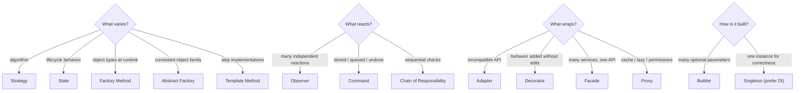
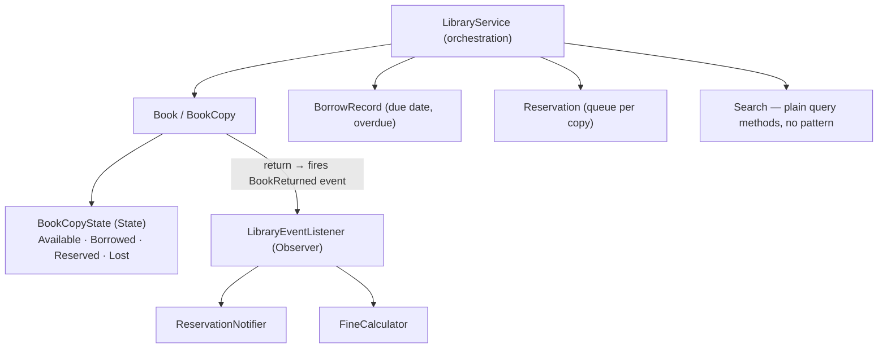

# 07 — The Complete Cheat Sheet & Course Closing

> **Source:** Course Section 8 (SLIDE 97 – SLIDE 111). This is the **compilation and closing section — no new concepts are introduced.** Every slide here is designed to be screenshotted, bookmarked, or printed as a study aid **for the days and hours before your LLD interview**. Use this file for **final review, not first-time learning** — if anything on these pages is unfamiliar, go back to the file where it was taught [SLIDE 97].

---

## 0. How to Use This File [SLIDE 97]

**What this file contains:**

- OOP principles quick reference (§1)
- SOLID principles quick reference (§2)
- Creational, structural, and behavioral pattern quick references (§3–§5)
- Complete signal-to-pattern mapping across all patterns (§6)
- Pattern combination reference (§7)
- Anti-pattern recognition guide (§8)
- Key design trade-offs summary (§9)
- The LLD interview checklist (§10)
- A full walkthrough (§11) and what to practice next (§12)
- The exam-day reference (§13) and the bridge to case studies (§14)

**Three review protocols, three moments:**

| When | What | How long |
|---|---|---|
| **A week before** | Read this file once end-to-end. Any entry that does not immediately trigger the deeper explanation → reopen that file section | 60 min |
| **The night before** | §6 signal mapping + §7 combinations + §8 anti-patterns + §13 exam-day reference. Only the tables | 25 min |
| **30 minutes before the interview** | §13 alone — three questions, five phases, three danger checks, trade-off template | 5 min |

> **[INTERVIEW]** The design of this file mirrors how the course itself prescribes using the slide set: **dense reference tables for rehearsal, not tutorials.** If you find yourself *learning* something from these tables, that is a signal — it means that particular item never got its repetition. Give it one more pass in its home file (02–06) before the interview, not here.

---

## 1. OOP Principles Quick Reference [SLIDE 98]

> Deep dive: **file 01** (`01_OOP_PRINCIPLES.md`). This table is the compressed decision version.

### 1.1 The five OOP decisions in every LLD interview [SLIDE 98]

| Decision point | Question to ask | Wrong signal | Right signal |
|---|---|---|---|
| **Encapsulation** | *"Should external code change this field directly?"* | Getter + setter on every field | **Behavior methods** that enforce rules |
| **Abstraction** | *"If I swap the implementation, does caller code change?"* | Callers import concrete classes | Callers depend on **interfaces** |
| **Inheritance** | *"Is this truly is-a? Does the child use most of the parent?"* | Inherits **for code reuse only** | True is-a with **shared behavior + state** |
| **Polymorphism** | *"Is there an if/else on object type?"* | **Switch statement selecting behavior** | **Interface with one implementation per type** |
| **Composition over inheritance** | *"Are there 2 independent dimensions of variation?"* | One deep inheritance tree | **Composed objects varying independently** |

### 1.2 Key code patterns [SLIDE 98]

| Concept | What it looks like (Java) |
|---|---|
| **Encapsulation** | Private fields, no setters, behavior methods: `withdraw()`, `authenticate()`, `changePassword()` |
| **Abstraction** | `PaymentProcessor` interface, `StripePaymentProcessor` implementation |
| **Polymorphism** | `processor.charge(amount)` calls different code depending on the concrete type |
| **Composition** | `NotificationSender` holds `DeliveryMethod` + `PriorityHandler` + `MessageFormatter` as constructor parameters |

**The interface-vs-abstract-class rule [SLIDE 98]: shared state (fields) = abstract class. Everything else = interface.**

### 1.3 The five decisions in C++, C, and Java — the compressed form

The tables above are structural; this block is the muscle memory. The same five decisions, applied together, in all three languages:

```java
// Java — the five decisions in one small system
public final class BankAccount {                     // ENCAPSULATION
    private Money balance;                           // no setter; rules live here
    public void withdraw(Money amount) {             // behavior method, not setBalance()
        if (amount.greaterThan(balance))
            throw new InsufficientFundsException();
        balance = balance.minus(amount);
    }
}

public interface PaymentProcessor {                  // ABSTRACTION
    void charge(Money amount);
}

public class Checkout {
    private final PaymentProcessor processor;        // COMPOSITION: injected
    Checkout(PaymentProcessor processor) { this.processor = processor; }
    public void pay(Money amount) {
        processor.charge(amount);                    // POLYMORPHISM: dispatch by type
    }
}
```

```cpp
// C++ — same five decisions
class BankAccount final {
    Money balance_;                                  // ENCAPSULATION
public:
    void withdraw(Money amount) {                    // behavior method enforces the rule
        if (amount > balance_) throw InsufficientFunds{};
        balance_ = balance_ - amount;
    }
};

class PaymentProcessor {                             // ABSTRACTION
public:
    virtual void charge(Money amount) = 0;
    virtual ~PaymentProcessor() = default;
};

class Checkout {
    PaymentProcessor& processor_;                    // COMPOSITION: reference injected
public:
    explicit Checkout(PaymentProcessor& p) : processor_(p) {}
    void pay(Money amount) { processor_.charge(amount); }   // POLYMORPHISM
};
```

```c
/* C — same five decisions: structs + ops tables */
struct bank_account {                    /* ENCAPSULATION: access only via functions */
    long balance_cents;                  /* private by convention, enforced by review */
};

int bank_account_withdraw(struct bank_account *a, long cents)
{
    if (cents > a->balance_cents) return -EINSUFFICIENT;
    a->balance_cents -= cents;
    return 0;
}

struct payment_processor_ops {           /* ABSTRACTION = the contract */
    int (*charge)(void *ctx, long cents);
};

struct checkout {                        /* COMPOSITION: ops table injected */
    const struct payment_processor_ops *processor;
    void          *processor_ctx;
};

int checkout_pay(struct checkout *c, long cents)
{
    return c->processor->charge(c->processor_ctx, cents);   /* POLYMORPHISM */
}
```

> **[INTERVIEW]** These five decisions are evaluated in **every** LLD interview, whether the interviewer names them or not. Your class diagram either demonstrates them or violates them [SLIDE 98]. During Phase 4 (detailed design, file 06 §9), the interviewer is watching for exactly these five.

---

## 2. SOLID Principles Quick Reference [SLIDE 99]

> Deep dive: **file 02** (`02_SOLID_PRINCIPLES.md`). 

### 2.1 One-line violation test for each principle [SLIDE 99]

| Principle | Violation test | If violated |
|---|---|---|
| **SRP** | *"How many reasons does this class have to change?"* | More than one → **split by change driver** |
| **OCP** | *"To add a new type, do I edit existing code?"* | Yes → **extract interface, one implementation per type** |
| **LSP** | *"Can I substitute a subtype without breaking behavior?"* | No → **fix the hierarchy** or split the interface |
| **ISP** | *"Does any implementor throw `UnsupportedOperationException`?"* | Yes → **split the interface by capability** |
| **DIP** | *"Does business logic import concrete infrastructure?"* | Yes → **depend on an interface, inject the implementation** |

### 2.2 SOLID violation code smells [SLIDE 99]

| Code smell | Likely violation | Refactoring |
|---|---|---|
| Class with 10+ methods across different domains | **SRP** | Extract focused service classes |
| Switch/if-else on type to decide behavior | **OCP** | Strategy pattern with interface |
| Subclass overrides method to throw exception | **LSP / ISP** | Split interface, fix hierarchy |
| Interface with 8+ methods | **ISP** | Split into role-based interfaces |
| Constructor creates dependencies with `new` | **DIP** | Constructor injection with interfaces |
| Business class imports SMTP/JDBC/HTTP client | **DIP** | Wrap behind your own interface |

> **[INTERVIEW]** **Spotting these code smells in your own design (or in code the interviewer presents) and naming the SOLID principle they violate is one of the strongest signals of design maturity** [SLIDE 99]. This is the vocabulary layer that sits on top of the anti-pattern fixes in §8 — e.g. God Class (§8) is SRP (§2) seen from the outside.

The tri-language treatment of every one of these refactorings (switch→Strategy, subclass-throws→ISP split, `new`-in-constructor→injection, and the kernel-flavored C analogues) lives in **file 02** — use it when a violation here needs a code-level refresher.

---

## 3. Creational Patterns Quick Reference [SLIDE 100]

> Deep dive: **file 03** (`03_CREATIONAL_PATTERNS.md`).

### 3.1 The four patterns [SLIDE 100]

| Pattern | Recognition signal | Structure | Key benefit |
|---|---|---|---|
| **Factory Method** | *"Create different types based on configuration or input"* | Interface + implementations + factory class/method | Adding a new type = **one new class, factory update only** |
| **Abstract Factory** | *"Create a family of objects that must be consistent"* | Factory interface + implementations, each producing a consistent set | **Guarantees family consistency** (all Material, all Fluent) |
| **Builder** | *"5+ parameters, many optional, cross-field validation"* | Inner Builder class with chained methods + `build()` | **Self-documenting construction, immutable objects** |
| **Singleton** | *"Exactly one instance for correctness (not convenience)"* | Private constructor, static access (**prefer DI instead**) | Single instance guarantee; **trades testability** for global access |

### 3.2 Decision shortcuts [SLIDE 100]

| Question | Answer |
|---|---|
| *"Multiple types at runtime?"* | **Factory Method** |
| *"Objects must be created as a consistent set?"* | **Abstract Factory** |
| *"Too many constructor parameters?"* | **Builder** |
| *"Global access needed?"* | **Dependency injection (not Singleton)** |
| *"Only one type, few parameters?"* | **Simple constructor (no pattern needed)** |

> **[INTERVIEW]** **Factory Method and Builder are the two creational patterns you will use most in LLD interviews. Abstract Factory is occasional. Singleton should be justified with a correctness argument, never a convenience argument** [SLIDE 100].

### 3.3 Tri-language: Factory Method — the creational archetype

```java
public interface PaymentProcessor { void charge(Money amount); }

public class PaymentProcessorFactory {
    public static PaymentProcessor create(PaymentMethod method) {
        return switch (method) {                       // switch lives HERE, once
            case CREDIT_CARD   -> new CreditCardProcessor();
            case BANK_TRANSFER -> new BankTransferProcessor();
            case WALLET        -> new WalletProcessor();
        };
    }
}
```

```cpp
class PaymentProcessor {
public:
    virtual void charge(Money amount) = 0;
    virtual ~PaymentProcessor() = default;

    static std::unique_ptr<PaymentProcessor> create(PaymentMethod method);
    // create() owns the one switch; every caller stays decoupled from concretes.
};

std::unique_ptr<PaymentProcessor> PaymentProcessor::create(PaymentMethod m) {
    switch (m) {
        case PaymentMethod::CreditCard:   return std::make_unique<CreditCardProcessor>();
        case PaymentMethod::BankTransfer: return std::make_unique<BankTransferProcessor>();
        case PaymentMethod::Wallet:       return std::make_unique<WalletProcessor>();
    }
    throw std::invalid_argument("unknown payment method");
}
```

```c
/* C — the factory returns an {ops, ctx} pair; callers never see concrete types */
struct payment_processor_ops {
    int (*charge)(void *ctx, long cents);
};

struct payment_processor {
    const struct payment_processor_ops *ops;
    void *ctx;
};

struct payment_processor payment_processor_create(enum payment_method m)
{
    switch (m) {
    case PAY_CREDIT_CARD:   return credit_card_processor_create();
    case PAY_BANK_TRANSFER: return bank_transfer_processor_create();
    case PAY_WALLET:        return wallet_processor_create();
    }
    return (struct payment_processor){0};
}
```

### 3.4 Tri-language: Builder — the construction archetype

```java
SearchQuery query = new SearchQuery.Builder("payment error")   // only required field
        .filters(List.of(Filter.type("LOG")))
        .sortOrder(SortOrder.NEWEST)
        .pageSize(50)
        .includeArchived(false)
        .build();                                              // validated, immutable
```

```cpp
auto query = SearchQuery::Builder("payment error")
        .filters({Filter::type("LOG")})
        .sortOrder(SortOrder::Newest)
        .pageSize(50)
        .includeArchived(false)
        .build();          // chain returns Builder&, build() returns SearchQuery by value
```

```c
/* C — designated-initializer + a finalize step is the closest honest analogue */
struct search_query q = search_query_init("payment error");
search_query_set_filters(&q, filters, filter_count);
search_query_set_page_size(&q, 50);
if (search_query_finalize(&q) != 0) { /* cross-field validation failed */ }
```

---

## 4. Structural Patterns Quick Reference [SLIDE 101]

> Deep dive: **file 04** (`04_STRUCTURAL_PATTERNS.md`).

### 4.1 The four patterns [SLIDE 101]

| Pattern | Recognition signal | Structure | Key benefit |
|---|---|---|---|
| **Adapter** | *"External API has incompatible interface"* | Your interface + adapter class + third-party class | **Isolates your code from external changes** |
| **Decorator** | *"Add behavior without modifying the core class"* | Shared interface + base class + decorator wrappers | **Stackable: n behaviors = n classes (not 2^n)** |
| **Facade** | *"Coordinate 3 services behind a simple API"* | Facade class orchestrating multiple services | **Centralized sequencing and error recovery** |
| **Proxy** | *"Cache / lazy-load / check permissions"* | Same interface as real object + proxy wrapper | **Transparent access control** |

### 4.2 The differentiation pairs — never confuse these again [SLIDE 101]

| Confusion pair | Key difference |
|---|---|
| **Decorator vs Proxy** | **Decorator adds behavior. Proxy controls access.** |
| **Adapter vs Facade** | **Adapter translates one interface. Facade simplifies a subsystem of many interfaces.** |
| **Decorator vs Adapter** | **Decorator keeps the same interface. Adapter changes the interface.** |
| **Facade vs Adapter** | **Facade creates a new, simpler API. Adapter maps between two existing APIs.** |

> **[INTERVIEW]** **Adapter and Decorator are the most frequently tested structural patterns. Proxy appears in caching and lazy-loading scenarios. Facade appears in multi-service coordination problems** [SLIDE 101]. The differentiation pairs are exactly the follow-up questions — *"isn't that just a Proxy?"* — so rehearse the one-line distinctions.

### 4.3 Tri-language: Decorator — the wrapping archetype

```java
public class LoggingStorage implements Storage {        // SAME interface as the real object
    private final Storage delegate;                     // wraps any Storage
    public LoggingStorage(Storage delegate) { this.delegate = delegate; }

    public void put(String key, byte[] data) {
        log.info("put key={} bytes={}", key, data.length);
        delegate.put(key, data);                        // forward, unchanged semantics
    }
    public byte[] get(String key) { return delegate.get(key); }
}
// new LoggingStorage(new EncryptingStorage(new S3Storage(...)))  — stack freely
```

```cpp
class LoggingStorage final : public Storage {           // same interface, wraps a Storage&
    Storage& delegate_;
public:
    explicit LoggingStorage(Storage& d) : delegate_(d) {}
    void put(const std::string& key, const Bytes& data) override {
        log("put key={} bytes={}", key, data.size());
        delegate_.put(key, data);
    }
};
```

```c
/* C — a decorator is an ops table that forwards to the inner object's ops */
struct storage { const struct storage_ops *ops; void *ctx; };

struct logging_ctx { struct storage inner; };

static int logging_put(void *ctx, const char *key, const void *buf, size_t len)
{
    log_put(key, len);
    struct logging_ctx *l = ctx;
    return l->inner.ops->put(l->inner.ctx, key, buf, len);   /* delegate */
}

/* stacking is wiring: logging_storage_create(encrypting_storage_create(s3_storage)) */
```

---

## 5. Behavioral Patterns Quick Reference [SLIDE 102]

> Deep dive: **file 05** (`05_BEHAVIORAL_PATTERNS.md`).

### 5.1 The six patterns [SLIDE 102]

| Pattern | Recognition signal | Structure | Key benefit |
|---|---|---|---|
| **Strategy** | *"Support multiple algorithms for X"* | Context + strategy interface + implementations | **Swap algorithms at runtime, OCP compliant** |
| **Observer** | *"When X happens, notify Y and Z"* | Subject + listener interface + listener implementations | **Decouple event source from reactions** |
| **Command** | *"Undo/redo, queue, or log operations"* | Command interface with `execute()`/`undo()` + history/queue | **Actions as first-class objects** |
| **State** | *"Object behaves differently by state"* | Context + state interface + state implementations | **Replace if/else on state, explicit transitions** |
| **Chain of Responsibility** | *"Process through pipeline of checks"* | Handler interface + concrete handlers linked in chain | **Sequential processing with short-circuiting** |
| **Template Method** | *"Same structure, different steps"* | Abstract base with final skeleton method + abstract step methods | **Shared algorithm, customizable steps** |

### 5.2 The differentiation pairs [SLIDE 102]

| Confusion pair | Key difference |
|---|---|
| **Strategy vs State** | **Strategy: algorithm selected once, stays fixed. State: behavior changes as the object transitions through its lifecycle.** |
| **Observer vs Chain of Responsibility** | **Observer: all listeners notified independently. CoR: handlers process sequentially, can short-circuit.** |
| **Command vs Strategy** | **Command: action as object (store, undo, queue). Strategy: algorithm as object (swap, select).** |
| **Template Method vs Strategy** | **Template Method: fixed structure, variable steps (inheritance). Strategy: entire algorithm varies (composition).** |

> **[INTERVIEW]** **Strategy, Observer, and State are the three behavioral patterns tested in 80%+ of LLD interviews. Command and Chain of Responsibility are Tier 2. Template Method is Tier 3** [SLIDE 102] — matching the tier table from file 06 §5. The differentiation pairs are the two most common trap questions: *"why State and not Strategy?"* and *"isn't Observer just a Chain?"* — answer with the one-liners above.

### 5.3 Tri-language: State — the lifecycle archetype

```java
public interface OrderState {
    OrderState next(OrderEvent event);          // the state decides what is legal next
}

public final class ShippedState implements OrderState {
    public OrderState next(OrderEvent e) {
        return e == OrderEvent.DELIVERED ? new DeliveredState() : this;   // invalid → stay
    }
}
// context: order.setState(order.getState().next(event));  — no if/else on state anywhere
```

```cpp
class OrderState {                              // one class per state
public:
    virtual std::unique_ptr<OrderState> next(OrderEvent e) = 0;
    virtual ~OrderState() = default;
};

class ShippedState final : public OrderState {
public:
    std::unique_ptr<OrderState> next(OrderEvent e) override {
        return e == OrderEvent::Delivered
                ? std::make_unique<DeliveredState>()
                : std::make_unique<ShippedState>();
    }
};
```

```c
/* C — the TCP state-table idiom: one ops table per state */
struct order_state_ops {
    const struct order_state_ops *(*next)(struct order *o, enum order_event e);
    const char *name;
};

static const struct order_state_ops *shipped_next(struct order *o, enum order_event e)
{
    return (e == ORDER_DELIVERED) ? &delivered_state : &shipped_state;
}

static const struct order_state_ops shipped_state = {
    .next = shipped_next,
    .name = "SHIPPED",
};
```

**Quick shapes for the other five (for recall — full versions in file 05):**

| Pattern | One-glance structure |
|---|---|
| **Strategy** | `context.execute()` → delegates to `strategy.algorithm()`; the context never learns which |
| **Observer** | `subject.subscribe(listener)`; on change → `for (l : listeners) l.onEvent(e)` |
| **Command** | `interface Command { execute(); undo(); }` + invoker holds a history deque |
| **Chain** | `handler.handle(req)` → decides: process, forward to `next`, or short-circuit |
| **Template Method** | `final run()` calls `step1(); step2(); step3();` — steps are abstract/hook methods |

---

## 6. Complete Signal-to-Pattern Mapping [SLIDE 103]

> The slides call this **"the master table. Every signal from every section in one place."** Same content as file 06 §2, reorganized by the **four questions** — this is the version to memorize.

### 6.1 "What varies?" signals [SLIDE 103]

| Signal | Pattern |
|---|---|
| Multiple algorithms for the same operation | **Strategy** |
| Object behavior changes by lifecycle state | **State** |
| Different object types created at runtime | **Factory Method** |
| Family of objects that must be consistent | **Abstract Factory** |
| Same algorithm structure, different step implementations | **Template Method** |

### 6.2 "What reacts?" signals [SLIDE 103]

| Signal | Pattern |
|---|---|
| Multiple independent reactions to one event | **Observer** |
| Action needs to be stored, queued, or undone | **Command** |
| Request processed through sequential checks | **Chain of Responsibility** |

### 6.3 "What wraps?" signals [SLIDE 103]

| Signal | Pattern |
|---|---|
| External API has incompatible interface | **Adapter** |
| Add behavior without modifying the class | **Decorator** |
| Coordinate multiple services behind one API | **Facade** |
| Cache, lazy-load, or control access | **Proxy** |

### 6.4 "How is it built?" signals [SLIDE 103]

| Signal | Pattern |
|---|---|
| 5+ parameters with many optional | **Builder** |
| Exactly one instance for correctness | **Singleton** (prefer DIP) |

### 6.5 The whole table as one decision flow



> **[INTERVIEW]** **Internalizing this table is the single highest-leverage LLD interview preparation. When you hear a requirement, the pattern should surface automatically** [SLIDE 103]. Target: **under 5 seconds** from signal to pattern name (drills in file 06 §13 and §15 of this file).

---

## 7. Pattern Combination Quick Reference [SLIDE 104]

> Deep dive: **file 05 §8**. Worked multi-pattern examples: **file 06 §3**.

| Combination | When it appears | How they interact |
|---|---|---|
| **Strategy + Factory** | Multiple algorithms selected by configuration | **Factory decides** which strategy; **strategy executes** the algorithm |
| **Observer + Command** | Events trigger deferred/retryable work | **Observer detects event synchronously; Command queued for async execution** |
| **State + Observer** | State transitions trigger notifications | **State class changes state, fires event** for decoupled listeners |
| **Decorator + Strategy** | Cross-cutting concerns on any algorithm | **Decorator wraps the strategy interface**, adds logging/timing/caching |
| **Chain of Responsibility + Factory** | Pipeline handlers vary by request type | **Factory creates the handler chain, CoR processes sequentially** |
| **Template Method + Strategy** | Fixed pipeline with swappable individual steps | **Template Method owns the sequence; each step is a Strategy** |
| **Adapter + Factory** | Multiple external integrations | **Factory selects the right adapter** based on provider configuration |
| **Builder + Factory** | Factory creates complex objects | **Factory decides the type; Builder handles** multi-parameter construction |

**The Two-Pattern Rule of Thumb [SLIDE 104]:**

> **Most LLD interview problems are well-served by 2–3 patterns. If you find yourself reaching for a fourth or fifth pattern, pause and ask: "Is this solving a stated requirement or a hypothetical future one?" If the latter, remove it.**

> **[INTERVIEW]** Knowing which patterns combine naturally **prevents awkward designs where patterns fight each other** — e.g. State + Strategy selected *per transition* instead of State + Observer *firing on* transitions. Each combination above was validated through the worked examples in files 05–06; when you combine, always name the interaction out loud (*"the factory picks, the strategy executes"* — file 05 §8.5's naming rule).

---

## 8. Anti-Pattern Recognition Quick Reference [SLIDE 105]

> Deep dives: **file 06 §6–7** (with tri-language code for every fix).

| Anti-pattern | Detection signal | SOLID violation | Fix |
|---|---|---|---|
| **God Class** | 8+ dependencies, 15 methods across domains | **SRP** | **Split by change driver** into focused classes |
| **Feature Envy** | Method calls 3+ getters on another class | **Encapsulation** | **Move method** to the class it envies |
| **Shotgun Surgery** | One change requires editing 8+ files | **SRP (inverted)** | **Consolidate** scattered responsibility |
| **Circular Dependency** | Class A depends on B, B depends on A | **DIP** | **Extract interface, use events, or add coordinator** |
| **Premature Abstraction** | Interface with exactly one implementation | **Over-engineering** | **Remove interface** until second implementation exists |
| **Refused Bequest** | Subclass overrides method to throw or no-op | **LSP** | **Break hierarchy, use composition** |
| **Switch on Type** | if/else or switch selecting behavior by type string | **OCP** | **Extract interface** with implementations |
| **Inappropriate Intimacy** | Two classes access each other's internals | **Encapsulation** | **Extract shared interface or merge** if truly one concept |

### 8.1 The two entries new to this slide — tri-language micro-cards

The two anti-patterns added here (beyond file 06's six) are **Refused Bequest** and **Switch on Type**. The compressed forms:

**Refused Bequest** — a subclass that *refuses* what it inherited:

```java
// Java — the smell: inherits, then refuses
public class SavingsAccount extends Account {
    @Override public void withdraw(Money amount) {
        throw new UnsupportedOperationException("No withdrawals from savings");
    }
}
// FIX: the hierarchy claim was false — use composition; SavingsAccount wraps
// a Ledger/DebitPolicy instead of extending Account.
```

```cpp
// C++ — same refusal
class SavingsAccount : public Account {
public:
    void withdraw(Money) override { throw std::logic_error("unsupported"); }
};
// FIX: no inheritance; SavingsAccount holds a SavingsPolicy member.
```

```c
/* C — the ops-table version: the entry exists but refuses to work */
struct account_ops {
    int (*withdraw)(struct account *a, long cents);
    /* ... */
};

static int savings_withdraw(struct account *a, long cents)
{
    return -ENOSYS;     /* classic refused bequest in kernel-land */
}
/* FIX: split the ops table — savings accounts simply have no withdraw slot. */
```

> **[BEYOND THE COURSE]** The `-ENOSYS` line is the kernel's honest way of *not* pretending: the VFS calls into an operation and the operation says "not implemented." The smell is when the **interface promised it**. In Java the promise is a method; in C it is a function pointer that had better be `NULL` (checked) or absent (split table) — not present-but-refusing.

**Switch on Type** — the OCP violation at the heart of files 02–03:

```java
// BEFORE — OCP violation: every new type edits this switch
public Money price(Item item) {
    switch (item.type()) {
        case BOOK:     return base * 0.95;
        case ELECTRONICS: return base * 1.10;
        // new type → edit here, again, forever
    }
}
// AFTER — one pricing strategy per type; the switch becomes a lookup, once.
```

```cpp
// The same fix in C++ is one virtual call (or std::variant + visit), never a
// growing switch in the caller.
```

```c
/* C — the same fix is the ops table: pricing becomes an entry in the item's
 * type-specific table, so the caller has no switch at all. */
struct item_type_ops { long (*price)(long base_cents); };
```

### 8.2 The three-second check [SLIDE 105]

> Before submitting your LLD design, scan for these three things:
>
> 1. **Any class with 5+ dependencies?** → Likely a **God Class**. Split it.
> 2. **Any if/else on object type?** → Likely an **OCP violation**. Extract interface.
> 3. **Any subclass throwing `UnsupportedOperationException`?** → Likely an **LSP/ISP violation**. Split the interface.

> **[INTERVIEW]** Interviewers sometimes **present a flawed design and ask you to critique it**. This table gives you the vocabulary and the specific fix for every common flaw [SLIDE 105] — the vocabulary is half the score: say *"that is a Refused Bequest — an LSP violation"*, not *"that seems weird."*

---

## 9. Key Design Trade-Offs Summary [SLIDE 106]

> **Every design decision in an LLD interview is a trade-off. Never present a choice as "the right answer." Always state what you gain and what you give up** [SLIDE 106].

### 9.1 The seven core trade-offs [SLIDE 106]

| Trade-off | Option A | Option B | Decision criteria |
|---|---|---|---|
| **Inheritance vs Composition** | Simpler for **true is-a with shared state** | **Flexible, decoupled, runtime-swappable** | **Default to composition** unless all three inheritance conditions are met |
| **Interface vs Abstract Class** | Multiple implementation, no shared state | Shared state, partial implementation | **Shared fields = abstract class. Everything else = interface** |
| **Strategy vs State** | Algorithm selected once, stays fixed | Behavior changes over object lifetime | **Does the object transition? State. Fixed selection? Strategy** |
| **Decorator vs Proxy** | Adding behavior (logging, compression) | Controlling access (caching, auth, lazy load) | **What is the primary purpose: enhance or control?** |
| **Facade vs No Facade** | Simplifies multi-service coordination | Callers may need fine-grained control | **Facade for the 80% common case, direct access for the 20%** |
| **Pattern vs No Pattern** | Extensibility for stated requirements | Simplicity for stable requirements | **Use pattern only when requirement demands extensibility** |
| **DI vs Singleton** | Testable, visible dependencies, loose coupling | Simple global access, no constructor threading | **Default to DI** unless creating two instances causes a correctness/threading bug |

### 9.2 How to state a trade-off in an interview [SLIDE 106]

**The one-line template:**

> *"I chose **[Option]** because **[specific requirement]**. The trade-off is **[what I give up]**, but that is acceptable here because **[why it does not matter for this use case]**."*

**The slides' worked example:**

> *"I chose **composition over inheritance** because there are **two independent dimensions of variation** (channel and priority). The trade-off is **slightly more boilerplate** (constructor injection), but that is acceptable because it gives us **runtime flexibility and avoids the class explosion problem**."*

> **[INTERVIEW]** **Explicitly stating trade-offs is the single most effective way to signal senior-level thinking in an LLD interview. Interviewers note whether candidates acknowledge costs or present every decision as obviously correct** [SLIDE 106]. Rule of thumb: **every pattern you name gets one trade-off sentence attached.** If you cannot articulate the trade-off, you cannot defend the choice — see file 06 §11.2, row *"cannot explain why a pattern was chosen."*

---

## 10. The LLD Interview Checklist [SLIDE 107]

> Use this checklist as a **mental walkthrough in the final 2 minutes of your LLD interview** to catch common mistakes before your time runs out [SLIDE 107].

**Requirements phase**

- [ ] Did I ask at least **3 clarifying questions**?
- [ ] Did I state my **assumptions** for anything ambiguous?
- [ ] Did I scope the design to the **stated requirements**, not hypothetical future ones?

**Object design phase**

- [ ] Does each class have a **single responsibility** (one change driver)?
- [ ] Are my classes **encapsulated** (behavior methods, not getters/setters for every field)?
- [ ] Do any of my classes have **5+ dependencies**? *(God Class signal)*

**Interface and relationship phase**

- [ ] Did I use **interfaces where there are multiple implementations**?
- [ ] Do my **dependency arrows point toward abstractions**, not concrete classes?
- [ ] Did I **avoid interfaces with a single implementation** and no testability requirement?
- [ ] Is there an **if/else or switch on type** anywhere? *(Extract interface)*

**Pattern phase**

- [ ] Can I **name the specific requirement each pattern solves**?
- [ ] Am I using **2–3 patterns, not 6**?
- [ ] Did I consider **State vs Strategy correctly** (lifecycle vs fixed selection)?

**Trade-off phase**

- [ ] Did I state **at least one trade-off** I made?
- [ ] Did I mention **one extensibility point** for future requirements?
- [ ] Can I **defend every design decision** if the interviewer asks *"why?"*

> **[INTERVIEW]** **Running through this checklist silently in your head during the last 2 minutes catches the most common mistakes that downgrade LLD scores from "strong hire" to "hire" or below** [SLIDE 107]. The checklist doubles as a self-review between practice runs — grade yourself on the two un-ticked boxes, not on the total.

---

## 11. Full LLD Walkthrough: Library Management [SLIDE 108]

> **The scenario [SLIDE 108]:** a 45-minute LLD interview. *"Design a library management system. Users can search for books, borrow books, return books, and reserve books that are currently checked out. Librarians can add new books, remove books, and view overdue items."*

**Phase 1 — Clarify (3 min) [SLIDE 108]:**

- *"Can a user borrow multiple books? Is there a maximum?"*
- *"Can books have multiple copies?"*
- *"Does a reservation expire?"*
- *"How are overdue books handled — just a report, or automated fines?"*

**Phase 2 — Core objects (3 min) [SLIDE 108]:** `Book`, `BookCopy`, `User`, `Librarian`, `BorrowRecord`, `Reservation`, `LibraryService`.

**Phase 3 — Relationships and patterns (7 min) [SLIDE 108]:**

- **Book copies transition through states: Available, Borrowed, Reserved, Lost. → State pattern.**
- **When a book is returned, notify anyone who reserved it, update inventory counts, check for overdue fines. → Observer.**
- **Search across title, author, ISBN is a query method — no pattern.** *(The refusal, stated aloud — file 06 §3.3.)*

**Phase 4 — Key classes (15 min) [SLIDE 108]:**

- Detail the `BookCopyState` interface with `AvailableState`, `BorrowedState`, `ReservedState`.
- Show `BorrowRecord` with due date and overdue detection.
- Show `LibraryEventListener` with `ReservationNotifier` and `FineCalculator` implementations.

**Phase 5 — Extensibility (5 min) [SLIDE 108]:**

- *"If we needed multiple search strategies (keyword, full-text, fuzzy match), I would extract a `SearchStrategy` interface."*
- *"If we needed different borrowing policies by user tier (student, faculty, public), I would use Strategy for `BorrowPolicy`."*

**Pattern count: 2 (State + Observer). This is sufficient for the stated requirements. Adding more would be over-engineering** [SLIDE 108].



**The State + Observer seam, compressed (the Phase 4 core):**

```java
public interface BookCopyState {
    BookCopyState borrow(User user, BorrowRecord record);
    BookCopyState returnCopy();
    BookCopyState reserve(Reservation reservation);
}

public class AvailableState implements BookCopyState {
    public BookCopyState borrow(User user, BorrowRecord record) {
        return new BorrowedState(record);
    }
    public BookCopyState returnCopy() { return this; }   // already available
    public BookCopyState reserve(Reservation r) { return new ReservedState(r); }
}
```

```cpp
// C++ — the same contract as pure abstract methods; one class per state file.
class BookCopyState {
public:
    virtual std::unique_ptr<BookCopyState> borrow(User& u, BorrowRecord& r) = 0;
    virtual std::unique_ptr<BookCopyState> returnCopy() = 0;
    virtual ~BookCopyState() = default;
};
```

```c
/* C — the state-table version per copy */
struct book_copy_state_ops {
    const struct book_copy_state_ops *(*borrow)(struct book_copy *c, struct user *u);
    const struct book_copy_state_ops *(*return_copy)(struct book_copy *c);
};
static const struct book_copy_state_ops available_state = {
    .borrow = available_borrow,
    .return_copy = available_return_copy,
};
```

> **[INTERVIEW]** A full case-study treatment of Library Management (with every class, tri-language code, and a graded "weak answer / hire / strong hire" comparison) appears in **file 09** — this section is the *script*; file 09 is the *implementation*. Notice how this walkthrough obeys every rule from file 06: signal recognition (lifecycle → State, notifications → Observer), restraint (search refused a pattern), and Phase 5 scripts for the two most likely extensions.

---

## 12. What to Practice Next [SLIDE 109]

### 12.1 Immediate next steps [SLIDE 109]

1. **Practice the five-phase structure on 3 different LLD problems with a 45-minute timer. Record yourself if possible. Most improvement comes from fixing timing issues.**
2. **Build the signal-to-pattern reflex.** Take any product you use daily (Spotify, Uber, Gmail) and identify 3 requirements that map to specific patterns. Practice until the pattern surfaces **within 5 seconds** of hearing the signal.
3. **Practice anti-pattern recognition.** Open any codebase you have access to and find **one God Class, one Feature Envy method, and one if/else chain that should be a Strategy**. Real code builds recognition faster than textbook examples.

### 12.2 LLD problems to practice, ordered by pattern density [SLIDE 109]

| Problem | Primary patterns | Difficulty |
|---|---|---|
| **Parking Lot** | State, Strategy (if multi-strategy), Factory | Beginner |
| **Library Management** | State, Observer | Beginner |
| **Vending Machine** | State, Factory | Beginner |
| **Elevator System** | State, Strategy, Observer | Intermediate |
| **ATM Machine** | State, Chain of Responsibility, Command | Intermediate |
| **Online Book Store** | Strategy, Factory, Observer, Facade | Intermediate |
| **Chess Game** | State, Strategy, Command (undo), Observer | Advanced |
| **Hotel Booking** | State, Strategy, Observer, Builder | Advanced |
| **Ride-Sharing (like Uber)** | Strategy, State, Observer, Factory, Decorator | Advanced |
| **Food Delivery (like DoorDash)** | Strategy, State, Observer, Chain of Responsibility, Command | Advanced |

> **[INTERVIEW]** **The problems in this table are the most commonly asked LLD interview questions across Amazon, Google, Microsoft, Meta, and Uber. Practicing 5–6 of these with the five-phase structure covers the majority of what you will encounter** [SLIDE 109]. In this course, **Parking Lot and Library Management are worked end-to-end in file 09**, with the same treatment available as templates for the rest — the pattern sets in this table tell you which sections of files 03–05 to rehearse before each problem.

---

## 13. The LLD Exam Day Reference [SLIDE 110]

> The slides call this **the final "note it down" slide: review it 30 minutes before your LLD interview** [SLIDE 110].

**① The Three Questions (pattern selection):**

| Question | Patterns |
|---|---|
| **What varies?** | Strategy, State, Factory, Template Method |
| **What reacts?** | Observer, Command, Chain of Responsibility |
| **What wraps?** | Decorator, Proxy, Adapter, Facade |

**② The Five Phases (interview structure):**

| Phase | Time |
|---|---|
| Clarify requirements | 3–5 min |
| Identify core objects | 3–5 min |
| Define interfaces and relationships | 5–10 min |
| Detailed class design | 10–15 min |
| Extensibility and trade-offs | 5 min |

**③ The Three Danger Checks (before you finish):**

1. **Any class with 5+ dependencies?** → Split it.
2. **Any if/else on type?** → Extract interface.
3. **Any subclass throwing exceptions?** → Split the interface.

**④ The One-Line Trade-Off Template:**

> *"I chose **[X]** over **[Y]** because **[specific requirement]**. The trade-off is **[cost]**, which is acceptable because **[justification]**."*

> **[INTERVIEW]** That is the entire card — four blocks — and it is deliberately this small: **the 30-minutes-before review must fit in working memory**, not in a reference lookup. If any block here feels shaky, it points at exactly one deeper section: ① → file 06 §1–2; ② → file 06 §9; ③ → this file §8; ④ → this file §9.

---

## 14. Bridge to Part 2 & Course Closing [SLIDE 111]

### 14.1 What the course's Part 2 covers [SLIDE 111]

Part 2 applies everything from this course to **complete, end-to-end LLD case studies**. Each case study will:

- Start with an **interview-style problem statement**;
- Walk through **all five phases** of the LLD interview structure;
- Produce a **complete class diagram** with interfaces, implementations, and relationships;
- Write **full implementations of the key classes**;
- Discuss **trade-offs and extensibility points**;
- Show what a **"hire," "strong hire," and "weak" answer** look like for the same problem.

**Planned case studies [SLIDE 111]:**

| Case study | Key patterns | Key trade-offs |
|---|---|---|
| **Parking Lot System** | State, Strategy, Factory | Single vs multi-floor, pricing strategy |
| **Elevator Design** | State, Strategy, Observer, Command | Scheduling algorithms, concurrent requests |
| **Online Bookstore** | Strategy, Factory, Observer, Facade, Decorator | Payment flow, discount composition |
| **Chess / Board Game** | State, Command, Strategy, Observer | Move validation, undo/redo, AI player |
| **Rate Limiter** | Strategy, Chain of Responsibility, Proxy | Token bucket vs sliding window, distributed vs local |
| **Notification Service** | Strategy, Factory, Observer, Decorator, Adapter | Channel selection, retry, template rendering |

> **How to use this course and Part 2 together [SLIDE 111]: this course gives you the vocabulary and the decision frameworks. Part 2 gives you the practice.** Practice the signal-to-pattern recognition until it is automatic, then work through the case studies to build fluency in applying the patterns under time pressure.

### 14.2 Where that maps in this notes course

| Slides' plan | This course's files |
|---|---|
| Part 2 case studies (all six above) | **file 09** (`09_INTERVIEW_PLAYBOOK.md`) — Parking Lot and Library Management worked end-to-end in tri-language, with the remaining case-study patterns mapped |
| Patterns not covered in the slides (Prototype, Bridge, Composite, Flyweight, Iterator, Mediator, Memento, Visitor, Interpreter) | **file 08** (`08_REMAINING_GOP_PATTERNS.md`) — same signal → structure → tri-language treatment |
| Cheat sheet + exam-day card | **this file** |

### 14.3 Course attribution

This notes course is built from **Mukul Raina's 5-hour Low-Level Design course**:

- **YouTube course:** https://www.youtube.com/watch?v=VSABVEBDhf0
- **Channel:** https://www.youtube.com/@mukulraina
- **Slides:** slides.mukulraina.com
- **Instructor LinkedIn:** https://www.linkedin.com/in/mukulraina/

Every `[SLIDE n]` marker traces back to that deck. Sections marked `[BEYOND THE COURSE]` — the C/C++ treatments, kernel parallels, remaining GoF patterns, and the numbered drill packs — extend it so the notes stand alone.

---

## 15. The Cheat-Sheet Self-Test (Final Drill Pack)

**Quick-fire round — answer out loud, target under 5 seconds each:**

1. *"Support multiple pricing algorithms"* → **Strategy**
2. *"Task moves To Do → In Progress → Done"* → **State**
3. *"When an order ships, notify email, analytics, and warehouse"* → **Observer**
4. *"Undo typing in an editor"* → **Command**
5. *"Auth, then rate limit, then validate"* → **Chain of Responsibility**
6. *"Nine constructor parameters, seven optional"* → **Builder**
7. *"Create payment processor based on the method chosen"* → **Factory Method**
8. *"Integrate with a vendor's SOAP API"* → **Adapter**
9. *"Add compression and encryption to uploads without touching the uploader"* → **Decorator**
10. *"Cache results of an expensive lookup behind the same interface"* → **Proxy**
11. *"One-click API over five internal services"* → **Facade**
12. *"Import from CSV or JSON — same stages, different parsing"* → **Template Method**
13. *"Exactly one connection pool for correctness"* → **Singleton** *(…and immediately say "prefer DI unless two instances corrupt state")*
14. *"Algorithm picked once at startup and never changed"* → **Strategy** *(…not State — the transition test)*
15. *"Events fire and the heavyweight work retries asynchronously"* → **Observer + Command** *(name the combination)*

**Table rounds — fill from memory, then check:**

- [ ] Write the **five OOP decisions** (§1.1) and their right signals.
- [ ] Write the **five SOLID violation tests** (§2.1) as questions.
- [ ] Write the **four signal-to-pattern buckets** (§6) — *varies / reacts / wraps / built* — with all 14 patterns placed.
- [ ] Write the **eight pattern combinations** (§7) as *"X + Y = interaction"* sentences.
- [ ] Write the **eight anti-patterns** (§8) as *smell → violation → fix* triples.
- [ ] Write the **seven trade-offs** (§9.1) as *"default to A unless B"* sentences.
- [ ] Recite the **five phases with minutes** (§13 ②) without looking.
- [ ] Recite the **three danger checks** (§13 ③) in one breath.
- [ ] Deliver **one trade-off** using the template (§9.2) about a decision from your last practice run.

> **[INTERVIEW]** If the quick-fire round finished under 75 seconds total and the table round needed no lookups, the recognition layer is ready. What remains is the production layer — the five-phase walkthroughs under a timer (§12.1) and the case studies in file 09. **Recognition, then restraint, then rehearsal.** That is the whole course.

---

*The slides' story ends here — with the exam-day card and the bridge to case studies. This notes course continues with `08_REMAINING_GOP_PATTERNS.md` (the nine GoF patterns outside the slides, in the same format) and `09_INTERVIEW_PLAYBOOK.md` (case studies, follow-up barrages, and the job-search layer around the interview itself).*