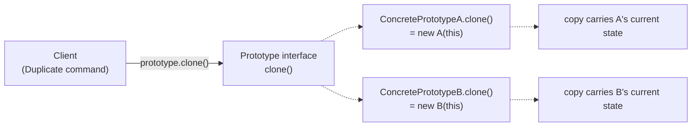

# 08 — The Remaining GoF Patterns: Prototype, Bridge, Composite, Flyweight, Iterator, Mediator, Memento, Visitor, Interpreter

> **[BEYOND THE COURSE]** The slide decks covered **14 of the 23 Gang-of-Four patterns** in depth. This file completes the set with the remaining **nine** — same treatment as every other file: signal → structure → **tri-language code (C++, C, Java)** → connections → drills. The slides place most of these in **Tier 4 ("rarely tested directly")** — but "rarely tested" is not "never useful": several of them (Iterator, Composite, Visitor) are everywhere in real codebases and show up as **follow-up questions** at infrastructure-heavy companies.

---

## 0. Why These Nine, and Where They Show Up

### 0.1 The complete 23, split by coverage

| Category | GoF patterns | Covered in |
|---|---|---|
| **Creational (5)** | Factory Method, Abstract Factory, Builder, **Prototype**, Singleton | Files 03 + this file (§1) |
| **Structural (7)** | Adapter, **Bridge**, **Composite**, Decorator, Facade, **Flyweight**, Proxy | File 04 + this file (§2–§4) |
| **Behavioral (11)** | Chain of Responsibility, Command, **Interpreter**, **Iterator**, **Mediator**, **Memento**, Observer, State, Strategy, Template Method, **Visitor** | File 05 + this file (§5–§9) |

**The nine remaining, and one honest sentence about each:**

| Pattern | The one honest sentence | Interview tier |
|---|---|---|
| **Prototype** | Clone existing objects instead of constructing new ones — polymorphism for copying | Tier 4 (concept) |
| **Bridge** | Split an abstraction and its implementation into two inheritance hierarchies that vary independently | Tier 4 (concept) |
| **Composite** | Treat single objects and compositions of objects uniformly — trees with one interface | Occasionally relevant |
| **Flyweight** | Share the parts of objects that repeat, so a million objects don't hold a million copies | Tier 4 (concept) |
| **Iterator** | Access elements sequentially without exposing the underlying representation | Everywhere in practice |
| **Mediator** | Centralize many-to-many interactions into one hub object | Tier 4 (concept) |
| **Memento** | Capture and externalize an object's state so it can be restored later, without breaking encapsulation | Feeds undo questions |
| **Visitor** | Add operations to a stable object structure without modifying the classes | Compiler-flavored follow-ups |
| **Interpreter** | Represent a grammar as a class hierarchy, and evaluate sentences by walking it | DSL follow-ups |

### 0.2 How to read this file

Every pattern gets the course-standard anatomy: **the signal** (when to hear it), **the problem** (why the naive design fails), **the structure** (mermaid), **tri-language implementations**, **kernel/real-world parallels**, and **interview notes**. The closing section (§10) reassembles all 23 patterns into one map, plus the drill pack.

> **[INTERVIEW]** The Tier-4 reality: these patterns are **rarely the point of an interview question** — but they are frequently the **follow-up**. *"The text editor needs to snapshot state for undo"* → Memento. *"The rule engine evaluates user-defined conditions"* → Interpreter. *"The UI tree has leaves and containers"* → Composite. Knowing the vocabulary turns a follow-up from a stumble into a ten-second answer.

---

## 1. Prototype — Cloning as a First-Class Operation

> **Signal:** *"Create new objects by copying existing ones"* — especially when the exact class is unknown, or construction is expensive. **Structure:** a `clone()`/copy operation on a prototype interface. **Benefit:** copy polymorphically without knowing the concrete type; skip expensive construction. **Tier:** 4 — but the underlying concept (shallow vs deep copy) is a core interview topic in every language.

### 1.1 The problem

You are designing a **document editor** with shapes: circles, rectangles, and (added later) groups of shapes, connectors, imported SVGs. The editor has a **"Duplicate"** command. The naive approach:

```java
public Shape duplicate(Shape original) {
    if (original instanceof Circle c)   return new Circle(c.getRadius(), c.getX(), c.getY());
    if (original instanceof Rectangle r) return new Rectangle(r.getWidth(), r.getHeight(), ...);
    // every new shape class edits this method  ← OCP violation (file 02 §2)
}
```

Every new shape class forces an edit here — the classic growing-switch. And it gets *worse*: groups contain children recursively; an imported SVG carries state the duplicator doesn't know about. The fix: **let each object copy itself** — the prototype pattern. The duplicator asks the object for a copy; nobody else needs to know what it contains.

### 1.2 Structure



Two operations to distinguish — this is where most candidates slip:

| | Shallow copy | Deep copy |
|---|---|---|
| Copies | fields as-is (references point to the *same* children) | fields recursively (children are also copied) |
| Effect | the copy **shares** child objects — mutating one mutates both | the copy is fully independent |
| Use when | children are immutable or intentionally shared | children are mutable and must diverge |

### 1.3 Java — copy constructor + polymorphic `clone()`

Java's `Cloneable`/`Object.clone()` is notoriously awkward (marker interface, shallow by default, checked exceptions). **The modern idiom is a copy constructor plus a `clone()` (or `copy()`) method for polymorphic use:**

```java
public abstract class Shape {
    protected int x, y;

    protected Shape(Shape source) {          // copy constructor: copies base state
        this.x = source.x;
        this.y = source.y;
    }

    public abstract Shape copy();            // polymorphic clone — the Prototype method
}

public final class Circle extends Shape {
    private final int radius;
    private final List<Tag> tags;            // mutable child!

    public Circle(Circle source) {           // copy constructor
        super(source);
        this.radius = source.radius;
        this.tags = new ArrayList<>(source.tags);   // DEEP copy of the mutable child
    }

    @Override public Circle copy() { return new Circle(this); }
}
```

**Usage — the duplicator never learns the concrete types:**

```java
Shape original = /* whatever the user selected */;
Shape duplicate = original.copy();           // no instanceof, no switch, OCP intact
```

**The clone pitfalls to name in interviews:**

| Pitfall | Consequence | Fix |
|---|---|---|
| `Object.clone()` without overriding | shallow copy of every field | override or use copy constructors |
| Mutable list/map fields copied by reference | "duplicates" edit each other | copy the container (and its elements, if mutable) |
| `final` fields + `clone()` | cannot patch leaked references | copy constructors handle this cleanly |
| Cloning through `Serializable` (deep clone hack) | slow, fragile, breaks on un-serializable fields | explicit copy logic |

### 1.4 C++ — copy constructors are native; `clone()` makes them polymorphic

C++ makes the two pieces **explicit language features**: copy constructors (deep or shallow as you implement) and a virtual `clone()` when you hold a base pointer:

```cpp
class Shape {
public:
    virtual ~Shape() = default;
    virtual std::unique_ptr<Shape> clone() const = 0;   // polymorphic copy
protected:
    Shape(const Shape&) = default;                      // copy ctor for derived use
    int x_ = 0, y_ = 0;
};

class Circle final : public Shape {
    int radius_ = 0;
    std::vector<Tag> tags_;                             // mutable child
public:
    Circle(const Circle& other)                          // explicit deep copy
        : Shape(other), radius_(other.radius_), tags_(other.tags_) {}
    std::unique_ptr<Shape> clone() const override {
        return std::make_unique<Circle>(*this);          // invokes the copy ctor
    }
};
```

```cpp
std::unique_ptr<Shape> original = make_shape_from_palette();
auto duplicate = original->clone();       // copied, no concrete type named
```

> **[BEYOND THE COURSE]** This is also **the C++ answer to "why do I need `clone()` if copy constructors exist?"** — copy constructors are not virtual; through a `Shape&` you cannot `new Shape(original)` and get a `Circle`. The virtual `clone()` is the *slicing-safe* way to copy polymorphically. (Copying a `Circle` **by value into a `Shape`** slices it — the same word, a different failure.)

### 1.5 C — clone functions per ops table; fork() is the pattern in the wild

C has neither language-level copy constructors nor `clone()` — so the pattern becomes explicit: **a `clone` entry in the ops table, implemented per type**, and (crucially for correctness) documented deep/shallow semantics:

```c
struct shape_ops {
    struct shape *(*clone)(const struct shape *s);   /* returns a NEW heap object */
    void          (*destroy)(struct shape *s);
};

struct shape {
    const struct shape_ops *ops;
    int x, y;                                        /* shared base state */
};

struct circle {
    struct shape base;                               /* must stay first: the "inherits" slot */
    int radius;
};

/* Deep-ish copy: the circle has no heap children, so a struct copy suffices.
 * If it had (e.g.) a name string, this is where the strdup would happen. */
static struct shape *circle_clone(const struct shape *s)
{
    struct circle *copy = malloc(sizeof *copy);
    if (!copy) return NULL;
    *copy = *(const struct circle *)s;               /* shallow struct copy... */
    /* ...followed by explicit deep copies of any owned heap fields: */
    /* copy->name = strdup(((const struct circle *)s)->name); */
    return &copy->base;
}

static const struct shape_ops circle_ops = {
    .clone   = circle_clone,
    .destroy = circle_destroy,
};
```

**Usage mirrors the polymorphic clone:**

```c
struct shape *duplicate(const struct shape *original)
{
    return original->ops->clone(original);           /* nobody knows the type */
}
```

> **[BEYOND THE COURSE] — the kernel parallel: `fork()` is Prototype.** A new process is not built from a specification; it is **created by copying an existing one** (`copy_process()` clones the parent's `task_struct`, then mutates the copy: new PID, new namespaces, COW memory). And `skb_clone()` is the *shallow* variant in networking: the new `sk_buff` shares the payload buffer with the original (reference-counted), while `skb_copy()` is the deep variant that duplicates the data. **Shallow vs deep copy is literally an API choice in the kernel** — `skb_clone()` vs `skb_copy()` — and choosing wrong (cloning when you meant to copy) is a classic kernel bug class.

### 1.6 When to use Prototype — and when not

| Use it when | Avoid it when |
|---|---|
| Copying must be **polymorphic** (concrete type unknown to the caller) | A plain constructor/copy suffices at a known type |
| Construction is **expensive** (parsed documents, DB-loaded graphs, configured objects) | Construction is cheap |
| You want the **"Duplicate" / "Save-as-template"** operations | Sharing (not copying) is what you actually want — then it's Flyweight (§4) |
| You need **pre-configured exemplars** ("new campaign from this campaign") | A Factory with a good constructor is clearer |

> **[INTERVIEW]** The follow-up line to have ready: *"Prototype is newspaperuml different from Flyweight: Prototype gives each caller an **independent copy**; Flyweight gives many callers a **shared immutable instance**. One duplicates, the other deduplicates."* Also be ready for the shallow/deep question — it is asked far more often than the pattern itself: *"a shallow copy shares mutable children; the first mutation through either reference is visible to both."*

**Drill:** *"The form builder has 'Duplicate this form.' Forms contain fields, and fields contain validation rules. What does the copy operation look like, and what must be deep?"* → Model: `Form.copy()` copies the fields list; each `Field.copy()` copies its rules list; validation rules themselves are immutable value objects — **sharing them across copies is correct and desirable** (that's Flyweight inside a Prototype: deep-copy the structure, share the immutable leaves).

---