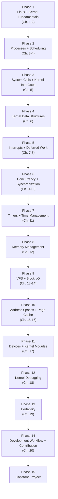
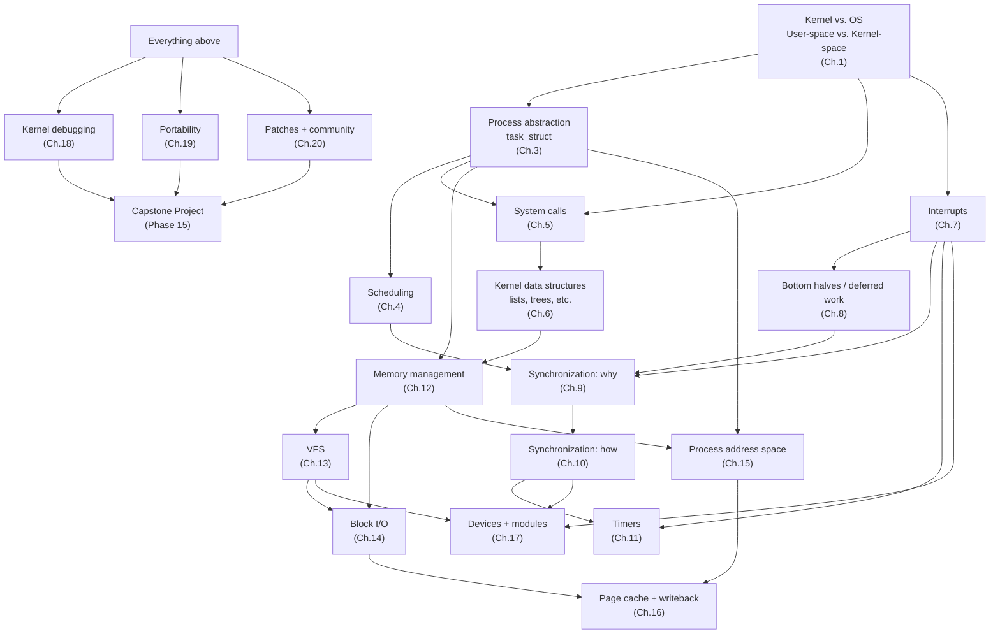

# 00 — Learning Roadmap, Dependency Graph, and Knowledge Map (Overview)

> This file is your map of the entire course before you start. Read it once now, then return to it after every chapter to re-orient yourself.

---

## 1. The 15-Phase Learning Progression

The book's 20 chapters map onto 15 conceptual phases. Phases are not 1:1 with chapters — some chapters span a phase, some phases combine two short chapters.



## 2. Why This Order — the Real Dependency Graph

This is *not* just "the book's chapter order" — it's the actual conceptual dependency chain. Each arrow below means "you genuinely cannot understand the target without the source":



The single most important dependency to internalize early: **synchronization (Ch. 9-10) cannot be taught in isolation** — it only makes sense once you understand **process context vs. interrupt context (Ch. 1, 7)** and **preemption/scheduling (Ch. 4)**. This is why the book itself delays synchronization until Chapter 9, well after processes/scheduling/interrupts — and why this course will keep explicitly back-referencing those chapters every time a lock is introduced.

## 3. What Each Phase Actually Builds Toward

| Phase | Chapters | The one question this phase answers |
|---|---|---|
| 1 | 1-2 | What *is* a kernel, and how do I build/run one? |
| 2 | 3-4 | What is a running program to the kernel, and who decides which one runs next? |
| 3 | 5 | How does user space ask the kernel to do something? |
| 4 | 6 | What building-block data structures does kernel code reuse everywhere? |
| 5 | 7-8 | How does hardware get the kernel's attention, and how does the kernel avoid doing too much work *right then*? |
| 6 | 9-10 | How do multiple execution contexts touch shared data safely? |
| 7 | 11 | How does the kernel know what time it is, and how does it make things happen later? |
| 8 | 12 | Where does kernel memory itself come from? |
| 9 | 13-14 | How does "a file" work across wildly different underlying storage, and how does data reach a physical disk? |
| 10 | 15-16 | What is a *process's* memory (not the kernel's), and how is file data cached? |
| 11 | 17 | How does the kernel talk to a specific piece of hardware, and how do I add code to a running kernel? |
| 12 | 18 | When all of the above breaks, how do I find out why? |
| 13 | 19 | Why does kernel code look the way it does, given it must run on wildly different CPUs? |
| 14 | 20 | How do I actually get code into Linux? |
| 15 | Capstone | Can I combine all of the above into something real? |

## 4. Conventions Used Throughout This Course

### Source-fidelity markers
Every place the book's Linux 2.6-era description has since changed, you will see:

> **[BOOK — Linux 2.6]** ...
> **[MODERN LINUX]** ...
> **[CONCEPTUAL CORE]** ...

If a modern detail cannot be verified reliably, the course says so explicitly (e.g., "I cannot confirm the exact current implementation of X without checking the live source — here is how to check it yourself") rather than guessing.

### Depth markers for each concept
Every non-trivial concept is walked through this progression, adapted to how much of it genuinely applies (a purely historical concept doesn't get an "algorithm" section; a purely algorithmic one doesn't get a "history" section):

```
INTUITION -> PROBLEM -> DESIGN IDEA -> ABSTRACTION -> DATA STRUCTURES
-> ALGORITHM -> IMPLEMENTATION -> CODE -> RUNTIME BEHAVIOR -> DEBUGGING
-> REAL-WORLD APPLICATION
```

### Risk labels for experiments
**SAFE USER-SPACE** / **KERNEL-MODIFYING** / **DANGEROUS** — see `README.md` for what each means and how to prepare.

## 5. How to Use the Cross-Cutting Files

- **`glossary.md`** — look up any unfamiliar term. Updated every chapter. Cross-references which chapter introduced each term.
- **`source-code-map.md`** — your kernel-source-tree tour guide. Updated every chapter with the specific files/functions that chapter touched.
- **`debugging-playbook.md`** — organized by symptom, not by chapter ("kernel panic on module load," "process stuck in D state," "high context-switch rate") — useful once you have several chapters under your belt and want to debug backward from a real problem.
- **`interview-questions.md`** — the aggregated question bank from every chapter, useful for review passes once you've completed several chapters.
- **`final-knowledge-map.md`** — the single, growing concept graph of the entire book. By the end, this is your one-page mental model of the whole kernel.

## 6. Starting Point

Begin with `01-introduction-to-linux-kernel.md`. It establishes the vocabulary (kernel-space/user-space, process context/interrupt context, monolithic/microkernel) that every later chapter assumes you already have cold.