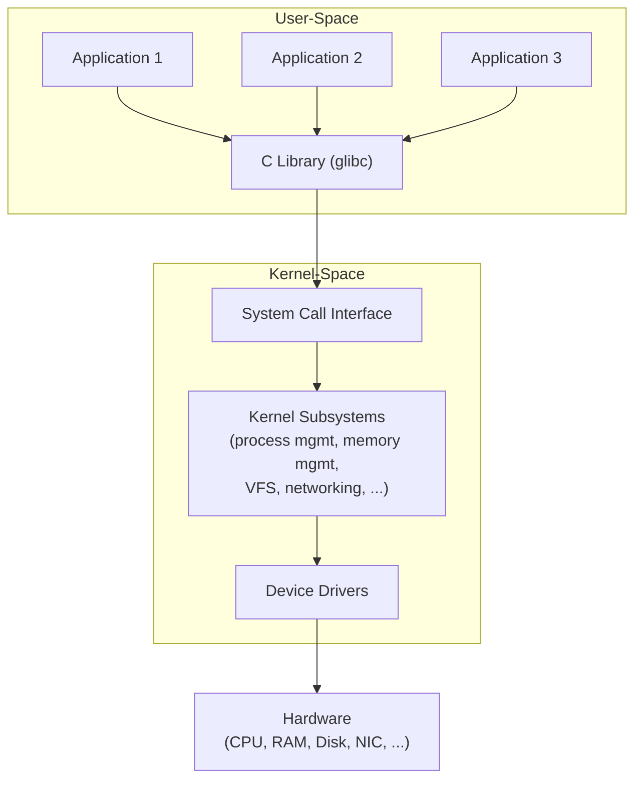
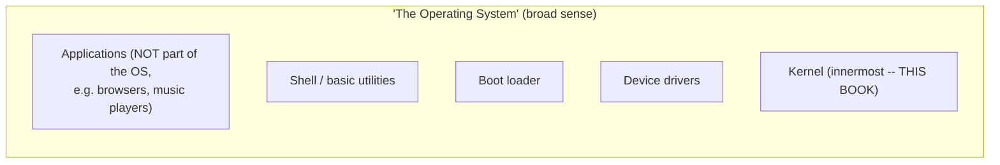
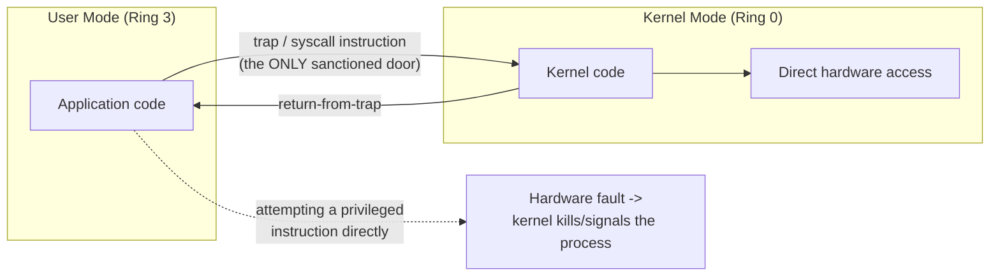
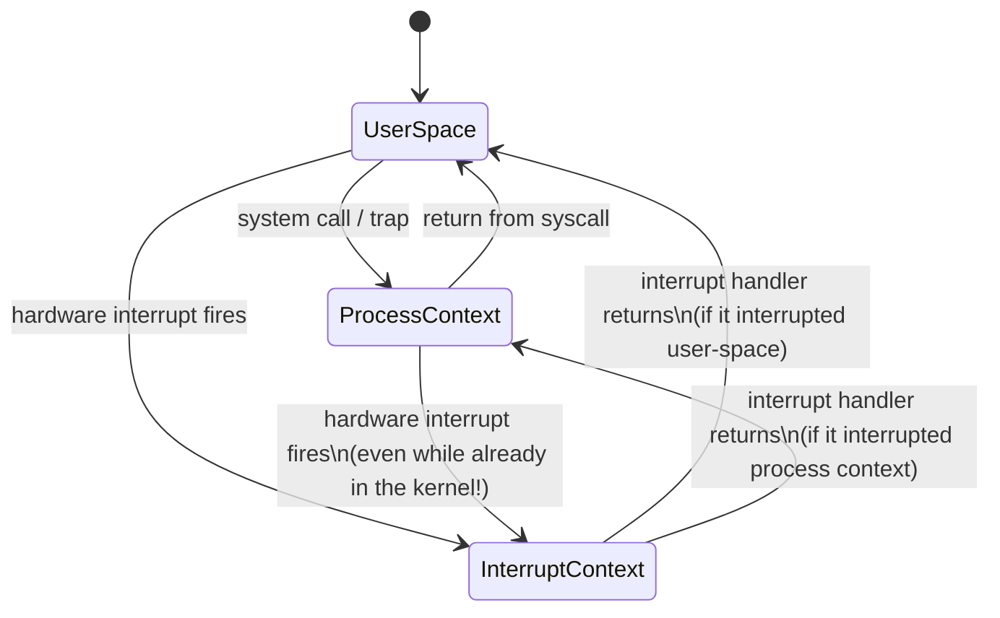
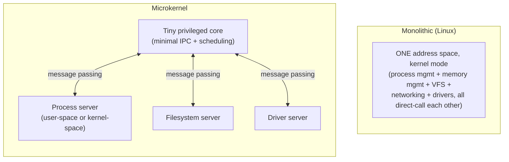
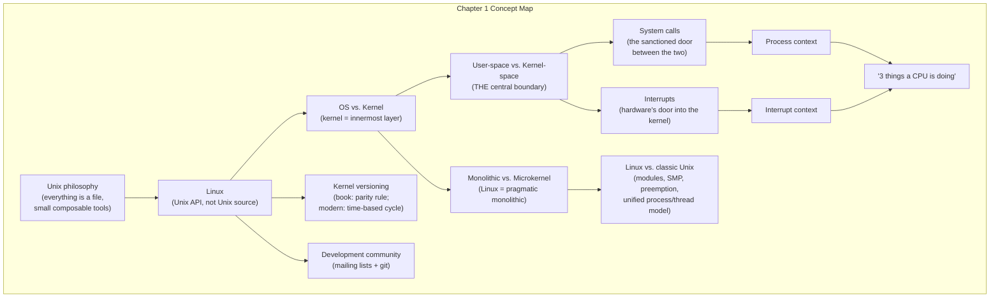

# Chapter 1 — Introduction to the Linux Kernel

> Source fidelity: this chapter follows Robert Love, *Linux Kernel Development*, 3rd Ed., Chapter 1 ("Introduction to the Linux Kernel"), which describes the Linux 2.6 kernel series (as of ~2010). Every place the material has since changed is marked explicitly.

---

## 1. What This Chapter Is About

This chapter establishes the vocabulary and mental model that every later chapter assumes you already have: what a kernel actually *is* (as distinct from "an operating system"), the boundary between kernel-space and user-space and why it exists, what a system call is, what an interrupt is, why Linux is a *monolithic* kernel rather than a *microkernel*, how Linux differs from classic Unix, and how Linux's version numbers are constructed (and — importantly — how that scheme has completely changed since the book was written).

## 2. Why This Matters

Every single later chapter in this course — processes, scheduling, system calls, interrupts, synchronization, memory management, filesystems — is a *specific answer* to a *general problem* introduced here: **the kernel must safely multiplex a computer's hardware among many untrusted, uncoordinated programs, while running with far greater privilege than any of them.** If you don't have a rock-solid mental model of kernel-space vs. user-space and process-context vs. interrupt-context *now*, later chapters will feel like memorizing disconnected facts instead of following an inevitable chain of engineering decisions.

## 3. Prerequisite Concepts

None from this course — this is the starting point. You should already be comfortable with C, and have used a Unix-like system (Linux, macOS, or WSL) from the command line.

## 4. Big Picture



This is, almost verbatim, Figure 1.1 from the book — and it is the single diagram every other diagram in this course elaborates on. Notice three things now, because they will matter for the rest of your kernel education:
1. **User applications never talk to hardware directly.** They go through the C library, which goes through the system call interface.
2. **The kernel is not "an application that runs first."** It's a different execution mode entirely — every box inside "Kernel-Space" above runs with different CPU privileges than every box inside "User-Space."
3. **Device drivers are part of the kernel**, not a separate thing bolted onto it (this is a direct consequence of Linux being *monolithic* — more on this below).

---

## 5. Core Concepts

### 5.1 Unix — Where All of This Came From

**Concept.** Unix is the multi-decade lineage of operating systems (and their shared design philosophy) that Linux deliberately imitates at the API level, without sharing any of its actual source code.

**Intuition.** Before Unix (1970s, Bell Labs -- Ken Thompson, Dennis Ritchie, and colleagues), operating systems were typically bespoke, single-purpose, and not portable. Unix introduced a small set of powerful, composable ideas that turned out to generalize astonishingly well.

**Problem it solved.** How do you build an operating system that is simple enough to actually understand and maintain, yet general enough to run everything from a teaching lab to a supercomputer, decades later, on hardware nobody had imagined yet?

**Design idea -- a short, memorable summary of Unix philosophy, as the book frames it:**
- Almost everything is treated as a **file** -- regular files, devices, pipes -- accessible with a small, uniform set of system calls (`open`, `read`, `write`, `close`). (Sockets are the well-known exception the book itself calls out.)
- **Small, sharp tools composed together**, rather than one enormous monolithic application, are preferred at the *user-space tool* level (note: this is a philosophy about *user-space tools*, distinct from the kernel's own monolithic-vs-microkernel design, which is a separate axis discussed in Section 5.7).
- The kernel provides mechanism; policy is left to user space wherever practical.

> [!NOTE]
> This "small tools, uniform interfaces" philosophy is exactly the same idea explored at length in the OSTEP-based notes on the process API (`fork`/`exec`/`wait`) elsewhere in your kernel-adjacent reading -- Unix's file-descriptor-based I/O redirection is a direct product of "everything is a file."

**Modern Linux notes.** [CONCEPTUAL CORE] This philosophy is unchanged today -- it is arguably *more* entrenched, not less, since Linux's own extensions (`/proc`, `/sys`, `cgroupfs`, `eventfd`, `signalfd`, `timerfd`) all deliberately continue the "expose a kernel facility as something you can `open()`/`read()`/`poll()`" pattern.

**Common Mistakes**
- Thinking Linux *is* Unix, or descends from Unix source code. It does not -- Linux implements the Unix **API** (POSIX + Single Unix Specification) but is a from-scratch implementation.

---

### 5.2 Linux -- History and What "Linux" Actually Refers To

**Concept.** Linux began in 1991 as a personal, hobbyist Unix-like kernel written by Linus Torvalds, a university student in Helsinki, dissatisfied with the licensing and design of Minix (a teaching Unix clone).

**Why it matters.** Understanding that Linux started as *just the kernel* -- and that "Linux" strictly refers to the kernel, not the whole OS you install -- resolves a huge amount of terminological confusion later ("the Linux operating system" colloquially means kernel + GNU userland + a package manager + a desktop environment; strictly, "Linux" is the kernel alone).

> [!IMPORTANT]
> Throughout this entire course, **"Linux" means the kernel**, unless explicitly stated otherwise -- this is the book's own convention, and it is important because this course is *specifically* about kernel internals, not about "a Linux system" broadly.

**Design idea that made Linux's growth possible.** The GPLv2 license: anyone can download, modify, and redistribute the source, provided the same freedoms are extended to recipients. This -- not any particular technical superiority at the time -- is what let Linux become a mass collaborative project rather than staying a solo hobby project.

**Modern Linux notes.** [MODERN LINUX] Linux now runs on architectures from tiny microcontrollers to the largest supercomputers on Earth, powers the overwhelming majority of public cloud infrastructure, all Android phones, and is developed by thousands of contributors from hundreds of companies -- but the *governance model* (Linus Torvalds as final arbiter for mainline, a hierarchy of subsystem maintainers below him) is structurally the same model described in this 2010 book. See Section 5.11 for what has concretely changed in the tooling.

**Common Mistakes**
- "Linux is not Unix" being read as an insult or a technicality -- it's a precise, important statement: Linux implements the **Unix API** without being **Unix source code**.

---

### 5.3 What Is an Operating System? What Is a Kernel?

**Concept.** The *operating system* is the software responsible for basic system use and administration: the kernel, device drivers, the boot loader, a command shell or other basic interface, and basic file/system utilities. The *kernel* is specifically the **innermost** part -- the core that manages hardware and provides basic services to everything else.

**Intuition.** Picture concentric layers: hardware at the very center is wrapped by the kernel, which is wrapped by system libraries and utilities, which is wrapped by the user-facing shell/GUI, which is wrapped by applications. "The operating system" is everything from the kernel out through the basic utilities layer; "the kernel" is just the innermost layer.

**Problem this distinction solves.** Without it, casual usage ("whatever I see on my screen is the OS") makes it impossible to talk precisely about what this book -- and this course -- is actually teaching. The book, and this course, is about the **kernel only**.



**Design idea.** Typical kernel responsibilities:
- **Interrupt handlers** -- respond to hardware events.
- **A scheduler** -- share CPU time among many processes.
- **A memory management system** -- manage each process's address space.
- **System services** -- networking, interprocess communication, and more.

**Modern Linux notes.** [CONCEPTUAL CORE] This taxonomy is unchanged -- a modern kernel does exactly these four categories of things, just with vastly more code implementing each one (the mainline kernel tree has grown from roughly 10 million lines around the time of this book to tens of millions of lines today, the overwhelming majority of it in drivers, not core kernel logic).

**Common Mistakes**
- "The kernel and the operating system are the same thing." They are not -- the kernel is a *part* of the operating system, specifically its innermost, most privileged part.
- Assuming a web browser or desktop environment is "part of the OS." Per this book's definition, it is not -- it's an application running *on top of* the operating system.

**Active Recall (5.1-5.3)**
1. What, precisely, is the difference between "the operating system" and "the kernel," per this book's definitions?
2. Why does the book insist that "Linux," in this text, means the kernel specifically?
3. What are the four typical categories of kernel responsibility?

<details>
<summary>Answers</summary>

1. The operating system is the broader collection: kernel + device drivers + boot loader + shell/basic interface + basic utilities. The kernel is specifically the innermost part that manages hardware and provides basic services.
2. Because this book (and this course) is specifically about kernel internals, and "Linux" is technically the name of just the kernel -- the rest of a "Linux system" (GNU userland, desktop environment, etc.) comes from other projects.
3. Interrupt handling, scheduling, memory management, and system services (networking, IPC, etc.).
</details>

---

### 5.4 User-Space vs. Kernel-Space -- the Central Concept of This Entire Course

**Concept.** On any system with a memory-management unit (MMU) and a CPU that supports privilege levels, the running system is always in one of two fundamentally different modes: **user mode**, running ordinary application code with restricted privileges, or **kernel mode**, running kernel code with full hardware access. The memory and privilege state associated with kernel mode is called **kernel-space**; the memory and privilege state associated with user mode is called **user-space**.

**Intuition (Level 1).** Imagine a building where most rooms (user-space) are accessible to any employee with a badge, but one room (kernel-space) requires a master key that only security has, and only security can touch the fire alarm panel, the electrical room, or the server closet (hardware). Employees can't reach into the electrical room themselves -- they have to *ask* security to flip a switch for them (a system call), and security decides whether that's allowed.

**Problem it solves.** If every user program could directly read/write arbitrary physical memory or directly manipulate hardware registers, then (a) one buggy or malicious program could corrupt another program's memory or crash the entire machine, and (b) there would be no way to enforce fairness, security, or resource accounting across multiple programs sharing one machine. **Kernel-space/user-space separation is the foundational mechanism for protection and multiplexing** -- everything else in this course exists to make that separation both safe *and* usable.

**Design idea.** Nearly every modern CPU architecture Linux supports provides at least two privilege levels in hardware (x86 calls these "rings," with ring 0 = most privileged, ring 3 = least privileged; Linux uses only ring 0 and ring 3 on x86, ignoring rings 1-2). The kernel runs in the most-privileged level; ordinary applications run in the least-privileged level. Certain instructions (modifying page tables, disabling interrupts, accessing arbitrary I/O ports) are only *permitted* to execute in the privileged level -- attempting them in user mode triggers a hardware fault the kernel can handle (typically by delivering `SIGSEGV` or similar to the offending process).

**Internal representation -- what "kernel-space" and "user-space" mean for one process, concretely:**

```
Virtual address space of one x86-64 Linux process (simplified)

High Address
+-----------------------------+  0xffffffffffffffff
|      Kernel-Space           |  <- SAME for every process; only
|  (not directly accessible   |     accessible while in kernel mode
|   from user mode)           |
+-----------------------------+  0xffff800000000000 (approx.)
|                             |
|      (non-canonical gap)    |
|                             |
+-----------------------------+  0x00007fffffffffff (approx.)
|      Stack                  |  <- grows downward
+-----------------------------+
|      Memory Mappings (mmap) |  <- shared libs, mmap'd files
+-----------------------------+
|      Heap                   |  <- grows upward
+-----------------------------+
|      BSS (uninitialized)    |
+-----------------------------+
|      Data (initialized)     |
+-----------------------------+
|      Text (code)            |
+-----------------------------+  0x0000000000400000 (typical)
Low Address
```

**The genuinely important detail most learners miss:** on Linux/x86-64, the kernel's address range is mapped into **every process's page tables**, at the *same* fixed high addresses -- but the page-table entries for that region are marked so that only kernel-mode code can access them. This is *why* a system call doesn't require switching to a completely different set of page tables (which would be slow) -- the kernel is "already there" in the address space, just invisible/inaccessible until a privilege-level change occurs.

> [!TIP]
> This is precisely why **Meltdown** (2018, discovered years after this book, but conceptually a direct descendant of this exact design) was such a big deal: it was a hardware side-channel that let user-mode code read kernel memory that was mapped into its address space but supposedly protected. The historical fix, **KPTI (Kernel Page Table Isolation)**, temporarily *unmapped* most of the kernel from user-mode-visible page tables during user-mode execution -- trading some performance for closing that side channel. This is a perfect example of a security concern from *after* this book was written meaningfully changing how the concept it describes is implemented -- flagged here as [MODERN LINUX] context you would not get from the book alone.

**Algorithm/mechanism -- how a privilege-level transition actually happens (conceptually; covered again with full code detail in Chapter 5):**
1. User-mode code executes a special trap instruction (historically `int 0x80` on x86; modern x86-64 uses the faster `syscall` instruction).
2. The CPU hardware, per a table the kernel configured at boot, atomically switches to kernel mode and jumps to a fixed, kernel-controlled entry point. **User code cannot choose where this jumps to** -- that would defeat the entire point of the privilege boundary.
3. Kernel code runs, does the requested work, possibly touching hardware directly.
4. A special "return from kernel" instruction (`sysret`/`iret`) switches back to user mode and resumes the calling process.

**Diagram -- the trust boundary:**



**Example.** `printf("hello\n")` in a C program does **not** directly enter the kernel. It's a library call that formats and buffers the string, and only when it actually needs to move bytes to the terminal does it call the `write()` **system call** -- and `write()` is where the user-mode-to-kernel-mode transition happens. `strcpy()`, by contrast, does no kernel work at all -- it's pure user-space computation. This distinction (library call vs. system call, and "some library calls make zero system calls, some make exactly one, some make several") is worth internalizing now; Chapter 5 goes much deeper.

**Real Linux Investigation.**
```bash
# See a live process's actual memory layout -- the "diagram" above, made real
$ cat /proc/self/maps
55a1... r-xp 00000000 ... /bin/cat        # text (code)
55a1... r--p ...        ... /bin/cat        # read-only data
55a1... rw-p ...        ... /bin/cat        # data/bss
7f2b... r-xp ...        ... /usr/lib/x86_64-linux-gnu/libc.so.6
7ffe... rw-p 00000000 00:00 0  [stack]
```
Note there is **no kernel-space entry** here -- `/proc/PID/maps` only shows the user-visible portion, exactly because kernel-space, while technically mapped into the process's page tables on many configurations, is never user-accessible and so is correctly omitted from this user-facing view.

**Common Mistakes**
- "User mode and kernel mode are different computers/processes." They are **privilege levels of the same CPU**, applied to the same running thread of execution -- a system call does not create a new process or thread, it changes the *mode* the current one is running in.
- "Kernel-space is a separate address space from every process's own address space." On Linux/x86-64, it is typically the *same* virtual address range, mapped into *every* process, just access-restricted.
- Confusing "kernel-space" (a memory/privilege concept) with "kernel thread" (a specific kind of task that has no user-space component at all -- covered in Chapter 3).

**Debugging mindset.** *Symptom:* a program crashes with `SIGSEGV` the instant it tries to dereference what looks like a valid-looking pointer (e.g., `0xffffffff81000000`). *Hypothesis:* that address falls in the kernel-space region of the address space. *Investigation:* compare the faulting address against `cat /proc/PID/maps` (won't show it, confirming it's outside any user-mapped region) and against `/proc/kallsyms` on the same machine (kernel symbol addresses will often match the range). *Root cause:* the program almost certainly is dereferencing an uninitialized or corrupted pointer that happens to alias a kernel address. *Fix:* find where the pointer was supposed to be initialized; this is usually a use-after-free or an uninitialized stack variable. *Verification:* run under `valgrind` or AddressSanitizer to catch the invalid access earlier, closer to the actual bug.

**Active Recall (5.4)**
1. Why can't user-space code directly modify kernel memory, even though (on many systems) it's technically mapped into the process's own page tables?
2. What is the difference between a library call and a system call? Give an example of each extreme (a library call that makes zero system calls; one that maps almost 1:1 to a single system call).
3. Why is it dangerous to let user code choose the kernel address it jumps to during a trap?

<details>
<summary>Answers</summary>

1. The page-table entries for the kernel region are marked so that only kernel-mode (privileged) code can access them; user-mode code attempting to touch them triggers a hardware protection fault, not a successful access.
2. A library call is any function in a library like glibc; a system call is specifically a request that crosses into the kernel. `strcpy()` is a library call that makes zero system calls. `open()` is a library call that maps almost directly onto the `open()` system call.
3. If user code could jump anywhere in the kernel, it could jump past permission checks straight into sensitive kernel logic -- defeating the entire purpose of having a privileged mode at all. This is exactly why the trap table is configured once, by the kernel itself, at boot.
</details>

---

### 5.5 System Calls -- the Sanctioned Interface (Introductory Treatment; Full Depth in Chapter 5)

**Concept.** A system call is a well-defined, numbered request an application makes to the kernel, via a trap instruction, to perform a privileged operation on the application's behalf.

**Why it matters here.** This chapter only needs you to understand the *shape* of the interaction; Chapter 5 covers the full mechanism (the system call table, `asmlinkage`, parameter passing, `errno`, `strace` internals) in complete depth.

**Design idea, at this level of detail:** applications call library functions; some library functions are thin wrappers around exactly one system call, others (like `printf`) do substantial work in user space and only call a system call for the truly privileged part (writing bytes to a file descriptor), and others (`strcpy`) never touch the kernel at all.

**Vocabulary introduced here, used everywhere later:**
- When a process makes a system call, the kernel is said to be **"executing on behalf of the application"** -- this exact phrase from the book is important, because it defines what "**process context**" means (Section 5.6).

**Real Linux Investigation.**
```bash
# See EVERY system call a simple command makes
$ strace -c ls /tmp
% time     seconds  usecs/call     calls    syscall
------ ----------- ----------- --------- ----------------
 23.08    0.000123          10        12 openat
 18.50    0.000098           9        11 read
 ...
```
Run this now, even before you fully understand every syscall name -- the point of this early exposure is to make "a system call" a concrete, countable, observable thing rather than an abstract concept.

**Common Mistakes**
- "Every library function is a system call." Most are not -- most library functions do user-space-only work, or bundle several system calls together with buffering/formatting logic.

*(Full depth: data structures, the system call table, calling convention, error handling, and how to add a new system call -- Chapter 5.)*

---

### 5.6 Process Context vs. Interrupt Context, and "the Three Things a CPU Is Doing"

**Concept.** At any given moment, the book states, each processor in a Linux system is doing exactly one of three things:
1. Running in **user-space**, executing user code, in a process.
2. Running in **kernel-space**, in **process context**, executing kernel code *on behalf of* a specific process (e.g., handling that process's system call).
3. Running in **kernel-space**, in **interrupt context**, **not associated with any process**, handling a hardware interrupt.

**Intuition.** "Process context" means "there is a specific process to blame/credit for this kernel code currently running" -- the kernel can look at `current` (a per-CPU pointer to the currently-scheduled task, covered fully in Chapter 3) and it will point at a real, meaningful process. "Interrupt context" means the opposite: the kernel is reacting to *hardware*, not to any process's request, and `current` still technically points at whatever process happened to be running when the interrupt fired -- but that's incidental, not meaningful, in interrupt context.

**Problem this distinction solves.** Code that runs in interrupt context has severe restrictions (it cannot sleep, cannot block waiting for a lock that might be held by a sleeping process, must run and exit quickly) that code in process context does not have. Without a crisp vocabulary for "which context am I in," it would be impossible to state kernel programming rules precisely -- and this distinction is the seed of almost the entire logic behind Chapters 7-10 (interrupts, bottom halves, and every synchronization primitive's design).

**Design idea, illustrated:**



**The subtlety worth internalizing now:** an interrupt can fire *while the kernel is already executing in process context* -- e.g., while handling a `read()` system call, a disk interrupt for an unrelated, previous I/O request could fire. The CPU briefly enters interrupt context, handles it, and returns to wherever it was (which might itself be process context, not user-space) -- interrupts nest on top of whatever was already happening.

**Example -- the keyboard, walked step by step, straight from the book's own example:**
1. You press a key.
2. The keyboard controller issues a hardware **interrupt** to signal "new data available."
3. The processor is interrupted (literally -- mid-instruction, wherever it was) and transfers control to the kernel's interrupt-dispatch logic.
4. The kernel looks up which handler is registered for this interrupt **number** and runs it -- this handler runs in **interrupt context**, associated with no process.
5. The handler reads the keyboard data, tells the controller it's ready for more, and returns quickly.
6. Whatever was running before the interrupt (user-space, or the kernel in process context) resumes.

**Even idle time is accounted for.** The book makes a subtle but important point: when there is nothing to run, the kernel is *not* "doing nothing" in some undefined fourth state -- it is running a real, specific **idle process**, in process context, inside the kernel. This is why "three things" is stated as an *exhaustive* list, not a rough approximation.

**Real Linux Investigation.**
```bash
# See which interrupts have fired, and on which CPU, since boot
$ cat /proc/interrupts | head
            CPU0       CPU1
  0:         31          0   IO-APIC   2-edge      timer
  1:        112          3   IO-APIC   1-edge      i8042 (keyboard controller)
  ...

# Watch context-switch and interrupt counts live
$ vmstat 1
procs -----------memory---------- ---swap-- -----io---- -system-- ------cpu-----
 r  b   swpd   free   buff  cache   si   so    bi    bo   in   cs us sy id wa
 1  0      0 512344  12040 203112    0    0     2    10  245  412  3  1 96  0
#                                                          ^^^  ^^^
#                                                     interrupts/sec  context switches/sec
```

**Common Mistakes**
- Thinking "kernel-space" and "process context" are synonyms. They are not: *all* process-context code runs in kernel-space, but interrupt-context code *also* runs in kernel-space. Kernel-space is about **privilege**; process/interrupt context is about **on whose behalf, and under what constraints**.
- Assuming an interrupt handler can just call `sleep()`-style blocking functions the way process-context code can. It generally cannot -- this is precisely why "bottom halves" (Chapter 8) exist: to defer the parts of interrupt handling that *do* need to sleep or take longer, out of interrupt context and into a safer context.

**Debugging mindset.** *Symptom:* a kernel warning/backtrace mentions `"BUG: scheduling while atomic"` or `"sleeping function called from invalid context"`. *Hypothesis:* code that assumes it's in process context (and tries to sleep, or take a mutex that might block) is actually running in interrupt context (or with preemption/interrupts disabled). *Investigation:* the backtrace itself, read top-down, shows the call chain -- look for an interrupt handler or a spinlock-held region in the trace. *Root cause:* a function was called from the wrong context. *Fix:* move the blocking work to a context that allows it (a workqueue, a tasklet's safe portion, or defer it -- this is exactly what Chapter 8 teaches). *Verification:* the warning disappears, and -- critically -- you reason about *why* it's now safe, not just that the symptom vanished.

**Active Recall (5.6)**
1. List the three things a CPU can be doing at any moment, per this book's model.
2. Why is idle time still counted as "process context," not as a fourth, separate state?
3. Can an interrupt occur while the kernel is already in process context? What happens?
4. Why can't (most) interrupt-context code sleep?

<details>
<summary>Answers</summary>

1. (a) User-space, running user code; (b) kernel-space, in process context, on behalf of a specific process; (c) kernel-space, in interrupt context, not associated with any process.
2. Because the kernel runs an actual idle *process* -- a real, schedulable entity -- when there's nothing else to do, rather than the CPU entering some undefined state.
3. Yes -- interrupts can nest on top of process-context kernel execution. The CPU briefly diverts to interrupt context, then returns to wherever it was.
4. Because sleeping requires the scheduler to pick something else to run -- but interrupt context isn't associated with a schedulable process, and blocking there could stall hardware event handling indefinitely, or deadlock if the resource it's waiting on can only be released by process-context code that never gets to run.
</details>

---

### 5.7 Monolithic Kernels vs. Microkernels

**Concept.** Kernel architectures broadly fall into two families (a third, exokernel, exists mainly in research): **monolithic**, where the entire kernel runs as one program in one address space, and **microkernel**, where kernel functionality is split into separate, isolated "server" processes communicating via message passing.

**Intuition.** A monolithic kernel is like one team working in one open office -- anyone can walk over and talk to anyone else directly (a function call). A microkernel is like several separate companies that can only communicate by sending formal memos through a mail system (IPC/message passing) -- safer in isolation (one company's fire doesn't burn down the others), but slower for anything that needs frequent back-and-forth.

**Problem each design solves, and what it costs:**

| | Monolithic | Microkernel |
|---|---|---|
| **Communication** | Direct function calls, same address space | Message passing / IPC across address spaces |
| **Performance** | Fast -- no context switch for internal communication | Slower -- IPC and address-space switches add overhead |
| **Fault isolation** | Weak -- a bug in one subsystem can corrupt the whole kernel | Strong -- a crashed server doesn't (in theory) take down others |
| **Modularity/swappability** | Requires deliberate internal discipline | Natural -- swap one server for another |
| **Historical examples** | Most Unix systems | (Originally) Mach, early micro-kernel designs |

**Design idea -- Linux's actual, pragmatic answer.** Linux **is** a monolithic kernel: it runs as one program in one address space, entirely in kernel mode, using direct function calls internally. But it deliberately **borrows the good parts of the microkernel philosophy**:
- A **modular design** -- subsystems are cleanly separated in the source tree and can often be compiled as loadable modules.
- **Dynamically loadable kernel modules** (`insmod`/`rmmod`/`modprobe`) -- code can be added to (and removed from) a *running* kernel image, without the monolithic-vs-microkernel address-space separation a true microkernel would require.
- **Kernel preemption** -- the kernel can interrupt itself mid-execution (Chapter 4/9 territory), somewhat like how a microkernel's servers are independently schedulable.
- **Kernel threads** -- schedulable kernel-only execution contexts.

**The book's own, memorably blunt conclusion, worth paraphrasing for its judgment as much as its content:** Linux borrows much of the good from microkernels — modularity, dynamic loading, a clean separation of concerns — while avoiding the performance-sapping cost of message-passing IPC, because everything still runs in kernel mode via direct function calls. The book frames this as pragmatism winning out over ideological purity.

**A historically important, book-era detail worth noting as [BOOK -- Linux 2.6] context, since it's specific commentary from that time:** the book observes that "practical" microkernel-based systems of that era (it names Windows NT and Mac OS X's Mach-derived core) had, in practice, moved most or all of their "servers" back into kernel-space anyway to avoid IPC overhead -- which the book argues defeats the primary purpose of the microkernel design in the first place. [CONCEPTUAL CORE] This general critique of "pure" microkernel IPC overhead remains a live, genuinely debated tradeoff in OS design discussions today -- modern microkernel research (e.g., seL4) has made significant strides in reducing that overhead, but the fundamental tradeoff table above still holds.

**Diagram -- the structural difference:**



**Connection to Systems Engineering.** This tradeoff is not just OS-course trivia -- it is the **exact same tradeoff** that shows up in distributed systems as "monolith vs. microservices": direct function calls (fast, but a bug anywhere can take down everything) vs. message-passing between isolated services (fault-isolated, but pays a serialization/network round-trip cost for every cross-boundary interaction). If you have studied distributed systems, this should feel *very* familiar -- it is the same engineering tension, one level of abstraction removed. Understanding *why* Linux chose monolithic will help you reason about *why* a given production service architecture chose monolith-vs-microservices, and vice versa.

**Common Mistakes**
- "Loadable kernel modules mean Linux isn't really monolithic." Incorrect -- a loaded module runs in the *same* kernel address space, in kernel mode, using direct function calls, exactly like statically-built-in kernel code. It's monolithic *and* modular; these are not contradictory (this is precisely the "borrows the good parts" point above).
- Assuming microkernels are strictly "better" because of fault isolation. It is a genuine tradeoff, not a strict improvement -- Linux's monolithic design is a deliberate, defensible engineering choice, not a historical accident.

**Active Recall (5.7)**
1. What is the fundamental communication mechanism inside a monolithic kernel? Inside a microkernel?
2. Name two specific features Linux borrows from the microkernel philosophy despite being monolithic itself.
3. What did the book observe about "practical" microkernel systems of its era, and why does that observation matter?

<details>
<summary>Answers</summary>

1. Monolithic: direct function calls within one address space. Microkernel: message passing/IPC across separate address spaces.
2. Dynamically loadable kernel modules; kernel preemption; kernel threads; a modular internal design (any two).
3. The book observed that real-world "microkernel" systems of that era had moved most servers back into kernel-space to avoid IPC overhead -- arguably defeating the point of the design. It matters because it's evidence for the book's broader argument that Linux's monolithic-with-borrowed-microkernel-features approach was a pragmatic winner.
</details>

---

### 5.8 Linux's Specific Differences from Classic Unix Kernels

**Concept.** Because Linux is not based on any specific Unix source code, its developers were free to choose the best available design for each problem, rather than being bound by a specific lineage's historical decisions. The book lists several concrete, notable differences:

| Feature | Linux's approach |
|---|---|
| **Dynamic loading** | Kernel modules can be loaded/unloaded from a running, monolithic kernel |
| **SMP support** | Native symmetric multiprocessor support (many traditional Unix variants lacked this historically) |
| **Kernel preemption** | The kernel can preempt itself even while executing kernel code (historically rare among Unix variants -- the book notes Solaris and IRIX as other examples that had this) |
| **Threading model** | Linux does **not** distinguish threads from processes at the kernel level -- to the kernel, all processes are the same, some just happen to share resources (this single idea is the seed of all of Chapter 3's `task_struct`/`clone()` discussion) |
| **Device model** | Object-oriented device model, hot-plug events, a user-space device filesystem (`sysfs`) |
| **Feature selectivity** | Linux deliberately omits features its developers consider poorly designed (the book names STREAMS as an example) |
| **Open development** | Anyone can propose changes; changes must solve a real problem with a clean design and solid implementation -- not just "because a standard requires it" or "for marketing" |

**Why this matters for you as a future kernel reader.** The **threading model** point deserves special attention now, because it will feel surprising the first time you read `task_struct`-related code in Chapter 3: Linux really does represent a "thread" as just another `task_struct` (the same structure used for full processes), distinguished mainly by which resources it shares with its creator (address space, open files, etc., via flags to the `clone()` system call) rather than being an intrinsically different kind of kernel object. Most other operating systems (and even POSIX's own abstract threading model) treat "thread" as a conceptually distinct entity from "process" -- Linux's choice to unify them is a genuinely distinctive design decision you'll want to remember when Chapter 3 arrives.

**Modern Linux notes.** [MODERN LINUX] Every item in this table remains true in spirit today. `sysfs` has grown enormously in scope since 2010; the device model (`kobject`, `kset`, `udev`/`systemd-udevd` in user space) has matured substantially but follows the same object-oriented core design the book describes. SMP support is now simply assumed -- virtually no shipping Linux system is single-core anymore, whereas at the time of the book SMP was still a notable, callable-out feature.

**Common Mistakes**
- "A Linux 'thread' and a Linux 'process' are different kinds of kernel objects." They are the same kind of object (`task_struct`); what differs is what they share with their parent.

---

### 5.9 Linux Kernel Versions -- a Deliberate Case Study in Source Fidelity

This section is the clearest, most concrete illustration in Chapter 1 of why the **[BOOK -- Linux 2.6] / [MODERN LINUX] / [CONCEPTUAL CORE]** distinction matters -- the versioning *scheme itself* has been completely replaced since this book was written, even though the *underlying goals* (distinguish stable from experimental, ship security fixes promptly) have not changed at all.

#### [BOOK -- Linux 2.6] The scheme as Robert Love describes it

- Version numbers have the form `major.minor.revision[.stable]` -- e.g., `2.6.30.1`.
- **The minor number's parity determines stability**: an **even** minor number is a stable, production-ready series (e.g., `2.6.x`); an **odd** minor number is a development series where large, destabilizing changes are expected (e.g., a hypothetical `2.7.x`).
- Development proceeds through phases: feature work -> **feature freeze** (no new features accepted) -> **code freeze** (only bug fixes accepted) -> release of a new stable series.
- The book documents a specific, important historical decision: at a 2004 Kernel Developers Summit, the community chose to **prolong the 2.6 series indefinitely** rather than open a destabilizing `2.7` development branch -- instead, each `2.6.x` release itself absorbed a "mini development series" (Andrew Morton's `2.6-mm` tree served as a staging ground for larger changes before they landed in a `2.6.x` release).
- A fourth number (e.g., the `.1` in `2.6.30.1`) denotes a **stable point release** -- critical bug fixes, often back-ported from the next release-in-development.

```
                           2 . 6 . 30  .  1
                           |   |    |     |
                    major -+   |    |     |
                    minor -----+    |     |
                    revision -------+     |
                    stable ---------------+
```

#### [MODERN LINUX] How this actually works today

> [!IMPORTANT]
> This is the single largest factual gap between the book and the present kernel -- do not carry the odd/even rule forward into your mental model of current Linux.

- **The odd/even parity rule for the minor number stopped applying in July 2011**, when the kernel moved from the `2.6.39` series directly to **`3.0`** -- a renumbering chosen specifically to mark that the old dev/stable-series distinction was being retired, *not* because of some enormous technical leap.
- **Kernel versions since then follow a simple, predictable, time-based release model**, with (as of this writing, based on kernel.org release history) a **major.minor.patchlevel** scheme where the *major* number has itself been incremented multiple times since 3.0 (through the 4.x and 5.x series, and -- as of this writing -- into the 6.x and, most recently, 7.x series) roughly whenever the minor number would otherwise become unwieldy, **not** to signal any particular magnitude of change. A major-number bump today is largely a round-number/cosmetic decision by Linus Torvalds, not a signal of a fundamentally new kernel generation.
- **Every mainline release goes through a fixed-shape cycle**: roughly a **2-week merge window** (all new features for the next release are merged) immediately followed by a **release-candidate (`-rcN`) series**, typically **rc1 through rc7 (sometimes more)**, spaced about a week apart, during which only fixes are accepted -- landing at a full release roughly **9-10 weeks** after the merge window opens. There is no longer a separate, long-running "development series" running in parallel with a "stable series" the way `2.5.x` ran alongside `2.4.x`, or the way an odd-numbered `2.7.x` was hypothesized in the book -- **all new feature development happens directly against the next release's merge window.**
- **"Stable" now means something more specific and more actively maintained**: once a mainline version (e.g., `X.Y`) is released, the **stable team** (historically Greg Kroah-Hartman, more recently also Sasha Levin) maintains an `X.Y.Z` branch that back-ports bug and security fixes only -- this is the direct descendant of the book's fourth "stable version" number, and it works essentially the same way the book describes, just without the old parity rule determining which `X.Y` gets this treatment (today, *every* `X.Y` release gets at least some stable point releases).
- **Long-Term Support (LTS) kernels** are a further-formalized concept largely absent from the book's discussion: specific `X.Y` releases (roughly one per year) are designated for multi-year maintenance, receiving stable-branch fixes for several years after their initial release, specifically so that distributions, embedded vendors, and enterprises can build on a version without needing to track every new mainline release.
- As of the time of this writing, mainline kernel development has reached the **7.x series**, with actively-maintained LTS branches spanning several years back (e.g., 6.18, 6.12, 6.6, 6.1, and older still-supported 5.15/5.10 branches) -- cited here as an illustration of the *shape* of the current release matrix (one current short-term stable line, several parallel long-term-support lines), not as a number to memorize, since it will already be out of date by the time you read this.

```mermaid
flowchart LR
    subgraph Cycle["One mainline release cycle (~9-10 weeks)"]
        Merge["Merge window\n(~2 weeks: all new features land)"] --> RC1["rc1"] --> RC2["rc2 ... rcN\n(~1 week apart,\nfixes only)"] --> Release["X.Y released"]
    end
    Release --> Stable["X.Y.Z stable branch\n(back-ported fixes only,\nGKH / Sasha Levin)"]
    Release --> NextMerge["Next merge window opens\nimmediately"]
    Stable -.some X.Y designated.-> LTS["X.Y LTS branch\n(multi-year maintenance)"]
```

#### [CONCEPTUAL CORE] What has NOT changed

- The fundamental *distinction* the version scheme is trying to express -- "is this a snapshot where risky new features just landed, or a snapshot receiving only vetted fixes?" -- is exactly the same problem, solved with a different mechanism.
- A dedicated team back-porting critical fixes into older, still-supported branches remains the mechanism by which users get security/bug fixes without adopting brand-new (and less-tested) features.
- The kernel is still released under an open process anyone can watch and, in principle, contribute to.

**Real Linux Investigation.**
```bash
$ uname -r
6.8.0-45-generic          # distro-patched kernel; the upstream base version is 6.8.0

$ cat /proc/version
Linux version 6.8.0-45-generic (buildd@...) ...

# See the exact shape of the current release matrix for yourself --
# this will always be accurate, unlike any specific number printed in this course
$ curl -s https://www.kernel.org/releases.json | python3 -m json.tool | head -40
```

**Common Mistakes**
- Assuming any current Linux version follows the even/odd stable-vs-development rule. It has not, since 2011.
- Assuming a major-version bump (e.g., 6.x -> 7.x) signals a dramatically different kernel generation. It typically does not -- it's largely a round-number decision.
- Confusing "LTS" with the book's old "stable series" concept -- LTS is a *newer*, more formalized idea layered on top of the (still-present) ordinary stable-point-release mechanism.

**Active Recall (5.9)**
1. In the book's 2.6-era scheme, how could you tell, from the version number alone, whether a kernel was a stable or development release?
2. What specific event marks the end of that scheme, and roughly when did it happen?
3. What replaced the old "parallel development series" model?
4. What does a modern "stable" `X.Y.Z` branch actually contain?

<details>
<summary>Answers</summary>

1. By the parity of the minor version number -- even meant stable, odd meant development.
2. The jump from kernel `2.6.39` directly to `3.0` in July 2011, explicitly marking the retirement of the old numbering convention.
3. A fixed-shape, time-based cycle: a ~2-week merge window for all new features, followed by a several-week release-candidate (rc) series of fixes-only snapshots, landing a new mainline `X.Y` release roughly every 9-10 weeks, with no separate long-running "development" branch running in parallel.
4. Back-ported bug and security fixes only, for a specific already-released `X.Y` version -- no new features -- maintained by the stable-kernel team.
</details>

---

### 5.10 The Linux Kernel Development Community

**Concept.** Kernel development happens in the open, historically centered on the **Linux Kernel Mailing List (LKML)**, where patches are proposed, reviewed, argued about, and eventually accepted or rejected.

**[BOOK -- Linux 2.6]** The book describes LKML as the primary forum, a high-traffic list (hundreds of messages/day even then) where testers and reviewers congregate, and recommends simply reading it ("lurking") as a supplement to the book itself.

**[MODERN LINUX]** The *mailing-list-centric* workflow is still real and still central -- patches are still submitted and reviewed as plain-text email, and Linus Torvalds still merges subsystem maintainers' pull requests via `git`. What has matured substantially since the book's writing:
- **`git` itself** (which Linus created in 2005, shortly before this book, specifically to manage kernel development after the prior tool, BitKeeper, became unavailable) is now completely universal -- every subsystem maintains its own tree, and the mainline tree lives at `git.kernel.org` (with a widely-used read-only mirror on GitHub).
- **Archival/searchability has improved enormously** -- `lore.kernel.org` now provides a full-text-searchable, threaded archive of LKML and essentially every subsystem-specific list, something not really available in the book's era.
- **A formal `Documentation/process/` directory** in the kernel source tree now codifies patch submission rules, coding style, and the maintainer hierarchy far more thoroughly than was true in 2010 -- this is covered in depth in Chapter 20 of this course.
- **Subsystem-specific mailing lists** have grown in importance relative to LKML-as-a-single-firehose -- most day-to-day review happens on lists scoped to a specific subsystem (e.g., a networking-specific list), with LKML itself serving more as a cross-cutting announcement/discussion channel.

**Why it matters for you now, even as a beginner.** You do not need to post to LKML to benefit from this ecosystem -- but you should know, from Chapter 1 onward, that **every function you will study in this course has a real commit history, a real author, and a real review thread**, discoverable with `git log`/`git blame` on the kernel tree once you have it cloned. This is a genuinely different experience from reading a closed-source codebase, and this course will lean on it throughout.

**Real Linux Investigation.**
```bash
$ cd ~/linux
$ git log --oneline -- kernel/sched/core.c | head -5     # recent history of one file
$ git log --follow --oneline kernel/fork.c | wc -l        # how many commits have touched this file, ever
$ git shortlog -sn -- mm/ | head -10                        # top contributors to the memory-management subsystem
```

**Common Mistakes**
- Assuming kernel development moved to GitHub-style pull requests and issues as the *primary* workflow. It did not -- GitHub hosts a read-only mirror; the actual review/merge workflow is still email-and-`git`-based.

---

### 5.11 "Before We Begin" -- the Book's Own Framing, and What This Course Adds

The book closes Chapter 1 by describing its own approach: practical, code-grounded, aimed at giving you "an insider's appreciation" for kernel design and implementation, and assuming you have access to a real Linux system and kernel source while reading. This course adopts that same practical orientation, and adds the explicit teaching scaffolding (diagrams, experiments, active recall, source navigation, debugging playbooks) described in `README.md`.

---

## 6. How the Pieces Fit Together -- Chapter 1 Subsystem Diagram



Every downstream chapter attaches to this map: **Process context** feeds directly into Chapter 3 (`task_struct`); **the three-states model** feeds directly into Chapters 4, 7, 8, 9, 10; **user/kernel-space** feeds into Chapter 5 (system calls) and Chapter 12/15 (memory management).

---

## 7. Source Code Navigation

You do not need to read specific kernel source files yet for Chapter 1's *content* -- but this is the right moment to set up your environment and get comfortable with the tree's shape, since every subsequent chapter will point you directly into it.

```
linux/
+-- arch/           <- architecture-specific code (x86, arm64, riscv, ...) -- where
|                      the actual privilege-level-switch assembly you read about
|                      in Section 5.4 lives, per architecture
+-- block/           <- block I/O layer (Chapter 14)
+-- crypto/          <- cryptographic algorithms used internally
+-- Documentation/    <- the modern, formalized process docs mentioned in Section 5.10
+-- drivers/          <- the overwhelming majority of the kernel's line count --
|                      device drivers of every kind (Chapter 17)
+-- fs/               <- filesystems + the VFS layer (Chapter 13)
+-- include/          <- public and internal headers; include/linux/ is where
|                      most core data structures (task_struct, etc.) are declared
+-- init/             <- kernel boot/initialization code, including init/main.c,
|                      the closest thing to "where execution begins" after the
|                      architecture-specific early boot code in arch/
+-- ipc/              <- System V IPC (semaphores, shared memory, message queues)
+-- kernel/           <- the core kernel itself: process management (Chapter 3),
|                      scheduling (Chapter 4), most of the system-call
|                      infrastructure, and more
+-- lib/              <- generic, architecture-independent library-style code
|                      (some of the data structures from Chapter 6 live here)
+-- mm/               <- memory management (Chapters 12, 15, 16)
+-- net/              <- the networking stack
+-- scripts/          <- build system and developer tooling
+-- security/          <- LSM (Linux Security Modules) framework, SELinux, etc.
+-- sound/            <- audio subsystem
+-- tools/            <- user-space tools shipped alongside the kernel
|                      (perf lives here!)
+-- ...
```

**A concrete, guided first navigation exercise for Chapter 1:**
```bash
cd ~/linux
# Find where the x86-64 syscall entry point is defined -- you are not expected
# to understand this code yet, just to see that it's real and locatable.
rg -n "SYSCALL_DEFINE" arch/x86/entry/ | head -5
rg -n "do_syscall_64" arch/x86/entry/common.c

# Find the file that names every syscall by number
rg -n "__NR_read" arch/x86/include/generated/uapi/asm/unistd_64.h 2>/dev/null \
  || find . -name "unistd_64.h" | head -3
```
Do not worry if the exact output looks intimidating -- the goal right now is purely *"I can locate real code that implements a concept I just read about,"* not *"I understand this code."* That understanding comes in Chapter 5.

---

## 8. Hands-On Experiments

### Experiment 1.1 -- Observe the User/Kernel Boundary Directly
**Risk:** SAFE USER-SPACE

**Objective.** See, concretely, that an ordinary command makes a countable, specific set of system calls -- turning "system call" from an abstract term into an observable event.

**Prerequisites.** `strace` installed (`sudo apt install strace`).

**Setup.** None beyond having `strace`.

**Execution.**
```bash
strace -c cat /etc/hostname
strace -T cat /etc/hostname   # -T shows time spent in each syscall
```

**Expected Observation.** A short table of syscalls (`openat`, `read`, `close`, plus some dynamic-linker-related ones like `mmap`, `mprotect`) with counts and (with `-T`) per-call timing.

**Why It Happens.** Even a nearly-trivial program like `cat` must ask the kernel to open a file, read its bytes, and close it -- none of that can happen from user-space code alone, because file access requires the kernel's mediation (permission checks, filesystem logic, ultimately hardware I/O).

**Investigation.** Try `strace -c ls -la /` (more syscalls -- directory listing does more work) and `strace -c true` (almost no syscalls -- `true` does essentially nothing). Compare the syscall *sets*, not just counts.

**Experiment Questions.**
- What changes if you `strace` a *shell built-in* like `cd` versus an external command like `cat`? (Hint: think about whether a new process is even created.)
- Why does even `true` make a handful of syscalls, given that it "does nothing" from your perspective?

---

### Experiment 1.2 -- Identify Process Context vs. Interrupt-Driven Activity
**Risk:** SAFE USER-SPACE

**Objective.** Correlate real interrupt activity with `/proc/interrupts`, connecting Section 5.6's abstract "interrupt context" to something you can watch change in real time.

**Prerequisites.** None beyond a standard shell.

**Setup.** Open two terminals.

**Execution.** In terminal 1:
```bash
watch -n 1 'cat /proc/interrupts'
```
In terminal 2, generate some interrupt-heavy activity (e.g., wiggle the mouse if you have a GUI VM, or generate disk I/O):
```bash
dd if=/dev/zero of=/tmp/testfile bs=1M count=500 && rm /tmp/testfile
```

**Expected Observation.** The counters for the storage controller's interrupt line (and the timer interrupt, constantly) climb visibly while `dd` runs.

**Why It Happens.** Each block of data written to disk eventually results in the storage controller signaling completion via a hardware interrupt -- exactly the mechanism described in Section 5.6's keyboard example, just for a disk instead.

**Investigation.**
```bash
cat /proc/interrupts | grep -i timer     # the timer interrupt, firing constantly regardless of your activity
```

**Experiment Questions.**
- Why does the timer interrupt count keep climbing even when you're not doing anything? (This is a preview of Chapter 11.)
- If you have a multi-core VM, do interrupts get spread across CPUs evenly? What does the per-CPU column layout in `/proc/interrupts` tell you about that?

---

### Experiment 1.3 -- Confirm Your Kernel's Actual Version and Release Type
**Risk:** SAFE USER-SPACE

**Objective.** Directly connect Section 5.9 to your own real system, and practice distinguishing an upstream version from a distro-patched one.

**Execution.**
```bash
uname -r
cat /proc/version
cat /etc/os-release      # your distro's OWN versioning, distinct from the kernel's
```

**Expected Observation.** Something like `6.8.0-45-generic` -- note the `-45-generic` suffix; that's Ubuntu's own patch/build numbering layered *on top of* upstream Linux `6.8.0`, not part of the upstream kernel.org versioning scheme at all.

**Why It Happens.** Distributions take an upstream release and apply their own patches, build numbering, and configuration -- the version string you see day-to-day conflates "upstream kernel version" with "distro packaging version," and part of learning to read Linux systems is learning to separate the two.

**Investigation.**
```bash
# Compare against the live, current kernel.org release matrix
curl -s https://www.kernel.org/releases.json | python3 -m json.tool | grep -A3 '"moniker": "stable"'
```

**Experiment Questions.**
- Is your running kernel an LTS release, a short-term stable release, or something else? How would you find out?
- What's the difference between the `6.8.0` part and the `-45-generic` part of your version string?

---

### Experiment 1.4 -- Walk the Kernel Source Tree
**Risk:** SAFE USER-SPACE

**Objective.** Build muscle memory for navigating a codebase this large -- a skill independent of any specific kernel concept, and one you will use in every subsequent chapter.

**Prerequisites.** The kernel source clone from `README.md`; `ripgrep` (`rg`) installed.

**Execution.**
```bash
cd ~/linux
du -sh */ | sort -rh | head -10          # which top-level directories are actually biggest?
find . -name "*.c" | wc -l                # how many .c files exist in the whole tree?
find drivers/ -name "*.c" | wc -l          # ... and how many are just in drivers/?
```

**Expected Observation.** `drivers/` will dwarf every other directory by file count and size -- often well over half the entire tree.

**Why It Happens.** This is a direct, empirical confirmation of something stated earlier in this chapter's Source Code Navigation section: the *overwhelming majority* of the kernel's code is device drivers, not "core kernel" logic -- because Linux supports an enormous, ever-growing set of physical hardware, each with its own driver.

**Investigation.** Compare `kernel/` (core kernel logic -- small) against `drivers/` (enormous) by file count and total size, to build calibrated intuition for where you'll actually be spending your reading time later.

**Experiment Questions.**
- Given that `drivers/` is so large, why does this course (and the book) spend so little relative time on it, focusing instead on `kernel/`, `mm/`, and `fs/`?
- What does the relative size of `drivers/` tell you about how a new hardware vendor gets support into Linux?

---

## 9. Mini Project -- Build a Boundary Explorer

**Goal.** Write a small user-space C program that deliberately probes the user/kernel boundary from multiple angles, turning Chapter 1's abstract concepts into something you built yourself.

```c
// boundary_explorer.c
// SAFE USER-SPACE. Compile: gcc -O0 -o boundary_explorer boundary_explorer.c
#include <stdio.h>
#include <unistd.h>
#include <sys/syscall.h>
#include <sys/types.h>

int main(void) {
    // 1. A library call that IS essentially a 1:1 system call wrapper.
    pid_t pid = getpid();
    printf("My PID (via getpid(), a thin syscall wrapper): %d\n", pid);

    // 2. Invoke the SAME operation via the raw syscall() interface,
    //    bypassing glibc's wrapper, to make the "system call" concept concrete.
    long raw_pid = syscall(SYS_getpid);
    printf("My PID (via raw syscall(SYS_getpid)):          %ld\n", raw_pid);

    // 3. A library call that does NOT need the kernel at all.
    char buf[32] = "hello";
    printf("A string built with sprintf (no syscall needed): %s\n", buf);

    // 4. Deliberately attempt something only the kernel is allowed to do:
    //    directly read a "kernel-space-looking" address.
    //    (Left as a commented-out exercise -- see below.)
    // volatile long *bad = (long *)0xffffffff81000000UL;
    // printf("%ld\n", *bad);   // <-- uncommenting this will SIGSEGV. Try it!

    return 0;
}
```

**What this teaches:**
1. Line-by-line: `getpid()` demonstrates a library call thinly wrapping exactly one system call; `syscall(SYS_getpid)` demonstrates that you, too, can invoke the raw system call interface directly, bypassing glibc, proving the "door" described in Section 5.4 is a real, callable thing; `sprintf` demonstrates a library call needing zero kernel involvement.
2. **Relevant kernel APIs:** `getpid()` (glibc wrapper) -> `SYS_getpid` (raw syscall number, defined per-architecture) -> the actual kernel-side `sys_getpid`/`__x64_sys_getpid` implementation (you will see this exact function in Chapter 3/5).
3. **Execution flow:** user code -> glibc (for the first call) or directly (for the raw `syscall()` call) -> `syscall`/`int 0x80` trap instruction -> kernel entry -> kernel returns the PID -> back to user mode.
4. **Expected output:**
   ```
   My PID (via getpid(), a thin syscall wrapper): 12345
   My PID (via raw syscall(SYS_getpid)):          12345
   A string built with sprintf (no syscall needed): hello
   ```
   Both PID values must match -- they're two different *paths* to the exact same kernel operation.
5. **Common errors:** forgetting `#include <sys/syscall.h>` (no `SYS_getpid` macro); on some architectures/libc versions the raw `syscall()` wrapper itself is still technically a tiny library function -- the point is that it does no formatting/buffering/logic beyond issuing the trap, unlike `printf`.
6. **How to inspect what happened:** `strace ./boundary_explorer` -- you will see **exactly one** `getpid` syscall entry appear in the trace for *both* of your PID-fetching lines, because from the kernel's perspective, `getpid()` and `syscall(SYS_getpid)` are indistinguishable -- they're the same trap, just reached via two different pieces of user-space code.
7. **Now uncomment the "bad" pointer dereference, rebuild, and run it again.** Watch it `SIGSEGV`. Then run `dmesg | tail` (on some configurations this logs the fault) and explain, in your own words, why this specific failure occurs -- tie it directly back to Section 5.4's explanation of the trust boundary.

---

## 10. Common Misconceptions (Chapter-Wide Summary)

| Misconception | Correction |
|---|---|
| "Linux is Unix." | Linux implements the Unix API; it shares no Unix source code lineage. |
| "The kernel and the OS are the same thing." | The kernel is the innermost part of the broader operating system. |
| "User mode and kernel mode run on different processors/machines." | They are privilege levels of the *same* CPU core, for the *same* thread of execution. |
| "Kernel modules mean Linux isn't monolithic." | Loaded modules run in the same address space, in kernel mode, via direct function calls -- fully monolithic. |
| "A Linux thread is a fundamentally different kernel object than a process." | Both are represented by the same `task_struct`; what differs is what resources they share. |
| "Current Linux still uses the odd/even minor-version stability rule." | That rule ended in 2011 with the jump from 2.6.39 to 3.0. |
| "A jump from Linux X.0 to (X+1).0 means a major architectural change." | It's now largely a round-number decision, not a signal of magnitude of change. |
| "Interrupt context and 'running in the kernel' are the same thing." | Process-context kernel code and interrupt-context kernel code are both "in the kernel," but have very different constraints (e.g., sleeping). |

---

## 11. Interview Questions

**Basic**
- Q: What is the difference between an operating system and a kernel?
  -> *Expected reasoning:* candidate should distinguish the broad "everything for basic use/administration" definition from the narrower "innermost, privileged core" definition.
  -> *Correct answer:* the kernel is one part (the innermost) of the broader operating system, which also includes the boot loader, device drivers packaged separately from kernel-proper concerns, shells, and basic utilities.
  -> *Deeper follow-up:* "Is a web browser part of the operating system? Justify your answer using this book's definition."

- Q: What is a system call?
  -> *Correct answer:* a well-defined, numbered mechanism for user-space code to request a privileged operation from the kernel, via a trap instruction.
  -> *Deeper follow-up:* "Give an example of a library function that is NOT a 1:1 wrapper around a single system call, and explain what extra work it does in user space."

**Intermediate**
- Q: Why is Linux considered "pragmatic" in its kernel design, per this book's framing?
  -> *Expected reasoning:* candidate should reference the monolithic-vs-microkernel tradeoff and Linux's choice to keep the performance benefits of monolithic design while adopting microkernel-inspired features (modules, preemption, kernel threads) where they don't cost that performance.
  -> *Deeper follow-up:* "If you were designing a brand-new OS today, targeting a many-core, high-reliability server environment, would you lean more monolithic or more microkernel? Defend your choice."

- Q: Explain process context vs. interrupt context, and why the distinction matters for what kernel code is allowed to do.
  -> *Deeper follow-up:* "Give a concrete example of a kernel bug class that results from code assuming it's in process context when it's actually in interrupt context."

**Advanced / Kernel-Development**
- Q: Walk through, in your own words, what physically happens (privilege-level-wise) when a user-space program calls `read()`.
  -> *Expected reasoning:* trap instruction -> hardware privilege switch -> fixed kernel entry point -> kernel-mode execution -> kernel-controlled return -> resume user mode.
  -> *Deeper follow-up:* "Why can't user-space code specify an arbitrary address for the kernel to jump to during this trap? What would go wrong if it could?"

- Q: The book was written describing Linux 2.6's odd/even version-parity scheme. Explain what replaced it, and why the change was made.
  -> *Deeper follow-up:* "What tradeoff does a fixed-length, predictable release cycle (like the modern ~9-10 week model) make versus an open-ended 'ready when it's ready' model?"

**Design Question**
- Q: Design the versioning/release scheme you would use for a brand-new open-source kernel project today, given what you now know about both the 2.6-era approach and the current time-based approach. What would you keep, what would you change?
  -> *No single correct answer* -- evaluate whether the candidate identifies the real tradeoffs (predictability vs. flexibility; how backports/security fixes get distributed; how to avoid a long-running "development branch" drifting too far from stable).

---

## 12. Active Recall (Whole-Chapter Review)

Attempt these without looking back at the chapter. Answers are in a collapsed block below.

1. What does "Linux," strictly, refer to according to this book's convention?
2. What are the four typical categories of kernel responsibility?
3. Why is the kernel/user-space boundary necessary -- what specifically goes wrong without it?
4. What are the three things a CPU can be doing, per Linux's model, at any given moment?
5. Is idle time a fourth state? Why or why not?
6. What is the core communication mechanism difference between a monolithic kernel and a microkernel?
7. Name three specific ways Linux differs from classic Unix kernels.
8. What did the odd/even minor-version rule mean in the book's 2.6-era scheme, and what replaced it?
9. What is the difference between a "stable" point release and an "LTS" branch in modern Linux?
10. Why does `drivers/` dominate the kernel source tree by size, and why doesn't this course spend most of its time there?

<details>
<summary>Answers</summary>

1. The kernel specifically -- not the whole system (GNU userland, desktop environment, etc.).
2. Interrupt handling, scheduling, memory management, system services (networking/IPC).
3. Without it, any user program could directly touch arbitrary memory or hardware, making it impossible to enforce protection, fairness, or security across multiple programs sharing one machine.
4. (a) User-space, executing user code; (b) kernel-space, process context, on behalf of a specific process; (c) kernel-space, interrupt context, not associated with any process.
5. No -- the kernel runs a real, schedulable idle process during idle time; it's process context, not a separate state.
6. Monolithic: direct function calls within one address space. Microkernel: message passing/IPC across isolated address spaces.
7. Any three of: dynamic module loading, native SMP support, kernel preemption, unified process/thread model (`task_struct` for both), object-oriented device model with `sysfs`, selective feature adoption (e.g., omitting STREAMS), fully open development process.
8. Even minor number = stable series, odd = development series. Replaced (starting with the jump from 2.6.39 to 3.0 in 2011) by a fixed-shape, time-based release cycle with no parallel long-running development branch.
9. A stable point release (`X.Y.Z`) back-ports fixes for the *current* `X.Y` release; an LTS branch is a specific `X.Y` release designated for extended, multi-year maintenance via the same stable-branch mechanism.
10. Because Linux supports an enormous and ever-growing set of physical hardware, and each device (or device family) needs its own driver code -- but this course (like the book) focuses on core kernel logic (`kernel/`, `mm/`, `fs/`) because that's where the transferable, subsystem-general concepts live; driver code, while voluminous, is largely an application of those concepts to one specific piece of hardware at a time.
</details>

---

## 13. Chapter Summary

Linux is a free, Unix-API-compatible, monolithic kernel, first written by Linus Torvalds in 1991 and now developed by a large, open, mailing-list-and-`git`-centered global community. Every Linux system enforces a hard boundary between privileged **kernel-space** and restricted **user-space**, crossed only through the sanctioned mechanisms of **system calls** (software-initiated) and **interrupts** (hardware-initiated). At any instant, every CPU is doing exactly one of three things: running user code, running kernel code in **process context** on behalf of a specific process, or running kernel code in **interrupt context** on behalf of no process at all -- and this three-way distinction is the foundation for nearly every synchronization and concurrency rule covered later in this course. Linux's kernel version numbering has changed completely since this book was written: the old even/odd stability convention ended in 2011, replaced by a predictable, time-based release cycle with a separately-maintained stable/LTS branch system.

## 14. What I Should Be Able To Explain Now

- [ ] The precise difference between "operating system" and "kernel," and why this book focuses on the latter.
- [ ] Why kernel-space/user-space separation exists, in terms of what specifically breaks without it.
- [ ] The mechanics of a privilege-level transition (trap instruction -> fixed kernel entry -> kernel work -> controlled return), at least at a conceptual level (full code-level detail comes in Chapter 5).
- [ ] The difference between process context and interrupt context, and why interrupt-context code has stricter rules.
- [ ] The tradeoffs between monolithic and microkernel designs, and specifically what Linux borrowed from microkernels without adopting their performance costs.
- [ ] At least three concrete ways Linux differs from classic Unix kernels.
- [ ] The book's 2.6-era version-numbering scheme, the modern time-based scheme that replaced it, and -- critically -- *why* you must not assume the old scheme still applies to any kernel version you encounter today.
- [ ] How to locate the major top-level directories of the kernel source tree and explain what each is responsible for.

---

## Knowledge Graph (Chapter 1 Contribution)

```
Linux Kernel
+-- Kernel vs. Operating System
+-- User-Space
|    +-- Applications, glibc
+-- Kernel-Space
|    +-- System Call Interface
|    +-- Kernel Subsystems
|    +-- Device Drivers
+-- Execution Contexts
|    +-- User mode
|    +-- Process context (kernel, on behalf of a process)
|    +-- Interrupt context (kernel, on behalf of no process)
+-- Kernel Architecture
|    +-- Monolithic (Linux's choice)
|    +-- Microkernel (contrast case)
+-- Linux vs. Classic Unix
|    +-- Loadable modules
|    +-- SMP support
|    +-- Kernel preemption
|    +-- Unified process/thread model
+-- Versioning
|    +-- [BOOK] major.minor.revision.stable, odd/even parity
|    +-- [MODERN] major.minor.patch, time-based cycle, LTS
+-- Development Community
     +-- LKML / subsystem lists
     +-- git (git.kernel.org, lore.kernel.org)
```

*(This graph will be merged into `final-knowledge-map.md` and expanded with every subsequent chapter.)*