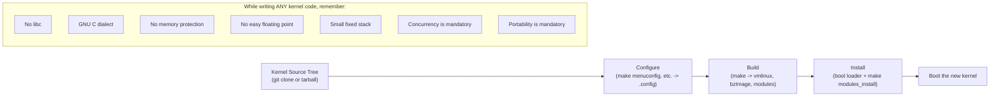
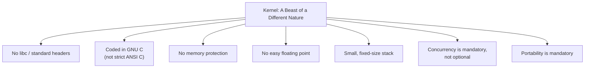
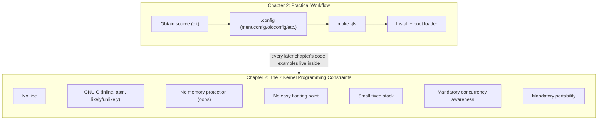

# Chapter 2 — Getting Started with the Kernel

> Source fidelity: this chapter follows Robert Love, *Linux Kernel Development*, 3rd Ed., Chapter 2 ("Getting Started with the Kernel"). Book-era tooling details (the `git://` protocol, the `linux-2.6.git` repository name, specific gcc version recommendations) are flagged and updated throughout.

---

## 1. What This Chapter Is About

This chapter takes you from "I understand conceptually what a kernel is" (Chapter 1) to "I have kernel source on my disk, I can configure it, build it, and boot it" — and, just as importantly, it introduces the seven specific ways kernel programming is *fundamentally different* from the user-space programming you already know: no C library, a different C dialect (GNU C), no memory protection, no easy floating point, a tiny fixed stack, mandatory concurrency-awareness, and mandatory portability discipline.

## 2. Why This Matters

Every code example in every later chapter of this course lives inside the constraints this chapter introduces. If you don't internalize *now* that the kernel has no `printf()`, no `malloc()` in the user-space sense, no automatic stack growth, and no safety net if you dereference a bad pointer, you will write code in later chapters that looks like ordinary C but is subtly, dangerously wrong for kernel context.

## 3. Prerequisite Concepts

- Chapter 1: kernel-space vs. user-space, process context vs. interrupt context, monolithic kernel design.
- You should be comfortable with basic `git` usage (`clone`, `log`, `diff`) and with compiling C programs from the command line.

## 4. Big Picture



---

## 5. Core Concepts

### 5.1 Obtaining the Kernel Source

**Concept.** The kernel is distributed as source code, obtainable either as a compressed tarball snapshot of a specific release, or — the way essentially all active development happens — as a `git` repository you clone and pull from.

**[BOOK — Linux 2.6]** The book gives this example:
```bash
git clone git://git.kernel.org/pub/scm/linux/kernel/git/torvalds/linux-2.6.git
```
Two book-era specifics stand out immediately: the `git://` protocol prefix, and the repository name `linux-2.6.git`.

**[MODERN LINUX]**
- **The `git://` (unauthenticated, unencrypted `git` protocol) transport has been deprecated and is generally no longer offered by kernel.org** — it was disabled there in 2018 for security reasons (the plain `git://` protocol has no transport-layer integrity/authentication). Use `https://` (or SSH, if you have kernel.org credentials) instead.
- **The repository is simply named `linux.git`**, not `linux-2.6.git` — reflecting, again, the retirement of the version-numbering scheme discussed in Chapter 1.
- The modern, correct clone command:
  ```bash
  git clone https://git.kernel.org/pub/scm/linux/kernel/git/torvalds/linux.git
  ```
  or, for a much faster, smaller download when you don't need full history (recommended for this course, per `README.md`):
  ```bash
  git clone --depth 1 https://git.kernel.org/pub/scm/linux/kernel/git/torvalds/linux.git
  ```
- A read-only mirror also exists on GitHub (`github.com/torvalds/linux`) — convenient for browsing in a web UI, but remember (Chapter 1) that it is a mirror, not where development actually happens.

**Why this matters as more than trivia.** This is your *second* concrete example (after kernel versioning in Chapter 1) of the [BOOK]/[MODERN LINUX] distinction mattering in a way that would actually break a command if you copied it verbatim from the book today — `git clone git://...linux-2.6.git` will simply fail on a modern system. Get in the habit, throughout this course, of treating any book-quoted command as something to *verify*, not blindly retype.

**Active Recall (5.1)**
1. What two specific things changed about the book's example `git clone` command, and why does each matter?

<details><summary>Answer</summary>
The `git://` protocol was deprecated for security reasons (no encryption/authentication) — use `https://` or SSH. The repository name changed from `linux-2.6.git` to `linux.git`, reflecting the retirement of the 2.6-era versioning scheme (Chapter 1).
</details>

---

### 5.2 Using Git

**Concept.** `git` is not incidental tooling for kernel development — it *is* the kernel's development process, and understanding a handful of commands turns the entire kernel's history into a learning resource.

**Why `git` specifically, historically.** The book notes (and this remains accurate, [CONCEPTUAL CORE]) that kernel development used a proprietary tool called BitKeeper until 2005, when licensing changes made it unavailable; Linus Torvalds responded by writing `git` — a distributed version control system designed around the kernel's own specific needs (huge history, huge number of contributors, no single central write-access server required for local work).

**Practical commands worth knowing now (all safe, read-only unless noted):**
```bash
git log --oneline -20                    # recent history
git log -p -- kernel/fork.c               # full diffs for every commit touching this file
git show <commit-hash>                     # one specific commit's full diff and message
git diff v6.6 v6.7 -- kernel/sched/        # what changed in the scheduler between two releases
git tag | grep '^v6\.'                      # list release tags matching a pattern
```

**[MODERN LINUX] additions the book doesn't cover** (since these matured after 2010): `git bisect` (binary-search a regression across a commit range — genuinely useful once you're debugging real kernel behavior changes, revisited in Chapter 18); `b4` (a modern community tool for fetching a patch series from `lore.kernel.org` and applying it directly, streamlining the mailing-list-patch workflow described in Chapter 1).

**Common Mistakes**
- Assuming you need push/write access to kernel.org to "use git" meaningfully. You don't — nearly everything valuable for learning (history, diffs, blame, bisecting) works entirely with a local read-only clone.

---

### 5.3 The Kernel Source Tree

**Concept.** Building on Chapter 1's brief tour, this section goes one level deeper into what actually lives at the *top* of the tree (not just the subsystem directories).

| Path | Contents |
|---|---|
| `COPYING` | The kernel's license (GPLv2) |
| `CREDITS` | A list of significant contributors |
| `MAINTAINERS` | **Extremely important, and used constantly in real kernel work** — lists who maintains each subsystem/file pattern, and which mailing list/tree it belongs to |
| `Makefile` | The top-level build script driving the entire build |
| `README` | Brief overview and pointers to `Documentation/` |
| `Documentation/` | In-tree, per-subsystem documentation |
| `arch/`, `block/`, `crypto/`, `drivers/`, `fs/`, `include/`, `init/`, `ipc/`, `kernel/`, `lib/`, `mm/`, `net/`, `scripts/`, `security/`, `sound/`, `tools/`, `usr/`, `virt/` | Subsystem directories, per Chapter 1's table |

**`MAINTAINERS` is worth practicing with right now, even before you can read the code it describes:**
```bash
cd ~/linux
scripts/get_maintainer.pl -f kernel/sched/core.c    # who do I email/CC for a patch touching this file?
```
This single command is how real kernel contributors figure out who to talk to — internalizing it now, in Chapter 2, sets you up for Chapter 20's patch-submission workflow.

**[MODERN LINUX] notes.** `Documentation/` has grown enormously in scope and formality since 2010 (it's now built into a Sphinx-based HTML/PDF documentation set, viewable at `docs.kernel.org`) — the book's brief mention of it undersells how central it has become to onboarding new kernel contributors.

---

### 5.4 Building the Kernel — Configuration

**Concept.** The kernel is enormously configurable — thousands of optional features, drivers, and subsystems can be compiled in, compiled as loadable modules, or left out entirely. This configuration is captured in one file, `.config`, at the root of the source tree, and generating/editing it is the first real step of building your own kernel.

**Why configuration exists at all — the problem it solves.** A single kernel binary containing *every* possible driver and feature for *every* possible piece of hardware Linux supports would be enormous, slow to build, and would waste memory on code that will never run on any given machine. Configuration lets you build a kernel tailored to (a) what hardware you actually have, and (b) what features you actually want.

**The interfaces for editing `.config`** — the book lists several `make` targets, all still valid:
| Command | Interface |
|---|---|
| `make config` | Text-based, one question at a time — tedious, rarely used directly today |
| `make menuconfig` | Text-based menu (ncurses) — the most common choice for terminal-only environments (e.g., a minimal VM) |
| `make gconfig` | GTK-based graphical menu |
| `make xconfig` | Qt-based graphical menu |
| `make oldconfig` | **The most commonly used in practice** — takes an *existing* `.config` (e.g., copied from your running distro kernel) and interactively asks only about *new* options introduced since that config was created |
| `make defconfig` | Generates a reasonable architecture-specific default configuration |
| `make allyesconfig` / `make allmodconfig` / `make allnoconfig` | Automated extremes: everything built-in / everything as a module / (almost) everything disabled — useful for build-testing, rarely for a real bootable system |

**Internal representation — what `.config` actually looks like:**
```
CONFIG_SMP=y
CONFIG_PREEMPT=y
# CONFIG_PREEMPT_NONE is not set
CONFIG_HZ_1000=y
CONFIG_MODULES=y
CONFIG_EXT4_FS=y
# CONFIG_SOUND is not set
```
Each `CONFIG_*` symbol corresponds to exactly one feature/driver/subsystem, with a value of `y` (built directly into the kernel image), `m` (built as a loadable module), or absent/commented-out (not built at all). These symbols are consumed both by the build system (deciding what to compile) *and* by the C preprocessor directly (`#ifdef CONFIG_SMP`) — meaning **the exact same source tree produces genuinely different compiled code** depending on `.config`, something worth remembering the first time you're confused why code you're reading "isn't doing what the book says" — check whether it's inside a `CONFIG_*` conditional you don't have enabled.

**A practical, realistic starting point** (the book's own recommendation, still sound): don't start from scratch — copy your running distribution's config as a starting point, then use `oldconfig` to only be asked about genuinely new options:
```bash
cp /boot/config-$(uname -r) .config
make oldconfig
```

**Common Mistakes**
- Running `make allyesconfig` expecting a normal, bootable, reasonably-sized kernel. It will build (almost) everything, including mutually-exclusive debugging options — this is a build-testing tool, not a "get me a working kernel" tool.
- Forgetting that `.config` is what makes source code behave differently — assuming *all* code in the tree is always "active" when reading it.

**Debugging mindset.** *Symptom:* you added a `printk()` inside a function, rebuilt, booted the new kernel, but never see your message. *Hypotheses:* (1) the file/function you edited is guarded by a `CONFIG_*` option you don't have enabled; (2) you're booted into a *different* kernel than the one you built (check `uname -r`!); (3) your `printk()`'s priority is being filtered by the console log level. *Investigation:* `grep` for `#ifdef`/`#if defined` wrapping your edit; confirm `uname -r` matches your newly built version string; check `cat /proc/sys/kernel/printk`. *This exact scenario is revisited as a full hands-on experiment below.*

---

### 5.5 Building the Kernel — Compilation and Minimizing Build Noise

**Concept.** Once `.config` exists, `make` (with no target, or `make all`) compiles the kernel image, all built-in code, and all configured loadable modules.

```bash
make            # build everything .config specifies
```

**Why this can be slow, and how the book addresses it.** A full kernel build compiles an enormous number of files — the book recommends parallelizing the build across CPU cores:
```bash
make -jN        # N = number of parallel compile jobs; a common rule of thumb
                # is 1-2 jobs per CPU core
make -j32 > /dev/null   # book's own example, redirecting noisy output
```

**[MODERN LINUX] practical additions:**
- `ccache` and `distcc` (mentioned briefly by the book) remain relevant — `ccache` caches compiled object files keyed by source+flags, dramatically speeding up *repeated* builds where only a few files changed (exactly your workflow while experimenting with kernel code); `distcc` spreads compilation across multiple networked machines.
- **`make -j$(nproc)`** is a common modern shorthand — `nproc` reports the number of available processors automatically, so you don't have to hardcode a number.

**Real Linux Investigation.**
```bash
time make -j$(nproc)    # time a full build; compare against `time make -j1` on a
                          # small subset if you want to feel the parallelism benefit directly
```

---

### 5.6 Installing the New Kernel

**Concept.** A built kernel is useless until it's actually installed where your boot loader can find it, and the boot loader is configured to offer it as a boot option.

**[BOOK — Linux 2.6]** describes copying `arch/i386/boot/bzImage` to `/boot`, naming it `vmlinuz-<version>`, and manually editing `/boot/grub/grub.conf` (GRUB legacy) or `/etc/lilo.conf` + rerunning `lilo`.

**[MODERN LINUX]**
- Nearly all modern distributions (Ubuntu very much included) use **GRUB2**, which is normally **not** hand-edited directly — instead, you run `update-grub` (Debian/Ubuntu) or `grub2-mkconfig` (Fedora/RHEL-family) after installing a new kernel, and it regenerates the boot menu automatically by scanning `/boot`.
- The book's `arch/i386/` path reflects the pre-x86_64-unification kernel source layout; modern x86/x86-64 kernels build under **`arch/x86/boot/bzImage`** regardless of 32- or 64-bit target (the two were unified into one `arch/x86/` tree years ago).
- The modules-install step is unchanged in spirit:
  ```bash
  sudo make modules_install    # installs modules under /lib/modules/<version>/
  sudo make install             # often also handles bzImage copy + bootloader config
                                 # update, depending on distro-provided kernel Makefile hooks
  ```

> [!WARNING]
> **Installing a custom-built kernel is a KERNEL-MODIFYING / borderline-DANGEROUS operation** if done on your primary machine. A misconfigured or buggy custom kernel can fail to boot entirely. Do this only in a VM, and **always keep your distro's original kernel available as a boot menu fallback** — this is precisely why GRUB's menu offers multiple kernel entries.

**`System.map`** — the build process also produces this file at the tree's root: a plain-text table mapping every kernel symbol (function and global variable name) to its address in the compiled image. It's what lets debugging tools translate a raw memory address in a crash report back into a human-readable function name — you'll use this directly in Chapter 18.

---

### 5.7 "A Beast of a Different Nature" — Seven Ways Kernel Code Differs from User-Space Code

This is the conceptual heart of Chapter 2, and arguably the most *practically consequential* section in the whole chapter for your future code-writing. The book's own framing: these differences don't make kernel development inherently *harder* than other large-software-project development — but they make it **different**, and every kernel programmer must keep all seven in mind, always.



#### 5.7.1 No libc or Standard Headers

**Concept.** Kernel code is not linked against glibc (or any C library) — no `printf()`, `malloc()`, `strcpy()` from `<string.h>` in the usual sense, none of it.

**Why.** The book gives the primary reason directly: **speed and size**. The full C library (or even a meaningful subset) is too large and too inefficient for a kernel that must remain small, fast, and free of unnecessary dependencies (there's also, as the book notes, a bootstrapping "chicken-and-egg" problem — the C library itself typically depends on kernel services to function).

**Design idea — the kernel reimplements what it needs.** Many familiar-looking functions *do* exist, just implemented inside the kernel itself: e.g., string manipulation functions live in `lib/string.c`, exposed via `<linux/string.h>` — a kernel-tree header, not a system one. **Kernel source files cannot include outside (user-space) headers**, exactly mirroring "no outside libraries."

**Header file layout, concretely:**
```
include/linux/inotify.h              <- architecture-independent kernel headers
arch/x86/include/asm/ioctl.h          <- x86-specific headers, included via the "asm/" prefix
                                          e.g. #include <asm/ioctl.h>
```

**`printk()` — the kernel's `printf()`:**
```c
printk("Hello world! A string '%s' and an integer '%d'\n", str, i);

printk(KERN_ERR "this is an error!\n");   // note: NO comma between KERN_ERR and the string!
```
**Code explanation.** `printk()` formats a string exactly like `printf()`, but writes it into the **kernel log buffer** (read by `syslog`/`dmesg` in user space) rather than to a file descriptor. The `KERN_ERR` in the second example is a **priority level** — and the missing comma is not a typo: `KERN_ERR` is a preprocessor macro expanding to a **string literal**, which the compiler then concatenates directly onto the following string literal at compile time (ordinary C adjacent-string-literal concatenation) — there is no function-call-argument comma because it isn't a separate argument at all.

**[MODERN LINUX] additions:** `pr_err()`, `pr_info()`, `pr_warn()`, `pr_debug()`, and similar convenience macros (defined in `<linux/printk.h>`) have become the more commonly used modern idiom in much of the tree — they wrap `printk()` with the priority level and (often) an automatic module/subsystem name prefix, reducing boilerplate versus writing out `printk(KERN_ERR ...)` by hand every time. The underlying `printk()` mechanism the book describes is unchanged; these are convenience wrappers on top of it.

**Active Recall (5.7.1)**
1. Why doesn't the kernel link against libc?
2. Why is there no comma between `KERN_ERR` and the message string in a `printk()` call?

<details><summary>Answers</summary>
1. Primarily speed and size — the full C library is too large/inefficient for the kernel, plus a bootstrapping dependency issue (libc itself typically relies on kernel services).
2. `KERN_ERR` is a macro expanding to a string literal, concatenated at compile time via C's automatic adjacent-string-literal concatenation — it is not a separate function argument.
</details>

#### 5.7.2 GNU C

**Concept.** The kernel is written in C, but not strictly standard (ANSI/ISO) C — it uses a mix of ISO C99 features and GCC-specific language extensions ("GNU C"), which ties the kernel's buildability to GCC (and, per the book, at the time, to a sufficiently GCC-compatible alternative like the Intel C Compiler).

**[BOOK — Linux 2.6]** states the earliest supported GCC version was 3.2, with 4.4+ recommended.

**[MODERN LINUX]** GCC version requirements have naturally moved forward substantially since 2010 (the specific minimum required version climbs with nearly every few kernel releases, tracked in the top-level `Documentation/process/changes.rst`) — and, notably, **Clang/LLVM has since become a fully-supported alternative compiler** for building the mainline kernel (Google's ChromeOS and Android kernels, among others, build with Clang), something not true — or not nearly as mature — at the time this book was written. The general principle the book states — the kernel depends on GNU C *language extensions*, not just "a C compiler" — remains true; it's simply no longer GCC-exclusively true.

**Two specific, important GNU C extensions the book highlights:**

**(a) Inline functions**
```c
static inline void wolf(unsigned long tail_size)
{
    /* ... */
}
```
**Intuition.** An inline function's body is copied directly into each call site at compile time, instead of a normal call/return sequence.
**Design idea / tradeoff.** Eliminates call/return overhead (register saves, jumps) and lets the compiler optimize caller and callee together — at the cost of larger code size (and hence larger instruction-cache footprint) if used carelessly on large or infrequently-time-critical functions.
**Code explanation.** The `static` keyword means no externally-visible (non-`static`) symbol is emitted for this function — because it's always inlined, there's no separate function body to link against from other files; if an inline function needs to be used from multiple `.c` files, it belongs in a header, declared this way, at the top.
**Rule of thumb from the book:** use inline functions for **small, time-critical** functions; avoid inlining large functions, and *avoid complicated macros* in favor of inline functions specifically because inline functions get real C type-checking, while macros are purely textual substitution.

**(b) Inline assembly**
```c
unsigned int low, high;
asm volatile("rdtsc" : "=a" (low), "=d" (high));
/* low and high now contain the lower and upper 32 bits of the 64-bit tsc */
```
**Intuition.** GCC's `asm()` directive lets C code embed literal, architecture-specific assembly instructions.
**Why it exists.** Some operations (reading a specific CPU register like the timestamp counter above, executing a genuinely architecture-unique instruction) simply have no C-level equivalent — you must drop to assembly.
**Design idea.** Confined, by kernel convention, to genuinely architecture-specific code and hot/fast-path code — the book is explicit that "the vast majority of kernel code is programmed in straight C."

**(c) Branch annotation — `likely()`/`unlikely()`**
```c
if (unlikely(error)) {
    /* handle the rare error case */
}

if (likely(success)) {
    /* handle the common case */
}
```
**Intuition.** Modern CPUs speculatively execute instructions past a conditional branch before knowing which way it will go, and mispredicting that direction costs real cycles (pipeline flush). `likely()`/`unlikely()` wrap a GCC built-in that hints the compiler (which can propagate the hint to the CPU's branch predictor, depending on architecture) about which direction is overwhelmingly expected.
**Design idea / tradeoff, stated bluntly by the book:** these hints produce a **performance gain when correctly marked, and a performance loss when mismarked** — they should only be used when the branch direction is overwhelmingly known in advance (error-handling `if` blocks are the canonical example, and the book notes `unlikely()` sees far more use in the kernel than `likely()`, precisely because `if` statements in general tend to guard *special* cases).

**Common Mistakes**
- Reaching for `likely()`/`unlikely()` "just in case it helps" on a branch whose actual behavior you haven't measured or reasoned about carefully — per the book's own warning, a wrong guess actively *hurts* performance, it doesn't just fail to help.
- Writing a large, rarely-hot-path function as `static inline` "for speed" — this bloats code size for no real benefit and can even hurt performance through worse instruction-cache behavior.

#### 5.7.3 No Memory Protection

**Concept.** When *user-space* code makes an illegal memory access, the kernel is the safety net — it traps the fault, delivers `SIGSEGV`, and kills the offending process. **When kernel code itself makes an illegal memory access, there is no safety net one level further out** — the book's own rhetorical question: "who is going to look after the kernel?"

**Consequence — the "oops."** A kernel memory violation results in an **oops**: a major kernel error, logged with a stack trace and diagnostic register dump, which may or may not leave the system in a usable state afterward (versus a full **panic**, an even more severe, typically unrecoverable failure — the oops/panic distinction is developed further in Chapter 18).

**A second, easy-to-overlook consequence: kernel memory is not pageable.** Ordinary process memory can be swapped out to disk under pressure (recall the OSTEP-based notes on swapping, if you've studied that material); **kernel memory generally cannot be** — every byte the kernel consumes is a byte of *physical* RAM permanently unavailable for anything else, for as long as it's allocated. The book's own closing line on this point is worth taking seriously as a design discipline, not just a fun fact: keep this in mind the next time you need to add one more feature to the kernel.

**Connection to Chapter 1.** This is the sharpest possible illustration of *why* the kernel-space/user-space boundary (Chapter 1) exists: user-space's safety net (the kernel catching its faults) is only possible *because* something more privileged is watching. The kernel, being the most privileged layer, has no equivalent watcher — which is exactly why kernel programming demands more discipline, not because the language or tools are different, but because the consequence of a mistake is categorically worse.

**Active Recall (5.7.3)**
1. Why can't the kernel simply catch its own memory-access errors the way it catches a user process's?
2. What are the two distinct consequences of "no memory protection" the book highlights — one about *crashing*, one about *resource consumption*?

<details><summary>Answers</summary>
1. There's no more-privileged layer above the kernel to trap and handle its faults — the kernel *is* the thing that normally plays that role for user space.
2. (a) A kernel-level illegal memory access produces an oops (or worse, a panic), not a clean, contained process kill. (b) Kernel memory is generally non-pageable — everything the kernel allocates is permanently consumed physical RAM for the duration of that allocation.
</details>

#### 5.7.4 No (Easy) Use of Floating Point

**Concept.** User-space floating-point usage is seamless because the kernel itself manages the integer-to-floating-point mode transition (trapping and handling it) on the process's behalf. **The kernel cannot as easily do this for itself** — it would need to manually save/restore floating-point register state around any floating-point operation it performs, and it generally does not want to pay that bookkeeping cost.

**The book's own blunt guidance:** avoid it — except in rare, deliberate cases, kernel code avoids floating-point arithmetic entirely, using integer/fixed-point arithmetic instead wherever a calculation is needed.

**Why this matters for you as a future kernel code writer.** If you find yourself wanting to compute something like a percentage or an average inside kernel code, the idiomatic kernel approach is integer arithmetic with careful ordering of multiplication before division (to preserve precision) or fixed-point techniques — not `float`/`double`. This is a real, recurring constraint you'll see throughout later chapters' code examples.

#### 5.7.5 Small, Fixed-Size Stack

**Concept.** User-space stacks are large and can typically grow dynamically (recall the OSTEP-based address-space notes, if you've studied them, on the stack growing downward toward the heap). **The kernel stack is small and fixed in size, per-process, and does not grow.**

**[BOOK — Linux 2.6]** states the x86 kernel stack size is configurable at compile time as either 4KB or 8KB, and that historically the kernel stack was "two pages" — 8KB on 32-bit architectures, 16KB on 64-bit architectures.

**[MODERN LINUX]** The exact default has shifted over kernel history and remains architecture- and configuration-dependent (`CONFIG_THREAD_SIZE`-related options), but the *principle* — small, fixed, non-growing, per-process/per-thread — is unchanged and remains [CONCEPTUAL CORE]. If you cannot verify a specific current default size reliably without checking your exact kernel's build configuration, the correct move (per this course's source-fidelity rule) is exactly that: check it yourself rather than trust a specific number.
```bash
# Check your own running kernel's configured thread/stack size, if available
grep -i thread_size /boot/config-$(uname -r) 2>/dev/null
```

**Practical, immediate consequence for kernel code.** Unlike user-space code, where declaring `char buf[16384];` as a local variable is thoughtless and safe, **doing the same inside kernel code risks overflowing the entire kernel stack** — a stack overflow in the kernel is not a clean, caught error the way it often effectively is in user space; it can corrupt adjacent kernel memory. This single fact will directly shape how later chapters' example code is written (favoring heap-style kernel allocation — covered in Chapter 12 — over large local/stack variables).

**Common Mistakes**
- Porting a user-space algorithm into kernel code (e.g., a kernel module) and keeping a large local array or deep recursion "because it worked fine in user space." It may not be fine at all in the kernel — this is one of the most common real beginner kernel-module bugs.

#### 5.7.6 Synchronization and Concurrency

**Concept.** The book lists four specific, concrete reasons kernel code is *inherently* concurrent — not "concurrent if you choose to use threads," but concurrent by the very nature of how the kernel operates, whether or not you ever explicitly spawn anything:

1. **Preemptive multitasking** — the scheduler (Chapter 4) can reschedule which process is running kernel code at essentially any moment, per its own policy, not the code's.
2. **SMP (multiple CPUs)** — kernel code can be **simultaneously executing on two or more different physical CPUs at once**, potentially touching the exact same shared resource, unless explicitly protected.
3. **Asynchronous interrupts** — an interrupt (Chapter 7) can occur in the *middle* of kernel code accessing some resource, and the resulting interrupt handler might access that same resource before the interrupted code resumes.
4. **Kernel preemption** — the kernel can preempt *itself* mid-execution (Chapter 1's "Linux differences from classic Unix" point, and Chapter 4/9's full treatment), meaning even code that looks like it "runs to completion uninterrupted" generally cannot assume that.

**Why this belongs in Chapter 2, not just Chapters 9-10.** This is a deliberate, early warning: **every** kernel programmer, writing **any** kernel code, must keep concurrency in mind from the very first line — it is not an advanced, optional topic you can defer. The book explicitly names **spinlocks and semaphores** as the typical tools (full treatment: Chapter 9-10), but the *awareness* that concurrency is mandatory, not optional, starts here.

**Connection to Systems Engineering.** If you have written concurrent server code, network code, or distributed systems, this list should feel immediately familiar in *shape*, even though the specific mechanisms differ: preemptive multitasking is analogous to an OS scheduler interleaving threads in any multi-threaded server; SMP concurrency is analogous to true multi-core parallelism in any parallel program; asynchronous interrupts are structurally similar to asynchronous signal handlers or async I/O completion callbacks; kernel preemption is analogous to a cooperative-vs-preemptive scheduler distinction in a user-space async runtime. The kernel simply faces *all four* simultaneously, unconditionally, as a base assumption — which is exactly why kernel synchronization primitives (Chapters 9-10) end up more varied and more carefully scoped (spinlocks for short critical sections that might run in interrupt context, semaphores/mutexes for longer sections that can sleep, and more) than a typical user-space concurrency toolkit.

#### 5.7.7 Importance of Portability

**Concept.** Unlike a typical user-space application (which can often target one platform without much thought), Linux **is** a portable operating system, supporting a wide and growing range of CPU architectures — and the book states plainly that it should *remain* one.

**Design discipline this implies, concretely:**
- Architecture-*independent* C code must compile and run correctly across every supported architecture.
- Architecture-*dependent* code must be properly segregated into architecture-specific directories (recall `arch/<architecture>/` from Chapter 1's and this chapter's source-tree tours) rather than scattered through generic code with `#ifdef`s everywhere.
- A short list of concrete discipline rules the book names: **remain endian-neutral** (don't assume byte order), **be 64-bit clean** (don't assume a pointer fits in a 32-bit integer, don't assume `long` and `int` are the same size), **don't assume word or page size** (these vary by architecture — recall the DRAM/page-size discussions from the cpumemory-based notes, if you've studied that material, for why page size specifically is architecture- and configuration-dependent).

**[MODERN LINUX] scope note.** Linux supports substantially more architectures today than at the time of the book's writing (RISC-V support, for instance, postdates this book entirely) — reinforcing, if anything, that this discipline has only become *more* important over time, not less.

---

## 6. How the Pieces Fit Together — Chapter 2 Subsystem Diagram



The left half of this diagram (the practical build workflow) is a one-time-per-machine-setup skill. The right half (the seven constraints) is a *permanent mindset* that governs every single line of kernel code you will read or write for the rest of this course.

---

## 7. Source Code Navigation

```bash
cd ~/linux
cat MAINTAINERS | head -40              # see the format: subsystem name, maintainer, list, tree, files
scripts/get_maintainer.pl -f mm/slub.c   # practice: who maintains this specific file?

# Find real, in-tree usage of the GNU C extensions just covered
rg -n "^static inline" kernel/sched/core.c | head -5
rg -n "unlikely\(" kernel/fork.c | head -5
rg -n "asm volatile" arch/x86/include/asm/tsc.h 2>/dev/null | head -5

# Find printk() priority macros in use
rg -n "printk\(KERN_" kernel/panic.c | head -5
```

---

## 8. Hands-On Experiments

### Experiment 2.1 — Build Your Own Kernel Config from Your Running System
**Risk:** SAFE USER-SPACE (this step alone does not modify anything running)

**Objective.** Turn "the kernel is configurable" from an abstract statement into something you've done yourself.

**Prerequisites.** Kernel source cloned (see `source-code-map.md`); build tools installed (see `README.md`).

**Execution.**
```bash
cd ~/linux
cp /boot/config-$(uname -r) .config
make oldconfig
```

**Expected Observation.** `make oldconfig` will ask you, interactively, about any configuration options that exist in this source tree's version but weren't present in your running distro kernel's config — potentially dozens of questions if the versions are far apart.

**Why It Happens.** Your distro kernel and the upstream tree you cloned are, in general, different versions with different available options — `oldconfig`'s whole purpose is reconciling an old config against a newer tree, asking only about what's genuinely new.

**Investigation.**
```bash
grep -c "^CONFIG_.*=y" .config     # how many features are built directly into YOUR distro's kernel?
grep -c "^CONFIG_.*=m" .config     # how many are modules?
```

**Experiment Questions.**
- Why would a distro kernel favor building most drivers as modules (`=m`) rather than built-in (`=y`)? (Hint: think about a single distro image needing to boot on wildly different hardware.)
- What would happen, conceptually, if you ran `make allnoconfig` instead — would the resulting kernel even boot on real hardware? Why or why not?

---

### Experiment 2.2 — Observe `printk()` and the Kernel Log
**Risk:** SAFE USER-SPACE (reading only)

**Objective.** Connect the `printk()` explanation to something real and observable on your current, already-running kernel — no rebuild required.

**Execution.**
```bash
dmesg | tail -30
dmesg --level=err,warn | tail -10      # filter by the SAME priority levels printk() uses
cat /proc/sys/kernel/printk             # four numbers: console_loglevel, default_message_loglevel,
                                          # minimum_console_loglevel, default_console_loglevel
```

**Expected Observation.** A stream of kernel-log messages, many prefixed with subsystem names, some visibly more "urgent" looking (errors/warnings) than others (routine info).

**Why It Happens.** Every one of these lines was produced by a `printk()` (or a `pr_*()` wrapper) call somewhere in currently-running kernel code, at some point since boot (or since the ring buffer last wrapped around) — this is the exact mechanism just described, made concrete.

**Investigation.**
```bash
dmesg -T | grep -i usb    # add human-readable timestamps, filter to one subsystem
```

**Experiment Questions.**
- The four numbers in `/proc/sys/kernel/printk` control filtering — can you find documentation (`Documentation/admin-guide/`) explaining what each one does, and predict what happens if you (temporarily, carefully) change the console log level?
- Why might a kernel developer choose `pr_debug()` over `pr_info()` for a message — what's the practical difference in default visibility?

---

### Experiment 2.3 — Time a Parallel vs. Serial Kernel Build
**Risk:** SAFE USER-SPACE (a build alone doesn't install/boot anything)

**Objective.** Make the abstract "`make -jN` parallelizes the build" concrete, with your own measured numbers.

**Prerequisites.** A configured `.config` from Experiment 2.1; be prepared for this to take real time and disk space (several GB) — do this on a VM with adequate resources, not a resource-constrained laptop battery session.

**Execution.**
```bash
cd ~/linux
make clean
time make -j1 2>&1 | tail -5
make clean
time make -j$(nproc) 2>&1 | tail -5
```

**Expected Observation.** The `-j$(nproc)` build completes in meaningfully less wall-clock time than `-j1`, though not a perfectly linear speedup (some parts of the build, like final linking, are inherently serial).

**Why It Happens.** Compilation of independent `.c` files is embarrassingly parallel — `make` (via the kernel's Kbuild system) can dispatch many compiler invocations to run concurrently, limited by CPU core count and I/O.

**Experiment Questions.**
- Why isn't the speedup perfectly linear with core count (e.g., 8 cores rarely gives exactly 8x speedup)? What parts of a build are inherently serial?
- What happens if you set `-j` far *higher* than your actual core count (e.g., `-j64` on a 4-core VM)? Does it help, hurt, or do nothing meaningful — and why?

---

### Experiment 2.4 — Find and Read a Real `likely()`/`unlikely()` Usage, and Justify It
**Risk:** SAFE USER-SPACE

**Objective.** Move from "I can define `likely()`/`unlikely()`" to "I can evaluate whether a *real* usage in the kernel is well-justified," directly exercising the code-reading skill this whole course is building toward.

**Execution.**
```bash
cd ~/linux
rg -n "unlikely\(" mm/page_alloc.c | head -10
```
Pick 2-3 hits. For each, open the surrounding function and answer: is this genuinely an error/rare-case branch (a good use), or does it look more like a 50/50 branch someone guessed about?

**Experiment Questions.**
- Did you find any usage that looks questionable to you? What would you want to know (e.g., real-world profiling data) before deciding whether to remove or keep a given `unlikely()` annotation?

---

## 9. Mini Project — A "Kernel Constraints" Static Checklist Script

**Goal.** Write a small user-space shell/Python script that scans a given C source file and flags patterns that would be red flags *if* this were kernel code — directly operationalizing the seven constraints into something mechanical.

```python
#!/usr/bin/env python3
# kernel_constraint_check.py
# SAFE USER-SPACE. Usage: python3 kernel_constraint_check.py somefile.c
import re, sys

CHECKS = [
    (r'\bprintf\s*\(', "Uses printf() -- kernel code has no libc; use printk()/pr_*() instead."),
    (r'\bmalloc\s*\(', "Uses malloc() -- kernel code uses kmalloc()/kzalloc() (Ch.12), not libc malloc()."),
    (r'\bfloat\b|\bdouble\b', "Uses floating point -- avoid in kernel code (Sec. 5.7.4)."),
    (r'char\s+\w+\s*\[\s*[0-9]{4,}\s*\]', "Large local array -- risky on the kernel's small, fixed stack (Sec. 5.7.5)."),
    (r'\bstrcpy\s*\(', "Uses strcpy() from libc -- kernel provides its own lib/string.c equivalents."),
]

def check_file(path):
    with open(path) as f:
        for lineno, line in enumerate(f, 1):
            for pattern, message in CHECKS:
                if re.search(pattern, line):
                    print(f"{path}:{lineno}: {message}\n    {line.rstrip()}")

if __name__ == "__main__":
    for path in sys.argv[1:]:
        check_file(path)
```

**What this teaches:**
1. **What the code does:** scans one or more `.c` files line by line, flagging patterns that map directly onto the seven constraints.
2. **Why each check exists:** each regex corresponds to a concrete, named constraint from this chapter — this is not an arbitrary linter, it's a direct codification of what you just learned.
3. **Execution flow:** read file -> for each line -> for each check -> report matches with file/line context.
4. **Try it on a real, ordinary user-space C program you've written before** — it should report nothing alarming (that's correct! these are kernel-specific concerns). **Then try it against a real kernel source file** (e.g., `kernel/fork.c`) — expect it to correctly report **zero** `printf`/`malloc`/floating-point hits (because real kernel code already avoids them!) while possibly flagging a large-looking local array or two worth investigating by hand.
5. **Common errors:** the large-local-array regex is deliberately crude (a fixed size threshold) — a genuinely good version would need to understand actual byte sizes across types, not just element counts; treat this as a starting point to extend, not a finished tool.
6. **Extension exercise:** add a check for `asm(` usage without an `#ifdef CONFIG_` architecture guard nearby (approximating the portability discipline) — this requires slightly more context than a single-line regex, a good stretch exercise.

---

## 10. Common Misconceptions (Chapter-Wide Summary)

| Misconception | Correction |
|---|---|
| "The `git clone` command in the book still works verbatim today." | The `git://` protocol is deprecated at kernel.org and the repo is now named `linux.git`, not `linux-2.6.git`. |
| "`.config` is just a build detail, not something that changes what code 'does.'" | `.config` symbols are consumed by `#ifdef`s directly in source — the *same tree* compiles to genuinely different code depending on it. |
| "Kernel code is just C, so all my user-space C habits transfer directly." | Seven concrete constraints (no libc, GNU C dialect, no memory protection, no floating point, small stack, mandatory concurrency, mandatory portability) make kernel C meaningfully different to write. |
| "`likely()`/`unlikely()` are always a safe performance win to add." | A mismarked hint actively *hurts* performance — they should only be used when the branch direction is overwhelmingly known. |
| "A kernel memory bug just crashes the one process, like in user space." | There's no more-privileged layer to catch a kernel-level fault — it produces an oops or panic, not a clean, contained process kill. |
| "The kernel stack works like a user-space stack, just maybe a bit smaller." | It's small **and fixed** — it does not grow dynamically the way a user-space stack typically can. |

---

## 11. Interview Questions

**Basic**
- Q: Why doesn't kernel code use the standard C library?
  -> *Correct answer:* primarily speed and size (the full library is too large/inefficient), plus a bootstrapping dependency concern; the kernel reimplements what it needs internally (e.g., `lib/string.c`).
  -> *Deeper follow-up:* "Name the kernel's equivalent of `printf()`, and explain one meaningful difference in how it's used."

**Intermediate**
- Q: Explain the tradeoff `likely()`/`unlikely()` represent, and when they should (and shouldn't) be used.
  -> *Deeper follow-up:* "How would you determine, for a real function in the kernel, whether an existing `unlikely()` annotation is actually justified?"

- Q: Why is "no memory protection" specifically dangerous in the kernel, given that user-space processes already lack memory protection *from each other* too, in a sense?
  -> *Expected reasoning:* candidate should articulate that user-space processes ARE protected — by the kernel — and that the kernel has no equivalent protector one level up; an illegal kernel access is categorically worse (oops/panic vs. a contained `SIGSEGV`).

**Advanced / Kernel-Development**
- Q: List the four reasons the book gives for why kernel code must always be concurrency-aware, even in code that never spawns a thread.
  -> *Deeper follow-up:* "For each of the four, name a synchronization primitive (even just from what you already know or will learn in Ch.9-10) that could plausibly address it, and explain why."

- Q: Why can't the kernel easily use floating-point arithmetic, and what's the typical workaround?
  -> *Deeper follow-up:* "Design an integer-arithmetic approach to computing a moving average, avoiding floating point entirely, being careful about overflow and precision loss."

**Design Question**
- Q: You're designing a brand-new, from-scratch OS kernel today. Which of the book's seven "beast of a different nature" constraints would you keep as hard requirements, which would you relax given modern hardware (e.g., much larger typical stack sizes, hardware floating-point transitions being cheaper than in 2010), and why?
  -> No single correct answer — evaluate whether the candidate reasons about *why* each constraint existed in the first place, not just whether they'd "keep" or "drop" it by feel.

---

## 12. Active Recall (Whole-Chapter Review)

1. What changed about the book's example `git clone` command, and why?
2. What is `.config`, and why does the *same* source tree compile to different actual code depending on it?
3. Name the five `make` targets for editing kernel configuration mentioned in this chapter, and which one is most commonly used when starting from an existing config.
4. What is an "oops," and why can't the kernel protect itself from memory errors the way it protects user-space processes?
5. Why is kernel memory generally non-pageable, and what's the practical consequence?
6. Why is floating point avoided in kernel code?
7. How does the kernel stack differ from a typical user-space stack?
8. List the four sources of mandatory concurrency in the kernel.
9. Name two concrete portability discipline rules the book gives.
10. What does `likely()`/`unlikely()` actually do, and what's the risk of misusing them?

<details>
<summary>Answers</summary>

1. The `git://` protocol was deprecated (use `https://`); the repo name changed from `linux-2.6.git` to `linux.git`, reflecting the retired versioning scheme.
2. `.config` is the file recording which kernel features/drivers/subsystems are built in (`y`), built as modules (`m`), or excluded — its `CONFIG_*` symbols are consumed directly by `#ifdef`s in the source, so the same tree produces different compiled output depending on it.
3. `make config`, `make menuconfig`, `make gconfig`, `make xconfig`, `make oldconfig` (plus `defconfig`/`allyesconfig`/etc. as automated extremes) — `oldconfig` is most commonly used, starting from an existing config and asking only about new options.
4. An oops is a major kernel error resulting from an illegal kernel-level memory access; the kernel can't protect itself the way it protects user-space because there's no more-privileged layer above it to trap and handle the fault.
5. Kernel memory generally can't be swapped to disk — every byte allocated is permanently consumed physical RAM for the duration of that allocation, unlike pageable user-space memory.
6. The kernel can't easily trap its own floating-point mode transitions or cheaply save/restore floating-point register state the way it does automatically for user-space processes — so kernel code uses integer/fixed-point arithmetic instead.
7. It's small and **fixed-size**, not dynamically growing — historically on the order of a couple of pages, exact size architecture- and configuration-dependent.
8. Preemptive multitasking (the scheduler can reschedule at any time), SMP (true simultaneous execution across multiple CPUs), asynchronous interrupts (can fire mid-access), and kernel preemption (the kernel can preempt itself mid-execution).
9. Any two of: remain endian-neutral; be 64-bit clean; don't assume word/page size; segregate architecture-specific code into `arch/<architecture>/`.
10. They're GCC branch-prediction hints telling the compiler which direction a conditional branch is expected to go; correctly used, they improve performance, but a mismarked hint actively *hurts* performance rather than merely failing to help.
</details>

---

## 13. Chapter Summary

This chapter took you from source to a bootable custom kernel: obtaining the source via `git` (noting the book's now-outdated `git://`/`linux-2.6.git` specifics), configuring it via `.config` and its various `make *config` front ends, building it (with `make -jN` for parallelism), and installing it via your boot loader's own mechanism (modernized substantially from the book's manual GRUB-legacy/LILO instructions). The chapter's deeper, more permanent contribution is its seven-point description of what makes kernel programming genuinely different from user-space C programming: no libc, a GNU C dialect with inline functions/inline assembly/branch annotation, no memory protection (and non-pageable memory), no easy floating point, a small fixed-size stack, mandatory concurrency-awareness (from four distinct, always-present sources), and mandatory portability discipline. Every later chapter's code examples operate inside these seven constraints, whether or not each individual example calls them out explicitly.

## 14. What I Should Be Able to Explain Now

- [ ] How to obtain kernel source correctly with modern tooling (not the book's literal, now-broken command).
- [ ] What `.config` is, how it's edited, and why it makes the same source tree compile to genuinely different code.
- [ ] The build and install workflow, including where it differs from the book's GRUB-legacy-era instructions.
- [ ] All seven "beast of a different nature" constraints, and — for each — *why* it exists, not just what it is.
- [ ] The difference between `printk()`/`pr_*()` and `printf()`, including why there's no comma before a `printk()` priority string.
- [ ] What an inline function is, when it's appropriate, and how it differs from a macro.
- [ ] What `likely()`/`unlikely()` do and the risk of misusing them.
- [ ] Why kernel memory errors are categorically worse than user-space ones ("no memory protection").
- [ ] The four distinct sources of mandatory kernel concurrency.
- [ ] Why floating point and large stack-local variables are both generally avoided in kernel code.

---

## Knowledge Graph (Chapter 2 Contribution)

```
Linux Kernel (continued from Ch.1)
+-- Getting Started
|    +-- Obtaining Source
|    |    +-- [BOOK] git:// + linux-2.6.git
|    |    +-- [MODERN] https:// + linux.git, GitHub mirror
|    +-- Kernel Source Tree (expanded)
|    |    +-- MAINTAINERS, Documentation/, top-level files
|    +-- Configuration
|    |    +-- .config -- drives BOTH build system AND #ifdef in source
|    |    +-- make {config,menuconfig,oldconfig,defconfig,allyesconfig,...}
|    +-- Build
|    |    +-- make -jN (parallelism), ccache/distcc
|    +-- Install
|         +-- [BOOK] manual GRUB-legacy/LILO editing
|         +-- [MODERN] update-grub / grub2-mkconfig, unified arch/x86/
|         +-- System.map -- symbol-to-address table (used in Ch.18)
+-- "A Beast of a Different Nature" (governs ALL later chapters' code)
     +-- No libc -- printk()/pr_*() instead of printf()
     +-- GNU C dialect
     |    +-- inline functions (static inline)
     |    +-- inline assembly (asm volatile)
     |    +-- branch annotation (likely()/unlikely())
     +-- No memory protection -- oops/panic, non-pageable kernel memory
     +-- No easy floating point -- integer/fixed-point arithmetic instead
     +-- Small, fixed-size stack -- avoid large locals, deep recursion
     +-- Mandatory concurrency
     |    +-- Preemptive multitasking (-> Ch.4)
     |    +-- SMP (-> Ch.9-10)
     |    +-- Asynchronous interrupts (-> Ch.7)
     |    +-- Kernel preemption (-> Ch.4, 9-10)
     +-- Mandatory portability -- endian-neutral, 64-bit clean, arch/ segregation
```

*(Merges into `final-knowledge-map.md`. Cross-reference: `glossary.md` gains `.config`, `oops`, `panic`, `printk`, `inline function`, `likely()`/`unlikely()`, `System.map`, `MAINTAINERS`; `source-code-map.md` gains the top-level tree files and `scripts/get_maintainer.pl`; `debugging-playbook.md` gains the "`printk()` message never appears" scenario; `interview-questions.md` gains this chapter's question set.)*