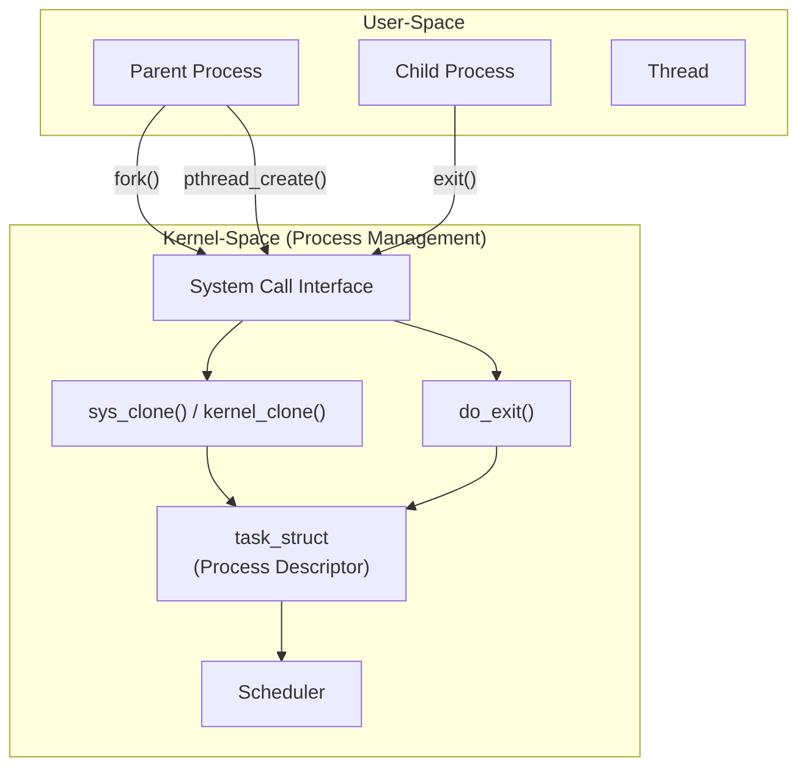
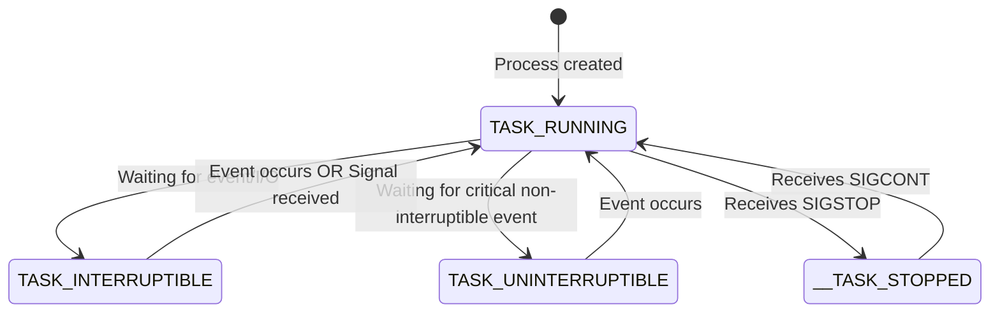

# Chapter 3 — Process Management

> Source fidelity: this chapter follows Robert Love, *Linux Kernel Development*, 3rd Ed., Chapter 3 ("Process Management"), which describes the Linux 2.6 kernel series (as of ~2010). Every place the material has since changed is marked explicitly with [MODERN LINUX]. Core concepts that remain unchanged are marked [CONCEPTUAL CORE].

---

## 1. What This Chapter Is About

This chapter explores how the Linux kernel manages processes and threads. We cover the central data structure for tasks (`task_struct`), how tasks are allocated and tracked, the states a process can be in, how processes are created (`fork`, `clone`), the kernel's unique approach to threads, and how processes terminate and are cleaned up. 

## 2. Why This Matters

Process management is the beating heart of any operating system. The kernel's primary job is to safely multiplex hardware resources among competing tasks. To do this, it must track every task, schedule them, isolate their resources, and manage their lifecycles. Without a deep understanding of process management, topics like scheduling (Chapter 4), memory management, and synchronization will lack context. Understanding `task_struct` and the Linux threading model (where threads are just processes sharing resources) is essential for diagnosing performance issues, debugging system crashes, and writing efficient system-level code.

## 3. Prerequisite Concepts

- From Chapter 1: The distinction between user-space and kernel-space, and process context vs. interrupt context.
- From Chapter 2: The small, fixed-size kernel stack and the necessity of concurrency awareness.
- Basic C programming and familiarity with standard Unix system calls (`fork`, `exec`, `wait`, `exit`).

## 4. Big Picture



---

## 5. Core Concepts

### 5.1 The Process

**Concept.** A process is a program in execution. It is more than just the executable code (the "text" section); it includes a set of resources such as open files, pending signals, internal kernel data, processor state, a memory address space with one or more memory mappings, one or more threads of execution, and a data section containing global variables.

**Intuition.** If a program is a recipe written on paper, a process is the act of a chef actually cooking the meal in a kitchen. The recipe is static; the cooking involves state, ingredients (data), and action (execution).

**Problem it solves.** The operating system needs an abstraction to run multiple programs apparently simultaneously on limited hardware. The process abstraction provides this by giving each program the illusion that it is the sole owner of the processor (virtualized processor) and memory (virtualized memory).

**Design idea.** 
- **Virtualized processor:** The kernel preemptively switches execution among processes, so each thinks it has exclusive use of the CPU.
- **Virtualized memory:** The kernel uses page tables to give each process its own isolated address space.
- **Threads of execution:** The actual locus of activity within a process. A process can have one thread (traditional Unix) or many threads sharing the same memory and resources.

**[CONCEPTUAL CORE]** The definition of a process and its components remains unchanged.
**[MODERN LINUX]** The core definition stands, though the scale and specific resource tracking (e.g., cgroups) have grown substantially.

**Common Mistakes**
- Confusing a "program" with a "process." A program is an inanimate file on disk. A process is active and alive.

**Active Recall (5.1)**
1. What is the difference between a program and a process?
2. What two key abstractions does a process provide?

<details><summary>Answers</summary>
1. A program is static executable code on disk. A process is a running instance of a program, including its active resources like memory, open files, and execution state.
2. A virtualized processor (the illusion of exclusive CPU ownership) and virtualized memory (the illusion of an exclusive, contiguous memory space).
</details>

---

### 5.2 Process Descriptor and `task_struct`

**Concept.** The kernel stores the list of processes in a circular doubly linked list called the task list. Each element in this list is a process descriptor of the type `struct task_struct`.

**Intuition.** `task_struct` is the kernel's dossier on a process. It contains absolutely everything the kernel needs to know about the process to manage it.

**Problem it solves.** To schedule, isolate, and manage processes, the kernel needs a comprehensive, centralized record of a task's current state, resources, and relationships.

**Design idea.** Define a massive struct that holds state, scheduling info, memory maps, file descriptors, signal handlers, and pointers to parents/children.

**Data structures.**
`struct task_struct` (defined in `include/linux/sched.h`)
Key fields include:
- `state`: The current execution state of the process.
- `stack`: Pointer to the task's kernel stack.
- `flags`: Per-process flags.
- `prio`: Scheduling priority.
- `pid`: Process ID.
- `parent`: Pointer to the parent process.
- `children`: List of child processes.
- `mm`: Pointer to `mm_struct` (memory descriptor).
- `files`: Pointer to `files_struct` (open file descriptors).

**Code excerpt:**
```c
/* Simplified subset of task_struct */
struct task_struct {
    volatile long state;    /* -1 unrunnable, 0 runnable, >0 stopped */
    void *stack;
    pid_t pid;
    pid_t tgid;
    struct task_struct __rcu *real_parent; /* real parent process */
    struct task_struct __rcu *parent;      /* recipient of SIGCHLD, wait4() reports */
    struct list_head children;             /* list of my children */
    struct list_head sibling;              /* linkage in my parent's children list */
    struct mm_struct *mm;                  /* address space */
    struct files_struct *files;            /* open file information */
    /* ... and hundreds of other fields ... */
};
```

🧠 **Mental Model.** `task_struct` is the ultimate "God object" for a process in the kernel. If a process does it, owns it, or feels it, it's recorded in `task_struct`.

**[BOOK — Linux 2.6]** The `task_struct` size was typically around 1.7 KB on 32-bit machines.
**[MODERN LINUX]** The struct has grown significantly due to new features like cgroups, namespaces, and enhanced tracing. It is allocated dynamically via the slab allocator (Chapter 12) for efficient reuse.

**Common Mistakes**
- Assuming `task_struct` is small. It is huge and complex.

**Active Recall (5.2)**
1. What is the central data structure used by the kernel to represent a process?
2. Name three types of information stored in this structure.

<details><summary>Answers</summary>
1. `struct task_struct`.
2. Process state, PID, parent/child pointers, memory descriptor (`mm`), open files (`files`), scheduling priority.
</details>

---

### 5.3 Allocating the Process Descriptor

**Concept.** How the kernel allocates space for a new `task_struct` when a process is created.

**Intuition.** Creating a process needs to be fast, so allocating its central data structure must be highly optimized.

**Problem it solves.** Allocating and deallocating memory frequently can cause fragmentation and slowness.

**Design idea.** 
**[BOOK — Linux 2.6]** Used the slab allocator to allocate `task_struct`. Additionally, the kernel stack and a structure called `thread_info` were allocated together. `thread_info` was placed at the very bottom (or top) of the kernel stack, depending on stack growth direction. `thread_info` contained a pointer to the dynamically allocated `task_struct`.

```text
Kernel Stack Layout (Book era)
+----------------+  <- High memory
|                |
|  Kernel Stack  |
|                |
+----------------+
|                |
|  thread_info   |  -> contains pointer to task_struct
|                |
+----------------+  <- Low memory
```

**[MODERN LINUX]** 
Modern implementation details should be verified against the current Linux source/documentation. However, typically (especially on x86-64 with `THREAD_INFO_IN_TASK` enabled), the `thread_info` structure is now embedded directly inside the `task_struct` itself rather than sitting on the kernel stack. This improves security (mitigates some stack-overflow attacks that target `thread_info`) and performance.

**Common Mistakes**
- Believing `task_struct` itself lives on the kernel stack. It does not; it is dynamically allocated on the heap via the slab allocator.

**Active Recall (5.3)**
1. How does the kernel optimize the allocation of `task_struct`?
2. Where did `thread_info` historically live, and where is it typically found in modern x86-64 Linux?

<details><summary>Answers</summary>
1. By using the slab allocator (an object cache) for fast allocation and reuse without fragmentation.
2. Historically, it lived at the bottom of the process's kernel stack. In modern kernels (with `THREAD_INFO_IN_TASK`), it is often embedded directly inside the `task_struct`.
</details>

---

### 5.4 Storing the Process Descriptor — `current` macro

**Concept.** The kernel frequently needs to access the `task_struct` of the currently executing process. The `current` macro is used for this.

**Intuition.** If you are the kernel executing code, you need a mirror to see "who am I executing on behalf of right now?"

**Problem it solves.** Finding the current process's metadata quickly is critical for performance since it happens constantly in syscalls and interrupts.

**Design idea.** 
**[BOOK — Linux 2.6]** On architectures with few registers (like x86 32-bit), `current` worked by masking the stack pointer to find the `thread_info` struct at the base of the stack, and then following the `task` pointer inside it to the `task_struct`.

```c
/* Concept of old x86 current macro */
static inline struct thread_info *current_thread_info(void)
{
    struct thread_info *ti;
    __asm__("andl %%esp,%0; ":"=r" (ti) : "0" (~(THREAD_SIZE - 1)));
    return ti;
}
#define current current_thread_info()->task
```

**[MODERN LINUX]** On architectures with plenty of registers (like x86-64), or through per-CPU variables, `current` is implemented much faster. On x86-64, the current `task_struct` pointer is typically stored in a per-CPU variable (accessed via the `gs` segment register). This avoids the stack-masking math entirely.

**Usage:**
```c
printk("Current process is %s (PID: %d)\n", current->comm, current->pid);
```

**Active Recall (5.4)**
1. What does the `current` macro do?
2. How did 32-bit x86 traditionally implement `current`?

<details><summary>Answers</summary>
1. It returns a pointer to the `task_struct` of the currently executing process.
2. By masking the stack pointer to find the `thread_info` struct at the base of the kernel stack, which then pointed to the `task_struct`.
</details>

---

### 5.5 Process State

**Concept.** A process in the kernel is essentially a state machine. The `state` field of `task_struct` describes the current condition of the process.

**Intuition.** A chef can be actively cooking (running), waiting for an oven timer (interruptible sleep), or trapped in the walk-in freezer ignoring all calls (uninterruptible sleep).

**Problem it solves.** The scheduler needs to know which tasks are eligible to run and which are waiting for events.

**Design idea.** Five mutually exclusive states.

- `TASK_RUNNING`: The process is runnable; it is either currently running on a CPU or waiting in a runqueue.
- `TASK_INTERRUPTIBLE`: The process is sleeping, waiting for some condition to exist. It *will* wake up prematurely if it receives a signal.
- `TASK_UNINTERRUPTIBLE`: Like interruptible, but it does *not* wake up for signals. Used when the process is waiting on an event that must not be interrupted (e.g., a critical disk I/O operation). Shows up as 'D' state in `top`/`ps`.
- `__TASK_STOPPED`: Process execution has stopped; it is not running nor eligible to run. Occurs when receiving `SIGSTOP`, `SIGTSTP`, `SIGTTIN`, `SIGTTOU`.
- `__TASK_TRACED`: The process is being traced by another process (e.g., a debugger using `ptrace`).



**Manipulating State:**
Kernel code uses `set_task_state(task, state)` or `set_current_state(state)`.
Why not just `task->state = state`? Because changing state requires **memory barriers** to ensure compiler or CPU reordering doesn't cause race conditions with the scheduler or wake-up routines.

🐛 **If This Breaks:** If a process gets stuck waiting for a hardware event that never happens while in `TASK_UNINTERRUPTIBLE`, it cannot be killed (even with `kill -9`). The process becomes an unkillable zombie (the infamous 'D' state) and usually requires a reboot to clear.

**Active Recall (5.5)**
1. What is the difference between `TASK_INTERRUPTIBLE` and `TASK_UNINTERRUPTIBLE`?
2. Why is `set_current_state()` used instead of simple assignment?

<details><summary>Answers</summary>
1. Both are sleeping states waiting for an event. `TASK_INTERRUPTIBLE` will wake up if it receives a signal. `TASK_UNINTERRUPTIBLE` ignores signals and only wakes up when the specific event it is waiting for occurs.
2. `set_current_state()` includes necessary memory barriers to prevent CPU or compiler instruction reordering, which is critical for concurrent safety.
</details>

---

### 5.6 Process Context

**Concept.** When a program executes a system call or triggers an exception, it transitions from user-space to kernel-space. The kernel is then said to be executing "on behalf of the process."

**Intuition.** When you order a coffee, the barista makes it for you. The barista (kernel) is doing work specifically for your order (your process).

**Back-reference to Ch.1 Section 5.6:** In process context, the `current` macro points to the associated process. The kernel can sleep or be preempted while in process context (unlike in interrupt context). When the kernel finishes the work, it returns to user-space, resuming the process.

---

### 5.7 The Process Family Tree

**Concept.** Processes have a strict hierarchical relationship. All processes are descendants of the `init` process (PID 1).

**Intuition.** A family tree where every child has exactly one parent, but a parent can have many children.

**Problem it solves.** Keeping track of process lineage is necessary for resource cleanup (parents waiting on children) and signal propagation.

**Design idea.** Every `task_struct` has a pointer to its `parent`. It also has a list of `children`, and a `sibling` list node to link into its parent's children list.

**[BOOK — Linux 2.6]** `init` process is spawned by the kernel at the end of the boot process.
**[MODERN LINUX]** `systemd` acts as PID 1 on most modern Linux distributions, taking over the responsibilities of traditional `init`.

**Data structures & Navigation:**
```c
struct task_struct *my_parent = current->parent;

struct task_struct *task;
struct list_head *list;

list_for_each(list, &current->children) {
    task = list_entry(list, struct task_struct, sibling);
    /* task now points to one of current's children */
}
```

The macro `for_each_process(task)` iterates over the entire task list.
`init_task` is the statically allocated process 0 (the idle process or swapper).

**Active Recall (5.7)**
1. What is the PID of the init process, and what is its role in the process tree?
2. How does a `task_struct` track its children?

<details><summary>Answers</summary>
1. PID 1. It is the root of the user-space process tree and the ancestor of all other user processes.
2. It maintains a linked list head called `children`. Each child links into this list via its `sibling` field.
</details>

---

### 5.8 Process Creation

**Concept.** Unix breaks process creation into two distinct steps: `fork()` and `exec()`.

**Intuition.** `fork()` clones an existing chef. `exec()` hands the cloned chef a completely new recipe to cook.

**Problem it solves.** Creating a new process requires an environment (file descriptors, environment variables). By separating creation from execution, the child process can inherit the parent's environment, make modifications (like redirecting standard output to a pipe), and *then* execute the new program.

**Design idea.** 
- `fork()` creates a child process that is an identical copy of the parent (except for PID, PPID, and certain pending signals).
- `exec()` replaces the current process's address space with a new executable program and starts executing it.

**Historical context.** Originally, `fork()` physically copied all memory pages from the parent to the child. This was incredibly slow and wasteful, especially because the child usually calls `exec()` immediately afterward, throwing away all that copied memory.

---

### 5.9 Copy-on-Write (COW)

**Concept.** A technique to make `fork()` extremely fast by delaying or completely avoiding the copying of memory pages.

**Intuition.** Two people sharing a textbook. As long as they are only reading, they can share one book. If one person wants to highlight a sentence (write), they must get their own photocopy of that page first.

**Problem it solves.** The historical cost of `fork()` copying the entire address space was unacceptable.

**Design idea.** 
1. When `fork()` is called, the kernel does *not* duplicate the parent's memory. Instead, parent and child share the same physical memory pages.
2. The kernel marks the page table entries for both processes as **read-only**.
3. If either process attempts to write to a page, a hardware page fault occurs.
4. The kernel intercepts the fault, transparently creates a duplicate of that specific page, assigns the new page to the faulting process, marks both the old and new pages as writable, and resumes execution.

🧠 **Mental Model.** Sharing until someone writes.

🔬 **Under the Hood:** `fork()` -> marks pages COW -> child calls `exec()` (which replaces address space, so no writing to old pages, saving massive overhead). Or, child writes a variable -> CPU traps (page fault) -> kernel page fault handler sees it's a COW page -> allocates new physical page -> copies data -> updates child's page table -> resumes instruction.

**Active Recall (5.9)**
1. Why is copy-on-write essential for efficient process creation?
2. What triggers the actual copying of memory in a COW system?

<details><summary>Answers</summary>
1. Because most `fork()` calls are immediately followed by `exec()`, which replaces the address space. Copying the entire memory during `fork` would be a massive waste of time and resources.
2. A hardware page fault triggered when either the parent or child attempts to write to a shared, read-only page.
</details>

---

### 5.10 Forking — Implementation

**Concept.** How `fork()` actually works inside the kernel.

**[BOOK — Linux 2.6]** `fork()`, `vfork()`, and `__clone()` all vector through the `do_fork()` function in `kernel/fork.c`.
**[MODERN LINUX]** `do_fork()` has been renamed and refactored into `kernel_clone()`. The core logic remains in `copy_process()`.

**Algorithm: What `copy_process()` does step by step:**
1. Calls `dup_task_struct()`, which allocates a new kernel stack, `thread_info`, and `task_struct` for the new process. At this point, child and parent process descriptors are identical.
2. Checks resource limits to ensure the current user hasn't exceeded their process quota.
3. Clears or resets various members of the child's `task_struct` (statistics, pending signals) so they don't inherit stale values.
4. Sets the child's state to `TASK_UNINTERRUPTIBLE` so it isn't scheduled yet.
5. Updates flags (e.g., clearing `PF_SUPERPRIV`).
6. Calls `alloc_pid()` to assign a new PID to the child.
7. Depending on the flags passed to `clone()`, it either duplicates or shares resources: open files, filesystem info, signal handlers, process address space, and namespaces.
8. Returns a pointer to the new child's `task_struct`.

After `copy_process()` returns, `kernel_clone()` wakes up the new child and puts it on the runqueue. (The kernel typically prefers the child to run first, as it might call `exec()` and avoid COW overhead if the parent ran first and started writing to pages).

```mermaid
flowchart TD
    ForkSyscall[User calls fork()] --> KernelClone[kernel_clone()]
    KernelClone --> CopyProcess[copy_process()]
    CopyProcess --> DupTask[dup_task_struct()]
    CopyProcess --> CheckLimits[Check Limits]
    CopyProcess --> InitTask[Initialize child task_struct]
    CopyProcess --> AllocPID[alloc_pid()]
    CopyProcess --> ShareCopy[Share/Copy Resources\nbased on clone flags]
    CopyProcess --> ReturnTask[Return new task_struct]
    ReturnTask --> WakeUp[Wake up child process]
```

**Active Recall (5.10)**
1. What function does the heavy lifting for process creation in the kernel?
2. What happens to the child's state immediately after its `task_struct` is allocated?

<details><summary>Answers</summary>
1. `copy_process()` (called by `kernel_clone()` or historically `do_fork()`).
2. It is set to `TASK_UNINTERRUPTIBLE` to ensure it is not scheduled to run before setup is complete.
</details>

---

### 5.11 `vfork()`

**Concept.** `vfork()` is an older system call identical to `fork()`, but with two major differences:
1. It does NOT copy the parent's page tables (address space).
2. The parent process is suspended until the child calls `exec()` or `exit()`.

**Problem it solves.** Before COW was fully optimized, `vfork()` was an optimization specifically for the `fork()` + `exec()` pattern.

**Design idea.** The child runs in the *parent's* address space. The parent is blocked so they don't step on each other's toes. The child must immediately call `exec()` or exit; doing otherwise (like returning from the current function) corrupts the parent.

**[BOOK — Linux 2.6]** Noted that with COW, `vfork()`'s performance advantage was marginal.
**[MODERN LINUX]** `vfork()` is largely a historical artifact in modern desktop/server Linux.
**[CONCEPTUAL CORE]** It still exists and is occasionally used in highly resource-constrained embedded systems where even copying page tables is considered too expensive. It is implemented via `clone()` flags `CLONE_VFORK | CLONE_VM`.

---

### 5.12 The Linux Implementation of Threads

> [!IMPORTANT]
> **THIS IS THE MOST IMPORTANT SECTION OF THE CHAPTER.** The Linux approach to threads is elegantly different from almost every other operating system.

**Concept.** Linux does **not** have a separate "thread" concept or "thread control block" (TCB) in the kernel. Threads are simply normal processes that happen to share resources.

**Intuition.** In other OSes (like Windows), a Process is a heavy container holding memory and resources, and a Thread is the execution unit running inside that container. In Linux, there are only Tasks. **A thread is just a process living in a shared apartment.**

**Problem it solves.** It drastically simplifies the kernel. There is no need for separate scheduling logic, separate data structures, or separate system calls for threads vs. processes.

**Design idea.** To the kernel, a thread is just a standard `task_struct`. What makes it a "thread" of another process is simply that it was created with instructions to *share* its address space, open files, and signal handlers with its creator, rather than copying them.

**[BOOK — Linux 2.6]** The Native POSIX Threads Library (NPTL) is the standard implementation mapping user-space pthreads to kernel tasks 1:1.

🧠 **Mental Model.**
- Normal `fork()`: "Create a new `task_struct`. Give it a copy of my memory and file descriptors." (Result: two processes).
- Thread creation: "Create a new `task_struct`. Point its memory descriptor and file descriptor pointers to *my* existing memory and file descriptors." (Result: two threads).

---

### 5.13 Creating Threads — `clone()`

**Concept.** Process and thread creation are unified under a single underlying system call: `clone()`.

**Intuition.** `clone()` is a parameterized `fork()`. You pass flags to tell the kernel exactly what to share and what to copy.

**Design idea.** Flags dictate sharing:
- `CLONE_VM`: Parent and child share address space.
- `CLONE_FS`: Parent and child share filesystem information (root, cwd).
- `CLONE_FILES`: Parent and child share the open file descriptor table.
- `CLONE_SIGHAND`: Parent and child share signal handlers.
- `CLONE_THREAD`: Child is placed in the same thread group as the parent (shares the same POSIX PID, which is called TGID in the kernel).

**Comparison Table:**

| User-space call | Equivalent `clone()` flags |
|---|---|
| `fork()` | `SIGCHLD` |
| `pthread_create()` | `CLONE_VM \| CLONE_FS \| CLONE_FILES \| CLONE_SIGHAND \| CLONE_THREAD \| CLONE_SETTLS \| ...` |
| `vfork()` | `CLONE_VFORK \| CLONE_VM \| SIGCHLD` |

**[MODERN LINUX]** The `clone3()` system call was introduced to pass arguments via a structure, allowing for easier extensibility compared to the older `clone()` system call which ran out of argument registers.

**Active Recall (5.12 & 5.13)**
1. How does the Linux kernel represent a thread differently than other operating systems?
2. Which system call is the foundation for both `fork()` and `pthread_create()`?

<details><summary>Answers</summary>
1. Linux has no distinct "thread" object. A thread is simply a standard process (`task_struct`) that shares resources (memory, files) with other processes.
2. `clone()`.
</details>

---

### 5.14 Kernel Threads

**Concept.** Standard processes that execute solely in kernel-space.

**Intuition.** The kernel has background chores to do (flushing disks, balancing load). It spawns its own "workers" to do these chores.

**Problem it solves.** The kernel needs to execute tasks asynchronously in the background. Since the scheduler manages `task_struct`s, creating kernel-only tasks allows these background chores to be scheduled and prioritized just like user processes.

**Design idea.** Kernel threads have a `task_struct`, but they have **no user address space** (`mm` pointer is NULL). They never context-switch into user-space.

**[BOOK — Linux 2.6]** `kernel_thread()` was the older API.
**[MODERN LINUX]** The `kthread` API (`kthread_create()`, `kthread_run()`) is standard. 
Common kernel threads: `kthreadd` (the parent of all other kernel threads), `kworker` (workqueue execution), `migration` (moving tasks between CPUs), `ksoftirqd` (handling deferred interrupts).

You can observe them via `ps aux`; they usually have brackets around their names (e.g., `[kworker/0:1]`).

---

### 5.15 Process Termination

**Concept.** How a process ends its life, via the `exit()` system call (which maps to `do_exit()` in the kernel).

**Intuition.** Tearing down the kitchen after the chef finishes cooking.

**Design idea (What `do_exit()` does):**
1. Sets the `PF_EXITING` flag in the `task_struct`.
2. Removes process timers.
3. Calls `exit_mm()` to release the `mm_struct`. If no other process is sharing it (i.e., not a thread), the memory is freed.
4. Calls `exit_files()` and `exit_fs()` to decrement usage counts on open files and filesystem data.
5. Sets the task's exit code, stored in `task_struct`.
6. Calls `exit_notify()`, which sends signals to the parent process and reparents any of the exiting process's children.
7. Changes the process state to `EXIT_ZOMBIE`.
8. Calls `schedule()` to switch to a new process. The exiting process never returns from this call.

At this point, the process is functionally dead. It holds no memory and executes no code. It is a **zombie**.

---

### 5.16 Removing the Process Descriptor

**Concept.** The cleanup of the process is split into two phases: termination (releasing resources) and removal (releasing the `task_struct`).

**Problem it solves.** Why leave a zombie? Because the parent process needs to know that the child died and what its exit status was.

**Design idea.** The zombie retains only its `task_struct`, kernel stack, and thread_info. It waits for the parent to call `wait()`, `waitpid()`, or `wait4()`.
When the parent calls `wait()`, the kernel retrieves the exit code and calls `release_task()`, which:
1. Removes the process from the PID hash table.
2. Removes it from the task lists.
3. Frees the `task_struct` and kernel stack.

---

### 5.17 The Dilemma of the Parentless Task

**Concept.** What happens if a parent process dies before its children? The children become "orphans."

**Problem it solves.** If an orphan dies, its original parent isn't around to call `wait()`. The orphan would remain a zombie forever, leaking a `task_struct` and PID.

**Design idea.** Orphaned processes must be **reparented**.
**[BOOK — Linux 2.6]** Orphans were reparented to `init` (PID 1).
**[MODERN LINUX]** Orphans are reparented to the nearest "subreaper" (a process that marked itself via `PR_SET_CHILD_SUBREAPER`), or to `init` if no subreaper exists. 

The `find_new_reaper()` function handles this during the parent's `do_exit()`. `init` has a special loop: it continuously calls `wait()` to clean up adopted children, preventing system-wide zombie leaks.

**Active Recall (5.15 - 5.17)**
1. What is a zombie process?
2. Why is process teardown split into two phases (`do_exit` and `release_task`)?
3. What happens if a parent exits before its child?

<details><summary>Answers</summary>
1. A process that has terminated (released its memory and files) but whose parent has not yet called `wait()`. It exists solely as a `task_struct`.
2. To allow the parent process to retrieve the child's exit status before the kernel completely forgets the child existed.
3. The child is reparented to a subreaper or to `init`. When the child eventually exits, its new parent will wait on it.
</details>

---

## 6. How the Pieces Fit Together

```mermaid
flowchart TD
    UserApp["C Program"]
    Fork["fork()"]
    Exec["exec()"]
    LibC["libc syscall wrapper"]
    
    subgraph Kernel
        Syscall[Syscall Entry]
        KernelClone[kernel_clone()]
        CopyProcess[copy_process()]
        DupTask[dup_task_struct()]
        DoExecve[do_execve()]
        Scheduler[Scheduler (wake_up_new_task)]
    end
    
    UserApp --> Fork
    UserApp --> Exec
    Fork --> LibC
    Exec --> LibC
    LibC -.-> Syscall
    
    Syscall --> KernelClone
    KernelClone --> CopyProcess
    CopyProcess --> DupTask
    CopyProcess --> Scheduler
    
    Syscall --> DoExecve
```

---

## 7. Source Code Navigation

Use these commands in your kernel source tree to locate the concepts discussed:

- **`task_struct` definition:**
  `rg -n "struct task_struct {" include/linux/sched.h`
- **fork/clone/copy_process implementation:**
  `rg "copy_process" kernel/fork.c`
- **exit and cleanup:**
  `rg "do_exit" kernel/exit.c`
  `rg "release_task" kernel/exit.c`
- **PID allocation:**
  Look in `kernel/pid.c`
- **Thread Info (x86):**
  `rg "struct thread_info {" arch/x86/include/asm/thread_info.h`

---

## 8. Hands-On Experiments

### Experiment 3.1 — Observe Process Creation with `fork()`
**Risk:** SAFE USER-SPACE

**Objective.** See the `clone` syscall in action underneath a standard C `fork()`.

**Setup:** Write a small C program:
```c
#include <stdio.h>
#include <unistd.h>

int main() {
    pid_t pid = fork();
    if (pid == 0) {
        printf("I am the child (PID: %d)\n", getpid());
    } else {
        printf("I am the parent (PID: %d), child is %d\n", getpid(), pid);
    }
    return 0;
}
```
**Steps:** Compile (`gcc fork_test.c`) and run under strace: `strace -e clone ./a.out`.
**Observation:** You will see the `clone()` system call with flags like `SIGCHLD`.
**Explanation:** Glibc implements the POSIX `fork()` function by calling the Linux `clone()` system call with minimal sharing flags.

### Experiment 3.2 — Observe Copy-on-Write
**Risk:** SAFE USER-SPACE

**Objective.** Prove that a forked process shares memory pages until it writes to them.

**Setup:** Write a C program that allocates a large array, forks, pauses (`sleep`), then the child modifies the array, and pauses again.
**Steps:** 
1. Run the program in the background.
2. Read `/proc/PID/smaps` for both parent and child during the first pause. Look at the `Shared_Clean` or `Shared_Dirty` metrics.
3. Allow the child to write.
4. Read `smaps` again.
**Observation:** After the write, the child's `Private_Dirty` memory increases, and `Shared` decreases.
**Explanation:** The kernel performed Copy-on-Write handling the page faults during the child's write loop.

### Experiment 3.3 — Observe Linux Threads
**Risk:** SAFE USER-SPACE

**Objective.** Verify that Linux threads are just processes sharing a Thread Group ID.

**Steps:**
1. Run a multi-threaded program (like a web browser or `stress-ng --pthread 4`).
2. Run `ps -ef | grep program_name` to find the main PID.
3. Look inside `/proc/<PID>/task/`.
**Observation:** You will see multiple subdirectories, one for each thread. They all have different PIDs (thread IDs), but they live under the main process's directory.
**Kernel connection:** Each subdirectory represents a unique `task_struct` created via `clone()` with `CLONE_THREAD`.

### Experiment 3.4 — Create and Observe a Zombie
**Risk:** SAFE USER-SPACE

**Objective.** Create a zombie process and see how the kernel exposes it.

**Setup:** Write a program where `fork()` happens, the child immediately calls `exit(0)`, and the parent calls `sleep(60)` without calling `wait()`.
**Steps:** Run the program, open another terminal, and run `ps aux | grep Z`.
**Observation:** You will see the child process listed with a 'Z' (Zombie) state and often `<defunct>` next to its name.
**Explanation:** The child finished `do_exit()` but is waiting for the sleeping parent to call `wait()` so `release_task()` can free its `task_struct`.

### Experiment 3.5 — Observe Kernel Threads
**Risk:** SAFE USER-SPACE

**Objective.** Identify background kernel threads on your system.

**Steps:** Run `ps -ef`.
**Observation:** Processes with brackets, like `[kthreadd]`, `[kworker/0:1]`, `[migration/0]`. Their PPID is usually 2 (kthreadd).
**Explanation:** These are `task_struct`s without an address space, spawned in kernel-space to do asynchronous work.

### Experiment 3.6 — Process Tree Exploration
**Risk:** SAFE USER-SPACE

**Objective:** Visualize the `parent` and `children` links of `task_struct`.

**Steps:** Run `pstree -p`.
**Observation:** A hierarchical tree showing `systemd` (1) at the root, leading down to your current shell and `pstree` command.

---

## 9. Common Misconceptions

| Misconception | Correction |
|---|---|
| "Linux has separate kernel structures for Processes and Threads." | Linux only has `task_struct`. A thread is just a process that shares memory and files with its parent via `clone()` flags. |
| "`fork()` copies all memory to the child." | `fork()` relies on Copy-on-Write (COW). Memory is shared read-only and only copied if modified. |
| "A Zombie process is consuming CPU and memory." | A zombie consumes almost no resources (it has released memory/files). It only consumes a slot in the process table and a `task_struct`. |
| "`task_struct` lives on the kernel stack." | It used to have a pointer from the stack (`thread_info`), but `task_struct` is allocated dynamically on the heap via the slab allocator. |

---

## 10. Interview Questions

**Basic**
- **Q:** What is a zombie process?
- **A:** A process that has called `exit()` and released its resources, but its parent has not yet called `wait()` to collect its exit status. It exists only as a `task_struct`.

**Intermediate**
- **Q:** How does Linux implement threads compared to other OSes?
- **A:** Linux doesn't differentiate between threads and processes internally. Both are `task_struct`s. A thread is created via `clone()` with specific flags (`CLONE_VM`, `CLONE_FILES`, etc.) that instruct it to share resources with its creator rather than copy them.
- **Follow-up:** What syscall underlies both `fork()` and `pthread_create()`? (Answer: `clone()`).

**Advanced**
- **Q:** Explain the exact mechanism of Copy-on-Write during `fork()`.
- **A:** The kernel creates the new `task_struct` but points the child's page tables to the parent's physical pages. It marks the pages read-only for both. When either process writes, the CPU triggers a page fault. The kernel traps this, allocates a new physical page, copies the data, updates the faulting process's page table to point to the new writable page, and resumes execution.

**Design**
- **Q:** Why did Unix designers split process creation into `fork()` and `exec()` instead of having one `spawn(program)` system call?
- **Expected reasoning:** Splitting allows the child process to inherit the parent's environment, but gives it a window to manipulate that environment (like redirecting file descriptors for pipes) before the new executable takes over memory in `exec()`.

---

## 11. Active Recall (Chapter-Wide)

<details><summary>What is the purpose of the <code>current</code> macro?</summary>
It provides a fast pointer to the <code>task_struct</code> of the process currently executing on the given CPU.
</details>

<details><summary>Describe the <code>TASK_UNINTERRUPTIBLE</code> state and its danger.</summary>
It is a sleeping state waiting for an event, but it ignores all signals. If the hardware event never arrives, the process cannot be killed (even with SIGKILL) and becomes permanently stuck (the 'D' state).
</details>

<details><summary>What prevents the system from running out of PIDs when parent processes die without waiting for children?</summary>
Orphaned children are reparented to a subreaper or to <code>init</code>. The <code>init</code> process has a continuous loop that calls <code>wait()</code> to reap adopted zombies.
</details>

<details><summary>What is a kernel thread and how does it differ from a user process?</summary>
A kernel thread is a <code>task_struct</code> that runs only in kernel-space. It has no user address space (its <code>mm</code> pointer is NULL) and handles background kernel chores.
</details>

---

## 12. Chapter Summary

The Linux kernel manages all execution units through a single abstraction: the `task_struct`. Whether it's a heavyweight process, a lightweight POSIX thread, or a background kernel thread, the kernel views them all as tasks. Process creation is heavily optimized using Copy-on-Write memory sharing during `fork()`, which is actually just a specific invocation of the highly configurable `clone()` system call. Process termination is a two-step dance (`do_exit` and `release_task`) designed to allow parents to read child exit codes while avoiding resource leaks. 

## 13. What I Should Be Able to Explain Now

- [ ] The contents and purpose of `task_struct`.
- [ ] How `fork()` and `exec()` work together.
- [ ] The mechanics of Copy-on-Write (COW).
- [ ] How Linux implements threads using `clone()`.
- [ ] The five process states and state transitions.
- [ ] The lifecycle of a process from creation to zombie to removal.
- [ ] The role of the `init` process in preventing zombie leaks.

## 14. Knowledge Graph

```text
Process Management
├── Data Structures
│   ├── task_struct (Central process descriptor)
│   ├── thread_info (Stack/Task linkage)
│   └── current (Macro for active task)
├── States
│   ├── TASK_RUNNING
│   ├── TASK_INTERRUPTIBLE
│   ├── TASK_UNINTERRUPTIBLE (D state)
│   └── EXIT_ZOMBIE
├── Creation
│   ├── fork() (clone with minimal sharing)
│   ├── exec() (replace address space)
│   ├── clone() (core creation syscall)
│   └── Copy-on-Write (COW optimization)
├── Threading Model
│   ├── No dedicated thread object
│   ├── Threads are shared-resource processes
│   └── Kernel threads (kthreads, mm=NULL)
└── Termination
    ├── do_exit() (release resources)
    ├── Zombie state
    ├── wait() (parent reads status)
    ├── release_task() (free task_struct)
    └── Reparenting (Orphans to init/subreaper)
```
