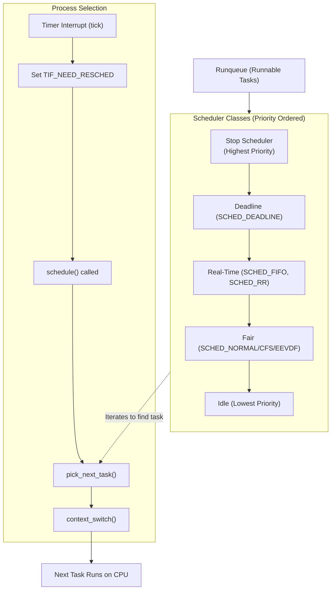
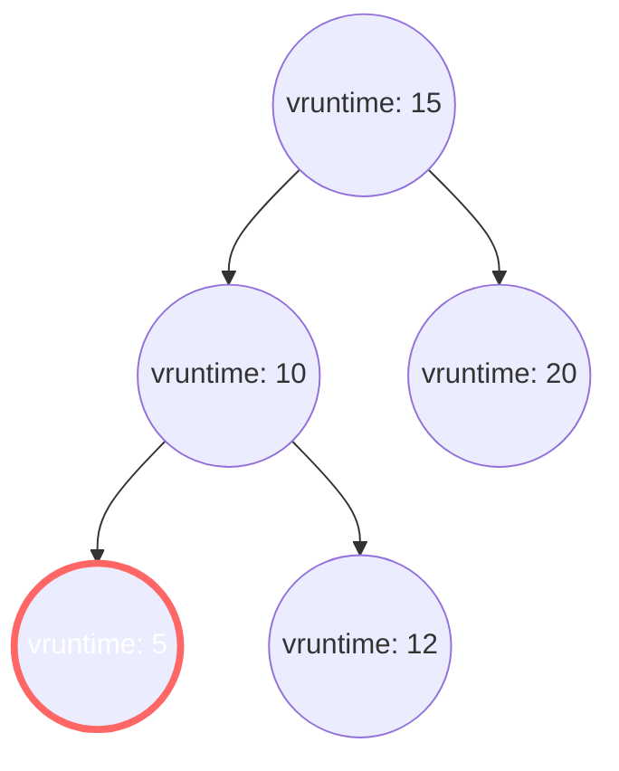

# Chapter 4 — Process Scheduling

> Source fidelity: this chapter follows Robert Love, *Linux Kernel Development*, 3rd Ed., Chapter 4 ("Process Scheduling"), which describes the Linux 2.6 kernel series (as of ~2010). Every place the material has since changed is marked explicitly with [MODERN LINUX]. Core concepts that remain unchanged are marked [CONCEPTUAL CORE].

---

## 1. What This Chapter Is About

This chapter explores how the Linux kernel decides which process runs when, and for how long. We cover the fundamental concepts of multitasking, the problem with traditional Unix schedulers, the revolutionary approach of the Completely Fair Scheduler (CFS) introduced in Linux 2.6, how context switching works, and the scheduling policies available in Linux. Most importantly, we examine the evolution of fairness in scheduling and how real-world constraints shape the scheduler's design.

## 2. Why This Matters

The scheduler is the component that makes a computer feel "alive." It is the reason you can compile a kernel, listen to music, and move your mouse smoothly all at the same time on a single CPU core. If the scheduler is inefficient, the system feels sluggish; if it is unfair, some applications will starve while others hog the CPU. Understanding scheduling is crucial for writing high-performance applications, tuning system latency, and reasoning about performance anomalies. For kernel developers, the scheduler is a masterclass in balancing conflicting requirements: low latency vs. high throughput, fairness vs. priority, and simplicity vs. edge-case handling.

## 3. Prerequisite Concepts

- From Chapter 1: The three things a CPU is doing (user mode, kernel mode, idle).
- From Chapter 3: Process states (`TASK_RUNNING`, `TASK_INTERRUPTIBLE`, etc.) and the `task_struct` process descriptor.
- Basic understanding of data structures, particularly the Red-Black Tree.

## 4. Big Picture



---

## 5. Core Concepts

### 5.1 Multitasking

**Concept.** Multitasking is the ability of an operating system to concurrently interleave the execution of multiple processes on a single processor. Multitasking systems are divided into two categories: cooperative multitasking and preemptive multitasking.

**Intuition.** Cooperative multitasking is like a panel discussion where speakers must voluntarily pass the microphone. Preemptive multitasking is like a moderated debate where the moderator has a stopwatch and can forcibly cut off a speaker's microphone when their time is up.

**Problem it solves.** Without multitasking, an OS can only run one program at a time. Without *preemptive* multitasking, a poorly written or malicious program in an infinite loop can hang the entire system.

**Design idea.** 
- **Cooperative:** A process runs until it voluntarily yields the CPU. This is dangerous because a hung process starves the system.
- **Preemptive:** The scheduler decides when to stop one process and start another. The act of involuntarily suspending a running process is called *preemption*. Linux, like all modern Unix variants, provides preemptive multitasking. The time a process runs before being preempted is traditionally called its *timeslice*.

**[CONCEPTUAL CORE]** Linux uses preemptive multitasking. The scheduler dictates preemption, not the running processes.

**Common Mistakes**
- Thinking processes control their own scheduling fate. They can give *hints* (nice values) or yield, but the kernel retains ultimate control over CPU allocation.

**Active Recall (5.1)**
1. What is the fundamental difference between cooperative and preemptive multitasking?
2. Why is preemptive multitasking considered superior for general-purpose operating systems?

<details><summary>Answers</summary>
1. In cooperative multitasking, processes must explicitly yield the CPU. In preemptive multitasking, the OS forcefully interrupts processes to switch contexts.
2. It prevents a single buggy or malicious process from monopolizing the CPU and hanging the entire system.
</details>

---

### 5.2 Scheduling Policy

**Concept.** The scheduling policy determines *what* runs *when*. It must balance two fundamentally opposed types of processes: I/O-bound and CPU-bound.

**Intuition.** 
- **I/O-bound processes:** Spend most of their time waiting for I/O (e.g., keyboard input, network packets, disk reads). They run for very short bursts. Examples: Text editors, GUI applications. They need *low latency* (responsiveness).
- **CPU-bound processes:** Spend most of their time executing code. Examples: Video encoders, compilers. They need *high throughput* (long continuous blocks of CPU time).

**Problem it solves.** If you give CPU-bound processes too much time, the UI feels laggy. If you constantly interrupt CPU-bound processes to check on I/O-bound processes, context-switching overhead destroys throughput. Most processes are I/O bound.

**Design idea.** 
- **Process Priority:** Linux uses two priority ranges:
  - **Nice values:** Range from -20 to +19. Default is 0. 
  - **Real-time priority:** Range from 0 to 99. Higher means more priority.
- **Timeslice:** Traditionally, a fixed amount of time assigned to a process. 

🧠 **Mental Model.** Nice values work like their English name. A high nice value (+19) means the process is very "nice" to others and gives up the CPU easily (low priority). A low nice value (-20) means the process is mean and demands CPU time (high priority).

**[BOOK — Linux 2.6]** The book details how CFS breaks away from fixed timeslices. Traditional Unix mapped nice values to absolute timeslice lengths (e.g., nice 0 = 100ms, nice +20 = 5ms). This caused major issues: nice values had a non-uniform effect depending on the baseline, and scheduling behavior degraded severely with many low-priority tasks.

Instead of fixed timeslices, CFS uses **proportional fair share**. The timeslice is dynamic, based on the number of runnable tasks and a *targeted latency* (the period in which all runnable tasks should get a turn).

**Active Recall (5.2)**
1. What is the difference between an I/O-bound and a CPU-bound process?
2. Does a nice value of +15 represent a high or low priority task?
3. Why did CFS move away from fixed timeslices based on nice values?

<details><summary>Answers</summary>
1. I/O-bound processes spend most time waiting (needing responsiveness). CPU-bound processes spend most time computing (needing throughput).
2. Low priority. The task is "nice" and yields CPU time to others.
3. Fixed timeslices caused non-uniform scaling of priorities and terrible context-switching overhead under heavy load or with multiple low-priority tasks.
</details>

---

### 5.3 The Linux Scheduling Algorithm — Scheduler Classes

**Concept.** The Linux scheduler is modular. It uses *scheduler classes*, allowing different, pluggable algorithms to coexist and schedule different types of processes.

**Intuition.** You have different lines at an airport: VIPs (Stop), First Class (Real-Time), Economy (Fair), and Standby (Idle). The gate agent (core scheduler) always checks the highest priority line first and only moves to the next line if the current one is empty.

**Design idea.** Each class encapsulates its own scheduling algorithm in a `struct sched_class`. The core scheduler iterates through the classes in priority order.

The classes are (highest to lowest priority):
1. **Stop scheduler:** A special class used to pause CPUs (e.g., for CPU hotplug).
2. **Deadline scheduler (`SCHED_DEADLINE`):** For tasks with strict time constraints.
3. **Real-time scheduler (`SCHED_FIFO`, `SCHED_RR`):** For real-time tasks.
4. **Fair scheduler:** The default class for normal user tasks (`SCHED_NORMAL`, `SCHED_BATCH`, `SCHED_IDLE`).
5. **Idle scheduler:** Only runs when absolutely nothing else is runnable.

**[BOOK — Linux 2.6]** Focuses heavily on the introduction of the CFS class as the fair scheduler.

**[MODERN LINUX]** The modular class architecture remains identical. However, in Linux 6.6 (late 2023), the implementation of the fair scheduler class transitioned from CFS to EEVDF (Earliest Eligible Virtual Deadline First). EEVDF solves some latency issues inherent in CFS, but the core concept of classes remains unchanged.

**Active Recall (5.3)**
1. How does the core scheduler decide which task to run next when there are multiple scheduler classes?
2. What is the name of the C structure that defines a scheduler class?

<details><summary>Answers</summary>
1. It iterates through the scheduler classes in strict priority order (highest to lowest). It asks the highest-priority class with a runnable task to pick the next task.
2. `struct sched_class`.
</details>

---

### 5.4 Fair Scheduling — The CFS Concept

**Concept.** CFS stands for Completely Fair Scheduler. Its core principle is modeling an "ideal, precise, multitasking CPU" where each process gets exactly `1/n` of the processor's time, where `n` is the number of runnable processes.

**Intuition.** Imagine a CPU that could literally run 4 processes simultaneously, advancing each instruction at 25% speed. Real hardware can't do this (it runs one task at 100% speed, then switches). CFS tries to simulate this ideal by keeping careful track of how much time each process *should* have had versus how much it *actually* got.

**Problem it solves.** Traditional Unix schedulers failed because mapping priority directly to absolute timeslices leads to unfairness and latency spikes.

**Design idea.**
Instead of a fixed timeslice, CFS calculates a proportional share. 
- **Targeted Latency:** A configured timeframe (e.g., 20ms) during which all runnable tasks should get at least one turn.
- **Minimum Granularity:** The absolute minimum time a task will run (e.g., 1ms) to prevent infinite context switching if there are thousands of tasks.

The genius of CFS is **Virtual Runtime (`vruntime`)**.
- `vruntime` is the actual runtime of a task, normalized by its priority (nice value).
- A normal task (nice 0) has its `vruntime` advance at real-time speed (1ms actual = 1ms virtual).
- A high-priority task (low nice) has its `vruntime` advance *slower* than real time.
- A low-priority task (high nice) has its `vruntime` advance *faster* than real time.

The scheduler's job is incredibly simple: **Always pick the task with the smallest `vruntime`.**

🧠 **Mental Model.** `vruntime` is a fairness meter. The task with the smallest `vruntime` is the one most "starved" of its fair share. High priority tasks are given a "cheat code" where their fairness meter fills up slowly, meaning the scheduler picks them more often to let them catch up.

🔬 **Under the Hood:**
```text
vruntime += actual_runtime × (NICE_0_WEIGHT / task_weight)
```
If `task_weight` is large (high priority), the fraction is less than 1, so `vruntime` grows slowly.

**[BOOK — Linux 2.6]** This is the definitive explanation of CFS introduced in 2.6.23.

**[MODERN LINUX]** EEVDF has replaced CFS. Modern implementation details should be verified against the current Linux source/documentation. EEVDF still uses `vruntime` for fairness, but instead of always picking the leftmost node (smallest vruntime), it calculates an "eligible deadline" for tasks to ensure latency constraints are met more accurately than CFS could manage.

**Active Recall (5.4)**
1. What is `vruntime`?
2. If a task has a high priority (low nice value), does its `vruntime` advance faster or slower than real time?
3. What happens to context switches if there are 1,000 runnable tasks and the targeted latency is 20ms?

<details><summary>Answers</summary>
1. Virtual runtime. It is the actual time a task has spent running on the CPU, scaled by the task's priority weight.
2. Slower. This keeps its `vruntime` small, so the scheduler picks it more often.
3. The scheduler uses the "minimum granularity" (e.g., 1ms) floor. Each task gets 1ms, so the targeted latency expands to 1,000ms to prevent context switch overhead from freezing the system.
</details>

---

### 5.5 The Scheduler Entity Structure

**Concept.** The scheduler does not operate directly on `task_struct`. Instead, scheduling information is encapsulated in a `struct sched_entity`.

**Intuition.** Just as a physics engine operates on rigid bodies rather than visual meshes, the scheduler operates on scheduler entities rather than full process descriptors.

**Problem it solves.** By abstracting the schedulable item into `sched_entity`, the kernel enables *group scheduling*. An entity can represent a single process, or it can represent a whole group of processes (like all processes spawned by a specific user or inside a container).

**Data structures.**
Defined in `<linux/sched.h>`, embedded inside `task_struct`:

```c
struct sched_entity {
    struct load_weight    load;          /* for load-balancing */
    struct rb_node        run_node;      /* node in the rb-tree */
    struct list_head      group_node;
    unsigned int          on_rq;         /* on runqueue? */
    
    u64                   exec_start;
    u64                   sum_exec_runtime;
    u64                   vruntime;      /* The crucial virtual runtime */
    u64                   prev_sum_exec_runtime;
    /* ... */
};
```

**[CONCEPTUAL CORE]** The abstraction of `sched_entity` remains vital for cgroups and namespace-based scheduling.

---

### 5.6 Time Accounting — `update_curr()`

**Concept.** The scheduler needs to constantly track how much time the currently running task has consumed to update its `vruntime`.

**Intuition.** The moderator checking the stopwatch.

**Mechanism.** The `update_curr()` function is invoked periodically by the system timer interrupt, and also whenever a task is awakened or blocks. 
1. It calculates `delta_exec` (time elapsed since last calculation).
2. It adds `delta_exec` to the task's actual runtime.
3. It scales `delta_exec` by the task's weight and adds it to `vruntime`.

---

### 5.7 Process Selection — Red-Black Tree

**Concept.** To efficiently find the task with the smallest `vruntime`, the fair scheduler uses a Red-Black (rbtree) data structure to maintain the runqueue.

**Intuition.** An rb-tree keeps data sorted. The node furthest to the left is always the smallest value.

**Problem it solves.** A simple array or linked list would require O(N) time to find the lowest `vruntime`. An rb-tree allows insertion and deletion in O(log N) time, and finding the smallest node takes O(1) time because the scheduler caches a pointer to the leftmost node.



**[BOOK — Linux 2.6]** CFS relies on always picking the leftmost node (smallest `vruntime`).
**[MODERN LINUX]** EEVDF still uses an rb-tree. However, the tree selection logic is more complex to account for eligibility and deadlines, not just raw minimum `vruntime`.

---

### 5.8 The Scheduler Entry Point — `schedule()`

**Concept.** The `schedule()` function is the main entry point into the core scheduler. It is the code that actually performs the context switch from one process to another.

**Intuition.** `schedule()` is the bouncer at the CPU club. It kicks out the current patron and lets the next one in.

**Algorithm:**
1. It looks at the runqueue.
2. It iterates through the scheduler classes (`for_each_class`).
3. It calls `pick_next_task()` on the highest-priority class with runnable tasks.
4. If a new task is selected, it calls `context_switch()`.

**Context Switching (`context_switch()`):**
- Calls `switch_mm()`: Switches the virtual memory mapping (page tables). This is architecture-specific.
- Calls `switch_to()`: Switches the processor state (registers, stack pointer). This is raw assembly code.

**Active Recall (5.8)**
1. What are the two main tasks performed during `context_switch()`?

<details><summary>Answers</summary>
1. Switching the virtual memory mapping (`switch_mm`) and switching the processor state/registers (`switch_to`).
</details>

---

### 5.9 Sleeping and Waking Up

**Concept.** A process sleeps when it is waiting for an event (e.g., data from a disk, a network packet, a lock). Sleeping removes the task from the runqueue.

**Intuition.** If you are waiting for a pizza delivery, you don't stand at the door staring at the street (busy waiting). You go sit on the couch (sleep) and wait for the doorbell (wake up).

**Data Structures: Wait Queues.**
A wait queue (`wait_queue_head_t`) is a linked list of sleeping tasks waiting for a specific condition.

**The standard wait loop pattern:**
```c
/* The canonical way to sleep in the kernel */
DEFINE_WAIT(wait);
add_wait_queue(q, &wait);
while (!condition) {
    prepare_to_wait(&q, &wait, TASK_INTERRUPTIBLE);
    if (signal_pending(current)) {
        /* handle signal */
        break;
    }
    schedule(); /* Yield CPU! */
}
finish_wait(&q, &wait);
```

**Why this pattern?** It prevents race conditions between checking the condition and going to sleep. 
- Waking up: `wake_up()` walks the wait queue, sets tasks to `TASK_RUNNING`, and puts them back on the rb-tree.

🐛 **If This Breaks:** If a task sleeps in `TASK_UNINTERRUPTIBLE` (D state) and the wakeup event never comes (e.g., a buggy storage driver), the process becomes a zombie that cannot be killed even by `SIGKILL`.

---

### 5.10 Preemption and Context Switching

**Concept.** The kernel must decide *when* to call `schedule()`. This is preemption. 

**User Preemption:** Occurs when returning to user-space from a syscall or interrupt, if the `need_resched` flag is set.
**Kernel Preemption:** The Linux kernel can preempt *itself* while executing in kernel space.

**Intuition.** Kernel preemption means that even if the kernel is busy serving a system call for Process A, if a high-priority interrupt wakes up Process B, the kernel will pause Process A's system call midway to run Process B.

**Design idea.** 
- Every thread has a `preempt_count`.
- Acquiring a lock increments it; releasing decrements it.
- If `preempt_count == 0` and `need_resched` is set, preemption is safe.

**[MODERN LINUX]** Preemption models are highly configurable:
- `PREEMPT_NONE`: Server throughput focus. No kernel preemption.
- `PREEMPT_VOLUNTARY`: Desktop focus. Explicit preemption points.
- `PREEMPT`: Real-time focus. Full kernel preemption.
- `PREEMPT_DYNAMIC`: Allows changing the model at boot/runtime.

---

### 5.11 Real-Time Scheduling Policies

**Concept.** Linux provides soft real-time scheduling via `SCHED_FIFO` and `SCHED_RR`.

- **SCHED_FIFO:** First-In, First-Out. Runs until it yields or is preempted by a *higher* priority RT task. It has NO timeslice.
- **SCHED_RR:** Round-Robin. Like FIFO, but same-priority RT tasks share the CPU via timeslices.

> [!WARNING]
> RT tasks ALWAYS preempt normal (CFS/EEVDF) tasks. A `SCHED_FIFO` task with an infinite loop will instantly hard-lock a single-core system.

**[MODERN LINUX]** The `PREEMPT_RT` patchset, which makes Linux a hard real-time OS by making nearly all kernel spinlocks preemptible, has been slowly merged into the mainline kernel over the last two decades.

---

### 5.12 Scheduler-Related System Calls

User-space can influence scheduling via system calls:
- `nice()`: Adjust nice value.
- `sched_setscheduler()`: Change class (e.g., move to `SCHED_FIFO`).
- `sched_setaffinity()`: Bind a process to specific CPUs.

**Processor Affinity:** Pinning a process to a CPU ensures its cache remains warm (cache locality). Moving a process between CPUs forces it to pull data into the new CPU's cache, degrading performance (especially on NUMA architectures).

---

## 6. How the Pieces Fit Together

```text
+----------------+      +---------------+       +------------------+
| User Process   | ---> | Timer Interrupt| ---> | update_curr()    |
| (Running)      |      | (Scheduler Tick)|     | updates vruntime |
+----------------+      +---------------+       +------------------+
                                                        |
                                                        v
                                                +------------------+
                                                | Set need_resched |
                                                | if vruntime high |
                                                +------------------+
                                                        |
+----------------+      +---------------+       +------------------+
| New Process    | <--- | context_switch| <---  | schedule() called|
| Runs on CPU    |      | (asm code)    |       | pick_next_task() |
+----------------+      +---------------+       +------------------+
```

---

## 7. Source Code Navigation

- `kernel/sched/core.c`: Contains `schedule()`, `context_switch()`.
- `kernel/sched/fair.c`: The implementation of CFS (and recently EEVDF).
- `kernel/sched/rt.c`: Real-time scheduler.
- `include/linux/sched.h`: Contains `task_struct` and `sched_entity`.
- `arch/x86/include/asm/switch_to.h`: Architecture-specific context switch.

Useful command to see scheduler classes:
`rg "struct sched_class" kernel/sched/`

---

## 8. Hands-On Experiments

### Experiment 4.1 — Observe Scheduling with /proc (SAFE USER-SPACE)
**Objective:** View live scheduling statistics.
**Setup:** A running Linux system.
**Steps:** Run `cat /proc/sched_debug` or `cat /proc/schedstat`.
**Observation:** You will see a massive dump of internal runqueue state, showing `vruntime` for tasks.
**Kernel connection:** This exposes the rb-tree and `sched_entity` metrics directly from `kernel/sched/core.c`.

### Experiment 4.2 — Nice Values in Action (SAFE USER-SPACE)
**Objective:** Prove that nice values create proportional CPU shares.
**Steps:** 
1. Run two infinite loops: `nice -n 0 bash -c "while true; do :; done" &` and `nice -n 19 bash -c "while true; do :; done" &`.
2. Run `top` and look at CPU %.
**Observation:** The nice 0 process will consume significantly more CPU% than the nice 19 process.
**Kernel connection:** The weight of nice 0 scales its `vruntime` slower than the weight of nice 19.

### Experiment 4.3 — Context Switch Observation (SAFE USER-SPACE)
**Objective:** Observe how I/O causes context switches.
**Steps:** Run `vmstat 1`. Look at the `cs` (context switch) column. Then run a heavy disk operation (`find / -type f`).
**Observation:** The `cs` rate spikes massively.
**Kernel connection:** The `find` command blocks on I/O, hitting wait queues, causing `schedule()` to run continuously.

### Experiment 4.4 — CPU Affinity (SAFE USER-SPACE)
**Objective:** Pin a task to a CPU.
**Steps:** Run `taskset -c 0 top`.
**Observation:** `top` will only execute on CPU core 0.
**Kernel connection:** This invokes `sys_sched_setaffinity()`, modifying the task's allowed CPU bitmask.

### Experiment 4.5 — Real-Time Scheduling (DANGEROUS — use VM)
**Objective:** Observe RT priority inversion and starvation.
**Setup:** Use a VM!
**Steps:** Run `sudo chrt -f 99 bash -c "while true; do :; done"`.
**Observation:** If you only have 1 vCPU, your VM will completely freeze. You will have to hard-reboot.
**Kernel connection:** A `SCHED_FIFO` task never yields and has no timeslice. The fair scheduler (and your SSH daemon) never gets CPU time.

### Experiment 4.6 — Observe Wait Queues (SAFE USER-SPACE)
**Objective:** See what a sleeping process is waiting for.
**Steps:** Run `sleep 100 &`. Get its PID. Run `cat /proc/PID/wchan`.
**Observation:** It will output a kernel function name (like `hrtimer_nanosleep`).
**Kernel connection:** This shows exactly which wait queue the task's `task_struct` is currently resting on.

---

## 9. Common Misconceptions

| Misconception | Reality |
|---------------|---------|
| "Nice values map to fixed timeslices." | [BOOK/MODERN] They map to weights that alter the growth rate of `vruntime`. |
| "A sleeping process consumes CPU." | A sleeping process is removed from the runqueue rb-tree. It consumes 0 CPU until awakened. |
| "Linux is a Hard Real-Time OS." | Mainline Linux is soft real-time. PREEMPT_RT is required for hard real-time guarantees. |
| "User-space can force a schedule out." | User-space can only block (sleep) or call `sched_yield()`. The kernel makes the final call. |

---

## 10. Interview Questions

**Basic**
*Q: What is the difference between cooperative and preemptive multitasking?*
A: Cooperative requires the app to explicitly yield. Preemptive allows the OS to forcefully interrupt the app. Linux is preemptive.

**Intermediate**
*Q: Explain how CFS achieves fairness without fixed timeslices.*
A: It uses `vruntime`. Every task has a virtual runtime that tracks execution time scaled by priority weight. The scheduler simply picks the task with the smallest `vruntime` from an rb-tree, ensuring fairness dynamically.

**Advanced**
*Q: Walk through what happens during a context switch.*
A: `schedule()` picks a new task. It calls `context_switch()`. This calls `switch_mm()` to swap the page tables (virtual memory) and `switch_to()` (assembly) to swap CPU registers and the stack pointer.

**Design**
*Q: How would you design a scheduler for a system with 1,000 CPU cores?*
A: Global runqueues cause extreme lock contention. You must use per-CPU runqueues. To prevent imbalance, you need a load balancer that periodically steals tasks from busy CPUs to idle CPUs, taking NUMA topology into account (don't move tasks far from their memory).

---

## 11. Active Recall

1. What problem do wait queues solve?
2. What is the complexity of picking the next task in CFS?
3. Why can't you sleep while holding a spinlock?
4. What is the difference between `SCHED_FIFO` and `SCHED_RR`?

<details><summary>Answers</summary>
1. They allow processes to sleep asynchronously while waiting for events, removing them from the active runqueue.
2. O(1), because the scheduler caches a pointer to the leftmost node of the rb-tree. (Insertion/deletion is O(log N)).
3. If you sleep with a spinlock, you cannot be preempted. Another CPU spinning for that lock will spin forever, deadlocking the system.
4. Both are real-time. `SCHED_FIFO` runs until yielding or preemption by a higher RT task. `SCHED_RR` provides timeslices for RT tasks of the *same* priority.
</details>

---

## 12. Chapter Summary

The Linux scheduler is a masterpiece of pragmatic engineering. By moving from fixed timeslices to the virtual runtime model, the kernel solved massive latency and fairness issues. The modular scheduler class system cleanly separates real-time requirements from everyday fairness. The transition from CFS to EEVDF in modern kernels proves that scheduling is never a solved problem, but the core abstractions—runqueues, preemption, context switching, and scheduler entities—remain the durable foundation of the OS.

---

## 13. What I Should Be Able to Explain Now

- [ ] The difference between I/O-bound and CPU-bound processes.
- [ ] How `vruntime` enables proportional fair scheduling.
- [ ] The role of the rb-tree in process selection.
- [ ] The core steps of `context_switch()`.
- [ ] Why `SCHED_FIFO` can freeze a system.
- [ ] How user and kernel preemption work.

---

## 14. Knowledge Graph

```text
Process Scheduling
├── Multitasking
│   ├── Cooperative
│   └── Preemptive (Linux)
├── Scheduler Classes
│   ├── Real-Time (FIFO, RR)
│   └── Fair (CFS / EEVDF)
│       ├── vruntime
│       └── Red-Black Tree Runqueue
├── Context Switch
│   ├── switch_mm (Memory)
│   └── switch_to (Registers)
└── Sleep/Wakeup
    └── Wait Queues
```
