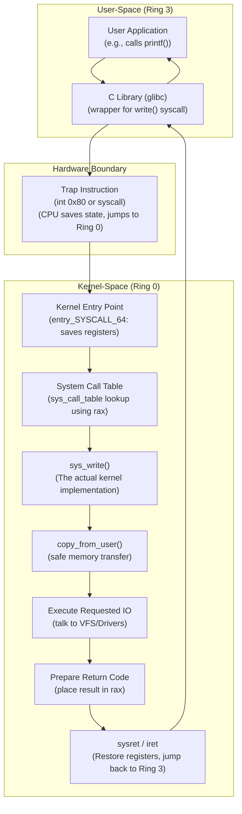
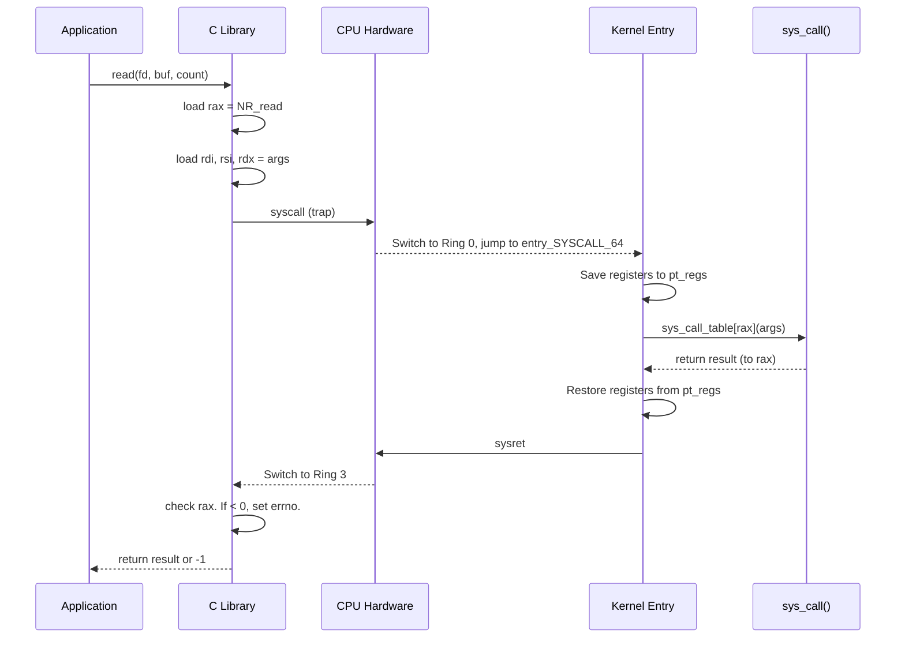
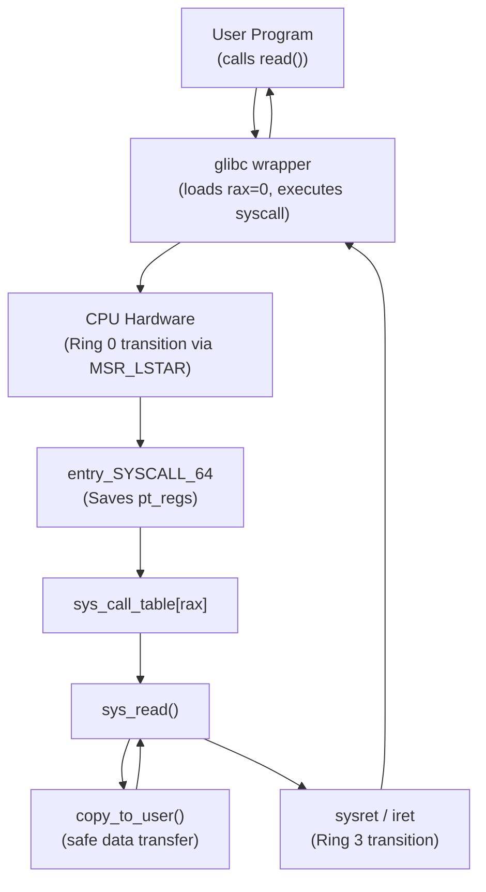

# Chapter 5 — System Calls

> Source fidelity: this chapter follows Robert Love, *Linux Kernel Development*, 3rd Ed., Chapter 5 ("System Calls"), which describes the Linux 2.6 kernel series (as of ~2010). Every place the material has since changed is marked explicitly with [MODERN LINUX]. Core concepts that remain unchanged are marked [CONCEPTUAL CORE].

---

## 1. What This Chapter Is About

This chapter is the definitive deep-dive into the ONLY sanctioned software-initiated door between user-space and kernel-space. Chapter 1 introduced system calls conceptually; this chapter explains the FULL mechanism from a user-space C library call, through the trap/syscall instruction, to the kernel handler, parameter passing, return, and how to implement a new syscall. It covers the crucial distinction between APIs, C library functions, and the actual system calls executed by the kernel. 

We will trace exactly what happens when a simple `printf("Hello World");` translates to a `write()` system call, how the CPU switches execution rings, how arguments are serialized into registers, and how the kernel securely accesses user-space memory without compromising its own integrity.

## 2. Why This Matters

System calls are the interface between user-space and the kernel. Without system calls, user-space programs would have no way to access hardware, allocate memory, or communicate with other processes. Conversely, if user-space had direct access to these resources, the system would descend into chaos, lacking any security or resource isolation. 

Understanding how system calls work is fundamental to understanding how an operating system protects itself while providing services. If you want to trace application behavior (using tools like `strace`), understand performance overheads of I/O, or develop kernel modules, you must understand the system call mechanism intimately. When a production database server is bottlenecked by CPU utilization, knowing the cost of entering and exiting the kernel via a system call is what separates a senior systems engineer from a junior one.

## 3. Prerequisite Concepts

- From Chapter 1: The distinction between user-space and kernel-space.
- From Chapter 3: Process context, the `current` macro, and how a process can block/sleep.
- Basic familiarity with C programming, pointers, and the standard C library.
- Basic understanding of hardware interrupts and traps (software interrupts) and CPU execution rings (Ring 0 vs. Ring 3).

## 4. Big Picture



This diagram illustrates the full journey of a system call. Notice that user space and kernel space are strictly separated, and the transition happens exclusively via a specific hardware instruction. The kernel acts as a gatekeeper, never trusting the data provided by the application.

---

## 5. Core Concepts

### 5.1 Communicating with the Kernel

**Concept.** System calls are the regulated, standardized interfaces that user-space applications use to request services from the kernel.

**Intuition.** Imagine a bank vault. Customers (user-space programs) cannot walk directly into the vault (kernel memory/hardware) to deposit or withdraw money. Instead, they must go to a teller window (the system call interface), fill out a specific form (parameters), and the teller (the kernel) performs the secure operation on their behalf. 

**Problem it solves.** Without syscalls, user-space programs would need direct hardware access. This would lead to chaos: processes would overwrite each other's memory, exhaust system resources, and inevitably crash the machine. If Process A wants to write to the disk while Process B is reading, they need an arbiter.

**Design idea.** Provide a controlled layer that offers three main benefits:
1. **Abstraction:** Programs don't need to know the specific details of the underlying hardware (e.g., how to spin up a hard drive). They simply say "write to this file descriptor".
2. **Security:** The kernel validates all requests before executing them, enforcing permissions and isolation.
3. **Portability:** A standardized API means applications can run across different hardware architectures without modification.

**[CONCEPTUAL CORE]** The core purpose of the system call interface remains exactly the same. It is the fundamental enabler of process isolation.

🧠 **Mental Model:** Syscalls act as "controlled service counters." You can request any service, but you must do it through a regulated window, not by reaching behind the counter.

**Common Mistakes**
- Believing that user-space can optionally bypass system calls for faster hardware access. It cannot (normally); the hardware prevents it via privilege rings.
- Thinking that the kernel runs on a separate CPU. The kernel is just code running on the same CPU, but in a mode with elevated privileges.

**Active Recall (5.1)**
1. What are the three main benefits provided by the system call layer?
2. What would happen if user-space programs had direct access to hardware?
3. How does the system call interface provide portability?

<details>
<summary>Answers</summary>

1. Abstraction (hiding hardware details), security (enforcing permissions), and portability (standardized API across architectures).
2. Chaos: lack of isolation, resource exhaustion, and systemic instability as processes interfere with each other and the hardware directly.
3. Applications write against the standard system call API (like read or write) rather than specific hardware instructions. The kernel translates the API to the specific hardware on which it runs.
</details>

---

### 5.2 APIs, POSIX, and the C Library

**Concept.** The distinction between an API (Application Programming Interface), a system call, and a C library function.

**Intuition.** 
- **API:** The contract (e.g., POSIX standard saying "this is how `read()` should behave").
- **C Library Function:** The actual C code you call in user-space (e.g., `glibc`'s `printf()` or `read()`).
- **System Call:** The kernel-level function executed in ring 0.

**Problem it solves.** Applications need a portable, easy-to-use way to invoke kernel services without writing raw assembly code for every architecture. The standard C library abstracts away the assembly and operating system specifics.

**Design idea.** 
- POSIX defines the API standard. Linux implements it (mostly) but adds many extra Linux-specific syscalls.
- The C library (like glibc or musl) provides the user-space wrappers.
- Examples: 
  - `printf()` is a C library function. It formats a string, manages a buffer, and then eventually calls the `write()` system call.
  - `strcpy()` or `abs()` are pure library functions; they do data manipulation entirely in user-space and use NO system calls.
  - `read()` in glibc is a thin wrapper that directly invokes the `read()` system call.

**[CONCEPTUAL CORE]** This layered approach is universal across Unix-like systems. You can have multiple library functions that map to the same syscall, or library functions that don't map to any syscall. 

**Common Mistakes**
- Thinking every C library function is a system call. They are not.
- Thinking the POSIX API maps 1:1 to system calls. It does not; POSIX defines *behavior*, the kernel and libc implement it however they see fit. For example, POSIX defines thread APIs, but Linux implements them via the `clone` system call.

**Active Recall (5.2)**
1. What is the difference between a system call and a C library function?
2. Does `strcpy()` invoke a system call? What about `printf()`?
3. What is POSIX in relation to Linux system calls?

<details>
<summary>Answers</summary>

1. A system call is the kernel-level operation executing in ring 0. A C library function is user-space code that provides a usable interface, which may or may not invoke one or more system calls.
2. `strcpy()` does not invoke a system call (it operates entirely in user-space memory). `printf()` does eventually invoke a system call (like `write`) to output the data.
3. POSIX is a standard that defines the API that Unix-like systems should provide. Linux system calls are the underlying mechanism used to implement the POSIX API, though they may not be a 1-to-1 mapping.
</details>

---

### 5.3 Syscalls — The Basics

**Concept.** Every system call is assigned a unique, immutable integer identifier called the syscall number.

**Intuition.** The kernel doesn't know the string name "read" or "write". It only knows that syscall #0 is `read`, syscall #1 is `write` (on x86-64). It's an index into an array.

**Problem it solves.** How does user-space tell the kernel *which* function to execute after making the generic transition into kernel space?

**Design idea.** 
- The syscall number is an index into the system call table (`sys_call_table`).
- ABI Stability: Once assigned, a syscall number can NEVER change or be recycled. If a syscall is removed, its number is mapped to `sys_ni_syscall()` (the "not implemented" stub) which simply returns `-ENOSYS`.

**[BOOK — Linux 2.6]** There were around 325 system calls on x86. The mechanism to invoke them was typically a software interrupt (`int 0x80`) or fast system calls (`sysenter`/`sysexit`).
**[MODERN LINUX]** There are over 450 system calls on x86-64. New ones are added carefully (e.g., `io_uring`, `clone3`, `pidfd_open`). The invocation uses the highly optimized `syscall` instruction on x86-64. 

Additionally, the **vDSO** (virtual dynamic shared object) maps certain kernel pages into user-space to allow ultra-fast "syscalls" (like `gettimeofday` and `clock_gettime`) that don't actually need a privilege transition.

🔬 **Under the Hood: The vDSO.** The vDSO is brilliant. For something like reading the time, a full context switch to ring 0 is expensive. The kernel simply maps a read-only page containing the current time into every process's address space. The glibc wrapper for `gettimeofday` just reads this memory, completely avoiding the kernel trap. The kernel updates this memory page periodically via a timer interrupt.

**Common Mistakes**
- Thinking syscall numbers are the same across all architectures. They are NOT. `read` might be 0 on x86-64, but 3 on x86-32, and 63 on ARM64. Syscall numbers are tied directly to the architecture ABI.

**Active Recall (5.3)**
1. What happens if a system call is deprecated and removed from the kernel?
2. What is the vDSO and why is it used?
3. Are syscall numbers consistent across different architectures (e.g., x86 vs. ARM)?

<details>
<summary>Answers</summary>

1. Its syscall number cannot be reused. It is replaced by `sys_ni_syscall()`, which returns `-ENOSYS`, preserving ABI compatibility for old binaries.
2. The virtual dynamic shared object. It maps read-only kernel data into user-space to allow certain operations (like getting the time) to complete without the expensive context switch of a real system call.
3. No. Syscall numbers are architecturally dependent. A specific system call might have a completely different number on x86-64 compared to ARM64.
</details>

---

### 5.4 System Call Handler

**Concept.** The step-by-step journey of how a system call transitions from user space to kernel space and back.

**Intuition.** It's like mailing a secure letter. You pack the contents in specific boxes (registers), press the send button (trap), the recipient unpacks it, does the work, repacks the answer, and sends it back.

**Problem it solves.** Safely transitioning from unprivileged ring 3 to privileged ring 0, executing the requested code, and returning safely with the result, without losing the state of the user-space application.

**Design idea (The Full Journey):**
1. User-space program calls C library wrapper (e.g., `read(fd, buf, count)`).
2. Library wrapper puts syscall number in a specific register (`eax` on x86-32, `rax` on x86-64).
3. Library wrapper puts arguments in registers (e.g., `rdi`, `rsi`, `rdx`).
4. Library wrapper executes the trap instruction (`int 0x80` or `syscall`).
5. CPU switches to kernel mode (ring 0), jumps to a predefined kernel entry point (defined in a Model Specific Register, MSR, on modern x86).
6. Kernel entry code saves user-space registers (`pt_regs` structure on the kernel stack).
7. Kernel looks up the syscall number in `sys_call_table`.
8. Kernel calls the corresponding `sys_*()` function.
9. `sys_*()` does the work and returns a value.
10. Return value is placed in a register (`eax`/`rax`).
11. Kernel restores user-space registers and returns to user mode (`iret` or `sysret`).
12. C library checks the return value; if negative, it negates it, sets `errno`, and returns `-1` to the application.



**[MODERN LINUX]** The `syscall` instruction on x86-64 bypasses much of the heavy interrupt descriptor table (IDT) lookup machinery used by the older `int 0x80`, making the transition significantly faster. The CPU automatically loads the instruction pointer from the `MSR_LSTAR` register, which the kernel configures at boot time to point to `entry_SYSCALL_64`.

**Common Mistakes**
- Thinking `errno` is a kernel construct. It is not. The kernel simply returns a negative number (e.g., `-EFAULT`). The *C library* intercepts this, sets the thread-local `errno` variable, and returns `-1` to the app.

**Active Recall (5.4)**
1. How does the kernel know which system call to execute when a trap occurs?
2. Who sets the `errno` variable when a system call fails?
3. Where does the kernel save the user-space registers before executing the system call handler?

<details>
<summary>Answers</summary>

1. The user-space library places the syscall number in a specific register (like `rax`) before executing the trap instruction. The kernel reads this register.
2. The C library wrapper in user-space sets `errno`. The kernel simply returns a negative integer.
3. The kernel saves them on the kernel stack in a structure called `pt_regs`.
</details>

---

### 5.5 Denoting the Correct System Call

**Concept.** `sys_call_table` is an array of function pointers indexed by the syscall number.

**Intuition.** It's a massive lookup table where the index is the ID and the value is the function address.

**Design idea.** 
- The syscall number is strictly validated. The kernel checks that `rax` is less than `NR_syscalls`. If it is greater or equal, the kernel returns `-ENOSYS`.
- If valid, the kernel executes `sys_call_table[syscall_number]`.

**[BOOK — Linux 2.6]** Defined in `arch/x86/kernel/syscall_table_32.S`.
**[MODERN LINUX]** The table is largely generated at build time from specific table files (e.g., `arch/x86/entry/syscalls/syscall_64.tbl`). A script parses this text file and generates the actual C array.

---

### 5.6 Parameter Passing

**Concept.** Parameters to system calls are passed via CPU registers, not on the stack.

**Intuition.** Register access is instantaneous. Stack access requires memory reads, which are comparatively slow. Syscalls must be incredibly fast, and crossing the ring boundary makes stack manipulation complex.

**Design idea.** 
- **[BOOK — Linux 2.6]** x86-32: `ebx`, `ecx`, `edx`, `esi`, `edi`, `ebp` (up to 6 parameters). Return value in `eax`.
- **[MODERN LINUX]** x86-64: `rdi`, `rsi`, `rdx`, `r10`, `r8`, `r9` (up to 6 parameters). Return value in `rax`.
- What if you need more than 6 parameters? (e.g. `clone3`). A single register points to a user-space memory buffer (a struct) containing all the parameters. The kernel then uses `copy_from_user` to read the struct.

```text
Parameter Passing (x86-64 Syscall ABI)
+---------+--------------------+
| rdi     | Argument 1         |
| rsi     | Argument 2         |
| rdx     | Argument 3         |
| r10     | Argument 4         |
| r8      | Argument 5         |
| r9      | Argument 6         |
| rax     | Syscall No. / Ret  |
+---------+--------------------+
```
*(Note that the C ABI uses `rcx` for the 4th argument, but the syscall ABI uses `r10` because the `syscall` instruction clobbers `rcx` by saving the return address in it).*

**Common Mistakes**
- Assuming normal C calling conventions (like pushing args to the stack) apply to crossing the syscall boundary. They do not; the ABI strictly specifies registers.

---

### 5.7 System Call Implementation

**Concept.** The principles of designing and implementing a new system call.

**Intuition.** A system call is forever. If you get it wrong, you are stuck with it until the end of time, because breaking ABI breaks existing binaries. Linus Torvalds famously will not break user-space.

**Design Guidelines (from the book):**
1. **Define purpose clearly:** What exact problem does it solve?
2. **Minimal arguments:** Keep them small and general.
3. **Generalize:** Don't design for one specific, narrow use case.
4. **Permanence:** The interface can never change (ABI stability).
5. **No assumptions:** Never trust user-space behavior or input.
6. **Portability:** Will this make sense on a 32-bit ARM chip as well as a 64-bit x86 chip? (For example, dealing with 64-bit variables on a 32-bit architecture).
7. **Is it necessary?** Is a syscall the right approach, or would an `ioctl`, a `/proc` file, or a `/sys` entry be better?

> [!TIP]
> The **Flags Argument Pattern**: Modern syscalls almost always include an `int flags` argument, even if currently unused. This allows future extension (by defining new flag bits) without creating an entirely new system call number. Example: `clone()`, `openat()`, `renameat2()`.

---

### 5.8 Verifying Parameters

**Concept.** The kernel must rigorously validate every single parameter passed from user-space, especially memory pointers.

**Intuition.** The kernel runs in ring 0. If it blindly trusts a pointer from user space, a malicious program could pass a pointer to kernel memory, tricking the kernel into reading or overwriting its own secure data (a classic privilege escalation vulnerability).

**Problem it solves.** Preventing security vulnerabilities, kernel panics, and data corruption caused by invalid user-space data.

**Design idea.** 
- Pointers must point to valid user-space regions, not kernel space.
- The process must have the correct permissions (read/write) for that memory region.
- **`copy_from_user()` / `copy_to_user()`**: These are the *only* safe ways to move data between user and kernel space. They handle page faults gracefully. If user space passes a bad pointer, these functions fail safely rather than panicking the kernel.
  - Return `0` on success.
  - Return the number of bytes *not* copied on failure.
- Permissions: The `capable()` function is used to check if the calling process has specific privileges (e.g., `capable(CAP_SYS_ADMIN)`).

**[MODERN LINUX]** Modern hardware provides features like SMAP (Supervisor Mode Access Prevention) and SMEP (Supervisor Mode Execution Prevention) on x86. These physically prevent the kernel from accidentally reading/writing or executing user-space memory without explicit instructions, providing a hardware backstop to `copy_from_user`. Attempting to access user memory without explicitly turning off SMAP (which `copy_from_user` does internally) results in a trap.

> [!WARNING]
> **NEVER** use raw `memcpy()` or directly dereference a pointer passed from user-space in kernel code. It will lead to a critical security vulnerability and likely crash the system on modern hardware due to SMAP.

**Active Recall (5.8)**
1. Why must the kernel use `copy_from_user()` instead of a simple pointer dereference or `memcpy()`?
2. What does `copy_from_user()` return on complete success?
3. What is SMAP and how does it relate to this topic?

<details>
<summary>Answers</summary>

1. A raw pointer dereference could point to protected kernel memory, allowing user-space to read/write secure data. `copy_from_user` safely validates the pointer, ensures it resides in user-space, and gracefully handles page faults if the memory is currently swapped out or invalid.
2. It returns `0` on success.
3. Supervisor Mode Access Prevention. It is a hardware feature that prevents the kernel (running in ring 0) from accidentally accessing user-space memory. `copy_from_user` contains the specific instructions required to temporarily disable SMAP, perform the copy safely, and re-enable it.
</details>

---

### 5.9 System Call Context

**Concept.** System calls execute in *process context*.

**Intuition.** When the kernel is executing a syscall, it is acting "on behalf of" the specific user-space process that invoked it.

**Why this matters:**
- Back-reference to Ch.3: The `current` pointer is perfectly valid and points to the `task_struct` of the calling process.
- The kernel **can sleep/block** while handling a syscall (e.g., waiting for disk I/O, waiting for a lock). This is entirely different from interrupt context, where sleeping is strictly forbidden.
- The process can be preempted during a syscall by a higher-priority task.
- Upon return from the syscall, the kernel checks the `need_resched` flag; if set, a context switch occurs before returning to user-space.

---

### 5.10 Final Steps in Binding a System Call

**Concept.** The mechanical steps required to wire up a new syscall in the source code.

**[BOOK — Linux 2.6]** 
1. Add an entry to the end of `sys_call_table`.
2. Add the syscall number `#define` to `<asm/unistd.h>`.
3. Implement the `sys_*()` function in the kernel source.

**[MODERN LINUX]**
We now use the `SYSCALL_DEFINEn()` macros (where `n` is the number of arguments).
Example for `read`:
```c
SYSCALL_DEFINE3(read, unsigned int, fd, char __user *, buf, size_t, count)
{
    /* implementation */
}
```

🔬 **Under the Hood: The Macro Magic** 
Why do we use macros instead of standard C function signatures? 
1. **Type Checking:** They handle complex type-casting to ensure that 32-bit user-space passing 32-bit arguments to a 64-bit kernel has those arguments properly sign-extended or zero-extended.
2. **Metadata Generation:** They generate metadata for ftrace (tracing framework) and BPF, allowing seamless tracing of all syscall entries.
3. **Security:** They hook into seccomp (secure computing mode), which allows processes to filter which system calls they are allowed to execute.

The `__user` annotation is a marker for the `sparse` static analysis tool, explicitly tagging pointers that originated from user-space to ensure they are handled safely (you'll get a sparse warning if you try to dereference a `__user` pointer directly).

> [!IMPORTANT]
> Adding new system calls is strongly discouraged in modern Linux unless absolutely necessary. Developers are encouraged to use alternative interfaces like `ioctl()`, `sysfs`, netlink sockets, or `io_uring` to extend kernel functionality.

---

### 5.11 Accessing the System Call from User Space

**Concept.** How to invoke syscalls when the C library doesn't provide a wrapper.

**Intuition.** Sometimes the kernel adds a new syscall, but glibc hasn't updated to include a nice `C` function wrapper for it yet (e.g. `pidfd_open` when it was first introduced).

**Design idea.** 
You can use the generic `syscall()` library function provided by glibc. This function takes the syscall number and a variable list of arguments, formats the registers correctly according to the architecture's ABI, and executes the trap.

```c
#include <unistd.h>
#include <sys/syscall.h>
#include <stdio.h>

int main() {
    /* gettid() often lacked a glibc wrapper on older systems */
    long tid = syscall(__NR_gettid);
    printf("My thread ID is: %ld\n", tid);
    return 0;
}
```

**Observability:**
- `strace`: The ultimate tool for tracing system calls. It intercepts and logs every syscall a process makes.
- `ltrace`: Traces dynamic library calls (helpful to distinguish what is a libc call vs. a syscall).

---

## 6. How the Pieces Fit Together



---

## 7. Source Code Navigation

Where to find these concepts in the Linux source tree:

- `arch/x86/entry/entry_64.S`: The assembly entry point for x86-64 system calls (`entry_SYSCALL_64`).
- `arch/x86/entry/common.c`: The C-level handler `do_syscall_64()`.
- `arch/x86/entry/syscalls/syscall_64.tbl`: The definitive list of x86-64 syscall numbers.
- `include/linux/syscalls.h`: Prototypes for all `SYSCALL_DEFINE` functions.
- `include/uapi/asm-generic/unistd.h`: Generic syscall numbers across architectures.
- `include/linux/uaccess.h`: Declarations for `copy_from_user` and `copy_to_user`.
- `kernel/sys.c`: Various standard system call implementations.

**Practical Git Grep:**
Find all 3-argument syscall definitions:
`git grep "SYSCALL_DEFINE3"`
Find where `sys_call_table` is used in x86 entry code:
`git grep "sys_call_table" arch/x86/entry/`
Find the definition of the `read` system call:
`git grep "SYSCALL_DEFINE3(read"`

---

## 8. Hands-On Experiments

### Experiment 5.1 — Tracing System Calls with strace (SAFE USER-SPACE)
**Objective:** Observe the system calls made by a standard utility.
**Prediction:** Even a simple command like `ls` makes dozens of system calls to set up memory, load libraries, and read directories.
**Setup & Steps:**
1. Run `strace ls`. Observe the massive output.
2. Run `strace -c ls` to see a summary table.
**Observation:** You will see `execve`, `mmap`, `openat`, `read`, `write`, `close`. The `-c` flag shows counts, errors, and time spent in each syscall.
**Explanation:** `strace` uses the `ptrace` system call to hook into the execution of `ls` and log every time it crosses the kernel boundary.
**Kernel connection:** Uses the `ptrace` system call to introspect another process's state.

### Experiment 5.2 — Syscall Number Investigation (SAFE USER-SPACE)
**Objective:** Find the actual syscall numbers for your architecture.
**Steps:**
1. Look at `/usr/include/asm/unistd_64.h` (or similar depending on your distro/architecture).
2. `grep __NR_read /usr/include/asm/unistd_64.h`
3. Compare with a 32-bit architecture if possible: `grep __NR_read /usr/include/asm/unistd_32.h`
**Observation:** You should see `#define __NR_read 0` for x86-64, but a completely different number (like `3`) for x86-32.
**Explanation:** These headers map the symbolic names used by user-space to the integer indices expected by the kernel.
**Kernel connection:** Maps directly to `sys_call_table` indices, proving they are architecture-specific.

### Experiment 5.3 — Using syscall() Directly (SAFE USER-SPACE)
**Objective:** Bypass the glibc wrapper for `write`.
**Steps:** Write a simple C program:
```c
#include <unistd.h>
#include <sys/syscall.h>

int main() {
    char msg[] = "Hello directly from syscall!\n";
    syscall(__NR_write, 1, msg, sizeof(msg)-1);
    return 0;
}
```
Compile and run it.
**Observation:** The program prints the message just like `printf` or `write` would.
**Explanation:** This proves that the C library `write()` function is just a convenience wrapper. The kernel only cares about the trap and the registers.
**Kernel connection:** Calls `sys_write` via the generic glibc syscall function.

### Experiment 5.4 — Observe copy_from_user/copy_to_user (SAFE USER-SPACE)
**Objective:** See what happens when you pass a bad pointer to a syscall.
**Steps:** Write a program that passes an invalid pointer to a syscall.
```c
#include <unistd.h>
#include <stdio.h>
#include <errno.h>
#include <string.h>

int main() {
    char *bad_ptr = (char *)0xFFFFFFFFFFFFFFFF; // Kernel space address
    int ret = write(1, bad_ptr, 10);
    if (ret == -1) {
        printf("Error: %s\n", strerror(errno));
    }
    return 0;
}
```
**Observation:** Output will be "Error: Bad address" (`EFAULT`). The kernel did not panic.
**Explanation:** `copy_from_user` intercepted the illegal access, failed gracefully, and returned `-EFAULT`. The glibc wrapper translated this to `errno = EFAULT`.
**Kernel connection:** Demonstrates `copy_from_user` boundary checking preventing kernel space from being accessed.

### Experiment 5.5 — vDSO Investigation (SAFE USER-SPACE)
**Objective:** Observe the vDSO mapping.
**Steps:** 
1. Run `ldd /bin/ls`. Look for `linux-vdso.so.1`.
2. Run `cat /proc/self/maps | grep vdso`.
3. If you have `perf` or `time`, try looping `gettimeofday()` a million times vs. looping `getpid()` a million times.
**Observation:** `linux-vdso.so.1` is linked but has no corresponding file on disk. The memory map shows it mapped into user-space. `gettimeofday()` runs significantly faster than `getpid()`.
**Explanation:** The kernel maps a tiny shared library directly into every process's memory. This allows functions like `gettimeofday` to read a timestamp without causing a hardware trap, making it much faster.
**Kernel connection:** The vDSO mapping securely exposes read-only kernel data to user-space.

### Experiment 5.6 — Examining the Syscall Table (SAFE USER-SPACE)
**Objective:** Look at the raw kernel table.
**Steps:** If you have the kernel source downloaded, run `cat arch/x86/entry/syscalls/syscall_64.tbl`.
**Observation:** You will see a list of numbers, ABI types (common, 64), syscall names, and the kernel function names (`sys_read`, `sys_write`, etc.). You can count the total syscalls and find the newest additions at the bottom.
**Kernel connection:** This file is the absolute source of truth defining the x86-64 ABI layout.

---

## 9. Common Misconceptions

| Misconception | Reality |
| :--- | :--- |
| "Every C library function is a system call." | False. Functions like `strcpy`, `strcmp`, or `abs` operate entirely in user-space. `printf` uses a syscall eventually, but does string formatting entirely in user-space. |
| "System calls are slow and should be avoided entirely." | False. While slower than a normal function call, they are heavily optimized (via the `syscall` instruction and vDSO). They are fundamental to OS operation. You should batch them when possible (e.g., buffering), but you cannot avoid them. |
| "You can easily add new syscalls to your production kernel." | Strongly discouraged in modern Linux. Breaking ABI is forbidden. Use `/sys`, `/proc`, or `ioctl` instead to expose functionality. |
| "The kernel sets `errno`." | False. The kernel returns a negative value (e.g., `-14` for `-EFAULT`). The user-space C library negates this, sets `errno=14`, and returns `-1`. |
| "Parameters are passed on the stack." | False. Syscall parameters are passed via CPU registers for speed (up to 6 registers). |
| "The kernel is just another process." | False. The kernel is a specialized piece of code running with elevated hardware privileges (Ring 0). It is not scheduled like a normal task. |

---

## 10. Interview Questions

### Basic
**Q: What is a system call?**
<details><summary>Answer</summary>
The standardized, secure interface used by user-space applications to request services from the kernel, implemented via a hardware trap/interrupt that transitions the CPU to privileged mode.
</details>

**Q: Name three system calls and state what they do.**
<details><summary>Answer</summary>
- `read`: Reads data from a file descriptor into a buffer.
- `write`: Writes data from a buffer to a file descriptor.
- `clone` (or `fork`): Creates a new process.
- `execve`: Replaces the current process image with a new executable program.
</details>

### Intermediate
**Q: How does the kernel know *which* system call to execute when a hardware trap occurs?**
<details><summary>Answer</summary>
The user-space wrapper places the syscall number into a designated CPU register (e.g., `rax` on x86-64) before firing the trap instruction. The kernel reads this register and uses it as an index into the `sys_call_table`.
</details>

**Q: Why must the kernel use functions like `copy_from_user` instead of directly dereferencing pointers passed as arguments from user-space?**
<details><summary>Answer</summary>
The kernel must verify that the pointer actually points to valid user-space memory, that the user process has permissions to access it, and it must gracefully handle page faults. Directly dereferencing the pointer could allow a malicious process to read/write kernel memory (causing a security breach) or cause a kernel panic if the memory is unmapped. Modern hardware enforces this via SMAP.
</details>

### Advanced
**Q: What is the vDSO, and what performance problem does it solve?**
<details><summary>Answer</summary>
The virtual dynamic shared object is a memory region the kernel maps into every user-space process. It contains code and read-only data for specific functions (like `gettimeofday`). It solves the problem of high overhead: it allows user-space to securely read state (like the current time) by executing normal instructions instead of triggering an expensive context switch (trap) to kernel space. This avoids the cost of flushing pipelines and switching CPU rings.
</details>

**Q: Can a system call be preempted by another process?**
<details><summary>Answer</summary>
Yes. System calls run in process context. If the kernel has preemption enabled (which is true on modern desktop/server Linux systems), a higher-priority process becoming runnable can preempt the process currently executing in kernel-space during a system call.
</details>

### Design
**Q: You want to add a feature to the kernel to get battery health telemetry from a new type of sensor. Should you add a new `sys_get_battery_health()` system call? Why or why not?**
<details><summary>Answer</summary>
No. Adding a new system call for a highly specific, potentially hardware-dependent feature is bad design because syscalls are permanent (ABI stability). Instead, this should be exposed via a `sysfs` file (e.g., `/sys/class/power_supply/BAT0/health`), which user-space can simply `open` and `read`. This adheres to the Unix "everything is a file" philosophy and avoids bloating the syscall table.
</details>

**Q: If you need to pass 10 arguments to a new system call, how would you design the ABI since x86-64 only allows 6 registers for parameters?**
<details><summary>Answer</summary>
You would define a struct containing the 10 arguments. The system call would take a pointer to this struct as its argument (passed in a register). The kernel would then use `copy_from_user` to read the struct from user-space memory into kernel memory. This is exactly how complex syscalls like `clone3` work.
</details>

---

## 11. Active Recall

1. What is the fundamental difference between an API (like POSIX) and a system call?
<details><summary>Answer</summary>
An API is a programming interface standard (a behavioral contract). A system call is the actual mechanism and kernel function executed in ring 0.
</details>

2. What is the `sys_call_table`?
<details><summary>Answer</summary>
An array of function pointers in the kernel indexed by the system call number, pointing to the implementation functions (`sys_*`).
</details>

3. How are parameters typically passed from user-space to the kernel during a system call?
<details><summary>Answer</summary>
Via CPU registers (e.g., `rdi`, `rsi` on x86-64), not on the stack.
</details>

4. What happens if you try to invoke a system call number that doesn't exist?
<details><summary>Answer</summary>
The kernel catches it, executes the `sys_ni_syscall` stub, and returns `-ENOSYS`.
</details>

5. What does the `SYSCALL_DEFINE` macro do?
<details><summary>Answer</summary>
It is used to define new system calls in the kernel source. It handles architecture-specific type casting, generates tracing metadata for ftrace/BPF, and integrates with security modules like seccomp.
</details>

6. What is process context in relation to system calls?
<details><summary>Answer</summary>
System calls execute on behalf of the calling process. The `current` macro is valid, pointing to the process's `task_struct`, and the kernel is allowed to block/sleep while handling the syscall (unlike interrupt context).
</details>

7. What user-space tool allows you to observe every system call made by a program?
<details><summary>Answer</summary>
`strace`.
</details>

8. Why is adding a new system call generally discouraged in modern Linux development?
<details><summary>Answer</summary>
Because it creates a permanent ABI commitment. Once added, it can never be changed or removed without breaking user-space programs. Interfaces like `/proc`, `/sys`, and `ioctl` provide more flexible ways to expose new kernel functionality.
</details>

9. How does the CPU transition from ring 3 to ring 0 on modern x86-64?
<details><summary>Answer</summary>
Using the `syscall` instruction. The CPU automatically loads the instruction pointer from the `MSR_LSTAR` register, which points to the kernel's entry point (`entry_SYSCALL_64`).
</details>

10. What does the C library do if a system call returns a negative number?
<details><summary>Answer</summary>
It negates the number, assigns it to the thread-local `errno` variable, and returns `-1` to the caller.
</details>

---

## 12. Chapter Summary

System calls are the secure, regulated interface between user-space and kernel-space. They provide critical abstraction, security, and portability. The journey of a system call begins with a user-space C library wrapper placing a unique syscall number and arguments into CPU registers, followed by a hardware trap (like the highly optimized `syscall` instruction on x86-64). The CPU switches execution privileges to ring 0, and the kernel entry code looks up the corresponding function in the `sys_call_table`. 

The kernel must never trust user-space; it rigorously validates all user-provided pointers using functions like `copy_from_user()` to prevent security breaches and panics. System calls execute in process context, meaning they act on behalf of the current process, have access to the `current` macro, and can sleep if necessary. Tools like `strace` and architectural optimizations like the vDSO are critical to understanding, monitoring, and optimizing syscall behavior.

---

## 13. What I Should Be Able to Explain Now

- [ ] The exact journey of a system call from `glibc` through the hardware trap, into the kernel, and back.
- [ ] The difference between an API, a C library function, and a system call.
- [ ] Why `sys_call_table` is central to the mechanism and why ABI stability matters.
- [ ] Why `copy_from_user` is an absolute necessity for security and stability (and what SMAP is).
- [ ] Why syscall parameters are passed in registers, not the stack.
- [ ] What the vDSO is and why it exists to solve performance bottlenecks.
- [ ] How `errno` is set (and by whom) vs. what the kernel actually returns.

---

## 14. Knowledge Graph

```text
System Calls
├── Purpose
│   ├── Abstraction (hide hardware details)
│   ├── Security / Isolation (Ring 0 vs Ring 3)
│   └── Portability (POSIX API compliance)
├── Mechanism
│   ├── User Space
│   │   ├── C Library Wrapper (glibc)
│   │   └── Registers setup (syscall number in rax + arguments)
│   ├── Boundary Transition
│   │   ├── Trap Instruction (syscall / int 0x80)
│   │   └── Privilege Switch (Ring 3 -> Ring 0)
│   └── Kernel Space
│       ├── Entry Point (save registers to pt_regs)
│       ├── sys_call_table lookup
│       ├── Parameter Validation (copy_from_user / capable)
│       ├── Handler execution (SYSCALL_DEFINE implementations)
│       └── Return (sysret / iret)
├── Key Optimizations
│   ├── syscall instruction (fast path bypasses IDT)
│   └── vDSO (avoids context switch entirely for read-only state)
└── Observability
    ├── strace (monitor syscalls via ptrace)
    └── ltrace (monitor dynamic library calls)
```
