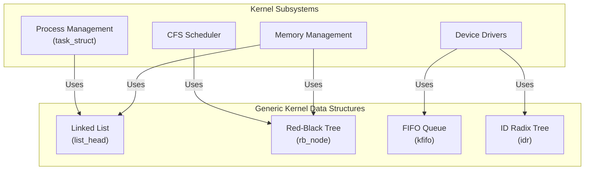

# Chapter 6 — Kernel Data Structures

> Source fidelity: this chapter follows Robert Love, *Linux Kernel Development*, 3rd Ed., Chapter 6 ("Kernel Data Structures"), which describes the Linux 2.6 kernel series (as of ~2010). Every place the material has since changed is marked explicitly with [MODERN LINUX]. Core concepts that remain unchanged are marked [CONCEPTUAL CORE]. The book era is marked [BOOK — Linux 2.6].

---

## 1. What This Chapter Is About

This chapter is about GENERIC KERNEL INFRASTRUCTURE — the foundational data structures used by virtually every subsystem in the Linux kernel. We will explore how the kernel implements linked lists, queues, maps, and binary trees. Crucially, we will dissect the kernel's unique "inside-out" approach to linked lists and the magical `container_of()` macro that makes it all work. Understanding this chapter is an absolute prerequisite for reading and understanding any real kernel source code.

## 2. Why This Matters

The Linux kernel does not have the luxury of using a standard library like C++'s STL or Java's Collections. It must provide its own highly optimized, generic data structures. If you do not understand how the kernel's linked list works, you will not be able to read kernel code — you will see a `list_head` and wonder where the data went. By understanding these structures, you gain a massive advantage: you learn the vocabulary of the kernel. Once you grasp `container_of()`, the seemingly bizarre struct definitions throughout the kernel will suddenly make perfect sense.

## 3. Prerequisite Concepts

- Basic understanding of standard data structures (linked lists, queues, trees).
- Pointer arithmetic in C.
- Familiarity with C structs and macros.

## 4. Big Picture



---

## 5. Core Concepts

### 5.1 Linked Lists

**Concept.** A linked list is a data structure that stores a collection of elements. Unlike arrays, linked lists do not store elements in contiguous memory. Instead, each element (node) contains a pointer to the next element.

**Intuition.** Traditional linked lists store data and pointers together. The kernel's linked list flips this inside out.

**Problem it solves.** How to write *one* generic linked list implementation in C (which lacks templates or generics) that can be used for *any* data type without duplicating code or using slow `void *` pointers.

**Design idea.** 
- **Traditional approach:** A list node contains a `void *` to the data, or the list node definition includes the data fields directly. 
- **Kernel approach:** The list node (`list_head`) is embedded *inside* the data structure. The kernel uses a **doubly linked, circular** list.
- Why this matters: one generic list implementation works for ANY struct — no need for type-specific list code.

**[CONCEPTUAL CORE]** The kernel uses circular, doubly linked lists where the pointers are embedded in the data structures themselves.

🧠 **Mental Model.** Instead of a list containing data nodes (like beads on a string), each data node contains a list connector (like Lego blocks snapping together).

**Common Mistakes**
- Thinking the kernel list implementation uses `void *` for generic data.
- Forgetting that the list is circular.

**Active Recall (5.1)**
1. What type of linked list does the kernel use?
2. Where are the `next` and `prev` pointers stored in the kernel's approach?

<details><summary>Answers</summary>
1. A doubly linked, circular list.
2. They are embedded *inside* the data structure being linked, rather than wrapping the data.
</details>

---

### 5.2 The list_head Structure

**Concept.** The building block of the kernel's linked list.

**Data structures.**
`struct list_head` (defined in `include/linux/types.h` and manipulated via `include/linux/list.h`)

**Code excerpt:**
```c
struct list_head {
    struct list_head *next, *prev;
};
```

**Explanation.** That's it. Just two pointers. No data. The beauty of this design is that you embed this struct inside YOUR struct.

**Example usage:**
```c
struct my_struct {
    int data1;
    char data2;
    struct list_head list; /* Embed the list_head! */
};
```

**Active Recall (5.2)**
1. Does `struct list_head` contain a `void *` to point to the data?

<details><summary>Answers</summary>
1. No. It contains *only* `next` and `prev` pointers. It is embedded inside the structure containing the data.
</details>

---

### 5.3 container_of() — THE KEY INSIGHT

> [!IMPORTANT] THIS IS THE SINGLE MOST IMPORTANT MACRO IN THE CHAPTER.

**Concept.** `container_of()` takes a pointer to a member within a struct and returns a pointer to the struct that contains it.

**Problem it solves.** If you traverse a list of `struct list_head`, you only have pointers to `list_head`. But you want the actual data (e.g., `struct my_struct`). How do you get from the `list_head` pointer to the `my_struct` pointer?

**Design idea.** Pointer arithmetic. By knowing the type of the container struct and the name of the embedded member, the compiler knows the byte offset of that member within the struct. We can subtract this offset from the member pointer to find the start of the container.

**Code excerpt:**
```c
#define offsetof(TYPE, MEMBER) ((size_t) &((TYPE *)0)->MEMBER)

#define container_of(ptr, type, member) ({          \
    const typeof( ((type *)0)->member ) *__mptr = (ptr);    \
    (type *)( (char *)__mptr - offsetof(type,member) );})
```

**Explanation.**
- `ptr`: The pointer to the member (e.g., a pointer to `list_head`).
- `type`: The type of the container struct (e.g., `struct my_struct`).
- `member`: The name of the member in the struct (e.g., `list`).

Example: given a pointer to `task->sibling` (which is a `list_head`), get back the pointer to the `task_struct`.

🧠 **Mental Model.** "Given a handle sticking out of a box, find the box."

**Common Mistakes**
- Failing to understand pointer arithmetic in `container_of()`.
- Forgetting that `container_of()` is evaluated at compile time in terms of offsets.

**Active Recall (5.3)**
1. What problem does `container_of()` solve?
2. What are the three arguments to `container_of()`?

<details><summary>Answers</summary>
1. It allows you to recover a pointer to a containing structure when you only have a pointer to an embedded member (like a `list_head`).
2. `ptr` (pointer to member), `type` (type of the container), and `member` (name of the member field).
</details>

---

### 5.4 Defining and Initializing Lists

**Concept.** How to create and set up lists.

**Code excerpt:**
```c
/* Static initialization */
LIST_HEAD(my_list);

/* Dynamic (runtime) initialization */
struct list_head my_list;
INIT_LIST_HEAD(&my_list);
```

**Explanation.** 
A newly initialized list is empty. For a circular list, "empty" means the `next` and `prev` pointers point to the list head itself.
`head->next == head->prev == head`.
You can check if a list is empty using `list_empty(&my_list)`.

---

### 5.5 Manipulating Linked Lists

**Concept.** Operations provided by `list.h` to modify lists.

**Key Operations.**
- `list_add(new, head)` — add after head (stack behavior / LIFO).
- `list_add_tail(new, head)` — add before head (queue behavior / FIFO).
- `list_del(entry)` — remove from list. The pointers of `entry` are set to poisoned values (`LIST_POISON1` and `LIST_POISON2`) to catch use-after-free bugs.
- `list_del_init(entry)` — remove and reinitialize (safe to re-add later).
- `list_move(entry, head)` — remove and add after head.
- `list_move_tail(entry, head)` — remove and add at tail.
- `list_splice(list, head)` — merge two lists.

**[CONCEPTUAL CORE]** All operations are O(1).
> [!WARNING] NO LOCKING is provided — caller must handle synchronization (see Chapters 9-10).

---

### 5.6 Walking (Iterating) Linked Lists

**Concept.** How to traverse the elements in a list.

**Key Macros.**
- `list_for_each(pos, head)` — iterate over `list_head` pointers. You still need `container_of` manually.
- `list_for_each_entry(pos, head, member)` — iterate and get the enclosing struct directly! (Uses `container_of` internally).
- `list_for_each_entry_safe(pos, n, head, member)` — safe for deletion during iteration. Uses a temporary variable `n` to store the next pointer before operating on the current node.
- `list_for_each_entry_reverse()` — iterate backwards.

**Code excerpt:**
```c
struct task_struct *child;
/* Iterate over all children of current */
list_for_each_entry(child, &current->children, sibling) {
    printk("%s (PID %d)\n", child->comm, child->pid);
}
```

**Active Recall (5.6)**
1. Why do you need `list_for_each_entry_safe`?

<details><summary>Answers</summary>
1. If you delete a node while iterating, its `next` pointer might be poisoned or modified. The `_safe` variant saves the `next` pointer before you execute the loop body, allowing safe deletion.
</details>

---

### 5.7 Queues — kfifo

**Concept.** The kernel's highly optimized FIFO (First-In, First-Out) queue implementation.

**Problem it solves.** A fast, efficient way to enqueue and dequeue data, especially between interrupt handlers and process context.

**Design idea.** 
- Implemented as a ring buffer.
- Size must be a power of 2. This allows the kernel to use a bitwise AND (masking) instead of the slower modulo operator to handle wrap-around.
- Uses two offsets: `in` (where to write) and `out` (where to read).
- **Lock-free** for the single-producer/single-consumer case because the producer only updates `in` and the consumer only updates `out`.

**[BOOK — Linux 2.6]** The API was simpler.
**[MODERN LINUX]** The `kfifo` API has been substantially reworked with type-safe macros (e.g., `DECLARE_KFIFO`).

**Key Operations.**
- `kfifo_alloc()`, `kfifo_in()`, `kfifo_out()`, `kfifo_len()`, `kfifo_is_empty()`, `kfifo_is_full()`.

**Active Recall (5.7)**
1. Why must a kfifo size be a power of 2?
2. Is kfifo lock-free?

<details><summary>Answers</summary>
1. So that wrap-around can be calculated using a fast bitwise AND rather than a slow modulo division.
2. Yes, but *only* for the single-producer, single-consumer case.
</details>

---

### 5.8 Maps — idr

**Concept.** UID-to-pointer mapping. A mechanism to map a unique integer ID to a kernel object pointer.

**Problem it solves.** The kernel frequently needs to hand out integer IDs to user space (e.g., file descriptors, POSIX timer IDs, IPC IDs) and quickly look up the corresponding kernel object when user space passes the ID back.

**Design idea.** 
**[BOOK — Linux 2.6]** The `idr` (ID Radix tree) used a custom radix tree implementation to efficiently map integers to pointers.
**[MODERN LINUX]** Modern implementation details should be verified against the current Linux source/documentation. The `idr` API is now mostly a wrapper around the **XArray** data structure, which is a highly optimized, lock-aware radix tree replacement.

**Key Operations.**
- `idr_alloc()`
- `idr_find()`
- `idr_remove()`

---

### 5.9 Binary Trees — Red-Black Trees (rbtree)

**Concept.** A self-balancing binary search tree.

**Problem it solves.** Linked lists are O(N) for search. When we need ordered iteration *and* fast O(log N) lookup, insertion, and deletion, we need a tree.

**Design idea.** 
Red-Black trees have specific properties that guarantee balance:
1. Every node is red or black.
2. The root is black.
3. Leaves (NULL children) are black.
4. Red nodes have only black children.
5. Every path from root to leaf has the same number of black nodes.
These properties ensure the longest path is no more than twice the shortest path, guaranteeing O(log N) operations.

**Implementation.**
- `struct rb_node` is embedded inside the user's struct (just like `list_head`!).
- `struct rb_root` is the root of the tree.
- The kernel does not provide search or insert routines directly because it doesn't know what your data is. You provide the comparison logic, and the kernel provides balancing functions like `rb_insert_color()`.

**Use cases.**
- CFS (Completely Fair Scheduler) runqueue, ordered by `vruntime`.
- Memory management (VMAs ordered by address).

🧠 **Mental Model.** `rbtree` = sorted container where insertion, deletion, and lookup are all O(log N).

---

### 5.10 Which Data Structure to Use?

| Requirement | Data Structure |
| :--- | :--- |
| Need fast O(1) add/remove anywhere? | **Linked List** |
| Need ordered iteration and fast O(log N) lookup? | **Red-Black Tree** |
| Need FIFO semantics (producer/consumer)? | **kfifo** |
| Need to map integer IDs to pointers? | **idr (XArray)** |
| Need O(1) lookup by key? | **Hash Table** |

---

## 6. How the Pieces Fit Together

```mermaid
flowchart TD
    task_struct["task_struct\n(Process)"]
    
    task_struct -->|children\n(list_head)| child_list["Child Processes"]
    task_struct -->|files\n(idr/xarray)| fds["File Descriptors"]
    
    CFS["CFS Scheduler"] -->|runqueue\n(rbtree)| task_struct
    
    Driver["Device Driver"] -->|buffers\n(kfifo)| UserSpace["User Space"]
```

---

## 7. Source Code Navigation

- `include/linux/list.h` — linked list (THE most important header for reading kernel code).
- `include/linux/rbtree.h` — red-black tree definitions.
- `lib/rbtree.c` — rbtree implementation (balancing logic).
- `include/linux/kfifo.h` — kfifo definitions.
- `kernel/kfifo.c` — kfifo implementation.
- `include/linux/idr.h` — idr/ida maps.
- `include/linux/container_of.h` (or `kernel.h`) — `container_of` macro definition.

*Tip:* Run `rg "container_of" include/linux/` in the kernel source to see how ubiquitous it is.

---

## 8. Hands-On Experiments

### Experiment 6.1 — Explore list_head in Kernel Source (SAFE USER-SPACE)
- **Objective:** See how ubiquitous `list_head` is.
- **Steps:** Run `rg "struct list_head" include/linux/sched.h`.
- **Observation:** You will see dozens of fields in `task_struct` that use `list_head` (e.g., `children`, `sibling`, `ptraced`).

### Experiment 6.2 — Trace container_of() (SAFE USER-SPACE)
- **Objective:** Understand pointer arithmetic.
- **Steps:** Write a short C program. Define a struct `A` containing a struct `B`. Create an instance. Take a pointer to `B`. Use `offsetof` to calculate the start of `A`.
- **Explanation:** This demystifies the macro.

### Experiment 6.3 — Write a User-Space Linked List Using Kernel Style (SAFE USER-SPACE)
- **Objective:** Port kernel list logic to user space.
- **Steps:** Copy the definitions of `list_head`, `INIT_LIST_HEAD`, `list_add`, `container_of`, and `list_for_each_entry` from the kernel source into a user-space C file. Create a list of custom structs.
- **Kernel connection:** You are using the exact same logic the kernel uses.

### Experiment 6.4 — Count Data Structures in the Kernel (SAFE USER-SPACE)
- **Objective:** Quantify usage.
- **Steps:** `rg -c "struct list_head" include/linux/ | sort -t: -k2 -rn | head`. Repeat for `rb_node`.

### Experiment 6.5 — Red-Black Tree Investigation (SAFE USER-SPACE)
- **Objective:** See rbtree in action.
- **Steps:** `rg "rb_root" kernel/sched/`. 
- **Observation:** Identify `tasks_timeline` in the CFS scheduler.

### Experiment 6.6 — Kernel Module Using list_head (KERNEL-MODIFYING)
> [!CAUTION] DANGEROUS: Run this in a VM.
- **Objective:** Create and iterate a list in kernel space.
- **Steps:** Write a kernel module that allocates a few structs containing `list_head`, adds them to a list with `list_add`, iterates them with `list_for_each_entry` printing to `dmesg`, and frees them on module exit.

---

## 9. Common Misconceptions

| Misconception | Reality |
| :--- | :--- |
| Kernel linked lists use `void *` pointers for generic data. | They embed the list pointers *inside* the data structure itself. |
| `container_of()` relies on runtime type information (RTTI). | It is purely compile-time pointer arithmetic using `offsetof`. |
| `kfifo` lock-free guarantee applies to multiple producers. | It is lock-free *only* for single-producer, single-consumer. |
| `list_del()` frees the memory of the node. | It only unlinks the node; memory management is the caller's responsibility. |

---

## 10. Interview Questions

**Basic**
*Q: How does the Linux kernel implement linked lists without using `void *`?*
A: By embedding `struct list_head` (which only contains `next` and `prev` pointers) inside the data structure, and using the `container_of()` macro to retrieve the data structure from the list pointer.

**Intermediate**
*Q: Explain how the `container_of()` macro works under the hood.*
A: It uses the compiler's `offsetof` macro to determine the byte offset of the embedded member within the container struct. It then subtracts this offset from the member pointer to yield the base address of the container struct.

**Advanced**
*Q: Why does the kernel require the size of a `kfifo` to be a power of two?*
A: To optimize the wrap-around logic. Instead of using a slow modulo division (`% size`), the kernel can use a fast bitwise AND (`& (size - 1)`).

**Design**
*Q: You are writing a kernel subsystem that tracks active TCP connections. Connections are frequently looked up by port number, and occasionally iterated. Which data structure do you use?*
A: An `idr` (or XArray) or a Hash Table for the port lookup, potentially combined with a `list_head` inside the struct if fast iteration of all active connections is strictly required regardless of port order.

---

## 11. Active Recall

<details><summary>What is the difference between traditional linked lists and the kernel's approach?</summary>
Traditional lists wrap the data. The kernel embeds the list pointers inside the data.
</details>

<details><summary>What does the list_head struct contain?</summary>
Only a `next` and a `prev` pointer. No data.
</details>

<details><summary>What macro is used to get the parent structure from a list_head pointer?</summary>
`container_of()`
</details>

<details><summary>Are list operations thread-safe by default?</summary>
No. The caller must provide locking.
</details>

<details><summary>What are the time complexities of rbtree insertion and lookup?</summary>
O(log N).
</details>

---

## 12. Chapter Summary

The Linux kernel relies on a set of highly optimized, generic data structures. The linked list implementation is the most pervasive, using an "inside-out" design where `struct list_head` is embedded within user data structures. The `container_of()` macro makes this possible via compile-time pointer arithmetic. The kernel also provides `kfifo` for fast producer-consumer queues, `idr` for integer-to-pointer mapping, and Red-Black trees for ordered data requiring O(log N) operations. Mastering these structures is the first major step to reading real kernel source code.

---

## 13. What I Should Be Able to Explain Now

- [ ] I can explain why the kernel embeds `list_head` inside structs.
- [ ] I can trace the pointer arithmetic inside `container_of()`.
- [ ] I can list the key operations for adding, removing, and iterating over kernel linked lists.
- [ ] I can explain why `kfifo` uses powers of 2.
- [ ] I can explain when to choose an rbtree over a linked list.

---

## 14. Knowledge Graph

```text
Kernel Data Structures
├── Linked Lists
│   ├── list_head (embedded)
│   ├── container_of (pointer arithmetic)
│   └── O(1) operations
├── Queues (kfifo)
│   ├── Power of 2 size (bitwise AND)
│   └── Lock-free (1P/1C)
├── Maps (idr / XArray)
│   └── Integer to pointer lookup
└── Trees (rbtree)
    ├── Self-balancing
    └── O(log N) lookup/insert
```
