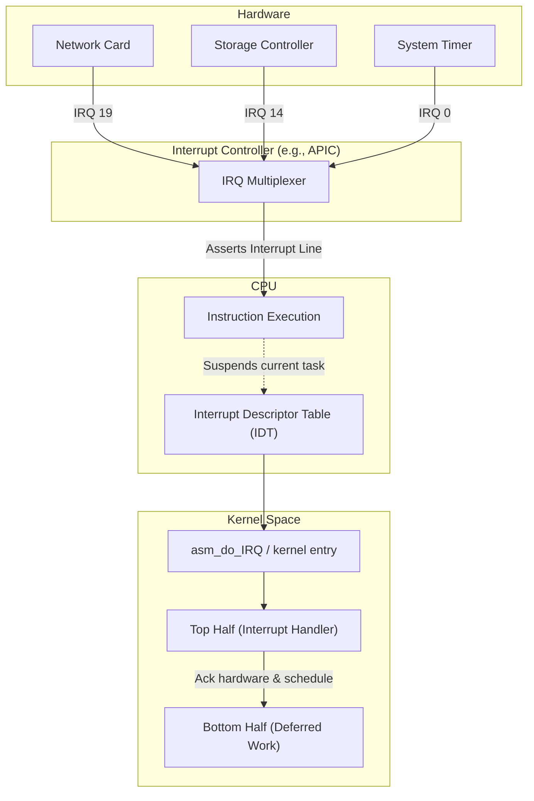
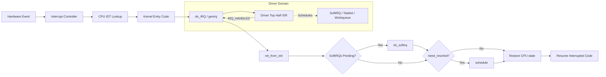

# Chapter 7 — Interrupts and Interrupt Handlers

> Source fidelity: this chapter follows Robert Love, *Linux Kernel Development*, 3rd Ed., Chapter 7 ("Interrupts and Interrupt Handlers"), which describes the Linux 2.6 kernel series (as of ~2010). Every place the material has since changed is marked explicitly with [MODERN LINUX]. Core concepts that remain unchanged are marked [CONCEPTUAL CORE].

---

## 1. What This Chapter Is About

This chapter introduces the **HARDWARE-INITIATED** counterpart to system calls. [Chapter 1](file:///Users/ritikraj/Documents/GitHub/Interview-Preparation/Linux-Kernel-Development-book-notes/01-introduction.md) established two doors into the kernel: syscalls (software-initiated, Chapter 5) and interrupts (hardware-initiated, this chapter). Interrupts are the mechanism by which hardware communicates with the CPU asynchronously. Understanding interrupts is essential for understanding bottom halves (Chapter 8), synchronization (Chapters 9-10), timers (Chapter 11), device drivers (Chapter 17), and kernel debugging (Chapter 18).

## 2. Why This Matters

Hardware operates asynchronously and at vastly different speeds than the CPU. If the CPU had to constantly ask each hardware device, "Do you have data for me?" (polling), it would waste billions of clock cycles. Interrupts allow the CPU to do useful work while hardware operates independently, notifying the CPU only when attention is required. Without a solid grasp of how interrupts work and how the kernel handles them, you cannot write efficient device drivers, understand kernel scheduling latencies, or debug system lockups.

## 3. Prerequisite Concepts

- From Chapter 1: Process context vs. interrupt context. Two fundamental states the CPU can be in.
- From Chapter 4: The scheduler and how `need_resched` works.
- From Chapter 5: System calls as software exceptions (synchronous), contrasting with interrupts (asynchronous).
- Basic hardware architecture: how a CPU executes instructions and the concept of a stack.

## 4. Big Picture



---

## 5. Core Concepts

### 5.1 Interrupts

**Concept.** An interrupt is a signal from hardware (or occasionally software) that asynchronously diverts the CPU from its current execution path to handle a high-priority event.

**Intuition.** 🧠 **Mental Model:** Interrupts are like a doorbell. The CPU (the homeowner) is busy doing chores inside the house. Instead of walking to the front door every 10 seconds to see if a package arrived (polling), the CPU waits for the delivery person (hardware) to ring the doorbell (interrupt). The CPU stops its chore, answers the door, takes the package, and returns to exactly what it was doing.

**Problem it solves.** Hardware operates at different speeds and asynchronously from the CPU. Without interrupts, the CPU would have to poll every device constantly, wasting massive amounts of compute time.

**Design idea.** 
- **The Electrical Signal:** A hardware device sends an electrical signal to an interrupt controller. 
- **Multiplexing:** The interrupt controller multiplexes multiple devices onto the CPU's interrupt lines.
- **IRQ Value:** Each interrupt has a unique value (IRQ number).
- **Asynchronous jump:** The CPU saves its state, disables the specific interrupt line (to prevent reentrancy of the same interrupt), and jumps to a predetermined kernel function based on the IRQ number.

**[BOOK — Linux 2.6]** Interrupt lines were traditionally physical pins. IRQ 0 = timer, IRQ 1 = keyboard, etc.
**[CONCEPTUAL CORE]** Exceptions vs. interrupts: exceptions are synchronous (caused by the CPU itself, e.g., divide by zero, page fault); interrupts are asynchronous (from external hardware).
**[MODERN LINUX]** MSI/MSI-X (Message Signaled Interrupts) are standard for PCIe devices. Instead of physical lines, devices write a specific value to a special memory address, which the chipset translates into an interrupt message to the CPU.

> [!NOTE] 
> Even with MSI, the conceptual abstraction of an "IRQ number" assigned to a device remains the same in software.

**Common Mistakes**
- Confusing exceptions (synchronous, CPU-generated like page faults) with interrupts (asynchronous, hardware-generated).

**Active Recall (5.1)**
1. What is the fundamental difference between an interrupt and an exception?
2. What is MSI/MSI-X, and how does it differ from traditional interrupts?

<details><summary>Answers</summary>
1. Interrupts are asynchronous and generated by external hardware (e.g., a network packet arriving). Exceptions are synchronous and generated by the CPU executing instructions (e.g., a divide-by-zero or a page fault).
2. MSI (Message Signaled Interrupts) removes the need for physical interrupt pins on the motherboard. Instead, devices perform a memory write to a special address to trigger an interrupt at the CPU.
</details>

---

### 5.2 Interrupt Handlers (ISRs — Interrupt Service Routines)

**Concept.** An interrupt handler (or ISR) is a C function that the kernel runs in response to a specific interrupt. 

**Intuition.** The handler is the kernel's immediate reaction to the doorbell ring.

**Problem it solves.** Once the CPU is notified of an event, *some code* needs to evaluate what happened, communicate with the hardware, and clear the event.

**Design idea.** Each device that generates interrupts has an associated handler registered with the kernel. The handler's job is to acknowledge the interrupt to the hardware (so the hardware stops asserting the interrupt signal) and do the absolute minimum work necessary to record the event.

**[CONCEPTUAL CORE]** Handlers run in **interrupt context**, NOT process context.
Interrupt context constraints:
- Cannot sleep or block (no waiting for disk I/O or taking a semaphore).
- Cannot call `schedule()`.
- Cannot acquire a mutex (because mutexes can sleep).
- Cannot do `copy_to_user`/`copy_from_user` (because this might trigger a page fault, which can sleep).
- Must be FAST — the specific interrupt line (and sometimes all interrupts) is disabled while the handler runs.
- Has no backing process — the `current` macro points to whatever process happened to be interrupted, which is completely irrelevant.

**Data structures.** Function pointer signature for an ISR:
```c
irqreturn_t handler_name(int irq, void *dev_id);
```

**Common Mistakes**
- Trying to allocate `GFP_KERNEL` memory in an interrupt handler (it can sleep). Must use `GFP_ATOMIC`.
- Trying to lock a mutex. Must use spinlocks (which disable local interrupts).

**Active Recall (5.2)**
1. Why can't an interrupt handler sleep?
2. What does the `current` macro represent inside an interrupt handler?

<details><summary>Answers</summary>
1. An interrupt handler does not have a backing process context. If it were to sleep, the kernel would have no way to reschedule it later, effectively hanging the system or that specific interrupt line.
2. It represents the process that was executing at the exact moment the hardware interrupted the CPU. It is completely arbitrary and unrelated to the interrupt.
</details>

---

### 5.3 Top Halves vs Bottom Halves

**Concept.** THE FUNDAMENTAL DESIGN SPLIT in Linux interrupt handling. 
- **Top half:** The interrupt handler itself. Runs immediately, often with interrupts disabled, must be extremely fast.
- **Bottom half:** Deferred work. Runs later, with interrupts enabled, can take its time (and sometimes sleep, depending on the mechanism).

**Intuition.** 🧠 **Mental Model:** The top half is emergency room triage. When an ambulance arrives (hardware interrupt), triage quickly stabilizes the patient, tags them, and clears the ambulance bay (acknowledges hardware). The bottom half is the actual surgery, performed later when an operating room is free.

**Problem it solves.** The interrupt handler must acknowledge the hardware quickly to prevent dropping subsequent hardware events. But fully processing an event (like routing a network packet) takes a long time. If the top half did all the work, the system would become unresponsive to other hardware.

**Design idea.** 
1. **Top half:** Acknowledge interrupt, copy critical data from device to memory (e.g., via DMA), schedule a bottom half, and return.
2. **Bottom half:** Process the data (Chapter 8 covers SoftIRQs, Tasklets, and Workqueues).

**Example: Network Card (NIC)**
- **Top half:** A packet arrives. The NIC interrupts the CPU. The top half acknowledges the NIC, tells it to DMA the packet into a kernel buffer (`sk_buff`), and schedules a softirq.
- **Bottom half:** The softirq runs later. It passes the packet up the network stack (IP layer -> TCP layer), computes checksums, and eventually wakes up a user-space application waiting on a socket.

> [!IMPORTANT] 
> This split is THE central theme of Chapter 7 and Chapter 8 together. You cannot design kernel drivers without understanding it.

**Active Recall (5.3)**
1. What are the three primary responsibilities of a top half?
2. Why is processing a network packet entirely in the top half a bad idea?

<details><summary>Answers</summary>
1. Acknowledge the interrupt to the hardware, copy time-sensitive data, and schedule a bottom half.
2. It takes too long. Processing TCP/IP headers, routing, and checksums would keep the CPU inside the handler for a long time, delaying other hardware interrupts and degrading system responsiveness.
</details>

---

### 5.4 Registering an Interrupt Handler

**Concept.** Drivers must tell the kernel which function to run when a specific IRQ fires.

**Intuition.** Subscribing to an event notification.

**Data structures & Code excerpt.**
```c
/* Include: <linux/interrupt.h> */

int request_irq(unsigned int irq,
                irq_handler_t handler,
                unsigned long flags,
                const char *name,
                void *dev_id);

void free_irq(unsigned int irq, void *dev_id);
```

- `irq`: The hardware interrupt number.
- `handler`: Pointer to the ISR function.
- `flags`: Behavior flags.
  - `IRQF_SHARED`: Indicates the interrupt line can be shared among multiple devices.
  - `IRQF_TIMER`: System timer interrupt.
- `name`: ASCII name for the device (shows up in `/proc/interrupts`).
- `dev_id`: A unique cookie (usually a pointer to the device's main struct). Crucial for shared interrupts so the kernel can tell the handler *which* device on the shared line triggered it.

**[BOOK — Linux 2.6]** Used `SA_INTERRUPT` and `SA_SHIRQ` flags.
**[MODERN LINUX]** Flags use the `IRQF_*` prefix. A massive shift in modern Linux is **threaded interrupt handlers** (`request_threaded_irq()`), where the top half is minimal or handled by the kernel, and the "bottom half" is run as a dedicated kernel thread. `IRQF_ONESHOT` is used heavily here to keep the interrupt disabled until the threaded handler finishes.

> [!WARNING] 
> `request_irq()` can sleep! It allocates memory. You cannot call it from interrupt context or while holding a spinlock. Usually called in module `init` or device probe functions.

**Active Recall (5.4)**
1. What is the purpose of the `dev_id` parameter in `request_irq()`?
2. Why can't you call `request_irq()` from inside an interrupt handler?

<details><summary>Answers</summary>
1. For shared interrupt lines, multiple handlers register for the same IRQ. When the IRQ fires, the kernel calls all registered handlers. `dev_id` allows the handler to identify its specific hardware device and check if it was actually the one that asserted the interrupt.
2. `request_irq()` allocates memory and can sleep, which is strictly forbidden in interrupt context.
</details>

---

### 5.5 Writing an Interrupt Handler

**Concept.** How to actually structure the ISR C function.

**Design idea.** 
1. The signature is `irqreturn_t handler(int irq, void *dev_id);`
2. Return values: 
   - `IRQ_NONE`: This handler's device did NOT generate the interrupt.
   - `IRQ_HANDLED`: This handler successfully processed the interrupt.
   - `IRQ_WAKE_THREAD`: (Modern) Wake up the threaded portion of the handler.

**Code excerpt (Conceptual Shared Handler):**
```c
static irqreturn_t my_device_interrupt(int irq, void *dev_id)
{
    struct my_device_data *dev = dev_id;
    
    /* 1. Check if OUR hardware actually generated this interrupt */
    if (!(read_device_status_register(dev) & INTERRUPT_PENDING_BIT)) {
        return IRQ_NONE; /* Was another device on this shared line */
    }

    /* 2. Acknowledge the hardware */
    write_device_ack_register(dev, ACK_BIT);

    /* 3. Do time-critical stuff (e.g., copy small buffer) */
    
    /* 4. Schedule bottom half (e.g., tasklet or workqueue) */
    tasklet_schedule(&dev->my_tasklet);

    return IRQ_HANDLED;
}
```

**Reentrancy:** In Linux, an interrupt handler is **NOT** reentrant with respect to itself. While a handler for IRQ X is running, IRQ X is disabled on all processors. However, OTHER interrupts (IRQ Y, IRQ Z) CAN fire unless the handler specifically disables all local interrupts (which is generally discouraged).

**Active Recall (5.5)**
1. If your device shares IRQ 12 with another device, how does the kernel know which handler to run when IRQ 12 fires?
2. Are Linux interrupt handlers reentrant?

<details><summary>Answers</summary>
1. The kernel doesn't know. It simply loops through a list and calls ALL handlers registered for IRQ 12. It is the responsibility of each handler to check its hardware registers (using `dev_id`) to see if it was the source of the interrupt. If not, it returns `IRQ_NONE`.
2. No. While an ISR for a specific IRQ is executing, that specific IRQ line is masked off, preventing the same handler from interrupting itself.
</details>

---

### 5.6 Interrupt Context

**Concept.** A deep dive into the environment where top halves run.

**Intuition.** It is a harsh, restricted environment.

**Problem it solves.** Interrupts interrupt *something else*. That "something else" could be holding locks or doing critical work. Therefore, the interrupt handler must not interfere with scheduling or state that belongs to the process context.

**Design idea.** 
- **No process backing:** `current` points to the interrupted process, which is innocent and unrelated.
- **No sleeping:** If an ISR sleeps, the scheduler might switch away, but there is no task to switch back *to* that explicitly represents the interrupt. The interrupt would be lost, and the hardware might hang waiting for an ack.
- **Stack size:** 
  **[BOOK — Linux 2.6]** Historically, ISRs shared the kernel stack of the interrupted process (which was only 4KB or 8KB). 
  **[MODERN LINUX]** To prevent stack overflows, modern architectures allocate dedicated **per-CPU interrupt stacks** (usually 16KB). When an interrupt fires, the CPU switches to this special interrupt stack before running the handler.

🐛 **If This Breaks:** If you accidentally call a function that can sleep (like `kmalloc(..., GFP_KERNEL)` or `mutex_lock()`) from an ISR, the kernel will panic or print a loud warning: `BUG: sleeping function called from invalid context`.

---

### 5.7 Implementation of Interrupt Handling

**Concept.** The journey of an interrupt from hardware signal to returning to user space.

**Diagram of the Journey:**

```ascii
[Hardware Device] 
      | (Electrical Signal / MSI)
      v
[Interrupt Controller (APIC)] 
      | (Interrupts CPU)
      v
[CPU (x86)] -> Finishes current instruction, looks up IDT vector
      |
      v
[Kernel Entry (arch/x86/entry/entry_64.S)] 
      | -> Saves registers on stack, calls common handler
      v
[do_IRQ() / __handle_domain_irq()]
      | -> Acks controller, looks up irq_desc
      v
[Top Half Handler (Driver ISR C code)]
      | -> Acks hardware, schedules bottom half
      v
[ret_from_intr()]
      | -> Checks need_resched flag, handles signals, runs SoftIRQs
      v
[IRET (CPU Instruction)] -> Restores state, returns to interrupted code
```

**[MODERN LINUX]** The implementation has evolved into the **generic IRQ subsystem (genirq)**. It abstracts away the hardware-specific interrupt controller details (using `struct irq_chip`) from the high-level flow (using `struct irq_desc`).

---

### 5.8 /proc/interrupts

**Concept.** The procfs interface for viewing interrupt statistics.

**Intuition.** A dashboard showing how many times the doorbell has rung, which door, and who answered it.

**Example Output:**
```bash
           CPU0       CPU1       CPU2       CPU3
  0:         26          0          0          0   IO-APIC-edge      timer
  1:          9          0          0          0   IO-APIC-edge      i8042 (keyboard)
 16:      10452          0          0          0   IO-APIC-fasteoi   ehci_hcd:usb1
 19:          0      32041          0          0   IO-APIC-fasteoi   eth0
```
- Column 1: IRQ number.
- Columns 2-5: Per-CPU hit counts. Notice IRQ 19 (eth0) is heavily hitting CPU1.
- Column 6: Interrupt controller type.
- Column 7: The `name` passed to `request_irq()`.

---

### 5.9 Interrupt Control

**Concept.** Functions to disable and enable interrupts.

**Why do this?** To protect shared data structures. If process context code is reading a variable, and an interrupt fires that writes to that same variable, you have a race condition. Disabling interrupts is the simplest form of synchronization on a local CPU. (Connection to Chapter 9-10).

**Key APIs:**
- `local_irq_disable()` / `local_irq_enable()`: Disables/enables ALL interrupts on the **current CPU only**. (Does not affect other CPUs in an SMP system).
- `local_irq_save(flags)` / `local_irq_restore(flags)`: **Preferred method.** Saves the current state of interrupts into `flags`, disables them, and later restores them to their *previous* state. (Crucial if they were already disabled before you called save).
- `disable_irq(irq)` / `enable_irq(irq)`: Disables a specific IRQ line across all CPUs. `disable_irq()` waits for any currently executing handler for that IRQ to finish.
- `disable_irq_nosync(irq)`: Disables the line immediately without waiting.

> [!CAUTION]
> Disabling all interrupts on a CPU (`local_irq_disable`) is a blunt instrument. It prevents the timer interrupt from firing, meaning the scheduler cannot run. Hold them disabled for the absolute minimum time possible.

**Active Recall (5.9)**
1. Why is `local_irq_save(flags)` generally preferred over `local_irq_disable()`?

<details><summary>Answers</summary>
1. If you use `local_irq_disable()` followed by `local_irq_enable()`, you forcefully enable interrupts. But what if interrupts were *already* disabled when your function was called? You just accidentally re-enabled them, potentially breaking the caller's synchronization. `local_irq_save(flags)` remembers the original state and restores it exactly.
</details>

---

## 6. How the Pieces Fit Together



---

## 7. Source Code Navigation

Use these paths to explore the kernel source:
- `kernel/irq/` — The generic IRQ subsystem (`genirq`).
- `kernel/irq/handle.c` — Generic interrupt handling flow.
- `kernel/irq/manage.c` — Implementation of `request_irq`, `free_irq`.
- `arch/x86/kernel/irq.c` — x86-specific interrupt handling.
- `arch/x86/entry/entry_64.S` — Assembly entry points for hardware interrupts.
- `include/linux/interrupt.h` — The main header for drivers (handler registration API, `IRQF_*` flags).
- `include/linux/irqreturn.h` — Return types like `IRQ_NONE`, `IRQ_HANDLED`, `IRQ_WAKE_THREAD`.

**Practical Git Grep:**
Search for how a network driver registers an interrupt:
```bash
git grep "request_irq" -- drivers/net/ethernet/intel/
```

---

## 8. Hands-On Experiments

### Experiment 7.1 — Read `/proc/interrupts` <kbd>SAFE USER-SPACE</kbd>
- **Objective:** Understand how interrupts are mapped in a running system.
- **Steps:** Run `cat /proc/interrupts`. Identify the timer interrupt, keyboard (or USB hub), and the network interface (NIC). 
- **Observation:** Notice how counts increase across different CPUs.

### Experiment 7.2 — Watch Interrupt Rates in Real-Time <kbd>SAFE USER-SPACE</kbd>
- **Objective:** See hardware events happening asynchronously.
- **Steps:** Run `watch -n 1 cat /proc/interrupts`. Move your mouse rapidly, type on the keyboard, or start a large file download.
- **Observation:** Watch specific IRQ lines increment rapidly.

### Experiment 7.3 — IRQ Affinity <kbd>SAFE USER-SPACE</kbd>
- **Objective:** Pin an interrupt to a specific CPU to optimize cache locality.
- **Setup:** Identify your NIC's IRQ number from Exp 7.1. (e.g., IRQ 19).
- **Steps:** 
  1. `cat /proc/irq/19/smp_affinity` (Outputs a bitmask, e.g., `f` for CPUs 0-3).
  2. Change it to CPU 1 (bitmask `2`): `echo 2 | sudo tee /proc/irq/19/smp_affinity`.
  3. Run a network speed test.
- **Observation:** Re-run `watch -n 1 cat /proc/interrupts`. You will see IRQ 19 counts *only* incrementing on CPU 1.

### Experiment 7.4 — Identify Top Interrupt Sources <kbd>SAFE USER-SPACE</kbd>
- **Objective:** Use `perf` to profile hardware interrupts.
- **Steps:** `sudo perf stat -e irq:irq_handler_entry sleep 5`.
- **Observation:** Correlate the total number of interrupts with system idle vs. load states.

### Experiment 7.5 — Simple Interrupt Handler Module <kbd>KERNEL-MODIFYING</kbd>
- **Objective:** Write a top half handler. **(Use a VM!)**
- **Steps:** Write a simple kernel module. Use `request_irq()` to hook a shared interrupt (e.g., the keyboard/USB IRQ). In your handler, print a message with `printk(KERN_INFO "Interrupt fired!\n");` and immediately return `IRQ_NONE` (so the real driver still handles it).
- **Observation:** Run `dmesg -w` and watch the kernel log flood with your message every time the hardware event occurs.

### Experiment 7.6 — Trace Interrupt Latency <kbd>SAFE USER-SPACE</kbd>
- **Objective:** Measure how long top halves take to execute.
- **Steps:** Use ftrace: 
  ```bash
  echo function_graph > /sys/kernel/debug/tracing/current_tracer
  echo do_IRQ > /sys/kernel/debug/tracing/set_graph_function
  cat /sys/kernel/debug/tracing/trace
  ```
- **Observation:** See the exact microsecond duration of `do_IRQ` and the driver handlers.

---

## 9. Common Misconceptions

| Misconception | Reality |
|---------------|---------|
| Interrupt handlers run as threads. | Handlers run in interrupt context, totally outside the scheduler's awareness. (Exception: Modern *threaded* interrupts run as kernel threads, but the hard top-half does not). |
| You can lock a mutex in an ISR. | Mutexes can sleep. You must use spinlocks to synchronize in an ISR. |
| `task_struct` in an ISR points to the interrupt state. | `current` points to whatever process was unlucky enough to be interrupted. It is meaningless to the ISR. |
| Interrupts are reentrant. | The same IRQ line is masked off while its handler runs. An ISR cannot be interrupted by the same IRQ. |

---

## 10. Interview Questions

### Basic
**Q: What is the difference between an interrupt and an exception?**
> **Expected Reasoning:** Understanding of async vs. sync.
> **Answer:** Interrupts are asynchronous hardware signals (network packet). Exceptions are synchronous CPU events caused by instructions (page fault, divide by zero).

### Intermediate
**Q: Why do we split interrupt handling into top halves and bottom halves?**
> **Expected Reasoning:** Latency, system responsiveness.
> **Answer:** Top halves run with interrupts (at least the current line) disabled. They must be extremely fast to acknowledge the hardware and prevent data loss. The heavy lifting (like TCP/IP processing) is deferred to the bottom half, which runs later with interrupts enabled, allowing the system to remain responsive to other hardware.

### Advanced
**Q: What happens if you call a function that sleeps (like `schedule()`) inside a top half interrupt handler?**
> **Expected Reasoning:** Understanding of interrupt context.
> **Answer:** The system will likely crash or hang, throwing a "scheduling while atomic" or "sleeping function called from invalid context" bug. Because interrupt context has no backing process, the scheduler has no entity to put to sleep and no way to wake the interrupt handler back up.

### Design
**Q: You are writing a driver for a very high-throughput network card. How do you prevent interrupt storms from livelocking the CPU?**
> **Expected Reasoning:** NAPI / polling hybrids.
> **Answer:** If we generate an interrupt for every single packet at 10Gbps, the CPU will spend 100% of its time entering and exiting interrupt context (Interrupt Livelock). Instead, the first interrupt triggers the top half, which masks further interrupts from the NIC and schedules a bottom half. The bottom half then *polls* the NIC buffer in a loop to process a batch of packets. Once the buffer is empty, it re-enables hardware interrupts. (This is exactly how Linux NAPI works).

---

## 11. Active Recall

<details><summary>1. What is an interrupt context and what restrictions does it have?</summary>
It is the state the CPU enters when servicing an interrupt. Restrictions: No sleeping, no scheduling, no mutexes, no access to user-space memory, and must be fast.
</details>

<details><summary>2. How does the kernel distinguish between multiple devices sharing the same IRQ line?</summary>
It passes the `dev_id` parameter to the handlers. Each handler must query its specific hardware device's registers to see if it generated the interrupt. If not, it returns `IRQ_NONE`.
</details>

<details><summary>3. What is the difference between `local_irq_disable()` and `disable_irq(irq)`?</summary>
`local_irq_disable()` disables ALL interrupts, but only on the local CPU executing the code. `disable_irq(irq)` disables one specific IRQ line across ALL CPUs in the system.
</details>

<details><summary>4. Why is `local_irq_save` safer than `local_irq_disable` for nested function calls?</summary>
It saves the previous interrupt state and restores it later, rather than blindly forcing interrupts back on with `local_irq_enable`, which could break assumptions made by the calling function.
</details>

<details><summary>5. What does the `current` macro point to during an interrupt handler?</summary>
The process that was interrupted. It is completely irrelevant to the interrupt handler itself.
</details>

---

## 12. Chapter Summary

Interrupts are the primary mechanism by which hardware communicates with the CPU. Because hardware is asynchronous, the kernel must be prepared to handle an interrupt at almost any time. The kernel responds by pausing the current execution and running an Interrupt Service Routine (ISR) in a restricted "interrupt context." To keep the system responsive, Linux mandates a strict division of labor: the top half (ISR) does only the bare minimum required to acknowledge the hardware and copy critical data, while the heavy processing is deferred to a bottom half (Chapter 8). Proper management of interrupts—including knowing when to disable them and how to register handlers safely—is critical for system stability and performance.

---

## 13. What I Should Be Able to Explain Now

- [ ] The mechanical flow of a hardware interrupt from the device to the CPU.
- [ ] The definition and strict rules of interrupt context.
- [ ] The architectural necessity of splitting work into top halves and bottom halves.
- [ ] How `request_irq()` works and the role of `dev_id` in shared interrupts.
- [ ] The dangers of sleeping in an interrupt handler.
- [ ] How to safely disable and enable interrupts using `local_irq_save`.
- [ ] How to interpret `/proc/interrupts`.

---

## 14. Knowledge Graph

```text
Process Management (Ch 3)
│
├── System Calls (Ch 5) [Software Exceptions]
│
└── Interrupts (Ch 7) [Hardware Signals]
    │
    ├── Concepts
    │   ├── Interrupt Context
    │   ├── Reentrancy
    │   └── Top Half vs Bottom Half
    │
    ├── Implementation
    │   ├── request_irq()
    │   ├── dev_id & Shared Handlers
    │   └── irqreturn_t
    │
    └── Synchronization (Ch 9-10)
        ├── local_irq_save()
        └── disable_irq()
```
