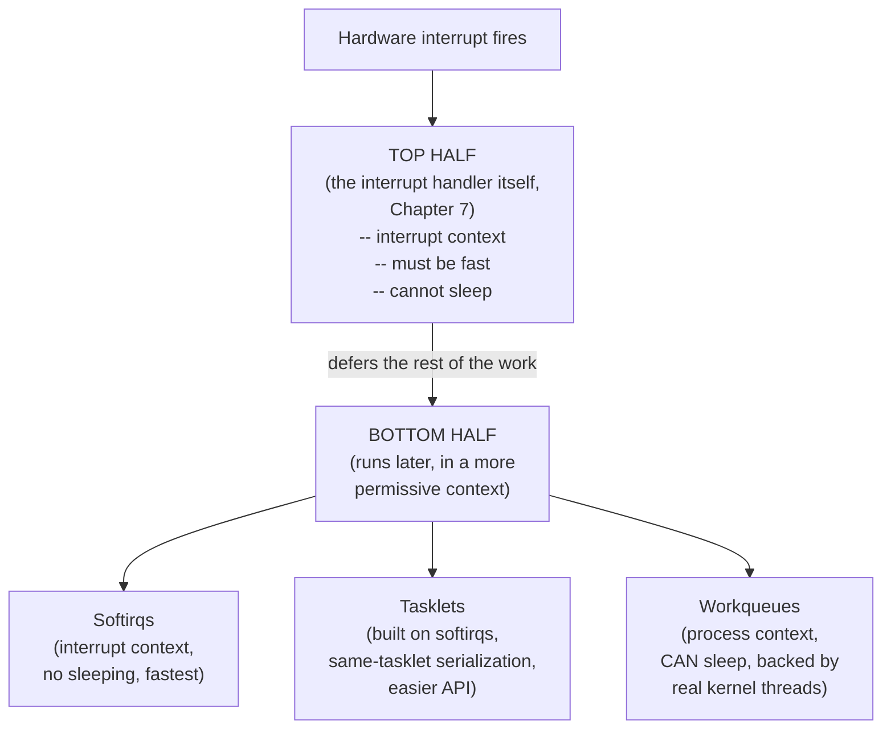
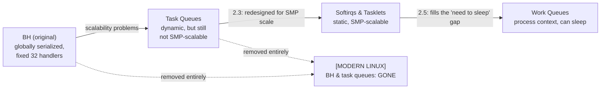
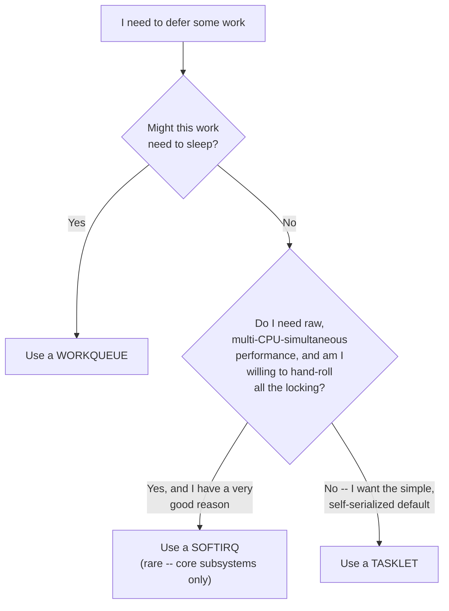
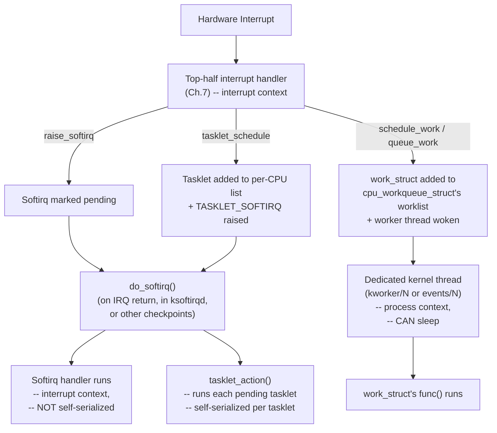

# Chapter 8 — Bottom Halves and Deferring Work

> Source fidelity: this chapter follows Robert Love, *Linux Kernel Development*, 3rd Ed., Chapter 8 ("Bottom Halves and Deferring Work"). Book-era API names (softirq/tasklet/workqueue interfaces) are checked against modern kernel source throughout, and the historical `BH`/task-queue mechanisms the book covers as deprecated history are marked accordingly.

---

## 1. What This Chapter Is About

Chapter 7 established that interrupt handlers must run **fast** — they execute in interrupt context, where the constraints from Chapter 1 apply at their strictest (cannot sleep, should minimize time spent with interrupts disabled). But a lot of the work an interrupt triggers is *not* inherently fast — copying a large network packet, processing disk I/O completion, waking up multiple waiting processes. This chapter is about the kernel's answer: split interrupt handling into a **top half** (runs immediately, in interrupt context, does only the truly urgent, minimal work) and a **bottom half** (runs later, in a more permissive context, does everything else). This chapter teaches the three modern bottom-half mechanisms — **softirqs**, **tasklets**, and **workqueues** — what each one is built from, how they differ, and precisely when to choose one over another.

## 2. Why This Matters

Every device driver you will ever read or write eventually confronts this exact design question: "some of this work is urgent and must happen right now in the interrupt handler; some of it can, and *should*, be deferred — which mechanism do I defer it with?" Choosing wrong has real consequences: choosing a mechanism that can't sleep for work that needs to sleep will crash or hang the kernel; choosing an unnecessarily heavyweight mechanism for trivial work wastes performance. This chapter is where you build the judgment to make that call correctly.

## 3. Prerequisite Concepts

- **Chapter 1**: process context vs. interrupt context — the entire chapter is organized around which bottom-half mechanism runs in which context.
- **Chapter 4**: the scheduler and `task_struct` — workqueues are backed by real, schedulable kernel threads.
- **Chapter 7**: interrupt handlers, and why they must be fast and cannot sleep.

## 4. Big Picture



The book's own recurring theme, worth internalizing before the details: **the entire reason multiple bottom-half mechanisms exist is that "defer this work" is not one problem — it's several problems with different constraints**, and the kernel offers a mechanism matched to each.

---

## 5. Core Concepts

### 5.1 Why Bottom Halves? — the Top-Half/Bottom-Half Split

**Concept.** An interrupt handler is deliberately split into two pieces: a **top half**, which the kernel runs immediately upon interrupt, in interrupt context; and a **bottom half**, which the kernel runs later, when it's more convenient and safer to do so.

**Intuition.** Think of a busy restaurant host who answers the phone (the interrupt). The host cannot spend five minutes on the call while a line of customers waits at the door — so the host takes the essential information *immediately* (the top half: "yes, we're open, hold please") and hands the detailed part of the conversation (looking up availability, discussing a large party's needs) to someone else to handle *shortly after*, freeing the host to get back to the door.

**Problem it solves.** Chapter 7 established that interrupt handlers run with **interrupts of the same line — and, depending on configuration, other interrupts — effectively suppressed**, and that they cannot sleep. If a handler is slow, it delays the *entire system's* ability to respond to other events for that duration. But some interrupt-triggered work is inherently non-trivial (copying substantial data, waking multiple waiters, anything that might need to sleep waiting on a resource). **Without a bottom-half mechanism, you'd be forced to choose between an interrupt handler that's dangerously slow, or work that never gets done properly.**

**Design idea — the book's own guiding questions for what belongs in the top half vs. the bottom half:**
| Belongs in the top half (interrupt handler) | Belongs in the bottom half |
|---|---|
| Time-sensitive | Everything else |
| Related to the hardware | |
| Must ensure another interrupt (esp. the same one) doesn't lose data | |

⭐ **The book's own summary heuristic, worth memorizing verbatim in spirit:** *if it can wait, it should wait.* The bottom half should do as much as possible, and the top half as little as is truly necessary to acknowledge the interrupt, capture urgent data, and schedule the bottom-half work.

**Example — the book's own network card illustration.** When a network card receives a packet, it needs the kernel to know quickly (so the card's own limited on-board buffer isn't overrun by the next arriving packet). The **top half** acknowledges the interrupt, copies the packet's data out of the card's hardware buffer into main memory (urgent — the hardware buffer is limited), and schedules a bottom half to process it. The **bottom half** does everything else — walking the packet up the network stack, handling protocol-specific processing — none of which is time-critical relative to the hardware.

**Common Mistakes**
- Assuming "bottom half" means "runs on a different CPU" or "runs in a separate process automatically." It means "runs *later*, in a context with fewer restrictions" — the specific *how* (which context, which scheduling) depends entirely on which of the three mechanisms you choose.
- Putting genuinely non-urgent work in the interrupt handler "because it's simpler to write it all in one place." This directly reintroduces the exact problem (a slow, greedy interrupt handler) bottom halves exist to solve.

**Active Recall (5.1)**
1. What are the book's three criteria for "does this belong in the top half"?
2. State the book's one-sentence heuristic for what to put in the bottom half.

<details><summary>Answers</summary>
1. Is it time-sensitive? Is it related directly to the hardware? Does it need to run before another interrupt (especially the same one) causes data loss?
2. "If it can wait, it should wait" — put as little as possible in the top half, defer everything else to a bottom half.
</details>

---

### 5.2 A Brief History of Bottom Halves — Why THREE Mechanisms Exist Today

**Concept.** The book walks through several bottom-half mechanisms that existed historically, to explain *why* the kernel settled on the current set rather than presenting softirqs/tasklets/workqueues as if they'd always been the obvious answer.

**[BOOK — Linux 2.6, historical account]**
- **"BH" (the original mechanism)** — a simple, static list of 32 bottom halves, globally serialized (no two BHs, even different ones, could ever run simultaneously on any CPU). Simple, but that global serialization was a severe scalability bottleneck on SMP systems, and the fixed count of 32 was inflexible.
- **Task queues** — an attempt to generalize BH into a dynamic list of pending work, with several predefined queues run at different points. More flexible than BH, but still not a great fit for high-performance, fine-grained deferred work.
- **Softirqs and tasklets (introduced in 2.3)** — designed specifically to address BH/task-queue's scalability problems: **statically allocated at compile time** (no dynamic registration overhead), and — critically — **capable of running simultaneously on multiple CPUs**, even two instances of the *same* softirq (with tasklets adding a layer of easier-to-use serialization on top, described below).
- **Work queues (introduced in 2.5)** — added later specifically to fill a gap softirqs/tasklets could never fill: **a bottom-half mechanism that runs in process context and can sleep.**

**[CONCEPTUAL CORE] Why this history matters, not just as trivia.** It directly explains the three-mechanism landscape you have today: **softirqs** exist for the highest-performance, most timing-critical deferred work (used by only a handful of core subsystems); **tasklets** exist as an easier-to-use interface *built on top of* softirqs for the overwhelming majority of driver authors who don't need multi-CPU-simultaneous execution of their own bottom half; **workqueues** exist for the one class of deferred work the other two structurally cannot handle at all — anything that might need to sleep.

**[MODERN LINUX]** The old BH mechanism and task queues were removed from the kernel entirely years ago — you will not find them in a current source tree at all (a good example of the source-fidelity distinction: the book documents them as already largely superseded/being phased out at the time of writing; today they are simply gone). Softirqs, tasklets, and workqueues remain the three living mechanisms and are exactly what modern kernel code uses.



---

### 5.3 Softirqs

**Concept.** A softirq is a statically-allocated (at compile time) bottom half, identified by an index into a fixed-size array, capable of running — and this is the defining, most important property — **concurrently, on multiple CPUs simultaneously, even multiple instances of the exact same softirq at once.**

**Intuition.** If tasklets are "the easy, common case" (below), softirqs are "the rare, maximum-performance case," reserved for a small number of genuinely timing-critical, high-frequency subsystems (the book names the networking and block-device/SCSI subsystems as the primary real-world softirq users).

**Internal representation.**
```c
struct softirq_action {
    void (*action)(struct softirq_action *);
};
```
A **static array** of 32 of these (`static struct softirq_action softirq_vec[NR_SOFTIRQS];`) exists — the maximum number of softirqs the system supports, fixed at compile time (unlike tasklets, which can be created dynamically on top of this fixed foundation).

**Design idea — registration, raising, and execution are three distinct steps:**
1. **Registration** (at compile/boot time, typically via `open_softirq()`) — declares a softirq's handler function, associating it with an index.
2. **Raising** (`raise_softirq()`) — marks a softirq **pending**, to be run soon — this is the operation an interrupt handler (or other code) actually performs when it wants deferred work done.
3. **Execution** — the kernel checks for and runs pending softirqs at a number of specific points: on return from hardware interrupt handling, in the `ksoftirqd` per-CPU kernel thread (below), and a few other explicit checkpoints in the kernel.

**Algorithm — `do_softirq()`, conceptually:**
```c
u32 pending = softirq_pending_on_this_cpu();
if (pending) {
    clear_pending_bits();
    for (i = 0; i < NR_SOFTIRQS; i++) {
        if (pending & (1 << i))
            softirq_vec[i].action(&softirq_vec[i]);
    }
}
```
⭐ **The critical, defining detail:** a softirq handler runs with **that same softirq re-enabled** — meaning if the handler itself (or another CPU) re-raises the same softirq while it's executing, it can run *again*, even concurrently on a different CPU, without waiting for the first invocation to finish. This is exactly what makes softirqs the highest-throughput bottom-half mechanism, and exactly why **a softirq handler must never assume it has exclusive, serialized access to any data it touches** — any data a softirq handler accesses **must be protected with proper locking** (Chapters 9-10), even data that "only this one softirq type" ever touches, because it can be running on two CPUs at once.

**`ksoftirqd`** — a per-CPU kernel thread (one instance per CPU, per Chapter 4's kernel-thread concept) that exists specifically to handle the case where softirqs are being raised **faster than the "run pending softirqs on return from interrupt" checkpoint can drain them.** Without this thread, a softirq storm could starve user-space processes indefinitely (the kernel would keep re-entering softirq processing on every interrupt return, forever, never letting anything else run) — `ksoftirqd` instead runs at **normal scheduling priority**, meaning it competes fairly for CPU time with everything else, ensuring the rest of the system stays responsive even under heavy softirq load, at the cost of some softirq processing latency under that specific overload condition.

**Real Linux Investigation.**
```bash
ps aux | grep ksoftirqd          # see the per-CPU ksoftirqd threads — one per CPU
cat /proc/softirqs                 # per-CPU counts of each softirq TYPE that has fired
```

**Common Mistakes**
- Assuming a softirq handler is automatically serialized against itself, the way a tasklet is (next section). It is explicitly **not** — this is the single most important distinction between the two mechanisms, and getting it backward is a real, dangerous bug source.
- Registering a new softirq casually for ordinary driver work. The book is explicit that new softirqs are rarely warranted — tasklets are the right choice for the overwhelming majority of real-world deferred-work needs.

---

### 5.4 Tasklets

**Concept.** A tasklet is a bottom-half mechanism **built entirely on top of softirqs** (in fact, implemented as exactly two softirqs — `HI_SOFTIRQ` and `TASKLET_SOFTIRQ` — that iterate over dynamically-maintained lists of pending tasklets), offering a much simpler API and — crucially — a serialization guarantee softirqs don't provide.

**Why tasklets exist, given softirqs already exist.** The book is direct about this: softirqs are necessary for a **small number** of the most performance-critical, highest-throughput subsystems, but their lack of self-serialization makes them genuinely harder to write correct code for. Tasklets give up the "can run simultaneously with itself on multiple CPUs" property in exchange for a **much simpler correctness model** — appropriate for the overwhelming majority of real driver/subsystem deferred-work needs.

**Internal representation.**
```c
struct tasklet_struct {
    struct tasklet_struct *next;
    unsigned long state;
    atomic_t count;
    void (*func)(unsigned long);
    unsigned long data;
};
```
- `state` tracks whether the tasklet is currently `TASKLET_STATE_SCHED` (scheduled, pending execution) and/or `TASKLET_STATE_RUN` (currently running — used specifically to enforce the same-tasklet serialization guarantee, checked on SMP systems).
- `count` is a **disable/enable reference count** — a nonzero value means the tasklet is disabled and must not run, even if scheduled; this lets code temporarily suppress a tasklet without losing its "it was scheduled" state.

⭐ **The defining, most important property, worth contrasting directly with softirqs:** **a given tasklet is guaranteed never to run concurrently with itself — not even on two different CPUs.** Two *different* tasklets *can* run concurrently (on different CPUs) with no special protection needed between them if they don't share data, but a *single* tasklet type is always serialized against itself. This dramatically simplifies the locking burden for anything that only needs "don't corrupt myself," at the cost of throughput a genuinely hot, must-scale-across-every-CPU subsystem (like networking) would still want the full softirq mechanism for.

**Algorithm — scheduling and running a tasklet, conceptually:**
```c
tasklet_schedule(&my_tasklet);
  -> if (test_and_set_bit(TASKLET_STATE_SCHED, &t->state))
         return;                      // already scheduled -- no-op, not queued twice
     add t to this CPU's tasklet list
     raise_softirq(TASKLET_SOFTIRQ);   // ride on the softirq mechanism underneath

// later, when TASKLET_SOFTIRQ runs (tasklet_action()):
for each tasklet on this CPU's list:
    if (tasklet_trylock(t)) {          // sets TASKLET_STATE_RUN; fails if already running elsewhere
        if (!atomic_read(&t->count)) { // not disabled
            clear_bit(TASKLET_STATE_SCHED, &t->state);
            t->func(t->data);
        }
        tasklet_unlock(t);
    }
```
⭐ **Notice, concretely, what enforces the serialization guarantee:** `tasklet_trylock()` — attempting to set `TASKLET_STATE_RUN` — is exactly what would fail (causing this CPU to simply skip and retry later) if the *same* tasklet were already mid-execution on another CPU. This is the actual mechanism, not magic — worth being able to point to when asked "how does the kernel guarantee this?"

**Using tasklets — declaration and definition:**
```c
// Statically declared:
DECLARE_TASKLET(name, func, data);       // starts enabled
DECLARE_TASKLET_DISABLED(name, func, data);  // starts disabled

// The handler function itself:
void my_tasklet_handler(unsigned long data)
{
    /* do the deferred work */
}
DECLARE_TASKLET(my_tasklet, my_tasklet_handler, 0);
```
**Code explanation.** `func` takes a single `unsigned long` argument — commonly used to pass a pointer (cast through `unsigned long`) to whatever state the handler needs, since a tasklet's own registration has no other built-in way to carry context.

**Scheduling a tasklet from an interrupt handler (the book's canonical use case):**
```c
irqreturn_t my_interrupt_handler(int irq, void *dev_id)
{
    /* do the urgent, top-half work here */
    tasklet_schedule(&my_tasklet);   // defer the rest
    return IRQ_HANDLED;
}
```
⭐ **Idempotence property worth noting:** calling `tasklet_schedule()` on a tasklet that's *already* pending (scheduled but not yet run) is a safe no-op — it will not run twice for two schedule calls; this matters because an interrupt handler that fires repeatedly in quick succession (a burst of hardware events) doesn't need to guard against "did I already schedule this?" itself.

**`HI_SOFTIRQ` vs. `TASKLET_SOFTIRQ`.** Tasklets actually come in two priority flavors: ordinary tasklets ride on `TASKLET_SOFTIRQ`; **high-priority tasklets** (scheduled via `tasklet_hi_schedule()`) ride on `HI_SOFTIRQ`, which the softirq dispatch order runs **before** ordinary tasklets — reserved, per the book, for the rare cases where even the small extra latency of ordinary tasklet processing genuinely matters.

**Common Mistakes**
- Assuming two *different* tasklets are automatically safe to run concurrently just because tasklets "have serialization." The serialization guarantee is **per-tasklet, against itself only** — two different tasklets sharing data still need explicit locking between them.
- Forgetting that a disabled (`tasklet_disable()`'d) tasklet that was already scheduled doesn't lose its pending state — it will run once re-enabled, not silently vanish.

**Active Recall (5.3-5.4)**
1. What is the single biggest correctness-relevant difference between softirqs and tasklets?
2. What underlying mechanism are tasklets actually built out of?
3. What real kernel structure/field enforces "a tasklet never runs concurrently with itself"?

<details><summary>Answers</summary>
1. Softirqs can run concurrently with themselves across multiple CPUs (no self-serialization); tasklets are guaranteed to never run concurrently with themselves, even on different CPUs.
2. Two softirqs — `TASKLET_SOFTIRQ` and `HI_SOFTIRQ` — whose handlers iterate over per-CPU lists of pending tasklets.
3. `tasklet_struct`'s `state` field, specifically the `TASKLET_STATE_RUN` bit, checked/set via `tasklet_trylock()`.
</details>

---

### 5.5 The Old BH Mechanism (Historical Note)

**[BOOK — Linux 2.6]** briefly documents `BH` as a legacy interface, at the time of writing already superseded by tasklets for all practical purposes, retained mainly for backward compatibility with not-yet-converted older drivers.

**[MODERN LINUX]** The BH interface has been **completely removed** from the kernel — there is nothing to look up in a current source tree. This entire subsection exists in this course purely as a source-fidelity note: if you ever see historical documentation or an old book/tutorial referencing `mark_bh()` or similar, know that it describes a mechanism that no longer exists at all in current Linux, not merely a discouraged one.

---

### 5.6 Work Queues

**Concept.** A workqueue defers work to **a real, schedulable kernel thread**, running in **process context** — meaning, unlike softirqs and tasklets, **workqueue handlers are allowed to sleep** (block on I/O, acquire a mutex, call anything that might need the scheduler to step in).

**Why this mechanism must exist, distinctly from the other two.** Softirqs and tasklets both ultimately execute via the softirq mechanism, which runs in a context where sleeping is forbidden (recall Chapter 1's interrupt-context constraints — even though softirq *processing itself* often happens outside a true hardware-interrupt-context window, it inherits the same "cannot sleep" restriction). Any deferred work that genuinely needs to sleep — allocating memory in a way that might block, waiting on a mutex another sleeping thread holds, performing blocking I/O — **has no other mechanism available to it.** Workqueues exist specifically, and only, to fill this gap.

**Internal representation — the layered structure:**
```c
struct workqueue_struct {
    struct cpu_workqueue_struct cpu_wq[NR_CPUS];   // one per-CPU structure per CPU
    ...
};

struct cpu_workqueue_struct {
    spinlock_t lock;
    struct list_head worklist;        // pending work_struct entries
    wait_queue_head_t more_work;
    struct work_struct *current_work;
    struct task_struct *thread;        // the actual kernel thread backing this CPU's queue
    ...
};

struct work_struct {
    atomic_long_t data;
    struct list_head entry;
    work_func_t func;                  // the function to run
};
```
⭐ **The layering worth understanding, top to bottom:** a `workqueue_struct` represents a *named queue type* (there's a default, shared one, and code can also create its own dedicated one); it contains one `cpu_workqueue_struct` **per CPU** (so work naturally distributes across CPUs rather than bottlenecking on one); each `cpu_workqueue_struct` is backed by **one real kernel thread** (a `task_struct`, per Chapter 3/4) that sleeps on `more_work` when idle and wakes to drain `worklist` when work arrives; each pending unit of work is one `work_struct`, holding the function to call.

**The default workqueue — `events`.** Rather than requiring every driver to create its own dedicated workqueue (and hence its own set of per-CPU kernel threads — a real resource cost if done by every driver independently), the kernel provides one shared, default workqueue (historically visible in `ps`/`top` output as `events/0`, `events/1`, etc. — one worker thread per CPU) that most simple deferred-work needs can just use directly.

**Using work queues — the book's core API:**
```c
DECLARE_WORK(name, void (*func)(void *));   // statically declare
// or, dynamically:
INIT_WORK(&work, func);

// Schedule work on the DEFAULT (shared "events") workqueue:
schedule_work(&work);                        // run as soon as possible
schedule_delayed_work(&work, delay);         // run no sooner than `delay` jiffies from now

// Flush -- block until all currently-queued work on the default workqueue has completed:
flush_scheduled_work();
```
**Code explanation.** `schedule_work()` is the workqueue analog of `tasklet_schedule()` — queue this unit of work to run soon, on the shared default queue. `flush_scheduled_work()` is a **blocking, sleeping call** (only legal to call from process context that's itself allowed to sleep) that waits for the entire default queue to drain — used, for example, during driver/module unload, to guarantee no deferred work is still pending against soon-to-be-freed data before the module is actually removed.

**Creating your own dedicated workqueue** (when the shared default one isn't appropriate — e.g., work that's expected to be heavy/frequent enough that you don't want it competing with every other subsystem's deferred work on the shared queue):
```c
struct workqueue_struct *my_wq = create_workqueue("my_driver_wq");
queue_work(my_wq, &work);
queue_delayed_work(my_wq, &work, delay);
flush_workqueue(my_wq);
destroy_workqueue(my_wq);
```
⭐ **The direct tradeoff, stated plainly:** a dedicated workqueue costs **one kernel thread per CPU**, a genuine, standing resource cost (kernel threads consume kernel stack space and scheduler bookkeeping even when idle) — the book's own guidance is to use the shared default queue unless you have a specific reason (very high work frequency, or a need to control scheduling priority/behavior independently from every other default-queue user) not to.

**[MODERN LINUX] — an important, substantial evolution beyond the book.** The workqueue subsystem was significantly redesigned after this book's writing into what's called **CMWQ (Concurrency Managed Workqueues)**, exposing a richer, more flexible API (`alloc_workqueue()` with various flags, e.g. `WQ_UNBOUND` for CPU-unpinned pools, `WQ_MEM_RECLAIM` for queues guaranteed forward progress under memory pressure) and — critically — **dynamically managing the number of worker threads per CPU pool** based on actual concurrency demand, rather than the book's simpler model of one fixed worker thread per CPU per workqueue. The book's *conceptual* description (process-context execution, can sleep, per-CPU distribution, a default shared queue) remains an accurate mental model; the specific data structures and the exact fixed-one-thread-per-CPU implementation detail have evolved substantially. If you need the precise current internal data structures, the correct move (per this course's fidelity rule) is checking `kernel/workqueue.c` directly rather than assuming the book's `cpu_workqueue_struct` layout still matches verbatim.

**Real Linux Investigation.**
```bash
ps aux | grep -E "kworker|events"    # modern CMWQ worker threads typically show as "kworker/N:M"
cat /sys/kernel/debug/workqueue/wq_dump 2>/dev/null | head -20    # if debugfs is mounted, a live dump
```

**Common Mistakes**
- Calling `schedule_work()`/`flush_scheduled_work()` (or their `queue_*`/`flush_*` equivalents) from interrupt context. `flush_*` specifically can sleep — calling it from a context that cannot sleep is a real, serious bug.
- Creating a dedicated workqueue "just in case" for lightweight, infrequent work, paying the standing per-CPU-thread cost for no real benefit over the shared default queue.

---

### 5.7 Which Bottom Half Should I Use?

⭐ **This is the single most practically important table in the whole chapter — the actual decision procedure.**

| Requirement | Mechanism |
|---|---|
| Needs the absolute highest performance/throughput, and the subsystem is prepared to handle full multi-CPU-simultaneous-with-itself concurrency correctly | **Softirq** |
| Ordinary deferred work; wants simple, automatic same-instance serialization; cannot sleep | **Tasklet** |
| The work might need to sleep (blocking I/O, a mutex, blocking allocation, etc.) | **Workqueue** |

**The book's own additional practical guidance, worth internalizing:**
- If you don't have a clear, specific reason to need a softirq's raw performance and are prepared to hand-roll your own locking for multi-CPU-simultaneous execution, **use a tasklet** — this is the right default for the overwhelming majority of driver-level deferred work that doesn't need to sleep.
- The moment sleeping is even a *possibility* (you're not 100% sure the function you're calling will never block), **you must use a workqueue** — there is no other legal option among these three.



---

### 5.8 Locking Between the Bottom Halves, and Disabling Bottom Halves

**Concept.** Because "a bottom half can run at virtually any moment" (the book's own phrasing), **any data shared between a bottom half and other code — process context, interrupt context, or another bottom half — requires proper locking**, even on a single-CPU machine (preemption alone is enough to create a race, independent of true SMP simultaneity).

**Design idea — the specific locking discipline per pairing, straight from the book:**
| Sharing between... | Required protection |
|---|---|
| Two instances of the **same tasklet** | None needed — tasklets are self-serialized by design (§5.4) |
| Two **different** tasklets sharing data | Proper locking (Chapters 9-10) |
| Two softirqs (including two instances of the *same* softirq) | Proper locking — always, no exceptions, since softirqs have no self-serialization at all |
| **Process-context code** and a bottom half | Disable bottom-half processing **and** obtain a lock |
| **Interrupt-context code** and a bottom half | Disable interrupts **and** obtain a lock |
| Data used only within a workqueue handler | Ordinary process-context locking rules apply — workqueues run in process context, so nothing special beyond Chapters 9-10's normal guidance |

**Disabling bottom halves — the mechanism:**
```c
local_bh_disable();   // disable softirq (and hence tasklet) processing on THIS CPU
/* ... critical section ... */
local_bh_enable();    // re-enable
```
⭐ **A genuinely amusing/important naming note the book flags directly:** `local_bh_disable()`/`local_bh_enable()` are named after the **old BH mechanism** (§5.5), but they actually control **softirq (and therefore tasklet) processing** — nobody renamed them when BH itself was replaced. This is a real, still-current naming artifact you will encounter in actual kernel source, and it's worth knowing the history so it doesn't confuse you.

**Common Mistakes**
- Assuming "disabling bottom halves" alone is sufficient protection on an SMP system. It only prevents bottom-half execution **on the local CPU** — a bottom half can still be running concurrently on a *different* CPU; you generally need **both** a lock (for SMP protection) **and** bottom-half/interrupt disabling (for local reentrancy protection), as the table above states.
- Forgetting that this whole topic is a preview — the book itself explicitly defers full locking mechanics to Chapters 9-10, and so does this course; treat this section as "know that this need exists and its shape," not "know every locking primitive yet."

---

## 6. How the Pieces Fit Together — Chapter 8 Subsystem Diagram



---

## 7. Source Code Navigation

```bash
cd ~/linux
# Softirqs
rg -n "struct softirq_action" include/linux/interrupt.h
rg -n "^void open_softirq" kernel/softirq.c
rg -n "^void raise_softirq" kernel/softirq.c
rg -n "static void.*do_softirq" kernel/softirq.c | head -5
rg -n "ksoftirqd" kernel/softirq.c | head -10

# Tasklets
rg -n "struct tasklet_struct" include/linux/interrupt.h
rg -n "^void tasklet_schedule" include/linux/interrupt.h
rg -n "static void tasklet_action" kernel/softirq.c

# Workqueues (modern CMWQ implementation)
rg -n "struct workqueue_struct" kernel/workqueue.c | head -5
rg -n "^struct workqueue_struct \*alloc_workqueue" kernel/workqueue.c
rg -n "^bool schedule_work" kernel/workqueue.c
rg -n "^bool flush_work" kernel/workqueue.c

# Real, live subsystem example: see who actually raises a softirq directly
git grep -n "raise_softirq(NET_RX_SOFTIRQ" net/
```

---

## 8. Hands-On Experiments

### Experiment 8.1 — Observe Softirq Activity Live
**Risk:** SAFE USER-SPACE

**Objective.** Turn "softirqs exist and fire constantly" into something directly observed, connecting `/proc/softirqs` to real system behavior.

**Execution.**
```bash
cat /proc/softirqs
# generate some network activity, then check again
ping -c 200 127.0.0.1 > /dev/null &
watch -n 1 'cat /proc/softirqs | grep -E "CPU|NET_RX|NET_TX"'
```

**Expected Observation.** The `NET_RX`/`NET_TX` softirq counters climb visibly while network traffic (even loopback traffic) flows.

**Why It Happens.** Each network packet's top-half interrupt handler (or, for loopback, the equivalent kernel entry point) raises `NET_RX_SOFTIRQ`/`NET_TX_SOFTIRQ` to defer the actual protocol-stack processing — exactly the mechanism described in §5.3, made visible.

**Experiment Questions.**
- Are the softirq counts evenly distributed across CPUs, or concentrated on one? What does that tell you about how this specific workload's interrupts are being routed?
- Which other softirq types (besides `NET_RX`/`NET_TX`) show nonzero counts even on an idle-looking system, and what does that suggest about their source (hint: think about Chapter 11's timers)?

---

### Experiment 8.2 — Watch `ksoftirqd` Under Load
**Risk:** SAFE USER-SPACE

**Objective.** Observe `ksoftirqd` transitioning from idle to actively consuming CPU time, connecting the book's "softirq storm" scenario to something real.

**Execution.**
```bash
ps aux | grep ksoftirqd    # note it's normally at ~0% CPU
top -H                       # in a second terminal, generate heavy network load
                              # (e.g. a large file transfer, or `yes > /dev/null &` a few times
                              # to generate scheduling/softirq pressure generally)
```

**Expected Observation.** Under heavy enough softirq-generating load, `ksoftirqd/N` threads start consuming measurable, sometimes substantial CPU time in `top`.

**Why It Happens.** As explained in §5.3, once softirqs are raised faster than the interrupt-return checkpoint alone can drain them, `ksoftirqd` — running at normal scheduling priority, not favored over user processes — takes over draining the backlog, which is directly why you can *see* it competing for CPU time like any other process once truly loaded.

**Experiment Questions.**
- Why is it deliberately a bad sign (worth investigating) if `ksoftirqd` is consuming a very high, sustained percentage of a CPU on a production system? What class of problem does that usually indicate?

---

### Experiment 8.3 — Compare `kworker` Threads to `ksoftirqd`
**Risk:** SAFE USER-SPACE

**Objective.** Directly contrast the two families of kernel threads this chapter introduces — softirq/tasklet's `ksoftirqd` versus workqueue's worker threads — by observing both simultaneously.

**Execution.**
```bash
ps aux | grep -E "ksoftirqd|kworker" | head -20
```

**Expected Observation.** You'll see one `ksoftirqd/N` per CPU (small, fixed count), and typically a **larger, more dynamic** set of `kworker/*` threads — reflecting the [MODERN LINUX] CMWQ redesign's demand-driven worker pool, versus the book's simpler one-fixed-thread-per-CPU model.

**Experiment Questions.**
- Why does it make sense for the *number* of `kworker` threads to be dynamic and load-dependent, while `ksoftirqd` is always exactly one per CPU, fixed?

---

## 9. Mini Project — A Kernel Module Comparing All Three Mechanisms

**Goal.** Write a minimal kernel module that schedules the *same* logical "deferred work" three ways — via a tasklet, and via a workqueue — and logs, with `printk()`, exactly which context each one runs in, making the process-context-vs-not distinction directly observable via `dmesg`.

> [!WARNING]
> This is a **KERNEL-MODIFYING** experiment — build and load this only in your VM, per `README.md`.

```c
// bh_demo.c
#include <linux/module.h>
#include <linux/kernel.h>
#include <linux/interrupt.h>
#include <linux/workqueue.h>
#include <linux/sched.h>

static void tasklet_handler(unsigned long data)
{
    printk(KERN_INFO "bh_demo: tasklet running. in_interrupt()=%d, current->comm=%s\n",
           in_interrupt(), current->comm);
}
DECLARE_TASKLET(demo_tasklet, tasklet_handler, 0);

static void work_handler(struct work_struct *work)
{
    printk(KERN_INFO "bh_demo: workqueue handler running. in_interrupt()=%d, current->comm=%s\n",
           in_interrupt(), current->comm);
}
static DECLARE_WORK(demo_work, work_handler);

static int __init bh_demo_init(void)
{
    printk(KERN_INFO "bh_demo: module loaded, scheduling tasklet and work\n");
    tasklet_schedule(&demo_tasklet);
    schedule_work(&demo_work);
    return 0;
}

static void __exit bh_demo_exit(void)
{
    tasklet_kill(&demo_tasklet);
    flush_scheduled_work();
    printk(KERN_INFO "bh_demo: module unloaded\n");
}

module_init(bh_demo_init);
module_exit(bh_demo_exit);
MODULE_LICENSE("GPL");
```

**What this teaches:**
1. **`in_interrupt()`** is a real kernel macro that reports whether the calling code is currently in interrupt/softirq/tasklet execution context — using it here makes the "which context am I actually in" question, central to this entire chapter, directly and empirically answerable rather than something you have to just trust from reading.
2. **`current->comm`** (recall `task_struct` from Chapter 3) prints the name of whatever `task_struct` happens to be current — for the tasklet, this will show whatever process happened to be interrupted (meaningless, since tasklets don't run "as" any process); for the workqueue handler, this will show the actual worker thread's own name (`kworker/...`), because it genuinely *is* a distinct, real process-context thread.
3. **Expected `dmesg` output**, roughly:
   ```
   bh_demo: module loaded, scheduling tasklet and work
   bh_demo: tasklet running. in_interrupt()=1, current->comm=... (whatever was interrupted)
   bh_demo: workqueue handler running. in_interrupt()=0, current->comm=kworker/0:1
   ```
4. **Build/run/inspect:**
   ```bash
   make -C /lib/modules/$(uname -r)/build M=$(pwd) modules
   sudo insmod bh_demo.ko
   dmesg | tail -5
   sudo rmmod bh_demo
   ```
5. **The key lesson to extract:** the `in_interrupt()` value and the `current->comm` value **prove**, rather than merely assert, the fundamental distinction this whole chapter is built around — tasklets run in a context indistinguishable (from `current`'s perspective) from an interrupt, while workqueue handlers run as genuine, separate, schedulable kernel threads.

---

## 10. Common Misconceptions (Chapter-Wide Summary)

| Misconception | Correction |
|---|---|
| "A bottom half runs on a separate CPU/core automatically." | It runs *later*, not necessarily elsewhere — the specific timing/context depends entirely on which of the three mechanisms is used. |
| "Softirqs and tasklets are basically the same thing with different names." | Softirqs have NO self-serialization (can run concurrently with themselves across CPUs); tasklets are always self-serialized. Tasklets are literally built on top of softirqs. |
| "Any bottom-half mechanism can call blocking functions if you're careful." | Only workqueues can sleep — softirqs and tasklets both run in a context where sleeping is forbidden, full stop, no amount of "carefulness" changes that. |
| "The old BH mechanism is just a deprecated-but-still-present option." | It has been completely removed from modern Linux — it does not exist in a current source tree at all. |
| "`local_bh_disable()` controls the old BH mechanism." | Despite the name (a historical artifact), it controls softirq/tasklet processing — BH itself is long gone. |
| "Disabling bottom halves alone is enough SMP protection." | It only prevents bottom-half execution on the *local* CPU — a proper lock is still needed for true SMP safety. |

---

## 11. Interview Questions

**Basic**
- Q: What is the difference between a top half and a bottom half?
  → *Correct answer:* the top half is the actual interrupt handler, running immediately in interrupt context, doing only the minimal urgent work; the bottom half is deferred work, run later, in a context with fewer restrictions.

**Intermediate**
- Q: Compare softirqs and tasklets. Which would you choose for a typical device driver's deferred work, and why?
  → *Deeper follow-up:* "Under what specific circumstance would you actually reach for a raw softirq instead of a tasklet?"

- Q: Why can't softirqs or tasklets sleep, and what mechanism exists specifically because something needs to?
  → *Deeper follow-up:* "Name a concrete example of kernel work that would require a workqueue rather than a tasklet."

**Advanced / Kernel-Development**
- Q: Explain exactly what mechanism guarantees a tasklet never runs concurrently with itself, even on a multi-CPU system.
  → *Expected reasoning:* the `TASKLET_STATE_RUN` bit in `tasklet_struct.state`, tested/set via `tasklet_trylock()` before a CPU is allowed to execute that tasklet's handler.

- Q: `ksoftirqd` runs at normal scheduling priority rather than the highest possible priority. Why is this a deliberate design decision, not an oversight?
  → *Deeper follow-up:* "What would go wrong if `ksoftirqd` ran at maximum priority under a sustained softirq storm?"

**Design Question**
- Q: You're designing a new deferred-work mechanism from scratch for a hypothetical kernel. Would you keep the three-mechanism split (softirq/tasklet/workqueue), or consolidate to fewer? Justify your answer using the specific constraints (context, sleeping, self-serialization) each one solves.

---

## 12. Active Recall (Whole-Chapter Review)

1. State the book's heuristic for what belongs in a top half vs. a bottom half.
2. What are the three modern bottom-half mechanisms, and which two are gone entirely from current Linux?
3. What is the single biggest correctness difference between a softirq and a tasklet?
4. Why must all data touched by a softirq handler be properly locked, even data "only that softirq" uses?
5. What data structure/field enforces tasklet self-serialization?
6. Why do workqueues exist, given softirqs and tasklets already exist?
7. What is the default, shared workqueue historically called, and when would you create your own dedicated one instead?
8. What does `local_bh_disable()` actually control, despite its name?
9. Complete this table: sharing data between process-context code and a bottom half requires ___ and ___; between interrupt-context code and a bottom half requires ___ and ___.

<details>
<summary>Answers</summary>

1. Time-sensitive, hardware-related, or data-loss-preventing work belongs in the top half; everything else belongs in the bottom half ("if it can wait, it should wait").
2. Softirqs, tasklets, and workqueues are the three modern mechanisms; the old BH mechanism and task queues have been completely removed.
3. Softirqs have no self-serialization (can run concurrently with themselves across CPUs); tasklets are guaranteed to never run concurrently with themselves.
4. Because a softirq handler can be running simultaneously on multiple CPUs at once, even multiple instances of the same softirq — there's no free serialization to rely on.
5. `tasklet_struct`'s `state` field, specifically the `TASKLET_STATE_RUN` bit, enforced via `tasklet_trylock()`.
6. Because neither softirqs nor tasklets can sleep, and some deferred work genuinely needs to (blocking I/O, mutexes, blocking allocation) — workqueues run in process context, backed by real kernel threads, specifically to fill that gap.
7. The default shared queue is (historically) `events`; create a dedicated workqueue when work is frequent/heavy enough to warrant its own resources, or needs independent scheduling behavior, rather than competing with everything else on the shared queue.
8. Despite its BH-era name, it actually disables/enables softirq (and hence tasklet) processing on the local CPU.
9. Process-context + bottom half: disable bottom halves AND obtain a lock. Interrupt-context + bottom half: disable interrupts AND obtain a lock.
</details>

---

## 13. Chapter Summary

Interrupt handling is split into a fast, minimal **top half** (Chapter 7's interrupt handler) and a deferred **bottom half**, because urgent hardware acknowledgment and non-urgent processing have fundamentally different timing and context requirements. Three living bottom-half mechanisms exist today, each solving a distinct constraint the others can't: **softirqs** offer the highest raw throughput but zero self-serialization, appropriate only for a small number of core, highly performance-critical subsystems; **tasklets** are built on top of softirqs and add automatic per-tasklet self-serialization, making them the right default for most driver-level deferred work; **workqueues** run in genuine process context, backed by real kernel threads, and are the *only* option among the three that may sleep. Every one of these still runs in a context where data shared with process-context or interrupt-context code requires explicit locking — a topic this chapter previews and Chapters 9-10 cover in full.

## 14. What I Should Be Able to Explain Now

- [ ] Why interrupt handling is split into a top half and a bottom half, and the book's own criteria for what belongs in each.
- [ ] The historical arc from BH → task queues → softirqs/tasklets → workqueues, and why each successor mechanism was created.
- [ ] Precisely how softirqs work (registration, raising, execution) and why they lack self-serialization.
- [ ] Precisely how tasklets are built on softirqs, and the exact mechanism (`TASKLET_STATE_RUN`) that gives them self-serialization.
- [ ] What `ksoftirqd` is for, and why it runs at normal (not elevated) scheduling priority.
- [ ] Why workqueues are the only bottom-half mechanism that can sleep, and how their per-CPU kernel-thread-backed design works.
- [ ] The decision procedure for choosing among softirq/tasklet/workqueue for a given piece of deferred work.
- [ ] The specific locking discipline required for each pairing of contexts sharing data with a bottom half.

---

## Knowledge Graph (Chapter 8 Contribution)

```
Linux Kernel (continued from Ch.1-7)
+-- Bottom Halves and Deferring Work
     +-- The Top-Half/Bottom-Half Split
     |    +-- Top half: urgent, hardware-related, interrupt context (Ch.7)
     |    +-- Bottom half: everything else, deferred
     +-- Historical Arc
     |    +-- [REMOVED] BH -- globally serialized, fixed 32 handlers
     |    +-- [REMOVED] Task queues -- dynamic but not SMP-scalable
     |    +-- Softirqs/Tasklets (2.3) -- SMP-scalable
     |    +-- Workqueues (2.5) -- fills the "needs to sleep" gap
     +-- Softirqs
     |    +-- struct softirq_action, static softirq_vec[NR_SOFTIRQS]
     |    +-- open_softirq() / raise_softirq() / do_softirq()
     |    +-- NO self-serialization -- can run on multiple CPUs at once
     |    +-- ksoftirqd -- per-CPU, normal priority, drains overload
     +-- Tasklets
     |    +-- struct tasklet_struct (state, count, func, data)
     |    +-- Built on TASKLET_SOFTIRQ / HI_SOFTIRQ
     |    +-- tasklet_trylock() / TASKLET_STATE_RUN -- self-serialization
     |    +-- DECLARE_TASKLET, tasklet_schedule()
     +-- Work Queues
     |    +-- workqueue_struct -> cpu_workqueue_struct (per CPU) -> work_struct
     |    +-- Runs in PROCESS CONTEXT -- can sleep
     |    +-- Default shared queue ("events") vs. dedicated (create_workqueue)
     |    +-- [MODERN LINUX] CMWQ -- dynamic kworker pools, alloc_workqueue()
     +-- Choosing a Mechanism
     |    +-- Might sleep? -> workqueue (only option)
     |    +-- Needs max throughput, hand-rolled locking? -> softirq (rare)
     |    +-- Otherwise (the common case) -> tasklet
     +-- Locking (preview of Ch.9-10)
          +-- Same tasklet: no lock needed (self-serialized)
          +-- Different tasklets / any softirqs: lock required
          +-- Process context + bottom half: disable BH + lock
          +-- Interrupt context + bottom half: disable IRQs + lock
          +-- local_bh_disable()/enable() -- misnamed after old BH mechanism
```

*(Merges into `final-knowledge-map.md`. Cross-reference: `glossary.md` gains `softirq`, `tasklet`, `workqueue`, `ksoftirqd`, `kworker`, `TASKLET_STATE_RUN`, `local_bh_disable`; `source-code-map.md` gains `kernel/softirq.c`, `kernel/workqueue.c`, `include/linux/interrupt.h`; `debugging-playbook.md` gains a "deferred work never runs / runs in the wrong context" scenario; `interview-questions.md` gains this chapter's question set.)*
