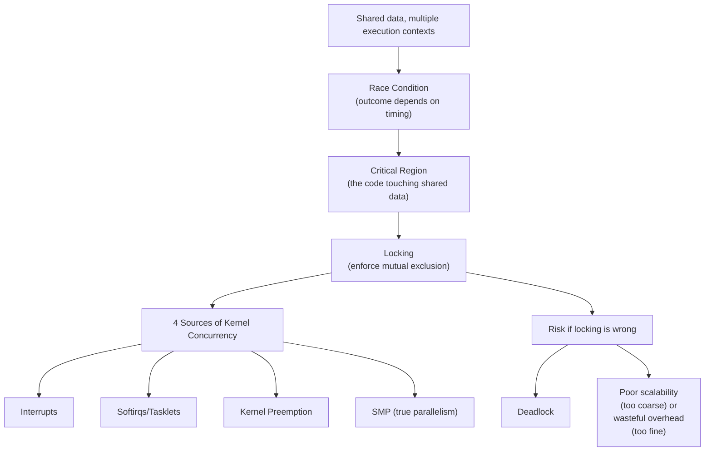
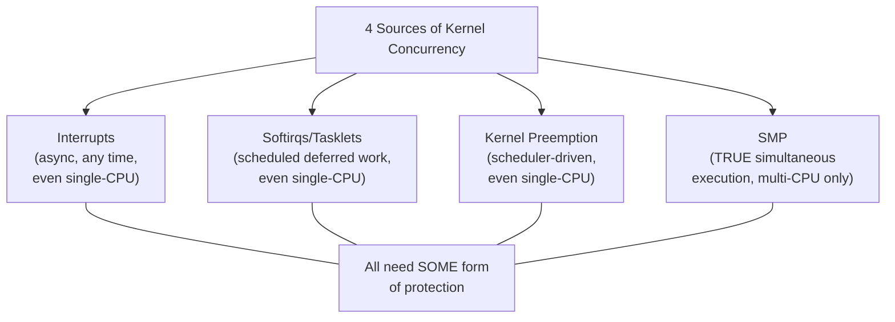
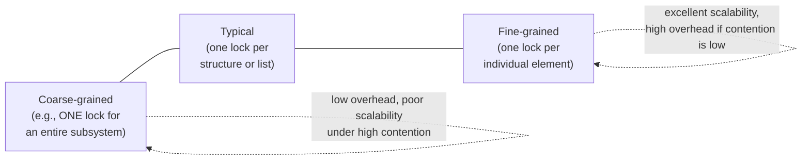
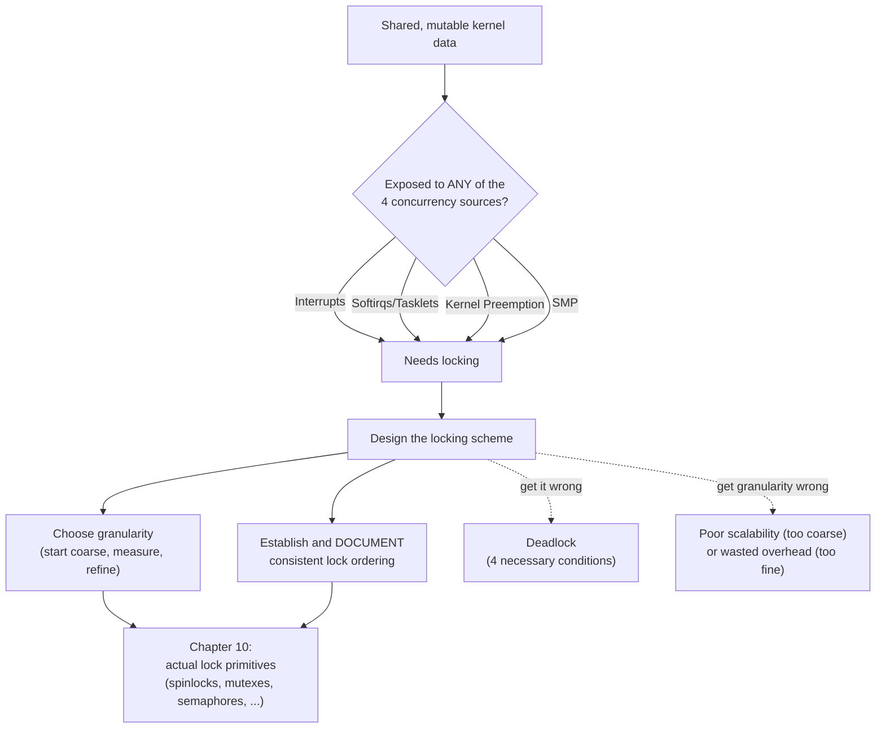

# Chapter 9 — An Introduction to Kernel Synchronization

> Source fidelity: this chapter follows Robert Love, *Linux Kernel Development*, 3rd Ed., Chapter 9 ("An Introduction to Kernel Synchronization"). This chapter is almost entirely [CONCEPTUAL CORE] — race conditions, critical sections, deadlock conditions, and lock-granularity tradeoffs are properties of concurrent systems in general, not specific to any kernel version. Where the book cites a concrete historical example (the O(1) scheduler's runqueue-locking evolution), it is marked explicitly as history, since the scheduler has since moved to CFS and EEVDF (Chapter 4).

---

## 1. What This Chapter Is About

Chapter 2 warned you, bluntly, that kernel code must be concurrency-aware from the very first line, listing four reasons why. Chapter 8 showed you *one* consequence of that (bottom halves need locking, even against themselves in the softirq case). This chapter is where the *theory* behind all of that gets its full, rigorous treatment: what a race condition actually is, exactly which four concurrency sources exist in Linux and how each one specifically creates races, what a critical region is, what deadlock is and the precise conditions required for it, and the fundamental engineering tradeoff — lock granularity — that governs every locking design decision you will ever make in kernel code.

## 2. Why This Matters

This chapter does not teach you a single new API. It teaches you the *reasoning* that Chapter 10's actual locking primitives (spinlocks, mutexes, semaphores, and more) exist to implement correctly. If you skip straight to "here's how to use a spinlock" without internalizing *why* a given piece of data needs protection, *from what*, and *how badly* a mistake can go wrong, you will write code that compiles, looks reasonable, and fails only occasionally, unpredictably, and usually in production under load — the worst possible failure mode.

## 3. Prerequisite Concepts

- **Chapter 1**: process context vs. interrupt context — the foundation this entire chapter builds on.
- **Chapter 2**: the four sources of mandatory kernel concurrency, first listed there — this chapter gives each one its full treatment.
- **Chapter 4**: scheduling and preemption — kernel preemption is one of the four concurrency sources this chapter covers in depth.
- **Chapter 8**: bottom halves — a concrete, already-studied example of code that needs the locking discipline this chapter formalizes.

## 4. Big Picture



---

## 5. Core Concepts

### 5.1 The Motivating Example — Race Conditions at the ATM

**Concept.** A **race condition** is a bug arising when the correctness of a result depends on the relative *timing* or *interleaving* of two or more execution contexts accessing shared data — the exact same code can be perfectly correct in one interleaving and badly wrong in another.

**Intuition — the book's own real-world ATM illustration.** Imagine a bank account with $100. Two "requesters" check the balance — a person at an ATM, and an automatic bill payment both want to withdraw from the same account at effectively the same moment. If both independently read "$100 available" *before* either one actually deducts anything, **both** could proceed to withdraw, and the bank loses money (or, equivalently, two people believe they successfully made a withdrawal that only one of them should have been allowed to make). The problem isn't that either check-then-withdraw sequence is individually wrong — it's that *interleaving two of them* produces a result neither sequence alone would.

**Problem it solves — why this belongs in a kernel book specifically.** The book is explicit: this exact shape of bug is pervasive inside the kernel, because the kernel is constantly managing shared, global data structures (process lists, memory structures, device state) accessed from many different execution contexts.

**Worked trace — the book's own single-shared-variable example**, with two tasks (interrupt handler and process context, say) both executing `i++`:
```
Task 1                              Task 2
------                              ------
load the value of i into a register
increment the value of i
                                     load the value of i into a register
                                     increment the value of i
write the new value of i back out
                                     write the new value of i back out
```
⭐ **This is structurally identical to the OSTEP-based `counter++` race example already covered elsewhere in your reading** — same underlying mechanism (a single high-level operation compiling to multiple, individually-interruptible machine instructions), same lesson. Worth explicitly connecting the two: Robert Love's book and OS-theory textbooks are describing *the same* fundamental phenomenon, because it's a property of concurrent execution itself, not something unique to either source.

**Design idea — the fix is **atomicity** of the whole sequence, or exclusion.** The book's own framing: the kernel code accessing `i` needs to execute as a **single, indivisible operation** relative to any other code that might touch `i` — either genuinely atomically (Chapter 10's atomic operations, when the operation is simple enough), or by using **locking** to prevent more than one context from being inside that sequence at a time.

**Active Recall (5.1)**
1. In your own words, why is a race condition specifically a *timing-dependent* bug, as opposed to an ordinary logic bug?
2. Why does `i++` need protection, given that it looks like one line of C?

<details><summary>Answers</summary>
1. The code itself can be entirely correct in isolation — the bug only manifests depending on *when*, relative to another execution context's access, this code happens to run; the same code with a different interleaving produces a correct result.
2. `i++` compiles to multiple separate machine instructions (load, increment, store) — any of which can be interrupted by another context also touching `i`, losing an update.
</details>

---

### 5.2 Critical Regions and Locking

**Concept.** A **critical region** (or critical section) is any code path that accesses and manipulates shared data; code of this nature must execute atomically — relative to other code also accessing that data — to avoid races. A **lock** is the kernel's general-purpose mechanism for enforcing this.

**Design idea — a lock's basic usage pattern, in the book's own words/shape:**
```c
lock(my_lock);
/* critical region ... */
unlock(my_lock);
```
⭐ **Two properties the book explicitly highlights about this mechanism, worth memorizing precisely:**
1. Locks are **advisory, voluntary**, not mandatory at the hardware level — they only work if **every** piece of code that touches the protected data actually acquires the lock first. A lock does nothing to stop code that simply forgets to take it.
2. Locks have **named scope** relative to the *data* they protect, not the code — the book stresses that the right mental model is "this lock protects *this data*," and you lock around any code that touches that data, rather than thinking of locks as protecting specific functions or lines.

**A second worked ATM trace, with locking added**, showing the fix conceptually:
```
Task 1 (locks before reading balance)      Task 2
--------------------------------------      ------
lock(balance_lock)
read balance ($100)
                                             lock(balance_lock)  <- BLOCKS, Task 1 holds it
withdraw $100, balance = $0
unlock(balance_lock)
                                             <- now unblocks, re-reads balance ($0)
                                             insufficient funds -- withdrawal correctly denied
```

**Common Mistakes**
- Thinking of a lock as protecting "a function" rather than "a piece of data." The same shared data can be touched by many different functions — all of them need to acquire the *same* lock, or the protection is incomplete.
- Assuming a lock enforces anything automatically. If even one code path forgetfully skips acquiring the lock before touching protected data, the whole scheme silently fails — this is exactly why disciplined, documented locking conventions (covered later in this chapter) matter so much.

---

### 5.3 The Four Sources of Kernel Concurrency, in Full Depth

This section gives each of Chapter 2's four concurrency sources the rigorous treatment it was deferred for.

#### 5.3.1 Interrupts

**Concept.** An interrupt can occur **asynchronously, almost at any time**, interrupting the currently executing code — including code that is mid-way through a critical region.

**Worked example — the book's own illustration.** Kernel code is updating a shared data structure when an interrupt occurs; the resulting interrupt handler accesses that **same** data structure before the interrupted code resumes — potentially observing a half-updated, inconsistent state, or (worse) corrupting it further by writing to it concurrently with the interrupted update still in flight (conceptually — on a single CPU the interrupted code is literally paused, but the *data* can still be left in an invalid intermediate state that the handler reads or further mutates).

**Implication for locking.** Data that might be touched by both process-context code and an interrupt handler needs to be protected in a way that's **safe even when the "other side" is an interrupt handler** — this specifically means the protection mechanism itself must be usable *from* interrupt context (ruling out anything that could sleep, per Chapter 1/8's interrupt-context constraints), and must disable interrupts (on the relevant CPU) around the critical section, not just acquire an ordinary lock — otherwise the very interrupt you're trying to protect against could fire *during* the critical section itself.

#### 5.3.2 Softirqs and Tasklets

**Concept.** Directly building on Chapter 8: the kernel can decide to run a pending softirq/tasklet at essentially any point, interrupting process-context code the same general way a hardware interrupt can.

**Implication, and the critical distinction from §5.3.1 worth restating precisely:**
- Data shared between **process-context code and a softirq/tasklet** needs protection, exactly analogous to the interrupt case.
- Data shared between **two instances of the same softirq** (which, per Chapter 8, can run truly concurrently on different CPUs) needs its own locking — tasklets get this for free (self-serialization), softirqs never do.
- Data shared between **two different** tasklets/softirqs needs locking between them, same as any other shared data.

#### 5.3.3 Kernel Preemption

**Concept.** The Linux kernel is itself **preemptible** (Chapter 4) — a higher-priority task can preempt kernel code that's currently executing, even mid-critical-region, on the *same* CPU.

**Why this is a genuinely distinct concurrency source from interrupts, worth not conflating.** Even on a **single-CPU, non-SMP** machine, with no interrupts involved at all, two different kernel code paths can still race against each other purely because the scheduler decided to preempt one mid-execution and run the other — this is why the book insists kernel preemption deserves its own entry in this list, rather than being lumped in with "interrupts" or "SMP."

**Implication for locking.** Protecting against this specifically requires being able to **disable kernel preemption** around a critical region (a distinct mechanism from disabling interrupts, covered as part of Chapter 10's primitives) — or, equivalently, holding any lock that itself disables preemption as a side effect (as several of Chapter 10's primitives do).

#### 5.3.4 Symmetrical Multiprocessing (SMP)

**Concept.** On a true multi-CPU (SMP) system, kernel code can be executing **simultaneously, genuinely in parallel**, on two or more different physical CPUs — not merely interleaved via scheduling, but truly concurrent in the strictest sense.

**Why this is the "purest" form of the problem.** Every race-condition mechanism described so far (interrupts, softirqs, kernel preemption) ultimately comes down to *interleaving* on what is, at bottom, still sequential execution on one CPU at a time. SMP removes even that — two CPUs can be reading *and* writing the exact same memory location at the literal same instant. Locking that's correct for SMP is automatically correct for the single-CPU interleaving-only sources too (a lock preventing true simultaneous access certainly also prevents merely-interleaved access) — which is part of why the book recommends designing SMP-safe locking as the default assumption, even for code you believe will "only ever run on a single CPU," since that assumption has a way of becoming false later (a driver written for an embedded single-core target getting reused on a multi-core server, for instance).

**A subtlety the book flags, worth remembering:** uniprocessor (UP) kernels historically could compile out some of this locking overhead entirely (since true simultaneous execution was impossible by construction) — but even a UP kernel still needs protection against the *other three* sources (interrupts, softirqs/tasklets, kernel preemption), which is exactly why "but my machine only has one CPU" has never been a valid excuse to skip locking altogether.



**Active Recall (5.3)**
1. Which of the four concurrency sources can occur on a single-CPU machine with no true parallelism at all?
2. Why does protecting against SMP automatically also protect against the other three?
3. Why is kernel preemption listed as a *distinct* source from "interrupts," rather than being folded into it?

<details><summary>Answers</summary>
1. All three of interrupts, softirqs/tasklets, and kernel preemption can occur on a single CPU — only true SMP parallelism strictly requires multiple physical CPUs.
2. A lock that correctly prevents genuinely simultaneous access on multiple CPUs also, as a strict subset, prevents merely-interleaved access on a single CPU — SMP-safe locking is a superset guarantee.
3. Kernel preemption is driven by the scheduler choosing to run different code on the *same* CPU, not by an external hardware/software event diverting execution the way an interrupt does — it's a conceptually distinct mechanism even though both can interrupt a critical region.
</details>

---

### 5.4 Knowing What to Protect

**Concept.** The book offers a direct, practical heuristic for identifying what actually needs locking, framed as a simple test: **if data can be accessed concurrently, it almost certainly needs locking.** The practical skill is learning to spot, while *writing* code (not after the fact), every piece of shared, mutable state that any of the four concurrency sources could touch.

**Design idea — a disciplined way to think about this, synthesized from the chapter's own guidance:** for every piece of global or shared data you introduce, explicitly ask: can an interrupt handler touch this? Can a softirq/tasklet? Can the scheduler preempt code mid-access and run something else that touches it? Can another CPU be touching it right now? If the honest answer to **any** of these is "yes, or I'm not sure," it needs locking.

**Common Mistakes**
- Protecting data "because it feels important" while missing genuinely shared, concurrently-accessed data that looks mundane. The right test is concurrency exposure, not subjective importance.
- Adding locking only after a race condition is observed in production. The book's entire framing is that this reasoning belongs at **design time**, not as a retrofit — races are notoriously hard to reproduce and debug after the fact, precisely because they're timing-dependent (revisited in the Debugging Mindset section below).

---

### 5.5 Deadlocks

**Concept.** A **deadlock** is a situation in which two or more execution contexts are each waiting on a resource held by one of the others, such that **none** of them can ever make progress — the classic simplest case being two threads, each holding one lock the other needs:

```
Thread 1                    Thread 2
--------                    --------
lock(A)
                             lock(B)
lock(B)  <- BLOCKS           lock(A)  <- BLOCKS
         (waiting forever, each holding what the other needs)
```

**A single-thread special case worth knowing by name — self-deadlock.** A thread attempting to acquire a lock **it already holds** (e.g., via a recursive function call, or by calling into another function that, unknown to the caller, tries to re-acquire the same lock) deadlocks against itself — the simplest possible deadlock, and a real, recurring bug pattern in practice (especially once code is refactored and a lock's acquisition moves to a different call depth than a caller assumes).

**The ABBA deadlock, generalized.** The two-thread example above is the canonical "ABBA deadlock": thread 1 acquires A then wants B; thread 2 acquires B then wants A — the *order* in which two locks are acquired, if inconsistent across different code paths, is enough to create a deadlock, even if neither thread individually does anything obviously wrong.

⭐ **The necessary conditions for deadlock, precisely** (directly connecting to the identical four-condition framework already covered in the OSTEP-based notes elsewhere in your reading — this is the same underlying theory, restated in this book's own kernel-specific framing):
- **Mutual exclusion** — the resources involved can only be held by one context at a time (true of locks by definition).
- **Hold and wait** — a context holds at least one resource while waiting for another.
- **No preemption** — a resource cannot be forcibly taken away from the context holding it.
- **Circular wait** — a cycle of contexts exists, each waiting on a resource the next one in the cycle holds.

**Design idea — deadlock prevention rules, exactly as the book states them, worth memorizing as concrete, actionable engineering discipline:**
1. **Implement lock ordering** — if locks must be acquired in a specific order, **always** acquire them in that same order, everywhere, without exception. This is the single most important rule, and the book notes that real kernel subsystems formally **document** their lock-ordering rules precisely because this discipline cannot be left to individual developers' memory.
2. **Prevent starvation** — ask "does this code ever terminate?" for any code waiting on a condition or lock; a thread that can wait indefinitely under some circumstance is a latent problem even short of full deadlock.
3. **Do not double acquire the same lock.** (The self-deadlock case, above — the book calls this out as its own explicit rule precisely because it's such a common real mistake.)
4. **Design for simplicity.** The book's blunt summary: the more complex your locking scheme, the greater the chance it harbors a subtle deadlock — simplicity in locking design is itself a correctness strategy, not merely a style preference.

**Debugging mindset — the book's own framing, worth internalizing.** Deadlocks are notoriously difficult to debug precisely because they're a function of **timing and interleaving**, exactly like ordinary race conditions — a deadlock-prone lock-ordering bug might run correctly thousands of times before the "wrong" interleaving occurs in production. This is exactly why *prevention through disciplined design* (the four rules above), not after-the-fact debugging, is the book's central recommendation — and it's precisely why this chapter exists *before* Chapter 10 teaches you the actual lock types: understanding the theory first is what lets you design locking schemes that never need this kind of debugging in the first place.

**Active Recall (5.5)**
1. State the four necessary conditions for deadlock.
2. What is the single most important deadlock-prevention rule the book gives, and why does it need to be *documented*, not just individually remembered?
3. What is a self-deadlock, and how does it typically arise in real code?

<details><summary>Answers</summary>
1. Mutual exclusion, hold and wait, no preemption, circular wait.
2. Consistent lock ordering — acquire locks that are needed together in the same order, everywhere. It needs to be documented because a subsystem is maintained by many different developers over time, none of whom can be relied on to simply "remember" an unwritten convention correctly forever.
3. A thread attempting to re-acquire a lock it already holds — commonly arising when a function acquires a lock, then (directly or through a chain of calls) invokes another function that, unknown to the caller, also tries to acquire that same lock.
</details>

---

### 5.6 Contention and Scalability

**Concept.** **Lock contention** (or simply "contention") occurs when a lock is currently held, and another context must wait to acquire it. A **highly contended** lock becomes a performance bottleneck, since waiting contexts are, by definition, not making progress. **Lock granularity** is the size/amount of data a single lock protects, and it is the primary design lever for managing contention.

**Design idea — the granularity spectrum:**


**[BOOK — Linux 2.6, cited as a concrete historical example] The scheduler runqueue-locking evolution.** Prior to the 2.6 series, the scheduler used **a single, global runqueue lock** — meaning, in effect, only one CPU at a time could even be *inside the scheduler*, regardless of how many CPUs the machine had, a severe bottleneck on large SMP systems. Early 2.6 (the O(1) scheduler) introduced **per-CPU runqueues, each with its own lock** — directly removing that single-global-lock bottleneck by construction.

**[MODERN LINUX]** The O(1) scheduler the book describes was itself later replaced by **CFS**, and more recently by **EEVDF** (both already covered in Chapter 4 of this course) — the *specific* scheduler algorithm has changed twice since this book's writing, but the **per-CPU runqueue locking architecture** this section describes (as the fix for the old global-lock bottleneck) has remained the underlying structural approach across all of these scheduler redesigns. This is a clean, concrete example of this course's [BOOK]/[MODERN LINUX] distinction: the specific algorithm named is dated, but the *locking architecture lesson it's illustrating* is exactly as valid today as when it was written.

⭐ **The core, genuinely difficult tradeoff, stated precisely by the book, worth internalizing as a permanent design principle:** locking that is **too coarse** causes poor scalability under high contention (everyone queues up for the one lock); locking that is **too fine** causes wasteful overhead when contention is actually low (the cost of acquiring/releasing many small locks, and the memory cost of all those separate lock structures, outweighs any contention they'd have prevented). **Both extremes produce poor performance, for opposite reasons.**

**Design idea — the book's own recommended discipline, worth treating as a direct instruction, not just advice:** *start with simple, coarser locking, and only move to finer-grained locking once contention is actually measured to be a real problem.* This directly echoes deadlock-prevention rule #4 (design for simplicity) — a simpler locking scheme is both easier to get correct and easier to reason about, and premature fine-graining adds real complexity and overhead for a scalability problem that may never actually materialize on the hardware you actually run on.

**Connection to Systems Engineering.** If you have reasoned about database lock granularity (row-level vs. table-level locking), distributed-system sharding/partitioning (coarse shards vs. fine-grained keys), or contention in a concurrent data structure in any language, this is the *exact same tradeoff*, one level removed — "how big a unit of data does one lock cover" is a universal concurrent-systems design question, and the kernel's runqueue-locking history is simply one well-documented, real-world instance of resolving it correctly over time, under actual measured pressure, rather than by guessing upfront.

**Active Recall (5.6)**
1. What does "lock granularity" mean?
2. Give the book's own recommended discipline for deciding how fine-grained to make a new locking scheme.
3. Why can locking that's *too fine-grained* actually hurt performance, not just add unnecessary complexity?

<details><summary>Answers</summary>
1. The size/amount of data a single lock protects — ranging from one lock for an entire subsystem (coarse) to one lock per individual element (fine).
2. Start simple/coarse, and only increase granularity once contention is actually measured to be a real, demonstrated problem — not preemptively.
3. Each additional, separate lock has real acquire/release overhead and memory cost; if actual contention on the data is low, that overhead is pure waste that a single coarser lock would have avoided entirely.
</details>

---

## 6. How the Pieces Fit Together — Chapter 9 Subsystem Diagram



---

## 7. Source Code Navigation

This chapter is almost entirely conceptual — the book itself defers concrete APIs to Chapter 10. Still, it's worth connecting the theory to real, in-tree evidence now:

```bash
cd ~/linux
# Find a real, documented lock-ordering convention -- exactly the discipline Sec. 5.5 describes
rg -n "lock order" Documentation/ -i | head -10
rg -n "locking order" mm/ -i | head -5

# Find the modern per-CPU runqueue structure Sec. 5.6's historical example evolved into
rg -n "struct rq \{" kernel/sched/sched.h

# See a real example of per-element ("fine-grained") locking
rg -n "spinlock_t.*lock;" include/linux/mm_types.h | head -5
```

---

## 8. Hands-On Experiments

### Experiment 9.1 — Reproduce a Classic User-Space Race Condition
**Risk:** SAFE USER-SPACE

**Objective.** Make §5.1's abstract race-condition trace concrete and *measurable*, in code you compile and run yourself — directly mirroring the OSTEP-based `counter++` demonstration, if you've seen that, but now explicitly tied to this book's framing.

```c
// race_demo.c
// SAFE USER-SPACE. Compile: gcc -O0 -o race_demo race_demo.c -lpthread
#include <stdio.h>
#include <pthread.h>

volatile long counter = 0;
#define ITERATIONS 10000000

void *worker(void *arg) {
    for (long i = 0; i < ITERATIONS; i++)
        counter++;     // NOT atomic -- load, increment, store
    return NULL;
}

int main(void) {
    pthread_t t1, t2;
    pthread_create(&t1, NULL, worker, NULL);
    pthread_create(&t2, NULL, worker, NULL);
    pthread_join(t1, NULL);
    pthread_join(t2, NULL);
    printf("Expected: %ld, Actual: %ld\n", 2L * ITERATIONS, counter);
    return 0;
}
```

**Execution.**
```bash
gcc -O0 -o race_demo race_demo.c -lpthread
for i in 1 2 3; do ./race_demo; done
```

**Expected Observation.** The "Actual" count is reliably **less than** the expected `2 * ITERATIONS`, and — critically — **different each run.**

**Why It Happens.** Exactly §5.1's trace: `counter++` is three separate machine instructions; when both threads' instruction streams interleave badly around the same increment, one thread's update is silently lost.

**Investigation.**
```bash
gcc -O0 -S -o race_demo.s race_demo.c    # look at the generated assembly for `counter++` --
                                            # count the actual instructions, confirm it's not one atomic op
```

**Experiment Questions.**
- Does the lost-update count change if you compile with `-O2` instead of `-O0`? Why might optimization level affect (without eliminating) how often the race manifests?
- If you added a `pthread_mutex_t` around just the `counter++` line, would you expect the result to become perfectly deterministic? Try it and confirm.

---

### Experiment 9.2 — Reproduce a Deadlock, Then Fix It With Lock Ordering
**Risk:** SAFE USER-SPACE (the program will genuinely hang — that's the expected, educational outcome; just `Ctrl+C` it)

**Objective.** Make §5.5's ABBA deadlock concrete, then apply deadlock-prevention rule #1 (consistent lock ordering) yourself, and confirm it actually fixes the problem.

```c
// deadlock_demo.c
// SAFE USER-SPACE (but WILL HANG -- that's expected; Ctrl+C to stop).
// Compile: gcc -O0 -o deadlock_demo deadlock_demo.c -lpthread
#include <stdio.h>
#include <pthread.h>
#include <unistd.h>

pthread_mutex_t lock_a = PTHREAD_MUTEX_INITIALIZER;
pthread_mutex_t lock_b = PTHREAD_MUTEX_INITIALIZER;

void *thread1(void *arg) {
    pthread_mutex_lock(&lock_a);
    printf("Thread 1: got lock A, trying lock B\n");
    usleep(100000);          // widen the race window so the deadlock is reliably hit
    pthread_mutex_lock(&lock_b);
    printf("Thread 1: got both locks\n");
    pthread_mutex_unlock(&lock_b);
    pthread_mutex_unlock(&lock_a);
    return NULL;
}

void *thread2(void *arg) {
    pthread_mutex_lock(&lock_b);        // <-- opposite order from thread1: THIS is the bug
    printf("Thread 2: got lock B, trying lock A\n");
    usleep(100000);
    pthread_mutex_lock(&lock_a);
    printf("Thread 2: got both locks\n");
    pthread_mutex_unlock(&lock_a);
    pthread_mutex_unlock(&lock_b);
    return NULL;
}

int main(void) {
    pthread_t t1, t2;
    pthread_create(&t1, NULL, thread1, NULL);
    pthread_create(&t2, NULL, thread2, NULL);
    pthread_join(t1, NULL);
    pthread_join(t2, NULL);
    printf("Both threads finished -- no deadlock this run.\n");
    return 0;
}
```

**Execution.**
```bash
gcc -O0 -o deadlock_demo deadlock_demo.c -lpthread
timeout 5 ./deadlock_demo; echo "Exit code: $?"
```

**Expected Observation.** Both threads print their first message ("got lock A/B, trying lock ...") and then the program **hangs** — `timeout 5` will kill it after 5 seconds, confirming neither thread ever finishes.

**Why It Happens.** This is exactly the ABBA pattern from §5.5: `thread1` acquires A then wants B; `thread2` acquires B then wants A, in the opposite order — each ends up holding what the other needs.

**The Fix (apply deadlock-prevention rule #1 yourself).** Edit `thread2` so it acquires `lock_a` **before** `lock_b`, matching `thread1`'s order exactly, then rebuild and rerun:
```bash
timeout 5 ./deadlock_demo; echo "Exit code: $?"
```

**Expected Observation After the Fix.** The program now reliably completes, printing "Both threads finished."

**Investigation.**
```bash
# GDB can show you a live deadlock's exact state -- run the ORIGINAL (buggy) binary, Ctrl+C
# it mid-hang under gdb, and inspect:
gdb ./deadlock_demo
(gdb) run
# wait for the hang, then Ctrl+C
(gdb) info threads
(gdb) thread 2
(gdb) bt            # see exactly which mutex_lock call each thread is stuck in
```

**Experiment Questions.**
- Why does adding `usleep(100000)` make the deadlock reliably reproducible, when removing it might make the bug "disappear" most runs? What does this tell you about why real deadlocks in production code can go unnoticed for a long time?
- Besides reordering the locks, name at least one *other* valid fix from §5.5's four prevention rules that could also resolve this specific bug (hint: think about `pthread_mutex_trylock()`).

---

## 9. Mini Project — A "Lock Ordering Auditor" for a Toy Codebase

**Goal.** Write a small Python script that scans a set of C source files for `lock(X)` / `lock(Y)` acquisition pairs (within the same function, simplistically) and flags any pair of locks acquired in **inconsistent order** across different functions — a crude, educational version of the real discipline described in §5.5.

```python
#!/usr/bin/env python3
# lock_order_check.py
# SAFE USER-SPACE. Usage: python3 lock_order_check.py *.c
import re, sys
from collections import defaultdict

lock_re = re.compile(r'\b(?:pthread_mutex_lock|lock)\s*\(\s*&?(\w+)\s*\)')

def find_lock_order_per_function(path):
    with open(path) as f:
        text = f.read()
    # Very simplistic: split on function boundaries by "void *... (...) {"
    funcs = re.split(r'\n\w[\w\s\*]*\([^)]*\)\s*\{', text)
    for func in funcs:
        locks_in_order = lock_re.findall(func)
        if len(locks_in_order) >= 2:
            yield tuple(locks_in_order[:2])   # just the first pair acquired, for simplicity

def main(paths):
    seen_orders = defaultdict(set)   # frozenset({A,B}) -> set of observed (first, second) orders
    for path in paths:
        for order in find_lock_order_per_function(path):
            key = frozenset(order)
            if len(key) < 2:
                continue
            seen_orders[key].add(order)
    for pair, orders in seen_orders.items():
        if len(orders) > 1:
            print(f"POTENTIAL ABBA DEADLOCK RISK between {pair}: inconsistent orders found: {orders}")

if __name__ == "__main__":
    main(sys.argv[1:])
```

**What this teaches:**
1. **What the code does:** scans each source file, approximates "which two locks does this function acquire, and in what order," and flags any lock *pair* observed in more than one order across the whole codebase — exactly the pattern deadlock-prevention rule #1 exists to prevent.
2. **Run it against your two experiment files:**
   ```bash
   python3 lock_order_check.py deadlock_demo.c
   ```
   On the **original, buggy** version (before your fix), it should correctly flag `lock_a`/`lock_b` as inconsistently ordered. After your fix, it should report nothing.
3. **Common errors / honest limitations:** this is a deliberately crude, regex-based approximation (real static-analysis lock-order checkers, like the kernel's own `lockdep` — mentioned here as a preview of Chapter 18's debugging toolchain — do this properly, tracking actual runtime lock-acquisition graphs rather than guessing from source text). Treat this mini-project as building *intuition* for what such a tool does and why it's valuable, not as a production-grade checker.
4. **Extension exercise:** `lockdep` is a real, built-in kernel debugging feature that performs exactly this kind of lock-ordering validation **at runtime**, on the actual kernel you're running, catching potential deadlocks even in interleavings that haven't actually occurred yet. Look up `Documentation/locking/lockdep-design.rst` in the kernel tree now, even though you won't fully exploit it until Chapter 18 — the connection between this toy script and a real, production debugging tool is worth seeing early.

---

## 10. Common Misconceptions (Chapter-Wide Summary)

| Misconception | Correction |
|---|---|
| "Race conditions only matter on true multi-CPU (SMP) systems." | Three of the four concurrency sources (interrupts, softirqs/tasklets, kernel preemption) can cause races on a single CPU with no true parallelism at all. |
| "A lock protects a function." | A lock protects *data* — every code path touching that data, in any function, must acquire the same lock. |
| "If my code works correctly in testing, the locking is fine." | Race conditions and deadlocks are timing-dependent — passing tests (especially under low load) proves little; this is exactly why design-time reasoning, not after-the-fact testing, is this chapter's core recommendation. |
| "More fine-grained locking is always better for performance." | Over-fine-grained locking adds real overhead and can *hurt* performance when actual contention is low — the right granularity is empirically determined, not maximized by default. |
| "Deadlock requires at least two different locks." | A single thread re-acquiring a lock it already holds (self-deadlock) is a real, simpler deadlock case involving only one lock. |
| "Kernel preemption and interrupts are basically the same concurrency concern." | They are listed as distinct sources precisely because they arise from different mechanisms (scheduler decision vs. external event), even though both can interrupt a critical region on a single CPU. |

---

## 11. Interview Questions

**Basic**
- Q: What is a race condition, and why is it specifically a *timing-dependent* bug?
  → *Correct answer:* a bug where the outcome depends on the relative interleaving/timing of concurrent accesses to shared data — the same code can be correct under one interleaving and wrong under another.

**Intermediate**
- Q: Name the four sources of kernel concurrency and explain which ones require only a single CPU to manifest.
  → *Deeper follow-up:* "Why does protecting correctly against SMP automatically protect against the other three as well?"

- Q: What is lock granularity, and what's the fundamental tradeoff involved in choosing it?
  → *Deeper follow-up:* "Walk through the book's runqueue-locking example and explain exactly what problem per-CPU runqueues solved."

**Advanced / Kernel-Development**
- Q: State the four necessary conditions for deadlock, and for each, name a concrete prevention technique that breaks it.
  → *Expected reasoning:* mutual exclusion (hard to remove — it's the point of a lock), hold-and-wait (acquire-all-at-once patterns), no preemption (`trylock`-and-backoff patterns), circular wait (consistent lock ordering — the book's primary recommended fix).

- Q: Why does the book recommend designing locking schemes to be SMP-safe even for code that currently only runs on a single-CPU system?
  → *Deeper follow-up:* "Give a realistic scenario where this assumption later breaking would cause a real, hard-to-diagnose production bug."

**Design Question**
- Q: You're reviewing a colleague's new kernel subsystem, which uses one single global lock for all of its data structures. Walk through how you'd decide whether this is appropriate, or whether — and how — you'd recommend finer-grained locking, using this chapter's own stated discipline.
  → No single correct answer — evaluate whether the candidate references *measuring* contention first, starting simple, and the specific cost side of over-fine-graining, not just "more locks = more scalable."

---

## 12. Active Recall (Whole-Chapter Review)

1. Using the ATM example, explain in your own words why two individually-correct check-then-act sequences can produce an incorrect result when interleaved.
2. What does it mean for a lock to be "advisory" rather than enforced at the hardware level?
3. List the four sources of kernel concurrency.
4. Which concurrency sources can occur even on a single-CPU, non-SMP machine?
5. State the four necessary conditions for deadlock.
6. What is a self-deadlock?
7. State the book's single most important deadlock-prevention rule.
8. What is lock granularity, and what happens at each extreme of the spectrum?
9. What was the book's cited historical example of a scalability-driven locking change, and what succeeded the scheduler it was describing?

<details>
<summary>Answers</summary>

1. Each sequence (read balance, then withdraw) is correct in isolation, but if both read the balance *before* either one withdraws, both can proceed to withdraw based on stale information — the bug exists only in the interleaving, not in either sequence alone.
2. It only works if every single code path touching the protected data voluntarily acquires the lock first — nothing in hardware prevents code from simply skipping the lock and accessing the data directly.
3. Interrupts, softirqs/tasklets, kernel preemption, and SMP.
4. Interrupts, softirqs/tasklets, and kernel preemption — only SMP strictly requires multiple physical CPUs.
5. Mutual exclusion, hold and wait, no preemption, circular wait.
6. A single thread attempting to re-acquire a lock it already holds, typically via recursion or an unnoticed nested call into code that also acquires the same lock.
7. Implement and consistently follow (and document) a fixed lock-acquisition ordering whenever multiple locks are needed together.
8. Granularity is the amount of data one lock protects; too coarse causes poor scalability under contention, too fine causes wasteful overhead when contention is actually low.
9. The scheduler's runqueue locking, which moved from a single global lock to per-CPU runqueue locks in the O(1) scheduler (early 2.6); the O(1) scheduler itself was later replaced by CFS, and more recently by EEVDF (Chapter 4), though the per-CPU locking architecture this example illustrates has persisted across both successors.
</details>

---

## 13. Chapter Summary

Race conditions arise whenever shared, mutable data can be accessed by more than one execution context, and the result depends on their relative timing — the kernel's defense is locking, which enforces that a critical region (code touching the shared data) executes as if atomic, relative to anyone else touching that same data. Linux has exactly four sources of concurrency that can create races: interrupts, softirqs/tasklets, kernel preemption, and SMP — the first three can occur even on a single CPU, and SMP-safe locking is automatically safe against all four. Getting locking wrong produces one of two failure modes: deadlock (requiring all four of mutual exclusion, hold-and-wait, no preemption, and circular wait simultaneously — prevented primarily through consistent, documented lock ordering), or poor performance from miscalibrated lock granularity (too coarse hurts scalability, too fine wastes overhead) — with the book's consistent recommendation being to design simply first and refine only once contention is actually measured.

## 14. What I Should Be Able to Explain Now

- [ ] What a race condition is, illustrated with the ATM example and the single-variable instruction-interleaving trace.
- [ ] What a critical region is and why a lock protects *data*, not functions.
- [ ] All four sources of kernel concurrency, which three can occur single-CPU, and why SMP-safety is a superset guarantee.
- [ ] A disciplined heuristic for deciding what data needs locking.
- [ ] The precise four necessary conditions for deadlock, and the book's four concrete prevention rules.
- [ ] What lock granularity is, the tradeoff at each extreme, and the book's recommended "start simple, measure, refine" discipline.
- [ ] Why this chapter deliberately precedes Chapter 10's actual locking primitives — theory before tools.

---

## Knowledge Graph (Chapter 9 Contribution)

```
Linux Kernel (continued from Ch.1-8)
+-- An Introduction to Kernel Synchronization
     +-- Race Conditions
     |    +-- ATM example -- interleaved check-then-act
     |    +-- Single-variable instruction-interleaving trace
     +-- Critical Regions and Locking
     |    +-- Locks protect DATA, not functions
     |    +-- Advisory/voluntary -- only as good as universal adoption
     +-- 4 Sources of Kernel Concurrency
     |    +-- Interrupts (async, single-CPU-capable)
     |    +-- Softirqs/Tasklets (Ch.8, single-CPU-capable)
     |    +-- Kernel Preemption (Ch.4, single-CPU-capable)
     |    +-- SMP (true parallelism, multi-CPU only, superset guarantee)
     +-- Knowing What to Protect
     |    +-- Heuristic: ANY of the 4 sources could touch it? -> needs locking
     +-- Deadlock
     |    +-- 4 necessary conditions (mutual exclusion, hold-and-wait,
     |    |    no preemption, circular wait)
     |    +-- Self-deadlock (single lock, re-acquired)
     |    +-- ABBA deadlock (two locks, inconsistent order)
     |    +-- Prevention: lock ordering (DOCUMENTED), avoid starvation,
     |         no double-acquire, simplicity
     +-- Contention and Scalability
          +-- Lock granularity spectrum (coarse <-> fine)
          +-- [BOOK] O(1) scheduler: global runqueue lock -> per-CPU locks
          +-- [MODERN] CFS -> EEVDF (Ch.4) -- algorithm changed,
          |    per-CPU locking architecture persisted
          +-- Discipline: start simple, measure, refine
     +-- -> Chapter 10: the actual locking primitives
```

*(Merges into `final-knowledge-map.md`. Cross-reference: `glossary.md` gains `race condition`, `critical region`, `lock granularity`, `deadlock`, `self-deadlock`, `ABBA deadlock`, `lock contention`, `lockdep`; `source-code-map.md` gains `Documentation/locking/`, `kernel/sched/sched.h`'s `struct rq`; `debugging-playbook.md` gains a "hang / deadlock reproduction and `gdb` thread inspection" scenario; `interview-questions.md` gains this chapter's question set.)*