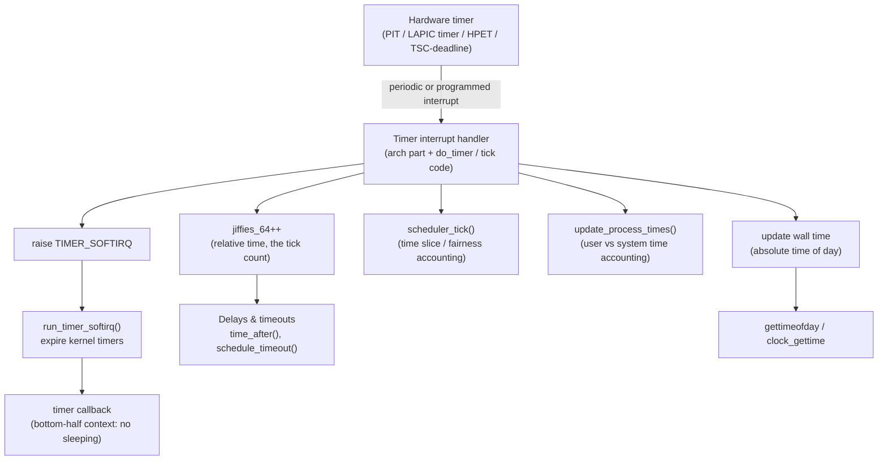
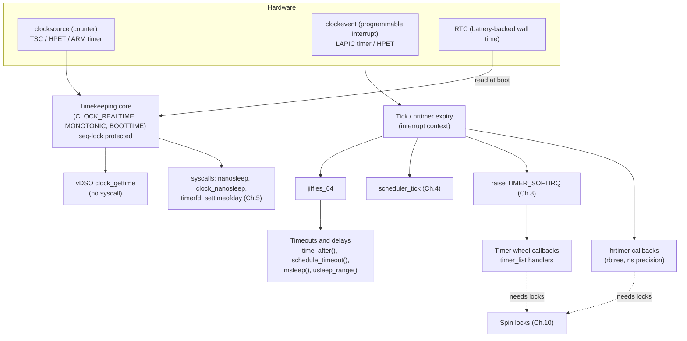

# Chapter 11 — Timers and Time Management

> Source fidelity: this chapter follows Robert Love, *Linux Kernel Development*, 3rd Ed., Chapter 11 ("Timers and Time Management"). All explanations, code and diagrams below are original. This is one of the chapters where the book is most visibly dated: the timer API was reworked, the timer wheel was rewritten, high-resolution timers and tickless operation arrived (they get one short mention or none in the book), and `xtime` is gone. Every such place is marked **[BOOK — Linux 2.6]**, **[MODERN LINUX]** or **[CONCEPTUAL CORE]**. Where I am not certain of an exact version number or name from memory, I say so and give you the command to verify it in the source tree.

---

## 1. What This Chapter Is About

A kernel has to answer three different questions about time, and this chapter keeps them apart:

| Question | Example | Mechanism |
|---|---|---|
| **What time is it?** (absolute time) | Stamp a file with its modification time | Wall-clock time, kept by the timekeeping core |
| **How long has it been?** (relative time) | Has this packet been waiting 200 ms? | `jiffies`, monotonic clocks |
| **Run this later.** (scheduled events) | Retransmit if no ACK in 300 ms | Kernel timers, delays |

Behind all three sits one hardware heartbeat: a periodic **timer interrupt**. The chapter covers that tick (`HZ`), the counter it advances (`jiffies`), the handler that runs on every tick, wall-clock time, kernel timers (`timer_list`), and the family of "wait a while" primitives used by drivers.

## 2. Why This Matters

Time is everywhere in kernel code and is where subtle bugs live:

- Every driver waits on hardware ("wait at least 2 microseconds after changing mode").
- Every network protocol is timers (retransmit, keepalive, delayed ACK, TIME_WAIT).
- The scheduler's time slices and CFS/EEVDF accounting (Chapter 4) ride on the tick.
- A `jiffies` comparison written the naive way works for 49 days (or 497, or 25 days) and then breaks.
- A timer callback runs in a context you cannot sleep in, concurrently with the code that armed it (Chapters 8-10 all apply here at once).

## 3. Prerequisite Concepts

- **Chapter 1**: process vs. interrupt context. Timer callbacks run in a bottom-half context.
- **Chapter 4**: scheduling, `need_resched`, `schedule()`, sleeping states (`TASK_INTERRUPTIBLE`...). Delays that sleep depend on them.
- **Chapter 7**: interrupt handlers (the tick *is* an interrupt).
- **Chapter 8**: softirqs. Kernel timers run in `TIMER_SOFTIRQ`.
- **Chapters 9-10**: synchronization. `xtime`'s seq lock, timer-vs-handler races, and `del_timer_sync` all need it.

## 4. Big Picture



The tick is a small piece of work that the entire system hangs off, which is why Chapter 1's rule "interrupt handlers must be fast" is taken so seriously here.

---

## 5. Core Concepts

### 5.1 The Kernel's Notion of Time — Why a Tick at All

**Concept.** A computer has no built-in sense of "now". The kernel builds one from hardware that can **count** (a free-running counter) and hardware that can **interrupt periodically** (a programmable timer). The periodic interrupt is the **system timer**; each interrupt is a **tick**.

**Intuition.** A metronome in a music room: nobody inside can see a clock, but everyone can count beats. If you know the beat rate, counting beats gives elapsed time, and a conductor (the scheduler) can use each beat as a chance to ask "should someone else play now?"

**Problem.** The kernel needs (a) elapsed-time bookkeeping, (b) a periodic opportunity to preempt a running task (Chapter 4), (c) a way to run things "in N milliseconds". A regular interrupt gives all three with one mechanism.

**Design idea.** Program a hardware timer to interrupt at a fixed frequency, `HZ`, and let the handler count ticks and do periodic work.

**Absolute vs. relative; periodic vs. one-shot (the book's four notions).**

| | Meaning | Kernel example |
|---|---|---|
| Absolute time | A point on the calendar | Wall-clock time ("the file was modified at 14:03") |
| Relative time | A distance from now | "Wake me in 5 ms" |
| Periodic event | Repeats on a schedule | The tick itself, `cron`-like kernel work |
| One-shot event | Happens once | A retransmit timer |

**[CONCEPTUAL CORE]** These four notions are timeless. What changed is *how* the kernel realizes them: Section 5.3 and the modern-Linux box in 5.2 explain that the tick no longer has to be periodic.

---

### 5.2 The Tick Rate: `HZ`

**Concept.** `HZ` is the frequency of the timer interrupt, in ticks per second. The period of one tick is `1/HZ` seconds. It is a compile-time constant (`CONFIG_HZ`).

**[BOOK — Linux 2.6]** The default on x86 was **100 Hz** (10 ms per tick) in the era the book describes; during 2.5 development it was raised to **1000 Hz** (1 ms) and later made a configuration choice, with the book's discussion presenting the tradeoff below. Other architectures used different values (the book lists a table, e.g. Alpha and some others with other HZ).

**Why the choice is a tradeoff.**

| Higher HZ (e.g. 1000) | Lower HZ (e.g. 100) |
|---|---|
| Timers and `poll()`/`select()` can time out with finer granularity (the book's "resolution" argument) | Coarser timeout accuracy (a timer for 3 ms effectively fires within the next tick, up to 10 ms later) |
| Better preemption responsiveness (the scheduler gets a chance more often) | Fewer interrupts, fewer cache disturbances, less power |
| More overhead: 1000 interrupts/s even when idle, more time in the handler, more cache pollution | Less overhead |
| Higher chance of waking an idle CPU for nothing (power) | Better for battery/idle |

**Important consequence for code.** Never hard-code a number of ticks. Express durations in seconds and multiply by `HZ`, e.g. `2 * HZ` is always two seconds regardless of configuration. `jiffies`, `HZ` and the conversion helpers (`msecs_to_jiffies()`, `jiffies_to_msecs()`) are how portable kernel code expresses time.

**`USER_HZ`.** User space historically saw clock ticks at a fixed 100 per second (`sysconf(_SC_CLK_TCK)`) regardless of the kernel's `HZ`. The kernel converts internally (`jiffies_to_clock_t()`). This is why `/proc/<pid>/stat` times are in units of 1/100 s even if your kernel runs 250 or 1000 Hz.

**[MODERN LINUX] — three important updates.**
1. **Common defaults today are 250 Hz on desktop/server distro kernels** (Ubuntu's generic kernel is commonly `CONFIG_HZ=250`; Android/embedded often 100; low-latency and some desktop kernels use 1000). Check yours: `grep 'CONFIG_HZ' /boot/config-$(uname -r)`.
2. **Tickless operation (`NO_HZ`).** Since around 2.6.21 the kernel can stop the periodic tick on an *idle* CPU (`CONFIG_NO_HZ_IDLE`), reprogramming the timer for the next actual event instead. Later, `CONFIG_NO_HZ_FULL` (around 3.10; verify against `Documentation/timers/no_hz.rst`) lets designated CPUs running exactly one task also skip the tick (useful for HPC and packet processing). So "a periodic 1000 Hz interrupt, always" from the book is no longer literally true; the periodic tick is now an *optimization-able default*, not a physical law.
3. **High-resolution timers (`hrtimers`).** Added around 2.6.21-2.6.24 (verify the exact release with `git log`), they decouple timer precision from `HZ` entirely: events are scheduled on the hardware's *nanosecond* time base using a one-shot timer ("clock event device"). Section 5.7 covers them. The book's 'bigger HZ = finer timers' tradeoff is largely sidestepped for code that uses hrtimers.

**Common mistakes.** Hard-coding "10 ms per tick"; comparing `jiffies` values to literal numbers instead of `n * HZ`; assuming user-visible tick-based counters (`/proc/stat`) tick at the kernel's `HZ`.

**Real Linux investigation.**
```bash
grep -E 'CONFIG_HZ|CONFIG_NO_HZ|CONFIG_HIGH_RES_TIMERS' /boot/config-$(uname -r)
getconf CLK_TCK                                          # USER_HZ, normally 100
cat /proc/timer_list | head -40                          # clock event devices and hrtimer state (root)
cat /sys/devices/system/clocksource/clocksource0/available_clocksource
cat /sys/devices/system/clocksource/clocksource0/current_clocksource
grep -i timer /proc/interrupts                           # the tick/local-timer interrupt counts
```

**Active recall (5.1-5.2)**
1. Name two things the periodic tick gives the kernel besides measuring elapsed time.
2. Why should kernel code write `2 * HZ` rather than `200`?
3. What does `NO_HZ_IDLE` change about the book's description of the tick?

<details><summary>Answers</summary>

1. A regular opportunity to run the scheduler (time-slice accounting, preemption) and a base for expiring kernel timers; also CPU-time accounting and wall-time updates.
2. `HZ` varies by configuration; `n * HZ` is always n seconds, whereas a literal tick count changes meaning.
3. An idle CPU no longer takes periodic ticks; the timer hardware is reprogrammed to fire at the next real event, saving power. The tick is not unconditionally periodic any more.
</details>

---

### 5.3 Jiffies

**Concept.** `jiffies` is a global counter of ticks since boot. Each timer interrupt increments it. Seconds since boot = `jiffies / HZ`.

**Internal representation.**
```c
extern unsigned long volatile jiffies;      /* 32 bits on 32-bit machines, 64 on 64-bit */
extern u64 jiffies_64;                      /* always 64 bits */
```
**[BOOK — Linux 2.6]** The linker script makes `jiffies` the *low 32 bits* of `jiffies_64` on 32-bit machines (same address on little-endian). On 64-bit machines they are effectively the same 64-bit word. The type is `volatile` so the compiler re-reads it every time (it changes under your feet, from an interrupt).

**The wraparound problem, worked.** With 32-bit `jiffies` and `HZ=1000`, it overflows every `2^32 ms ≈ 49.7 days`; with `HZ=100` every ≈ 497 days. A comparison like `if (jiffies > timeout)` is wrong near the wrap:

```
timeout = jiffies + 10 ticks   (suppose jiffies = 0xFFFFFFFB -> timeout wraps to 0x00000005)
Naive:  jiffies(0xFFFFFFFC) > timeout(0x00000005)  -> TRUE  (wrong! timeout is still in the future)
```
**Design idea — compare by signed difference.** Treat the 32-bit values as points on a circle and ask "which is *ahead* of the other by less than half the circle?". The kernel packages this in four macros:

```c
time_after(a, b)        /* true if a is after b */
time_before(a, b)
time_after_eq(a, b)
time_before_eq(a, b)
/* implemented essentially as: ((long)((b) - (a)) < 0) for time_after(a, b) */
```
**Code.**
```c
unsigned long timeout = jiffies + HZ / 2;     /* half a second from now */
/* ... later ... */
if (time_after(jiffies, timeout))
    printk("timed out\n");
```
Because the subtraction is done in unsigned arithmetic then reinterpreted as signed, wraparound cancels out, *provided the two values are within half the counter range of each other* (about 24.8 days at HZ=1000). Never use these macros to compare moments months apart on a 32-bit counter.

**A small trick the book mentions, worth appreciating.** The kernel deliberately initializes `jiffies` not to zero but to a value a few minutes *before* the wrap (`INITIAL_JIFFIES`, roughly `-300*HZ`), so that code with a wraparound bug fails in the first five minutes of boot rather than after 49 days in production. This is the "make rare things happen early" principle; the technique is still used.

**64-bit access on 32-bit machines.** Reading `jiffies_64` is *not* atomic on a 32-bit CPU (two loads). The kernel therefore provides `get_jiffies_64()`, which reads under a **seq lock** (Chapter 10 Section 5.9) and retries if the timer interrupt updated the value mid-read. This is the textbook real use of seq locks.

**Conversions.** `msecs_to_jiffies(m)`, `usecs_to_jiffies(u)`, `jiffies_to_msecs(j)`, `jiffies_to_usecs(j)`, and `jiffies_to_clock_t()` for user space.

**[MODERN LINUX] notes.**
- `jiffies` is still real and everywhere (timer expiry values are in jiffies).
- Many places that wanted "the time" have moved to the nanosecond-resolution timekeeping API: `ktime_get()`, `ktime_get_ns()`, `ktime_get_boottime_ns()`, `ktime_get_real_ts64()`. Use jiffies for coarse timeouts (they are very cheap to read), `ktime_*` for timestamps and precision.
- `READ_ONCE(jiffies)` style accessors exist because plain `volatile` is now regarded as a blunt instrument. Behavior is the same.
- Year-2038: the old 32-bit `time_t` problem led to the `time64` API (`timespec64`, `ktime_get_real_ts64`). The book's `struct timespec xtime` is a 32-bit-seconds structure on 32-bit machines. See Section 5.5.

**Common mistakes.** `if (jiffies > expires)`; comparing jiffies from different clocks; storing jiffies differences in a small integer type; assuming `jiffies` is *monotonic across suspend* (it stops during suspend; use `ktime_get_boottime()` if you need time including suspend).

**Debugging.** Symptom: a timeout works for weeks, then everything times out at once. Hypothesis: a raw `>` comparison hit the 32-bit wrap. Tool: `grep -rn "jiffies >"` and `jiffies <` in the driver; on a test machine boot with `jiffies=` set near wrap (the `INITIAL_JIFFIES` mechanism already does this; on 32-bit builds you will see failures early). Fix: use `time_after()`. Verification: inject a start value close to wrap in a unit test.

**Active recall (5.3)**
1. How does `time_after(a, b)` survive wraparound?
2. Why does the kernel start `jiffies` several minutes before the wrap?
3. Why is `get_jiffies_64()` needed on 32-bit machines?

<details><summary>Answers</summary>

1. It computes `(long)(b - a) < 0` in modular arithmetic, so only the signed *distance* matters, valid while the values are less than half the range apart.
2. So that wraparound bugs show up within minutes of boot rather than after weeks in production.
3. A 64-bit load is two 32-bit loads there; the timer interrupt could update the value in between. `get_jiffies_64()` uses a seq lock read-retry loop.
</details>

---

### 5.4 Hardware Clocks and Timers

**Concept.** Two different pieces of hardware are involved, and they are routinely confused.

| Device | Job | Notes |
|---|---|---|
| **Real-Time Clock (RTC)** | Keeps wall-clock time even when the machine is **off** (battery-backed) | Read at boot to initialize the kernel's wall time; on some platforms also usable as an alarm to wake the machine. Not used for the tick. |
| **System timer** | Generates the periodic (or programmed) interrupt that drives the tick | x86 historically the Programmable Interval Timer (PIT, 8253/8254) — the book's main example; others: the local APIC timer, HPET (High Precision Event Timer), the ARM architected timer |

**[BOOK — Linux 2.6]** The book describes the x86 PIT being programmed at boot to interrupt at `HZ`.

**[MODERN LINUX]** The kernel now has a layered **clock framework**:
- **clocksource** = something that *counts* (TSC, HPET, ACPI PM timer, ARM generic timer). It provides a monotonic counter and conversion to nanoseconds. Check `current_clocksource` in sysfs (Section 5.2).
- **clockevent device** = something that *interrupts at a programmed time* (local APIC timer in TSC-deadline mode, HPET comparator, ARM timer).
- The **timekeeping core** (`kernel/time/timekeeping.c`) turns the counter into `CLOCK_REALTIME` / `CLOCK_MONOTONIC` / `CLOCK_BOOTTIME` and the **tick/hrtimer** code (`kernel/time/tick-*.c`, `hrtimer.c`) uses the clockevent device.
- On x86 the TSC (time-stamp counter, the `rdtsc` register you saw in the Chapter 2 inline-assembly example) is the preferred clocksource because reading it needs no hardware access. Its counter is also exposed to user space through the **vDSO**, which is why `clock_gettime(CLOCK_MONOTONIC)` and `gettimeofday()` normally cost tens of nanoseconds and make **no system call** at all. (Chapter 5 context: `strace` will not show them.)

**Real Linux investigation.**
```bash
sudo dmesg | grep -iE "clocksource|tsc|hpet|clockevent"
cat /sys/devices/system/clocksource/clocksource0/available_clocksource
strace -e trace=clock_gettime,gettimeofday,time date 2>&1 | head   # note: vDSO calls often don't appear
sudo hwclock --show            # the RTC
date                           # the kernel's wall clock
```

---

### 5.5 The Timer Interrupt Handler and Time of Day

**Concept.** On every tick the kernel runs the timer interrupt handler. The book splits it into an **architecture-dependent** half and an **architecture-independent** half.

**Architecture-dependent part (as the book describes):**
1. Acknowledge/reset the timer hardware.
2. Save wall-clock time to the RTC if it needs updating periodically.
3. Call the generic tick routine.

**Architecture-independent part (`do_timer()` and friends), the real content:**

```
timer interrupt
   |
   +-- jiffies_64++                      (the tick count)
   +-- update_wall_time()                (advance the wall clock by one tick's worth)
   +-- update_process_times(user_tick)   (charge the tick to user or system time, or idle)
   |       +-- scheduler_tick()          (Chapter 4: time-slice / fairness accounting, set need_resched)
   |       +-- run_local_timers()        (raise TIMER_SOFTIRQ if any timer is due)
   +-- calc_global_load()                (the load average)
```
Each name is a real function you can read in `kernel/time/`. The important design point is *what is deliberately **not** done* in the interrupt itself: expired kernel timers do not run here, they run later in `TIMER_SOFTIRQ` (a **bottom half**, Chapter 8). The tick stays short; the variable-cost timer expiry is deferred. This is Chapter 8's top-half/bottom-half split, applied to the busiest interrupt in the system.

**Execution flow (one tick with one expired timer).**
1. Hardware timer fires; CPU vectors to the timer interrupt handler (interrupt context).
2. `jiffies_64` is advanced; wall time updated; the running task's tick accounting runs; `scheduler_tick()` may set `need_resched`.
3. `run_local_timers()` sees a timer is due and raises `TIMER_SOFTIRQ`.
4. Interrupt returns; on the way out, pending softirqs run (Chapter 8): `run_timer_softirq()`.
5. The expired timer's callback runs in softirq context on that CPU.
6. If `need_resched` was set, the scheduler runs when it is safe to preempt.

**Wall-clock time ("time of day").**
**[BOOK — Linux 2.6]** The current time of day lives in a global `struct timespec xtime` (seconds + nanoseconds since the Unix epoch), protected by a **seq lock** named `xtime_lock`. Writers (the timer interrupt) take the write side; readers loop:
```c
struct timespec xtime;
unsigned long seq;
do {
    seq = read_seqbegin(&xtime_lock);
    now = xtime;
} while (read_seqretry(&xtime_lock, seq));
```
The `gettimeofday()` system call (Chapter 5) copies this to user space. Setting the time (`settimeofday()`, `clock_settime`) needs `CAP_SYS_TIME`.

**[MODERN LINUX]** `xtime` no longer exists. Time-of-day is held in the **timekeeper** (`struct timekeeper`, in `kernel/time/timekeeping.c`), updated from the clocksource, and read through functions such as `ktime_get_real_ts64()`. The *principle* is unchanged and worth remembering, because it is the cleanest real-world use of the Chapter 10 seq lock: a frequently-read, rarely-written, tiny structure where readers must never block the interrupt that updates it. Beyond that, three things changed from the book's picture:
- Time advances not as "add one tick's worth" but by reading the *clocksource counter delta* since the last update, so wall time is correct even with a tickless idle CPU.
- Most user-space time queries bypass the kernel entirely through the vDSO (Section 5.4).
- Time adjustments (NTP slewing via `adjtimex`) change the *rate* of the clock rather than jumping it. `CLOCK_MONOTONIC` is rate-adjusted but never steps; `CLOCK_REALTIME` can be stepped by an administrator or time daemon.

**Connection to Systems Engineering.** This is exactly the wall-clock-versus-monotonic-clock distinction that matters in distributed systems (the DDIA-based notes in this workspace spend a whole chapter on it): time-of-day clocks can jump (NTP step, manual set, leap second) and must never be used to measure durations or order events across machines; monotonic clocks only move forward and are correct for timeouts. Linux's `CLOCK_REALTIME` vs. `CLOCK_MONOTONIC` split is the kernel-level foundation of that rule, and the reason well-written network code uses `CLOCK_MONOTONIC` (or jiffies/ktime internally) for retransmit timeouts and lease expiries.

**Common mistakes.** Using wall-clock time (`CLOCK_REALTIME`) for timeouts (breaks when the clock is stepped); doing heavy work in a timer-driven path; assuming the tick is exactly periodic on a tickless system.

**Active recall (5.4-5.5)**
1. What is the difference between the RTC and the system timer?
2. Why do expired kernel timers run in `TIMER_SOFTIRQ` and not directly in the interrupt handler?
3. Why was `xtime_lock` a seq lock?

<details><summary>Answers</summary>

1. The RTC keeps wall time while powered off and seeds the clock at boot; the system timer produces the interrupts that drive the tick (or programmed events).
2. The tick handler must be fast; timer callbacks have unbounded cost, so they are deferred to a bottom half.
3. Time is read very often and written once per tick; seq lock readers never block the interrupt-context writer and simply retry if they overlapped.
</details>

---

### 5.6 Kernel Timers (`timer_list`)

**Concept.** A kernel timer arranges for **a function to be called at a future time**, once. It is a *one-shot* "run this later" facility; to repeat, the callback re-arms itself.

**Intuition.** An egg timer. You wind it, walk away, and when it rings a function runs. You don't wait for it (that would be a delay, Section 5.8); you do other things.

**Problem.** A driver wants "if the device has not answered in 100 ms, declare an error". Sleeping in a loop would tie up a task; a timer lets the code return and be called back.

**Data structure (book-era).**
```c
struct timer_list {
    struct list_head entry;        /* linkage into the internal timer lists */
    unsigned long expires;         /* expiry, in jiffies */
    void (*function)(unsigned long);   /* the handler */
    unsigned long data;            /* argument passed to the handler */
    struct tvec_t_base_s *base;    /* internal; per-CPU timer base */
};
```

**Book-era API.**
```c
struct timer_list my_timer;
init_timer(&my_timer);
my_timer.expires  = jiffies + 5 * HZ;     /* 5 seconds from now */
my_timer.data     = (unsigned long)dev;
my_timer.function = my_handler;           /* void my_handler(unsigned long data) */
add_timer(&my_timer);

mod_timer(&my_timer, jiffies + HZ);       /* change expiry; also (re)arms if inactive */
del_timer(&my_timer);                     /* cancel; may not wait for a running handler */
del_timer_sync(&my_timer);                /* cancel AND wait for a running handler to finish */
```

**[MODERN LINUX] — the API changed, and this is the most important thing to know if you copy older driver code.**
```c
/* Kernel 4.15 and later: the (function, data) pair was replaced by a self-describing callback */
struct my_dev { struct timer_list t; int state; };

static void my_handler(struct timer_list *t)
{
    struct my_dev *d = from_timer(d, t, t);   /* container_of wrapper: get back to your struct */
    /* ... */
}

timer_setup(&d->t, my_handler, 0);
mod_timer(&d->t, jiffies + HZ);
```
`init_timer()`, `setup_timer()`, and the `.data`/`.function` fields were removed in favor of `timer_setup()` and `from_timer()` (the data pointer was a perpetual source of type-confusion bugs and a security-hardening target). In very recent kernels the cancel functions have also been renamed: `del_timer()` became `timer_delete()` and `del_timer_sync()` became `timer_delete_sync()`. I am sure the rename happened in the 6.x series (and that `timer_shutdown_sync()` exists for teardown); I believe it landed around 6.15 but **verify with `rg 'timer_delete' include/linux/timer.h`** and use whichever your target kernel has. The *semantics* are identical.

**Rules that cause real bugs (the book's "timer races" and ordering).**
1. **Do not use `del_timer()` then `add_timer()` to change an active timer's expiry.** On SMP the handler may be running on another CPU between the two calls. `mod_timer()` is the atomic way.
2. **`del_timer()` does not wait.** If the handler is currently running on another CPU, `del_timer()` returns while it still executes. For teardown (module unload, freeing the object holding the timer) you **must** use `del_timer_sync()`/`timer_delete_sync()`, which waits for the handler to finish. It can sleep, so it works only in process context, and **must not be called while holding a lock the handler needs** (self-deadlock).
3. **Timers are asynchronous and per-CPU-armed**: a timer runs on the CPU that armed it (usually), concurrently with other CPUs' process-context code. Data the handler touches needs the Chapter 9-10 locking, typically a spin lock (the handler cannot take a mutex).
4. **The handler runs in softirq (bottom-half) context.** It cannot sleep, cannot touch user space, cannot `kmalloc(GFP_KERNEL)`. `in_softirq()` will be true inside it (the kernel module experiment below prints this).
5. **Timers are not hard-real-time.** The handler runs *no earlier than* `expires`, and typically within one tick after; a loaded system can delay it further.
6. **Free the structure only after the timer is gone.** Embedding the `timer_list` in a larger object and freeing the object while the timer is armed is a classic use-after-free.

**Execution flow (`mod_timer` to callback).**
1. `mod_timer(t, jiffies + n)` computes the expiry and inserts the timer into the current CPU's timer structure.
2. Ticks go by; each tick `run_local_timers()` checks whether any timer on this CPU is due.
3. When due, `TIMER_SOFTIRQ` is raised.
4. `run_timer_softirq()` removes the expired timers and calls each handler (`my_handler(t)`).
5. A repeating timer's handler calls `mod_timer()` on itself before returning.

**Common mistakes.** Using `del_timer` in the exit path (module unloads while the handler is mid-run: crash); sleeping in the handler; sharing state with the handler without a lock; a handler that re-arms itself and thus cannot be stopped by a single `del_timer_sync` (the handler may re-arm *after* you cancel; use a "shutting down" flag, or `timer_shutdown_sync()`, which prevents re-arming, in new kernels).

**Debugging.**

| Step | Timer-vs-module-unload crash |
|---|---|
| Symptom | Oops in `call_timer_fn` / `run_timer_softirq` at an address inside an unloaded module's text, minutes after `rmmod` |
| Hypotheses | Timer still armed after module removed; or handler running during teardown |
| Observations | Faulting RIP points to freed module memory; `/proc/timer_list` or `debugobjects` shows the timer |
| Tools | `CONFIG_DEBUG_OBJECTS_TIMERS` (warns on freeing an active timer), `dmesg`, `crash` |
| Root cause | `del_timer()` (non-sync) in `module_exit`, or never cancelled |
| Fix | `del_timer_sync()` / `timer_delete_sync()` (+ shutdown flag) before freeing |
| Verification | `insmod`/`rmmod` loop for hours with the debug option on, no warnings |

**Real Linux investigation.**
```bash
cd ~/linux
rg -n "struct timer_list" include/linux/timer.h
rg -n "timer_setup|from_timer|timer_delete_sync|del_timer_sync" include/linux/timer.h
rg -n "run_timer_softirq|run_local_timers" kernel/time/timer.c
cat /proc/timer_list | head -60          # hrtimers; per-CPU base info
# Count timers armed system-wide, roughly (debugfs/trace needed for exact numbers)
sudo cat /proc/timer_stats 2>/dev/null   # removed in newer kernels; if absent, use ftrace/bpftrace below
sudo bpftrace -e 'tracepoint:timer:timer_start { @[args->function] = count(); } interval:s:5 { exit(); }'
```

**Active recall (5.6)**
1. Why must you use `mod_timer` rather than `del_timer` + `add_timer` to change an armed timer?
2. In what context does a kernel timer handler run, and what does that forbid?
3. Why does module unload require `del_timer_sync` and not `del_timer`?

<details><summary>Answers</summary>

1. Between the two calls the handler may run on another CPU, or the timer may be re-armed twice; `mod_timer` does it atomically.
2. Softirq context (bottom half): it cannot sleep, use a mutex, or touch user memory.
3. `del_timer` may return while the handler is still executing on another CPU; the module's code could be freed under it. `del_timer_sync` waits for completion.
</details>

---

### 5.7 Timer Implementation: the Timer Wheel (and What Replaced It)

**Concept.** A system may have tens of thousands of armed timers (every TCP connection has several). The kernel needs insertion and expiry to be nearly constant-time, and it must not scan all timers every tick.

**[BOOK — Linux 2.6] The cascading timer wheel (five groups).** Timers are partitioned into **five groups ("vectors")** by how far in the future they expire. The first group holds timers expiring within the next 256 ticks, each tick having its own bucket; the next groups hold timers expiring in progressively larger windows (roughly 2^14, 2^20, 2^26 ticks, and beyond), with coarser buckets. On every tick the kernel processes only the current bucket of the first group. When the first group's index wraps, timers from the next group are **cascaded** down into the first group's fine-grained buckets (re-sorted by their now-closer expiry), and so on up the hierarchy.

```
Group 1: next 256 ticks            | one bucket per tick   | <- examined EVERY tick
Group 2: next 2^14 ticks           | 64 coarse buckets     | cascaded into group 1 once per 256 ticks
Group 3: next 2^20 ticks           | 64 coarser buckets    | cascaded into group 2 less often
Group 4: next 2^26 ticks           | 64 buckets            |
Group 5: everything farther out    | 64 buckets            |
```
**Why it works.** Most timers (retransmits, timeouts) are *cancelled before they fire*, so a timer that sits in a far, coarse bucket is never re-examined unless it survives long enough to be cascaded closer. Insert is O(1); work per tick is proportional to the timers actually expiring (plus an occasional batch cascade). The book's phrasing is that this partitioning means the kernel usually does little work to find expired timers.

**[MODERN LINUX]** The classic wheel was **substantially reworked around kernel 4.8** (I am confident of the reworked design and the approximate version; check `git log --oneline kernel/time/timer.c` for the exact series). The new wheel has several levels with 64 buckets each but **no cascading**: a timer lands in the level appropriate to its distance and fires from there, with its *accuracy degrading with distance* (a timer 10 seconds away is allowed to fire up to the width of its bucket late). The justification is a measured one: timeout-type timers are nearly always cancelled, and expiring them slightly late costs nothing, while cascading was expensive on busy systems. This is a textbook case of the course's source-fidelity rule: the *idea* (hierarchical, coarser-with-distance buckets so the common timer is cheap) is identical to the book's; the *cascade step* the book describes no longer exists.

**High-resolution timers (`hrtimer`).** The timer wheel is tick-granular and deliberately imprecise. When code needs precise expiry (media, audio, scheduler tick itself, `nanosleep`, `clock_nanosleep`, `timerfd`, POSIX timers), it uses **`struct hrtimer`**, which keeps its timers in a **time-ordered red-black tree** (Chapter 6's rbtree) per CPU keyed by an absolute `ktime_t` expiry in nanoseconds, and programs the one-shot clockevent hardware for the *earliest* one.
```c
#include <linux/hrtimer.h>
static struct hrtimer hr;

static enum hrtimer_restart hr_cb(struct hrtimer *t)
{
    /* default: runs in hard-interrupt context unless using a _SOFT mode */
    return HRTIMER_NORESTART;               /* or forward the timer and return HRTIMER_RESTART */
}

hrtimer_init(&hr, CLOCK_MONOTONIC, HRTIMER_MODE_REL);   /* newer kernels: hrtimer_setup() */
hr.function = hr_cb;
hrtimer_start(&hr, ms_to_ktime(2), HRTIMER_MODE_REL);
```
**Design contrast to remember:**

| | `timer_list` (timer wheel) | `hrtimer` |
|---|---|---|
| Resolution | Ticks (`1/HZ`, 4 ms at HZ=250) | Nanoseconds (limited by hardware/latency) |
| Structure | Bucketed wheel, O(1) | Red-black tree, O(log n) |
| Typical use | Timeouts that are usually cancelled (network, driver watchdogs) | Precise scheduling (sleep, media, scheduler) |
| Context | Softirq (`TIMER_SOFTIRQ`) | Hard interrupt by default; `_SOFT` modes use softirq |
| Clock base | `jiffies` | `ktime_t` on `CLOCK_MONOTONIC` / `REALTIME` / `BOOTTIME` |

(The hrtimer API has also been churning: `hrtimer_init()` is being replaced by `hrtimer_setup()` in recent kernels. As with `timer_delete`, check `include/linux/hrtimer.h` for your target.)

**Active recall (5.7)**
1. Why can the classic timer wheel be cheap even with tens of thousands of timers?
2. What did the 4.x-era rework remove from the wheel?
3. Which mechanism does `nanosleep()` use, and why not `timer_list`?

<details><summary>Answers</summary>

1. Timers are bucketed by distance; most are cancelled before they ever need fine-grained handling, and only the current near-term bucket is examined each tick.
2. The cascading step (moving timers down to finer buckets); timers fire from their coarser level, with accuracy that degrades with distance.
3. `hrtimer`, because `nanosleep` needs sub-tick precision which a tick-granular wheel cannot provide.
</details>

---

### 5.8 Delaying Execution

**Concept.** Sometimes code just needs to wait: for hardware, for a retry, for a settle time. The kernel offers several ways, and the choice depends on **how long** and **what context** you are in.

**The five styles (book's list, re-ordered here by decision):**

| Style | Mechanism | Sleeps? | Allowed in atomic/interrupt context? | Good for |
|---|---|---|---|---|
| **Busy loop on jiffies** | `while (time_before(jiffies, t)) ;` (or with `cond_resched()`) | Spins (`cond_resched` yields) | Only the pure spin; `cond_resched` not in atomic | Rarely correct; shown mostly as what to avoid |
| **Short precise delays** | `ndelay()`, `udelay()`, `mdelay()` | **No: busy-waits** | **Yes** | Sub-millisecond hardware settle times |
| **`schedule_timeout()`** | Set task state, arm an internal timer, call `schedule()` | **Yes** | **No** (process context only, no locks held) | Delays of at least a few ticks |
| **Sleep on a wait queue with timeout** | `wait_event_timeout()` / `schedule_timeout()` after enqueuing | **Yes** | No | "Wait for an event OR give up after T" |
| **Kernel timer** | `timer_list` / `hrtimer` | n/a (non-blocking callback) | Handler is atomic | "Do something later" without blocking anyone |

**Busy looping, and why `jiffies` is `volatile`.**
```c
unsigned long timeout = jiffies + 10;           /* ten ticks from now */
while (time_before(jiffies, timeout))
    ;                                           /* burns the CPU; legal anywhere, rarely wise */
```
The `volatile` qualifier on `jiffies` is what stops the compiler from hoisting the load out of the loop and spinning forever on a stale register copy (the book's footnote on this is a good example of why `volatile`, or today `READ_ONCE`, exists at all). A friendlier variant calls `cond_resched()` in the loop body, which yields the CPU if a higher-priority task is waiting; it is legal only in process context with no locks held.

**Small delays: `udelay`, `ndelay`, `mdelay`.**
```c
#include <linux/delay.h>
udelay(150);        /* busy-wait 150 microseconds */
ndelay(500);        /* nanoseconds (accuracy limited by the loop calibration) */
mdelay(2);          /* milliseconds, built on udelay; avoid for long waits */
```
They work by spinning a calibrated loop. At boot, `calibrate_delay()` measures how many empty iterations fit in one jiffy and stores `loops_per_jiffy`; `udelay` scales that. **BogoMIPS** (the number printed at boot and in `/proc/cpuinfo`) is just this calibration expressed loosely as "million loop iterations per second": a measure of how fast the CPU can do nothing, which is why the book jokes about it. **Rules:** keep `udelay` to a millisecond or less (larger values risk overflow in the scaling arithmetic); do not use these casually, because they hold the CPU hostage and, if used with interrupts disabled or a lock held, directly add to system latency.

**`schedule_timeout()`.**
```c
set_current_state(TASK_INTERRUPTIBLE);          /* must be set BEFORE the call, or it won't sleep */
schedule_timeout(2 * HZ);                       /* sleep at least ~2 seconds */
```
It arms a timer whose handler (`process_timeout`) simply wakes the sleeping task, then calls `schedule()`. A task in `TASK_INTERRUPTIBLE` may wake early on a signal; the return value is the number of jiffies left, so callers should check. Because it calls the scheduler, it needs process context and no spinlocks held. The special value `MAX_SCHEDULE_TIMEOUT` means "sleep with no timer; somebody else must wake me".

**Sleeping on a wait queue with a timeout.** If you want "wake on event *or* timeout, whichever comes first", enqueue the task on a wait queue (Chapter 4/6) and call `schedule_timeout()` instead of `schedule()`; after waking, check *why* you woke (event, timeout, or signal).

**[MODERN LINUX] — what you should actually call in new code.** The kernel's own guidance (`Documentation/timers/timers-howto.rst`; read it) boils down to:

| Wait length | Context | Use |
|---|---|---|
| < ~10 µs | Atomic or not | `udelay()` / `ndelay()` |
| ~10 µs to ~20 ms | Process context, can sleep | **`usleep_range(min, max)`** (hrtimer-based, lets the kernel coalesce wakeups; give a range, not a point) |
| > ~10-20 ms | Process context | **`msleep()`** / `msleep_interruptible()` |
| Unsure of unit | Process context | `fsleep()` (picks the right one) |
| Event or timeout | Process context | `wait_event_timeout()` / `wait_for_completion_timeout()` (Chapter 10) |
| Later, non-blocking | Any | `timer_list` / `hrtimer` / `delayed_work` (Chapter 8) |

`schedule_timeout()` still exists and is what `msleep()` is built on, but drivers normally call the wrappers (`schedule_timeout_interruptible()`, `schedule_timeout_uninterruptible()`) or the higher-level helpers. Also note `mdelay()` for long values is considered a smell: it spins a whole CPU. And with `NO_HZ` + hrtimers, `msleep(1)` no longer necessarily means "up to one 10 ms tick"; it sleeps for about one millisecond (rounded up to timer resolution).

**Common mistakes.** `udelay(5000)` (5 ms busy-wait; use `usleep_range`); `schedule_timeout()` without setting the task state first (returns immediately, loop spins); `msleep()` in atomic context; `mdelay` while holding a spin lock; forgetting that sleep durations are *at least* the request, never exact.

**Debugging.** Symptom: a driver intermittently misses its hardware window. Hypotheses: delay too short for slower hardware revisions; `usleep_range` upper bound too loose on a busy system; interrupts being delayed by someone's `mdelay`. Tools: ftrace `irqsoff`/`preemptoff` tracers to find long irq-off or preempt-off sections; `cyclictest` for wakeup latency; `perf sched`. Fix: widen the minimum, or use a polling loop on a status register with a timeout instead of a blind delay.

**Real Linux investigation.**
```bash
cd ~/linux
sed -n '1,80p' Documentation/timers/timers-howto.rst
rg -n "^void usleep_range|^void msleep|^signed long __sched schedule_timeout" kernel/time/ | head
rg -n "loops_per_jiffy|calibrate_delay" init/calibrate.c | head -5
grep -E "bogomips|BogoMIPS" /proc/cpuinfo | head -2
dmesg | grep -i bogomips
```

**Active recall (5.8)**
1. Why is `udelay()` usable in an interrupt handler while `msleep()` is not?
2. What must you do to the task's state before calling `schedule_timeout()`?
3. What does `loops_per_jiffy` represent, and who computes it?

<details><summary>Answers</summary>

1. `udelay` busy-waits and never calls the scheduler; `msleep` sleeps, which requires process context.
2. Set it to `TASK_INTERRUPTIBLE` or `TASK_UNINTERRUPTIBLE`; otherwise the scheduler sees a runnable task and returns immediately.
3. The number of empty-loop iterations the CPU executes per tick; `calibrate_delay()` in `init/calibrate.c` measures it at boot, and `udelay`/`mdelay` scale from it.
</details>

---

## 6. How the Pieces Fit Together



How to read this: *hardware gives the kernel a counter and a bell; the timekeeping core turns the counter into clocks; the tick/hrtimer layer uses the bell to run code; and everything else (timeouts, delays, user-visible sleeps) is built on those two.*

---

## 7. Source Code Navigation

```bash
cd ~/linux
ls kernel/time/
#  timer.c           the timer wheel, run_timer_softirq, mod_timer, timer_delete_sync (or del_timer_sync)
#  hrtimer.c         high-resolution timers
#  tick-common.c, tick-sched.c   periodic tick and NO_HZ machinery
#  timekeeping.c     the timekeeper, ktime_get*, CLOCK_* implementation
#  clocksource.c, clockevents.c  the framework from Section 5.4
#  time.c            gettimeofday, settimeofday, time() syscalls
#  posix-timers.c    timer_create(), POSIX timers
#  sleep_timeout.c   schedule_timeout, msleep, usleep_range (file name differs by version; use rg)
rg -n "^void do_timer|^void update_wall_time|^void update_process_times" kernel/time/
rg -n "INITIAL_JIFFIES|define time_after\b" include/linux/jiffies.h
rg -n "get_jiffies_64" kernel/time/ include/linux/jiffies.h
rg -n "CONFIG_HZ" kernel/Kconfig.hz
rg -n "struct timekeeper" include/linux/timekeeper_internal.h
rg -n "vdso.*clock_gettime|__cvdso_clock_gettime" lib/vdso/ arch/x86/entry/vdso/ | head -5
rg -n "calibrate_delay" init/calibrate.c
```
Call chain to trace by hand: hardware timer interrupt -> `tick_handle_periodic()` (or the hrtimer-based `tick_sched_timer()` on NO_HZ systems) -> `tick_periodic()` -> `do_timer()` + `update_process_times()` -> `scheduler_tick()` and `run_local_timers()` -> `raise_softirq(TIMER_SOFTIRQ)` -> `run_timer_softirq()` -> `expire_timers()` -> `call_timer_fn()` -> your handler. (Names are stable in concept; some have moved between files, so use `rg` rather than trusting the file list above.)

---

## 8. Hands-On Experiments

### Experiment 11.1 — Inspect Your System's Time Machinery
**Risk:** SAFE USER-SPACE (some reads need `sudo`)

**Objective.** Make `HZ`, `NO_HZ`, `clocksource`, and the vDSO concrete on *your* machine.

**Execution.**
```bash
grep -E 'CONFIG_HZ|CONFIG_NO_HZ|CONFIG_HIGH_RES_TIMERS' /boot/config-$(uname -r)
getconf CLK_TCK
cat /sys/devices/system/clocksource/clocksource0/current_clocksource
sudo cat /proc/timer_list | sed -n '1,60p'
grep -iE 'timer|LOC' /proc/interrupts
# Watch the local timer interrupt rate per CPU for 5 s on an IDLE system, then busy system:
a=$(grep -i 'LOC' /proc/interrupts | tr -s ' ' | cut -d' ' -f3-); sleep 5
b=$(grep -i 'LOC' /proc/interrupts | tr -s ' ' | cut -d' ' -f3-); echo "$a"; echo "$b"
```
Then generate load (`yes > /dev/null &` on each core) and repeat.

**Expected observation.** `CONFIG_HZ` is commonly 250 (or 100/300/1000). On an *idle* tickless system the per-CPU local-timer interrupt count rises far slower than `HZ` per second; under CPU load it rises close to `HZ` per second on busy CPUs. The `current_clocksource` is usually `tsc` on bare metal, `kvm-clock` or `tsc` in a VM.

**Why it happens.** `NO_HZ_IDLE` stops the tick on idle CPUs (Section 5.2); a busy CPU needs the tick for scheduling accounting.

**Investigation.** `sudo bpftrace -e 'hardware:...'` is unnecessary; use `perf stat -a -e irq_vectors:local_timer_entry -- sleep 5` (needs tracepoints) to count local-timer interrupts precisely.

**Experiment questions.** How many ticks per second would a fully idle CPU take if your kernel lacked `NO_HZ_IDLE`? What does the tick rate difference between idle and busy CPUs say about why `NO_HZ_FULL` exists?

---

### Experiment 11.2 — Jiffies Wraparound, Reproduced in User Space
**Risk:** SAFE USER-SPACE

**Objective.** Prove to yourself why `time_after()` exists, using a 32-bit stand-in for `jiffies`.

**Code.**
```c
// wrap_demo.c   gcc -O0 -o wrap_demo wrap_demo.c
#include <stdio.h>
#include <stdint.h>

#define time_after(a, b)  ((int32_t)((b) - (a)) < 0)

int main(void)
{
    uint32_t jiffies = 0xFFFFFFF0u;           /* just before the 32-bit wrap */
    uint32_t timeout = jiffies + 0x20;         /* 32 ticks from now: wraps past zero */

    printf("timeout = 0x%08x (wrapped past zero)\n", timeout);
    for (int step = 0; step <= 0x30; step += 0x10) {
        uint32_t now = jiffies + step;
        printf("now=0x%08x  naive(now > timeout)=%d  time_after(now,timeout)=%d\n",
               now, now > timeout, time_after(now, timeout));
    }
    return 0;
}
```

**Execution.** `gcc -O0 -o wrap_demo wrap_demo.c && ./wrap_demo`

**Expected observation.** At `step=0` and `0x10` (before the timeout), `time_after` is 0 as it should be, but the naive `now > timeout` is **1** for some steps because the wrapped timeout is numerically tiny. Once `now` really passes the timeout, `time_after` becomes 1 and keeps the right answer.

**Why it happens.** Unsigned compare treats the circle as a line; the signed difference measures *distance* on the circle (Section 5.3).

**Experiment questions.** What breaks if the two values are more than `2^31` apart? How long is that in wall-clock terms at HZ=250? (`2^31 / 250 / 86400` days ≈ 99 days.) Why does the kernel's `INITIAL_JIFFIES` trick make this *testable*?

---

### Experiment 11.3 — Measure Real Sleep Accuracy and Timer Slack
**Risk:** SAFE USER-SPACE

**Objective.** See that "sleep 100 µs" is a *minimum*, observe the timer-slack coalescing policy, and compare busy-waiting with sleeping.

**Code.**
```c
// sleep_jitter.c   gcc -O2 -o sleep_jitter sleep_jitter.c
#define _GNU_SOURCE
#include <stdio.h>
#include <stdlib.h>
#include <time.h>
#include <sys/prctl.h>

static int cmp(const void *a, const void *b){ double x=*(double*)a,y=*(double*)b; return (x>y)-(x<y);}
static double ns_between(struct timespec a, struct timespec b)
{ return (b.tv_sec - a.tv_sec) * 1e9 + (b.tv_nsec - a.tv_nsec); }

int main(int argc, char **argv)
{
    long req_us = argc > 1 ? atol(argv[1]) : 100;
    int  slack  = argc > 2 ? atoi(argv[2]) : -1;   /* ns; -1 = leave default (usually 50000) */
    if (slack >= 0) prctl(PR_SET_TIMERSLACK, slack);

    enum { N = 2000 };
    static double d[N];
    struct timespec ts = { 0, req_us * 1000L }, t0, t1;
    for (int i = 0; i < N; i++) {
        clock_gettime(CLOCK_MONOTONIC, &t0);
        nanosleep(&ts, NULL);
        clock_gettime(CLOCK_MONOTONIC, &t1);
        d[i] = ns_between(t0, t1) / 1000.0;          /* microseconds */
    }
    qsort(d, N, sizeof d[0], cmp);
    printf("requested %ld us | min %.1f  p50 %.1f  p99 %.1f  max %.1f us (slack arg: %d)\n",
           req_us, d[0], d[N/2], d[(int)(N*0.99)], d[N-1], slack);
    return 0;
}
```

**Execution.**
```bash
gcc -O2 -o sleep_jitter sleep_jitter.c
./sleep_jitter 100            # default timer slack
./sleep_jitter 100 1          # slack = 1 ns (tight)
./sleep_jitter 1000
./sleep_jitter 100 1 &  yes >/dev/null &  sleep 3; kill %2   # under CPU contention on the same core
taskset -c 0 ./sleep_jitter 100 1
```

**Expected observation.** Actual sleeps are never shorter than requested; with default slack (commonly 50 µs for normal tasks) the median for a 100 µs request is noticeably above 100 µs, and tightening slack to 1 ns pulls the median closer. The tail (`p99`, `max`) grows under CPU contention.

**Why it happens.** `nanosleep` is an hrtimer (Section 5.7); *timer slack* deliberately lets the kernel delay expiry within a window so nearby wakeups can be **coalesced** into one interrupt (saves power). Real-time tasks default to zero slack. Scheduling latency adds the rest (the woken task must actually get the CPU, Chapter 4).

**Investigation.** `strace -T ./sleep_jitter 100 | head` shows the syscall time; `perf stat -e context-switches ./sleep_jitter`; `cat /proc/self/timerslack_ns`.

**Experiment questions.** Why does a 1 ms request come in much closer (in relative terms) than a 100 µs request? What would `SCHED_FIFO` (root only; do it in a VM) change, and why does that change the *tail* more than the median?

---

### Experiment 11.4 — A Kernel Timer, Observed from Inside
**Risk:** KERNEL-MODIFYING. **VM only, snapshot first.** The module cleans up fully on unload.

**Objective.** Prove that a `timer_list` handler runs in softirq context, see `jiffies`/`HZ` in action, and practice the correct teardown (`del_timer_sync`).

**Code: `timer_demo.c`.**
```c
// timer_demo.c  -- needs kernel >= 4.15 (timer_setup/from_timer API)
#include <linux/module.h>
#include <linux/timer.h>
#include <linux/jiffies.h>
#include <linux/sched.h>
#include <linux/interrupt.h>
#include <linux/version.h>

/* The cancel function was renamed in recent kernels. If your build says
 * "implicit declaration of timer_delete_sync" (or of del_timer_sync), flip this
 * threshold; the semantics are identical. Verify: rg timer_delete include/linux/timer.h */
#if LINUX_VERSION_CODE >= KERNEL_VERSION(6, 15, 0)
#define demo_timer_stop(t) timer_delete_sync(t)
#else
#define demo_timer_stop(t) del_timer_sync(t)
#endif

struct demo {
    struct timer_list t;
    unsigned long fires;
    unsigned long armed_at;
};
static struct demo d;

static void demo_cb(struct timer_list *tl)
{
    struct demo *p = from_timer(p, tl, t);

    p->fires++;
    pr_info("timer_demo: fire #%lu  now=%lu  armed_at=%lu  elapsed=%lu ticks (%lu ms)  HZ=%d  "
            "in_softirq=%d in_interrupt=%d comm=%s\n",
            p->fires, jiffies, p->armed_at, jiffies - p->armed_at,
            jiffies_to_msecs(jiffies - p->armed_at), HZ,
            !!in_softirq(), !!in_interrupt(), current->comm);

    if (p->fires < 5) {
        p->armed_at = jiffies;
        mod_timer(&p->t, jiffies + HZ);              /* re-arm: one-shot becomes periodic */
    }
}

static int __init timer_demo_init(void)
{
    timer_setup(&d.t, demo_cb, 0);
    d.armed_at = jiffies;
    mod_timer(&d.t, jiffies + HZ);                    /* first fire in ~1 second */
    pr_info("timer_demo: loaded, HZ=%d, first fire in 1 s\n", HZ);
    return 0;
}

static void __exit timer_demo_exit(void)
{
    demo_timer_stop(&d.t);                            /* waits for a running handler: REQUIRED */
    pr_info("timer_demo: unloaded after %lu fires\n", d.fires);
}

module_init(timer_demo_init);
module_exit(timer_demo_exit);
MODULE_LICENSE("GPL");
MODULE_DESCRIPTION("Chapter 11: timer_list handler context and teardown");
```
`Makefile`:
```make
obj-m += timer_demo.o
all:
	make -C /lib/modules/$(shell uname -r)/build M=$(PWD) modules
clean:
	make -C /lib/modules/$(shell uname -r)/build M=$(PWD) clean
```

**Execution.**
```bash
make
sudo insmod timer_demo.ko
sleep 7
dmesg | grep timer_demo
sudo rmmod timer_demo
```

**Expected observation.** Five lines about one second apart; `elapsed` close to `HZ` ticks (and `jiffies_to_msecs` close to 1000, possibly slightly more); **`in_softirq=1`**, `in_interrupt=1` (it counts softirq), and `comm=` shows whatever task was interrupted or `ksoftirqd/N` (not meaningful as "owner" of the timer). The module unloads cleanly.

**Why it happens.** The wheel timer fires from `TIMER_SOFTIRQ` (Section 5.5/5.6). `comm` is meaningless because bottom-half context belongs to no process (Chapter 1's "interrupt context" idea). `mod_timer` from inside the handler is the standard periodic-timer pattern.

**Investigation.**
```bash
sudo bpftrace -e 'tracepoint:timer:timer_expire_entry /args->function == (uint64)kaddr("demo_cb")/ { printf("fired at %llu\n", nsecs); }' 2>/dev/null
echo 1 | sudo tee /sys/kernel/debug/tracing/events/timer/enable   # raw timer tracepoints
```

**Experiment questions.**
- Replace `del_timer_sync` with a plain `del_timer` and load/unload in a loop while the handler fires every 10 ms (`HZ/100`). What can go wrong, and what debugging option from Section 5.6 would warn you?
- Add `msleep(10)` inside the callback. What does the kernel report, and which Chapter 1 rule does it violate?
- Change the first `mod_timer` argument to `jiffies + 1` and print `jiffies_to_msecs(elapsed)`. How close to one tick (`1000/HZ` ms) is the firing time, and what does that tell you about the wheel's accuracy?

---

## 9. Mini Project — A Wakeup-Latency Meter (`cyclictest`-lite)

**Goal.** Build a small user-space tool that measures how *late* a periodic wakeup arrives, producing a histogram and percentiles, so you can quantify the effects Chapters 4, 7, 8 and 11 describe together: scheduler latency, tick/hrtimer precision, timer slack, interrupt load, and CPU contention.

```c
// lat_meter.c   gcc -O2 -o lat_meter lat_meter.c
#define _GNU_SOURCE
#include <stdio.h>
#include <stdlib.h>
#include <time.h>
#include <string.h>
#include <sched.h>
#include <sys/prctl.h>

#define NSEC 1000000000L
static void add_ns(struct timespec *t, long ns)
{ t->tv_nsec += ns; while (t->tv_nsec >= NSEC) { t->tv_nsec -= NSEC; t->tv_sec++; } }

int main(int argc, char **argv)
{
    long period_us = argc > 1 ? atol(argv[1]) : 1000;     /* wake every N us */
    long samples   = argc > 2 ? atol(argv[2]) : 10000;
    int  slack_ns  = argc > 3 ? atoi(argv[3]) : 50000;
    prctl(PR_SET_TIMERSLACK, slack_ns);

    long *late = malloc(samples * sizeof *late);
    struct timespec next, now;
    clock_gettime(CLOCK_MONOTONIC, &next);

    for (long i = 0; i < samples; i++) {
        add_ns(&next, period_us * 1000L);
        clock_nanosleep(CLOCK_MONOTONIC, TIMER_ABSTIME, &next, NULL);   /* ABSOLUTE: no drift */
        clock_gettime(CLOCK_MONOTONIC, &now);
        late[i] = (now.tv_sec - next.tv_sec) * NSEC + (now.tv_nsec - next.tv_nsec);
    }
    int cmp(const void *a, const void *b){ long x=*(long*)a, y=*(long*)b; return (x>y)-(x<y); }
    qsort(late, samples, sizeof *late, cmp);
    printf("period=%ldus samples=%ld slack=%dns\n", period_us, samples, slack_ns);
    printf("lateness us: min %.1f  p50 %.1f  p90 %.1f  p99 %.1f  p99.9 %.1f  max %.1f\n",
           late[0]/1e3, late[samples/2]/1e3, late[(long)(samples*.90)]/1e3,
           late[(long)(samples*.99)]/1e3, late[(long)(samples*.999)]/1e3, late[samples-1]/1e3);
    return 0;
}
```

**What it teaches, line by line.**
1. `TIMER_ABSTIME` with a monotonically advancing `next`: absolute-time sleeping avoids cumulative drift (each period's lateness does not pile into the next); this is the same reason the kernel itself expresses timers as absolute expiry times and why `time_after(jiffies, deadline)` is the right idiom.
2. `CLOCK_MONOTONIC` (not `CLOCK_REALTIME`): immune to NTP steps; the clock you use for *durations* (Section 5.5's connection to distributed-systems clock hygiene).
3. `PR_SET_TIMERSLACK`: the knob from Experiment 11.3; observe slack's effect on the median and tail.
4. Percentiles, not averages: the same lesson the DDIA notes teach about latency distributions. The p99.9 and max are what matter, and they are what spikes when something long runs with interrupts or preemption disabled elsewhere in the system.

**Experiments to run with it (each is a hypothesis you can check).**
```bash
./lat_meter 1000 10000 50000        # baseline, default slack
./lat_meter 1000 10000 1            # tight slack
taskset -c 0 ./lat_meter 1000 10000 1 &  taskset -c 0 yes > /dev/null &   # CPU contention, same core
# network interrupt storm on this core (VM: ping -f from another host, or iperf3)
# SCHED_FIFO (root, VM only):  sudo chrt -f 50 ./lat_meter 1000 10000 1
# Compare idle vs. a `stress-ng --cpu N` background load
```
**Debugging exercise.** When you see a huge `max`, find *which kernel activity* caused it: run `sudo trace-cmd record -e irq -e sched -e timer ./lat_meter ...` or use the ftrace `wakeup`/`irqsoff` tracers (Chapter 18 preview) and read the trace around the spike. That workflow ("measure the symptom, then trace the cause") is the real skill this project trains.

**Extension.** Port the same measurement to a kernel module using an `hrtimer` that records `ktime_get() - expected` and exposes a histogram via debugfs; compare the in-kernel numbers with user-space numbers to isolate the *scheduler wakeup* part of the latency.

---

## 10. Common Misconceptions

| Misconception | Correction |
|---|---|
| "The kernel always ticks at `HZ` times per second." | Idle CPUs on `NO_HZ` kernels skip the tick; precise timers use hrtimers independent of `HZ`. |
| "`HZ` is 100 on Linux." | It is a build-time choice (commonly 250 today; 100, 300, 1000 also occur). Never hard-code it. |
| "`jiffies` is a time in seconds/ms." | It is a *tick count*; convert with `HZ` or the helper functions. |
| "`if (jiffies > timeout)` is fine." | It breaks at 32-bit wraparound; use `time_after()`. |
| "The RTC drives the scheduler tick." | The RTC just keeps calendar time while powered off; the system timer drives the tick. |
| "A kernel timer handler can sleep briefly." | It runs in softirq context; any sleep is a bug. |
| "`del_timer()` stops the timer and the handler." | It only prevents *future* expiry; a handler already running on another CPU continues. Use the `_sync` variant for teardown. |
| "`msleep(10)` sleeps exactly 10 ms." | At least ~10 ms; precision and wake latency depend on timers, slack and load. |
| "`gettimeofday()` is an expensive system call." | On modern kernels it normally runs entirely in user space via the vDSO. |
| "`udelay()` is a good general-purpose sleep." | It burns the CPU; good only for very short hardware waits. |
| "`CLOCK_REALTIME` is fine for timeouts." | It can step backward or jump; use `CLOCK_MONOTONIC`/jiffies/`ktime` for intervals. |
| "The book's `init_timer()` + `.data/.function` example still compiles." | Replaced by `timer_setup()`/`from_timer()` in 4.15; cancel functions renamed in recent 6.x kernels. |

---

## 11. Interview Questions

**Basic**
- Q: What is `jiffies` and how do you turn it into seconds?
  - *Correct answer:* a global tick counter incremented by the timer interrupt; seconds = jiffies / HZ.
  - *Follow-up:* "Why is it `volatile`, and what happens when it wraps?"

- Q: Difference between a kernel timer and `udelay`?
  - *Follow-up:* "Which can you use in an interrupt handler? Which blocks the CPU?"

**Intermediate**
- Q: Explain why `time_after()` is written as a signed subtraction.
  - *Follow-up:* "What is the maximum separation for which it gives correct answers on a 32-bit counter?"

- Q: Why do kernel timers run in a softirq instead of in the timer interrupt handler itself?
  - *Follow-up:* "What does this forbid inside the callback?"

- Q: What is `NO_HZ`, and what problem does it solve?
  - *Follow-up:* "How is the next wakeup time determined on a tickless idle CPU?"

**Advanced / Kernel-Development**
- Q: A driver calls `del_timer(&dev->t); kfree(dev);` in its remove path and crashes occasionally under load. Explain.
  - *Expected reasoning:* the handler may be running concurrently on another CPU; `del_timer` doesn't wait; the handler dereferences `dev` after `kfree`. Fix: `del_timer_sync`/`timer_shutdown_sync` before freeing, and make sure the handler can't re-arm.
  - *Follow-up:* "What can go wrong if you call `del_timer_sync` while holding a spin lock the handler also takes?"

- Q: Compare the classic timer wheel with hrtimers. Which data structure does each use, and what are the accuracy and cost tradeoffs?
  - *Follow-up:* "Why did the wheel's cascade step get removed?"

- Q: How can `clock_gettime(CLOCK_MONOTONIC)` avoid a system call, and what keeps the value coherent with the kernel's own?
  - *Expected:* vDSO page mapped into every process, reads the clocksource (TSC) and kernel-maintained parameters under a seqcount-style read loop.

**Debugging**
- Q: Wakeup latency of a periodic task has p50 of 60 µs and max of 8 ms on an otherwise idle server. How do you find the cause?
  - *Expected:* ftrace `irqsoff`/`preemptoff`/`wakeup` tracers, `cyclictest`, `perf sched`; look for long irq-off sections, SMIs, `mdelay`, timer slack, CPU frequency/idle-state exit latency, noisy neighbors; compare to a pinned/isolated CPU.

**Design**
- Q: You are building a connection-tracking subsystem that needs a timeout per connection for 5 million connections, most of which will be cancelled early. What timer mechanism do you choose and why? What changes if each timeout must be accurate to 100 µs?
  - *No single answer.* Strong answers: hierarchical timing wheel or per-connection `timer_list` with coarse accuracy accepted; lazy/"touch" updates instead of re-arming per packet; hrtimers only if precision justifies O(log n) cost; batching to avoid timer storms.

---

## 12. Active Recall (Whole Chapter)

1. Name the three questions about time the kernel answers, with one mechanism each.
2. What does `HZ` control and what are the costs of raising it?
3. Why is `jiffies` initialized shortly before a wrap?
4. Write the idea behind `time_after(a, b)`.
5. RTC vs. system timer: what does each do?
6. List what the tick handler does, and what it deliberately defers.
7. What changed in the timer API in 4.15, and in the 6.x series?
8. Why can't a timer handler sleep?
9. When must you use `del_timer_sync`?
10. What replaced the book's cascading wheel, and what does an `hrtimer` use for storage?
11. Choose a delay primitive for: 3 µs in an interrupt handler; 5 ms in process context; wait for event or 1 s timeout.
12. Why is `CLOCK_MONOTONIC` the right clock for timeouts?

<details><summary>Answers</summary>

1. What time is it (wall clock/timekeeper), how long has it been (jiffies/monotonic clocks), run this later (timers/delays).
2. The timer interrupt frequency. Higher: finer timer resolution and preemption latency; costs: more interrupts, overhead, power, cache disturbance.
3. To make wraparound bugs surface in minutes instead of weeks.
4. Compute the signed distance `(long)(b - a)` in modular arithmetic; negative means a is after b.
5. RTC keeps calendar time when powered off and seeds the clock at boot; the system timer drives ticks and scheduling.
6. It advances jiffies, updates wall time, charges CPU time, runs `scheduler_tick`, computes load, and raises `TIMER_SOFTIRQ`; it defers expired timer callbacks to the softirq.
7. 4.15: `timer_setup()`/`from_timer()` replaced `init_timer`+`.data/.function`. 6.x: `del_timer*` renamed `timer_delete*` (verify version).
8. It runs in softirq (bottom-half) context, which has no process to put to sleep.
9. Whenever the object holding the timer is about to be freed/unloaded, so a running handler on another CPU finishes first (and never while holding a lock the handler needs).
10. A reworked non-cascading wheel (around 4.8); hrtimers use a time-ordered red-black tree of absolute nanosecond expiries.
11. `udelay(3)`; `usleep_range()` or `msleep()`; `wait_event_timeout()` / `wait_for_completion_timeout()`.
12. It only moves forward at a steady (rate-adjusted) pace and is unaffected by wall-clock steps, unlike `CLOCK_REALTIME`.
</details>

---

## 13. Chapter Summary

The kernel builds its sense of time from a hardware counter and a programmable interrupt. The periodic **tick** (`HZ` per second, originally always on, now optionally suppressed on idle CPUs with `NO_HZ`) increments **`jiffies`**, advances wall time, drives scheduler accounting, and raises `TIMER_SOFTIRQ` so expired **kernel timers** run as a bottom half (Chapter 8) rather than inside the interrupt. `jiffies` is a wrap-prone tick count compared with `time_after()` family macros; time of day lives in the timekeeper (the book's `xtime`), read lock-free via a seq lock (Chapter 10) or without entering the kernel at all via the vDSO. Kernel timers are one-shot, asynchronous, softirq-context callbacks organized in a hierarchical wheel designed so that the typical, soon-cancelled timeout costs almost nothing; precision work uses `hrtimer`'s red-black tree. When code merely needs to wait, choose among busy-waiting (`udelay`, for tiny atomic-context waits), sleeping (`msleep`/`usleep_range`/`schedule_timeout`, process context only), or event-with-timeout. The book's APIs (`init_timer`, `xtime`, cascading wheel, `HZ=100` as default) are largely historical now; the concepts they illustrate (tick, relative vs. absolute time, bottom-half timer expiry, wraparound-safe comparison, sync-cancel on teardown) are still exactly right.

## 14. What I Should Be Able to Explain Now

- [ ] The difference between absolute and relative time, and periodic vs. one-shot events, with kernel examples of each.
- [ ] What `HZ` is, the tradeoffs of changing it, and how tickless idle and hrtimers change the picture.
- [ ] What `jiffies` is, how it wraps, how `time_after()` survives that, and why `get_jiffies_64()` exists.
- [ ] RTC vs. system timer; clocksource vs. clockevent; why `tsc` + vDSO makes `clock_gettime` cheap.
- [ ] Every step the timer interrupt performs, and why timer callbacks are deferred to a softirq.
- [ ] How wall time is stored and read (seq lock) and why `CLOCK_MONOTONIC` is right for durations.
- [ ] The `timer_list` life cycle, its rules (asynchronous, softirq context, `mod_timer`, `_sync` teardown), and the modern API names.
- [ ] How the timer wheel keeps expiry cheap, what the modern rework changed, and how `hrtimer` differs.
- [ ] Which delay primitive to use for each duration and context, and why `udelay` and `msleep` can't be swapped.

---

## Knowledge Graph (Chapter 11 Contribution)

```
Linux Kernel (continued from Ch.1-10)
+-- Timers and Time Management
     +-- Notions of time: absolute / relative / periodic / one-shot
     +-- The tick
     |    +-- HZ (CONFIG_HZ; tradeoff: resolution vs. overhead/power)
     |    +-- [BOOK] always periodic; x86 default 100 -> 1000 option
     |    +-- [MODERN] commonly 250; NO_HZ_IDLE / NO_HZ_FULL (tickless)
     |    +-- USER_HZ = 100 for user space
     +-- jiffies / jiffies_64
     |    +-- volatile counter incremented by timer interrupt
     |    +-- wraparound -> time_after/before/_eq; INITIAL_JIFFIES trick
     |    +-- get_jiffies_64() via seq lock (Ch.10) on 32-bit
     +-- Hardware
     |    +-- RTC (wall time when off) vs. system timer (tick)
     |    +-- [MODERN] clocksource (TSC/HPET) + clockevent (LAPIC timer) framework
     +-- Timer interrupt handler
     |    +-- arch part + do_timer(): jiffies, wall time, process times,
     |    |    scheduler_tick (Ch.4), run_local_timers -> TIMER_SOFTIRQ (Ch.8)
     |    +-- deferred: expired timer callbacks
     +-- Time of day
     |    +-- [BOOK] xtime + xtime_lock (seq lock)  ->  [MODERN] timekeeper, ktime_get*
     |    +-- CLOCK_REALTIME (steppable) vs. CLOCK_MONOTONIC; vDSO fast path
     +-- Kernel timers
     |    +-- timer_list; softirq context; asynchronous; one-shot
     |    +-- [BOOK] init_timer + .data/.function  ->  [MODERN] timer_setup/from_timer (4.15)
     |    +-- mod_timer (atomic re-arm), del_timer_sync/timer_delete_sync (teardown)
     |    +-- implementation: [BOOK] 5-group cascading wheel -> [MODERN] reworked wheel (~4.8)
     |    +-- hrtimer: ktime_t, red-black tree, ns resolution
     +-- Delaying execution
          +-- busy loop (jiffies), cond_resched
          +-- udelay/ndelay/mdelay (calibrated loops_per_jiffy / BogoMIPS; atomic-safe)
          +-- schedule_timeout (+ wait queue timeout); [MODERN] msleep, usleep_range, fsleep
          +-- Choose by duration and context (Documentation/timers/timers-howto.rst)
```

*(Companion-file candidates, left untouched per your instruction: `glossary.md` — `HZ`, `jiffies`, `tick`, `NO_HZ`, `hrtimer`, `timer_list`, `clocksource`, `clockevent`, `RTC`, `BogoMIPS`, `loops_per_jiffy`, `vDSO`, `timer slack`, `CLOCK_MONOTONIC`. `source-code-map.md` — `kernel/time/` (timer.c, hrtimer.c, timekeeping.c, tick-*.c, clocksource.c), `include/linux/jiffies.h`, `include/linux/timer.h`, `include/linux/hrtimer.h`, `include/linux/delay.h`, `init/calibrate.c`, `kernel/Kconfig.hz`, `Documentation/timers/`. `debugging-playbook.md` — timer-vs-module-unload crash, jiffies wrap bug, wakeup-latency spike, sleeping in a timer handler. `final-knowledge-map.md` — attach the tree above under the Chapter 10 branch.)*
