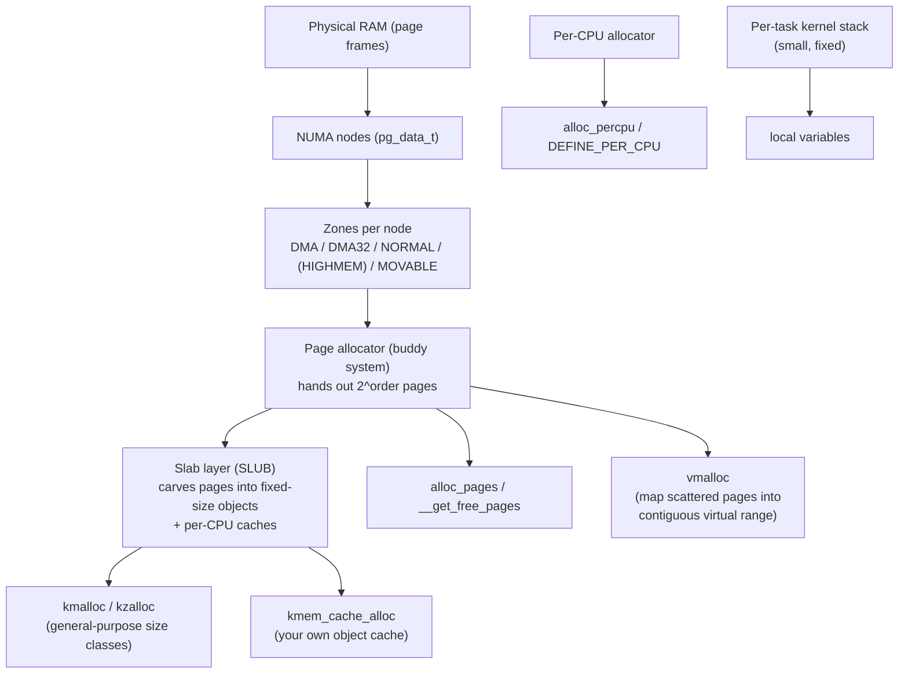
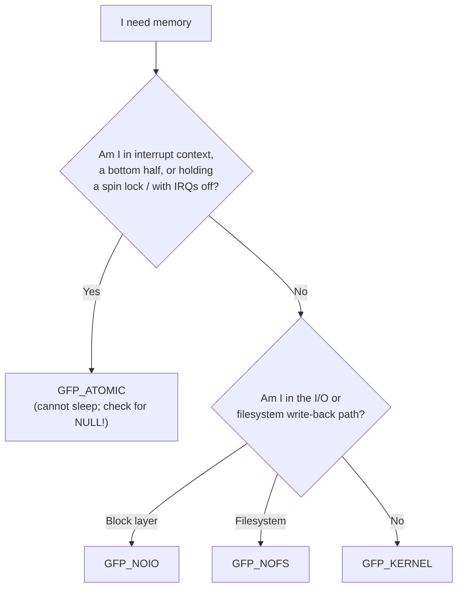
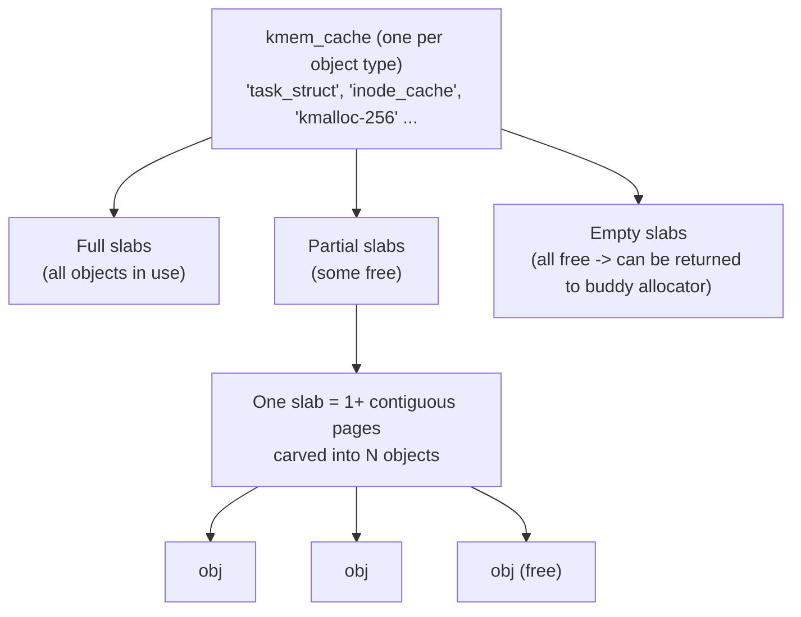
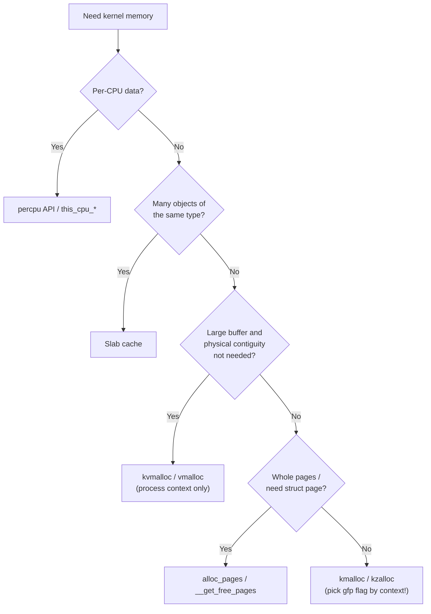

# Chapter 12 — Memory Management

> Source fidelity: this chapter follows Robert Love, *Linux Kernel Development*, 3rd Ed., Chapter 12 ("Memory Management"), which covers how the **kernel itself** obtains and uses memory (pages, zones, `kmalloc`, `vmalloc`, the slab layer, the kernel stack, high memory, per-CPU data). It deliberately does **not** cover a *process's* memory (that is Chapter 15). All explanations, diagrams, code and experiments below are original. Where the book's API or implementation has changed I mark it **[BOOK — Linux 2.6]**, **[MODERN LINUX]** or **[CONCEPTUAL CORE]**. Where I am unsure of an exact version number from memory I say so and give you the command to check.

---

## 1. What This Chapter Is About

User-space code calls `malloc()` and gets memory. Kernel code cannot do that: there is no C library (Chapter 2), kernel memory is generally not pageable, the stack is tiny and fixed, and the code asking for memory might be running in an interrupt handler that is forbidden to sleep (Chapter 1). So the kernel has its own memory-allocation machinery, with *several* interfaces, each for a different need:

| Need | Interface |
|---|---|
| Whole pages, physically contiguous | `alloc_pages()` / `__get_free_pages()` |
| A few bytes to a few KB, physically contiguous (the everyday case) | `kmalloc()` / `kzalloc()` |
| A large buffer that need only be *virtually* contiguous | `vmalloc()` |
| Many objects of the same type, allocated and freed constantly | The slab layer (`kmem_cache_*`) |
| Memory that cannot be permanently mapped (32-bit "high memory") | `kmap()` family |
| Data private to each CPU | The per-CPU API |
| Small, short-lived scratch data | The kernel stack (carefully!) |

The chapter also introduces the **units** the kernel thinks in: bytes, **pages**, **zones**, and (modern) NUMA **nodes**.

## 2. Why This Matters

- **Allocation is where kernel contexts get tested.** The single most common kernel-memory bug is calling a *sleeping* allocation (`GFP_KERNEL`) from a context that cannot sleep (Chapters 1, 8, 10). The right `gfp` flag is a function of context.
- **Allocation can fail**, and the kernel cannot "just crash the process". Every allocation must be checked and every failure path must be correct, including in interrupt handlers.
- **Memory is the resource the whole system shares.** A leak in kernel code is a leak forever (non-pageable, never reclaimed at "process exit"), so the discipline is much stricter than user space.
- Every later chapter (VFS, block I/O, page cache, devices, modules) allocates objects with the tools in this chapter.

## 3. Prerequisite Concepts

- **Chapter 1**: process context vs. interrupt context; kernel memory is not pageable; monolithic kernel.
- **Chapter 2**: "no libc", small fixed kernel stack, no memory protection for kernel code.
- **Chapter 4**: sleeping and the scheduler (a `GFP_KERNEL` allocation may sleep while memory is reclaimed).
- **Chapters 8-10**: bottom halves and locks. Which `gfp` flag you may use depends on whether you hold a spin lock or run in a softirq.
- **Chapter 11**: nothing required, but `jiffies` timeouts reappear in "retry the allocation" loops.
- Helpful but optional: if you have studied virtual memory and paging elsewhere (page tables, TLB, NUMA, false sharing), this chapter plugs into those ideas directly; I point out where.

## 4. Big Picture



Read it bottom-up as a stack of abstractions: **pages are the unit the hardware and the page allocator understand; everything smaller (`kmalloc`, slab objects) is built on pages; everything "different" (vmalloc, per-CPU) is a variation on how pages are mapped or replicated.**

A picture of the kernel's own virtual address space on x86-64 helps keep the interfaces straight. The addresses below are *typical* for 4-level paging **before** randomization (KASLR and `page_offset_base` randomization shift them at boot), so treat them as illustrations:

```
High Address
+--------------------------------------------+ 0xffffffffffffffff
| fixmap, vsyscall page, etc.                |
+--------------------------------------------+
| Kernel image: text/data/bss                | 0xffffffff81000000  (typical, randomized)
|   modules area                             | 0xffffffffa0000000  (typical)
+--------------------------------------------+
| vmemmap: the array of struct page          | 0xffffea0000000000  (typical)
+--------------------------------------------+
| vmalloc area: vmalloc(), ioremap, vstacks  | 0xffffc90000000000  (typical)
+--------------------------------------------+
| DIRECT MAP of ALL physical RAM             | 0xffff888000000000  (typical)
|   phys 0x0  <-> virt 0xffff888000000000    |    kmalloc / alloc_pages memory lives here:
|   phys 0x1000 <-> virt 0xffff888000001000  |    virt = phys + PAGE_OFFSET (a constant)
+--------------------------------------------+
| (non-canonical hole)                       |
+--------------------------------------------+ 0x00007fffffffffff
| User space (Chapter 15)                    |
Low Address
```
**Key idea (conceptual core):** on 64-bit machines the kernel maps *all* physical RAM into a big linear "direct map" so that converting between a physical address and its kernel virtual address is just adding or subtracting one constant. That is why `kmalloc`/`__get_free_pages` memory is cheap to use and is **physically contiguous**: a physically contiguous run of pages is automatically a virtually contiguous run in the direct map.

---

## 5. Core Concepts

### 5.1 Pages and `struct page`

**Concept.** The **page** is the basic unit of memory *management*. The MMU (hardware) translates addresses in units of pages; the kernel therefore tracks and allocates physical memory in page-sized chunks called **page frames**. `PAGE_SIZE` is 4 KB on x86 (and commonly 4 KB elsewhere, some architectures use 16 KB or 64 KB).

**Intuition.** A hotel does not rent out square meters of floor, it rents rooms. The kernel does not hand out arbitrary bytes of RAM at the lowest level, it hands out whole page-frame "rooms" and bookkeeps each one.

**Problem.** The kernel must know, for *every* physical page frame in the machine: is it free or in use? who owns it (a file's page-cache page? an anonymous user page? slab memory?) is it dirty? how many references? where is it mapped? Without a per-frame record, none of Chapters 15-16 (address spaces, page cache) would be possible.

**Design idea.** One small descriptor, `struct page`, per physical page frame, stored in a big array (`mem_map` / the `vmemmap` region in the diagram above), indexed by **page frame number (PFN)**.

**Internal representation (book-era, simplified).**
```c
struct page {
    unsigned long flags;          /* PG_dirty, PG_locked, PG_uptodate, PG_slab, ... status bits */
    atomic_t      _count;         /* reference count: 0 means the page is free */
    atomic_t      _mapcount;      /* how many page tables map it */
    unsigned long private;        /* owner-specific (e.g. buffers, swap info) */
    struct address_space *mapping;/* the file/anon mapping that owns the page, if any */
    pgoff_t       index;          /* offset within that mapping */
    struct list_head lru;         /* linkage into the LRU lists (Chapter 16 context) */
    void         *virtual;        /* kernel virtual address, or NULL if not mapped (high memory) */
};
```
Important meaning of the fields: `flags` encodes per-page state (the book lists many `PG_*` bits); `_count` is the reference count (the kernel wraps the read as `page_count()`; a count of zero means the page is free for reuse); `virtual` exists only on systems with high memory (below). Which `struct page` belongs to which physical frame is fixed by position in the array, so converting PFN <-> `struct page` <-> address is arithmetic: `page_to_pfn()`, `pfn_to_page()`, `page_address()`, `virt_to_page()`.

**The key point the book makes, worth internalizing:** `struct page` describes a *physical page*, not the data currently in it. It says "this 4 KB of RAM is currently a page-cache page for inode X", not "this is the data of inode X"; data can move between frames, a frame can be reused for something else.

**Cost of the bookkeeping, worked.** If a `struct page` is about 64 bytes (typical on x86-64; check with `pahole struct page` against a debug-info kernel) and a page is 4096 bytes, the metadata costs `64 / 4096 ~ 1.6%` of RAM. On a 128 GB server that is about 2 GB spent just on page descriptors. This is why the kernel works so hard to keep `struct page` small, packing many unrelated meanings into unions.

**[MODERN LINUX] notes.**
- The struct has been heavily reorganized: many fields overlap in unions depending on page type (file, anon, slab, page table, compound page). The book's flat picture is a good *mental* model, but the actual layout changed substantially.
- **`struct folio`** (introduced around 5.16, still being rolled out) represents "the head of a possibly multi-page, physically contiguous allocation" and is replacing `struct page` in most page-cache and filesystem code. It is a type-safety fix: functions that were supposed to be passed a head page but could receive a *tail* page of a compound page now take a `folio`, making that mistake a compile error. When you read recent `mm/` and `fs/` code you will see `folio_*` everywhere.
- The `virtual` field is gone on most configurations (64-bit has no high memory; the address is computed from the PFN).
- **`_count` was renamed `_refcount`** and is accessed through helpers (`page_ref_count()`, `get_page()`, `put_page()`); do not touch the raw field.

**Common mistakes.** Treating `struct page *` as if it were a pointer to data; forgetting to hold a reference while using a page another path might free; assuming a `struct page` for a PFN always exists (holes in the physical address space).

**Real Linux investigation.**
```bash
getconf PAGE_SIZE                         # 4096
grep -E "MemTotal|MemFree|Buffers|^Cached|Slab|PageTables|KernelStack|Percpu|VmallocUsed" /proc/meminfo
# Compare MemTotal with the RAM you installed: the gap includes the struct page array and kernel image.
dmesg | grep -iE "Memory:|reserved|struct page"      # boot-time memory summary
cd ~/linux; rg -n "^struct page \{" include/linux/mm_types.h
rg -n "^struct folio \{" include/linux/mm_types.h
```

**Active recall (5.1)**
1. Why does the kernel need a descriptor per *physical* page?
2. What does `_count == 0` mean?
3. Why does `struct page` not contain the page's data, or say which file it holds, in a permanent way?

<details><summary>Answers</summary>

1. To track the state, owner, reference count, and mappings of every page frame, which the allocator, the page cache, reclaim, and the address-space code all need.
2. The page has no users and is free to be reallocated.
3. It describes the *frame* (a physical resource), whose contents and owner change over time; the owner relationship (`mapping`/`index`) is recorded while in use but the descriptor itself stays attached to the frame.
</details>

---

### 5.2 Zones (and NUMA Nodes)

**Concept.** Not all physical pages are equal. Hardware limitations force the kernel to group pages into **zones**, and treat pages in different zones differently.

**Problem it solves.** Two real hardware limitations:
1. Some devices can only perform DMA to a limited range of physical addresses (old ISA devices: the first 16 MB; many PCI devices: only below 4 GB). Memory for such a device must be allocated from a matching range.
2. On 32-bit architectures with a lot of RAM, the kernel's virtual address space is too small to permanently map all physical memory (the "high memory" problem, Section 5.9).

**Design idea.** Partition physical memory into zones, each with its own free lists and bookkeeping, and let allocation requests say which zone(s) they can accept.

**The book's four zones (x86 example).**

| Zone | Meaning | x86 (32-bit) |
|---|---|---|
| `ZONE_DMA` | Pages usable for legacy DMA | below 16 MB |
| `ZONE_DMA32` | Pages usable by 32-bit-limited DMA (64-bit machines) | below 4 GB |
| `ZONE_NORMAL` | Pages that are permanently mapped into the kernel's address space | 16 MB to 896 MB |
| `ZONE_HIGHMEM` | "High memory": not permanently mapped | above 896 MB |

**The layout is architecture-dependent**, and on x86-64 there is no `ZONE_HIGHMEM` at all (the 64-bit virtual space is large enough to map everything). A common x86-64 machine therefore has `DMA` (<16 MB), `DMA32` (16 MB-4 GB) and `Normal` (everything above 4 GB), or only `DMA32`+`Normal` on small machines.

```
x86-64 physical memory (illustration, 16 GB machine)
0 ----16MB------------4GB-----------------------16GB
|DMA|    DMA32        |           NORMAL          |
```

**Zones are not a layout of addresses in memory you can see; they are bookkeeping.** A request for `GFP_KERNEL` memory is satisfied preferentially from `Normal`, falling back to `DMA32` then `DMA` if needed ("zone fallback"), but never the reverse for a `__GFP_DMA` request.

**Internal representation.** Each zone is a `struct zone` holding: a lock protecting the zone's free lists; **watermarks** (minimum/low/high number of free pages that control when background reclaim starts and when allocations are throttled); per-CPU page lists (to avoid lock contention on the hot path); the free lists themselves (one per allocation order); and statistics. A *NUMA* system adds one more level: memory is divided into **nodes** (`pg_data_t`), one per memory controller/socket, each containing its own set of zones (the NUMA background is in the cpumemory-based notes: local memory is faster than remote memory, so the allocator prefers the node of the CPU asking).

**[MODERN LINUX] notes.**
- Extra zones now exist: `ZONE_MOVABLE` (pages the kernel guarantees it can always migrate or reclaim, used for memory hot-unplug and to keep huge-page-capable regions defragmentable) and `ZONE_DEVICE` (memory that belongs to a device, e.g. persistent memory or GPU memory exposed to the kernel).
- The classic `ZONE_HIGHMEM` still exists in 32-bit kernels only.
- The low-level allocator is the **buddy allocator**: free memory is kept in lists by *order* (a block of `2^order` contiguous pages), splitting larger blocks to satisfy smaller requests and merging free "buddies" back together to fight fragmentation. The book touches this in the "Getting Pages" discussion; the modern name for the maximum order constant changed (historically `MAX_ORDER`, now `MAX_PAGE_ORDER` after a 6.x cleanup; I believe around 6.8, but check `include/linux/mmzone.h`). The practical maximum is an order-10 allocation (4 MB), and *large high-order allocations get harder the longer a machine runs*, because free memory fragments.

**Real Linux investigation.**
```bash
cat /proc/zoneinfo | head -60          # per-zone: pages free/min/low/high, managed/present pages
cat /proc/buddyinfo                      # free blocks per order, per zone: the fragmentation picture
# columns = order 0,1,2,...,10; numbers = how many free blocks of 2^order pages
sudo cat /proc/pagetypeinfo 2>/dev/null | head -30   # per migrate-type breakdown
numactl --hardware 2>/dev/null           # NUMA nodes and distances (if installed)
```
**Reading `/proc/buddyinfo`:** if the right-hand (high-order) columns are all zero while low orders have thousands, memory is fragmented; a request for 16 KB-contiguous (order 2) or larger may fail even though megabytes are free in total.

**Common mistakes.** Assuming zones are address *ranges you can allocate from by hand*; assuming 64-bit machines have highmem; asking for `__GFP_DMA` when you only needed "memory a 32-bit device can reach" (`__GFP_DMA32` or, better, the DMA-mapping API).

**Active recall (5.2)**
1. Name the two hardware reasons zones exist.
2. Why does an x86-64 kernel have no `ZONE_HIGHMEM`?
3. What does zone fallback mean?

<details><summary>Answers</summary>

1. Devices with DMA address limits, and (32-bit) a kernel address space too small to map all RAM permanently.
2. The 64-bit kernel address space is large enough to map all physical memory permanently.
3. If the preferred zone cannot satisfy a request the allocator tries other zones that are acceptable for that request (e.g. Normal then DMA32 then DMA), but never a zone the request is not allowed to use.
</details>

---

### 5.3 Getting Pages

**Concept.** The lowest-level interface hands out `2^order` **physically contiguous** pages.

**API (book's list, still current in spirit).**
```c
struct page *alloc_pages(gfp_t gfp_mask, unsigned int order);   /* returns a struct page */
void *page_address(struct page *page);                          /* its kernel virtual address */

unsigned long __get_free_pages(gfp_t gfp_mask, unsigned int order);  /* returns the address directly */
unsigned long get_zeroed_page(gfp_t gfp_mask);                        /* one zero-filled page */
struct page *alloc_page(gfp_t gfp_mask);                              /* order 0 shorthand */

void __free_pages(struct page *page, unsigned int order);
void free_pages(unsigned long addr, unsigned int order);
void free_page(unsigned long addr);
```
`order` is the exponent: order 0 = 1 page (4 KB), 1 = 2 pages (8 KB), 2 = 4 pages (16 KB), ... A request for 3 pages must be rounded to order 2.

**Why two flavors.** `alloc_pages()` returns a `struct page *` because memory in `ZONE_HIGHMEM` may have *no* kernel virtual address at all (you must `kmap` it, Section 5.9); `__get_free_pages()` cannot return high memory (it returns an address, and a high-memory page has none).

**Example with the discipline the book insists on (check, use, free exactly what you allocated).**
```c
unsigned long addr;
unsigned int order = 2;                       /* 4 pages = 16 KB, physically contiguous */

addr = __get_free_pages(GFP_KERNEL, order);
if (!addr)
    return -ENOMEM;                           /* ALWAYS handle failure */

memset((void *)addr, 0, PAGE_SIZE << order);
/* ... use it ... */
free_pages(addr, order);                      /* free with the SAME order */
```
**Rules.**
1. **Always check for failure.** Page allocation can fail, especially for `order > 0` on a fragmented system and for `GFP_ATOMIC` under memory pressure.
2. **Free with the same order you allocated.** Passing the wrong order corrupts the allocator's free lists.
3. **Never free memory twice or free memory you did not allocate** (the kernel cannot catch this cheaply and the result is silent corruption later).
4. **Zeroing:** `get_zeroed_page()` or `__GFP_ZERO` for data that might later be copied to user space (a stale page can leak another subsystem's data, a classic information-leak bug; the book makes this point about clearing).

**Execution flow (`__get_free_pages(GFP_KERNEL, 2)`).**
1. Choose the zone list from the `gfp` flags and the current NUMA node.
2. Look in the order-2 free list of the preferred zone; if present, take a block.
3. Otherwise take an order-3 block, split into two order-2 "buddies", return one and keep the other free (recursively for larger orders).
4. If nothing is free and the flags allow, wake background reclaim (`kswapd`), possibly reclaim/compact directly (this is where a `GFP_KERNEL` caller *sleeps*), and retry.
5. Return the page (or `NULL` after exhausting the permitted effort).

**Common mistakes.** Using page allocation for tiny objects (wastes a whole page); high-order allocations for buffers that don't need physical contiguity (use `vmalloc`/`kvmalloc`); forgetting the order on free.

**Active recall (5.3)**
1. What is the largest request you should assume you can reliably get, and why?
2. Why does `alloc_pages` return `struct page *` rather than an address?

<details><summary>Answers</summary>

1. Order-0 (one page). Higher orders require contiguous free memory and may fail on a fragmented system even when plenty of memory is free in total.
2. The page might be in high memory and have no permanent kernel virtual address; the descriptor is the always-valid handle.
</details>

---

### 5.4 The `gfp` Flags — Allocation Context Made Explicit

**Concept.** Every kernel allocation takes a **`gfp_mask`** (Get Free Pages) describing *how* the allocator is allowed to behave. This is where the Chapter 1/8/10 context rules become code.

The book groups flags into three families:

| Family | Purpose | Examples |
|---|---|---|
| **Action modifiers** | *How* the allocator may act | may it sleep? may it start I/O? may it call into the filesystem? is this a high-priority request? zero the memory? |
| **Zone modifiers** | *Where* memory may come from | `__GFP_DMA`, `__GFP_DMA32`, `__GFP_HIGHMEM` |
| **Type flags** | Pre-packaged combinations for common situations | `GFP_KERNEL`, `GFP_ATOMIC`, `GFP_NOIO`, `GFP_NOFS`, `GFP_USER`, `GFP_HIGHUSER`, `GFP_DMA` |

**Action modifiers worth knowing by meaning (book-era names).**
- `__GFP_WAIT`: the allocator may sleep (i.e. wait for reclaim).
- `__GFP_IO`: the allocator may start disk I/O to free memory.
- `__GFP_FS`: the allocator may perform filesystem operations to free memory.
- `__GFP_HIGH`: this is a high-priority request, may dip into emergency reserves.
- `__GFP_NOWARN`, `__GFP_REPEAT`/`__GFP_NOFAIL`/`__GFP_NORETRY`: failure-handling policy (warn or not; keep retrying; never fail; give up immediately).
- `__GFP_ZERO`: zero the returned memory.

**The type flags, and *when* to use each (this table is the practical heart of the section).**

| Flag | Meaning | Use when |
|---|---|---|
| **`GFP_KERNEL`** | May sleep, may do I/O and filesystem work | The default for **process context** that holds **no spin lock** and is not atomic |
| **`GFP_ATOMIC`** | May **not** sleep; draws on emergency reserves; fails more easily | **Interrupt handlers, bottom halves, any code holding a spin lock**, or anywhere sleeping is illegal |
| `GFP_NOIO` | May sleep but may not start I/O | Called from the block I/O path itself (avoid recursion) |
| `GFP_NOFS` | May sleep and do I/O but not filesystem operations | Called from within the filesystem (avoid recursion into the same filesystem) |
| `GFP_USER` / `GFP_HIGHUSER` | Memory on behalf of user space (the latter allows high memory) | Backing user pages (Chapter 15) |
| `GFP_DMA` | From `ZONE_DMA` | Legacy hardware needing low memory |

**The decision as a flow.**


**Why `GFP_KERNEL` in the wrong context is a bug, not just a style issue.** `GFP_KERNEL` may call `schedule()` while memory is reclaimed. Calling it with a spin lock held means sleeping while holding a spin lock (Chapter 10: the forbidden act). Calling it from an interrupt handler means sleeping in a context with no schedulable task to put to sleep (Chapter 1). Debug kernels print `BUG: sleeping function called from invalid context` on the first such call, even if the allocation would have succeeded without sleeping.

**Modern notes.**
- **[MODERN LINUX]** The flag set was reorganized after the book. `__GFP_WAIT` was split into the `__GFP_RECLAIM` family (`__GFP_DIRECT_RECLAIM`, `__GFP_KSWAPD_RECLAIM`), and `GFP_ATOMIC` is now essentially "high priority + only kswapd reclaim". The *meanings* in the table above still hold; look at `include/linux/gfp_types.h` (or `gfp.h` on older trees) for the current definitions.
- **Scoped allocation constraints.** Instead of every call site choosing `GFP_NOFS`/`GFP_NOIO` correctly (error-prone through deep call chains), modern code brackets a region with `memalloc_nofs_save()` / `memalloc_nofs_restore()` (and `memalloc_noio_*`); every allocation in the region behaves as if `NOFS`/`NOIO` were set. If you see these in recent filesystem code, that's what they replace. I am confident of the scoped-API design; verify exact names in `include/linux/sched/mm.h`.
- `GFP_KERNEL_ACCOUNT` charges the allocation to the caller's memory cgroup (container accounting), a feature that did not exist when the book was written.

**Common mistakes.** Using `GFP_KERNEL` under a spin lock; using `GFP_ATOMIC` "to be safe" everywhere (it fails more often and drains emergency reserves); not checking `NULL` from a `GFP_ATOMIC` allocation (it *can and does* fail under load); asking for large `GFP_ATOMIC` allocations.

**Debugging scenario.**

| Step | "Page allocation failure" in the log |
|---|---|
| Symptom | `dmesg` shows `<comm>: page allocation failure: order:N, mode:0x...` with a backtrace and a dump of free memory by order |
| Hypotheses | A high-order request on a fragmented system; a `GFP_ATOMIC` request under pressure; a genuine leak exhausting memory |
| Observations | Look at `order` (0 = memory is truly short, >0 = fragmentation likely) and the `mode` bits; the free-area dump shows which orders have free blocks |
| Tools | `/proc/buddyinfo`, `/proc/meminfo`, `/proc/vmstat` (compaction and reclaim counters), `CONFIG_PAGE_OWNER` to see who holds pages |
| Root cause | e.g. a driver asks for an order-4 `GFP_ATOMIC` buffer on every RX; free order-4 blocks are scarce |
| Fix | Preallocate at init, allocate in order-0 pieces, use `vmalloc`/`kvmalloc` if contiguity isn't needed, or move allocation to process context |
| Verification | Stress test with memory pressure; no more failure messages |

**Active recall (5.4)**
1. When must you use `GFP_ATOMIC`, and what is the cost?
2. What are the two "recursion" flags and what do they prevent?
3. Why is `GFP_KERNEL` illegal under a spin lock?

<details><summary>Answers</summary>

1. In interrupt/bottom-half/atomic contexts. Cost: cannot reclaim, draws on reserves, fails more often, so the caller must handle failure.
2. `GFP_NOIO` (don't start block I/O) and `GFP_NOFS` (don't enter the filesystem): used on those very paths so reclaim doesn't recurse into the caller.
3. It may sleep, and sleeping with a spin lock held can deadlock the CPU/lock and is a bug.
</details>

---

### 5.5 `kmalloc()` and `kfree()`

**Concept.** `kmalloc()` returns a pointer to at least the requested number of bytes of **physically contiguous** kernel memory. It is the kernel's `malloc()`, and it is how most kernel memory is allocated.

**API.**
```c
#include <linux/slab.h>

void *kmalloc(size_t size, gfp_t flags);
void  kfree(const void *ptr);

/* modern conveniences */
void *kzalloc(size_t size, gfp_t flags);                       /* zeroed */
void *kmalloc_array(size_t n, size_t size, gfp_t flags);      /* overflow-checked n*size */
void *kcalloc(size_t n, size_t size, gfp_t flags);            /* zeroed array */
void *krealloc(const void *p, size_t new_size, gfp_t flags);
```
**Example (the idiom you will see in a thousand drivers).**
```c
struct my_dev *dev;

dev = kzalloc(sizeof(*dev), GFP_KERNEL);
if (!dev)
    return -ENOMEM;

dev->buf = kmalloc(4096, GFP_KERNEL);
if (!dev->buf) {
    kfree(dev);
    return -ENOMEM;
}
/* ... later, in teardown ... */
kfree(dev->buf);
kfree(dev);
```
Notice `sizeof(*dev)` rather than `sizeof(struct my_dev)`: if the type of `dev` changes, the allocation stays right. Notice that the *unwinding on failure is manual*; real drivers use a `goto err_free_buf;` ladder so every error path frees exactly what had been allocated so far.

**Rules.**
- `kfree()` only on memory from `kmalloc` and friends. Not on `vmalloc` memory (use `vfree`), not on page-allocator memory (use `free_pages`), not on slab-cache objects (use `kmem_cache_free`).
- `kfree(NULL)` is safe, which simplifies cleanup code.
- Calling `kfree()` twice on the same pointer, or calling it on a stack address, is memory corruption.
- Missing a `kfree()` is a **memory leak** that persists until reboot (Chapter 2's "kernel memory is not reclaimed on exit").
- Check the return value; use the right `gfp` flag (Section 5.4).

**How it works (conceptual).** `kmalloc` is a thin layer over the slab allocator (Section 5.7): it rounds the request up to one of a ladder of **size classes** (8, 16, 32, 64, 96, 128, 192, 256, ... up to a few KB, power-of-two-ish steps), each served by its own slab cache named `kmalloc-<size>` (you can see them in `/proc/slabinfo`). For sizes beyond the slab ladder it falls through to the page allocator. **Consequences:** a 129-byte request really consumes a 192- or 256-byte object (internal fragmentation); memory is physically contiguous because slab pages are; the maximum size is limited (historically 128 KB; today larger, bounded by the maximum page-allocator order and `KMALLOC_MAX_SIZE`). **Do not rely on large `kmalloc`s succeeding**; they are high-order page allocations in disguise.

**[MODERN LINUX] notes.**
- **`kvmalloc()` / `kvfree()`**: "try `kmalloc` first, fall back to `vmalloc` if it fails or is large". The standard answer today for "I need a possibly large buffer and don't need physical contiguity".
- **Managed allocation:** `devm_kzalloc()` ties the memory's lifetime to a `struct device`, freeing automatically when the device goes away. Huge reduction in driver cleanup bugs.
- `kmalloc` buckets are now split by purpose (normal, reclaimable, DMA, memcg-accounted, and randomized/"typed" buckets as a security hardening measure), so you may see multiple `kmalloc-*` families in `/proc/slabinfo`. The concept (size classes over slab) is unchanged.
- Tooling: **KASAN** (detects out-of-bounds and use-after-free), **kmemleak** (finds leaked allocations), and **`slub_debug`** (red zones, poisoning) turn the bugs listed here from "silent corruption weeks later" into immediate, located reports.

**Common mistakes.** Not checking `NULL`; wrong `gfp` flag for the context; `sizeof` of the *pointer* instead of the pointee (`kmalloc(sizeof(dev), ...)` allocates 8 bytes); freeing with the wrong function; using an uninitialized `kmalloc` buffer as if zero (use `kzalloc`) and then copying it to user space (information leak); `n * size` overflow (use `kmalloc_array`).

**Debugging scenario.**

| Step | Slow memory leak in a driver |
|---|---|
| Symptom | `Slab:` in `/proc/meminfo` grows steadily; `slabtop` shows one cache (e.g. `kmalloc-256`) growing |
| Hypotheses | A path allocates and doesn't free (error path or `remove()`); object lifetime/refcount bug |
| Observations | Growth correlates with a specific operation (open/close, packet RX) |
| Tools | `slabtop`, `/proc/slabinfo`, **kmemleak** (`echo scan > /sys/kernel/debug/kmemleak; cat /sys/kernel/debug/kmemleak`), `slub_debug=U` for allocation stack traces, `bpftrace` on `kmem:kmalloc`/`kfree` |
| Root cause | e.g. an early `return` skipping the `kfree` |
| Fix | `goto` cleanup ladder or `devm_*` allocation |
| Verification | kmemleak reports nothing after stress; slab count flat |

**Active recall (5.5)**
1. Why is `kmalloc` memory physically contiguous?
2. Why `kzalloc(sizeof(*p), ...)` rather than `sizeof(struct foo)`?
3. Which free function matches `kvmalloc`?

<details><summary>Answers</summary>

1. It's carved from slab pages, which are physically contiguous runs from the page allocator, and the direct map makes that contiguous virtually too.
2. It stays correct if the pointer's type changes, and avoids size mismatches.
3. `kvfree()`.
</details>

---

### 5.6 `vmalloc()` and `vfree()`

**Concept.** `vmalloc()` returns memory that is **virtually contiguous but not necessarily physically contiguous**. It grabs individual (possibly scattered) pages from the page allocator and builds **page-table entries** in a dedicated region of kernel virtual address space (the "vmalloc area" in the earlier map) so that they appear as one linear range.

**Intuition.** A book whose pages are stored in different drawers but whose table of contents makes them read in order. `kmalloc` is a book printed on consecutive sheets; `vmalloc` is a binder you assembled from loose sheets.

**Problem it solves.** Large allocations (hundreds of KB to MB) are hard to satisfy physically contiguously on a long-running system (fragmentation, Section 5.2). If the code does not need physical contiguity (it is not handing the buffer to DMA hardware that needs one range), `vmalloc` can succeed where `kmalloc` would fail.

**API.**
```c
#include <linux/vmalloc.h>
void *vmalloc(unsigned long size);
void  vfree(const void *addr);
```
Example: `buf = vmalloc(8 * 1024 * 1024); if (!buf) return -ENOMEM; ...; vfree(buf);`

**Cost, the reason you do not use it by default.**
1. **Page-table entries must be set up** (and torn down on free): extra work per allocation.
2. **TLB pressure:** the direct map (where `kmalloc` memory lives) is mapped with large pages (2 MB or 1 GB entries), so `kmalloc` memory costs very few TLB entries; `vmalloc` memory is mapped page by page (4 KB entries), so a large `vmalloc` buffer touches many more TLB entries and walks more page-table levels on misses. This is exactly the huge-page/TLB trade-off from the cpumemory-based notes, appearing inside the kernel.
3. **It may sleep** (it allocates with `GFP_KERNEL`): process context only; never in an interrupt handler or under a spin lock.
4. **Not usable for DMA** that requires physical contiguity.

**Where it is used.** The book's examples: loading modules (the module's code and data must be placed in contiguous *virtual* space, physical contiguity is irrelevant), and large kernel buffers. Modern additional users: vmapped kernel stacks, large hash tables sized at boot, `ioremap`'d device windows (same virtual-region machinery).

**[MODERN LINUX] notes.**
- `kvmalloc()` automates the choice. Prefer it over raw `vmalloc` for buffers whose size depends on user input.
- `vmalloc` can now use **huge page mappings** for large allocations on supporting architectures, partially reducing the TLB cost described above.
- `/proc/vmallocinfo` (root) lists every live vmalloc region with its size, caller, and page count: an excellent investigation tool.
- **`CONFIG_VMAP_STACK`** (about 4.9 on x86-64): kernel stacks themselves are allocated from the vmalloc area, with guard pages around them, so a stack overflow faults immediately instead of silently corrupting a neighbor (Section 5.8).

**Common mistakes.** Using `vmalloc` for small objects; passing `vmalloc` memory to DMA APIs or to `virt_to_phys()` (the result is garbage because the pages are not contiguous in physical memory); calling it from atomic context; freeing with `kfree`.

**Active recall (5.6)**
1. Why is `vmalloc` slower to *use* than `kmalloc` memory, even after allocation?
2. Name two situations where physical contiguity is required, ruling out `vmalloc`.

<details><summary>Answers</summary>

1. It is mapped in 4 KB pieces through extra page-table entries, so it uses more TLB entries and incurs more TLB misses than the huge-page-mapped direct map.
2. DMA to hardware that needs one contiguous physical range; any use of `virt_to_phys()`/physical addresses across the whole buffer.
</details>

---

### 5.7 The Slab Layer

**Concept.** The **slab layer** (a.k.a. the slab allocator) manages allocation of **many objects of the same kind**, such as `task_struct`, `inode`, or network packet descriptors, caching freed objects so the next allocation is almost free.

**Intuition.** A coffee shop that keeps a stack of clean mugs by the machine. It does not manufacture a mug for every order and smash it afterwards; used mugs are washed and returned to the stack. The "mug stack" is a *cache*; each kind of kernel object gets its own stack.

**Problem.** Kernel code allocates and frees the same structures at enormous rates. Using the general page allocator for each is wasteful (internal fragmentation: a 400-byte struct in a 4 KB page), slow (page allocation locks, zeroing), and cache-unfriendly. Free lists are the traditional answer, but each subsystem rolling its own free list has no way to *shrink* when the system needs memory back, and wastes memory when idle.

**Design idea (the book's four goals).**
1. Frequently-used data structures get **free lists** (caches of ready objects).
2. The cache is **aware of memory pressure**: it can give pages back when the system is short.
3. **Fragmentation** is reduced by grouping objects of identical size.
4. **Performance** is improved by per-CPU caching (no lock on the hot path), awareness of NUMA nodes, and cache coloring (staggering object placement so different slabs don't all fight for the same CPU cache sets).

**Internal structure.**


- A **cache** holds all objects of one type. Each cache is made of **slabs**, a slab being one or more physically contiguous pages cut into equal-size objects.
- A slab is **full**, **partial**, or **empty**. Allocation prefers partial slabs (to keep full/empty counts low and let empty slabs be returned), then empty slabs, and asks the page allocator for a new slab only if none exist.
- Freeing an object simply marks it free; if its slab becomes entirely empty, the slab may later be released back to the page allocator (that is the "pressure-aware" shrinking).

**API (book-era).**
```c
struct kmem_cache *kmem_cache_create(const char *name, size_t size, size_t align,
                                     unsigned long flags, void (*ctor)(void *));
void *kmem_cache_alloc(struct kmem_cache *cachep, gfp_t flags);
void  kmem_cache_free(struct kmem_cache *cachep, void *objp);
void  kmem_cache_destroy(struct kmem_cache *cachep);
```
Common creation flags: `SLAB_HWCACHE_ALIGN` (align objects to a cache line: faster, a bit more memory), `SLAB_POISON` / `SLAB_RED_ZONE` (debug aids: fill free objects with a pattern; guard bytes around objects to catch overruns), `SLAB_PANIC` (panic if creation fails: used for core caches at boot), `SLAB_CACHE_DMA` (allocate slab pages from DMA memory). `ctor` is an optional constructor run when pages are first turned into objects (not on every alloc).

**A real example from the book you can read yourself: the `task_struct` cache.** `fork()` (Chapter 3) allocates each new `task_struct` from a dedicated slab cache created at boot:
```c
/* kernel/fork.c (book-era shape) */
task_struct_cachep = kmem_cache_create("task_struct", sizeof(struct task_struct),
                                       ARCH_MIN_TASKALIGN, SLAB_PANIC | SLAB_NOTRACK, NULL);
...
tsk = kmem_cache_alloc(task_struct_cachep, GFP_KERNEL);   /* in alloc_task_struct */
...
kmem_cache_free(task_struct_cachep, tsk);                  /* in free_task_struct */
```
Because `fork()` is hot, caching `task_struct`s avoids touching the page allocator on most forks.

**Using your own cache: the pattern.**
```c
static struct kmem_cache *item_cache;

item_cache = kmem_cache_create("my_item", sizeof(struct my_item), 0,
                               SLAB_HWCACHE_ALIGN, NULL);
if (!item_cache) return -ENOMEM;

struct my_item *it = kmem_cache_alloc(item_cache, GFP_KERNEL);
if (!it) { /* handle */ }
/* ... */
kmem_cache_free(item_cache, it);

kmem_cache_destroy(item_cache);     /* only after ALL objects freed, in module exit */
```
`kmem_cache_destroy` on a cache that still has live objects is a bug (modern kernels warn loudly: "Slab cache still has objects").

**When to create your own cache:** many objects of one type, high allocation rate, or large fixed-size structures (the book's guidance). Otherwise `kmalloc` suffices.

**[MODERN LINUX] notes.**
- **Implementation names.** The book describes the original slab allocator; Linux has had three: **SLAB** (the book's description), **SLUB** (default since 2.6.23: simpler, lower overhead, no per-slab metadata queues, per-CPU freelists with lockless fast paths), and **SLOB** (tiny systems). I believe SLOB was removed around 6.4 and the old SLAB around 6.8, leaving SLUB as the only implementation; verify with `ls mm/slab* mm/slub.c`. The *interface* (`kmem_cache_*`, `kmalloc`) did not change, which is the whole point of having an interface.
- **Cache merging.** SLUB merges compatible caches (same size/flags) into one to save memory, so your named cache may not appear separately in `/proc/slabinfo`. Boot with `slab_nomerge` (or use debug flags) to keep them distinct when investigating.
- New helpers: `KMEM_CACHE(struct_name, flags)` macro derives the name/size/alignment from the type; `kmem_cache_create_usercopy()` whitelists the part of an object that may be copied to/from user space (hardened usercopy); `SLAB_ACCOUNT` charges the memory cgroup; `kmem_cache_zalloc()`.
- **Observability.** `/proc/slabinfo` (root; may be restricted on hardened kernels), `slabtop`, and `/sys/kernel/slab/<cache>/` expose per-cache statistics.

**Connection to Systems Engineering.** The slab layer is the kernel's version of the **object pool / free-list / size-class allocator** pattern that shows up everywhere in high-performance software: network packet buffers and connection structures (the network stack allocates `sk_buff` heads and socket structs from dedicated slab caches, which is a big part of why the kernel can handle millions of packets per second), DPDK mempools, jemalloc/tcmalloc size classes and per-thread caches, arena allocators in databases. The same three motivations apply: avoid general-purpose allocator overhead on a hot path, keep hot objects warm in the CPU cache, avoid fragmentation by never mixing sizes. Per-CPU caches are the same idea as per-thread caches in a user-space allocator: remove cross-core contention.

**Real Linux investigation.**
```bash
sudo cat /proc/slabinfo | head -5            # columns: name active_objs num_objs objsize objperslab pagesperslab ...
sudo slabtop -o | head -15                   # live, sorted
ls /sys/kernel/slab | head
cat /sys/kernel/slab/kmalloc-256/object_size /sys/kernel/slab/kmalloc-256/objs_per_slab 2>/dev/null
cd ~/linux; rg -n "kmem_cache_create\(\"task_struct\"|task_struct_cachep|alloc_task_struct_node" kernel/fork.c
rg -n "^struct kmem_cache \{" include/linux/slub_def.h mm/slab.h 2>/dev/null
```

**Common mistakes.** Destroying a cache with live objects; freeing an object to the *wrong* cache; relying on the constructor running on each allocation; assuming a named cache will show separately in `/proc/slabinfo` under SLUB merging.

**Active recall (5.7)**
1. Why does the slab layer keep full/partial/empty lists?
2. What does it mean that the cache is "aware of memory pressure"?
3. Why create a dedicated cache for `task_struct` rather than using `kmalloc`?

<details><summary>Answers</summary>

1. To allocate from partial slabs first (keeping slabs dense), and to know which slabs are fully empty and can be returned to the page allocator.
2. Empty slabs can be released back to the page allocator when the system needs memory.
3. `fork()` is hot: a dedicated cache gives exact sizing, alignment, fast reuse of warm objects, per-type accounting, and no mixing with other sizes.
</details>

---

### 5.8 Statically Allocating on the Stack

**Concept.** Local variables live on the **kernel stack**: a **small, fixed-size, per-task** region. Unlike user-space stacks, it cannot grow.

**[BOOK — Linux 2.6]** On 32-bit x86 the kernel stack is **two pages (8 KB)** (a 4 KB option existed, which also forced interrupt handlers onto separate per-CPU interrupt stacks), and on 64-bit it is **two pages = 16 KB** with the book's page-size assumptions. The stack and the task's `thread_info` structure (Chapter 3) share this memory region: the stack grows downward from the top, `thread_info` sits at the bottom, so a stack overflow tramples `thread_info` first.

```
Kernel stack region for ONE task (e.g. 16 KB on x86-64)
+---------------------------+  high address: stack TOP
| kernel stack frames       |  grows DOWN
| (function call frames,    |
|  local variables)         |
|            |              |
|            v              |
|                           |
|   ... free stack space ...|
|                           |
+---------------------------+
| thread_info (older kernels)|  <- an overflow clobbers THIS and then neighbor memory
+---------------------------+  low address
```
**Why it matters (practical rule).** A local `char buf[4096]` or deep recursion that is harmless in user space (megabyte-scale stack) can overflow the kernel stack, corrupt unrelated data, and crash. **Keep stack usage to a few hundred bytes per function; allocate anything larger dynamically** (`kmalloc`/`kzalloc`, or on the slab).

**[MODERN LINUX] notes.**
- **x86-64 stack size is 16 KB (since about 3.15).** The book's "8 KB on 32-bit" remains valid on 32-bit; many architectures differ. Check `THREAD_SIZE` for your build.
- **`CONFIG_VMAP_STACK`** (x86-64 since about 4.9, and widely enabled): stacks are `vmalloc`ed with unmapped **guard pages**, so an overflow causes an immediate, diagnosable fault ("kernel stack overflow") instead of silent corruption. `thread_info` moved out of the stack region for the same reason on many architectures.
- **Interrupt stacks:** x86-64 uses separate per-CPU hardware-IRQ and softirq stacks, so interrupt handlers do not eat into the interrupted task's stack.
- **Compile-time guard:** the kernel build warns when a function's frame is too large (`-Wframe-larger-than=`; `CONFIG_FRAME_WARN`, typically 2048 bytes on 64-bit; check your config). The tree also ships `scripts/checkstack.pl` and `make checkstack` to list the biggest frames in a build.
- Runtime tools: `CONFIG_DEBUG_STACK_USAGE` and `/proc/<pid>/stack`; ftrace's `stack_trace` tracer (`/sys/kernel/debug/tracing/stack_trace`) shows maximum observed stack depth.

**Connection to Chapter 2.** This is the "small, fixed-size stack" constraint from the *Beast of a Different Nature* list, now with its allocator-level reason.

**Common mistakes.** Large local arrays/structs; recursion without a hard depth bound (e.g., walking a filesystem tree recursively); passing big structs by value (copies onto the stack); forgetting that a deep call chain of *many* modest frames also adds up (stack depth is the sum, not a single frame).

**Active recall (5.8)**
1. Why can't the kernel stack simply grow like a user stack?
2. What did `CONFIG_VMAP_STACK` change about how an overflow is detected?

<details><summary>Answers</summary>

1. Kernel memory is physical and non-pageable, each task's stack is a fixed, contiguous region the kernel allocates up front, and there is no layer below the kernel to catch and grow it on a fault.
2. The stack sits in the vmalloc area with guard pages, so overflowing it hits an unmapped page and faults immediately instead of corrupting neighboring memory.
</details>

---

### 5.9 High Memory Mappings

**Concept.** Where `ZONE_HIGHMEM` exists (32-bit machines with more RAM than the kernel can permanently map), high-memory pages have **no permanent kernel virtual address**. To access one you must create a **temporary mapping**.

**API (book-era).**
```c
void *kmap(struct page *page);          /* map; may sleep; works for any page (returns the existing address for lowmem) */
void  kunmap(struct page *page);

void *kmap_atomic(struct page *page);   /* map into a per-CPU slot; cannot sleep; disables preemption */
void  kunmap_atomic(void *addr);
```
- `kmap()`: uses a limited pool of permanent-ish mapping slots; **may sleep** if all are in use, so process context only.
- `kmap_atomic()`: uses a small set of **per-CPU** fixed slots, so it is fast and is **usable from interrupt context**, but it **disables kernel preemption** (Chapter 10) for as long as the mapping is held (the book: you must not sleep between map and unmap), and nesting uses distinct slot types.

**[MODERN LINUX] notes.**
- On **64-bit systems this entire section is mostly moot**: there is no high memory; `kmap()` on a normal page just returns `page_address(page)`.
- The API was reworked: **`kmap_atomic()` is deprecated in favor of `kmap_local_page()`** (about 5.11-5.12), which gives a thread-local, preemptible-friendly mapping with a stack-like unmap discipline and is safe to use across more contexts. If you read recent code and see `kmap_local_page()`/`kunmap_local()`, that is the modern equivalent. Verify with `rg kmap_local_page include/linux/highmem*.h`.
- The surviving cost model ("temporary mappings are limited resources, so hold them briefly") is the lasting lesson.

**Common mistakes.** Sleeping between `kmap_atomic` and `kunmap_atomic`; forgetting to unmap; using `__get_free_pages` when high memory is acceptable and you could use `alloc_pages(GFP_HIGHUSER)`.

---

### 5.10 Per-CPU Allocations

**Concept.** Per-CPU data is a separate copy of a variable **for each CPU**, so that a CPU only ever touches its own copy and no lock is needed for it.

**Intuition.** Every cashier has their own cash drawer. No need to take turns for one shared drawer; at the end of the day you total the drawers.

**Problem.** Frequently-updated shared data (statistics counters, free lists) become contention points when protected by a single lock (Chapter 9's granularity discussion), and, even *without* a lock, every update bounces the cache line holding the variable between CPUs (cache coherence traffic, the false-sharing effect measured in the cpumemory-based notes: updating one shared line from several cores can make a loop several times slower).

**Design idea.** Give each CPU its own, cache-line-padded copy. Reads of the "total" combine all copies on demand (slow, rare); updates touch only the local copy (fast, frequent).

**The only safety requirement: prevent preemption (and migration) while you touch your CPU's copy.** If you were preempted mid-update and the scheduler resumed you on a *different* CPU, you would then be modifying another CPU's data, racing with *its* owner. Chapter 10's `get_cpu()` / `preempt_disable()` solve this. **You may not sleep while using per-CPU data.** Per-CPU data is *not* protected from interrupts: if an interrupt handler on the same CPU touches the same variable, you must also disable local interrupts.

**Book's approaches.**
1. **Manual array** `unsigned long counter[NR_CPUS];` indexed by `get_cpu()` and `put_cpu()` (works, but pads poorly: adjacent elements share a cache line, causing exactly the false sharing you were trying to avoid).
2. **The `percpu` interface** (since 2.6):
```c
DEFINE_PER_CPU(int, my_counter);               /* static, one int per CPU, properly aligned/padded */

get_cpu_var(my_counter)++;                     /* disable preemption, access this CPU's copy */
put_cpu_var(my_counter);                        /* re-enable preemption */

int v = per_cpu(my_counter, some_cpu);          /* another CPU's copy (caller must ensure safety) */

/* dynamic */
int __percpu *p = alloc_percpu(int);            /* one int per CPU */
(*get_cpu_ptr(p))++;                            /* modern spelling:  this_cpu_inc(*p); */
put_cpu_ptr(p);
free_percpu(p);
```
**[MODERN LINUX] notes.**
- The preferred operators today are the **`this_cpu_*` family**: `this_cpu_inc()`, `this_cpu_add()`, `this_cpu_read()`, `this_cpu_ptr()`... On x86 these compile to a *single instruction* with a segment-register-relative address (the per-CPU base lives in a segment register), which is *atomic with respect to preemption on that CPU* (a single instruction cannot be interrupted midway by a context switch), so no explicit disable/enable is needed for simple read-modify-write. `get_cpu_var/put_cpu_var` still exist for multi-statement sections.
- `percpu_counter` is a ready-made "approximate global counter built from per-CPU counters" used for things like file counts and dirty-page accounting: updates are local; the global value is exact only when summed.
- Cost to remember: every per-CPU variable is replicated for *every possible* CPU, so large per-CPU data on a machine with hundreds of CPUs is not free (see `Percpu:` in `/proc/meminfo`).

**Connection to Systems Engineering.** "Shard by CPU, merge on read" is the same pattern as per-thread/striped counters in high-throughput user-space code (Java's `LongAdder`, per-core statistics in DPDK/Seastar, sharded locks in concurrent hash maps), and as sharding in distributed systems: avoid a single hot key. The cache-coherence cost model from the cpumemory notes explains *why* it wins.

**Common mistakes.** Sleeping (or being preempted) between getting the CPU's copy and finishing the update; assuming per-CPU data is interrupt-safe; reading another CPU's copy without thinking about concurrent updates; summing an approximate counter and treating it as exact.

**Active recall (5.10)**
1. Why can per-CPU data usually avoid a lock?
2. What's the one thing you must prevent while using it?
3. Why does the plain array version suffer from cache problems?

<details><summary>Answers</summary>

1. Each CPU only modifies its own copy, so there is no concurrent access between CPUs.
2. Preemption/migration (and, if an interrupt handler uses it too, interrupts), so you stay on the same CPU for the whole access.
3. Adjacent array elements share a cache line, so CPUs updating "their own" element still invalidate each other's lines (false sharing); the `percpu` interface pads each CPU's copy.
</details>

---

### 5.11 Picking an Allocation Method

The chapter closes with a practical decision procedure. Here it is, expanded.

| You need | Use | Notes |
|---|---|---|
| Physically contiguous bytes, small to medium (the usual case) | `kmalloc()` / `kzalloc()` with `GFP_KERNEL` or `GFP_ATOMIC` | Right default. Check for `NULL`. |
| Whole pages, or a size that's a multiple of a page, contiguous | `alloc_pages()` / `__get_free_pages()` | Higher orders may fail on fragmented systems. |
| A page that might live in high memory | `alloc_pages(GFP_HIGHUSER)` + `kmap_local_page()` | 32-bit only in practice. |
| A large buffer, physical contiguity **not** needed | `vmalloc()` or (better) `kvmalloc()` | Slower to use, process context only. |
| Many same-type objects with churn | `kmem_cache_create()` + `kmem_cache_alloc()` | Slab cache. |
| Per-CPU counters/lists | `DEFINE_PER_CPU` / `alloc_percpu` + `this_cpu_*` | No lock; no sleeping; mind interrupts. |
| Tiny, short-lived scratch | The kernel stack | Keep it under a few hundred bytes. |
| Memory tied to a device's lifetime | `devm_kzalloc()` | Auto-freed on device removal. |



---

## 6. How the Pieces Fit Together

```mermaid
flowchart TD
    subgraph Callers["Kernel code, by context"]
        P["Process context\n(GFP_KERNEL ok)"]
        I["Interrupt / softirq / spin-locked\n(GFP_ATOMIC only)"]
    end
    P --> KM["kmalloc / kzalloc / kvmalloc"]
    I --> KM
    P --> VM["vmalloc"]
    P --> SC["kmem_cache_alloc"]
    P --> PG["alloc_pages / __get_free_pages"]
    KM --> SLUB["Slab layer (SLUB)\nper-CPU caches -> partial slabs"]
    SC --> SLUB
    SLUB -->|needs a new slab| BUDDY["Buddy page allocator\n(zones, NUMA nodes, free lists by order)"]
    PG --> BUDDY
    VM -->|N order-0 pages + page tables| BUDDY
    BUDDY -->|low on free pages| RECLAIM["Reclaim / compaction\n(kswapd, direct reclaim) -- may SLEEP\n-> why GFP_KERNEL cannot be used in atomic context"]
    BUDDY --> PAGES["struct page / folio descriptors\n(vmemmap)"]
    PERCPU["Per-CPU allocator"] -.uses.-> BUDDY
    STACK["Kernel stack (vmapped, guard pages)"] -.allocated at fork (Ch.3).-> BUDDY
```

The invariants to keep in your head: **everything resolves to pages**; **the gfp flags say how hard the allocator may try and whether it may sleep**; **the slab layer exists to avoid paying the page allocator's cost for small, frequent objects**; **the choice among interfaces is about contiguity, size, lifetime, and context**.

---

## 7. Source Code Navigation

```bash
cd ~/linux
# Page allocator (the buddy system)
rg -n "^struct page \*__alloc_pages|__alloc_pages_noprof|get_page_from_freelist" mm/page_alloc.c | head
rg -n "struct zone \{" include/linux/mmzone.h
rg -n "^enum zone_type" include/linux/mmzone.h
ls mm/                             # page_alloc.c, slub.c, vmalloc.c, compaction.c, vmscan.c, percpu.c, highmem.c, ...
# GFP flags
rg -n "define GFP_KERNEL|define GFP_ATOMIC" include/linux/gfp*.h
# kmalloc and the slab layer
rg -n "static __always_inline void \*kmalloc" include/linux/slab.h
rg -n "^void \*kmem_cache_alloc|^static void \*slab_alloc_node" mm/slub.c | head
rg -n "kmalloc_caches|KMALLOC_" mm/slab_common.c | head
# vmalloc
rg -n "^void \*vmalloc|^void vfree|__vmalloc_node_range" mm/vmalloc.c | head
# stacks and highmem
rg -n "THREAD_SIZE" arch/x86/include/asm/page_64_types.h arch/x86/include/asm/thread_info.h
rg -n "kmap_local_page|kmap_atomic" include/linux/highmem*.h | head
# per-CPU
rg -n "define this_cpu_inc|define DEFINE_PER_CPU" include/linux/percpu*.h
sed -n '1,60p' Documentation/core-api/memory-allocation.rst      # read this: the official allocation guide
ls Documentation/mm/ Documentation/core-api/ | head -40
```
Trace by hand: `kmalloc(100, GFP_KERNEL)` -> `__kmalloc` -> pick `kmalloc-128` cache by size -> `slab_alloc_node` -> per-CPU freelist fast path -> (on miss) `___slab_alloc` -> partial list -> `new_slab` -> `alloc_pages`/`__alloc_pages` -> buddy free list -> (low memory) `__alloc_pages_slowpath` -> reclaim/compaction. Reading that chain once is worth more than any description of it.

---

## 8. Hands-On Experiments

### Experiment 12.1 — Read Your System's Memory Bookkeeping
**Risk:** SAFE USER-SPACE (some files need `sudo`)

**Objective.** Make zones, buddy free lists, slab usage and the `struct page` overhead visible on your machine.

**Execution.**
```bash
getconf PAGE_SIZE
grep -E "MemTotal|MemFree|MemAvailable|Slab|SReclaimable|SUnreclaim|PageTables|KernelStack|Percpu|VmallocUsed" /proc/meminfo
cat /proc/zoneinfo | grep -E "^Node|pages free|min|low|high|managed" | head -30
cat /proc/buddyinfo
sudo cat /proc/vmallocinfo | head -20
sudo slabtop -o | head -20
# Estimate the struct page overhead for YOUR machine:
python3 - <<'EOF'
import re
mt = int(re.search(r'MemTotal:\s+(\d+)', open('/proc/meminfo').read()).group(1))  # kB
pages = mt*1024//4096
print(f"MemTotal {mt/1024:.0f} MiB  ->  ~{pages} pages;  at 64 B/struct page ~ {pages*64/2**20:.1f} MiB of descriptors")
EOF
```

**Expected observation.** `buddyinfo` shows plenty of order-0..3 blocks and a smaller (sometimes zero) count at orders 9-10; `Slab` is typically hundreds of MB on a busy server; `slabtop` lists `dentry`, `inode_cache`, `kmalloc-*`, `vm_area_struct`... as top consumers. The `MemTotal` you see is a bit less than installed RAM, partly because of the page-descriptor array and the kernel image.

**Why it happens.** Everything in Sections 5.1-5.7 is live: zones and free lists (buddy), slab caches, vmalloc regions.

**Investigation.** Run a memory hog (`stress-ng --vm 2 --vm-bytes 70%` or compile a big project) and re-read `buddyinfo`; watch high orders drain. Then `echo 1 | sudo tee /proc/sys/vm/compact_memory` and re-read to see fragmentation reduced.

**Experiment questions.** What is the ratio of `SReclaimable` to `SUnreclaim` and why does it matter for how much of `Slab` the kernel can give back under pressure? Which slab caches grow when you walk a huge directory tree (`find / > /dev/null`) and why those?

---

### Experiment 12.2 — Allocation Is Not Residency (User-Space View of Lazy Allocation)
**Risk:** SAFE USER-SPACE

**Objective.** Connect "allocating memory" to "the kernel actually giving you physical pages", the demand-paging idea that Chapter 15 will explain, using only observable numbers.

**Code.**
```c
// lazy_alloc.c   gcc -O2 -o lazy_alloc lazy_alloc.c
#include <stdio.h>
#include <stdlib.h>
#include <string.h>
#include <sys/resource.h>
#include <unistd.h>

static long rss_kb(void)
{
    FILE *f = fopen("/proc/self/status", "r"); char line[256]; long v = -1;
    while (f && fgets(line, sizeof line, f))
        if (sscanf(line, "VmRSS: %ld kB", &v) == 1) break;
    if (f) fclose(f);
    return v;
}
static long minflt(void) { struct rusage r; getrusage(RUSAGE_SELF, &r); return r.ru_minflt; }

int main(void)
{
    size_t sz = 512UL << 20;                     /* 512 MiB */
    printf("start:        RSS %6ld kB   minor faults %ld\n", rss_kb(), minflt());
    char *p = malloc(sz);                        /* reserves ADDRESS SPACE, not RAM */
    printf("after malloc: RSS %6ld kB   minor faults %ld\n", rss_kb(), minflt());
    for (size_t i = 0; i < sz; i += 4096)        /* touch one byte per page */
        p[i] = 1;
    printf("after touch:  RSS %6ld kB   minor faults %ld   (~%zu pages)\n",
           rss_kb(), minflt(), sz / 4096);
    free(p);
    return 0;
}
```
**Execution.** `gcc -O2 -o lazy_alloc lazy_alloc.c && ./lazy_alloc`

**Expected observation.** After `malloc` the RSS barely changes; after the touch loop RSS grows by ~512 MiB and the minor-fault count rises by roughly the number of pages touched (131,072 for 512 MiB at 4 KB pages, order of magnitude).

**Why it happens.** `malloc` of a large block becomes an `mmap` that creates address space only; the first write to each page causes a page fault and the kernel allocates a zeroed physical page (through the page allocator you studied in this chapter) in the fault handler. This is why *kernel* memory, which is not lazily faulted in and not pageable, is a scarcer resource than user memory.

**Experiment questions.** Why must the kernel hand you a *zero-filled* page on first touch (hint: `__GFP_ZERO`, information leaks)? What changes if you `madvise(p, sz, MADV_HUGEPAGE)` before touching (fewer faults? larger?), tying back to huge pages? (Experiment further, then check against `grep thp /proc/vmstat`.)

---

### Experiment 12.3 — A Kernel Module That Allocates Every Way
**Risk:** KERNEL-MODIFYING. **VM only, snapshot first.** The module frees everything on unload and does nothing risky, but you are running code in the kernel.

**Objective.** See `kmalloc`, `vmalloc`, the page allocator, a slab cache, and per-CPU data side by side, and *observe* the physically-contiguous-vs-not distinction directly.

**Code: `mem_zoo.c`.**
```c
// mem_zoo.c -- Chapter 12 demo
#include <linux/module.h>
#include <linux/slab.h>
#include <linux/vmalloc.h>
#include <linux/gfp.h>
#include <linux/mm.h>
#include <linux/io.h>
#include <linux/percpu.h>
#include <linux/string.h>

struct item { int id; char name[28]; };

static void *km, *vm;
static unsigned long gfp_pages;
static struct page *pg;
static struct kmem_cache *item_cache;
static struct item *it;
static int __percpu *pcpu_cnt;

static int __init mem_zoo_init(void)
{
    int cpu, i;
    long sum = 0;

    /* 1. kmalloc: physically contiguous, from the direct map */
    km = kmalloc(1024, GFP_KERNEL);
    if (!km)
        return -ENOMEM;
    pr_info("mem_zoo: kmalloc(1024)      virt=%px phys=0x%llx\n",
            km, (unsigned long long)virt_to_phys(km));

    /* 2. vmalloc: virtually contiguous, physically scattered */
    vm = vmalloc(4 * PAGE_SIZE);
    if (!vm)
        goto err_vm;
    pr_info("mem_zoo: vmalloc(4 pages)   virt=%px is_vmalloc_addr=%d\n", vm, is_vmalloc_addr(vm));
    for (i = 0; i < 4; i++)
        pr_info("mem_zoo:   vm page %d -> pfn %lu\n", i, vmalloc_to_pfn(vm + i * PAGE_SIZE));

    /* 3. page allocator: order-2 = 4 contiguous pages */
    gfp_pages = __get_free_pages(GFP_KERNEL, 2);
    if (!gfp_pages)
        goto err_gfp;
    pr_info("mem_zoo: __get_free_pages(2) virt=0x%lx pfn=%lu (16 KB contiguous)\n",
            gfp_pages, (unsigned long)(virt_to_phys((void *)gfp_pages) >> PAGE_SHIFT));

    /* 3b. alloc_pages: returns struct page */
    pg = alloc_pages(GFP_KERNEL | __GFP_ZERO, 0);
    if (!pg)
        goto err_pg;
    pr_info("mem_zoo: alloc_pages(0)     struct page=%px pfn=%lu virt=%px\n",
            pg, page_to_pfn(pg), page_address(pg));

    /* 4. slab cache of our own */
    item_cache = kmem_cache_create("ch12_item", sizeof(struct item), 0,
                                   SLAB_HWCACHE_ALIGN, NULL);
    if (!item_cache)
        goto err_cache;
    it = kmem_cache_alloc(item_cache, GFP_KERNEL);
    if (!it)
        goto err_item;
    it->id = 42;
    strscpy(it->name, "slab object", sizeof(it->name));
    pr_info("mem_zoo: slab object %px (size %zu)\n", it, sizeof(struct item));

    /* 5. per-CPU counter */
    pcpu_cnt = alloc_percpu(int);
    if (!pcpu_cnt)
        goto err_pcpu;
    for (i = 0; i < 1000; i++)
        this_cpu_inc(*pcpu_cnt);                 /* preempt-safe single-CPU increment */
    for_each_possible_cpu(cpu)
        sum += *per_cpu_ptr(pcpu_cnt, cpu);
    pr_info("mem_zoo: per-CPU counter total=%ld (spread over CPUs)\n", sum);

    return 0;                                     /* stay loaded so you can inspect /proc */

err_pcpu:  kmem_cache_free(item_cache, it);
err_item:  kmem_cache_destroy(item_cache);
err_cache: __free_pages(pg, 0);
err_pg:    free_pages(gfp_pages, 2);
err_gfp:   vfree(vm);
err_vm:    kfree(km);
    return -ENOMEM;
}

static void __exit mem_zoo_exit(void)
{
    free_percpu(pcpu_cnt);
    kmem_cache_free(item_cache, it);
    kmem_cache_destroy(item_cache);
    __free_pages(pg, 0);
    free_pages(gfp_pages, 2);
    vfree(vm);
    kfree(km);
    pr_info("mem_zoo: everything freed\n");
}

module_init(mem_zoo_init);
module_exit(mem_zoo_exit);
MODULE_LICENSE("GPL");
MODULE_DESCRIPTION("Chapter 12: every kernel allocation interface");
```
`Makefile`:
```make
obj-m += mem_zoo.o
all:
	make -C /lib/modules/$(shell uname -r)/build M=$(PWD) modules
clean:
	make -C /lib/modules/$(shell uname -r)/build M=$(PWD) clean
```

**Execution.**
```bash
make
sudo insmod mem_zoo.ko
dmesg | tail -20
sudo grep -E "ch12_item|kmalloc-1k" /proc/slabinfo          # may not appear separately: SLUB cache merging
sudo grep -n "mem_zoo" /proc/vmallocinfo                      # our vmalloc region, with caller
sudo rmmod mem_zoo
dmesg | tail -2
```

**Expected observation.**
- `kmalloc` and `__get_free_pages` addresses lie in the **direct map** (`0xffff88...`-style on x86-64, subject to KASLR) and `virt_to_phys` gives a sensible physical address.
- The `vmalloc` address is in a **different, higher region** (`0xffffc9...`-style), `is_vmalloc_addr` is 1, and the four PFNs are generally **not consecutive** (often scattered), demonstrating "virtually contiguous, physically not".
- The per-CPU total is exactly `1000`, but the individual CPU copies differ if the task migrated.
- `/proc/vmallocinfo` shows a line attributing the 16 KB (+guard page) region to `mem_zoo_init`.
- Unload prints "everything freed" and nothing leaks (check `Slab:` in `/proc/meminfo` before/after).

**Why it happens.** Each interface follows its Section 5 design: direct-map memory is contiguous by construction; `vmalloc` builds page-table entries over scattered frames; the slab cache serves objects from slab pages it got from the page allocator; per-CPU storage is one padded copy per CPU.

**Investigation.**
```bash
# Is cache merging hiding our cache? Check:
ls /sys/kernel/slab | grep -i ch12 ; cat /proc/cmdline | tr ' ' '\n' | grep slab
# Compare physical addresses: are the kmalloc and __get_free_pages ranges ever "above 4GB" on your VM?
# Free-page accounting before and after:
grep -E "MemFree|Slab|VmallocUsed" /proc/meminfo
```

**Experiment questions.**
- Replace `vmalloc(4 * PAGE_SIZE)` with `kmalloc(4 * PAGE_SIZE, GFP_KERNEL)` and print PFNs of its pages using `virt_to_phys(km + i*PAGE_SIZE) >> PAGE_SHIFT`. Are they consecutive? Why?
- Change `GFP_KERNEL` to `GFP_ATOMIC` in one allocation and wrap the module init in a spin lock (`spin_lock(&lk); ... spin_unlock(&lk);`). Which allocations remain legal inside the lock, and what does a debug kernel print if you leave `vmalloc` inside it?
- Request `__get_free_pages(GFP_KERNEL, 10)` (4 MB). Does it succeed on a freshly booted VM? On a VM that has been running a compile job for an hour? What does that tell you about fragmentation and `/proc/buddyinfo`?
- Create a second slab cache with the **same size and flags** and look at `/sys/kernel/slab/`. Do you see two entries, or one alias?

---

### Experiment 12.4 — Why Large Locals Are Dangerous: Measure Stack Frames at Compile Time
**Risk:** SAFE USER-SPACE

**Objective.** Make the "small stack" rule quantitative, using the compiler's own frame-size report, the same information the kernel's `-Wframe-larger-than` check uses.

**Code.**
```c
// frames.c   gcc -O2 -fstack-usage -c frames.c    (produces frames.su)
#include <string.h>

int small_user(int x)
{
    char buf[64];
    memset(buf, x, sizeof buf);
    return buf[x & 63];
}

int big_user(int x)
{
    char buf[8192];                 /* would be a kernel bug waiting to happen */
    memset(buf, x, sizeof buf);
    return buf[x & 8191];
}
```
**Execution.**
```bash
gcc -O2 -fstack-usage -c frames.c && cat frames.su
# Then ask the kernel's own policy: what frame size does your kernel config warn about?
grep CONFIG_FRAME_WARN /boot/config-$(uname -r)
# And, in the kernel tree, list the heaviest frames of a built object (needs a built tree):
cd ~/linux && make -s scripts/checkstack.pl 2>/dev/null; objdump -d kernel/fork.o | scripts/checkstack.pl x86_64 | head
```
**Expected observation.** `frames.su` reports ~80-ish bytes for `small_user` and ~8200 bytes for `big_user`. With a 16 KB kernel stack, a *single* call to `big_user` would consume about half of it.

**Why it matters.** The kernel stack must also hold interrupt frames (on some configs), nested calls, and the entire call chain of the system call; the budget is a few KB of *total* depth per path.

**Experiment questions.** If five functions in a call chain each use 3 KB of stack, how much stack does the chain use at its deepest point, and does it fit in 16 KB alongside the rest? Why can recursion be worse than any single big frame?

---

## 9. Mini Project — A Kernel-Memory Health Report Tool

**Goal.** Build a user-space report that turns raw `/proc` data into the questions an engineer actually asks: *Is memory fragmented? Which slab caches waste the most space? Where is kernel memory going?*

```python
#!/usr/bin/env python3
# kmem_report.py   SAFE USER-SPACE. Run as root for slabinfo:  sudo python3 kmem_report.py
import re, sys, os

def meminfo():
    d = {}
    for line in open('/proc/meminfo'):
        m = re.match(r'(\w+)(?:\(\w+\))?:\s+(\d+)', line)
        if m: d[m.group(1)] = int(m.group(2))          # kB
    return d

def buddy():
    zones = {}
    for line in open('/proc/buddyinfo'):
        m = re.match(r'Node\s+(\d+),\s+zone\s+(\w+)\s+(.*)', line)
        if m: zones[(int(m.group(1)), m.group(2))] = list(map(int, m.group(3).split()))
    return zones

def slab():
    rows = []
    if not os.access('/proc/slabinfo', os.R_OK):
        return rows
    for line in open('/proc/slabinfo').read().splitlines()[2:]:
        f = line.split()
        name, active, total, objsize = f[0], int(f[1]), int(f[2]), int(f[3])
        rows.append((name, active, total, objsize))
    return rows

mi = meminfo()
print("== Kernel memory accounting (MiB) ==")
for k in ("MemTotal","MemFree","MemAvailable","Slab","SReclaimable","SUnreclaim","PageTables","KernelStack","Percpu","VmallocUsed"):
    if k in mi: print(f"  {k:14s} {mi[k]/1024:10.1f}")

print("\n== Fragmentation (per zone): free memory by order ==")
for (node, zone), counts in sorted(buddy().items()):
    pages_by_order = [c * (1 << o) for o, c in enumerate(counts)]
    total = sum(pages_by_order) or 1
    hi = sum(pages_by_order[4:])                       # memory in blocks >= order 4 (64 KB)
    print(f"  node{node} {zone:8s} free={total*4/1024:8.1f} MiB  in order>=4 blocks: {100*hi/total:5.1f}%  "
          f"counts={counts}")

print("\n== Top slab caches by memory, with utilization ==")
rows = slab()
if not rows:
    print("  (run as root to read /proc/slabinfo; or use `slabtop -o`)")
else:
    ranked = sorted(rows, key=lambda r: r[2]*r[3], reverse=True)[:15]
    print(f"  {'cache':28s} {'MiB':>8s} {'obj size':>8s} {'util%':>6s}")
    for name, active, total, size in ranked:
        util = 100.0*active/total if total else 0
        print(f"  {name:28s} {total*size/2**20:8.1f} {size:8d} {util:6.1f}")
    waste = sum((t-a)*s for _,a,t,s in rows)
    print(f"\n  Estimated slack in slab caches (free but cached objects): {waste/2**20:.1f} MiB")
```
**What it teaches.**
1. **Fragmentation as a number**: the share of free memory sitting in high-order blocks. If it falls near zero, high-order allocations (and transparent huge pages) will struggle, which is exactly the failure mode in Section 5.4's debugging scenario.
2. **Slab accounting and slack**: utilization of each cache (`active/total`) shows memory held in cache but unused, which the kernel can give back under pressure (the "pressure-aware" property).
3. **Where kernel memory goes** beyond the slab: page tables, kernel stacks, per-CPU, vmalloc.
**Experiments with it.** Run on an idle box; run again after `find / >/dev/null` (watch `dentry`/`inode_cache` grow); after `echo 2 | sudo tee /proc/sys/vm/drop_caches` (watch reclaimable slab shrink); after a memory hog (watch the high-order percentage drop).
**Extensions.** Poll every second and log deltas to spot a leaking cache (the signature: one cache's `total` rising monotonically); add `/proc/vmstat` counters (`compact_stall`, `allocstall_*`, `pgscan_*`) to link fragmentation to actual stalls; compare against `kmemleak` output in a test VM.

---

## 10. Common Misconceptions

| Misconception | Correction |
|---|---|
| "`kmalloc` is just `malloc` in the kernel." | It never returns uninitialized-safe guarantees (use `kzalloc`), takes a context flag, can fail in interrupt context, and returns physically contiguous memory limited in size. |
| "`GFP_KERNEL` is the safe default everywhere." | It may sleep; in atomic contexts it is a bug. The flag *is* the context declaration. |
| "`GFP_ATOMIC` can't fail." | It fails more easily than `GFP_KERNEL`, because it cannot reclaim; always check. |
| "Zones are address ranges I can manage." | They are allocator bookkeeping categories driven by hardware limits. |
| "64-bit kernels have high memory." | They do not; `kmap()` there is a no-op returning the permanent address. |
| "`vmalloc` is just a bigger `kmalloc`." | Different mapping (page-by-page), different cost (TLB, page tables), can sleep, not physically contiguous, not DMA-safe. |
| "The slab allocator is the page allocator." | It sits *on top of* it, carving pages into same-type objects, with per-CPU caches. |
| "I can free a `kmem_cache` while objects are live." | That is a bug; free every object first. |
| "The kernel stack can grow if it needs to." | Fixed size; overflow corrupts memory (or faults, with vmapped stacks). |
| "A big local array is fine, like in user space." | A few KB can already be a lot of a 16 KB stack that also holds the entire call chain. |
| "Per-CPU data needs no protection at all." | It still needs preemption disabled (and interrupt protection if an IRQ handler shares it). |
| "More free memory always means a big allocation will succeed." | Contiguity matters; fragmentation can fail an order-N request with gigabytes free. |
| "Memory I allocate in the kernel is reclaimed when my code finishes." | Only if you free it; leaks last until reboot. |

---

## 11. Interview Questions

**Basic**
- Q: What is the difference between `kmalloc` and `vmalloc`?
  - *Correct answer:* `kmalloc` gives physically (and therefore virtually) contiguous memory from the direct map via the slab/page allocators, fast, size-limited; `vmalloc` gives virtually contiguous memory built from scattered pages with extra page-table setup, slower to use, may sleep, not DMA-safe.
  - *Follow-up:* "Why does a long-running system make large `kmalloc`s fail?"

- Q: What does `GFP_ATOMIC` mean and when do you use it?
  - *Follow-up:* "Why can it fail, and what must the caller do?"

**Intermediate**
- Q: Explain what a slab cache is and why `task_struct` has its own.
  - *Follow-up:* "What are full/partial/empty slabs and how do they relate to memory pressure?"

- Q: Explain zones. Why does x86-64 not have `ZONE_HIGHMEM`?
  - *Follow-up:* "What does `/proc/buddyinfo` tell you about a machine?"

- Q: Why must freed memory have the right order/cache/function pairing (`free_pages` vs `kfree` vs `vfree` vs `kmem_cache_free`)?

**Advanced / Kernel-Development**
- Q: A function takes a spin lock, then calls a helper that does `kmalloc(sz, GFP_KERNEL)`. What happens and how do you fix it?
  - *Expected reasoning:* sleeping in atomic context; with `CONFIG_DEBUG_ATOMIC_SLEEP` you get a splat; fixes: allocate before taking the lock, use `GFP_ATOMIC` (small, can fail), or restructure so the locked region is a preallocated-object swap.
  - *Follow-up:* "Under what circumstances is `GFP_ATOMIC` the *wrong* fix?"

- Q: How does per-CPU data eliminate locking, and what two conditions does it still require?
  - *Follow-up:* "Why does the plain `counter[NR_CPUS]` array still cause cache-line bouncing, and how does `percpu` avoid it?"

- Q: A kernel build warns `the frame size of 5200 bytes is larger than 2048 bytes`. Why is that a *real* bug, not a style nit?

**Debugging**
- Q: `Slab:` in `/proc/meminfo` grows 1 MB/hour on a server. Describe your investigation end to end.
  - *Expected:* `slabtop` to find the cache; check `SReclaimable` vs `SUnreclaim`; `slub_debug=U`/kmemleak/bpftrace to find allocation sites; correlate with a workload; check object lifetime/refcounts; verify after the fix.

- Q: A driver logs `page allocation failure: order:5, mode:0x...(GFP_ATOMIC)` under network load. Diagnose.
  - *Expected:* order-5 atomic allocation in an RX path on a fragmented system; preallocate, use order-0 page fragments, scatter-gather, or process-context refill.

**Design**
- Q: Design the memory strategy for a new network driver's RX path: per-packet buffers, ring descriptors, and per-queue statistics. Choose interfaces for each and justify (context, contiguity/DMA, rate, failure handling, per-CPU).
  - *No single answer.* Strong answers: DMA-coherent allocation for descriptor rings (physically contiguous, mapped), preallocated order-0 page pools for buffers with refill from a workqueue/NAPI context, slab cache for per-packet metadata, per-CPU counters for stats, `GFP_ATOMIC` only where unavoidable with fallback/backpressure on failure.

---

## 12. Active Recall (Whole Chapter)

1. What is a page frame and what does `struct page` record about it?
2. What problem do zones solve? Name the x86-64 zones.
3. What does order mean in `alloc_pages(gfp, order)`?
4. Which `gfp` flag for: a) interrupt handler, b) ordinary process context, c) inside the filesystem?
5. Why is `kmalloc` memory physically contiguous?
6. What are `vmalloc`'s costs and constraints?
7. List the four goals of the slab layer.
8. What do full/partial/empty slabs mean?
9. Why is the kernel stack dangerous to overuse?
10. What replaced `kmap_atomic` in modern kernels?
11. What are the two requirements for safely using per-CPU data?
12. Which interface do you pick for a large buffer that doesn't need physical contiguity?
13. Which three book-era allocator facts are outdated: the slab implementation, the `kmap_atomic` API, and what else?

<details>
<summary>Answers</summary>

1. A page frame is one page-sized unit of physical RAM; `struct page` (now often `struct folio`) records its flags, reference count, mapcount, owner mapping/offset, and list linkage.
2. Hardware DMA address limits and (32-bit) the inability to map all RAM permanently. x86-64: DMA, DMA32, Normal (plus Movable/Device).
3. The request is for `2^order` physically contiguous pages.
4. a) `GFP_ATOMIC`; b) `GFP_KERNEL`; c) `GFP_NOFS` (or `memalloc_nofs_save()` around the region in modern code).
5. It is carved from slab pages, which are contiguous page runs, and the direct map keeps contiguous physical pages contiguous virtually.
6. Page-table setup, TLB cost, may sleep, process context only, not physically contiguous (no DMA assumption), slower than `kmalloc`.
7. Free lists for hot structures; pressure-aware shrinking; reduced fragmentation by size-grouping; per-CPU/NUMA/cache-colored performance.
8. Full: all objects in use; partial: some free (preferred for allocation); empty: all free (can be released to the page allocator).
9. It is small and fixed; overflow corrupts neighboring memory (or faults with vmapped stacks); deep call chains and big locals consume it.
10. `kmap_local_page()`.
11. Prevent preemption/migration for the duration (and interrupts if shared with an IRQ handler), and don't sleep.
12. `kvmalloc()` (or `vmalloc()` in process context).
13. `struct page` has been reorganized/replaced by `struct folio` in much code; the book's flat `struct page` and `_count` are dated. (Also `__GFP_WAIT` and `MAX_ORDER` names changed.)
</details>

---

## 13. Chapter Summary

Kernel memory management is a layered system built on **pages**. Each physical page frame has a descriptor (`struct page`, increasingly `struct folio`); frames are grouped into **zones** (by hardware constraints) within NUMA **nodes**; the **buddy page allocator** hands out `2^order` contiguous pages. On top sits the **slab layer**, which carves pages into same-size objects with per-CPU caches and underlies `kmalloc`. **`vmalloc`** maps scattered pages into one contiguous virtual range at extra cost. **High memory** needed temporary mappings on 32-bit systems (now largely historical, with `kmap_local_page` surviving the idea). **Per-CPU data** removes locking and cache bouncing but requires preemption control. Every allocation carries a **`gfp` flag** that encodes the caller's context (may it sleep, do I/O, enter the filesystem, use zone limits): `GFP_KERNEL` for ordinary process context, `GFP_ATOMIC` where sleeping is forbidden. The **kernel stack** is small and fixed, so large locals are bugs. Choosing among these interfaces is a function of contiguity, size, frequency, lifetime, and context. The book's concepts remain right; its details changed (folios, SLUB-only slab, scoped NOFS/NOIO, `kmap_local`, `kvmalloc`, vmapped stacks, `refcount`-style helpers, `MAX_ORDER` rename).

## 14. What I Should Be Able to Explain Now

- [ ] What a page and a `struct page` are, and why the kernel keeps a descriptor per physical frame (and what folios fix).
- [ ] Why zones exist, which exist on x86-64, and what the buddy allocator and `/proc/buddyinfo` tell me.
- [ ] How to allocate and free pages correctly, and why failure handling is mandatory.
- [ ] What every common `gfp` flag means and how to choose one from the calling context.
- [ ] How `kmalloc` relates to the slab layer, its size classes, its rules, and its modern helpers (`kzalloc`, `kvmalloc`, `devm_*`).
- [ ] Why `vmalloc` exists, what it costs, and where physical contiguity is required.
- [ ] How the slab layer is structured (cache/slab/object, full/partial/empty) and when to create a cache.
- [ ] Why the kernel stack is small, how big it is today, and how vmapped stacks catch overflow.
- [ ] How high-memory mappings worked and what replaced `kmap_atomic`.
- [ ] How per-CPU data works, why it avoids locks and false sharing, and what it still requires.
- [ ] How to pick an allocation interface for a given need, and how to investigate a leak or an allocation failure with real tools.

---

## Knowledge Graph (Chapter 12 Contribution)

```
Linux Kernel (continued from Ch.1-11)
+-- Memory Management (kernel's own memory)
     +-- Units
     |    +-- Page / page frame (PAGE_SIZE)
     |    +-- struct page  ->  [MODERN] struct folio; vmemmap array; PFN conversions
     |    +-- Zones: DMA, DMA32, NORMAL, HIGHMEM(32-bit), [MODERN] MOVABLE, DEVICE
     |    +-- NUMA nodes (pg_data_t)
     +-- Page allocator (buddy): orders, free lists, watermarks, reclaim/compaction
     |    +-- alloc_pages / __get_free_pages / get_zeroed_page / free_pages
     +-- GFP flags
     |    +-- action modifiers, zone modifiers, type flags
     |    +-- GFP_KERNEL vs GFP_ATOMIC (context!) ; NOIO / NOFS
     |    +-- [MODERN] __GFP_RECLAIM family; memalloc_nofs/noio scoped API
     +-- kmalloc / kfree / kzalloc / kvmalloc / devm_*  (slab size classes over pages)
     +-- vmalloc / vfree (virtually contiguous; page tables; TLB cost; may sleep)
     +-- Slab layer
     |    +-- kmem_cache -> slabs (full/partial/empty) -> objects
     |    +-- [BOOK] SLAB  ->  [MODERN] SLUB (SLAB/SLOB removed); cache merging
     |    +-- real example: task_struct_cachep (Ch.3)
     +-- Kernel stack: small, fixed (16 KB x86-64), thread_info (Ch.3)
     |    +-- [MODERN] CONFIG_VMAP_STACK + guard pages; frame-size warnings
     +-- High memory: kmap / kmap_atomic  ->  [MODERN] kmap_local_page (32-bit only)
     +-- Per-CPU data: DEFINE_PER_CPU, alloc_percpu, this_cpu_*, percpu_counter
     |    +-- needs preemption control; avoids locks + false sharing
     +-- Choosing an allocator (contiguity / size / rate / lifetime / context)
     +-- Tools: /proc/{meminfo,zoneinfo,buddyinfo,slabinfo,vmallocinfo,vmstat}, slabtop,
          kmemleak, KASAN, slub_debug, page_owner, bpftrace kmem:*
     +-- -> Ch.15 (process address space), Ch.16 (page cache), Ch.17 (devices/DMA)
```

*(Companion-file candidates, left untouched per your instruction: `glossary.md`: page frame, `struct page`, folio, zone, NUMA node, buddy allocator, order, GFP flags, `GFP_KERNEL`, `GFP_ATOMIC`, `kmalloc`, `vmalloc`, slab, SLUB, `kmem_cache`, `kmap`, per-CPU data, `this_cpu_*`, kernel stack, vmapped stack, KASAN, kmemleak. `source-code-map.md`: `mm/page_alloc.c`, `mm/slub.c`, `mm/slab_common.c`, `mm/vmalloc.c`, `mm/highmem.c`, `mm/percpu.c`, `include/linux/gfp*.h`, `include/linux/slab.h`, `include/linux/mmzone.h`, `include/linux/mm_types.h`, `Documentation/core-api/memory-allocation.rst`. `debugging-playbook.md`: page allocation failure, slab leak, sleeping-in-atomic from `GFP_KERNEL`, kernel stack overflow, fragmentation-induced high-order failure. `final-knowledge-map.md`: attach the tree above under the Chapter 11 branch. Interview questions: the set in Section 11.)*
