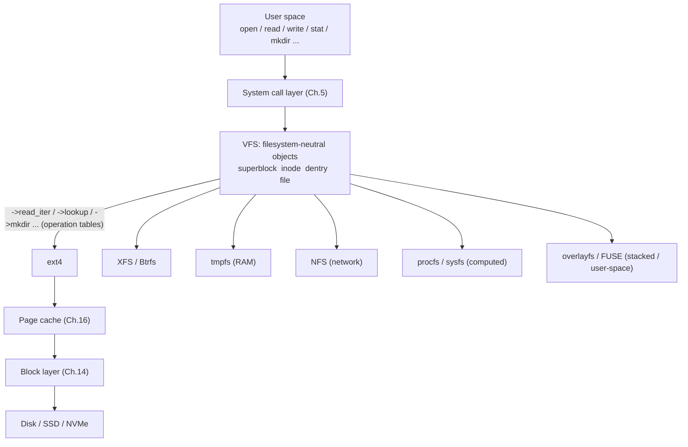
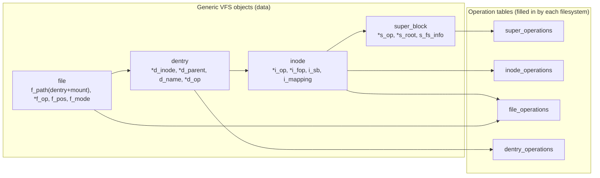
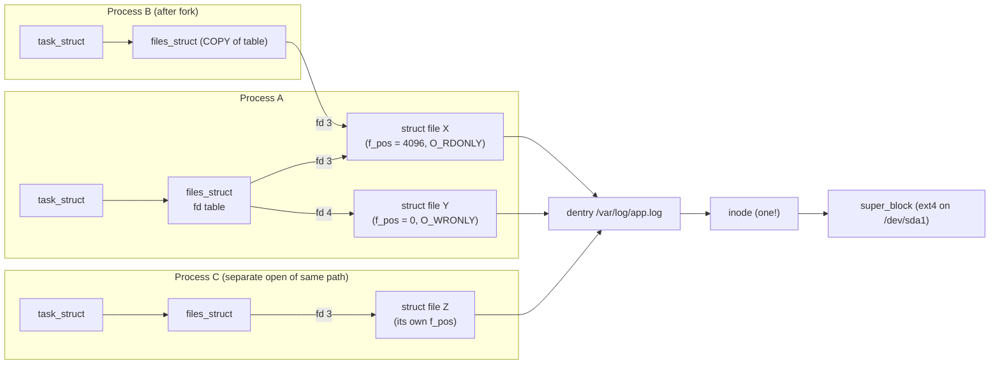
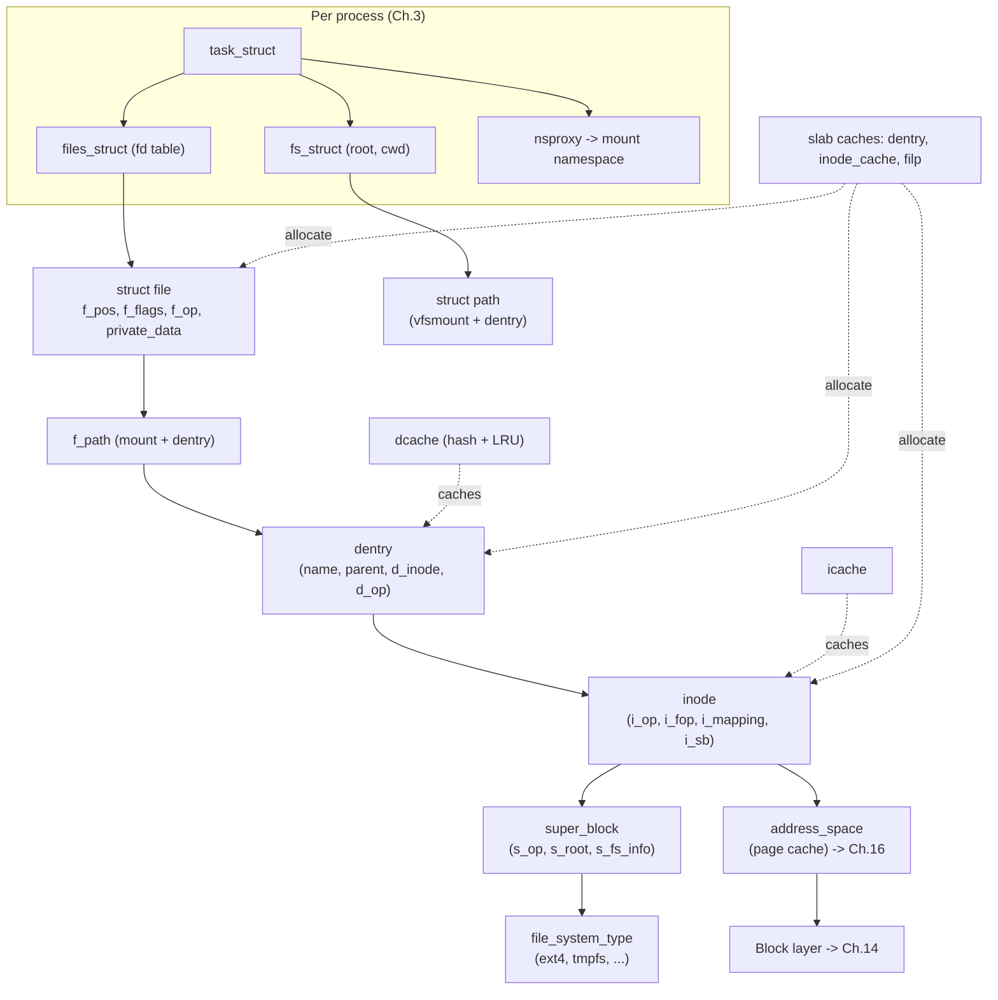

# Chapter 13 — The Virtual Filesystem (VFS)

> Source fidelity: this chapter follows Robert Love, *Linux Kernel Development*, 3rd Ed., Chapter 13 ("The Virtual Filesystem"). All explanations, diagrams, code and experiments below are original. The book's four central objects (superblock, inode, dentry, file) and their operation tables are still the heart of the VFS today, but many *members* and *method names* have changed (e.g. `write_super`, `delete_inode`, `truncate`, `readdir`, the BKL-era `ioctl` are gone; mounting is now driven by `fs_context`). Where something changed I mark it **[BOOK — Linux 2.6]**, **[MODERN LINUX]** or **[CONCEPTUAL CORE]**. Where I am not certain of an exact name or version, I say so and give you the command to check.

---

## 1. What This Chapter Is About

Linux supports dozens of filesystems at the same time (ext4, XFS, Btrfs, tmpfs, NFS, FAT, overlayfs, procfs, sysfs, FUSE ...), stored on disks, in memory, across a network, or computed on the fly. Yet every program uses the same handful of calls: `open`, `read`, `write`, `close`, `stat`, `mkdir`, `unlink`. The component that makes that possible is the **Virtual Filesystem (VFS)**, also called the *virtual file switch*. It is an **abstraction layer**: a common, filesystem-neutral model of "files, directories, and mounts", plus a table of function pointers each concrete filesystem fills in.

This chapter teaches:

1. The Unix filesystem *concepts* the VFS is built to model (file, directory entry, inode, mount point, superblock).
2. The VFS's **four primary objects** and the **operation tables** attached to each.
3. The **dentry cache** (dcache) and why path lookup is fast.
4. The per-process structures that connect a process to open files, its root/cwd, and its mount view.
5. How a `write(fd, ...)` travels from user space into a specific filesystem *without the caller knowing which one*.

## 2. Why This Matters

- **Almost everything in Linux is reached through a file descriptor**: regular files, directories, pipes, sockets, devices, `eventfd`, `epoll`, `/proc` and `/sys` entries. Understanding the VFS is understanding the common spine of the kernel's user-facing interface (Chapter 1's "everything is a file" philosophy made concrete).
- **Production debugging constantly lands here**: "too many open files", "No space left on device" while `df` says plenty of space, `umount: target is busy`, a deleted 50 GB log that still eats disk, a server whose memory is full of dentries.
- **The VFS is the kernel's best example of object-oriented design in C**: structs of function pointers as vtables, "base class" objects with filesystem-private data hanging off them. You will see the exact same pattern in device drivers (Chapter 17), the block layer (Chapter 14), networking, and more.
- It is the gateway to Chapters 14-16: block I/O, the address-space abstraction, and the page cache all hang off VFS objects.

## 3. Prerequisite Concepts

- **Chapter 1/5**: system calls and the user/kernel boundary; the `read`/`write` entry path.
- **Chapter 3**: `task_struct` and per-process state (the VFS adds `files_struct`, `fs_struct`, and a mount-namespace view to it).
- **Chapter 6**: linked lists, hash tables (the dcache uses both), and `list_head`.
- **Chapters 9-10**: locks (every VFS object has locks and reference counts; `d_lock`, `i_lock`, RCU in modern lookup).
- **Chapter 12**: the slab layer (`dentry`, `inode`, and `filp` objects each come from their own `kmem_cache`; dentries and inodes are reclaimable under memory pressure).

## 4. Big Picture



The mental model for the whole chapter in one sentence: **the VFS owns a small set of generic objects and generic algorithms (path lookup, permission checks, caching), and *calls into* the concrete filesystem through function-pointer tables only for the parts that genuinely differ.**

---

## 5. Core Concepts

### 5.1 Why a Common Filesystem Interface Exists

**Concept.** The VFS is a software layer between the system-call interface and the concrete filesystems, defining one model that every filesystem can be presented as.

**Intuition.** A universal power adapter. Every country's socket is different, but the adapter gives your laptop one plug shape. Applications plug into "the VFS socket"; each filesystem provides its own adapter from that socket to whatever it actually does.

**Problem.** Without it, every program would need to know *which* filesystem a path lives on and call different APIs for each. You could not `cp` from a USB FAT stick to an ext4 disk, or `cat /proc/cpuinfo` with the same `read()` used on a file, and the kernel would duplicate generic logic (permission checks, path walking, caching) inside every filesystem.

**Design idea.** Two parts:
- **A generic model** (the four objects below) that captures what is *common* to all filesystems.
- **Operation tables** (structs of function pointers) in which each filesystem supplies *its own* implementation of the operations that differ.

**The book's illustrative example.** A user runs `cp` from one filesystem to another. `cp` simply `read()`s from one descriptor and `write()`s to another. The kernel looks at each descriptor's file object, follows its operation table to the right filesystem's implementation, and the two filesystems never need to know about each other. The same flow handles a copy between a local disk and NFS, or from a disk into `tmpfs`.

**Execution flow (conceptual, `write(fd, buf, n)`).**
1. `write` enters the kernel (Chapter 5) with a file descriptor.
2. The kernel finds the `struct file` for `fd` in the process's descriptor table.
3. The generic function `vfs_write()` does generic checks (open for writing? within limits? permissions/security hooks?).
4. It calls **`file->f_op->write_iter(...)`** (or `->write`): a pointer chosen when the file was opened, pointing at the concrete filesystem's code.
5. The concrete filesystem does its filesystem-specific work (typically: copy data into the page cache, mark pages dirty, update the inode), and later the data is written back to a device through the block layer.
6. The return value propagates back to user space.

**[CONCEPTUAL CORE]** This indirection (generic layer, then filesystem-specific call through a function pointer) is the whole trick. Everything that follows is the details of which objects hold which pointers.

**Common mistakes.** Thinking the VFS is "a filesystem" (it is not; it stores nothing); thinking applications can detect the filesystem through `read`/`write` (they should not need to).

---

### 5.2 Unix Filesystem Concepts the VFS Models

Before the objects, the book recalls five Unix concepts. Know these precisely, because each VFS object corresponds to one of them.

| Concept | Meaning | VFS object |
|---|---|---|
| **Filesystem** | A hierarchical namespace of files organized in a tree, stored somewhere. Each filesystem instance has a **root** and is *mounted* into one global tree. | **superblock** (one per mounted instance) |
| **File** | An ordered string of bytes, plus metadata; treated uniformly even when it is a directory, device, pipe, or socket | **inode** (the file itself) + **file** (an *open* instance) |
| **Directory entry** | One component of a path: a name tied to an inode. Directories are just files whose contents are a list of (name, inode) pairs. | **dentry** |
| **Inode (index node)** | All the information *about* a file that is not its name and not its data: permissions, owner, size, timestamps, link count, where its data lives | **inode** |
| **Mount point** | The directory where another filesystem's tree is attached into the global tree | recorded in the **mount** structures (`vfsmount`/`struct mount`) |
| **Superblock** | Metadata describing a whole filesystem instance: block size, free-space info, pointers to its root, its operations | **superblock** |

**Separation of name and file.** The single most important Unix idea here is that a **name (dentry) is not the file (inode)**. One inode can have many names (hard links); one name resolves to one inode at a time. Deleting a name (`unlink`) removes a directory entry and decrements the inode's link count; the file's *data* is destroyed only when the link count is zero **and** nobody has it open (this is the "deleted file still eats disk" phenomenon in Section 5.9).

**Filesystems that don't have inodes.** FAT, for instance, stores file metadata differently. The VFS still *constructs* an inode object in memory for every accessed file, filling it from whatever the real filesystem keeps, so the rest of the kernel always sees the same shape. This is the abstraction paying off.

---

### 5.3 The VFS Objects and Their Operation Tables (the Object-Oriented Pattern in C)

**Concept.** The VFS defines four primary object types. Each is a C `struct` describing the generic data, **plus a pointer to a table of function pointers** (an "operations object") that the concrete filesystem fills in.

| Object | Represents | Operations table | Lifetime |
|---|---|---|---|
| **`super_block`** | One mounted filesystem instance | `struct super_operations` | From mount to unmount |
| **`inode`** | One file/directory/device/etc. (the thing itself) | `struct inode_operations` (+ `file_operations` as default) | While cached; persists on disk |
| **`dentry`** | One path component (name -> inode link) | `struct dentry_operations` | Cached; created on demand; *not stored on disk* |
| **`file`** | One *open instance* of a file by a process | `struct file_operations` | From `open` to last `close` |

**The pattern, made explicit (this is how to read all of it).**
```c
/* Every operation is invoked through the object's ops pointer, and the object is
 * passed back in explicitly, because C has no implicit "this". */
inode->i_op->mkdir(dir_inode, dentry, mode);       /* ask THIS inode's filesystem to make a directory */
file->f_op->read_iter(kiocb, iter);                /* ask THIS file's filesystem/driver to read */
sb->s_op->statfs(dentry, &kstatfs);                /* ask THIS filesystem for usage statistics */
```
Recognize: "`x->something_op->method(x, ...)`" is a virtual method call. A `NULL` method pointer means "this filesystem does not implement it", and the VFS either falls back to a generic default or fails (`ENOSYS`/`EOPNOTSUPP`/`EPERM`, depending on the operation). That is also how a tiny filesystem like `procfs` can implement only a handful of operations.


The reference chain on the bottom row is the single most useful picture in the chapter: **an open `file` points to a `dentry`, which points to an `inode`, which points to its `super_block`.**

---

### 5.4 The Superblock Object

**Concept.** One `struct super_block` exists for each *mounted filesystem instance*. It holds filesystem-wide information.

**Intuition.** The "cover sheet" of a filesystem: how big are its blocks, what type is it, where is its root directory, which device does it live on, and which functions does it use to manage itself.

**Problem.** The VFS needs one place to ask filesystem-wide questions (statistics, sync, remount, unmount) and to find the root of the filesystem tree.

**Internal representation (the important members, modern flavor).**
```c
struct super_block {
    struct list_head         s_list;        /* list of all superblocks */
    dev_t                    s_dev;         /* the device identifier (st_dev in stat()) */
    unsigned long            s_blocksize;   /* block size in bytes */
    unsigned char            s_blocksize_bits;
    loff_t                   s_maxbytes;    /* max file size */
    struct file_system_type *s_type;        /* which filesystem type ("ext4", "tmpfs", ...) */
    const struct super_operations *s_op;    /* operations table */
    unsigned long            s_flags;       /* mount flags */
    unsigned long            s_magic;       /* filesystem magic number */
    struct dentry           *s_root;        /* dentry of the filesystem's root directory */
    /* ... lists of inodes, dirty inode tracking, locks, quota, security ... */
    void                    *s_fs_info;     /* filesystem-private data (e.g. ext4's superblock info) */
};
```
For disk filesystems the in-memory superblock is built from the **on-disk superblock** (a block read from the device at mount time). For virtual filesystems (procfs, sysfs, tmpfs) it is simply created in memory. `s_fs_info` is the hook where each filesystem hangs its own private state: the C analog of a subclass's extra fields.

**`super_operations` (what the VFS asks the filesystem to do), conceptually:**

| Operation | Purpose |
|---|---|
| `alloc_inode` / `destroy_inode` (+ free) | Create/destroy the in-memory inode (so a filesystem can embed `struct inode` inside a bigger struct, via `container_of`) |
| `dirty_inode` | Notification that an inode was modified (journaling filesystems hook it) |
| `write_inode` | Write this inode's metadata to disk (sync or async) |
| `evict_inode` | Remove an inode from memory (and from disk if unlinked) **[MODERN]** |
| `put_super` | Release the superblock at unmount |
| `sync_fs` | Flush filesystem metadata to disk |
| `statfs` | Report usage (`df`, `statvfs`) |
| `remount_fs` | Apply new mount options |
| `umount_begin` | Abort-friendly unmount hook (used by network filesystems) |

All of these are called **in process context**, and most may block (the book's note, still correct).

**[BOOK — Linux 2.6] vs. [MODERN LINUX] for `super_operations`.** The book's list includes methods that no longer exist. In particular, **`write_super`, `write_super_lockfs`, `unlockfs`, `delete_inode`, `clear_inode`, `drop_inode` (semantics changed), and `bdev_try_to_free_page` have been removed or folded into newer ones** (`evict_inode` replaced `delete_inode`/`clear_inode`; `sync_fs` plus `freeze_fs`/`unfreeze_fs` replaced the lock/unlock pair; `statfs` now takes a `struct kstatfs`). The *idea* (filesystem-wide hooks called by the VFS) is the same; use your tree's `include/linux/fs.h` for the real list.

**[MODERN LINUX] — mounting changed substantially.** The book describes a filesystem type's `get_sb()` method that returns a superblock. Modern kernels use the **new mount API (`fs_context`, introduced around 5.2)**: user space can call `fsopen`/`fsconfig`/`fsmount`/`move_mount` (the old `mount(2)` still works and is translated internally). Filesystem implementers now provide `init_fs_context()` / `get_tree` operations. If you read a recent filesystem's `mount` code and see `fs_context_operations`, that is the replacement for the book's `get_sb`.

**Common mistakes.** Confusing the on-disk superblock with the in-memory `struct super_block`; assuming every filesystem has a block device (many do not: `s_bdev` may be NULL); forgetting `s_fs_info` is the place for private state.

**Active recall (5.4)**
1. What is the relationship between a filesystem *type* and a superblock?
2. Why does the VFS ask the filesystem to allocate its own inodes (`alloc_inode`) instead of allocating them itself?

<details><summary>Answers</summary>

1. A filesystem type (`file_system_type`, e.g. ext4) is a driver-like registration; each *mount* of it creates one `super_block` instance. Two mounts of ext4 on two devices share one type but have two superblocks.
2. So the filesystem can allocate a larger structure that *contains* `struct inode` plus its private fields in one allocation (typically from its own slab cache), then the VFS uses the embedded `struct inode` and the filesystem recovers its container with `container_of()`.
</details>

---

### 5.5 The Inode Object

**Concept.** A `struct inode` holds **everything the kernel needs to manipulate a file or directory** except its name and (mostly) its data.

**Intuition.** The file's passport: identity (inode number), who owns it, permissions, size, timestamps, how many names point at it, and pointers to where to find its contents. Not its name (that is on the *directory*), and not the contents themselves.

**Problem.** The VFS needs one uniform in-memory record of a file regardless of how a particular filesystem stores metadata (a Unix inode table, a database, a FAT directory entry, computed on the fly).

**Internal representation (important members, simplified).**
```c
struct inode {
    umode_t                  i_mode;      /* file type bits + permissions */
    kuid_t                   i_uid;       /* owner  (kuid_t: user-namespace aware) */
    kgid_t                   i_gid;
    unsigned int             i_flags;
    const struct inode_operations *i_op;  /* inode operations */
    struct super_block      *i_sb;        /* owning superblock */
    struct address_space    *i_mapping;   /* the page-cache mapping for this file's data (Ch.16) */
    unsigned long            i_ino;       /* inode number (unique within a filesystem) */
    unsigned int             i_nlink;     /* number of hard links */
    dev_t                    i_rdev;      /* for device special files */
    loff_t                   i_size;      /* size in bytes */
    struct timespec64        i_atime, i_mtime, i_ctime;   /* access / modify / change time (note: 64-bit time) */
    blkcnt_t                 i_blocks;    /* blocks used */
    const struct file_operations *i_fop;  /* default file operations for opens of this inode */
    spinlock_t               i_lock;      /* protects fields/refcount */
    struct rw_semaphore      i_rwsem;     /* main inode lock [BOOK: i_mutex/i_sem] */
    unsigned long            i_state;     /* I_DIRTY, I_NEW, I_FREEING ... */
    union {                               /* type-specific pointers */
        struct pipe_inode_info *i_pipe;
        struct cdev            *i_cdev;
        char                   *i_link;   /* fast symlink target */
    };
    void                    *i_private;   /* filesystem-specific data */
};
```
Notice: **`i_op` and `i_fop` are two *different* operation tables.** `i_op` holds operations on the *file as an object* (create, lookup, link, unlink, mkdir, rename, setattr ...); `i_fop` supplies the default **`file_operations`** installed into a `struct file` when someone *opens* this inode (read, write, mmap ...). A regular ext4 file and a character device have different `i_fop`; that is how `open("/dev/null")` ends up calling a driver instead of a disk filesystem.

**The `union` is meaningful.** A given inode is a pipe, a character device, a block device, a symlink, or none of those: only one "special" pointer is ever valid.

**`inode_operations` (what the VFS asks of a *directory or file inode*).**

| Operation | Called from | Meaning |
|---|---|---|
| `create` | `open(O_CREAT)`, `creat` | Make a new regular file in this directory |
| **`lookup`** | path walking | **Find the inode for a name in this directory** (the core of path resolution) |
| `link`, `unlink`, `symlink`, `readlink` | the matching syscalls | Hard links, removal, symlinks |
| `mkdir`, `rmdir`, `mknod`, `rename` | matching syscalls | Directory and special-file management |
| `permission` | access checks | Custom permission logic (ACLs); otherwise the generic mode-bits check |
| `getattr` / `setattr` | `stat`, `chmod`/`truncate`... | Read/change attributes (modern `setattr` also handles truncate) |
| `setxattr`/`getxattr`/`listxattr`/`removexattr` | xattr syscalls | Extended attributes (now through `xattr_handler`s) |

**[BOOK] vs. [MODERN] notes on the inode.**
- `i_sem`/`i_mutex` (the book) became **`i_rwsem`** (a reader-writer semaphore, around 4.7), allowing parallel lookups in a directory while serializing modifications. `i_alloc_sem` is gone.
- `truncate()` and `truncate_range()` were removed from `inode_operations` (folded into `setattr` and `fallocate`); `follow_link`/`put_link` became `get_link`; the dnotify/inotify fields were replaced by the unified **fsnotify** framework (`i_fsnotify_marks`).
- Timestamps use **`timespec64`** (the year-2038 fix; compare Chapter 11).
- UID/GID are `kuid_t`/`kgid_t` (user namespaces), and operations take idmapping arguments in recent kernels (idmapped mounts, around 5.12) so containers can present remapped ownership.
- The in-memory inode is **built on demand** and cached in the **inode cache** (icache); it is *not* a one-to-one mirror of the on-disk inode, and the memory is reclaimable under pressure when unreferenced.

**Real Linux investigation.**
```bash
stat /etc/hostname                       # Inode, Links, Access/Modify/Change, Device
ls -i /etc/hostname                       # just the inode number
ln /tmp/a /tmp/b 2>/dev/null; echo hi > /tmp/a; ln /tmp/a /tmp/b; ls -li /tmp/a /tmp/b    # same inode, two names
sudo debugfs -R "stat <12>" /dev/sda1 2>/dev/null | head       # ext4's on-disk inode (device name varies)
df -i                                      # inode usage per filesystem (a separate resource from space!)
cat /proc/sys/fs/inode-nr /proc/sys/fs/inode-state
cd ~/linux; rg -n "^struct inode \{" include/linux/fs.h; rg -n "^struct inode_operations \{" include/linux/fs.h
```

**Common mistakes.** Treating `i_nlink` as "number of references" (it is *on-disk link count*; in-memory references are separate); assuming an inode number is unique across the whole system (it is unique *per filesystem*, so identify a file by (`st_dev`, `st_ino`)); assuming a filesystem supports every `inode_operations` method.

**Active recall (5.5)**
1. What belongs in an inode, and what does not?
2. What is the difference between `i_op` and `i_fop`?
3. Why do you need both `st_dev` and `st_ino` to identify a file uniquely?

<details><summary>Answers</summary>

1. Ownership, mode/permissions, size, timestamps, link count, and where the data lives belong in the inode; the file's *name* (it lives in the directory) and the file's *contents* do not.
2. `i_op` = operations on the inode/namespace (create, lookup, unlink, setattr ...); `i_fop` = the default file operations given to an open `struct file` (read, write, mmap ...).
3. Inode numbers are only unique within a single filesystem; two filesystems can both have inode 12. The device ID distinguishes them.
</details>

---

### 5.6 The Dentry Object and the Dentry Cache

**Concept.** A **dentry** (directory entry) represents **one component of a path**. In `/home/alice/notes.txt`, the VFS has dentries for `/`, `home`, `alice`, and `notes.txt` (files and directories alike). Each dentry links a **name** to an **inode** and to its **parent** dentry.

**Intuition.** The signposts on a road. Inodes are the destinations; dentries are the signs saying "this name leads to that destination, and its parent road is ...". Walking a path means following signs one at a time.

**Problem.** Resolving a path means, for each component, reading a directory (possibly from disk), searching it by name, finding the child's inode, and checking permissions. Done from scratch on every `open()` this would be slow and string-heavy; and kernels open and stat files millions of times a second.

**Design idea.** Build dentry objects *on the fly* during a lookup and **cache them** in the **dentry cache (dcache)** so that the next lookup of the same path costs a few hash-table probes, not disk reads.

**Key fact: dentries are not stored on disk.** They are a pure in-memory construct, a cache of name resolution. So there is **no "dirty" flag** and nothing to write back.

**Internal representation (important members).**
```c
struct dentry {
    unsigned int         d_flags;
    seqcount_spinlock_t  d_seq;       /* for lockless (RCU-walk) lookup */
    struct hlist_bl_node d_hash;      /* hash table linkage */
    struct dentry       *d_parent;    /* parent directory's dentry */
    struct qstr          d_name;      /* this component's name (+ length + hash) */
    struct inode        *d_inode;     /* the inode, or NULL if this is a NEGATIVE dentry */
    unsigned char        d_iname[DNAME_INLINE_LEN]; /* short names stored inline */
    struct lockref       d_lockref;   /* spin lock + reference count combined */
    const struct dentry_operations *d_op;
    struct super_block  *d_sb;        /* which filesystem */
    struct list_head     d_lru;       /* LRU list of unused dentries */
    struct hlist_head    d_children;  /* subdirectory entries [BOOK: d_subdirs list] */
    void                *d_fsdata;    /* filesystem-specific */
};
```

**Three dentry states (the book's taxonomy; still the right one).**

| State | `d_inode` | Reference count | Meaning |
|---|---|---|---|
| **Used (positive, in use)** | valid | > 0 | Someone has it (open file, cwd, mount point...). **Cannot be discarded.** |
| **Unused (positive, cached)** | valid | 0 | Kept for speed; on the LRU; **can be reclaimed** under memory pressure |
| **Negative** | **NULL** | any | Caches the fact that **"this name does not exist"** |

**Negative dentries deserve attention.** A daemon that polls for a config file that is not there would otherwise force the kernel to walk and read the directory on every failed `open()` (returning `ENOENT`). A negative dentry remembers the failure so the next attempt is answered from memory. Cheap and effective, but see "dcache memory growth" in the debugging section: a workload that probes millions of unique nonexistent names can fill memory with negative dentries.

**The dentry cache has three parts (book, still accurate in concept):**
1. **Lists of "used" dentries** hanging off the inode (`i_dentry`), since one inode may have several names (hard links), hence several dentries.
2. **An LRU list of unused and negative dentries**, newest at the head, evicted from the tail when memory is needed.
3. **A hash table** keyed on (parent dentry, name hash) for fast lookup (`d_lookup()` in the book; today the lockless RCU-walk fast path first).

**The dcache is the front end of the inode cache.** As long as a dentry holds a reference to its inode, the inode stays in memory (**dentries pin inodes**). So the dentry LRU effectively controls inode caching too.

**`dentry_operations` (all optional).** `d_revalidate` (is a cached dentry still valid? essential for network filesystems like NFS where the server may have changed things), `d_hash` and `d_compare` (custom hashing/comparison, e.g. case-insensitive filesystems), `d_delete` (should an unreferenced dentry be kept or dropped?), `d_release` (free private data), `d_iput` (release the inode), `d_dname` (generate the name for pseudo-files).

**[MODERN LINUX] notes.**
- **RCU path walk (since ~2.6.38).** The book's description of lookup (take reference counts and locks at each step) is the *slow path* today. Modern lookup first tries a **lockless walk** under RCU, using sequence counters (`d_seq`) to detect concurrent changes, taking no locks and no reference counts on the common path, and falls back to the reference-counting walk only if something changed (`LOOKUP_RCU` vs. ref-walk). This is why path lookup scales across dozens of cores, and it is the production-scale application of Chapter 10's seq locks plus RCU (the mechanism the book never covers).
- `d_count` was replaced by a combined spinlock+refcount (`lockref`) manipulated with a single atomic compare-and-exchange on the fast path.
- Dentries are reclaimed by the **superblock shrinker** (`super_block`'s `s_shrink`), driven by `/proc/sys/vm/vfs_cache_pressure` (default 100: dcache/icache reclaimed at a "fair" rate relative to page cache; larger values reclaim them more aggressively).
- The dcache is a major **kernel memory consumer** on file-heavy servers; Chapter 12's slab tools show it as `dentry` and `inode_cache`/`ext4_inode_cache` in `slabtop`.

**Real Linux investigation.**
```bash
cat /proc/sys/fs/dentry-state            # first numbers: total dentries, unused dentries, ... (see Documentation/admin-guide/sysctl/fs.rst)
sudo slabtop -o | grep -E "dentry|inode_cache"
# See the dcache work: warm vs. cold lookup
sync; echo 2 | sudo tee /proc/sys/vm/drop_caches >/dev/null    # drop dentries+inodes (safe, just performance)
time find /usr -type f >/dev/null          # cold
time find /usr -type f >/dev/null          # warm: dramatically faster
# Create negative dentries:
for i in $(seq 1 100000); do stat /tmp/no-such-$i >/dev/null 2>&1; done; cat /proc/sys/fs/dentry-state
cd ~/linux; rg -n "^struct dentry \{" include/linux/dcache.h
rg -n "LOOKUP_RCU" fs/namei.c | head -5
```

**Common mistakes.** Believing dentries are on disk; forgetting that a positive dentry in use pins the inode (and thus can block `umount` with "target is busy"); using `drop_caches` in production to "fix" memory (it forces expensive re-lookups).

**Active recall (5.6)**
1. What is a negative dentry for?
2. Why is there no dirty bit on a dentry?
3. How does the dcache end up also controlling inode caching?

<details><summary>Answers</summary>

1. To cache that a name does *not* exist so repeated failed lookups don't walk the directory again.
2. A dentry exists only in memory as a cache of name resolution; there is no on-disk dentry to write back.
3. A used dentry holds a reference to its inode, so inodes with live dentries cannot be freed; when dentries are reclaimed, their inodes become reclaimable too.
</details>

---

### 5.7 The File Object

**Concept.** A `struct file` represents **one open instance of a file by a process** (or processes). It is created by `open()` and destroyed when the last reference to it is closed.

**Intuition.** A *session* with a file. The inode is the book on the library shelf; the `struct file` is *your bookmark and reading state*: where you are, how you opened it (read-only? append?), which process owns it.

**Problem.** The same inode can be open many times, by many processes, with independent positions and modes. That per-open state cannot live in the inode.

**Internal representation (important members).**
```c
struct file {
    struct path            f_path;      /* { vfsmount *mnt; dentry *dentry } : WHICH mount, WHICH name */
    struct inode          *f_inode;     /* cached pointer to the inode */
    const struct file_operations *f_op; /* operations (copied from inode->i_fop at open) */
    spinlock_t             f_lock;
    atomic_long_t          f_count;     /* reference count (modern kernels: refcount-style) */
    unsigned int           f_flags;     /* O_RDONLY, O_APPEND, O_NONBLOCK, ... */
    fmode_t                f_mode;      /* FMODE_READ, FMODE_WRITE, ... */
    loff_t                 f_pos;       /* CURRENT FILE OFFSET (the "bookmark") */
    struct fown_struct     f_owner;     /* owner for async notification (SIGIO) */
    const struct cred     *f_cred;      /* credentials of the opener */
    void                  *private_data;/* the filesystem's/driver's per-open state */
    struct address_space  *f_mapping;   /* page-cache mapping */
};
```
Notes: `f_pos` is per open instance; this is why two `open()`s of the same file read independently, whereas a `dup()`ed or fork-inherited descriptor *shares* the offset (the experiment below demonstrates it). `private_data` is the generic "attach my own state here" slot drivers use constantly (Chapter 17). The *name* of the file is not stored here: `f_path.dentry` has it. A file object has no on-disk form and, like a dentry, no dirty flag.

**`file_operations` (the table every driver/filesystem implements).** The book's list: `llseek`, `read`, `write`, `aio_read`/`aio_write`, `readdir`, `poll`, `unlocked_ioctl`/`ioctl`, `mmap`, `open`, `flush`, `release`, `fsync`, `fasync`, `lock`, `splice_*`, ...

**[MODERN LINUX] changes worth knowing when you read recent code.**
- **`read_iter` / `write_iter`** (taking a `struct kiocb` and an iterator `struct iov_iter`) are the primary read/write methods; the old `read`/`write` (plain buffer pointers) remain for simple cases such as small character devices, and `aio_*` is gone (it was replaced by the iterator model, and `io_uring` now sits on top).
- **`readdir` -> `iterate_shared`** (directory listing, called under a shared lock since ~4.7).
- **`ioctl` -> `unlocked_ioctl`/`compat_ioctl`** (the end of the Big Kernel Lock era from Chapter 10; ioctls no longer run under the BKL).
- `mmap`, `poll`, `fsync`, `open`, `release` remain essentially as described; `splice_read`/`splice_write` back the `sendfile` zero-copy paths; `fallocate`, `copy_file_range`, `remap_file_range` and others were added.
- There is a `proc_ops` table for `/proc` files in recent kernels (replacing use of `file_operations` there).

**The key lifecycle events.**
1. **`open()`**: path lookup finds the dentry/inode; the kernel allocates a `struct file` (from the `filp` slab cache), sets `f_path`, copies `f_op = inode->i_fop`, calls `f_op->open()` if present, installs the file in the process's descriptor table, returns the descriptor number.
2. **`read`/`write`**: use `f_op`, `f_pos`, the page cache.
3. **`close()`**: drops the descriptor-table reference; the `struct file` is destroyed (its `release()` called) **only when its reference count reaches zero** (other descriptors may share it).

**Common mistakes.** Thinking one file descriptor = one `struct file` (several descriptors can point at one `struct file`: `dup`, `fork`); thinking the offset lives in the inode; forgetting `release()` runs at the last reference, not at each `close()`.

**Active recall (5.7)**
1. Where does the file offset live, and why not in the inode?
2. When is `file_operations->release` called?
3. What does `open()` copy into the new `struct file` from the inode?

<details><summary>Answers</summary>

1. In `struct file` (`f_pos`), because every open instance needs its own independent position and mode.
2. When the last reference to the `struct file` is dropped (not on every descriptor's `close`).
3. The default operations table: `f_op = inode->i_fop` (plus the path/dentry/mount and the mode/flags).
</details>

---

### 5.8 Filesystem Types, Mounts, and the Mount Namespace

**Concept.** A **filesystem type** (`struct file_system_type`) is a registered "driver" for one *kind* of filesystem (ext4, tmpfs, nfs ...). **Mounting** creates a superblock for that type on some source and *attaches it into the global directory tree at a mount point*; the attachment is recorded in a **mount** object.

**Structures.**
```c
struct file_system_type {
    const char *name;                       /* "ext4", "tmpfs", ... */
    int         fs_flags;                   /* FS_REQUIRES_DEV, ... */
    /* [BOOK] struct super_block *(*get_sb)(...);  [MODERN] int (*init_fs_context)(struct fs_context *); */
    void      (*kill_sb)(struct super_block *);   /* tear down the superblock at unmount */
    struct module *owner;
    struct file_system_type *next;          /* list of registered types */
    /* ... list of this type's superblocks ... */
};
```
Registered with `register_filesystem()` at module/boot init time; you can see them in `/proc/filesystems`. Each filesystem type has **one** `file_system_type` but **one `super_block` per mount**.

**Mount structures.** **[BOOK]** `struct vfsmount` describes one mount instance: its root dentry (`mnt_root`), its parent mount and the dentry it's mounted on (`mnt_parent`, `mnt_mountpoint`), the superblock, flags (read-only, nosuid, noexec), the device name. **[MODERN]** `struct vfsmount` is now a small public part embedded inside a private `struct mount` (in `fs/mount.h`); the combination of (mount, dentry) is represented as a **`struct path`**, which you will see everywhere (`f_path`, lookup results). Mount points form a **tree** (and mount *propagation* between namespaces, "shared/slave/private" mounts, is a large modern feature the book does not cover).

**Crossing a mount point during lookup.** When path walking reaches a dentry flagged as a mount point (`d_mounted`), the walker switches to the root dentry of the filesystem mounted there. That is how `/mnt/usb/file` leaves ext4's tree and enters FAT's tree transparently.

**Mount namespaces (container-critical).** **[BOOK]** touches the per-process *namespace* concept (`mnt_namespace` via `nsproxy`). **[MODERN]** this is the foundation of containers: each container can have its own mount tree, its own `/`, with overlay and bind mounts, all built from the same VFS pieces. `/proc/self/mountinfo` shows *this process's* view.

**Real Linux investigation.**
```bash
cat /proc/filesystems                         # registered types ("nodev" = no backing block device)
cat /proc/self/mountinfo | head               # mount id, parent, device, root, mountpoint, options, fstype, source
findmnt -o TARGET,SOURCE,FSTYPE,OPTIONS | head -20
findmnt --tree | head -30
stat -f /                                      # superblock-level stats (statfs)
unshare -m bash -c 'mount -t tmpfs none /mnt && findmnt /mnt'    # a private mount ns (needs privilege; do it in a VM)
```

**Common mistakes.** Thinking "a filesystem type" and "a mounted filesystem" are the same; forgetting that bind mounts show one filesystem (one superblock) at several places in the tree; assuming the same path means the same filesystem across containers.

---

### 5.9 Data Structures Associated with a Process

**Concept.** Three per-process structures link a task (Chapter 3) to the VFS.

| Structure | Reached via | Holds |
|---|---|---|
| **`struct files_struct`** | `task->files` | The **file descriptor table**: array of `struct file *` indexed by descriptor number, plus bitmaps for in-use descriptors and close-on-exec flags |
| **`struct fs_struct`** | `task->fs` | The process's **root directory** (`/`, changeable via `chroot`) and **current working directory**, each as a `struct path`; also the `umask` |
| **`struct nsproxy`** -> mount namespace | `task->nsproxy` | The process's view of the mount tree (and other namespaces) |

**The file descriptor table, concretely.** A descriptor is just **an index into an array of `struct file *`**:
```
task_struct --files--> files_struct
                         fd table (fdtable): [0] -> struct file (stdin)
                                             [1] -> struct file (stdout)
                                             [2] -> struct file (stderr)
                                             [3] -> struct file  <-- returned by open()
                                             [4] -> (free)
                         open_fds bitmap, close_on_exec bitmap, next_fd hint
```
`open()` returns the **lowest unused** index; this is the reason `close(1); open(file)` redirects standard output (the shell trick from the process-API discussion, now with the kernel structure behind it). The table starts small (an inline 64-descriptor array on 64-bit builds) and is **grown and replaced under RCU** when a process opens more; there are system-wide and per-process limits (`ulimit -n`, `RLIMIT_NOFILE`, `fs.nr_open`, `fs.file-max`).

**How clone/fork treat it (links Chapter 3).** `clone(CLONE_FILES)` makes the child **share the entire `files_struct`** (threads do this: all threads share one descriptor table, so a descriptor opened in one thread is immediately valid in another). Plain `fork()` gives the child a **copy of the table, but the `struct file` objects themselves are shared** (each file's reference count is incremented). That sharing is exactly why a forked child and parent share a file offset.


Read the picture: two *descriptors* in different processes can lead to the **same `struct file`** (shared offset, e.g. via `fork`/`dup`); two *separate opens* produce **different `struct file`s** that still converge on the **same dentry and inode**. This diagram is the answer to a large class of "why does my program behave like that" questions.

**The "deleted file still eats disk" phenomenon, explained by the diagram.** `rm bigfile` removes a *name* (dentry/directory entry) and decrements `i_nlink`. If a process still has the file open, a `struct file` still references the inode, so the inode (and its data blocks) remain until that last reference is dropped. Disk space comes back only when the process closes it (or exits). Diagnose with `lsof +L1` (open files with link count 0).

**Real Linux investigation.**
```bash
ls -l /proc/self/fd                              # your own descriptor table: number -> target
ls -l /proc/$$/fd; cat /proc/$$/fdinfo/0          # pos, flags, mnt_id, ino for each descriptor
ulimit -n; cat /proc/sys/fs/file-nr               # per-proc limit; system: allocated, free, max
sudo lsof +L1 | head                              # deleted-but-open files
sudo ls -l /proc/<pid>/cwd /proc/<pid>/root       # fs_struct: cwd and root as magic symlinks
```

**Common mistakes.** Assuming `fork()` copies open files (it shares the `struct file`s); forgetting close-on-exec when spawning children; descriptor leaks (the table slowly fills until `EMFILE`).

---

### 5.10 Putting It Together: the Life of a Path Lookup, `open`, and `write`

**Scenario.** A process runs `fd = open("/home/alice/notes.txt", O_WRONLY); write(fd, buf, 100);`

**Step-by-step (conceptual, with modern names where they differ).**

```mermaid
sequenceDiagram
    participant U as User space
    participant K as Kernel (syscall layer)
    participant V as VFS (path walk, dcache)
    participant F as ext4 (concrete fs)
    participant PC as Page cache (Ch.16)
    U->>K: open("/home/alice/notes.txt", O_WRONLY)
    K->>V: path lookup starting at current->fs->root
    V->>V: "/" dentry -> look up "home" in dcache (hit) -> "alice" (hit)
    V->>F: "notes.txt" not in dcache -> inode_operations->lookup(dir inode, dentry)
    F-->>V: inode (read from disk, cached in icache); dentry now positive
    V->>V: permission check (inode->i_op->permission or generic mode-bit check)
    V->>K: allocate struct file; f_op = inode->i_fop; call f_op->open
    K-->>U: fd = 3 (lowest free descriptor; file stored in files_struct)
    U->>K: write(3, buf, 100)
    K->>V: fdget(3) -> struct file; vfs_write() (checks, security hook)
    V->>F: file->f_op->write_iter (new_sync_write wraps ->write)
    F->>PC: copy 100 bytes into page cache pages; mark dirty; update i_size/mtime
    F-->>K: 100
    K-->>U: 100   (data reaches disk LATER via writeback, Ch.14/16)
```

**Path walk detail.** Starting point is the process's root (`fs_struct`) for absolute paths or its cwd for relative ones. For each component: (1) check the dcache (RCU-walk, no locks); (2) on miss, call the **parent directory's `inode_operations->lookup`** to ask the concrete filesystem (this is the only filesystem-specific step), which creates/fills a dentry; (3) check **search permission** on each directory; (4) if the dentry is a **mount point**, hop to the mounted filesystem's root; (5) if it is a **symlink**, read the link target and continue the walk (with a loop limit of around 40 follow-ups, giving `ELOOP`).

**What belongs to the VFS vs. the filesystem in that trace:** path walking, dcache, permission framework, descriptor allocation, `struct file` management, and `vfs_write()`'s generic checks are VFS. Reading the directory to find "notes.txt", interpreting the on-disk inode, and deciding where the new data's blocks go are filesystem-specific, reached only through `->lookup`, `->write_iter`, etc.

---

## 6. How the Pieces Fit Together



Two ways to read it. **Vertical** (top to bottom): process -> open file -> name -> file -> filesystem instance -> filesystem type. **Horizontal**: caches (dcache/icache/page cache) sit alongside the objects, slab provides their memory (Chapter 12), and operation tables provide the filesystem-specific behavior.

---

## 7. Source Code Navigation

```bash
cd ~/linux
ls fs/                                          # fs/ext4, fs/xfs, fs/proc, ... + the VFS core files
# VFS core:
#   fs/namei.c       path lookup (link_path_walk, path_openat, RCU-walk)
#   fs/open.c        open/close syscalls, do_sys_open, vfs_open
#   fs/read_write.c  vfs_read, vfs_write, new_sync_read/write, lseek
#   fs/file.c        file descriptor tables (fdtable, alloc_fd, fd_install)
#   fs/file_table.c  struct file allocation (alloc_empty_file, fput)
#   fs/dcache.c      dentry cache
#   fs/inode.c       inode cache and generic inode handling
#   fs/super.c       superblock management, mounting helpers
#   fs/namespace.c   mount tree, mount(2), namespaces
#   fs/filesystems.c  register_filesystem, /proc/filesystems
#   include/linux/fs.h, dcache.h, path.h, mount.h   the structure definitions
rg -n "^struct super_block \{|^struct inode \{|^struct file \{|^struct file_operations \{" include/linux/fs.h
rg -n "^struct dentry \{" include/linux/dcache.h
rg -n "^ssize_t vfs_write|^ssize_t vfs_read|^static ssize_t new_sync_write" fs/read_write.c
rg -n "^struct file \*do_filp_open|^static int link_path_walk|^static const char \*walk_component" fs/namei.c
rg -n "^struct files_struct|struct fdtable" include/linux/fdtable.h
rg -n "SYSCALL_DEFINE3\(write|SYSCALL_DEFINE3\(open\b|ksys_write" fs/read_write.c fs/open.c
# a small, readable concrete filesystem to study alongside:
ls fs/ramfs/ fs/libfs.c fs/proc/ | head -30
sed -n '1,120p' fs/ramfs/inode.c        # tiny in-memory fs: shows super_operations / inode_operations being filled in
rg -n "const struct file_operations ext4_file_operations" fs/ext4/file.c
```
Trace by hand, using `rg` jump-to-definition: `SYSCALL_DEFINE3(write)` -> `ksys_write()` -> `vfs_write()` -> `new_sync_write()` -> `file->f_op->write_iter` -> `ext4_file_write_iter()` -> `generic_perform_write()`. The *only* line in that chain that depends on the filesystem is the indirect call through `f_op`.

---

## 8. Hands-On Experiments

### Experiment 13.1 — The File Descriptor Table and `struct file` Sharing
**Risk:** SAFE USER-SPACE

**Objective.** Prove the diagram in Section 5.9: separate opens have independent offsets; `dup` and `fork` share one `struct file` and its offset.

**Code.**
```c
// fd_share.c   gcc -O2 -o fd_share fd_share.c
#define _GNU_SOURCE
#include <stdio.h>
#include <stdlib.h>
#include <string.h>
#include <unistd.h>
#include <fcntl.h>
#include <sys/wait.h>

static void rd(const char *who, int fd)
{
    char buf[11] = {0};
    ssize_t n = read(fd, buf, 10);
    printf("%-18s fd=%d read %zd bytes: '%s'  (offset now %ld)\n",
           who, fd, n, buf, (long)lseek(fd, 0, SEEK_CUR));
}

int main(void)
{
    const char *path = "/tmp/vfs_demo.txt";
    int w = open(path, O_CREAT | O_TRUNC | O_WRONLY, 0644);
    write(w, "0123456789ABCDEFGHIJ", 20);
    close(w);

    puts("== Two SEPARATE open() calls: two struct files, independent offsets ==");
    int a = open(path, O_RDONLY), b = open(path, O_RDONLY);
    rd("a first", a); rd("b first", b); rd("a second", a);

    puts("\n== dup(): two descriptors, ONE struct file, shared offset ==");
    int c = open(path, O_RDONLY), d = dup(c);
    rd("c", c); rd("d (dup of c)", d);

    puts("\n== fork(): child's descriptor table is a copy, but struct file is SHARED ==");
    int e = open(path, O_RDONLY);
    if (fork() == 0) { rd("child", e); _exit(0); }
    wait(NULL);
    rd("parent after child", e);

    puts("\n== Descriptor numbers: lowest free is reused ==");
    close(a); int f = open(path, O_RDONLY);
    printf("closed fd %d, next open() returned fd %d\n", a, f);
    unlink(path);
    return 0;
}
```
**Execution.** `gcc -O2 -o fd_share fd_share.c && ./fd_share` and, in a second terminal while it runs inside `gdb` or with `sleep` added, `ls -l /proc/<pid>/fd` and `cat /proc/<pid>/fdinfo/<n>`.

**Expected observation.** `a` and `b` each read the *first* 10 bytes ("0123456789") independently; `a second` reads the next 10. With `dup`, `c` reads the first 10 and `d` the *next* 10 (shared offset). After the fork, the child reads the first 10, and the parent's next read continues from byte 10 (shared offset across processes). Closing `a` makes the next `open` reuse its number.

**Why it happens.** Section 5.7/5.9: `f_pos` lives in `struct file`; `dup` and `fork` share the `struct file` (reference count incremented); separate `open()`s allocate separate `struct file`s that converge on the same inode.

**Investigation.** Run it under `strace -f ./fd_share` to see `openat`, `dup`, `clone`, `read` results and descriptor numbers. Use `readlink /proc/<pid>/fd/3` and compare `ino` in `fdinfo` for the separate opens (same inode, different `pos`).

**Experiment questions.**
- Add `O_APPEND` to one `open` and `write()` from two processes. Why is append safe across processes even though offsets are per-`struct file`? (Hint: the kernel repositions to EOF atomically under the inode lock.)
- If two *threads* call `read` on the same descriptor concurrently, which kernel structures and locks serialize `f_pos` updates? (Look for `fdget_pos` and `f_pos_lock` in `fs/file.c`.)
- What changes if the child calls `close(e)` before the parent reads? Does the parent's descriptor remain valid, and why?

---

### Experiment 13.2 — Names vs. Files: Hard Links, Unlink, and the Open-but-Deleted File
**Risk:** SAFE USER-SPACE (uses `/tmp`; the disk-space part is small)

**Objective.** Make the name/inode separation and reference counting visible.

**Execution.**
```bash
cd /tmp; rm -f n1 n2
echo "payload" > n1
ln n1 n2                          # second NAME for the same inode
ls -li n1 n2                      # same inode number, link count 2
stat n1 | grep -E "Inode|Links"
rm n1; ls -li n2; cat n2          # data survives: one name left

# Now the open-but-deleted case:
dd if=/dev/zero of=/tmp/big bs=1M count=200 2>/dev/null
tail -f /tmp/big >/dev/null &    # keeps it OPEN
TP=$!
df -h /tmp | tail -1
rm /tmp/big                        # name gone, link count 0
df -h /tmp | tail -1               # space NOT freed (still open)
ls -l /proc/$TP/fd | grep big      # "(deleted)"
sudo lsof +L1 2>/dev/null | grep big
kill $TP; sleep 1
df -h /tmp | tail -1               # now it's freed
```

**Expected observation.** After `rm n1`, `n2` still works and `ls -li` shows link count 1. After removing `big` while `tail` holds it open, `df` shows no change and `/proc/<pid>/fd` shows `/tmp/big (deleted)`; killing `tail` releases the space.

**Why it happens.** `unlink` removes a dentry/directory entry and decrements `i_nlink`; the inode and its blocks are freed only at link count zero **and** zero open `struct file` references (Section 5.9). This is a VFS rule, not a filesystem quirk.

**Experiment questions.**
- Truncate the deleted file through the open descriptor: `: > /proc/$TP/fd/3` (adjust the fd number). Does space return, and why is that a standard production trick for a runaway deleted log?
- Why can't hard links cross filesystems, in terms of (`st_dev`, `st_ino`)? Why can't you hard-link directories?
- Make a symlink instead of a hard link. Which VFS mechanism (Section 5.10, step 5) follows it, and what does `stat` vs `lstat` show?

---

### Experiment 13.3 — Watch the VFS Work: Tracing `vfs_read` and the dcache
**Risk:** SAFE USER-SPACE (root needed for tracing; reads only)

**Objective.** See, on a live kernel, the generic VFS function call into a *filesystem-specific* function, and watch dcache lookups.

**Execution.**
```bash
# 1. Function graph of one read, on whichever filesystem holds the file
sudo trace-cmd record -p function_graph -g vfs_read -F cat /etc/hostname >/dev/null 2>&1
trace-cmd report 2>/dev/null | sed -n '1,60p'
# Look for the filesystem-specific callee under vfs_read:
#   ext4: ext4_file_read_iter -> generic_file_read_iter/filemap_read
#   xfs : xfs_file_read_iter ;  tmpfs: shmem_file_read_iter ;  overlayfs: ovl_read_iter

# 2. Same syscall, different filesystems:
cat /proc/cpuinfo >/dev/null    # procfs
sudo trace-cmd record -p function_graph -g vfs_read -F cat /proc/uptime >/dev/null 2>&1
trace-cmd report 2>/dev/null | grep -E "proc_|seq_" | head

# 3. Count VFS operations by process for 5 seconds
sudo bpftrace -e 'kprobe:vfs_read { @reads[comm] = count(); } kprobe:vfs_write { @writes[comm] = count(); } interval:s:5 { exit(); }'
# 4. Who is opening files right now?
sudo bpftrace -e 'kprobe:vfs_open { @[comm] = count(); } interval:s:5 { exit(); }'
```

**Expected observation.** The *same* `vfs_read` entry calls **different** callees depending on where the file lives: `ext4_file_read_iter` (or `xfs_...`/`shmem_...`) for a normal file, `proc_reg_read`/`seq_read_iter` for `/proc`. The bpftrace output ranks busy processes by VFS operations.

**Why it happens.** `vfs_read()` is generic; it dispatches through `file->f_op`, set at open time from `inode->i_fop`. The variation in the callee **is** the VFS abstraction, made visible.

**Investigation.** Use `trace-cmd record -e syscalls:sys_enter_openat -e vfs:*` where available; `perf trace -e openat,read,write cat /etc/hostname`; `sudo opensnoop-bpfcc` (BCC tool) for a ready-made "who opens what" view.

**Experiment questions.** Compare the call depth of reading a cached vs. uncached file (drop caches first): where does the extra time go? Why does a read of `/proc/uptime` not touch the page cache or block layer at all?

---

### Experiment 13.4 — The Dentry Cache in Numbers
**Risk:** SAFE USER-SPACE (`drop_caches` is safe but temporarily hurts performance; VM recommended)

**Objective.** Quantify the dcache benefit and observe negative dentries and shrinking.

**Execution.**
```bash
cat /proc/sys/fs/dentry-state                       # note numbers
sync; echo 2 | sudo tee /proc/sys/vm/drop_caches >/dev/null   # drop dentries and inodes
cat /proc/sys/fs/dentry-state
/usr/bin/time -f "cold: %es" find /usr -type f >/dev/null
/usr/bin/time -f "warm: %es" find /usr -type f >/dev/null
cat /proc/sys/fs/dentry-state

# Negative dentries:
python3 - <<'EOF'
import os
n = 0
for i in range(200000):
    try: os.stat(f"/tmp/definitely-missing-{i}")
    except FileNotFoundError: n += 1
print("probed", n, "missing names")
EOF
cat /proc/sys/fs/dentry-state
sudo slabtop -o | grep -E "dentry|inode_cache"

# Pressure knob (default 100):
cat /proc/sys/vm/vfs_cache_pressure
```

**Expected observation.** Cold `find` is much slower than warm. `dentry-state`'s counts grow after the walk and after the negative-name probe. `slabtop` shows `dentry` growing by roughly the number of distinct names probed.

**Why it happens.** Warm runs hit the dcache; failed lookups create negative dentries which persist until reclaimed.

**Experiment questions.** If a monitoring agent probes `/var/run/<unique-id>` thousands of times per second with unique ids, what happens to kernel memory over hours, and what would you change (hint: the pattern, not the kernel)? How would `vfs_cache_pressure=200` change the steady state and the cold-lookup cost?

---

## 9. Mini Project — `vfswalk`: A Path Walk Visualizer

**Goal.** Build a user-space tool that mirrors what the kernel's path walk does conceptually: for a given path, print every component with its inode, device, type, and which **filesystem** serves it, highlighting **mount-point crossings** and **symlink** expansions.

```python
#!/usr/bin/env python3
# vfswalk.py   SAFE USER-SPACE.   Usage: python3 vfswalk.py /proc/self/fd/0   (any path)
import os, sys, stat

def load_mounts():
    """Parse /proc/self/mountinfo -> {mountpoint: (fstype, source)}  (longest-prefix wins later)."""
    mounts = {}
    for line in open('/proc/self/mountinfo'):
        left, right = line.split(' - ')
        lf, rf = left.split(), right.split()
        mounts[lf[4].replace('\\040', ' ')] = (rf[0], rf[1])
    return mounts

def fs_for(path, mounts):
    best = '/'
    for mp in mounts:
        if (path == mp or path.startswith(mp.rstrip('/') + '/')) and len(mp) > len(best):
            best = mp
    return best, mounts.get(best, ('?', '?'))

def kind(mode):
    for name, test in (('dir', stat.S_ISDIR), ('file', stat.S_ISREG), ('symlink', stat.S_ISLNK),
                       ('chardev', stat.S_ISCHR), ('blockdev', stat.S_ISBLK),
                       ('fifo', stat.S_ISFIFO), ('socket', stat.S_ISSOCK)):
        if test(mode): return name
    return '?'

def walk(path, mounts, depth=0):
    if depth > 40:
        print("  ELOOP: too many symlink expansions"); return
    comps = [c for c in path.split('/') if c]
    cur = '/'
    prev_dev = None
    st = os.lstat('/')
    print(f"{'component':28s} {'type':8s} {'dev':>9s} {'inode':>10s}  filesystem")
    print(f"{'/':28s} {kind(st.st_mode):8s} {st.st_dev:9d} {st.st_ino:10d}  {fs_for('/', mounts)[1][0]}")
    prev_dev = st.st_dev
    for c in comps:
        cur = os.path.join(cur, c)
        try:
            st = os.lstat(cur)
        except FileNotFoundError:
            print(f"{cur:28s} NEGATIVE DENTRY (ENOENT): the kernel would cache this failure"); return
        mp, (fstype, src) = fs_for(cur, mounts)
        note = ''
        if st.st_dev != prev_dev:
            note += f'  <-- MOUNT CROSSING into {fstype} ({src}) at {mp}'
        if stat.S_ISLNK(st.st_mode):
            target = os.readlink(cur)
            note += f'  <-- SYMLINK -> {target}'
        print(f"{cur:28s} {kind(st.st_mode):8s} {st.st_dev:9d} {st.st_ino:10d}  {fstype}{note}")
        prev_dev = st.st_dev
        if stat.S_ISLNK(st.st_mode):
            tgt = os.readlink(cur)
            newpath = tgt if tgt.startswith('/') else os.path.join(os.path.dirname(cur), tgt)
            rest = '/'.join(comps[comps.index(c)+1:])
            print(f"  ... following symlink, restarting walk at {newpath}/{rest}")
            walk(os.path.normpath(os.path.join(newpath, rest)), mounts, depth + 1)
            return

if __name__ == '__main__':
    walk(os.path.abspath(sys.argv[1]), load_mounts())
```

**What it teaches.**
1. **Path resolution is a component-by-component walk** (each line is a dentry-equivalent step), exactly the loop in Section 5.10.
2. **Mount crossings are visible as device-number changes**: `st_dev` differs across the boundary because a different superblock serves the child.
3. **Symlinks restart the walk** (bounded by a loop counter, as in the kernel's `ELOOP` protection).
4. **Negative lookups** are the "name not found" case the dcache would remember.
5. **(`st_dev`, `st_ino`) is the unique file identity.**

**Experiments to run.**
```bash
python3 vfswalk.py /etc/hostname
python3 vfswalk.py /proc/self/status          # crosses into procfs
python3 vfswalk.py /dev/null                   # devtmpfs; note type 'chardev'
python3 vfswalk.py /tmp/nonexistent/file
ln -s /etc /tmp/etclink; python3 vfswalk.py /tmp/etclink/hostname
```
**Extensions.** (1) Print the path of every open file for a PID by combining `/proc/<pid>/fd` and `fdinfo` (`pos`, `flags`, `mnt_id`); flag descriptors whose `st_nlink == 0` (open-but-deleted). (2) Detect descriptors that share a `struct file` by comparing `pos` changes across a `fork` (compare with Experiment 13.1). (3) Compare your output with `namei -x /path` and `findmnt` to validate it.

---

## 10. Common Misconceptions

| Misconception | Correction |
|---|---|
| "The VFS is a filesystem." | It stores nothing; it is the generic layer and operation-table dispatcher above real filesystems. |
| "A file name is part of the file." | The name lives in a directory entry (dentry); the file is the inode. One inode can have many names. |
| "Dentries are stored on disk." | They are in-memory cache objects built during lookup; a directory's *on-disk contents* are what the filesystem reads to build them. |
| "Deleting a file frees its space immediately." | `unlink` removes a name; space is freed only when the link count is zero **and** no one has it open. |
| "One file descriptor means one open-file object." | Several descriptors (via `dup`/`fork`) can share one `struct file` and its offset. |
| "`fork()` copies the open files." | It copies the *descriptor table*; the `struct file`s are shared. |
| "An inode number identifies a file system-wide." | Only within one filesystem; use (`st_dev`, `st_ino`). |
| "`df` says free space, so `ENOSPC` is impossible." | Inodes are a separate resource (`df -i`); some filesystems also have quotas/reserved blocks. |
| "`umount` fails randomly with 'busy'." | Something holds a reference: an open file, a cwd, a mount further down, a bind mount (`lsof`, `fuser -vm`, `findmnt`). |
| "Page cache and dcache are the same thing." | The page cache caches *file data*; the dcache caches *name->inode resolution*; the icache caches *inodes*. |
| "The book's `write_super`/`delete_inode`/`readdir`/BKL-ioctl still exist." | Those were removed/renamed (`sync_fs`, `evict_inode`, `iterate_shared`, `unlocked_ioctl`). |

---

## 11. Interview Questions

**Basic**
- Q: What is the VFS and why does Linux need it?
  - *Correct answer:* an abstraction layer defining a common file/directory/mount model plus operation tables, so applications use one API across many filesystems and the kernel avoids duplicating generic logic.
  - *Follow-up:* "How does `cp` between ext4 and NFS work without knowing either?"

- Q: Name the four VFS objects and one thing each represents.

**Intermediate**
- Q: Explain the difference between a dentry and an inode. Can one inode have multiple dentries?
  - *Follow-up:* "What happens to the inode when you `unlink` one of two hard links?"

- Q: What is a negative dentry and what are its pros and cons?
  - *Follow-up:* "How could negative dentries cause a memory problem in production, and how would you find it?"

- Q: What is in `struct file` and why isn't the offset stored in the inode?

**Advanced / Kernel-Development**
- Q: Walk through `open("/a/b/c", O_RDONLY)` inside the kernel, naming the VFS objects created or looked up at each step.
  - *Expected:* start at `fs_struct` root; per-component dcache lookup (RCU-walk) with `->lookup` on a miss; permission checks; mount-point and symlink handling; allocate `struct file`; `f_op = i_fop`; `->open`; install in `files_struct`.
  - *Follow-up:* "What is RCU-walk and why does it matter for scalability?"

- Q: How does `read()` on `/dev/null`, `/proc/uptime`, and an ext4 file reach three different implementations with the same syscall?
  - *Follow-up:* "Where is the decision made, and when?" (at `open`, from `inode->i_fop`)

- Q: After `fork()`, parent and child both `read()` from an inherited file descriptor. What do they see, and why? How does `CLONE_FILES` change it?

**Debugging**
- Q: `df -h` shows 40 % free but `touch newfile` fails with `ENOSPC`. Diagnose.
  - *Expected:* inode exhaustion (`df -i`), many small files; or reserved blocks/quota; fix by cleaning up or reformatting with more inodes (or a filesystem with dynamic inodes).

- Q: A 100 GB log was `rm`'d but disk usage didn't drop. Explain and fix without restarting the service.
  - *Expected:* open file keeps inode alive; find with `lsof +L1`; truncate via `/proc/<pid>/fd/N`, or signal the app to reopen logs.

- Q: `umount /data` says "target is busy". Systematically find the holder.

**Design**
- Q: You're building a container runtime. Which VFS features do you use to give each container its own root filesystem and a shared read-only base image with a private writable layer?
  - *No single answer.* Strong answers: mount namespaces, `pivot_root`, bind mounts, overlayfs (a *stacked* filesystem implemented entirely through the VFS operation tables), idmapped mounts, tmpfs for volatile paths, and a note on dcache/inode-cache memory accounting per container.

---

## 12. Active Recall (Whole Chapter)

1. What are the four primary VFS objects, and what does each represent?
2. What does an "operations table" give the VFS, and what happens when a method pointer is NULL?
3. List what is stored in an inode and what is not.
4. What are the three states of a dentry?
5. What is the dentry cache composed of, and how does it relate to the inode cache?
6. Why is there no "dirty" state on a dentry or a file object?
7. What is the difference between `i_op` and `i_fop`?
8. Where is the file offset stored?
9. What do `files_struct`, `fs_struct` and the namespace pointer each describe?
10. What is shared by `fork()`, and what is shared by `clone(CLONE_FILES)`?
11. What condition frees an unlinked file's data?
12. Which book-era VFS methods were removed/renamed in modern kernels? Name three.
13. What is RCU-walk?

<details>
<summary>Answers</summary>

1. Superblock (a mounted filesystem instance), inode (a file's metadata/identity), dentry (a path component, name->inode link), file (an open instance with offset/mode).
2. Filesystem-specific behavior via indirect calls; NULL means "not implemented", and the VFS uses a generic default or fails the operation.
3. In: mode/permissions, owner, size, timestamps, link count, data location/mapping. Not in: the file's name, and the data itself.
4. Used (valid inode, refcount > 0), unused (valid inode, refcount 0, cached/reclaimable), negative (no inode; caches non-existence).
5. A hash table, a list of in-use dentries per inode, and an LRU of unused/negative dentries; dentries pin inodes, so it fronts the inode cache.
6. Neither has an on-disk representation to write back; they are in-memory constructs.
7. `i_op`: operations on the inode/namespace (create, lookup, unlink...); `i_fop`: default `file_operations` assigned to a `struct file` at open.
8. In `struct file` (`f_pos`).
9. Open descriptor table; root and current directory (and umask); the mount-namespace view.
10. `fork`: copies the descriptor table, shares the underlying `struct file`s (shared offsets). `CLONE_FILES`: shares the whole `files_struct`.
11. Link count zero **and** no remaining open references.
12. e.g. `write_super`, `delete_inode`/`clear_inode`, `readdir` (-> `iterate_shared`), `i_sem` (-> `i_rwsem`), `truncate` (-> `setattr`), `aio_read/write` (-> `read_iter/write_iter`), `get_sb` (-> `fs_context`).
13. A lockless, reference-count-free path lookup using RCU and sequence counters, falling back to ref-walk on interference.
</details>

---

## 13. Chapter Summary

The VFS lets Linux present one file API over many kinds of filesystems by defining four generic objects and attaching operation tables the concrete filesystems fill in. The **superblock** represents a mounted filesystem instance; the **inode** is a file's identity and metadata; the **dentry** is a cached name-to-inode link for one path component (with used/unused/negative states and a hash+LRU **dcache** that also pins inodes); the **file** is one open instance with its own offset and mode. Processes reach these through `files_struct` (descriptor table, shared at `struct file` granularity by `dup`/`fork`), `fs_struct` (root/cwd), and a mount namespace. Path lookup walks components through the dcache, calling the parent inode's `lookup` only on a miss, crossing mount points and following symlinks; reads and writes dispatch through `f_op`, set from `inode->i_fop` at open. The book's concepts are intact, while many members and methods have been renamed or replaced (iterator-based I/O, `i_rwsem`, `evict_inode`, `iterate_shared`, `fs_context` mounting, RCU-walk, 64-bit time, user-namespace-aware ids), and mount namespaces, overlayfs and idmapped mounts built on the same objects now underpin containers.

## 14. What I Should Be Able to Explain Now

- [ ] Why the VFS exists and how operation tables give C an object-oriented dispatch.
- [ ] The five Unix filesystem concepts and the VFS object each maps to.
- [ ] Every member group of the superblock, inode, dentry and file objects, and what each operation table is for.
- [ ] The three dentry states, negative dentries, the dcache's three parts, and why dentries pin inodes.
- [ ] The separation of name, inode, and open file, and its consequences (hard links, unlink semantics, open-but-deleted files, shared offsets).
- [ ] How a process connects to the VFS (descriptor table, root/cwd, namespace) and how `fork`/`clone` treat it.
- [ ] The end-to-end journey of `open` and `write`, including path walk, mount crossing, symlinks, and the single filesystem-specific hand-off points.
- [ ] Which parts of the book's VFS description are historical (names/methods) vs. conceptual core, and how modern kernels changed mounting and lookup.
- [ ] How to investigate VFS problems with `/proc`, `lsof`, `findmnt`, `stat`, `trace-cmd`, and `bpftrace`.

---

## Knowledge Graph (Chapter 13 Contribution)

```
Linux Kernel (continued from Ch.1-12)
+-- The Virtual Filesystem
     +-- Purpose: common file API over many filesystems (abstraction layer)
     +-- Unix concepts: filesystem, file, dentry, inode, mount point, superblock
     +-- Object-oriented C: struct + operations table (vtable); NULL = unimplemented
     +-- super_block  (+ super_operations)   one per mounted instance
     |    +-- s_op, s_root, s_fs_info, s_type, s_dev
     |    +-- [BOOK] write_super/delete_inode  ->  [MODERN] sync_fs/evict_inode; fs_context mount API
     +-- inode  (+ inode_operations, i_fop)  file identity & metadata; icache
     |    +-- i_mapping -> address_space (Ch.16); i_rwsem [BOOK i_sem/i_mutex]; timespec64; kuid_t
     +-- dentry (+ dentry_operations)        path component; in-memory only
     |    +-- states: used / unused / negative ; dcache = hash + LRU (+ per-inode list)
     |    +-- dentries pin inodes; [MODERN] RCU-walk, lockref, superblock shrinker
     +-- file   (+ file_operations)          open instance: f_pos, f_flags, f_path, private_data
     |    +-- [BOOK] read/write/readdir/ioctl  ->  [MODERN] read_iter/write_iter/iterate_shared/unlocked_ioctl
     +-- file_system_type, mounts (vfsmount/struct mount, struct path), mount namespaces
     +-- Per-process: files_struct (fd table), fs_struct (root/cwd), nsproxy
     |    +-- fork shares struct file; CLONE_FILES shares the whole table
     +-- Path lookup: component walk, ->lookup on dcache miss, mount crossing, symlinks
     +-- Behaviors: unlink vs link count vs open refs; negative-dentry growth; ENOSPC via inodes
     +-- Tools: /proc/{filesystems,self/mountinfo,self/fd,sys/fs/*}, stat, lsof +L1, findmnt,
          df -i, slabtop, trace-cmd function_graph vfs_read, bpftrace kprobe:vfs_*
     +-- -> Ch.14 (block I/O), Ch.16 (page cache), Ch.17 (devices use file_operations)
```

*(Companion-file candidates, left untouched per your instruction: `glossary.md`: VFS, superblock, inode, dentry, dcache, icache, negative dentry, `struct file`, `file_operations`, operation table, mount point, mount namespace, `struct path`, file descriptor table, `files_struct`, `fs_struct`, RCU-walk, `fs_context`. `source-code-map.md`: `fs/namei.c`, `fs/open.c`, `fs/read_write.c`, `fs/file.c`, `fs/file_table.c`, `fs/dcache.c`, `fs/inode.c`, `fs/super.c`, `fs/namespace.c`, `include/linux/fs.h`, `include/linux/dcache.h`, `fs/ramfs/`. `debugging-playbook.md`: `ENOSPC` with free blocks (inodes), open-but-deleted log, `umount` busy, `EMFILE`/`ENFILE`, dcache memory growth. `final-knowledge-map.md`: attach the tree above under the Chapter 12 branch. `interview-questions.md`: the set in Section 11.)*