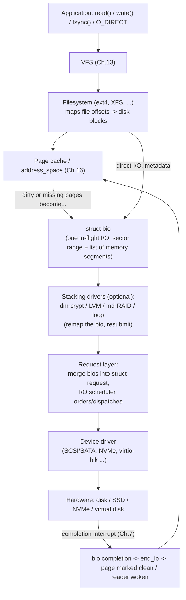
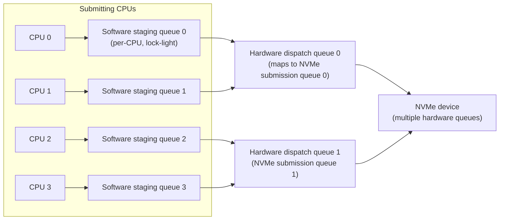
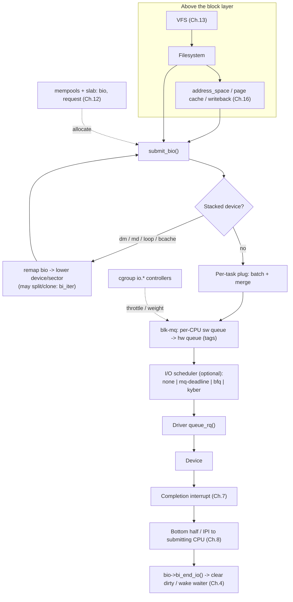

# Chapter 14 — The Block I/O Layer

> Source fidelity: this chapter follows Robert Love, *Linux Kernel Development*, 3rd Ed., Chapter 14 ("The Block I/O Layer"). All explanations, diagrams, code and experiments below are original. This is one of the chapters where the book is **most** out of date in its details: the single-queue block layer it describes was replaced by the multi-queue **blk-mq** design, and CFQ, Deadline (legacy), Anticipatory and Noop schedulers were removed or replaced. The *concepts* (sectors vs blocks, `bio`, request, merging, sorting, elevators, latency vs throughput) are still the vocabulary every storage engineer uses. Every change is marked **[BOOK — Linux 2.6]**, **[MODERN LINUX]** or **[CONCEPTUAL CORE]**. Where I am unsure of an exact version or field name from memory, I say so and give you a command to check in your own tree.

---

## 1. What This Chapter Is About

Chapter 13 ended at the point where a filesystem has decided *"I need blocks N..M of this device"*. This chapter is everything between that decision and the physical device: the **block I/O layer**, the part of the kernel that manages **block devices** (disks, SSDs, NVMe, RAID volumes, loop devices, virtual disks) and the **requests** to them.

| Question | Answer in this chapter |
|---|---|
| What *is* a block device, and how is it different from a character device? | Section 5.1 |
| What are sectors, blocks, and segments? | Section 5.1 |
| How does the kernel describe one in-flight I/O? | **`struct bio`** (Section 5.4); the old **`buffer_head`** (Section 5.3) |
| How are many small requests turned into few efficient ones? | Request queues and **merging** (Section 5.5) |
| In what *order* are requests sent to the device? | **I/O schedulers** (Section 5.6) |
| How does a modern NVMe device get fed from 64 CPUs without a single lock? | **blk-mq**, the multi-queue layer (Section 5.5, modern notes) |

## 2. Why This Matters

- **Storage is the slowest component** in almost every system (compare: nanosecond DRAM from the cpumemory-based notes vs. microsecond-to-millisecond storage). The block layer is where the kernel claws back performance: batching, merging, reordering, parallelizing.
- **Every databases/storage-engine design decision** (append-only logs, SSTables, `fsync` batching, direct I/O, queue depth, alignment) is an answer to how this layer behaves.
- **Production debugging** lives here: high `await` latency, saturated queues, write stalls, a noisy neighbor on shared storage, NVMe timeouts.
- It is the lower half of **Chapter 16** (page cache and writeback): dirty pages become `bio`s here.

## 3. Prerequisite Concepts

- **Chapter 1**: kernel vs. device; interrupts (an I/O completion is an interrupt).
- **Chapters 7-8**: top-half/bottom-half. A block I/O *completion* is classic top-half (acknowledge) plus deferred completion processing.
- **Chapters 9-10**: queues and requests are shared data structures, protected by locks (the old per-queue lock was a famous scalability limit; blk-mq exists largely to remove it).
- **Chapter 12**: slab caches (`bio`, `request`) and page frames (a `bio` points at pages, the unit of Chapter 12).
- **Chapter 13**: the VFS and `address_space` hand blocks down to this layer. The OSTEP-based storage notes in this workspace (disk geometry, seek vs rotation, RAID, elevator/SCAN, the "random vs sequential" bandwidth gap) are the *why* behind merging and sorting; this chapter is the *how* in Linux.

## 4. Big Picture



Read it as three layers, which is also the structure of this chapter: **(1) describe the I/O** (`bio`), **(2) organize and schedule I/Os** (requests, queues, schedulers), **(3) talk to the device** (driver) and handle completion.

---

## 5. Core Concepts

### 5.1 Block Devices, Sectors, Blocks, and Segments

**Concept.** A **block device** is hardware (or a software emulation of it) that is accessed in **fixed-size chunks** and supports **random access**: you can read chunk 5000, then chunk 3, then chunk 99. Hard disks, SSDs, NVMe drives, CD-ROMs, RAID volumes, and virtual disks are block devices. A **character device** (keyboard, serial port, `/dev/null`) delivers a *stream* of bytes you consume in order; you cannot "seek to byte 5000" in a keyboard.

**Intuition.** A block device is a bookshelf of numbered, identical boxes: you may ask for box 4,117 directly. A character device is a conveyor belt: items arrive in order, and you take what comes.

**Why the distinction forces a whole subsystem.** Random access to *slow* hardware means **the order and grouping of requests matters enormously** (a mechanical disk's cost depends on where the head is). A stream device needs no such cleverness. So block devices get a dedicated layer for **queuing, merging, scheduling, and buffering**; character devices are mostly handled by a driver directly (Chapter 17).

**Three units, and the book's strict definitions.** Confusing these is the #1 source of block-layer confusion.

| Unit | Defined by | Typical size | Constraints |
|---|---|---|---|
| **Sector** | The **device** hardware: the smallest addressable unit | 512 bytes (traditional); 4096 bytes on "Advanced Format" drives | Power of two; the device can only transfer whole sectors |
| **Block** | The **filesystem / kernel**: the smallest logical unit the filesystem addresses | 1 KB, 2 KB, 4 KB | Power of two; **a multiple of the sector size and no larger than a page** (so a page holds a whole number of blocks) |
| **Segment** | The **in-memory** piece: a contiguous run of memory participating in one I/O | Up to a page or more | Used to describe scatter-gather lists |

```
Sector 512 B (hardware)             Block 4 KB (filesystem)             Page 4 KB (memory)
+-----+-----+-----+-----+-----+-----+-----+-----+            +-----------------------------+
| s0  | s1  | s2  | s3  | s4  | s5  | s6  | s7  |   = 1 block = 8 sectors  = 1 page frame
+-----+-----+-----+-----+-----+-----+-----+-----+
```
Many sources (and the kernel API) call a "sector" a *512-byte unit* regardless of what the hardware really uses: `bio->bi_iter.bi_sector` and `/proc/diskstats` always count in 512-byte units even on a 4 KB-sector disk. Always ask "whose sector?"

**Real Linux investigation.**
```bash
lsblk -d -o NAME,TYPE,SIZE,ROTA,LOG-SEC,PHY-SEC,SCHED,MODEL   # logical/physical sector sizes, rotational?, scheduler
lsblk -t                                                       # topology: alignment, min/opt I/O, discard granularity
sudo blockdev --getss --getpbsz --getbsz /dev/sda             # logical sector, physical sector, kernel block size
sudo tune2fs -l /dev/sda1 2>/dev/null | grep "Block size"     # filesystem block size (ext4)
cat /sys/block/sda/queue/{logical_block_size,physical_block_size,rotational,nr_requests,read_ahead_kb,max_sectors_kb}
```
**Common mistakes.** Mixing sector and block units in arithmetic; assuming the sector size is always 512; assuming "block" means the device's unit (it is the *filesystem's*); misaligned partitions (a 4 KB filesystem block straddling two physical 4 KB sectors forces read-modify-write on the device).

**Active recall (5.1)**
1. Which unit does the *hardware* define, and which does the *filesystem* define?
2. Why must a filesystem block be at most one page?
3. Why does the block layer exist for disks but not for a keyboard?

<details><summary>Answers</summary>

1. Sector = hardware; block = filesystem/kernel.
2. A block must fit in a page so that a page holds a whole number of blocks and a block never spans two pages (simplifies the page-cache-to-block mapping).
3. Disks are random-access and slow, so order, grouping, and buffering of requests matter; a keyboard is a stream with no such choices.
</details>

---

### 5.2 Anatomy of the Layer (the Whole Path in One Pass)

**Concept.** Before the details, trace one write through the whole stack so each piece has a place.

1. **VFS/filesystem** (Chapter 13): `write()` copies data into **page-cache pages** and marks them dirty. Nothing touches the disk yet.
2. **Writeback** (Chapter 16) later decides to flush those pages. The filesystem translates "file offset X" into "disk block B" (its allocation logic) and builds **`bio`s** describing the transfer.
3. **`submit_bio()`** hands each `bio` to the block layer.
4. **Stacking drivers** (device-mapper: LVM, dm-crypt; md RAID; loop) may *remap* the bio to different device/sector and resubmit it.
5. The **request layer** tries to **merge** the bio into an existing pending **request**, or creates a new request; the **I/O scheduler** (if any) orders it.
6. The **driver** is told to dispatch; it programs the hardware (an NVMe doorbell, a SATA command).
7. The device performs the transfer and raises a **completion interrupt** (Chapter 7); the top half acknowledges, a bottom half (Chapter 8) finishes the request, calls each `bio`'s **`end_io`** callback, and the page is marked clean / the waiting reader wakes (Chapter 4).

**[CONCEPTUAL CORE]** This pipeline (describe, merge/schedule, dispatch, complete) is invariant. What changed in modern Linux is *how many parallel lanes* it has and *how much cleverness it still spends on slow media* (Sections 5.5-5.6).

---

### 5.3 Buffers and Buffer Heads

**Concept.** A **buffer** is the in-memory representation of **one on-disk block**. When the kernel holds a disk block in memory, a **`struct buffer_head`** describes it.

**[BOOK — Linux 2.6] The two jobs the buffer head had, and the problem.**
- *Job 1, mapping:* record which disk block (`b_blocknr` on device `b_bdev`) corresponds to which piece of memory (`b_page` plus `b_data`, the address within the page). This is how the kernel knew "this 1 KB chunk of this page is block 7,042 of /dev/sda1".
- *Job 2, I/O unit:* in Linux 2.4 the buffer head was *also* the structure submitted to the block layer for I/O.

```c
struct buffer_head {                  /* simplified from the book */
    unsigned long   b_state;          /* BH_Uptodate, BH_Dirty, BH_Lock, BH_Mapped, ... */
    struct buffer_head *b_this_page;  /* circular list of buffers sharing one page */
    struct page    *b_page;           /* the page holding this block's data */
    sector_t        b_blocknr;        /* logical block number on b_bdev */
    size_t          b_size;           /* block size */
    char           *b_data;           /* pointer to the data inside the page */
    struct block_device *b_bdev;      /* which device */
    bh_end_io_t    *b_end_io;         /* completion callback */
    void           *b_private;        /* owner-private data (journaling uses it) */
    atomic_t        b_count;          /* reference count */
};
```
**The problems with the buffer head as an I/O unit (why `bio` was invented):**
1. **It described only one block** (often 512 B-4 KB, always contiguous memory). Moving a large, physically-scattered memory region in one I/O meant a pile of tiny buffer heads, each with bookkeeping overhead.
2. **Too heavy**: a whole structure per small block, and it duplicated the job of "describe a page".
3. **The kernel prefers to think in pages** (Chapter 12), not blocks; the mapping job is about *blocks inside a page*, the I/O job is about *a run of data*; one struct doing both was awkward.
4. It could not directly express **scatter-gather** (one disk range, many memory pieces) or I/O straight to/from user pages (direct I/O).

**Design response.** Split the jobs: **buffer heads keep only the block-to-page mapping role**; a new, lighter, flexible structure, the **`bio`** (Section 5.4), is the **unit of I/O**.

**[MODERN LINUX]** Buffer heads still exist. Filesystems that keep per-block state (ext2/ext3-style, **ext4 metadata and the jbd2 journal**, some others) still use them, and **block-device buffer-cache access** (`sb_bread`, `__bread`) uses them too. But *new* data-path code (XFS, Btrfs data, and ext4's newer paths via **`iomap`**) avoids buffer heads: they map file ranges to disk extents and build `bio`s straight from page-cache folios. If a recent filesystem seems to have no buffer heads, that is the intended direction, not an omission. See `include/linux/buffer_head.h` and `fs/iomap/`.

**Common mistakes.** Thinking buffer heads are the I/O interface (they are mapping/state structures; `bio` is the I/O); thinking the "buffer cache" is a separate cache from the page cache (since 2.4/2.6 it is unified: buffers *live inside* page-cache pages).

---

### 5.4 The `bio` Structure

**Concept.** `struct bio` is the block layer's **basic container for a block I/O operation**: "transfer *this contiguous range of sectors on this device* to/from *this list of memory segments*".

**Intuition.** A shipping order: "deliver parcels from these three warehouse shelves (pages in memory, anywhere) to one contiguous aisle on the disk (sectors 8,000-8,015)". The order carries the destination range once, and a packing list for the pieces.

**Internal representation.**
```c
struct bio {                         /* conceptual; field names vary by kernel version */
    sector_t            bi_sector;   /* [BOOK] starting sector on the device (modern: bi_iter.bi_sector) */
    struct block_device *bi_bdev;    /* the target device (modern: bi_bdev, or via disk) */
    unsigned long       bi_flags;    /* status flags */
    unsigned long       bi_rw;       /* [BOOK] READ or WRITE (+ flags)   [MODERN: bi_opf] */
    unsigned short      bi_vcnt;     /* number of bio_vecs in the list */
    unsigned short      bi_idx;      /* current index into bi_io_vec (progress) [MODERN: bi_iter.bi_idx] */
    struct bio_vec     *bi_io_vec;   /* the array of memory segments */
    bio_end_io_t       *bi_end_io;   /* completion callback */
    atomic_t            bi_cnt;      /* reference count */
    void               *bi_private;  /* owner's private data (passed to end_io) */
};

struct bio_vec {                     /* ONE memory segment */
    struct page    *bv_page;         /* the page */
    unsigned int    bv_len;          /* length in bytes */
    unsigned int    bv_offset;       /* offset within the page */
};
```
**Scatter-gather, drawn.** A `bio` representing a 12 KB read from sector 8000 into three *non-adjacent* pages:
```
bio:  bi_sector = 8000   (one contiguous run of the disk)
      bi_vcnt   = 3
      bi_io_vec -> [0]: page @ phys 0x1a3000, offset 0, len 4096
                   [1]: page @ phys 0x07f000, offset 0, len 4096     <- pages need NOT be adjacent in memory
                   [2]: page @ phys 0x2c1000, offset 0, len 4096

Disk (sectors):  | 8000 ........ 8007 | 8008 ....... 8015 | 8016 ....... 8023 |
                      -> page[0]            -> page[1]           -> page[2]
```
The hardware (via DMA scatter-gather, Chapter 17) can fill all three pages in one command. This is the capability the buffer head lacked.

**The progress index.** `bi_idx` marks how far through the vector the I/O has progressed. The index lets a request be **split or partially completed** and lets stacking drivers (RAID, device-mapper) hand parts of one bio to different devices without copying the vector. **[MODERN]** this was formalized as a small embedded `struct bvec_iter bi_iter` (sector, remaining size, index, offset-in-vector), so `bio` splitting and cloning are cheap and safe.

**Reference counting.** `bi_cnt` is a plain reference count; get/put with `bio_get()`/`bio_put()`; when it reaches zero the bio is freed (back to its slab/mempool).

**Why mempools, not just slab.** `bio`s must be allocatable **under memory pressure** (because writing out dirty memory to free memory needs a `bio`!). The block layer therefore allocates them from **mempools** (reserved pre-allocated pools that guarantee forward progress), a direct use of the Chapter 12 ideas to avoid a deadlock where reclaim needs memory to free memory.

**Advantages over buffer heads (book's list, condensed).** Supports high-memory pages (it holds `struct page`s, not addresses); can describe a **normal page I/O or a direct I/O** (user pages pinned) with the same structure; naturally expresses **scatter-gather**; lightweight; and separates "mapping" from "I/O" cleanly.

**[MODERN LINUX] field and API changes (what to expect when you read current code).**
- `bi_rw` became **`bi_opf`** (operation + flags, around 4.8): the operation is `REQ_OP_READ`, `REQ_OP_WRITE`, `REQ_OP_FLUSH`, `REQ_OP_DISCARD` (TRIM), ...; flags like `REQ_SYNC`, `REQ_FUA` (force unit access), `REQ_PREFLUSH` (flush the device write cache first) carry durability semantics. This is how a filesystem's `fsync()` guarantee ("it is on stable storage") is expressed to the device.
- Error reporting moved from `bi_error`-style ints to **`bi_status`** (`blk_status_t`).
- `bio_vec` is unchanged in spirit; `bi_iter` carries the progress state. Multi-page `bio_vec`s ("multipage bvecs", around 5.0) allow one vector entry to cover physically contiguous *multiple* pages, so large I/O needs fewer entries.
- Submission is `submit_bio()`; the stacking-driver entry point was renamed several times (`generic_make_request` -> `submit_bio_noacct` and friends; the old per-queue `make_request_fn` is now the disk's `submit_bio` method in `block_device_operations`). Check `block/blk-core.c` for the names in your tree.
- The structure is increasingly shown with **folios** (Chapter 12) instead of single pages in the data path.

**Real Linux investigation.**
```bash
cd ~/linux
rg -n "^struct bio \{" include/linux/blk_types.h
rg -n "^struct bio_vec \{" include/linux/bvec.h
rg -n "REQ_OP_READ|REQ_OP_WRITE|REQ_OP_FLUSH|REQ_FUA|REQ_PREFLUSH" include/linux/blk_types.h | head
rg -n "^void submit_bio\b|^blk_qc_t submit_bio\b|submit_bio_noacct" block/blk-core.c
rg -n "bio_alloc_bioset|bioset_init|mempool" block/bio.c | head
sudo cat /sys/kernel/slab/bio-*/object_size 2>/dev/null | head   # the bio slab(s)
```

**Common mistakes.** Treating a `bio` as one contiguous memory buffer (it is a *list* of segments); modifying a bio you don't own after submission; forgetting that `end_io` may run in **interrupt/softirq context** (cannot sleep, Chapter 8); forgetting `REQ_PREFLUSH/REQ_FUA` semantics when reasoning about durability.

**Active recall (5.4)**
1. What does a `bio` describe about *disk* and about *memory*?
2. Why can a `bio` map non-adjacent pages to one contiguous disk range?
3. Why are `bio`s allocated from mempools?
4. What are `REQ_PREFLUSH` and `REQ_FUA` for?

<details><summary>Answers</summary>

1. Disk: one contiguous sector range on one device. Memory: a list (`bio_vec` array) of page/offset/length segments.
2. The hardware supports scatter-gather DMA; each `bio_vec` is an independent segment, so memory need not be contiguous.
3. To guarantee that I/O needed to free memory can always be issued even when general allocation fails (avoiding a reclaim deadlock).
4. Durability: flush the device's volatile write cache before this write, and force this write itself to non-volatile media before completing.
</details>

---

### 5.5 Request Queues and Requests

**Concept.** Each block device has a **request queue** holding pending **requests**. A **request** (`struct request`) is a list of one or more **`bio`s** that are adjacent on disk and will be issued to the driver as *one command*. The queue exists so the kernel can **batch and reorder** work before bothering the (slow) device.

**Intuition.** A bus stop. Passengers (`bio`s) arrive one by one; the dispatcher (request layer) waits to group those headed the same way into one bus (request) rather than sending a separate bus for each person.

**Why not send each `bio` straight to the device?** Because (a) per-command overhead is large relative to a tiny transfer; (b) neighboring bios can be **merged** into one big, efficient command; (c) on rotating disks, **order** determines seek cost (Section 5.6). Queuing creates the opportunity to do both.

**[BOOK — Linux 2.6] the single-queue model.**
```c
struct request {                     /* simplified, book-era */
    struct list_head queuelist;      /* linkage in the queue */
    struct request_queue *q;         /* owning queue */
    sector_t   sector;               /* next sector to transfer */
    unsigned long nr_sectors;        /* total sectors */
    struct bio *bio;                 /* first bio in this request */
    struct bio *biotail;             /* last bio (append here when merging) */
    /* ... flags, timeouts, tags, driver private data ... */
};
```
- The queue is a **doubly-linked list of requests sorted by sector**, protected by **one spin lock per queue** (the `queue_lock`).
- Filesystems submit bios; the block layer tries to **merge each new bio into an existing request** (extend `biotail`) before creating a new one.
- The driver registers a **request function (`request_fn`, "strategy routine")**; the block layer calls it when requests are ready; the driver pulls requests off the queue (`blk_fetch_request`), programs hardware, and, on completion (interrupt), calls `end_request`/`blk_end_request` to finish bios.

**The problem that doomed this design.** *One lock per queue, one list per device.* Fine for a disk that serves ~100-200 requests per second; a bottleneck for a flash/NVMe device that can service **hundreds of thousands to millions of requests per second** from dozens of CPUs. Every submitting CPU contends on the same lock and bounces the same cache lines (the cache-coherence cost from the cpumemory-based notes, and the "global lock" scalability lesson from Chapter 9).

**[MODERN LINUX] blk-mq: the multi-queue block layer (merged around 3.13; made *the only* block layer around 5.0).** I am confident of the design and the approximate versions; confirm with `git log --oneline block/blk-mq.c | tail`.


- **Per-CPU software staging queues**: a CPU submits into *its own* queue with little or no locking.
- **One or more hardware dispatch queues**, matching the device's real queues (an NVMe controller exposes many submission/completion queue pairs, often one per CPU or per few CPUs). A **mapping** ties each CPU to a hardware queue.
- **Tags**: each in-flight request gets a **tag** from a pre-allocated tag set (the request structures themselves are pre-allocated, per queue, together with the driver's per-request private data). A tag is the index the device uses to identify the command, so completions need no search.
- **Optional I/O scheduler** sits between staging and hardware queue (Section 5.6); for fast NVMe devices the best choice is typically *none*.
- **Plugging**: a submitter may "plug" the queue (`blk_start_plug()` ... `blk_finish_plug()`) to accumulate a batch of bios in a small per-task list, merging them cheaply and flushing them together, reducing queue and lock traffic. The book describes a form of this idea as "unplugging" for rotating disks; modern plugging is per-task and per-call.
- **Completion** is steered back to the submitting CPU (or its group) via IPI or per-queue interrupt vectors, preserving cache locality (Chapter 7's interrupt affinity ideas).
- **Driver interface:** instead of a `request_fn`, a blk-mq driver provides `queue_rq()`, `complete()`, and a `blk_mq_tag_set`; see `drivers/nvme/host/pci.c` and `drivers/block/null_blk/`.

The conceptual summary: **the old design had one queue and one lock to serve many CPUs; blk-mq has many queues, mostly lock-free per-CPU fast paths, shaped to match modern parallel hardware.** It is an almost textbook case of Chapter 9's "lock granularity" argument applied at subsystem scale, and of the "per-CPU data" idea from Chapter 12.

**What a driver sees now (both eras, same idea).** "Here is a request (sector range, direction, a list of memory segments). Do it. Tell me when done." Everything else is the block layer's job.

**Real Linux investigation.**
```bash
ls /sys/block/nvme0n1/mq/ 2>/dev/null          # hardware queues for an NVMe device (one dir per hctx)
ls /sys/block/nvme0n1/mq/0/                    # cpu_list, nr_tags, ...
cat /sys/block/nvme0n1/mq/*/cpu_list           # which CPUs map to which hardware queue
cat /sys/block/*/queue/nr_requests             # queue depth limit
cat /sys/block/sda/queue/scheduler             # e.g.  [mq-deadline] none   (brackets = active)
cd ~/linux; ls block/ ; rg -n "^struct request \{" include/linux/blk-mq.h; rg -n "struct blk_mq_hw_ctx \{" include/linux/blk-mq.h
```

**Common mistakes.** Assuming one request equals one `bio` (a request holds many merged bios); assuming a single global device queue exists on modern kernels; setting queue depth far beyond what the device or workload benefits from (deeper queues raise throughput *and* latency; Little's law).

**Active recall (5.5)**
1. What is the relationship between a `bio` and a `request`?
2. What scalability problem did the single-queue design have?
3. What are the two kinds of queues in blk-mq, and what is a tag?

<details><summary>Answers</summary>

1. A request is a list of one or more adjacent `bio`s issued to the driver as one command; bios are merged into requests.
2. One lock and one list per device, contended by every submitting CPU: unable to scale to flash/NVMe rates.
3. Per-CPU software staging queues and hardware dispatch queues matching the device; a tag identifies one in-flight request/command and indexes pre-allocated request structures.
</details>

---

### 5.6 I/O Schedulers

**Concept.** An **I/O scheduler** manages a device's request queue: it decides the **order** of requests and **when** each is dispatched, with the goal of improving **global throughput** (fewer/cheaper seeks, bigger transfers) while bounding **latency** and **starvation**.

> **It is *not* the process scheduler of Chapter 4.** Both virtualize a shared resource among competitors (CPU time vs. disk bandwidth) and both trade fairness against throughput, but they are separate subsystems with separate code. The book warns about conflating them; so do I.

**The two basic actions.**
1. **Merging**: coalesce a new request with an adjacent existing one into one bigger command. *Front merge* when the new request immediately **precedes** the existing one's start; *back merge* when it immediately **follows** the existing one's end. Back merges dominate in practice because files are read forward. Merging cuts per-command overhead and seeks.
2. **Sorting**: keep the queue ordered by sector so the disk head moves in **one direction, like an elevator**, sweeping across the disk and servicing requests in passing, then reversing; hence the schedulers' nickname, **elevators**. (This is the SCAN family from the disk-scheduling discussion in the OSTEP-based notes; SSTF could starve distant requests, the elevator limits that.)

```
Disk sectors:  1 ----- 100 ----- 200 ----- 300 ----- 400 ----- 500
Arrival order of requests:  300, 100, 400, 200, 500, 120
Unscheduled (FIFO):   head thrashes: 300 -> 100 -> 400 -> 200 -> 500 -> 120   (long total travel)
Elevator (sorted, one sweep upward from 100):  100 -> 120 -> 200 -> 300 -> 400 -> 500  (one pass)
```
**The unavoidable tradeoff.** Reordering for throughput is **unfair to someone**: a far-away request can wait while the head services a cluster of nearby ones. A scheduler is therefore a throughput-vs-latency-vs-fairness policy, and each historical scheduler is a different point on that tradeoff, plus a different answer to *reads vs. writes*:
- **Reads are synchronous** (the application blocks until data arrives) and are often dependent chains (read a directory, then an inode, then data).
- **Writes are usually asynchronous** (buffered by the page cache; the app has already moved on).
- Therefore **read latency matters far more than write latency** for responsiveness; a good scheduler favors reads **without starving writes forever**.

**The book's schedulers, as design lessons.**

| Scheduler | Core idea | What it fixed / cost | Fate |
|---|---|---|---|
| **Linus Elevator** (2.4) | One queue; on submit: **merge** if adjacent, else **insertion-sort** by sector, else tail; if an old request exists, insert at tail to limit starvation | Merge + sort, but starvation only crudely bounded; no read preference | Gone from 2.6 onward |
| **Deadline** | Keep the **sorted queue** *plus* two **FIFO queues** (read and write) with **expiry times** (defaults: reads ~500 ms, writes ~5 s). Normally dispatch in sector order; **if the head of a FIFO has expired, serve it first**. Reads get shorter deadlines. | Bounds starvation and favors reads; slightly lower throughput than pure sorting; no hard guarantees | **Survives as `mq-deadline`** |
| **Anticipatory** | Deadline's base, plus **anticipation**: after a read, *idle a few ms (default ~6 ms)* hoping the app issues another nearby read, avoiding a seek-away-and-back "seek storm" against concurrent writes; uses per-process statistics to decide if waiting is worthwhile | Great throughput *and* read latency on many workloads; poor for seek-heavy databases; waiting wastes time if prediction fails | **Removed** (around 2.6.33; its ideas were folded into CFQ's idling) |
| **CFQ (Complete Fair Queuing)** | **One queue per process**; service queues **round-robin**, a few requests (default 4) per turn; each queue sorted/merged internally | Per-process fairness (e.g., the audio player's buffer refills on time); good desktop default | **Removed** with the legacy block layer (about 5.0); fairness now provided by **BFQ** and by cgroup I/O controllers |
| **Noop** | **Merge only**, FIFO otherwise: no sorting, no waiting | Minimal CPU overhead; right when the device (or an array/hypervisor underneath) does its own scheduling or has no seek cost: flash, RAM disks, virtual disks, SAN LUNs | Lives on as **`none`** (the blk-mq "no scheduler" setting) |

**Selecting a scheduler.** **[BOOK]** the `elevator=` boot parameter picked one globally (`as`, `cfq`, `deadline`, `noop`). **[MODERN]** the choice is **per device at runtime** via `/sys/block/<dev>/queue/scheduler`.

**[MODERN LINUX] the schedulers you actually meet today (blk-mq).**
- **`none`**: no I/O scheduler. The default and usually best for **NVMe and other fast, parallel devices**: the hardware has deep internal queues and parallelism that make host-side reordering pointless, and scheduler code adds CPU cost and a serialization point.
- **`mq-deadline`**: the blk-mq descendant of Deadline; a common default for SATA/SAS disks and SSDs. Sorted + read/write FIFOs with deadlines; also useful to *prevent write starvation of reads*.
- **`bfq`** (Budget Fair Queueing): a fairness-oriented descendant in the spirit of CFQ/Anticipatory: per-process (or per-cgroup) queues with *budgets*, idling to preserve sequentiality, low-latency heuristics for interactive/soft-real-time workloads, and I/O priorities (`ionice`) honored. Best on rotating disks and slow flash where interactivity matters; costs more CPU.
- **`kyber`**: a lightweight scheduler for fast devices that throttles to meet **read/write latency targets** by limiting queue depths per domain.
- Beyond the scheduler, **cgroup v2 I/O controllers** (`io.max` throttling, `io.weight`/`iocost` proportional sharing, `io.latency` targets) are the modern mechanism for *fairness between tenants/containers*, replacing the per-process fairness CFQ once provided.

**Why the scheduler matters less on SSDs/NVMe.** The cost model that motivated sorting (seek and rotational latency) does not exist for flash; there the dominant factors are **parallelism (queue depth)**, **write amplification/garbage collection**, and **tail latency**. Merging still helps (larger transfers amortize per-command overhead), but elevator-style sorting is mostly wasted work. This is the same "the mechanism followed the hardware" story as the move from `hash mod N`-style partitioning to consistent hashing in the distributed-systems notes: an algorithm tuned for one cost model is retired when the cost model changes.

**Connection to Systems Engineering.** Everything here maps onto storage-engine design: **LSM-trees and write-ahead logs** issue large sequential writes precisely so the layer below can merge them and the device can stream; **`fsync` batching (group commit)** exists because each flush is a `REQ_PREFLUSH/FUA` barrier that serializes the pipeline; **direct I/O (`O_DIRECT`) and `io_uring`** bypass the page cache (Chapter 16) but still pass through this layer; **queue depth** and **IOPS/latency/throughput** relationships follow Little's law (`outstanding I/Os = IOPS x latency`), which is why cloud block volumes quote IOPS limits and why "more threads" raises latency once the device saturates; **noisy-neighbor** problems on shared disks are what cgroup I/O control and BFQ weights address; **tail latency** is dominated by queuing here, not by the device itself.

**Common mistakes.** Choosing `bfq` for a high-IOPS NVMe database (CPU overhead, lower peak IOPS); leaving a deadline scheduler's tunables untouched when a latency SLA exists; assuming `ionice` works under `none` or `mq-deadline` (it needs a scheduler that honors priorities, e.g. BFQ, or a cgroup controller); benchmarking with the page cache in the way and believing the numbers describe the device.

**Debugging scenario.**

| Step | "Reads are slow while a backup writes" |
|---|---|
| Symptom | Interactive/DB read latency spikes to hundreds of ms whenever a bulk write job runs; `iostat -x` shows `w_await` and `r_await` both high, queue size (`aqu-sz`) large |
| Hypotheses | (1) Writes saturate the device and queued reads wait behind them; (2) scheduler is `none` on a rotating disk or shared volume; (3) writeback bursts from the page cache (Chapter 16) flood the queue; (4) device or cloud volume hit its IOPS/bandwidth cap |
| Observations | `iostat -x 1`: `%util`, `aqu-sz`, `r_await`/`w_await`, `rareq-sz`/`wareq-sz`; `cat /sys/block/<dev>/queue/scheduler`; `/proc/meminfo` `Dirty:`/`Writeback:`; cloud-provider throttling metrics |
| Tools | `iostat`, `blktrace`+`blkparse`/`btt`, `biolatency`/`biosnoop` (BCC/bpftrace), `fio` to reproduce, `pidstat -d`, cgroup `io.stat` |
| Evidence | e.g. `mq-deadline` absent, read requests sit in the queue behind a deep write backlog; or throttled at the volume's IOPS cap |
| Root cause | Write flood without read prioritization, or an I/O cap, or unbounded dirty-page writeback |
| Fix | Pick/tune a scheduler (`mq-deadline` read-favoring defaults, BFQ for slow disks), throttle the backup (`ionice` with BFQ, or cgroup `io.max`), lower `vm.dirty_*` thresholds, increase provisioned IOPS |
| Verification | Re-run `fio` mixed workload; p99 read latency back within target while the backup runs |

**Active recall (5.6)**
1. What are the two actions every elevator performs?
2. Why are reads treated as more latency-critical than writes?
3. What does the Deadline scheduler add on top of a sorted queue?
4. Why is `none` a sensible scheduler for NVMe?
5. How is I/O fairness between containers achieved today, given CFQ is gone?

<details><summary>Answers</summary>

1. Merging adjacent requests and sorting the queue by sector.
2. Reads are synchronous (the app blocks) and often dependent on each other; writes are mostly asynchronous, buffered, and tolerate delay.
3. Per-request expiry deadlines enforced through separate read and write FIFO queues, so no request waits indefinitely, with shorter deadlines for reads.
4. The device already has many hardware queues and internal parallelism and no seek cost; host-side sorting gains nothing and costs CPU and serialization.
5. cgroup v2 I/O controllers (`io.max`, `io.weight`, `iocost`, `io.latency`) and/or BFQ.
</details>

---

### 5.7 The Life of One Write: Putting the Chapter Together

**Scenario.** `write(fd, buf, 8192)` followed by `fsync(fd)` on an ext4/XFS file on an NVMe drive.

```mermaid
sequenceDiagram
    participant A as Application
    participant V as VFS + filesystem
    participant P as Page cache
    participant B as Block layer (blk-mq)
    participant D as Driver (NVMe)
    participant H as Device
    A->>V: write(fd, buf, 8192)
    V->>P: copy 8 KB into 2 page-cache pages, mark dirty
    V-->>A: returns 8192 (data NOT on disk yet)
    A->>V: fsync(fd)
    V->>P: start writeback of the file's dirty pages
    V->>B: build bios (iomap/bufferheads -> sectors); submit_bio(bio)
    B->>B: plug/merge adjacent bios; allocate tag; place in hw queue
    V->>B: journal commit: bio with REQ_PREFLUSH | REQ_FUA
    B->>D: queue_rq(request)
    D->>H: write submission-queue entry; ring doorbell
    H-->>D: completion-queue entry + interrupt (Ch.7)
    D->>B: complete request -> bio_endio() -> end_io (softirq/IPI)
    B->>P: pages marked clean (writeback done)
    B-->>V: all bios done; flush acknowledged
    V-->>A: fsync() returns -> durable
```
The two things the diagram makes obvious: **`write()` returning does not mean data is on the device** (it means it is in the page cache; Chapter 16), and **`fsync()` is a request-pipeline *barrier*** (flush + FUA semantics), which is why each `fsync` is expensive and why databases batch commits.

**blktrace letters (an event vocabulary worth memorizing; Experiment 14.3 shows it live).** `Q` bio queued to the block layer; `G` request allocated; `M`/`F` back/front **merge**; `I` inserted into the scheduler/queue; `D` **dispatched** to the driver; `C` **completed**. The gap `Q -> D` is *time spent queued in the kernel* (scheduler/queue delay); `D -> C` is *time in the device* (what `iostat` calls service time).

---

## 6. How the Pieces Fit Together



---

## 7. Source Code Navigation

```bash
cd ~/linux
ls block/        # blk-core.c blk-mq.c blk-mq-tag.c blk-merge.c bio.c elevator.c mq-deadline.c bfq-*.c kyber-iosched.c blk-settings.c ...
rg -n "^void submit_bio|submit_bio_noacct|__submit_bio" block/blk-core.c | head
rg -n "^static int blk_mq_submit_bio|blk_mq_submit_bio" block/blk-mq.c | head
rg -n "bio_attempt_back_merge|bio_attempt_front_merge|blk_attempt_plug_merge" block/ | head
rg -n "^struct request_queue \{" include/linux/blkdev.h
rg -n "^struct gendisk \{" include/linux/blkdev.h include/linux/genhd.h 2>/dev/null
rg -n "struct elevator_type|struct elevator_mq_ops" include/linux/elevator.h block/elevator.h 2>/dev/null
rg -n "dd_dispatch_request|fifo_batch|read_expire|write_expire" block/mq-deadline.c | head
# A driver to read: the null block device is the simplest complete blk-mq driver
ls drivers/block/null_blk/
rg -n "queue_rq|blk_mq_ops|blk_mq_tag_set" drivers/block/null_blk/main.c | head
# A real one: NVMe's blk-mq integration
rg -n "nvme_queue_rq|nvme_irq|blk_mq_complete_request" drivers/nvme/host/pci.c | head
# Stacking drivers: where bios get remapped
ls drivers/md/ | head -20      # dm-*.c, raid*.c, md.c
```
Trace by hand: `submit_bio()` -> `blk_mq_submit_bio()` -> try plug merge / `blk_mq_get_new_requests()` -> `blk_mq_sched_insert_request()` or direct issue -> `blk_mq_dispatch_*` -> driver `->queue_rq()` ... completion: device interrupt -> driver ISR -> `blk_mq_complete_request()` -> `bio_endio()` -> `bi_end_io`.

---

## 8. Hands-On Experiments

### Experiment 14.1 — Read the Topology: Units, Queues, and Scheduler of Your Disks
**Risk:** SAFE USER-SPACE (read-only)

**Objective.** Map the chapter's vocabulary (sector, block, queue depth, scheduler, hardware queues) onto your real devices.

**Execution.**
```bash
lsblk -d -o NAME,TYPE,SIZE,ROTA,LOG-SEC,PHY-SEC,SCHED,MODEL
for d in /sys/block/*; do n=$(basename $d); [ -e $d/queue/scheduler ] && \
  printf "%-10s sched=%-30s rot=%s nr_req=%s ra_kb=%s maxkb=%s\n" $n \
  "$(cat $d/queue/scheduler)" $(cat $d/queue/rotational) $(cat $d/queue/nr_requests) \
  $(cat $d/queue/read_ahead_kb) $(cat $d/queue/max_sectors_kb); done
ls /sys/block/nvme0n1/mq 2>/dev/null && cat /sys/block/nvme0n1/mq/*/cpu_list
grep -E " (sda|nvme0n1|vda) " /proc/diskstats
```

**Expected observation.** Rotating disks usually show `rot=1` and `mq-deadline`/`bfq`; NVMe shows `rot=0` and `none`; virtual disks (`vda`) often `none` or `mq-deadline`; NVMe lists several `mq/<n>` hardware queues with CPU lists partitioning your cores.

**Why it happens.** Section 5.5-5.6: defaults follow the device class; blk-mq mirrors the hardware queues.

**Experiment questions.** What is the sector/block mismatch on your device (`LOG-SEC` vs `PHY-SEC`)? Why does an NVMe device show multiple `mq` directories and a SATA disk usually exactly one? What does `max_sectors_kb` bound, and why would a huge sequential write become several requests?

---

### Experiment 14.2 — See Merging and Request Size with `fio` and `iostat`
**Risk:** SAFE USER-SPACE if you write to a *file* as below. **Never point `fio` at a raw device that holds data.** (Use a file, or Experiment 14.4's `null_blk`.)

**Objective.** Show the difference between sequential and random I/O, the effect of merging (`rrqm/s`, `wrqm/s`), and request size (`rareq-sz`/`wareq-sz`).

**Prerequisites.** `sudo apt install fio sysstat`; a few GB free; ideally a VM with a virtual disk.

**Execution.**
```bash
mkdir -p /var/tmp/fio && cd /var/tmp/fio
# Terminal 1: watch the device that holds /var/tmp (find with: df /var/tmp)
iostat -x 1 sda      # replace sda with your device (e.g. vda, nvme0n1)

# Terminal 2 -- jobs bypass the page cache with direct=1 so we see the DEVICE, not RAM
fio --name=seqread  --filename=./f --size=2G --rw=read      --bs=4k  --iodepth=1  --direct=1 --ioengine=libaio --runtime=15 --time_based
fio --name=randread --filename=./f --size=2G --rw=randread  --bs=4k  --iodepth=1  --direct=1 --ioengine=libaio --runtime=15 --time_based
fio --name=randread32 --filename=./f --size=2G --rw=randread --bs=4k --iodepth=32 --direct=1 --ioengine=libaio --runtime=15 --time_based
fio --name=seqwrite --filename=./f --size=2G --rw=write     --bs=4k  --iodepth=1  --direct=0 --ioengine=psync  --runtime=15 --time_based
```

**Expected observation.**
- `seqread` with `bs=4k` and `direct=1`: `rareq-sz` in `iostat` is often **larger than 4 KB** and `rrqm/s` (merged reads) is nonzero on a *rotating or SATA-scheduled* device, because the block layer merges adjacent 4 KB requests. On NVMe with `none`, merges are fewer.
- `randread` at depth 1: low throughput, high latency per I/O (`r_await`); on a HDD it is dramatically slower than sequential (the seek penalty from the OSTEP disk notes).
- `randread32`: IOPS climb with queue depth (device parallelism), but `r_await` grows (Little's law).
- `seqwrite` with `direct=0` (buffered): `fio` reports huge speed (page cache), while `iostat` shows the *device* writing later in bursts (writeback; preview of Chapter 16).

**Why it happens.** Merging (Section 5.5/5.6), seek cost, queue-depth parallelism, and buffered-vs-direct I/O.

**Investigation.** `fio` prints per-percentile latencies (`clat percentiles`); compare p50 vs p99. Use `--ioscheduler`/`echo mq-deadline | sudo tee /sys/block/<dev>/queue/scheduler` between runs (Experiment 14.5).

**Experiment questions.** (1) Predict `aqu-sz` for `iodepth=32` from IOPS x latency and check it. (2) Why is `%util` ~100 % on an NVMe drive that could still do much more? (Hint: `%util` = fraction of time with *at least one* I/O in flight; a parallel device is never "full" at 100 %.) (3) What does `direct=1` remove from the picture, and what additional kernel layer does that bypass?

---

### Experiment 14.3 — Watch One I/O Travel Through the Layer with `blktrace`
**Risk:** SAFE USER-SPACE (tracing reads only; root required)

**Objective.** Observe the Q/G/M/I/D/C lifecycle and the queue-time vs device-time split.

**Prerequisites.** `sudo apt install blktrace`; debugfs mounted (`sudo mount -t debugfs none /sys/kernel/debug` if needed).

**Execution.**
```bash
# In one terminal: trace a device while generating a little I/O in another
sudo blktrace -d /dev/sda -w 10 -o trace          # (use your device) trace 10 seconds
blkparse -i trace | head -60
blkparse -i trace -d trace.bin >/dev/null; btt -i trace.bin | head -40      # latency breakdown
# generate load at the same time:  fio --name=t --filename=/var/tmp/fio/f --size=1G --rw=read --bs=64k --direct=1 --runtime=8 --time_based
```
(For a quick no-install look: `sudo bpftrace -e 'tracepoint:block:block_rq_issue { @[args->comm] = count(); } interval:s:5 { exit(); }'`, or `sudo biolatency-bpfcc -D 5 1`.)

**Expected observation.** Lines like `8,0  3  1  0.000000000  4162  Q   R 12345678 + 128 [fio]` followed by `G`, `I`, `D`, and `C` for the same sector, with `M` lines when requests merge. `btt` summarizes **Q2G**, **G2I**, **I2D** (time in kernel queue/scheduler) vs **D2C** (device time).

**Why it happens.** Section 5.7: every event is a stage of the pipeline; `I2D`-heavy latency means *scheduler/queue* delay, `D2C`-heavy means *device* delay.

**Investigation.** Increase `iodepth` and watch `I2D` grow while `D2C` stays about constant: queueing delay. Switch scheduler and compare.

**Experiment questions.** How many `Q` events become one `D`, and what does that ratio say about merging? What would `D2C` look like on a throttled cloud volume? Which blktrace gap would reveal a *lock contention* problem inside the block layer?

---

### Experiment 14.4 — A Disk With No Disk: `null_blk` and the blk-mq Structure
**Risk:** KERNEL-MODIFYING (loads a stock kernel module; no data is at risk; VM recommended). `null_blk` completes I/O instantly without storing data.

**Objective.** Explore the *block layer's own* overhead and structure (hardware queues, CPU mapping, tags) with no real device in the way.

**Execution.**
```bash
modinfo null_blk | grep -E "parm|description" | head -30       # see available parameters (names can vary by version)
sudo modprobe null_blk gb=1 submit_queues=4 queue_mode=2 irqmode=0
ls /dev/nullb0
cat /sys/block/nullb0/queue/scheduler
ls /sys/block/nullb0/mq/                     # one directory per hardware queue
for q in /sys/block/nullb0/mq/*; do echo "$q cpus: $(cat $q/cpu_list)"; done
cat /sys/block/nullb0/queue/nr_requests

# Block layer throughput ceiling (no real device): files only, DO NOT run on real disks
sudo fio --name=null --filename=/dev/nullb0 --rw=randread --bs=4k --iodepth=64 --numjobs=4 \
         --direct=1 --ioengine=libaio --runtime=10 --time_based --group_reporting
# Compare 1 vs 4 vs 8 jobs, and 1 vs 4 submit_queues (reload the module with different submit_queues)

# Cleanup
sudo rmmod null_blk
```
> **Safety:** `/dev/nullb0` stores nothing, so pointing `fio` at it is safe; do **not** reuse that command line with a real device name.

**Expected observation.** Hundreds of thousands to millions of IOPS (host- and VM-dependent), scaling with jobs until CPUs saturate; `mq/` shows 4 hardware queues with CPU lists partitioning your cores.

**Why it happens.** With no media latency the only cost is the kernel's own per-I/O overhead; blk-mq's per-CPU/hardware queue design is what lets IOPS scale across cores. Reloading with `submit_queues=1` shows the single-queue bottleneck effect (fewer queues -> contention, lower scaling).

**Investigation.** `perf top -g` during the run to see where kernel time goes (`blk_mq_*`, `fio` syscall path); `cat /sys/block/nullb0/stat`.

**Experiment questions.** At what job count does scaling stop, and what resource limits it (CPU, a lock, the VM)? Why is there no I/O scheduler benefit here? What would an `I/O error` injection (`/sys/kernel/config/nullb/`) let you test about filesystem error handling?

---

### Experiment 14.5 — Change the Scheduler and Measure Tail Latency
**Risk:** KERNEL-MODIFYING (changes a sysfs tunable; reversible; VM recommended; do **not** do this on a production device)

**Objective.** Quantify the effect of the I/O scheduler on a mixed read/write workload, the situation Deadline-style schedulers were designed for.

**Execution.**
```bash
DEV=sda            # <-- your test device; the scheduler file must exist
cat /sys/block/$DEV/queue/scheduler
cd /var/tmp/fio
for S in none mq-deadline bfq; do
  grep -qw $S /sys/block/$DEV/queue/scheduler || { echo "skip $S (not available)"; continue; }
  echo $S | sudo tee /sys/block/$DEV/queue/scheduler >/dev/null
  echo "=== $S ==="
  fio --name=mix --filename=./f --size=2G --rw=randrw --rwmixread=70 --bs=4k --iodepth=16 \
      --direct=1 --ioengine=libaio --runtime=20 --time_based \
      --lat_percentiles=1 --percentile_list=50:99:99.9 | grep -E "read:|write:|clat|99.000|99.900"
done
echo mq-deadline | sudo tee /sys/block/$DEV/queue/scheduler >/dev/null   # restore a sane default
```

**Expected observation.** On a rotating or SATA device, `mq-deadline`/`bfq` typically show lower read p99/p99.9 than `none` under mixed load (reads not stuck behind writes); on fast NVMe the differences shrink or reverse (scheduler overhead). Results are workload- and device-dependent; the point is to *measure*.

**Why it happens.** Read-biased deadlines bound read waiting; BFQ budgets/idling trade throughput for responsiveness; `none` applies no ordering.

**Experiment questions.** Try `--rwmixread=100` vs `0`. Add a second, background sequential-writer `fio` job and compare read p99. Which scheduler would you choose for (a) a laptop HDD, (b) a database on NVMe, (c) a multi-tenant host, and why?

---

## 9. Mini Project — `miniostat`: Build `iostat -x` from `/proc/diskstats`

**Goal.** Re-derive `iostat`'s extended columns from the kernel's raw counters, which forces you to understand what each counter means and how latency, throughput, merge rate, queue depth and utilization are computed.

```python
#!/usr/bin/env python3
# miniostat.py   SAFE USER-SPACE.   Usage: python3 miniostat.py sda 1     (device, interval seconds)
import sys, time

def read(dev):
    for line in open('/proc/diskstats'):
        f = line.split()
        if f[2] == dev:
            v = list(map(int, f[3:]))
            # v[0] reads completed   v[1] reads merged   v[2] sectors read   v[3] ms reading
            # v[4] writes completed  v[5] writes merged  v[6] sectors written v[7] ms writing
            # v[8] I/Os in progress  v[9] ms doing I/O   v[10] weighted ms in queue
            return v
    sys.exit(f"device {dev} not found in /proc/diskstats")

def main(dev, interval):
    prev, t0 = read(dev), time.time()
    print(f"{'dev':8s}{'r/s':>8s}{'w/s':>8s}{'rMB/s':>9s}{'wMB/s':>9s}{'rrqm/s':>9s}{'wrqm/s':>9s}"
          f"{'r_await':>9s}{'w_await':>9s}{'avgrq-KB':>10s}{'aqu-sz':>8s}{'%util':>7s}")
    while True:
        time.sleep(interval)
        cur, t1 = read(dev), time.time()
        dt = t1 - t0
        d = [c - p for c, p in zip(cur, prev)]
        rio, wio = d[0], d[4]
        rsec, wsec = d[2], d[6]                       # 512-byte sectors ALWAYS (even on 4 KB-sector disks)
        r_await = d[3] / rio if rio else 0.0          # avg ms per read  (queue + service)
        w_await = d[7] / wio if wio else 0.0
        avgrq = ((rsec + wsec) * 512 / 1024) / (rio + wio) if (rio + wio) else 0.0
        aqu = d[10] / (dt * 1000)                     # avg number of I/Os in the system (Little's law: L)
        util = 100.0 * d[9] / (dt * 1000)             # % of time at least one I/O was in flight
        print(f"{dev:8s}{rio/dt:8.1f}{wio/dt:8.1f}{rsec*512/dt/2**20:9.2f}{wsec*512/dt/2**20:9.2f}"
              f"{d[1]/dt:9.1f}{d[5]/dt:9.1f}{r_await:9.2f}{w_await:9.2f}{avgrq:10.1f}{aqu:8.2f}{util:7.1f}")
        prev, t0 = cur, t1

if __name__ == '__main__':
    main(sys.argv[1], float(sys.argv[2]) if len(sys.argv) > 2 else 1.0)
```

**What it teaches, field by field.**
1. **Counters are cumulative; rates are deltas over time**: the standard way to turn kernel counters into metrics (same technique as `vmstat`, `/proc/stat`, and Prometheus `rate()`).
2. **Merged vs completed**: `rrqm/s` is the merging benefit made visible; a high `rrqm` with a large `avgrq-KB` means the layer is coalescing many small bios into big requests.
3. **`await` vs service time**: `ms reading / reads completed` includes **time spent queued in the kernel**, not only device time. This is why high `await` with modest device load points at *queuing* (compare `blktrace`'s `I2D` vs `D2C`).
4. **Little's law in the wild**: `aqu-sz = IOPS x await` (`L = lambda x W`). Check it against your output; the numbers should approximately agree.
5. **Why `%util` lies for parallel devices**: it only measures "any I/O in flight", so an NVMe drive can show 100 % while having headroom.

**Experiments with it.** Run alongside Experiment 14.2's `fio` jobs; compare against real `iostat -x 1` (they should match closely); drive it under `null_blk` and under a throttled cgroup (`io.max`); break `avgrq` into read vs write sizes as an extension.

**Extensions.** (1) Add `/sys/block/<dev>/queue/scheduler` and `nr_requests` to the header line. (2) Detect "queue building" (rising `aqu-sz` with flat IOPS) and print a warning. (3) Export Prometheus-style metrics. (4) Compare against `bpftrace` `block:block_rq_complete` latencies to separate queue vs device time.

---

## 10. Common Misconceptions

| Misconception | Correction |
|---|---|
| "A sector, a block, and a page are the same thing." | Sector = hardware unit; block = filesystem unit (multiple of sector, at most a page); page = memory unit. |
| "A block device is a disk." | It is any random-access, fixed-chunk device or emulation: SSD, NVMe, RAID/LVM volume, loop device, virtual disk, `null_blk`. |
| "The buffer head is how I/O is submitted." | That was the 2.4 design; `bio` is the I/O unit. Buffer heads survive mainly for block-to-page mapping/metadata in some filesystems. |
| "A `bio` is one contiguous buffer." | It is one contiguous *disk range* plus a list of (possibly scattered) memory segments. |
| "One request is one `bio`." | A request is a list of merged, adjacent `bio`s. |
| "The I/O scheduler is the CPU scheduler." | Separate subsystems; they share ideas, not code. |
| "I/O schedulers are mainly about fairness." | Primarily about throughput via merging/sorting, with deadlines/budgets limiting the unfairness it causes. |
| "SSDs/NVMe need an elevator scheduler." | No seek penalty; `none` is typically best; fairness is handled by cgroup controllers. |
| "`write()` returning means data is on disk." | It means it is in the page cache; durability needs `fsync` (flush/FUA down this layer). |
| "`iostat %util` of 100 % means the device is saturated." | Only for a serial device; parallel devices can show 100 % with plenty of headroom. |
| "CFQ, Anticipatory, Noop are still the choices." | Replaced by `none`, `mq-deadline`, `bfq`, `kyber` under blk-mq; legacy single-queue schedulers are gone. |
| "More queue depth is always faster." | Throughput saturates; beyond that, depth only adds latency (Little's law). |

---

## 11. Interview Questions

**Basic**
- Q: What is the difference between a block device and a character device?
  - *Correct answer:* random access in fixed-size chunks (and hence a layer for queuing/merging/scheduling) vs. an ordered byte stream.
  - *Follow-up:* "Why does `/dev/sda` go through the block layer but `/dev/tty` doesn't?"

- Q: Define sector, block, and page, and how they relate.
  - *Follow-up:* "What goes wrong if a filesystem's 4 KB blocks aren't aligned to a 4 KB physical sector?"

**Intermediate**
- Q: What is a `bio`? How does it differ from a buffer head and from a `request`?
  - *Follow-up:* "Why did the kernel introduce `bio`? What does scatter-gather buy you?"

- Q: Explain merging and sorting in an I/O scheduler and why reads are favored over writes.
  - *Follow-up:* "Why is sorting nearly pointless on NVMe? What *is* still useful there?"

- Q: Describe the Deadline scheduler's three queues and how it prevents starvation.

**Advanced / Kernel-Development**
- Q: Why was the single-queue block layer replaced by blk-mq? Describe the structure of blk-mq.
  - *Expected:* one queue lock became a bottleneck at flash speeds; per-CPU software queues, hardware dispatch queues matching device queues, tag sets with pre-allocated requests, per-task plugging, completion steering.
  - *Follow-up:* "How does this relate to the locking-granularity discussion in Chapter 9, and to per-CPU data in Chapter 12?"

- Q: How do stacking drivers (device-mapper, md RAID) fit into the block layer, and why does `bi_iter` make cloning/splitting a bio cheap?
  - *Follow-up:* "Where would dm-crypt encrypt the data relative to the page cache and the request queue?"

- Q: A block driver completes requests in its interrupt handler. What constraints apply to `bi_end_io` callbacks, and how do blk-mq/bottom halves help?
  - *Follow-up:* "Why does the completion often get steered back to the submitting CPU?"

**Debugging**
- Q: `iostat -x` shows `await` = 80 ms, `%util` = 40 %, `aqu-sz` = 30 on a disk. What is happening, and what would you check next?
  - *Expected:* large kernel queue (deep queue builds latency though the device isn't 100 % busy in time); check scheduler/queue depth, mixed read/write, writeback bursts, `blktrace` I2D vs D2C, cgroup or cloud throttling.

- Q: After a power loss, a database reports corruption though `fsync` returned. List the layers where "durable" could have been silently violated.
  - *Expected:* volatile device write cache without flush/FUA, filesystem mount options (nobarrier), RAID controller cache without BBU, hypervisor ignoring flushes, misreported `fsync` on some storage, application skipping directory `fsync`.

**Design**
- Q: Design the I/O path for a log-structured storage engine on NVMe that needs both high write throughput and bounded read p99. Which parameters in this layer do you control or monitor (scheduler, queue depth, direct I/O, alignment, sync strategy, cgroup limits)?
  - *No single answer.* Strong answers: large aligned sequential writes, group commit with a single flush, `O_DIRECT`/`io_uring` with controlled queue depth, `none` scheduler, separate read/write queue-depth budgets, monitoring p99 via `biolatency`, cgroup `io.latency` for tenant isolation.

---

## 12. Active Recall (Whole Chapter)

1. Name the three units of storage addressing and who defines each.
2. Why did the buffer head fail as an I/O unit?
3. What does a `bio` contain, and what does `bi_idx`/`bi_iter` enable?
4. How are bios, requests, and the request queue related?
5. What did the book's single-queue design lock, and why did that stop scaling?
6. Describe blk-mq's two queue levels and tags.
7. What are merging and sorting? Front vs back merge?
8. Compare Deadline, Anticipatory, CFQ, and Noop in one sentence each.
9. Which schedulers exist under blk-mq today, and which suits NVMe?
10. What do the blktrace events Q, M, I, D, C represent?
11. Why can `write()` return before data is durable, and what makes `fsync` durable at this layer?
12. What replaced CFQ's per-process fairness in modern Linux?

<details>
<summary>Answers</summary>

1. Sector (hardware), block (filesystem), segment (in-memory contiguous run; also page as the memory unit).
2. It described one small contiguous block, was heavy, mixed mapping with I/O duties, and couldn't express scatter-gather or direct user-page I/O.
3. One contiguous disk sector range plus an array of `bio_vec` (page, offset, length) segments; the index/iterator tracks progress so bios can be split/cloned/partially completed and remapped by stacking drivers.
4. Bios are the I/O descriptions; adjacent bios merge into a request; requests are queued per device (per hardware queue in blk-mq) and dispatched to the driver.
5. A single per-queue spin lock and list shared by all CPUs; contention and cache-line bouncing limited IOPS on fast devices.
6. Per-CPU software staging queues feeding hardware dispatch queues matching the device; each in-flight request holds a pre-allocated tag identifying the command.
7. Merging coalesces adjacent requests (front = new precedes existing, back = new follows existing); sorting orders the queue by sector to keep the head moving in one direction.
8. Deadline: sorted queue plus read/write FIFOs with expirations. Anticipatory: Deadline plus brief idling to anticipate nearby reads. CFQ: per-process queues served round-robin for fairness. Noop: merge only, FIFO.
9. `none`, `mq-deadline`, `bfq`, `kyber`; `none` (or sometimes `kyber`) for NVMe.
10. Q: bio queued; M: merged into an existing request; I: inserted into the queue/scheduler; D: dispatched to the driver; C: completed.
11. It returns after copying into the page cache; durability needs writeback plus flush/FUA requests (`REQ_PREFLUSH`/`REQ_FUA`) to reach stable media.
12. BFQ (per-process/cgroup budgets) and cgroup v2 I/O controllers (`io.max`, `io.weight`/`iocost`, `io.latency`).
</details>

---

## 13. Chapter Summary

The block layer sits between the filesystem/page cache and block-device drivers. Devices are addressed in **sectors** (hardware), filesystems in **blocks**, memory in **pages**. The per-I/O unit is the **`bio`**: one contiguous disk range plus a scatter-gather list of memory segments (replacing the heavy, single-block `buffer_head`, which survives only as a mapping/metadata structure). Adjacent bios are merged into **requests** held on **request queues**; an **I/O scheduler** merges and orders them (elevator-style sorting, deadlines to prevent starvation, anticipation or fairness queues to trade latency against throughput), a job entirely distinct from CPU scheduling. The book's single-lock, single-queue design with CFQ/Deadline/Anticipatory/Noop has been replaced by **blk-mq** (per-CPU staging queues, hardware dispatch queues, tags, plugging) with schedulers `none`, `mq-deadline`, `bfq`, and `kyber`, plus cgroup I/O controllers for fairness, because flash and NVMe moved the bottleneck from seek time to parallelism, queue depth, and software overhead. A completed I/O returns through an interrupt and bottom half to `bio->bi_end_io`, which cleans pages or wakes waiters. What remains true regardless of era: describe the I/O, batch and order it, dispatch it, complete it, and understand that queuing is where latency is created.

## 14. What I Should Be Able to Explain Now

- [ ] Block vs character devices, and sector vs block vs segment vs page.
- [ ] The buffer head's two roles and why the `bio` replaced it as the I/O unit.
- [ ] The structure and purpose of `bio` and `bio_vec`, scatter-gather, `bi_idx`/`bi_iter`, reference counting, mempools, and `REQ_*` durability flags.
- [ ] How bios merge into requests and how request queues work, in both the book's single-queue model and modern blk-mq.
- [ ] What an I/O scheduler does (merge, sort, bound starvation, read-vs-write policy), how it differs from the CPU scheduler, and how each classic scheduler works.
- [ ] Which schedulers exist today, why `none` is right for NVMe, and how cgroup controllers provide fairness.
- [ ] The life of a write from `write()` to durable `fsync`, and where latency can accumulate (`Q->D` vs `D->C`).
- [ ] How to read `iostat -x`, `/proc/diskstats`, and `blktrace` output, and apply Little's law to queue depth.

---

## Knowledge Graph (Chapter 14 Contribution)

```
Linux Kernel (continued from Ch.1-13)
+-- The Block I/O Layer
     +-- Block vs character devices
     +-- Units: sector (HW) / block (FS) / segment (memory run) / page
     +-- Buffers and buffer heads
     |    +-- [BOOK] mapping + I/O unit  ->  [MODERN] mapping/metadata only; iomap for new code
     +-- bio  (unit of I/O)
     |    +-- bi_sector/bi_iter, bio_vec[] (page, offset, len), bi_end_io, bi_private
     |    +-- scatter-gather; splittable/cloneable (stacking drivers: dm, md, loop)
     |    +-- [BOOK] bi_rw  ->  [MODERN] bi_opf (REQ_OP_*, REQ_PREFLUSH/FUA); bi_status; mempools
     +-- Requests and queues
     |    +-- struct request = merged bios
     |    +-- [BOOK] single request_queue + one lock + request_fn
     |    +-- [MODERN] blk-mq: per-CPU sw queues -> hw queues (tags), plugging, queue_rq()
     +-- I/O schedulers (NOT the CPU scheduler)
     |    +-- merging (front/back) + sorting (elevator); read-vs-write latency policy
     |    +-- [BOOK] Linus elevator, Deadline, Anticipatory, CFQ, Noop
     |    +-- [MODERN] none, mq-deadline, bfq, kyber; cgroup io.max/io.weight/io.latency
     +-- Completion: interrupt (Ch.7) -> bottom half/IPI (Ch.8) -> bio_endio -> page clean / waiter wakes (Ch.4)
     +-- Tools: lsblk, /sys/block/*/queue/*, /proc/diskstats, iostat -x, fio, blktrace/blkparse/btt,
          biolatency/biosnoop, bpftrace block:*, null_blk
     +-- -> Ch.15 (address space), Ch.16 (page cache & writeback feed this layer), Ch.17 (drivers)
```

*(Companion-file candidates, left untouched per your instruction: `glossary.md`: block device, sector, block, segment, buffer head, `bio`, `bio_vec`, request, request queue, I/O scheduler, elevator, merging, blk-mq, tag, plugging, `none`, `mq-deadline`, `bfq`, `kyber`, `REQ_FUA`, `REQ_PREFLUSH`, `iomap`, `null_blk`. `source-code-map.md`: `block/blk-core.c`, `block/blk-mq.c`, `block/bio.c`, `block/blk-merge.c`, `block/mq-deadline.c`, `block/bfq-*.c`, `include/linux/blk_types.h`, `include/linux/blkdev.h`, `include/linux/blk-mq.h`, `include/linux/bvec.h`, `drivers/block/null_blk/`, `drivers/nvme/host/pci.c`, `drivers/md/`, `fs/buffer.c`, `fs/iomap/`. `debugging-playbook.md`: high await/low util, reads stalled behind writes, NVMe I/O timeout, durability/flush misconfiguration, queue-depth saturation. `final-knowledge-map.md`: attach the tree above under the Chapter 13 branch. `interview-questions.md`: the set in Section 11.)*
