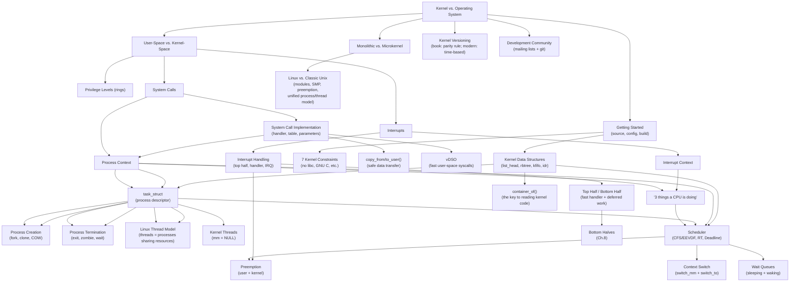

# Final Knowledge Map

> The single, growing concept graph of the entire book/course. Each chapter appends its branch to this tree. By the end of the course, this file is your one-page mental model of the whole kernel — the thing you should be able to redraw from memory.

---

## How to Use This File

Do not try to memorize this as a static artifact. Instead: after finishing each chapter, come here, find where that chapter's concepts attach to what you already knew, and mentally (or literally) re-draw the connections. The value of this file is in the *edges* (why does X depend on Y?), not just the *nodes* (a list of terms).

---

## Master Graph (grows every chapter)



*(Future chapters attach here — e.g., ProcCtx -> task_struct (Ch.3); ThreeStates -> Scheduler (Ch.4); Syscall -> Syscall Table (Ch.5); IntCtx -> Bottom Halves (Ch.8); ThreeStates -> Synchronization (Ch.9-10).)*

---

## Chapter 1 Branch — Detail

```
Linux Kernel
+-- Kernel vs. Operating System
|    +-- OS = kernel + drivers + boot loader + shell + utilities
|    +-- Kernel = innermost, most privileged layer
+-- User-Space
|    +-- Applications, glibc -- restricted privilege, no direct HW access
+-- Kernel-Space
|    +-- System Call Interface -- software-initiated entry
|    +-- Kernel Subsystems -- process mgmt, memory mgmt, VFS, networking...
|    +-- Device Drivers -- part of the monolithic kernel, not separate
+-- The Privilege Boundary (hardware mechanism)
|    +-- Rings (x86): 0 = kernel, 3 = user (1-2 unused by Linux)
|    +-- Trap instruction (int 0x80 / syscall) -- the only sanctioned door
|    +-- Kernel-controlled fixed entry point -- user code can't choose target
+-- Execution Contexts (THE recurring theme of Ch.7-10)
|    +-- User mode -- running application code
|    +-- Process context -- kernel code, on behalf of a specific process
|    |    +-- current -- per-CPU pointer to the running task
|    +-- Interrupt context -- kernel code, on behalf of NO process
|         +-- Strict rules: cannot sleep, must be fast
+-- Kernel Architecture
|    +-- Monolithic (Linux) -- one address space, direct function calls
|    |    +-- Borrows from microkernels: modules, preemption, kernel threads
|    +-- Microkernel (contrast) -- isolated servers, message passing/IPC
|         +-- Tradeoff: fault isolation vs. IPC overhead
+-- Linux vs. Classic Unix
|    +-- Dynamic module loading
|    +-- Native SMP support
|    +-- Kernel preemption
|    +-- Unified process/thread model (task_struct for both)
|    +-- Object-oriented device model + sysfs
|    +-- Selective feature adoption (open development process)
+-- Kernel Versioning
|    +-- [BOOK] major.minor.revision.stable, odd/even minor = dev/stable
|    |    +-- Retired 2.6.x indefinitely (2004 decision) instead of 2.7.x
|    +-- [MODERN] major.minor.patch, time-based release cycle
|         +-- ~2-week merge window -> rc1...rcN (~1wk apart) -> release
|         +-- No parallel dev branch -- features land only via merge window
|         +-- Stable branch (X.Y.Z) -- back-ported fixes only
|         +-- LTS branches -- multi-year maintenance, layered on stable mechanism
+-- Development Community
     +-- LKML + subsystem-specific mailing lists
     +-- git (created by Linus, 2005) -- git.kernel.org, GitHub mirror
     +-- lore.kernel.org -- full-text-searchable archive (modern addition)
```

---


## Chapter 2 Branch — Detail

```
Linux Kernel
+-- Getting Started
|    +-- Kernel Source Tree
|    |    +-- arch/, drivers/, fs/, include/, kernel/, mm/, scripts/
|    +-- Building the Kernel
|    |    +-- .config (configuration symbols)
|    |    +-- vmlinux, bzImage, System.map
|    +-- 7 Kernel Constraints
|    |    +-- No libc or standard headers
|    |    +-- GNU C (inline functions, likely/unlikely)
|    |    +-- No memory protection (oops, panics)
|    |    +-- No floating point easily available
|    |    +-- Small, fixed-size stack
|    |    +-- Synchronization and concurrency are required
|    |    +-- Portability is important
```

---

## Chapter 3 Branch — Detail

```
Linux Kernel
+-- Process Management
|    +-- Process vs. Program vs. Thread
|    +-- task_struct (Process Descriptor)
|    |    +-- State (TASK_RUNNING, TASK_INTERRUPTIBLE, TASK_UNINTERRUPTIBLE, __TASK_STOPPED, __TASK_TRACED)
|    |    +-- thread_info (low-level arch state)
|    |    +-- PID
|    +-- Process Creation
|    |    +-- fork(), vfork(), clone()
|    |    +-- Copy-on-Write (COW)
|    |    +-- do_fork() / kernel_clone() -> copy_process()
|    +-- Thread Implementation
|    |    +-- Threads are just processes sharing resources (clone flags)
|    |    +-- Kernel threads (no user address space, mm = NULL)
|    +-- Process Termination
|    |    +-- exit() -> do_exit()
|    |    +-- EXIT_ZOMBIE state
|    |    +-- wait() / waitpid() -> release_task()
|    |    +-- Reparenting (orphans go to init/subreaper)
```

---

## Chapter 4 Branch — Detail

```
Process Scheduling
├── Policy
│   ├── I/O-bound vs CPU-bound
│   ├── Nice values (-20 to +19)
│   ├── Real-time priorities (1-99)
│   └── Timeslice → proportional fair share
├── Scheduler Classes
│   ├── Stop (highest)
│   ├── Deadline (SCHED_DEADLINE)
│   ├── RT (SCHED_FIFO, SCHED_RR)
│   ├── Fair (CFS [BOOK] / EEVDF [MODERN])
│   └── Idle (lowest)
├── Fair Scheduling
│   ├── vruntime — weighted CPU time counter
│   ├── sched_entity — per-task scheduling data
│   ├── Red-black tree of runnable tasks
│   ├── Targeted latency
│   └── update_curr() — time accounting
├── Preemption
│   ├── User preemption (on return to user-space)
│   ├── Kernel preemption (preempt_count, need_resched)
│   └── → feeds into Synchronization (Ch.9-10)
├── Context Switching
│   ├── schedule() → pick_next_task()
│   ├── switch_mm() — page tables
│   └── switch_to() — registers/stack
└── Wait Queues
    ├── Sleeping (TASK_INTERRUPTIBLE/UNINTERRUPTIBLE)
    └── Waking (wake_up)
```

---


---

## Chapter 5 Branch — Detail

```
System Calls (Ch.5)
├── The Interface
│   ├── API vs System Call vs Library Function
│   ├── POSIX compliance
│   └── C library wrappers (glibc, musl)
├── Mechanism
│   ├── System call numbers (immutable ABI)
│   ├── sys_call_table lookup
│   ├── Trap instruction (int 0x80 → syscall/sysret)
│   ├── Register-based parameter passing
│   └── pt_regs (saved register state)
├── Implementation
│   ├── SYSCALL_DEFINEn() macros
│   ├── Parameter verification
│   │   ├── copy_from_user() / copy_to_user()
│   │   ├── capable() checks
│   │   └── __user annotation
│   └── Return value → errno convention
├── Performance
│   ├── syscall/sysret (fast path)
│   └── vDSO (no privilege transition)
└── Observability
    ├── strace (syscall tracing)
    └── ltrace (library call tracing)
```


---

## Chapter 6 Branch — Detail

```
Kernel Data Structures (Ch.6)
├── Linked Lists (list_head)
│   ├── Doubly linked, circular
│   ├── Embedded inside data structs (not wrapping them)
│   ├── container_of() — recover enclosing struct from member pointer
│   ├── list_for_each_entry() / _safe() iteration
│   └── No locking → caller must synchronize (Ch.9-10)
├── Queues (kfifo)
│   ├── FIFO ring buffer
│   ├── Lock-free for single-producer/single-consumer
│   └── Power-of-2 size for bitmask wrap
├── Maps (idr / XArray)
│   ├── Integer ID → pointer mapping
│   └── File descriptors, timer IDs, IPC IDs
├── Trees (rbtree)
│   ├── Self-balancing BST, O(log N)
│   ├── Embedded rb_node (same pattern as list_head)
│   └── Used by: CFS scheduler, VMA tree, I/O schedulers
└── Choosing the Right Structure
    ├── Ordered iteration → rbtree
    ├── Fast add/remove → linked list
    ├── FIFO → kfifo
    └── ID mapping → idr/xarray
```

---

## Chapter 7 Branch — Detail

```
Interrupts and Interrupt Handlers (Ch.7)
├── What Are Interrupts
│   ├── Asynchronous hardware signals
│   ├── Interrupts vs Exceptions (async vs sync)
│   └── IRQ numbers, interrupt controller (APIC)
├── Interrupt Handlers (Top Half)
│   ├── Runs in interrupt context (cannot sleep)
│   ├── Must be fast: acknowledge HW, copy data, schedule bottom half
│   ├── request_irq() / free_irq() registration
│   └── Shared interrupts (IRQF_SHARED)
├── Top Half / Bottom Half Split
│   ├── Top half: time-critical, interrupts disabled
│   └── Bottom half: deferred work, interrupts enabled (→ Ch.8)
├── Interrupt Context
│   ├── No backing process (current is meaningless)
│   ├── Cannot sleep, block, or schedule
│   └── Separate per-CPU interrupt stack [MODERN]
├── Interrupt Control
│   ├── local_irq_disable/enable (all IRQs on this CPU)
│   ├── local_irq_save/restore (nested-safe)
│   ├── disable_irq/enable_irq (specific IRQ line)
│   └── → feeds into Synchronization (Ch.9-10)
└── Implementation
    ├── Device → APIC → CPU → IDT → handler
    ├── [BOOK] do_IRQ() dispatch
    ├── [MODERN] genirq subsystem, MSI/MSI-X
    └── /proc/interrupts observability
```

## Cross-Chapter Dependency Notes (populated as chapters are written)

| Concept | Depends on (from earlier chapters) | Feeds into (later chapters) |
|---|---|---|
| Process context | User/kernel-space boundary (Ch.1), system calls (Ch.1 intro, Ch.5 full) | `task_struct` (Ch.3), scheduling (Ch.4), synchronization (Ch.9-10) |
| Interrupt context | User/kernel-space boundary (Ch.1) | Interrupts (Ch.7), bottom halves (Ch.8), synchronization (Ch.9-10) |
| Monolithic design | Kernel vs. OS (Ch.1) | Loadable modules (Ch.17) |
| `task_struct` | Kernel-space/user-space (Ch.1), process context (Ch.1) | Scheduling (Ch.4), synchronization (Ch.9-10), memory (Ch.12, 15) |
| `fork`/`clone` | `task_struct` (Ch.3), memory concepts (Ch.1) | COW/address space (Ch.15), threading (Ch.3) |
| Process termination | `task_struct` (Ch.3) | Wait queues (Ch.4), signal handling |
| Scheduler | `task_struct`/process states (Ch.3), process context (Ch.1) | Preemption → synchronization (Ch.9-10), timers (Ch.11) |
| Context switch | Process descriptor (Ch.3), address space (Ch.15) | Synchronization (Ch.9-10) |
| Wait queues | Process states (Ch.3) | Synchronization (Ch.9-10), I/O (Ch.14), timers (Ch.11) |
| 7 kernel constraints | Kernel vs OS (Ch.1) | ALL later chapters' code |
| System call mechanism | User/kernel-space boundary (Ch.1), privilege levels (Ch.1), process context (Ch.1, 3) | ALL later chapters (every kernel service is reached via syscalls) |
| copy_from_user/copy_to_user | Virtual memory concepts | VFS (Ch.13), block I/O (Ch.14), device drivers (Ch.17) |
| vDSO | Virtual memory mapping | Timers (Ch.11) |

| Kernel data structures | GNU C extensions (Ch.2, for container_of/typeof) | virtually every later chapter |
| list_head | nothing specific | Process management (Ch.3), scheduling (Ch.4), interrupts (Ch.7), synchronization (Ch.9-10), memory (Ch.12), VFS (Ch.13), modules (Ch.17) |
| rbtree | nothing specific | Scheduling (Ch.4), memory management (Ch.12, 15), block I/O (Ch.14) |
| Interrupts (implementation) | interrupt context (Ch.1), kernel-space entry (Ch.5) | bottom halves (Ch.8), synchronization (Ch.9-10), timers (Ch.11), device drivers (Ch.17) |
| Top/bottom half split | interrupt context constraints (Ch.1, 7) | softirqs/tasklets/workqueues (Ch.8) |
| Interrupt control (local_irq_*) | interrupt concept (Ch.1) | spinlock variants (Ch.9-10) |

*(This table is the machine-checkable version of the dependency graph in `00-learning-roadmap.md` — update both together.)*