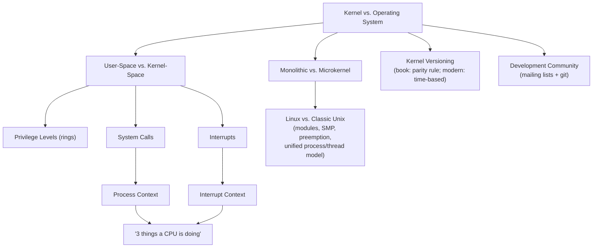

# Final Knowledge Map

> The single, growing concept graph of the entire book/course. Each chapter appends its branch to this tree. By the end of the course, this file is your one-page mental model of the whole kernel — the thing you should be able to redraw from memory.

---

## How to Use This File

Do not try to memorize this as a static artifact. Instead: after finishing each chapter, come here, find where that chapter's concepts attach to what you already knew, and mentally (or literally) re-draw the connections. The value of this file is in the *edges* (why does X depend on Y?), not just the *nodes* (a list of terms).

---

## Master Graph (grows every chapter)



*(Future chapters attach here — e.g., ProcCtx -> task_struct (Ch.3); ThreeStates -> Scheduler (Ch.4); Syscall -> Syscall Table (Ch.5); IntCtx -> Bottom Halves (Ch.8); ThreeStates -> Synchronization (Ch.9-10).)*

---

## Chapter 1 Branch — Detail

```
Linux Kernel
+-- Kernel vs. Operating System
|    +-- OS = kernel + drivers + boot loader + shell + utilities
|    +-- Kernel = innermost, most privileged layer
+-- User-Space
|    +-- Applications, glibc -- restricted privilege, no direct HW access
+-- Kernel-Space
|    +-- System Call Interface -- software-initiated entry
|    +-- Kernel Subsystems -- process mgmt, memory mgmt, VFS, networking...
|    +-- Device Drivers -- part of the monolithic kernel, not separate
+-- The Privilege Boundary (hardware mechanism)
|    +-- Rings (x86): 0 = kernel, 3 = user (1-2 unused by Linux)
|    +-- Trap instruction (int 0x80 / syscall) -- the only sanctioned door
|    +-- Kernel-controlled fixed entry point -- user code can't choose target
+-- Execution Contexts (THE recurring theme of Ch.7-10)
|    +-- User mode -- running application code
|    +-- Process context -- kernel code, on behalf of a specific process
|    |    +-- current -- per-CPU pointer to the running task
|    +-- Interrupt context -- kernel code, on behalf of NO process
|         +-- Strict rules: cannot sleep, must be fast
+-- Kernel Architecture
|    +-- Monolithic (Linux) -- one address space, direct function calls
|    |    +-- Borrows from microkernels: modules, preemption, kernel threads
|    +-- Microkernel (contrast) -- isolated servers, message passing/IPC
|         +-- Tradeoff: fault isolation vs. IPC overhead
+-- Linux vs. Classic Unix
|    +-- Dynamic module loading
|    +-- Native SMP support
|    +-- Kernel preemption
|    +-- Unified process/thread model (task_struct for both)
|    +-- Object-oriented device model + sysfs
|    +-- Selective feature adoption (open development process)
+-- Kernel Versioning
|    +-- [BOOK] major.minor.revision.stable, odd/even minor = dev/stable
|    |    +-- Retired 2.6.x indefinitely (2004 decision) instead of 2.7.x
|    +-- [MODERN] major.minor.patch, time-based release cycle
|         +-- ~2-week merge window -> rc1...rcN (~1wk apart) -> release
|         +-- No parallel dev branch -- features land only via merge window
|         +-- Stable branch (X.Y.Z) -- back-ported fixes only
|         +-- LTS branches -- multi-year maintenance, layered on stable mechanism
+-- Development Community
     +-- LKML + subsystem-specific mailing lists
     +-- git (created by Linus, 2005) -- git.kernel.org, GitHub mirror
     +-- lore.kernel.org -- full-text-searchable archive (modern addition)
```

---

## Cross-Chapter Dependency Notes (populated as chapters are written)

| Concept | Depends on (from earlier chapters) | Feeds into (later chapters) |
|---|---|---|
| Process context | User/kernel-space boundary (Ch.1), system calls (Ch.1 intro, Ch.5 full) | `task_struct` (Ch.3), scheduling (Ch.4), synchronization (Ch.9-10) |
| Interrupt context | User/kernel-space boundary (Ch.1) | Interrupts (Ch.7), bottom halves (Ch.8), synchronization (Ch.9-10) |
| Monolithic design | Kernel vs. OS (Ch.1) | Loadable modules (Ch.17) |

*(This table is the machine-checkable version of the dependency graph in `00-learning-roadmap.md` — update both together.)*