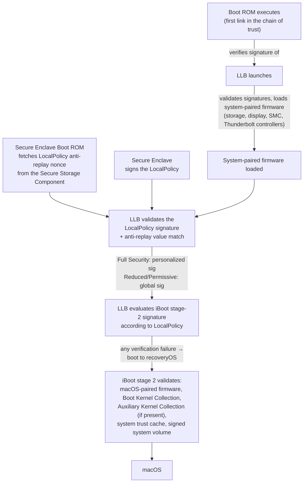
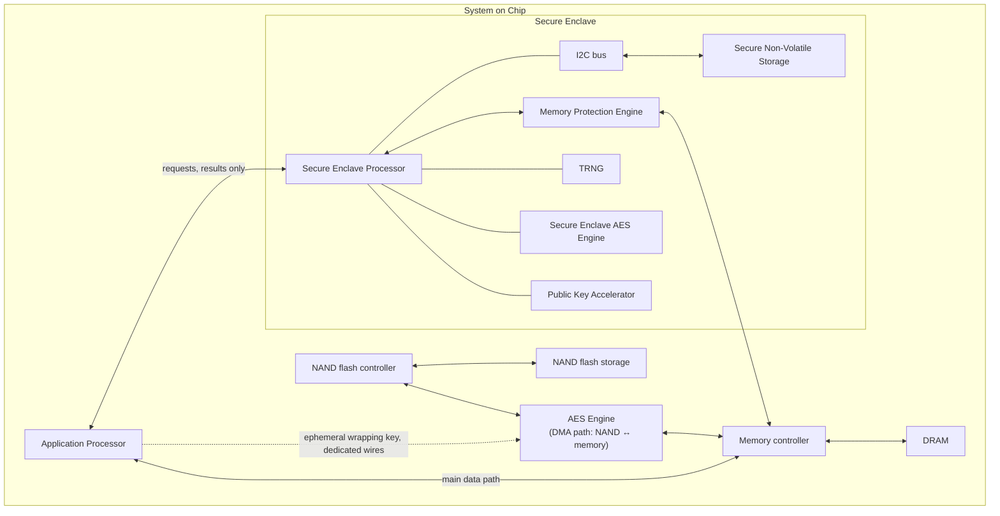

[← Index](00-Index.md) · [← Part IV I/O Kit Kexts BootChain](Part-IV-IOKit-Kexts-BootChain.md) · [Part VI VFS Internals →](Part-VI-VFS-Internals.md)

# PART V — Security Architecture, GPU Firmware & the Matrix Coprocessor

> New source batch: Asahi Lina's "Tales of the M1 GPU" (the full story of the Linux GPU kernel driver, in Rust); Apple's own Platform Security documentation for **Boot process for a Mac with Apple silicon**, **The Secure Enclave**, and **Operating system integrity**; Dougall Johnson's actual reverse-engineered **AMX** instruction-set notes (an IDA/Hex-Rays plugin's source comments); Howard Oakley's M1 Max vs. M3 Pro AMX benchmarking (with the original charts, reproduced here as data); Apple's **Accelerate** framework docs; two 2025/2026 research papers; and a correction to `MTLStorageMode` from the current API reference. This is the most authoritative material in the whole note set for the Secure Enclave, boot chain, and exploit-mitigation sections — it's Apple's own documentation, not reverse engineering — so where it conflicts with or sharpens earlier approximations in Parts I–IV, this Part wins.

---

## 59. The GPU Firmware Coprocessor in Full: ASC, RTKit, and a Rust Kernel Driver *(Asahi Lina, "Tales of the M1 GPU"; extends §38)*

### 59.1 GPU 101, restated precisely

Every modern GPU has four main pieces: **shader cores** (run user-defined programs on vertex/fragment data, in a GPU-specific instruction set), **fixed-function units** (rasterizers, texture samplers, render-output units — wiring differs per GPU), a **command processor** (takes draw commands from the app — triangle lists, textures, shader programs, output location — and programs the shader cores to execute them), and an **MMU** (isolates one app's memory from another's). Every serious GPU driver, on every OS, splits into a **user-space** half (compiles shaders, translates API calls like OpenGL/Vulkan/Metal into command lists) and a **kernel** half (owns the MMU, memory allocation, and command submission scheduling), talking through an OS-specific **UAPI**.

### 59.2 How the reverse-engineering actually proceeded (the order matters)

1. **Alyssa Rosenzweig** (2021) reverse-engineered the **user-space** half first — by reverse-engineering **macOS's own kernel-driver UAPI** well enough to allocate GPU memory and submit her own command lists, she could write an M1 OpenGL driver (for Mesa) *on top of Apple's kernel driver*, without needing a Linux kernel driver to exist yet. Within a month she had a triangle; a few months later, 75% of OpenGL ES 2 conformance — **entirely running on macOS**, with no Linux kernel driver involved at all.
2. Only **then** (April the following year) did **Asahi Lina** start on the actual Linux **kernel** driver — and immediately discovered the GPU was "no ordinary GPU."

### 59.3 The ASC: a full ARM64 computer *inside* the GPU

Like several other Apple Silicon blocks (§39's SEP, §40's boot-chain coprocessors), the GPU has a coprocessor called an **ASC** ("Apple System Coprocessor"), running a proprietary Apple real-time OS called **RTKit** — and it is in charge of **everything**: power management, command scheduling and preemption, fault recovery, performance counters, statistics, and even temperature measurement.

**The macOS kernel driver does not talk to the GPU hardware at all.** Every interaction happens through the firmware, via data structures in shared memory. Roughly **100+ distinct structure types** are involved, including:

| Structure category | Purpose |
|---|---|
| **Initialization data** | Power-management config, global GPU config — **almost 1,000 fields**, not fully reverse-engineered even now |
| **Submission pipes** | Ring buffers for queuing GPU work |
| **Device control messages** | Global GPU operation control |
| **Event messages** | Firmware → driver notifications (completion, fault) |
| **Statistics / logs / tracing** | Debug and status telemetry |
| **Command queues** | One app's list of pending GPU work |
| **Buffer info / page lists** | Manage the Tiled Vertex Buffer (§38's TVB/partial-render mechanism) |
| **Context structures** | Firmware-side bookkeeping |
| **Vertex / fragment rendering commands** | Set up a full render pass — deeply nested, and each carries a pointer to a **microsequence**: a small program the firmware interprets like a **virtual CPU**, supporting waits, timestamping, and even **loops and arithmetic** |

### 59.4 "GPU memory is firmware memory"

The firmware shares the **same page tables as the GPU MMU** — it literally takes the same page-table base pointer the MMU uses and configures it as its own ARM64 page table. There's a shared **kernel address space** (firmware's own use, plus most driver↔firmware communication) and separate **user-space addresses** per app for buffers shared directly with the GPU hardware. Because the kernel-space structures are riddled with pointers to each other and are **not isolated between processes**, none of this complexity can be pushed down into user space — which is exactly why Alyssa found all the vertex/fragment rendering detail sitting in the macOS *kernel* UAPI rather than something apps fill in directly.

### 59.5 Development path: Python → Rust

- **m1n1** (Asahi's existing Python hypervisor-tracing framework) → a hand-built GPU tracer → flipped into a **Python kernel-driver prototype**, reusing the same struct definitions, because Python iterates fast and already spoke RTKit's protocol and could parse firmware crash logs.
- An genuinely bizarre bring-up stack: **Inochi2D → Mesa (Alyssa's driver) → `drm-shim`** (a library that normally mocks the Linux DRM kernel interface for shader CI) **→ an embedded Python interpreter inside `drm-shim` → the Python prototype driver → m1n1 → USB → the real M1**, rendering a frame end to end. *"It's so ridiculous that it worked."*
- **Why Rust, not C:** the driver has to juggle 100+ linked data structures where getting *anything* wrong can crash the firmware (unrecoverable short of a full reboot — the firmware doesn't sanity-check anything, for performance). On top of that, Apple does **not** keep the firmware's structure layouts stable across versions — supporting a second firmware version required **over 100 field-level changes**. C has no good answer to either problem (manual lifetime tracking for the first; `#ifdef`-driven recompiles for the second); Rust's ownership model and macro system were a much better structural fit, so after prototyping the GPU object model in userspace Rust with help from the Rust community, Lina committed to it — becoming the **first Rust GPU driver in the Linux kernel**.
- Had to hand-write **~1,500 lines of unsafe-wrapped Rust abstractions** over the Linux DRM subsystem (nothing like this existed yet), then port the Python prototype's GPU object system and remaining logic into Rust. **Aug 18** start of the Rust driver → **Sept 24** first rendered cube (`kmscube`) → a **full GNOME desktop session days later**.
- **The payoff:** going from a toy demo to a full multi-app desktop session is normally where race conditions, UAFs, and memory leaks pile up. Here: **a few logic bugs and one memory-management abstraction bug**, then stable. Rust's safety guarantees don't eliminate `unsafe` code, but they shrink the *surface area* you have to reason about down to specific, auditable modules instead of whole-program interactions — plus automatic reference counting and real iterators replace C's `goto cleanup` error-handling pattern entirely.

### 59.6 Where it stood (XDC 2022 talk onward)

Joint work with Alyssa followed: M1 Pro/Max/Ultra and M2 kernel support; OpenGL ES 2.0 conformance essentially complete, ES 3.0 over 96%; Xonotic and Quake running at 4K; **Xonotic at 1080p inside a full GNOME session measured over 8 hours of estimated battery life** (GPU power management, being entirely firmware-driven, "just works" once the driver talks the right protocol). Vulkan support was in progress separately. As of the article, the UAPI was still a prototype (no concurrent GPU+CPU execution yet) and not upstream — Linux requires UAPI stability guarantees macOS does not, so the driver had to wait for a settled design before merging.

---

## 60. The Official Boot Process for Apple Silicon *(Apple Platform Security docs; supersedes/extends §40)*

Apple's own documentation adds precision the video (§40) didn't go into — most importantly, the exact **anti-replay** mechanism and the **Auxiliary Kernel Collection (AuxKC)**.

**What this adds beyond §40:**

- **The anti-replay mechanism, precisely:** LLB doesn't just check a Secure Enclave signature on `LocalPolicy` — it looks up an **anti-replay value** from the Secure Enclave–attached **Secure Storage Component** (§61.8), via the **Secure Enclave Boot ROM**, and checks it matches the value recorded *in* the `LocalPolicy` file. This is what actually makes "replaying an old, less-secure settings file" cryptographically impossible, not merely policy-discouraged — exactly the guarantee §40.1 described, now with the mechanism named.
- **Security-level definitions, precisely (these are tighter than the video's summary):**
  - **Full Security** — behaves like iOS/iPadOS: boots **only** software that was the latest available at install time (a *personalized* signature tied to this chip).
  - **Reduced Security** — LLB trusts **global signatures bundled with the OS** (not chip-specific), which is what permits running **older macOS versions** — explicitly flagged as "reduced" because older versions carry unpatched vulnerabilities by definition. **This is also the required level to boot third-party kexts.**
  - **Permissive Security** — same global-signature trust as Reduced for iBoot onward, **plus** iBoot will accept boot objects signed by the **Secure Enclave using the same key that signed the `LocalPolicy`** — i.e., this is the level for people building, signing, and booting their **own custom XNU kernels**.
- **Auxiliary Kernel Collection (AuxKC):** a *second*, separate kext-bearing collection beyond the base Boot Kernel Collection (kernelcache, §56.3). If `LocalPolicy` indicates one should exist, iBoot looks for it, verifies it was signed by the **same Secure Enclave key** as the `LocalPolicy` and that its hash matches the hash recorded *in* the `LocalPolicy`, then places it in memory alongside the Boot Kernel Collection and **locks the combined memory region with System Coprocessor Integrity Protection (SCIP, §62.3)** before continuing. If the policy says an AuxKC should exist but it can't be found, macOS **boots without it** rather than failing closed — a deliberate availability-over-strictness choice for this one specific failure mode.
- **iBoot's full checklist before kernel handoff:** macOS-paired firmware (Secure Neural Engine, Always-On Processor), Boot Kernel Collection, AuxKC (if present), the **system trust cache**, and the **signed system volume (SSV)** root hash — all verified before the kernel ever runs.

---

## 61. The Secure Enclave, in Full *(Apple Platform Security; massively extends §39.2–§39.4)*

### 61.1 Where SEP exists

Not just Apple Silicon Macs: all iPad from Air onward, all iPhone from 5s onward, every Apple Silicon Mac, **2016/2017 MacBook Pro with Touch Bar (T1 chip)**, **every Intel Mac with a T2 chip**, Apple TV HD+, every Apple Watch from Series 1, Vision Pro, and every HomePod. The Secure Enclave is a genuinely cross-product design, not an Apple-Silicon-Mac-only feature — the T1/T2 chips are earlier, Intel-era instances of the exact same subsystem design.

### 61.2 Hardware layout

**Key point the diagram makes visually:** the Secure Enclave's only connections to the outside world are (1) a narrow request/response channel to the Application Processor, (2) the shared DRAM — but only through its own **Memory Protection Engine**, and (3) a dedicated-wire key handoff to the (separate, DMA-path) **AES Engine**. There is no path by which the Application Processor — even fully compromised — can read SEP's internal state directly.

### 61.3 The Secure Enclave Processor itself

A **dedicated core**, used for nothing else — this isolation specifically defends against **side-channel attacks** that rely on malicious code sharing an execution core with the target. It runs an **Apple-customized L4 microkernel** (confirming §39.4's SEPOS claim), deliberately clocked **lower** than the main cores to resist clock/power-glitching attacks. Since **A11/S4**, it includes the memory-protection engine below, a dedicated RNG, secure boot, and its own AES engine.

### 61.4 Memory Protection Engine

SEP operates out of a dedicated DRAM region, protected by a hardware engine sitting between SEP and memory:

1. At boot, the **Secure Enclave Boot ROM** generates a **random ephemeral memory-protection key** — fresh every boot, never persisted.
2. **Every write** SEP makes: the engine encrypts the block with **AES in XEX mode** and computes a **CMAC authentication tag**, stored alongside the ciphertext.
3. **Every read:** the tag is checked first. Mismatch → the Memory Protection Engine signals an error and **SEP stops answering any request until the next full reboot** (confirms §39.3's claim precisely).
4. **Since A11/S4:** adds **replay protection** — a per-block **anti-replay value**, itself protected by an **integrity tree rooted in dedicated on-chip SRAM** (so even an attacker who can replay old, validly-encrypted memory blocks is caught, because the SRAM-rooted tree can't be replayed externally).
5. **Since A14/M1:** **two** ephemeral keys are maintained simultaneously — one for data private to SEP, one for data **shared with the Secure Neural Engine** (§61.9).

The net effect, stated plainly: SEP reads and writes memory as if it were ordinary unencrypted DRAM; **everything outside SEP sees only ciphertext** — full protection with no software complexity cost to SEP's own code.

### 61.5 Secure Enclave Boot ROM and Boot Monitor

- The **SE Boot ROM** is immutable, parallel to the Application Processor's own Boot ROM (§40) — it's SEP's independent hardware root of trust.
- At startup, **iBoot** assigns SEP its dedicated memory region; the SE Boot ROM initializes the Memory Protection Engine *before* using that memory at all.
- The **Application Processor sends the sepOS image** to the SE Boot ROM, which copies it into SEP-protected memory and checks its **hash and signature**. Valid → control transfers to sepOS. Invalid → **SEP permanently refuses further use until the next full chip reset** (not just the next SEP reset).
- **Since A10:** the SE Boot ROM locks a **hash of sepOS into a dedicated register**, which the Public Key Accelerator (§61.7) uses for **OS-bound keys**.
- **Since A13 — the Boot Monitor:** adds a second, independent layer specifically to stop a compromised SE Boot ROM from being used to bypass OS-bound-key protections. SEP's own **SCIP** configuration (§62.3) initially permits executing *only* the SE Boot ROM; the Boot Monitor (not the Boot ROM itself) is the only thing that can update that SCIP config to permit the newly-loaded sepOS to run — it resets SEP, hashes the loaded code, updates SCIP, and starts execution, repeating this pattern for *every* later stage that becomes executable, each time folding into a **running hash**. At boot completion, that running hash — not just the Boot-ROM-recorded hash — is handed to the PKA for OS-bound keys. **The explicit design goal:** even a vulnerability found in the SE Boot ROM itself cannot be used to bypass OS-keybinding, because the Boot Monitor is a structurally separate gatekeeper for "what code is allowed to execute," not something the Boot ROom alone controls.

### 61.6 True Random Number Generator (TRNG)

Multiple **ring oscillators**, post-processed with **CTR_DRBG** (a block-cipher-based counter-mode DRBG). Used for every cryptographic key, seed, or entropy SEP generates.

### 61.7 Root keys: UID, GID, AES Engine, PKA

| Element | What it is |
|---|---|
| **UID** | A **per-device unique** root key, randomly fused into the SoC at manufacture. **Since A9**, it's generated by SEP's own TRNG *during manufacturing* and fused in by a process that runs entirely inside SEP — **not even Apple or its suppliers ever see it**. Every device-specific secret (file-system key hierarchy, Face/Touch/Optic ID templates) is cryptographically tied to the UID — exactly why moving internal storage to a different Mac makes it unreadable (§39.3's claim, now sourced precisely). **Only fully internal storage gets this treatment** — external USB drives and the 2019 Mac Pro's PCIe-based storage expansion are explicitly **not** covered. |
| **GID** | A **shared, per-SoC-model** key (every A15, say, shares one GID) — used for different purposes than the per-device UID. |
| **AES Engine (inside SEP)** | Hardware block for symmetric crypto, with **timing/SPA resistance**, **DPA countermeasures since A9**, and **lockable seed bits since A10** that diversify UID/GID-derived keys by *operating mode* — e.g., denying access to password-protected data when booted into **DFU mode**. |
| **Public Key Accelerator (PKA)** | Asymmetric crypto (RSA, ECC), SPA/DPA-resistant, **formally verified for mathematical correctness since A13**. Supports **OS-bound keys / Sealed Key Protection (since A10)** — keys derived from UID **plus the hash of the exact sepOS in use**, used both to let Apple services verify the sepOS version and to block keying material if critical system changes happen without user authorization. |
| **AES Engine (separate, DMA-path)** | Not the same block as the above — this one sits **inline on the NAND↔memory DMA path**, making whole-disk file encryption essentially free. sepOS generates an **ephemeral wrapping key** via TRNG at boot and sends it to this engine over **dedicated wires no software can intercept**; the Application Processor's file-system driver then sends *wrapped* file keys to this engine for unwrap/use — the **unwrapped key is never exposed to software at all**, on either side. |

### 61.8 Secure non-volatile storage and counter lockboxes

SEP has its own dedicated non-volatile storage, reachable **only** via a private **I2C bus**. On **A12/S4 and later**, this is a **Secure Storage Component** — itself a mini secure element with immutable ROM, its own RNG, a per-device key, crypto engines, and physical tamper detection.

**Counter lockboxes** (2nd-generation Secure Storage Component, devices from autumn 2020+) are the actual mechanism behind passcode rate-limiting:

- Each lockbox stores: a 128-bit salt, a 128-bit passcode verifier, an 8-bit attempt counter, an 8-bit max-attempts value.
- **Creating one:** SEP sends the passcode entropy + max-attempt value; the Secure Storage Component generates a random salt, derives a verifier and a lockbox-entropy value from (passcode entropy, the component's own unique key, the salt), stores {0 count, max, verifier, salt}, and returns the lockbox-entropy value to SEP.
- **Retrieving it:** SEP sends the passcode entropy; the component **increments the counter first**. Over the max → **the lockbox is completely erased**. Otherwise it re-derives the verifier the same way and compares; match → return the lockbox-entropy value and **reset the counter to 0**; mismatch → the attempt was consumed and nothing is returned.
- **The crucial property:** the user's passcode can only be *attempted* through the paired SEP — there is no way to brute-force the verifier offline, because the derivation requires the Secure Storage Component's own unique key, which never leaves it.
- On older/non-Secure-Storage-Component designs, a plain **EEPROM** fills the same role but with **no hardware security features, no exclusive-access guarantee, and no counter-lockbox logic** — a strictly weaker fallback.
- This same storage underpins **all SEP anti-replay services** generally — passcode changes, biometric enrollment/removal changes, Apple Pay card add/remove, and Erase All Content and Settings all mark anti-replay boundaries here.

### 61.9 Secure Neural Engine

- **A11–A13:** integrated directly into SEP, with an IOMMU under sepOS's control limiting its DMA to authorized memory only.
- **A14/M1 and later:** no longer a separate block — it's a **secure execution mode of the main Application Processor's Neural Engine**, switched into/out of by a **dedicated hardware security controller** that **resets all Neural Engine state on every transition** (so biometric data from a secure-mode run can never leak into a subsequent normal-mode run), with its own memory encryption/authentication/access-control and the §61.4 memory-protection-engine-style dual-key scheme.

### 61.10 Power and clock monitors

Dedicated monitoring circuits (with a wider safe operating envelope than the rest of SEP, so the monitors themselves stay reliable even under conditions that would already be breaking other SEP logic) watch voltage/frequency. Out-of-range → **SEP's clocks stop immediately and will not restart until the next full SoC reset** — a hardware-level defense against voltage/clock-glitching attacks, the same threat model the deliberately-low SEP clock speed (§61.3) also targets.

### 61.11 Feature summary by SoC generation (condensed)

| Era | Memory Protection | Secure Storage | AES Engine | PKA |
|---|---|---|---|---|
| A8 | Encryption + authentication (no replay) | EEPROM | — | — |
| A9 | same | EEPROM | + DPA protection | — |
| A10 | same | EEPROM | + lockable seed bits | + OS-bound keys |
| A11 / S4 | **+ replay prevention** | EEPROM (A11) / gen-1 component (S4) | same | same |
| A12 (pre-autumn 2020) | + replay prevention | gen-1 Secure Storage Component | same | same |
| A12 (post-autumn 2020), A13+, S5+, **M1 or later** | + replay prevention | **gen-2** Secure Storage Component (counter lockboxes) | same | **+ Boot Monitor** (A13+/M1+) |
| T2 (Intel Macs) | Encryption + authentication (no replay) | EEPROM | + lockable seed bits | + OS-bound keys |

**Reading this table against §9 (Intel→Apple Silicon transition):** the T2 row is a strictly *less* hardened SEP generation than any Apple Silicon Mac's M1-or-later row — one more concrete reason the Apple Silicon transition was a genuine security upgrade, not merely a performance one.

---

## 62. Operating System Integrity: KIP, APRR, SCIP, PAC, PPL, SPTM/TXM, MIE *(Apple Platform Security; extends/corrects §36)*

These are **runtime** exploit-mitigation features — distinct from the **boot-time** chain of trust in §40/§60 and from the **Secure Enclave's own** protections in §61. All are implemented with dedicated silicon, available on Apple-designed SoCs across iOS/iPadOS/macOS-on-Apple-Silicon/tvOS/visionOS/watchOS.

### 62.1 Kernel Integrity Protection (KIP)

After the kernel finishes initializing, the **memory controller** (not just the MMU) is told to **deny all writes** to the physical memory region iBoot loaded the kernel and kexts into. The Application Processor's MMU is additionally configured so that (a) privileged code **cannot be mapped from physical memory outside** that protected region, and (b) **no writable mapping of physical memory inside** the kernel region can exist at all. The hardware that enables KIP is then **locked** — reconfiguration is impossible until the next boot.

### 62.2 Fast Permission Restrictions (APRR, A11/S3+)

A **per-thread CPU register** that can strip execute permission from memory **without a syscall, a page-table walk, or a TLB flush**. The direct practical payoff: **W^X enforcement cheap enough to use constantly** — memory used for JIT-compiled code (the classic web-browser attack surface) can be flipped non-executable the instant it's being written/read, and flipped back without the overhead that made this impractical on older hardware. This is the same register family §62.4/§62.5 (PPL, SPTM) build further mitigations on top of.

### 62.3 System Coprocessor Integrity Protection (SCIP)

The KIP idea, generalized to **every coprocessor with its own firmware** (SEP, the image sensor processor, the motion coprocessor, and — per §59 — the GPU's ASC). At boot, iBoot loads each coprocessor's firmware into its **own** protected region (separate from the KIP region), and configures that coprocessor's own memory unit to forbid executable mappings **outside** its region and writable mappings **inside** it. For SEP specifically, **sepOS itself** (not iBoot) performs the SCIP configuration. Locked after boot, same as KIP.

### 62.4 Pointer Authentication Codes (PAC) — the full, exact table

§36 gave an approximate account (5 keys, a few examples). Apple's documentation gives the **precise** key and salt used per pointer kind — this table **replaces** that approximation:

| Protected item | Key | Salt |
|---|---|---|
| Function return address | IB | storage address |
| Function pointers | IA | 0 |
| Block invocation function | IA | storage address |
| Block descriptor pointer | DA | storage address + `0xC0BB` |
| Objective-C method cache entry | IB | storage address + class + selector |
| Objective-C `isa` pointer | DA | storage address + `0x6AE1` |
| Objective-C super pointer | DA | storage address + `0xB5AB` |
| Selector-typed Objective-C ivars | DB | storage address + `0x57C2` |
| Objective-C read-only class data pointer | DA | storage address + `0x61F8` |
| C++ v-table entries | IA | storage address + hash(mangled method name) |
| C++ v-table pointers | DA | storage address + hash(mangled base v-table name) |
| Computed goto label | IA | hash(function name) |
| Kernel thread state | GA | — |
| User thread-state registers | IA | storage address |

- **Five 128-bit secret keys total** (IA, IB, DA, DB, GA — "I"=instruction, "D"=data, "A"/"B" = two independent keys per category, "G" = generic/hash); kernel instructions/data are signed with the kernel's own keys, and **each user-space process gets its own distinct B keys**, so a signature captured from one process context is cryptographically meaningless in another.
- **The salt is never just "the storage address"** for most interesting targets — it's address **plus** some context-specific extra (a fixed per-category constant, or the class+selector, or a mangled-name hash) specifically so that a signature can't be lifted from one storage slot and replayed onto a different one of the same general kind, even within the same process.
- Verification happens before use; mismatch → **abort**, not silent failure. This is what makes classic **ROP (return-oriented programming)** attacks dramatically harder: a corrupted return address won't carry a valid signature for *that* stack slot, full stop.

### 62.5 Page Protection Layer (PPL) → Secure Page Table Monitor (SPTM) + Trusted Execution Monitor (TXM)

- **PPL** (iOS/iPadOS/visionOS/watchOS **only — not macOS**, because macOS is designed to run arbitrary unsigned code, which PPL's whole premise rules out): built on KIP + APRR, ensures that **only PPL itself** can alter page-table permissions governing already-signature-verified user code and page tables — a system-wide code-integrity guarantee that survives even a fully compromised kernel.
- **SPTM + TXM** (iOS/iPadOS/**macOS**/visionOS, **A15+/M2+ only**, replacing PPL where supported): SPTM runs at a **higher privilege level than the kernel itself** and protects page tables for both user and kernel processes, even against an attacker with kernel write primitives who can bypass ordinary control-flow protections. SPTM **delegates** actual code-execution policy enforcement to the lower-privileged **TXM** — a deliberate privilege split so that **compromising TXM alone does not automatically grant an SPTM bypass**. This is the mechanism that finally brings PPL-grade page-table protection to **macOS** specifically (note it's absent from the PPL row above), built on a newer silicon primitive that's an evolution of APRR.

### 62.6 Memory Integrity Enforcement (MIE) — A19/M5 and later

The newest layer, built on three things together:
1. **Apple's own secure memory allocators** as the foundation.
2. **Enhanced Memory Tagging Extension (EMTE)**, Apple's hardened implementation of ARM's 2019 **Memory Tagging Extension (MTE)** spec: every allocation gets a secret tag; later accesses are only honored if they carry the matching tag; mismatch → **crash + log**, catching memory-corruption bugs (buffer overflows, use-after-free) **as they happen**, not later as an exploited crash. EMTE specifically closes the gaps that would otherwise let it be used only as a *detection* tool rather than an **active, always-on defense** — notably, it supports **only the stricter synchronous mode**, and accessing *untagged* memory from within a *tagged* region requires knowing that region's own tag, closing an obvious sidestep.
3. **Tag Confidentiality Enforcement:** protects the secure allocator implementation and the confidentiality of EMTE tags themselves against side-channel and **speculative-execution** attacks — SPTM protects the kernel allocator's backing store and tag storage directly, the kernel is held to the **same** tag-checking rules as user space even when acting on an app's behalf, and the scheme explicitly includes a **Spectre V1** mitigation.

Apple's framing: MIE is "always-on" and designed to **not trade away performance** for this protection — a notable claim given the historical reputation of tagged-memory schemes as a measurable perf tax.

### 62.7 Feature-by-chip summary (condensed from Apple's table)

| Feature | First available |
|---|---|
| Kernel Integrity Protection | present from early SoCs covered by this doc (A10-era table start) |
| Fast Permission Restrictions (APRR) | A11, S3 |
| System Coprocessor Integrity Protection | present alongside KIP from the same era |
| Pointer Authentication Codes | present alongside KIP/SCIP from the same era |
| Page Protection Layer | A12–A14 / S4–S10 era, non-macOS platforms only |
| Secure Page Table Monitor (replacing PPL) | A15+ / M2+ |
| Memory Integrity Enforcement (EMTE) | **A19 / M5 and later only** |

---

## 63. AMX, For Real This Time: The Reverse-Engineered Instruction Set *(Dougall Johnson's AMX notes; extends §37.2)*

§37.2 covered *how AMX was discovered* (power-draw measurement). This is *what AMX actually is*, from the same researcher's detailed reverse engineering (an IDA/Hex-Rays disassembler-decompiler plugin, published with extensive inline documentation). **Caveat carried over from §37.2: this is undocumented, reverse-engineered, unofficial — a "do not build production code on this" instruction set**, included here purely for engineering understanding.

### 63.1 Register model

AMX has three "registers," really register **groups**: **`x`** and **`y`** are 0x200 bytes each (512 bytes), **`z`** is 0x1000 bytes (4096 bytes) — Apple's own headers describe `z` specifically as **"64 registers in an M-by-N matrix,"** i.e. 64 rows of 64 bytes. Data typically loads/stores in 0x40-byte (64-byte) rows, though some operations index by arbitrary byte offset.

### 63.2 Instruction encoding and enable/disable

Every AMX instruction decodes as `0x00201000 | ((op & 0x1F) << 5) | (operand & 0x1F)`. AMX must be **explicitly enabled** (`op=17, operand=0`) before any other AMX instruction is legal — issuing anything else first is treated as an **illegal instruction**. It's disabled the same way (`op=17, operand=1`). Apple's own Accelerate-generated code always prefixes AMX instructions with **three NOPs** — the reason is undocumented, but it's a reliable fingerprint for finding AMX usage in a disassembly.

Outside the enable/disable op, the 5-bit "operand" field is actually a **64-bit general-purpose register number** (X0–X30, or 31=XZR), whose *contents* are a bitfield carrying the operation's real parameters (e.g. for loads: a 56-bit address, a 5-bit register-row offset, and a 1-bit size flag selecting a 0x40-byte vs. 0x80-byte transfer).

### 63.3 The opcode table (ops 0–22)

| Op | Name | Does |
|---|---|---|
| 0 / 1 | `AMXLDX` / `AMXLDY` | Load `x` / `y` from memory |
| 2 / 3 | `AMXSTX` / `AMXSTY` | Store `x` / `y` to memory |
| 4 / 5 | `AMXLDZ` / `AMXSTZ` | Load/store `z` |
| 6 / 7 | `AMXLDZI` / `AMXSTZI` | Load/store `z`, but **interleaved**: row 0 = `z[0].low`+`z[1].low` interleaved, row 1 = `z[0].high`+`z[1].high`, etc. — always a fixed 0x40-byte transfer |
| 8 | `AMXEXTRX` | Move a 64-byte row from `z` (or `y`) into `x` |
| 9 | `AMXEXTRY` | Move a 64-byte column from `z` into `x`/`y`, or a row from `x` into `y` |
| 10 / 11 | `AMXFMA64` / `AMXFMS64` | 8×8 **double**-precision multiply, add/subtract into every 8th row of `z` (64 results) |
| 12 / 13 | `AMXFMA32` / `AMXFMS32` | 16×16 **float** multiply, add/subtract into every 4th row of `z` (256 results) |
| 14 | `AMXMAC16` | 32×32 **16-bit signed integer** outer product (1024 results), with row/column masking, 16-bit or 32-bit accumulation mode, and a "vector-only" (non-matrix) mode |
| 15 / 16 | `AMXFMA16` / `AMXFMS16` | Same shape as op 14, but **16-bit (or, with a mode bit, 32-bit) float** |
| 17 | enable/disable (`amxset`/`amxclr`) | — |
| 18 / 19 | `AMXVECINT` / `AMXVECFP` | Simple vector add/multiply, `z0[i] += x0[i] * y0[i]`-style |
| 20 / 21 | `AMXMATINT` / `AMXMATFP` | Matrix multiply variants (relationship to 14–16 not fully resolved) |
| 22 | `AMXGENLUT` | Generates a lookup/permutation value from 16 signed 32-bit integers in `x`'s first row — looks like a gather/scatter index-table builder |

**Op 14's outer-product shape, concretely** (32-bit accumulation mode): `z` becomes a 16×32 grid where row `2k` holds `(even-indexed x elements) × y[k]` and row `2k+1` holds `(odd-indexed x elements) × y[k]` — i.e., **one AMXMAC16 instruction computes an entire 16×32 outer-product tile in one shot**, which is the whole point of having a matrix coprocessor instead of looping scalar/NEON multiplies.

### 63.4 Performance characteristics (measured, not just reverse-engineered)

- AMX is **non-speculative**: operations are posted to it through the **CPU's store units**, not the normal out-of-order execution path (§28/§29). Non-load/store AMX instructions can **fuse** with each other to use only one store port.
- **There are two separate AMX coprocessors on the M1 — one per core cluster** (one shared by the four Firestorm/P cores, one by the four Icestorm/E cores). Each coprocessor stores **four copies of its architectural register state**, one per core in that cluster, so cores in a cluster *share the compute unit* but each keeps **private register contents**.
- **Performance-cluster AMX:** 4-cycle-latency, pipelined FMAs — **1 FMA32/FMA64 per cycle** throughput, but only **1 FMA16 per 2 cycles**.
- **Efficiency-cluster AMX:** same 4-cycle FMA32/FMA64 *latency*, but only **1 FMA32/64 per 4 cycles** throughput, and **1 FMA16 per 8 cycles** — a roughly 4× (FMA32/64) to 4× (FMA16, scaled) throughput gap between the two cluster variants, distinct designs just like the CPU cores themselves (§25.3).
- To get full 1-cycle throughput from a single core's AMX stream, **destinations must be independent** (different `z` offsets); throughput can be further doubled etc. by spreading work across **different cores**, since each core effectively owns its own slice of register state even on a shared coprocessor.
- There's **some out-of-order capability on the coprocessor itself** — roughly a 28–32-operation buffer, low confidence.
- **Loads/stores are the real bottleneck.** They go via L2 (with a small extra penalty for data already in L1), and can fault on bad addresses/alignment normally. **Mixing ordinary CPU loads/stores with AMX loads/stores causes dramatic slowdowns**, apparently from the synchronization needed to keep a consistent memory view across the two execution paths:

| Instruction sequence before an `AMXLDX` | Measured cost |
|---|---|
| `nop`/`add` (no memory op) | 9 cycles/iteration |
| `str` (provably non-aliasing) | 47 cycles/iteration |
| `str` (aliasing) | 93–103 cycles/iteration |
| `ldr` (non-"aliasing") | 11 cycles/iteration |
| `ldr` (aliasing) | 66 cycles/iteration |

  (A comparable table exists for `AMXSTX`, with similar 3–4× penalties.) **The practical lesson:** a hand-written AMX kernel should keep ordinary scalar loads/stores **out of the loop entirely** wherever possible — the coprocessor's own load/store path is fast in isolation, but contends badly with the main core's.

- Concrete achievable rate: loading 0x80 bytes into `x` and 0x80 bytes into `y`, in a tight loop, measured at **9 cycles/iteration** — and because of the coprocessor's own limited OoO capability, **four `AMXFMA32`s fit inside that same 9-cycle window at essentially no extra cost**, i.e. a 32×32 accumulation tile's worth of multiply-adds riding along for free behind the load latency.

---

## 64. Measuring AMX: Howard Oakley's M1 Max vs. M3 Pro Benchmarks *(extends §37.2, corroborates §63)*

Independent empirical confirmation of §63's architecture claims, using `powermetrics` sampling at 0.1 s intervals around Accelerate calls known to route through AMX (`vDSP_mmul` for dense matrices, `SparseMultiply`/`SparseConvertFromCoordinate` for sparse ones), with threads deliberately pinned to a QoS tier to control P-core vs. E-core placement.

### 64.1 Single-thread case: the power signature that proves AMX involvement

Running sparse-matrix multiplication at high QoS (→ P cores) on an **M3 Pro**, a single core (one specific P core) runs at **100% active residency** for close to a second, clocked around **3,800 MHz** (just under its ~4,000+ MHz ceiling), while the GPU and Neural Engine both sit at **~0 mW**. The measured **total CPU power plateaus around 8,000–8,600 mW** for that single thread.

**Why that number is the smoking gun:** on the *same* M3 Pro, a plain scalar floating-point loop on one P core draws **~1,000 mW**; NEON vector code on one P core draws **~2,500 mW**. Since GPU and Neural Engine are both confirmed idle, the **remaining ~5,500–6,000 mW has nowhere else to come from except a fourth, otherwise-invisible unit — the AMX coprocessor.** The equivalent test on an **M1 Max** reaches **~4,800 mW** for sparse multiply vs. its own **~2,500 mW** NEON baseline — the same signature, smaller magnitude.

### 64.2 Multi-thread scaling: M3 Pro's AMX is measurably faster, and *much* hungrier

| Metric | M1 Max (per added thread/core) | M3 Pro (per added thread/core) |
|---|---|---|
| Throughput regression-line slope | ~3.4 ×10⁷ loops/s | ~4.2 ×10⁷ loops/s (**≈124% of M1 Max**) |
| Power regression-line slope | ~4,500 mW | ~6,000 mW |
| Peak measured (6 P cores/threads) | under 14,000 mW *(for the equivalent NEON-only test, for comparison)* | up to **~40,000 mW**, **~44,500 mW** observed for the full 12-core chip at 100% active residency |

The **E-cluster's AMX is dramatically weaker**: on the M3 Pro, the E-core throughput regression slope is **~0.5 ×10⁷ loops/s — roughly 12% of the P-cluster's AMX throughput** — consistent with §63.4's "efficiency AMX variant runs FMA32/64 at 1-per-4-cycles vs. the performance variant's 1-per-cycle" claim, i.e. **almost exactly the predicted ~4× gap**, measured independently via power/throughput rather than disassembly.

### 64.3 The core-allocation pattern — independent proof of "one AMX per cluster"

Normally, macOS's scheduler allocates high-QoS threads **strictly**: fill cluster 1's P-cores completely before waking cluster 2 at all (this is the ordinary pattern Oakley's broader body of work documents for plain CPU-bound work). For **dense** matrix multiplication (`vDSP_mmul`) specifically on an **M1 Max** (which has two P-clusters), the allocation pattern breaks that rule in two specific ways:

| Threads | Cores actually used (of 8 total P cores, across 2 clusters) |
|---|---|
| 1 | 1 core, cluster 1 |
| 2 | 1 core cluster 1 + 1 core cluster 2 — **balanced across both clusters from the 2nd thread**, not "fill cluster 1 first" |
| 3 | 2 cores (1 cluster 1 + 1 cluster 2) |
| 4 | 3 cores |
| 5 | 4 cores |
| 6 | 4 cores |
| 7 | 5 cores |
| 8 | 6 cores |

Two findings, both unprecedented in Oakley's other (non-AMX) core-allocation measurements:

1. **The scheduler deliberately balances load across both P clusters** starting from the *second* thread, instead of saturating cluster 1 first — strong evidence the scheduler is aware that **each cluster has its own separate AMX unit**, and is spreading AMX-bound work to use both rather than contending one.
2. **The number of cores actually lit up is sometimes smaller than the number of threads** (e.g. 3 threads → only 2 active cores). Since the "extra" cores sit idle for the whole test duration, overall throughput **isn't being limited by P-core capacity at all — it's bottlenecked by the (single, per-cluster) AMX unit itself**, so macOS doesn't bother spinning up a core whose AMX access would just be serialized behind another core in the same cluster.

### 64.4 Takeaways

- `vDSP_mmul()`/`SparseMultiply()` reliably route through AMX; `powermetrics`'s **total CPU power figure includes AMX draw**, with no separate line item — a real trap for anyone trying to attribute power usage purely to "CPU cores."
- M3 Pro's AMX is measurably faster **and** measurably hungrier than M1 Max's — generational AMX improvement is real and significant, even though Apple has never once mentioned "AMX" in a keynote.
- **AMX power draw can exceed the P-cores' own power draw** for the same workload — a genuinely surprising result for anyone assuming "CPU power" and "core power" are the same thing on this silicon.
- Oakley's closing caution, worth repeating verbatim in spirit: Accelerate-routed AMX usage "may well be used in image and audio processing, and elsewhere" inside perfectly ordinary-looking apps — **do not underestimate how much of a Mac's power budget AMX can silently claim.**

---

## 65. Accelerate: What's Actually Inside It *(Apple framework docs; extends §37.3)*

Accelerate is the **documented, stable path** to the hardware described in §63/§64 — this is the API surface that insulates callers from AMX↔SME hardware churn (§37.3's central lesson). It bundles several sub-libraries, each abstracting a slightly different numerical domain so that the *same call* picks the best available instructions (NEON, SME, AMX-generation-appropriate dispatch) at runtime:

| Sub-library | Domain |
|---|---|
| **BNNS** | Constructing/training/running neural networks |
| **vImage** | Large-scale image processing: format conversion, Core Graphics/Core Video interop, manipulation |
| **vDSP** | Digital signal processing — 1D/2D FFTs, biquad filters, vector/matrix arithmetic, convolution, type conversion. **This is the sub-library `vDSP_mmul()` (§64's dense-matrix test) belongs to.** |
| **vForce** | Arithmetic/transcendental functions over vectors |
| **Sparse Solvers, BLAS, LAPACK** | Linear algebra on sparse and dense matrices. **This is where `SparseMultiply()` (§64's sparse-matrix test) lives.** |

**Closely related but separate frameworks:** **Apple Archive** (multithreaded lossless directory/file compression), **Compression** (LZFSE/LZ4/LZMA/ZLIB/etc. algorithms), **`simd`** (small fixed-size vector/matrix math — rotations, dot/cross products), **Spatial** (a lightweight 3D math library for primitives). Accelerate itself has shipped since **macOS 10.3** — this is a genuinely ancient, continuously-re-targeted framework, not a recent addition; it already existed well over a decade before AMX or SME were ever silicon.

---

## 66. Research Frontier: Beating Accelerate at Its Own Game *(two 2025/2026 papers; extends §37.3)*

### 66.1 "Above the Inner Loop: Exceeding Accelerate at LLM Prefill GEMM on the M1 AMX" (Deyvik Bhan, June 2026)

This is the paper §37.3 referenced only vaguely ("a June 2026 paper... ~23% speedup") — here are the actual, precise findings:

- **The inner loop is *not* where the win comes from.** Microbenchmarking shows the AMX inner loop is **load-issue bound**: the instant any operand load interleaves with the FMA32 stream, single-thread throughput **drops to a 610–680 GFLOPS band — under half the load-free rate**. A hand-written kernel cannot out-loop Accelerate's own inner loop; it's already near the hardware ceiling (consistent with §63.4's load/store-contention cycle-cost table).
- **The real gains are two deployment-level choices Accelerate under-uses**, both validated against §64's measurement:
  1. **Fine-grained multi-threaded panels that deliberately fill the M1's *second* on-chip AMX block** (i.e., explicitly target both P-cluster AMX units, exactly the behavior §64.3 found macOS's scheduler doing automatically for `vDSP_mmul` — this paper does it *manually and more aggressively* at the kernel level) — wins specifically on shapes where `K ≥ N`.
  2. **Pre-packing the constant weight matrix at load time** — wins on shapes where `N > K`.
- **Results:** a bit-exact, direct-AMX kernel using both levers **beats all three Accelerate fp32 paths** (`cblas_sgemm`, `BNNSMatMul`, and the BNNS Graph compiler) at **all twelve** of the LLM-prefill GEMM shapes tested (GPT-2 through Llama-7B scale, sequence length 128) — **1.17× over the best Accelerate path (BNNS Graph)**, geometric mean **1.58×** over `BNNSMatMul`, **~2.0×** over `cblas_sgemm`.
- **Precision matters too:** every output is **bit-identical** to Accelerate's own reference. BNNS Graph, by contrast, is bit-exact on only 3 of the 12 shapes tested — the rest run at **reduced precision**, with error up to **1.4×10⁻³**.
- **End-to-end validation:** dropped into `llama.cpp`'s `cblas_sgemm` call sites, measured full-forward throughput rose from **291 to 420 tokens/s (1.44×, bit-identical)** at 128-token prefill — a real application-level number, not just a microbenchmark ratio.
- **A sharp warning for anyone tempted to try this:** mis-tuning a single parameter (column-panel width) costs **nearly 2×** — this is squarely the §37.3 risk ("breaks without notice, costs correctness margin if you get it wrong") made concrete with a specific, large penalty for a specific, easy-to-get-wrong tuning knob.

### 66.2 "Apple vs. Oranges: Evaluating the Apple Silicon M-Series SoCs for HPC Performance and Efficiency" (Hübner, Hu, Peng, Markidis — KTH, Feb 2025)

This is the actual paper behind the "**KTH Stockholm group**" STREAM-benchmark reference already made in §26.2 — now with full detail:

- Architectural review of **M1 through M4** CPU/GPU design, the unified memory architecture, and AMX.
- Custom benchmarks written in **Metal Shading Language and Objective-C++** for FP32 compute and memory performance; power/efficiency measured via `powermetrics` — the same measurement discipline this whole Part relies on.
- **Memory bandwidth:** up to **100 GB/s** measured (matches §26.2's figure exactly — this is the primary source for that claim).
- **Compute:** up to **2.9 FP32 TFLOPS on the M4's GPU.**
- **Power:** a few watts up to 10–20 W depending on workload, with **over 200 GFLOPS/W** efficiency on the GPU/accelerator path across all four generations tested.
- **FP64 is a real limitation** on the GPU side specifically (consistent with Metal/Apple-GPU design being fundamentally FP32-first, §17/§30's integer/FP unit tables never even list a 64-bit float path on the GPU side).
- **Conclusion, in the authors' own framing:** Nvidia's Grace-Hopper superchip still wins outright on raw memory bandwidth and compute — but the M-series lands in a genuinely different category: a **competitive, power-efficient alternative** for energy-constrained HPC use cases, not a drop-in datacenter-GPU replacement. The paper's title is a deliberate pun acknowledging this isn't really an apples-to-apples comparison at all.

---

## 67. Metal Storage Modes, Corrected *(current API reference; updates §34.2)*

§34.2 listed `MTLStorageMode`'s four cases from the video's description. The **current** API reference changes two things worth flagging:

| Case | Status | Meaning |
|---|---|---|
| `.shared` | current | CPU and GPU share one copy, in system memory — the zero-copy case (§34.2) |
| `.private` | current | GPU-only |
| **`.managed`** | **⚠️ Deprecated** | CPU/GPU may keep *separate* copies, requiring explicit sync — this is the Intel-Mac-discrete-GPU holdover §34.2 already flagged as "compatibility only, no real hardware meaning on Apple Silicon"; it's now formally marked deprecated in the API itself, not just vestigial in practice |
| **`.memoryless`** | current, confirmed | The resource's contents are **GPU-only and exist only temporarily during a render pass** — never materialized in main memory at all. This is the official definition of the case §34.2 flagged as "not covered in the video, but relevant" — it's the natural storage mode for a render pass's depth/stencil attachment or an intermediate tile result that's written and consumed entirely within the GPU's on-chip tilebuffer (§38.1) and never needs to leave it |

**Why `.memoryless` matters given §38:** a resource that only ever needs to live inside the tilebuffer for the duration of one tile's processing — the canonical example is a transient depth buffer — should be `.memoryless`, not `.private`. `.private` still implies "this resource has a real backing allocation in GPU memory"; `.memoryless` tells the GPU driver the data **never needs a main-memory home at all**, which is exactly the efficiency tile-based deferred rendering (§38.1) is built around in the first place.

---

## 68. Glossary & Checklist Addendum (Part V)

| Term | Meaning |
|---|---|
| **ASC / RTKit** | The GPU's own ARM64 firmware coprocessor / the proprietary Apple RTOS it runs — same "firmware computer in front of the silicon" pattern as SEP and the boot chain |
| **UAPI** | The custom kernel↔userspace driver protocol specific to one GPU family; what Alyssa reverse-engineered on macOS before any Linux kernel driver existed |
| **Microsequence** | A small firmware-interpreted "program" (with loops/arithmetic) attached to a GPU rendering command |
| **AuxKC** | A second, separately-signed kext collection loaded alongside the base kernelcache, protected by SCIP once verified |
| **Full / Reduced / Permissive Security** | Chip-specific personalized signing / global OS-bundled signing (+ older OS, + 3rd-party kexts) / + locally Secure-Enclave-signed custom kernels |
| **Memory Protection Engine** | SEP's own inline AES-XEX + CMAC + anti-replay encryption of its dedicated DRAM region |
| **SE Boot Monitor** | A13+ mechanism that, not the SE Boot ROM alone, gates which code may execute in SEP, specifically to survive a Boot-ROM-level vulnerability |
| **UID / GID** | Per-device fused root key (A9+: SEP-generated, never seen by Apple) / per-SoC-model shared key |
| **Counter lockbox** | The Secure Storage Component structure that rate-limits and ultimately erases passcode-protected entropy after too many failed attempts |
| **KIP / SCIP / APRR** | Kernel Integrity Protection / the coprocessor-firmware equivalent / the per-thread fast-execute-permission-toggle register |
| **PAC key/salt table** | The exact 5-key, per-item-type signing scheme protecting pointers and vtables (§62.4) |
| **PPL → SPTM/TXM** | iOS-only page-table-and-code-integrity enforcement → its macOS-capable, privilege-separated A15+/M2+ successor |
| **MIE / EMTE / Tag Confidentiality Enforcement** | A19/M5+ always-on memory-safety stack: secure allocators + synchronous ARM MTE + protection of the tags themselves |
| **AMX `x`/`y`/`z`** | The three AMX register groups (512 B / 512 B / 4096 B) |
| **`.memoryless`** | A Metal storage mode for GPU-only data that never leaves the tilebuffer during a render pass |

- [ ] Explain why the macOS GPU kernel driver "doesn't talk to the GPU at all," and what it talks to instead
- [ ] Give the two reasons Lina chose Rust over C for the GPU driver (not just "memory safety" in the abstract)
- [ ] Explain exactly what "anti-replay value" check LLB performs on `LocalPolicy`, and where the nonce comes from
- [ ] Define Full/Reduced/Permissive Security precisely enough to say which one a kext-development machine needs
- [ ] Walk the Memory Protection Engine's write path and read path, and say what happens on a tag mismatch
- [ ] Explain why the SE Boot Monitor exists even though the SE Boot ROM already checks a signature
- [ ] Recite at least 6 rows of the PAC key/salt table from memory, including why the salt is never *just* the address
- [ ] Explain the difference between PPL and SPTM/TXM, and why PPL could never apply to macOS
- [ ] Explain the AMX `x`/`y`/`z` register model and what one `AMXMAC16` instruction actually computes
- [ ] Explain how Howard Oakley's core-allocation-pattern measurement proves "one AMX per P-cluster" without ever disassembling anything
- [ ] State which two "levers" the LLM-prefill-GEMM paper pulls that Accelerate doesn't, and why neither is "a faster inner loop"
- [ ] Explain when to use `.memoryless` instead of `.private` for a Metal resource

---

[← Index](00-Index.md) · [← Part IV I/O Kit Kexts BootChain](Part-IV-IOKit-Kexts-BootChain.md) · [Part VI VFS Internals →](Part-VI-VFS-Internals.md)
