# macOS Internals — Engineering Notes

> Personal revision notes compiled from: a macOS-internals course intro video (XNU deep-dive playlist), Wikipedia (Mach, NeXTSTEP, XNU, Carbon, Intel transition, macOS version history, Golden Gate), the `apple-oss-distributions/xnu` source tree + README, Apple Developer docs (AppKit, Notarization, Kext deprecation), Dougall Johnson's Apple Microarchitecture Research (Firestorm), Asahi Linux's AGX GPU reverse-engineering writeup, Mike Ash's NSBlog, and the Ghostty / Zed / objc2 project docs.
>
> Audience: assumes strong OS/CS fundamentals. Written dense, not tutorial-style. Diagrams are Mermaid — render in VS Code, Obsidian, or GitHub.

---

## Table of Contents

1. [Foundational Definitions](#1-foundational-definitions)
2. [Kernel vs. User Land — the Syscall Boundary](#2-kernel-vs-user-land--the-syscall-boundary)
3. [The Five-Layer Model of macOS](#3-the-five-layer-model-of-macos)
4. [One Keystroke: Full Pipeline & the 8.3 ms Frame Budget](#4-one-keystroke-full-pipeline--the-83-ms-frame-budget)
5. [Libraries, Frameworks, and APIs](#5-libraries-frameworks-and-apis)
6. [History: Mach → BSD → NeXTSTEP → XNU → Darwin](#6-history-mach--bsd--nextstep--xnu--darwin)
7. [XNU Deep Dive](#7-xnu-deep-dive)
8. [Carbon vs. Cocoa](#8-carbon-vs-cocoa)
9. [Processor Architecture Transitions](#9-processor-architecture-transitions)
10. [Loader & Runtimes Layer](#10-loader--runtimes-layer)
11. [Frameworks Layer](#11-frameworks-layer)
12. [App Layer: Bundles, Code Signing, Notarization, Sandboxing](#12-app-layer-bundles-code-signing-notarization-sandboxing)
13. [Process Model: Daemons, launchd, Process Tree](#13-process-model-daemons-launchd-process-tree)
14. [File Systems: APFS & Disk Layout](#14-file-systems-apfs--disk-layout)
15. [Virtual Memory & Paging](#15-virtual-memory--paging)
16. [Threads & the Main-Thread Rule](#16-threads--the-main-thread-rule)
17. [Hardware Microarchitecture: Firestorm (M1 P-core)](#17-hardware-microarchitecture-firestorm-m1-p-core)
18. [GPU Architecture: AGX & Tile-Based Deferred Rendering](#18-gpu-architecture-agx--tile-based-deferred-rendering)
19. [Tooling Reference (Cheat Sheet)](#19-tooling-reference-cheat-sheet)
20. [macOS Version History Table](#20-macos-version-history-table)
21. [Native Apps Beyond Swift: objc2/Rust, Ghostty, Zed](#21-native-apps-beyond-swift-objc2rust-ghostty-zed)
22. [Key People & Further Reading](#22-key-people--further-reading)
23. [Glossary](#23-glossary)

**Part II — The Silicon Layer (video 2)**

24. [The Chip: Die, Package, SoC, Fusion](#24-the-chip-die-package-soc-and-fusion-architecture)
25. [Cores & Clusters](#25-cores--clusters)
26. [Unified Memory Architecture](#26-unified-memory-architecture)
27. [Design Philosophy: Wide and Slow](#27-design-philosophy-wide-and-slow)
28. [Inside the Core: The Six-Stage Pipeline](#28-inside-the-core-the-six-stage-pipeline)
29. [Branch Prediction, OoO & the Retire Queue](#29-branch-prediction-out-of-order-execution--the-retire-queue)
30. [Firestorm Reference Card — Extended](#30-firestorm-reference-card--extended-deepens-17)
31. [Memory Hierarchy Summary](#31-memory-hierarchy--summary-diagram)
32. [Pages, TLBs & 16 KiB Fallout](#32-pages-tlbs-and-the-practical-fallout-of-16-kib-pages)
33. [Cache Lines & False Sharing](#33-cache-lines--false-sharing)
34. [Bandwidth, Zero-Copy & Metal Storage Modes](#34-memory-bandwidth-zero-copy-buffers--metal-storage-modes)
35. [Memory Ordering, TSO & Rosetta 2](#35-memory-ordering-tso-vs-arms-relaxed-model-and-the-rosetta-2-tso-switch)
36. [Pointer Authentication & arm64e](#36-pointer-authentication-pac--arm64-vs-arm64e)
37. [NEON, AMX, SME](#37-neon-amx-and-sme)
38. [GPU Recap & the Firmware Coprocessor](#38-gpu-recap-tiles-the-tilebuffer--the-agx-firmware-coprocessor-extends-18)
39. [Other Engines & the Secure Enclave](#39-the-other-engines-neural-media-display--and-the-secure-enclave)
40. [Boot Chain](#40-boot-chain-boot-rom--llb--iboot--localpolicy--signed-kernel)
41. [QoS & Why E-Cores Make Macs Fast](#41-scheduling-in-practice-qos-and-why-e-cores-make-macs-feel-fast)
42. [Tracing Tools, Extended](#42-tracing-tools-extended)
43. [The Objective-C Runtime API](#43-the-objective-c-runtime-api-deepens-103--mike-ash-a-tour-of-the-objective-c-runtime-api)
44. [Processor Trace & CPU Counters (WWDC25)](#44-modern-cpu-profiling-processor-trace--cpu-counters-wwdc25-session-308-optimize-cpu-performance-with-instruments)
45. [Apple M5 Quick Reference](#45-apple-m5-quick-reference-wikipedia-as-of-sept-2026)
46. [Mach task/thread at the Source Level](#46-mach-task-and-thread-at-the-source-level-levin-mac-os-x-and-ios-internals-mach-scheduling)
47. [Deep History: Apple's Pre-Darwin OSes](#47-deep-history-apples-pre-darwin-operating-systems-amit-singh-a-technical-history-of-apples-operating-systems-extends-6)
48. [Book Cross-Reference Map & Source Notes](#48-book-cross-reference-map--source-notes)
49. [Glossary Addendum](#49-glossary-addendum-part-ii)

**Part III — Book Deep-Dives (Singh, *Mac OS X Internals*)**

50. [Mach IPC in Depth](#50-mach-ipc-in-depth-singh-ch-9-deepens-61-and-72)
51. [Mach VM Architecture in Depth](#51-mach-vm-architecture-in-depth-singh-ch-8-deepens-15)
52. [From `_start` to `launchd`](#52-from-_start-to-launchd-kernel-startup-order-singh-ch-5-complements-40)
53. [Glossary & Checklist Addendum (Part III)](#53-glossary--checklist-addendum-part-iii)

---

## 1. Foundational Definitions

### 1.1 A computer, scoped to 4 things

For OS purposes, reduce "computer" to:

| Component | Role | Example (M-series MacBook) |
|---|---|---|
| **Processor** | Executes instructions serially per core | M-series SoC core cluster |
| **Memory (RAM)** | Volatile store the processor reads/writes | Unified memory on the SoC package |
| **Disk** | Non-volatile store, survives power loss | Internal SSD (NVMe over a custom controller) |
| **Screen** | Displays pixels — nothing more | ProMotion panel, up to 120 Hz |

### 1.2 Program vs. Process

- **Program** = a file at rest on disk: instructions + the data those instructions need. Inert. Copying an app = copying a program, not creating behavior.
- **Process** = a program the kernel has loaded and started executing. Has:
  - Its own private memory space (granted by the kernel)
  - A **PID** (process ID) — the handle the kernel uses to address it
- **1 program → N processes.** Two Terminal windows from one binary = two processes of the *same* program. Two browser tabs = separate *processes* (usually one per renderer/tab) even though it's one *program* — this is a deliberate sandboxing boundary: a compromised or crashed tab can't reach across into the browser process or a sibling tab's memory.

### 1.3 The Bundle

What Finder shows as a single double-clickable "file" with an icon is, on disk, a **directory with a fixed layout** — Apple calls this a **bundle**.

```
Ghostty.app/                     <- looks like a file in Finder, is a folder on disk
└── Contents/
    ├── Info.plist               <- app metadata/description
    ├── MacOS/                   <- the actual executable(s)
    ├── Resources/                <- images, text, localized resources
    ├── Frameworks/               <- bundled/private libraries shipped with the app
    ├── PlugIns/
    └── _CodeSignature/           <- signature (see §12)
```

**Rule of thumb:** what the screen shows you (Finder's friendly icon view) and what's actually on disk are two different representations. Always verify on disk (`ls`, `find`, `stat`) when something matters — Finder actively hides bundle internals for UX reasons.

---

## 2. Kernel vs. User Land — the Syscall Boundary

### 2.1 Why you need a bridge at all

If two unrelated processes could write to the same physical RAM address directly, whichever writes *last* wins and silently destroys the other's data — a race with no possible recovery. You need an arbiter that:

- Owns 100% of hardware access (CPU cores, RAM, disk, screen)
- Decides which process gets which core, for how long (scheduling)
- Decides which memory pages belong to which process (virtual memory / isolation)
- Decides which files/devices a process may touch

That arbiter is the **kernel**.

### 2.2 The Kernel

- The **only** software component with unrestricted hardware access — every byte of memory, every device, every process.
- Everything else — Finder, Terminal, your browser, your text editor — runs in **user land** (a.k.a. userspace) with restricted privilege.
- There is exactly **one** kernel instance running the whole system.

### 2.3 System Calls

A **system call (syscall)** is the *only* doorway a user-land process has into the kernel. Examples: "open this file," "give me more memory," "send these bytes to the screen," "spawn another process."

- Each syscall has a real, measurable cost (context switch + validation + kernel work). A huge fraction of macOS performance engineering is **minimizing syscall count** on hot paths.
- Example — saving a file in TextEdit, traced live with `fs_usage`:
  1. Repeated `stat`/lookup calls to probe file state
  2. `open` the target
  3. **Write to a freshly-named scratch file next to the original** (not in place!)
  4. **Rename the scratch file over the original**
  - This dance exists so the operation is **atomic**: if power dies mid-write, you either see the *old* file or the *new* file — never a half-written one.
- A syscall that the kernel refuses returns an **error number + symbolic code**. Example: `open()` targeting a path under `/System` → refused with `EPERM` / "Operation not permitted," because `/System` is immutable even to admins (see §14).

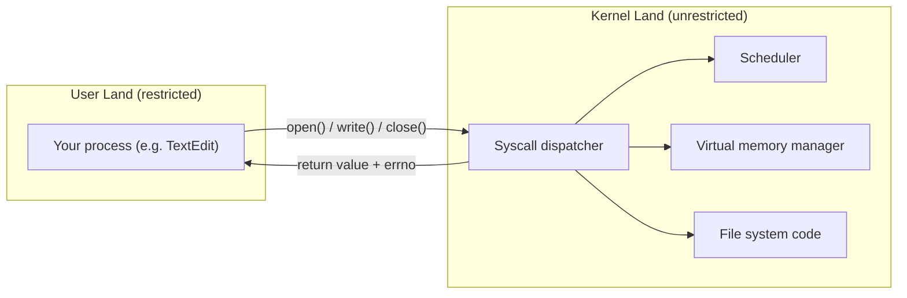


---

## 3. The Five-Layer Model of macOS

The whole stack, bottom to top:

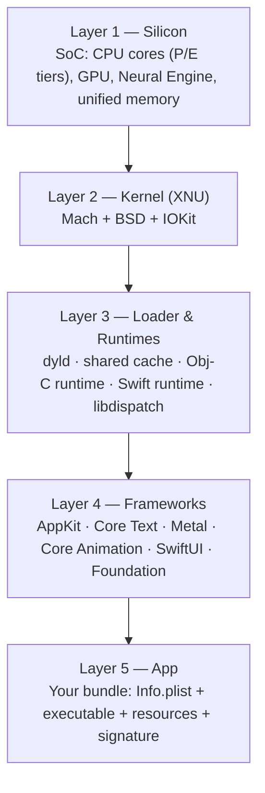

| Layer | Owns | Notes |
|---|---|---|
| **Silicon** | Cores, cache hierarchy, GPU, memory controller | Undocumented by Apple; understood via reverse engineering / counter measurement (§17) |
| **Kernel (XNU)** | Scheduling, memory, IPC, files, sockets, drivers | Hybrid: Mach *inside* the kernel, not as separate user-land servers (§6, §7) |
| **Loader & runtimes** | Turning a program-on-disk into a running, linked process | `dyld` resolves and maps every dependency (§10) |
| **Frameworks** | Drawing, text, windows, events, GPU submission | Shipped once, shared via the **dyld shared cache** (§10.2) |
| **App** | Your code + resources + a fixed bundle layout | Signed, sandboxed, notarized (§12) |

A single modern macOS app therefore touches **all five layers simultaneously**: SwiftUI/AppKit describes the window (Frameworks), Core Text lays out glyphs (Frameworks), Metal submits GPU work (Frameworks→Silicon), the process itself only exists because dyld linked it (Loader), and every one of those calls ultimately funnels through syscalls into XNU (Kernel), which schedules time on physical cores (Silicon).

---

## 4. One Keystroke: Full Pipeline & the 8.3 ms Frame Budget

### 4.1 The full round trip

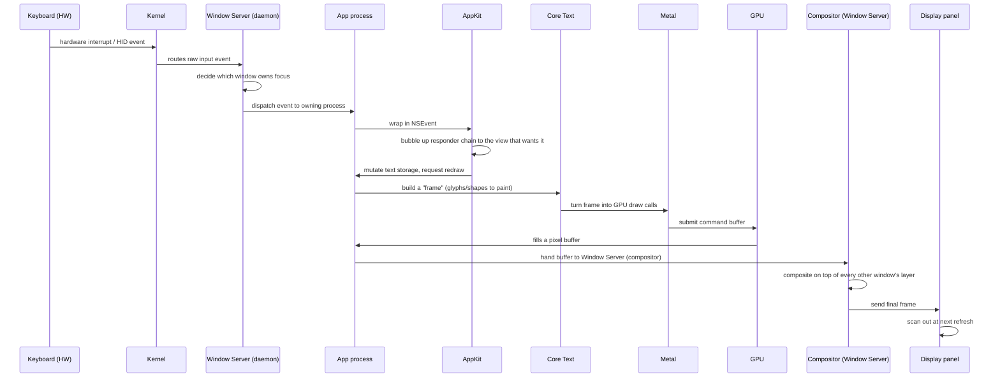

Key architectural point: **the Window Server is the single owner of "which window is where" and "what gets composited."** Apps never draw directly to the physical screen — they draw into buffers, then hand them to the compositor daemon.

### 4.2 The 8.3 ms budget

- A 120 Hz ProMotion panel refreshes every `1000 / 120 ≈ 8.33 ms`.
- If your app's full pipeline above doesn't finish inside that window, the panel **re-displays the previous frame** — nothing new appears until the *next* scan-out (16.7 ms later on a 120 Hz panel).
- **"Laggy" = dropped frames**, i.e., repeatedly blowing the 8.3 ms budget so the display keeps re-showing stale frames.
- **Practical consequence:** all serious macOS perf work is framed around staying inside this budget — batching syscalls, keeping the main thread free of blocking I/O, minimizing redundant layout/draw passes.

---

## 5. Libraries, Frameworks, and APIs

- **Library** = a file of reusable instructions, loaded into every process that needs it (e.g. code that draws the standard "Open File" dialog — written once, shared by every app).
- **Framework** (Apple-specific packaging) = a library **bundle**: the compiled code *plus* its headers, resources, and documentation, all under one versioned directory.
  - `AppKit.framework` — macOS's native UI toolkit
  - `Metal.framework` — the low-level GPU API
  - `CoreText.framework` — text layout/shaping/rendering
- A reference MacBook has **~305 entries** in its public frameworks/libraries directory, shared across every running process.
- **API** = the *contract* a framework exposes: the finite set of things you're allowed to ask it to do ("draw a window with this title," "give me the width of this string in this font," "tell me when a key is pressed"). Apple documents these; the framework's *internal* implementation is opaque.

---

## 6. History: Mach → BSD → NeXTSTEP → XNU → Darwin

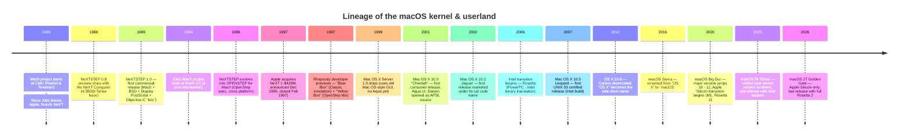

### 6.1 Mach — the microkernel core

Developed at **Carnegie Mellon University** (1985–1994) by **Richard Rashid** and **Avie Tevanian** (later NeXT's head of software, then Apple's Chief Software Technology Officer until 2006). Name origin: an in-joke backronym ("MUCK" → mis-transcribed as "Mach" by an Italian colleague) that stuck because Rashid liked the spelling.

**Core primitives Mach introduced:**

| Primitive | Meaning |
|---|---|
| **Task** | A set of system resources (address space, ports) that owns threads |
| **Thread** | A single flow of execution inside a task; shares the task's resources |
| **Port** | A protected, kernel-mediated **message queue** — the unit of IPC. Tasks hold *send* and *receive* rights, modeled after UNIX file permissions |
| **Message** | Typed data sent to a *port*, never directly to a task or thread |

**Design intent:** re-implement 4.2BSD on top of Accent-style message-passing IPC so it stayed binary-compatible with existing UNIX software while incrementally moving OS functionality out of the kernel into user-space "servers" running on **ports**. This is the textbook **microkernel** pattern.

**Why IPC (not classic syscalls)?** Under Mach, calling system functionality means: get a *port*, then send it an IPC *message*. The kernel's job in the "pure" microkernel design is reduced to routing/validating messages; actually servicing the request is some *other* user-space program's job.

**Mach's real-world performance problem (this matters — it's *why* XNU is not a microkernel):**

- A single "get the time" IPC round trip needs: trap into kernel → context switch → MMU remap → rights/validity check → context switch into the server → do the work → repeat in reverse. **4 context switches + 2 message validations** for one logical call.
- Measured on a 486DX-50: a native BSD syscall ≈ **20 µs**; the *equivalent* Mach IPC round trip ≈ **114 µs** (only ~18 µs of that was unavoidable hardware/MMU cost — the rest was Mach's own rights-checking machinery).
- Mach 3 (pushing BSD entirely into user-space servers) measured **50–67% slower** than native UNIX on real workloads (SOSP'97 benchmarks).
- Second-generation microkernels (L4) proved you *can* get IPC down to ~5 µs by stripping out most of Mach's built-in permission/rights checking and pushing that policy entirely to user space — but Apple didn't go that route.

**Apple's answer: co-location.** Put the "server" code (BSD) back *inside* kernel space instead of running it as a separate user-space process, trading microkernel purity for the elimination of IPC round-trip cost on hot paths (file I/O, networking, process control).

### 6.2 BSD

**Berkeley Software Distribution** — UC Berkeley's own UNIX lineage, providing everything classic Mach *lacked*: files, sockets/networking, the UNIX process model (parent/child, fork/exec), signals, users/permissions. "Big and practical" vs. Mach's "small, fast, elegant."

### 6.3 NeXTSTEP = Mach + BSD + Objective-C + Display PostScript

Steve Jobs left Apple in 1985 and founded **NeXT**. **NeXTSTEP** (first preview 1988, 1.0 in 1989) combined:

- Mach kernel (2.5) — microkernel core
- BSD userland (4.3BSD-Tahoe, later 4.3BSD-Reno) layered on top
- **Display PostScript** windowing engine
- **Objective-C** language + runtime, and an object-oriented app layer ("kits")
- A **DriverKit** API (Objective-C) for writing drivers

**Every class prefix you still see today — `NS`** (`NSWindow`, `NSString`, `NSArray`) — stands for **NeXTSTEP**. This is why AppKit is full of `NS`-prefixed types even in 2026.

NeXTSTEP → **OPENSTEP for Mach** (1996–97, cross-platform OpenStep spec jointly developed with Sun) → basis for Apple's next-gen OS after the acquisition.

Notable NeXTSTEP legacy: Tim Berners-Lee built the **first web browser and web server** on a NeXT machine (1990); id Software built **Doom** and **Quake** on NeXT workstations; the NeXTSTEP **Dock** concept carried straight through to today's macOS Dock.

### 6.4 Apple's internal disaster: Copland

In parallel, Apple's own in-house attempt to modernize classic Mac OS — codename **Copland** (started 1994) — collapsed under political infighting and was cancelled by 1996; some pieces were salvaged into Mac OS 8. This failure is *why* Apple went shopping for an external OS instead (evaluated BeOS too, chose NeXT).

### 6.5 Acquisition → Rhapsody → Mac OS X

- **Feb 1997:** Apple acquires NeXT (~$429M). Avie Tevanian takes over OS development; Jobs joins as advisor, later CEO.
- **Rhapsody** (1997 plan): OPENSTEP core + a **Blue Box** (full Classic Mac OS VM for legacy apps) + **Yellow Box** (native OpenStep libraries). Developers (Adobe, Microsoft) balked at rewriting everything for Yellow Box — the "penalty box" backlash.
- Jobs (WWDC 1997/98): pivot to give developers "a modern version of the Mac OS" — leads to **Carbon** (§8), a C API letting existing Mac Toolbox code run mostly unmodified on the new Unix-based core, alongside the fully object-oriented **Cocoa** (the OpenStep/Yellow Box descendant).
- **1999:** Mac OS X Server 1.0 (old-style GUI, no Aqua).
- **March 2001:** **Mac OS X 10.0 "Cheetah"** — first consumer release, introduces **Aqua** (full-color, anti-aliased, shadowed, animated UI — the Dock is the headline new widget).
- Lower layers (Mach + BSD) released as open source under the **Apple Public Source License (APSL)** — this open subset is **Darwin**.

### 6.6 XNU: "X is Not Unix"

**XNU** = the kernel = **Mach + BSD + IOKit**, glued together as one binary. The name is an in-joke leftover from NeXTSTEP days (predates macOS's official UNIX certification).

**Critical architectural fact:** even though its Mach half was *designed* as a microkernel, **XNU is not a microkernel**. Apple pulled the (heavy) BSD subsystem *into* the kernel with full privilege instead of running it as a user-land Mach server — precisely to avoid the IPC-crossing tax measured in §6.1. XNU is a deliberate, pragmatic **hybrid kernel**.

### 6.7 Darwin

The open-sourced kernel + Unix userland layer (Mach + BSD + IOKit + core toolchain pieces: the loader, Obj-C runtime, `libdispatch`, `libc`, threading lib). **Darwin ≠ macOS.** A bare Darwin machine has **no concept of windows** — the Window Server, Core Animation, AppKit, etc. are 100% closed-source, proprietary Apple code layered on top. You can *measure* that layer's behavior with external tools, but you can't read its source.


---

## 7. XNU Deep Dive

### 7.1 Composition diagram

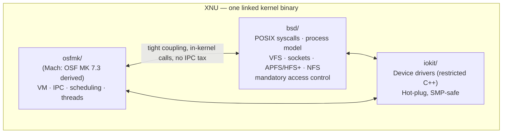

This is a **hybrid kernel**: Mach and BSD talk to each other via plain in-kernel function calls, not Mach IPC — that's the whole point (§6.1/6.6).

### 7.2 Division of responsibility

| Subsystem | Owns |
|---|---|
| **Mach** | Virtual memory management, IPC (Mach ports/messages — still used *between user-space processes*, and for some kernel↔user-space server communication), thread scheduling, low-level I/O with the console |
| **BSD** | POSIX API surface (the syscalls user code actually calls), UNIX process model on top of Mach tasks, users/groups/permissions, network protocol stack, **VFS** + journaling layer, local file systems (**HFS/HFS+**, **APFS**), NFS client/server, crypto framework, SysV IPC, audit subsystem, mandatory access control, some locking primitives |
| **IOKit** | The device-driver framework — a **restricted subset of C++** (based on Embedded C++: no exceptions, no multiple inheritance, no templates). Object-oriented so common driver boilerplate is shared. SMP-safe, hot-plug aware |

### 7.3 Real source tree (`apple-oss-distributions/xnu`)

```
xnu/
├── osfmk/          Mach-derived subsystems
│   ├── kern/        core scheduler, tasks, threads, zones
│   ├── vm/           virtual memory subsystem
│   ├── ipc/           Mach ports/messages
│   ├── arm64/ i386/ x86_64/   arch-specific code
│   ├── console/ kdp/ kperf/ voucher/ corpses/ ...
├── bsd/            BSD subsystems
│   ├── kern/         syscalls, process mgmt, signals
│   ├── vfs/           virtual file system layer
│   ├── vm/            BSD-side VM glue (UBC etc.)
│   ├── net/ netinet/ netinet6/ netkey/   networking stack
│   ├── nfs/ miscfs/ skywalk/ pthread/ security/ crypto/ ...
├── iokit/          IOKit device driver framework
│   ├── Kernel/        in-kernel IOKit runtime
│   ├── DriverKit/     user-space driver API (post-kext-deprecation)
│   ├── Families/ IOKitUser/ Exclaves/ bsddev/ ...
├── libkern/        C++ runtime used by IOKit/kexts
├── libsyscall/     userspace syscall stub library
├── libsa/          kernel bootstrap/startup code
├── libkdd/         kernel chunked-data parsing helpers
├── pexpert/        platform expert: interrupts, atomics, per-platform glue
├── security/        Mandatory Access Control policy hooks
├── EXTERNAL_HEADERS/  vendored headers to avoid dependency cycles
├── config/          per-arch/platform exported-API configuration
├── tests/ tools/ san/  test suites, dev tools, sanitizer glue
└── Makefile, README.md, APPLE_LICENSE
```

**Apple publishes:** the kernel (XNU) itself, the loader, the Objective-C runtime, `libdispatch`, the C library, the threading library, and the memory allocator — under the umbrella account `apple-oss-distributions`. Everything above the kernel (Window Server, AppKit, Core Animation, …) is closed.

### 7.4 Building XNU (high-level, from the repo README)

```bash
# Build for the host architecture:
make SDKROOT=macosx.internal

# Pin architecture / kernel config:
make SDKROOT=macosx.internal ARCH_CONFIGS=X86_64 KERNEL_CONFIGS=DEVELOPMENT

# Faster dev iteration with full debug info, still O0:
CFLAGS_DEVELOPMENTARM64="-O0 -g -DKERNEL_STACK_MULTIPLIER=2" make ...

# Install into a DSTROOT and build a bootable kernelcache:
make install_kernels DSTROOT=/tmp/xnu-dst
kextcache -q -z -a x86_64 -l -n -c /var/tmp/kernelcache.test \
          -K /var/tmp/kernel.test /System/Library/Extensions
```

Key conditional-compile macros you'll see throughout the tree: `KERNEL`, `KERNEL_PRIVATE`, `PRIVATE`, `BSD_KERNEL_PRIVATE`, `MACH_KERNEL_PRIVATE`, `XNU_KERNEL_PRIVATE`, `DRIVERKIT`. XNU deliberately avoids compiling based on `TARGET_OS_*` macros — those don't exist inside the kernel build.

### 7.5 K32 / K64 (historical) & current architecture support

| Era | Detail |
|---|---|
| Snow Leopard (10.6) | Dual kernel builds: **K32** (32-bit kernel, could still run 64-bit *apps*) and **K64** (64-bit kernel space — needed for >32 GB RAM, larger cache buffers, mapping multiple GPUs/high-DMA devices). K64 could run 32-bit apps but **not** 32-bit kexts |
| Mountain Lion (10.8)+ | 64-bit kernel only |
| Lion (10.7) | IA-32 kernel support dropped |
| Snow Leopard | PowerPC support dropped entirely |
| iOS 11 | 32-bit ARM support dropped |
| **macOS Golden Gate (27)** | x86-64 support removed from the shipping kernel — **ARM64 only** kernel going forward |

Current supported architectures: **ARM64** and **x86_64** (x86_64 only up through Tahoe/pre-Golden Gate builds).

### 7.6 Kernel extensions (kexts) → System Extensions / DriverKit

Historically, a **kext** loaded arbitrary driver/filter code directly into kernel space with **full kernel privilege** — a single bad kext can panic the whole machine, and it's an enormous attack surface.

- **Big Sur (11.0):** deprecated KPIs stop loading by default. Whole categories go from "deprecated" to "unsupported":

| KPI family | Deprecated | Unsupported (won't load) | Replacement |
|---|---|---|---|
| `KAUTH` (`kauth_listen_scope`/`unlisten_scope`) | Catalina 10.15 | Big Sur 11.0 | **EndpointSecurity** |
| Socket KPIs (`sock_*`) | Catalina 10.15 | still deprecated (not fully unsupported) | **NetworkExtension** |
| Network Filter (`sflt_*`, `ipf_*`) | Catalina 10.15 | Big Sur 11.0 | NetworkExtension |
| `IOHIDFamily` | Catalina 10.15 | Big Sur 11.0 | **HIDDriverKit** |
| `IOUSBFamily` | El Capitan 10.11 | Big Sur 11.0 | **IOUSBHostFamily** / **USBDriverKit** |
| `IOAudioFamily` | Monterey 12.3 | — | **AudioDriverKit** |
| `IOBluetoothHIDDriver` | Monterey 12.3 | — | **CoreBluetooth** (BLE); Classic BT no longer supported |

- **Replacement model — System Extensions:** same category of functionality (drivers, filters, endpoint security), but running **in user space**. A crashing/buggy system extension **cannot** take down the kernel. Requires an Apple-granted **entitlement** for DriverKit / EndpointSecurity.
- Kext deprecation enforcement is **not** applied if SIP is disabled, or if the kext is force-approved via an MDM profile — an important exception for managed fleets.

### 7.7 Exclaves (mentioned in modern XNU source, not covered in the video)

The current `iokit/Exclaves/` directory and osfmk internals reflect Apple's newer **"exclave"** security-domain work (isolated secure compute domains coordinating with XNU) — worth flagging as a topic to go deeper on separately; not covered by this video's source material.


---

## 8. Carbon vs. Cocoa

| | **Carbon** | **Cocoa** |
|---|---|---|
| Origin | Cleaned-up, memory-protected, multitasking-safe re-implementation of the classic **Mac Toolbox** (Pascal-calling-convention heritage) | Direct descendant of NeXTSTEP's **Yellow Box**/OpenStep, Objective-C, `NS`-prefixed |
| Language | **C** | **Objective-C** |
| Purpose | Let existing Mac OS 9 codebases ("Carbonize") run natively on Mac OS X without a full rewrite | The "real," fully object-oriented native API Apple wanted developers to converge on |
| Shared substrate | Both ultimately call into **Core Foundation (CF)** — pure-C reimplementation of Foundation's useful bits. **Toll-free bridging** lets CF and Foundation/Cocoa objects be used interchangeably without wrapper overhead | |
| Windowing | Quartz (in-house Display-PDF-like engine, replacing the license-encumbered Display PostScript) exposed to both APIs | |
| Fate | 64-bit apps **never** got Carbon UI support (2007+); deprecated OS X 10.8 (2012); **removed entirely** in Catalina 10.15 (2019) along with all 32-bit app support | Sole native macOS API since Catalina |
| Famous Carbon holdouts | Finder (Cocoa since 10.6/2009), iTunes, Final Cut Pro, Photoshop (Cocoa in 2010) | — |

**Mental model:** Carbon and Cocoa were architectural **peers**, not a compatibility shim on top of each other — you could mix Carbon and Cocoa windows in the *same process*. Carbon's death was really the death of 32-bit, not a Cocoa "win" via superiority alone — though Cocoa was always the strategic direction.

---

## 9. Processor Architecture Transitions

Apple has now switched CPU architecture **three times**: 68k → PowerPC (1994) → Intel (2006) → Apple Silicon (2020). Each transition used the same two-part playbook:

1. **Universal binary** — one file, multiple instruction sets bundled together; the OS/loader picks the right slice at launch.
2. **A translation layer** — runs *foreign* binaries by translating instructions at runtime (slower, stopgap).

### 9.1 PowerPC → Intel (2005–2006)

- Announced WWDC June 2005 (Steve Jobs). First Intel Macs shipped Jan 2006 (Mac OS X 10.4.4 Tiger) — a **32-bit** Core Duo initially, 64-bit Core 2 Duo six months later.
- Translation layer: **Rosetta** (from Transitive Corp's QuickTransit tech) — PowerPC → Intel at runtime, typically **50–80% of native speed**.
- File format: **Universal Binary** — one Mach-O file, multiple architecture slices.
- Full hardware transition: **210 days**, "complete" Aug 2006 (Mac Pro + Xserve).
- PowerPC support fully dropped: Mac OS X 10.6 Snow Leopard (2009) requires Intel; Rosetta itself removed in 10.7 Lion (2011).
- Motivations debated at the time: IBM's PowerPC roadmap kept slipping (promised 3 GHz G5 within 12 months at WWDC 2003 — never shipped; G5 never fit in a laptop thermal envelope — Tim Cook: *"the mother of all thermal challenges"*), pricing/volume tension with IBM, and Apple's desire for native Windows compatibility (Boot Camp, launched alongside the transition).
- A previously-explored alternative, **P.A. Semi's PWRficient** PowerPC derivative, lost out mainly on performance-per-watt and delivery timing; Apple later *acquired* P.A. Semi (2008) and used its engineers to build Apple's own ARM chips — the seed of the *next* transition.

### 9.2 Intel → Apple Silicon (2020–present)

- Announced WWDC June 2020. Same two-part playbook, updated names:
  - **Universal binary** (still the term — now x86_64 + arm64 slices)
  - **Rosetta 2** — x86_64 → Apple Silicon runtime translation

- **Inspecting a real universal binary (`lipo`, from the video's live demo on the Ghostty terminal binary):**

```bash
lipo -info /Applications/Ghostty.app/Contents/MacOS/ghostty
# Architectures in the fat file: x86_64 arm64

ls -l ghostty                 # total ≈ 42 MB
# lipo -detailed_info shows two slices:
#   x86_64: ~21.7 MB, offset 16384
#   arm64:  ~20.3 MB, offset immediately after
```

  Both slices are **page-aligned to 16,384 bytes** — the Apple Silicon page size (see §15). When you run this binary on an Apple Silicon Mac, only the ARM64 slice is ever mapped; the Intel slice is dead weight on disk for that machine.

### 9.3 The Apple-Silicon-only endgame: macOS Golden Gate

| Version | Darwin / XNU | Architecture story |
|---|---|---|
| macOS 26 **Tahoe** (Sept 2025) | Darwin 25 | **Last** release supporting Intel Macs |
| macOS 27 **Golden Gate** (Sept 14, 2026) | Darwin 27 / `xnu-13432.x` | **First** Apple-Silicon-only release; **last** release with *full* Rosetta 2 functionality (Intel-compiled apps still run, translated) |
| macOS 28 (future) | — | Rosetta 2 goes away entirely — no more Intel-app compatibility path at all |

Video's live demo of the reading tools on Tahoe (26.6.2) at the time of recording:

```bash
sw_vers        # ProductName / marketing version 26.6.2 / build 25G83
uname -a       # Darwin 25.6.0 ... kernel tag "XNU 12377.161.14"
sysctl hw.pagesize            # 16384
sysctl -a | grep hw.perflevel # tier 0 "Super" = 5 cores, tier 1 "Performance" = 10 cores
```

**Version-number cheat sheet:** macOS has 4 independent numbering schemes you must not conflate:
1. **Marketing version** (`26.6.2`) — what System Settings shows
2. **Build number** (`25G83`) — Apple engineering's internal tracking id
3. **Darwin/kernel version** (`Darwin 25.6.0`) — from `uname`
4. **XNU kernel tag** (`xnu-12377.161.14`) — the exact kernel source revision

`sw_vers`, `uname`, and the kernel tag together tell you *exactly* which kernel source drop is running underneath a given marketing release.


---

## 10. Loader & Runtimes Layer

Three components sit directly above the kernel:

### 10.1 `dyld` — the dynamic loader

Takes a program file off disk, walks its full dependency graph, maps every needed library into the new process's address space, applies fixups/relocations, and hands off control to start the process running.

Example dependency chain for a minimal Rust-based GUI app (from the video's own demo project, §21):

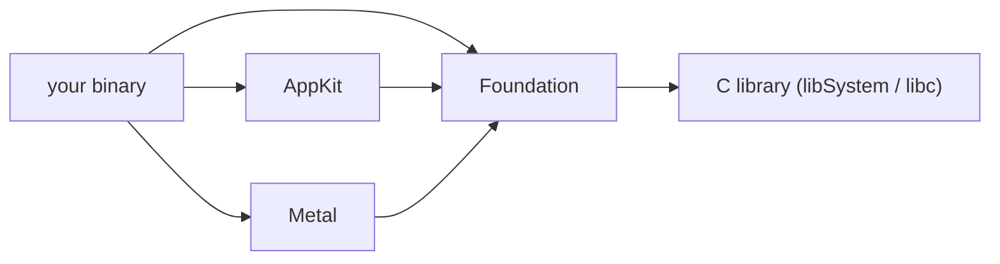

Every framework in the chain can itself depend on others — `dyld`'s job is to resolve the whole transitive closure before your `main()` ever runs.

### 10.2 The dyld Shared Cache

Apple **pre-links every system framework once**, at OS build time, into one giant combined file — shipped as part of the OS image. Every process that needs `AppKit`, `Foundation`, etc. gets **mapped to the same physical pages** — the cache is loaded into RAM once, system-wide, and shared.

- On a reference Apple Silicon Mac: the shared cache is **13 files in one directory, ~5.8 GB total**.
- **Consequence:** launching 100 apps that each use `AppKit` does *not* load `AppKit` 100 times — it's resident once, mapped N times.
- **Location:** *not* under `/System` directly — under `/System/Cryptexes/OS`, a mounted, separately-signed disk image (see §14.3, Cryptexes).

### 10.3 Runtimes

"Runtime" here = the language-support code needed *while a program runs* (as distinct from compile-time tooling):

| Runtime | Job |
|---|---|
| **Objective-C runtime** | Turns a method *name* into the actual code *address* to jump to (dynamic dispatch — `objc_msgSend` and friends). Any call into `AppKit` (written in Obj-C) from *any* language goes through this |
| **Swift runtime** | Automatic memory management (ARC bookkeeping), existentials, protocol witness tables, etc. |
| **`libdispatch` (Grand Central Dispatch)** | Hands work out to threads — the queueing/scheduling substrate almost everything concurrent in macOS sits on top of |

---

## 11. Frameworks Layer

The layer that actually **draws** things and routes events, built on the loader/runtime substrate:

| Framework | Responsibility |
|---|---|
| **AppKit** | macOS's native, event-driven UI toolkit. Draws windows/buttons/panels/text fields, manages event dispatch (`NSEvent` responder chain), printing, animation, document architecture, accessibility, localization. Works *with* SwiftUI (embed AppKit views inside SwiftUI and vice versa) |
| **Core Text** | Text layout, shaping, glyph rendering |
| **Metal** | Low-level, explicit GPU API — command buffers, pipelines, direct hardware access (Apple's answer to Vulkan/DirectX 12-class APIs) |
| **Core Animation** | Compositing layers, talks to the Window Server for final on-screen presentation |
| **SwiftUI** | A **declarative abstraction over AppKit** (macOS) / UIKit (iOS) — not a replacement, a *layer on top* aimed at nicer developer ergonomics. A modern app frequently uses SwiftUI *and* AppKit *and* Core Text *and* Metal *and* Core Animation simultaneously |

**AppKit specifics worth remembering** (from Apple's docs):
- Available since Mac OS X 10.0; also usable via **Mac Catalyst** (bringing iPad apps to Mac) since Catalyst 13.0.
- Ships **Cocoa Bindings** (declarative data-model↔UI sync), an App Extension mechanism, and first-class **Dark Mode** / appearance-proxy support.
- The Objective-C `NS`-prefix convention across `NSWindow`, `NSView`, `NSViewController`, etc. is the direct NeXTSTEP lineage from §6.5.

---

## 12. App Layer: Bundles, Code Signing, Notarization, Sandboxing

### 12.1 Bundle recap (see §1.3)
`Info.plist` + `MacOS/<executable>` + `Resources/` + `_CodeSignature/`.

### 12.2 Code signing

Every executable running on modern macOS carries a **cryptographic signature** asserting who built it. The system verifies the signature **before** running the program. Inspect with:

```bash
codesign -dv --verbose=4 /path/to/App.app
# shows: Identifier, TeamIdentifier, flags (e.g. "runtime" = Hardened Runtime enabled)
```

### 12.3 Notarization

Distinct from **App Review** (App Store) — notarization is for **Developer-ID-signed software distributed outside the App Store**.

- Apple's **notary service** automatically scans your binary for malware and code-signing problems, then (if clean) issues a **ticket**. The ticket can be:
  - **Stapled** to your distributable (disk image, `.pkg`, app bundle), or
  - Published online for **Gatekeeper** to look up at first launch
- **First-launch UX:** Gatekeeper sees the ticket and shows a *"Apple checked this app for malicious software"*-style dialog instead of an unqualified warning.
- **Hard requirements to submit for notarization:**
  1. Every executable must have a **valid code signature**
  2. Signed with a **Developer ID** cert (not Mac Distribution / ad hoc / plain Apple Developer / local dev cert)
  3. **Hardened Runtime** capability enabled
  4. A **secure timestamp** included in the signature
  5. **No** `com.apple.security.get-task-allow` entitlement set to `true`
  6. Linked against the **macOS 10.9+ SDK**
  7. Properly-formatted XML/ASCII entitlements
- **Since June 1, 2019 (Catalina):** *all* Developer-ID-distributed software built after that date **must** be notarized. Mac App Store software is exempt (App Review already covers equivalent checks).
- **Plug-in note:** plug-ins inherit their *host* process's entitlements (they don't declare their own) — so a host app that wants to support plug-ins doing unusual things (JIT, unsigned executable memory, camera-driver-style deep hooks) must pre-declare those entitlements itself.
- **Tooling:** `notarytool` (current) — `altool` and Xcode ≤13 uploads were cut off entirely as of **Nov 1, 2023**.
- **`spctl`** performs the *same check macOS itself runs on double-click*:

```bash
spctl --assess --verbose /path/to/App.app
# source: "Notarized Developer ID"  -> accepted
```

### 12.4 Sandboxing & containers

An app can be constrained to a **sandbox**: a restricted execution environment limiting exactly which files/devices it may touch. A sandboxed app's writable home is a single private folder under the user's home directory called its **container** (`~/Library/Containers/<bundle-id>/...`).


---

## 13. Process Model: Daemons, `launchd`, Process Tree

### 13.1 Daemon

A **daemon** = a background process with **no window / no UI layer** — it just does a job and answers requests from other processes. Examples: the **Window Server** (owns compositing — see §4), the Spotlight indexing daemon, `launchd` itself.

### 13.2 `launchd` — PID 1

- The **first** process the kernel starts at boot. **PID 1**. Parent PID is listed as **0** — i.e., nothing is its parent.
- `launchd` starts every other daemon and, transitively, is the ancestor of **every** process on the system.
- Reference measurement from the video (fresh/clean macOS VM, minimal user apps open): **488 total processes**, of which **481 spawn directly from `launchd`**; the remainder chain through a couple of intermediate parents.

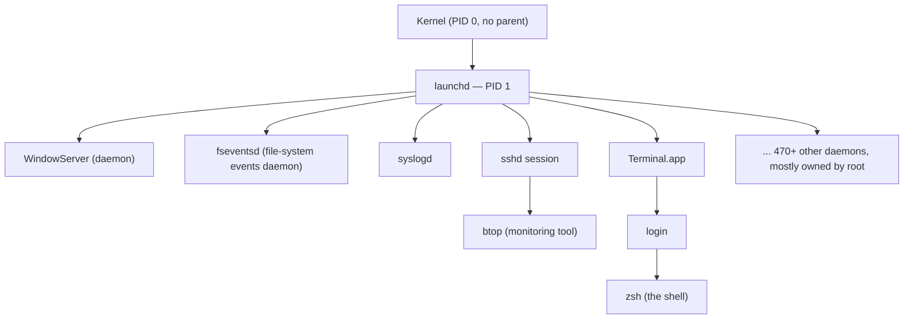

### 13.3 Terminal vs. Shell (people conflate these constantly — don't)

| | **Terminal** | **Shell** |
|---|---|---|
| Has a window | Yes | No |
| Job | Draws text on screen, captures keystrokes — nothing more | Reads each line you type, figures out which program you mean, asks the kernel to start it |
| Example | Terminal.app, **Ghostty** (video's reference app) | `zsh` (video's reference shell) |
| Communication channel between the two | A **pseudo-terminal (pty)** — a bidirectional pipe pairing the two processes | |

Flow for typing `ls` + Enter: Terminal draws the characters → sends the line to the shell over the pty → shell forks/execs the `ls` program → `ls` prints results back through the pty → Terminal draws that output. **Three processes total** for one command: Terminal, shell, and the spawned `ls` process.

---

## 14. File Systems: APFS & Disk Layout

### 14.1 What a file system *is*

Kernel-resident code (part of BSD/VFS, §7) that turns raw disk bytes into named files/folders humans can navigate.

### 14.2 APFS — Apple File System

Default on modern macOS. Headline feature: **copy-on-write clones**.

- Copying a 5 GB file to another folder is **instant** and uses **zero extra disk space** at copy time — APFS just records that both names point at the same underlying data blocks.
- Space is only actually duplicated **once you start diverging** — i.e., write to one of the two copies (classic COW semantics).

### 14.3 Root-level directory map

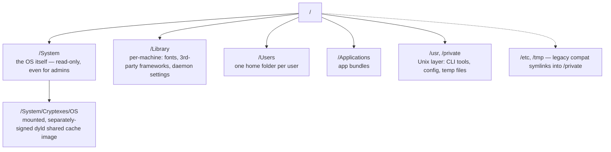

- **`/System`** — the OS proper; **immutable**, even root can't write to it directly.
- **`/Library`** — machine-wide installed resources (fonts, 3rd-party frameworks, daemon `LaunchDaemons`/`LaunchAgents` plists).
- **`/Users`** — one home directory per account.
- **`/Applications`** — installed app bundles.
- **`/usr`, `/private`** — the classic Unix layer (CLI tools, configs, scratch space). `/etc` and `/tmp` are legacy compatibility symlinks pointing into `/private` — kept only so Unix muscle memory keeps working; they carry no independent meaning.

### 14.4 Cryptexes

A **Cryptex** = a **separately signed disk image** holding just one slice of the system, mounted at boot. Enables Apple to ship/update *that slice* (e.g. the dyld shared cache under `/System/Cryptexes/OS`) **independently**, without a full OS reinstall — a modular signing/update boundary baked into the on-disk layout.

---

## 15. Virtual Memory & Paging

### 15.1 The illusion

Every process believes it owns the **entire physical address space**, starting at address 0. This belief is literally false but extremely useful: the kernel can freely remap a process's *virtual* addresses onto whatever *physical* RAM (or disk-backed swap) it wants, invisibly to that process.

- Two processes **cannot** read each other's memory precisely because their virtual pages map to *disjoint* physical addresses — this is the actual mechanism behind process isolation, not just a policy.

### 15.2 Pages

Memory is managed in fixed-size chunks called **pages**.

- **Apple Silicon Mac page size: 16,384 bytes (16 KiB)** — much larger than the traditional 4 KiB page size used on most other platforms (and on Intel Macs).
- Mapping a 100,000-byte file at 16 KiB/page needs **⌈100000/16384⌉ = 7 pages** (last page ~14,688 B wasted). At a hypothetical 4 KiB page size the same file needs 25 pages, wasting only ~2,400 B.

**The trade-off:**

| Bigger pages (16 KiB) | Smaller pages (4 KiB) |
|---|---|
| More wasted space at the tail of each mapped file | Less wasted space |
| **Fewer** page-table lookups/TLB entries needed to cover the same working set → fewer expensive disk round-trips | More lookups, more TLB pressure |

Apple's 16 KiB choice trades a little disk-space waste for meaningfully cheaper address translation at scale — a deliberate hardware/OS co-design decision.

---

## 16. Threads & the Main-Thread Rule

- A **process** can have many **threads**; a thread = one sequence of instructions executing the process's code, with its own program counter and its own stack, but **sharing** the process's address space with every other thread in that process.
- macOS designates one thread per GUI process as **the main thread** — it alone is responsible for:
  - Drawing windows / anything touching the UI layer
  - Routing input events
- **Golden rule:** never touch AppKit UI state from a background thread. Classic bug pattern: read a large file on a worker thread to keep the UI responsive, then — from that *same worker thread* — try to update a window's title when done. **Instant crash.** Only the main thread may mutate UI state; hand results back to the main thread (e.g. via `libdispatch`) before touching any view/window API.


---

## 17. Hardware Microarchitecture: Firestorm (M1 P-core)

Source: Dougall Johnson's black-box reverse-engineering (~35k tables of hardware performance-counter measurements). **No warranty of any kind** — this is inferred, not Apple-documented, but it's the best public data available and matches what's cited across the industry.

**Method (generalizes beyond CPUs — see §22):** run one instruction millions of times in a tight loop, read the core's own performance counters after each run, and back out pipeline width, queue depths, and retire rates from the aggregate statistics.

**Terminology:** an *instruction* decodes to one or more **uops**. Uops count against the **8 uops/cycle** pipeline-width limit (measured via the documented `RETIRE_UOP` counter). A uop then **issues** to an execution unit/port, counted separately per unit type via undocumented counters (issue limits are enforced per-unit, one issue/unit/cycle).

### 17.1 Full pipeline diagram

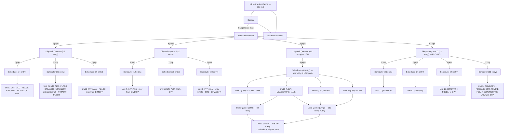

*(Reconstructed from the reference pipeline diagram; unit numbering follows Dougall Johnson's own "Firestorm Units" labeling — units 1–6 = integer, 7–10 = load/store, 11–14 = FP/SIMD.)*

### 17.2 Key numbers to memorize

| Metric | Value |
|---|---|
| Pipeline / retire width | **8 uops/cycle** |
| Taken branches/cycle | 1 |
| Integer execution units | 6 |
| Load/store (LSU) units | 4 (up to 128-bit loads/stores; address gen includes shifts up to LSL #3) |
| FP/SIMD units | 4 |
| **Max issues/cycle in contrived cases** | **11** (ALU ops with optional shift/extend issue as extra uops beyond the raw pipeline width) |
| L1 Instruction Cache | 192 KiB |
| L1 Data Cache | 128 KiB, **8-way**, 128 banks × 2 B |
| Coalesced Retire Queue (ROB-equivalent) | **~330 entries**, up to 7 uops/group |
| Rename Retire Queue (arch-register-write tracking) | **~623 entries** |
| Integer physical register file | ~380–394 |
| FP/SIMD physical register file | ~432 |
| Flags physical register file | ~128 |
| In-flight branches | ~144 |
| In-flight loads | ~130 |
| In-flight stores | ~60 |
| Effective OOO window (issuing instrs) | ~1000+ (over 2200 for pure `nop`) |
| Retirement rate | up to 8 coalesced-ROB entries/cycle, or up to 16 rename-retire entries/cycle |

### 17.3 The reorder buffer is *unconventional*

Firestorm doesn't use a classic flat ROB. It **coalesces uops into retire groups** (≤7 uops/group) that all retire together:

- Uops that can fail **before** retiring (e.g. memory ops) must sit at the **start** of a group.
- Uops that can fail **after** retiring (e.g. conditional branches) must sit at the **end**.
- Full 7-uop groups only appear for *eliminated* instructions (`nop`, certain `mov`s) — issuing uops are capped near ~4/group in practice.
- Every write to an **architectural register** needs a slot in the *separate* **Rename Retire Queue**, regardless of whether the instruction itself was "eliminated" (see below) — e.g. `cbz`/`str` need zero entries, `add`/`mov` need one, `adds`/`ldp` need two.
- Loads/stores can **commit out of order** if non-speculative — subtle implication: once a store "completes," architectural state has *already* advanced past that point even though it hasn't formally "retired" in ROB terms.

### 17.4 Fusion (2 instructions → 1 issuing uop)

| Pattern | Condition |
|---|---|
| `adds/subs/ands/cmp/tst` + `b.cc` | Fuses fully if the fused pair reads ≤4 distinct registers per 6 instructions |
| `add/sub/and/orr/eor/bic/...` + `cbnz/cbz` | Fuses if destination matches the `cbz` operand (also works with flag-setting variants) |
| `aese`+`aesmc`, `aesd`+`aesimc` | Fuses if operand pattern is `A,B ; A,A` |
| `aese/aesd` + `eor` | Fuses on `A,B ; A,A,C` or `A,B ; A,C,A` patterns |
| `pmull` + `eor` | Similarly pattern-gated |
| `amx` + `amx` (excl. loads/stores) | Fuses, roughly like an `stp` |

**Not fused** (despite being "obvious" candidates): `adrp`+`add`, `mov`+`movk`, `mul`+`umulh`, `udiv`+`msub`. Branch fusion specifically breaks if there's an implicit shift/extend, or if the fused instruction reads flags (e.g. `adc`).

### 17.5 Elimination (instruction costs **zero** issue slots — handled purely by renaming)

- `mov x0, #0` (and 32-bit form)
- `mov x0, x1` (64-bit only, handled by renaming)
- `mov x0, #123` and other immediate-`mov` aliases — capped at **2 eliminations per 8 instructions**
- `movi v0.16b, #0` (and other zero-vector types)
- `mov v0.16b, v1.16b` (full-width vector moves; **not** narrower forms like `v0.8b`)
- `nop` (never issues at all)
- unconditional `b` (never issues)

**Not eliminated** (common mistake to assume otherwise): `adr`/`adrp`, `mov w0, w1`, `mov x0, xzr`.

### 17.6 Complex latencies worth remembering

- `MADD`'s result feeds its **own addend operand** with **1-cycle** latency, but **3-cycle** latency if chained into something *else*.
- Load→load base-address chaining (pointer chasing, e.g. linked lists): **3-cycle** latency; load→ALU chaining: **4-cycle**. The *second* destination register of an `LDP` is always 4-cycle.
- A load can pick up **+1 cycle** extra latency if its index register is itself the output of a shift-like instruction (addition/bitwise index sources don't pay this).
- Integer↔SIMD/FP round trip latency can be as low as **7 cycles** in favorable chains (e.g. flag-op chaining).


---

## 18. GPU Architecture: AGX & Tile-Based Deferred Rendering

Source: Alyssa Rosenzweig / Asahi Linux project — reverse-engineered by **watching what Apple's closed Metal driver sends to the hardware**, since Apple documents almost none of this.

### 18.1 Immediate-mode vs. tile-based deferred renderers

| | **Immediate mode** (typical discrete desktop GPU) | **Tile-based deferred** (AGX, Mali, PowerVR — mobile-lineage) |
|---|---|---|
| Passes | Vertex shader → fragment shader per triangle, straight into the framebuffer | **Two full passes**: (1) run *all* vertex shaders for the whole frame first, (2) tile the framebuffer, then run fragment shaders per-tile |
| Framebuffer access | Constant read/write traffic to the framebuffer in VRAM | Small on-chip **tilebuffer** (a few KB) caches the tile being worked on — writes/blends are nearly free while resident |
| Best suited for | Discrete GPUs with dedicated VRAM and huge memory bandwidth | Mobile/SoC GPUs with **unified memory** and no dedicated VRAM — minimizes expensive main-memory traffic |

**Apple's AGX (M-series GPU) is architecturally a *mobile* GPU** (iPhone lineage) repurposed for desktop-class performance via unified memory + a much wider chip — this is *why* it behaves like a tiler even on a "screaming fast desktop."

### 18.2 The Parameter Buffer / Tiled Vertex Buffer (TVB)

Because *all* vertex shaders run before *any* fragment shader, the GPU needs a memory buffer to hold every vertex shader's output for the whole frame — this is the **Tiled Vertex Buffer** (Apple's public name) = the **Parameter Buffer / PB** (PowerVR-lineage internal name — AGX shares DNA with PowerVR).

- **It is not sized by user-space.** Tracing Metal's own driver shows the command buffer only ever encodes a *vertex count* — no buffer-size field grows with geometry complexity. The kernel/firmware owns allocation and can **grow it dynamically** in response to overflow (balances memory footprint against the cost of overflow handling).
- **What "too much per-vertex data" means:** overflow depends on `(vertex count) × (bytes of "varying" data interpolated per vertex)` — a low-poly model with a complex, data-heavy shader can overflow just as easily as a high-poly model with a simple shader.

### 18.3 Partial renders — what happens on overflow

If the Parameter/Tiled-Vertex Buffer fills up mid-frame, the GPU performs a **partial render**:

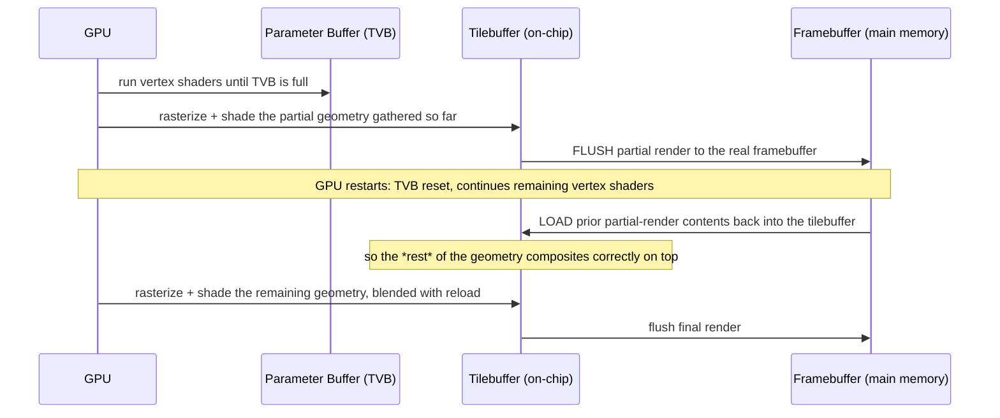

**Auxiliary programs required around every render (this is the crux of the "impossible bug"):**

| Program | When it runs | Purpose |
|---|---|---|
| **Load (initial)** | Start of frame | Either write the clear color, or load prior framebuffer contents, per app setting |
| **Load (partial-render)** | *Only* if a partial render occurred | **Always** reloads the framebuffer — separate from the initial load program, and easy to forget entirely if you didn't know partial renders existed |
| **Store (final)** | End of frame | Flush the finished tile to the real framebuffer |
| **Store (partial)** | Mid-frame, on TVB overflow | Flush the *incomplete* tile so rendering can resume later |

### 18.4 Case study: "The Impossible Bug" (Asahi Linux driver bring-up)

Symptom: detailed models partially rendered — correct output up to some point, then black (clear-color) beyond it; complexity threshold moved depending on shader complexity too, not just geometry.

**Debug path (a great case study in systematic reverse engineering):**
1. Ruled out a shader "timeout" theory — an artificial infinite-loop shader proved there's no meaningfully low time limit, and the *symptom shape* didn't match a timeout anyway.
2. Bisected the *shader itself*: only the amount of **interpolated per-vertex data** mattered, not raw instruction count.
3. Correlated with Apple's own (rare) public WWDC documentation mentioning the **Tiled Vertex Buffer** and "Partial Render" by name — confirming the buffer-overflow theory and matching it to PowerVR's public "Parameter Buffer" docs (same underlying mechanism, different public names).
4. Traced Metal's *own* GPU memory allocations across increasing geometry loads — no buffer size in userspace scaled with geometry, ruling out a userspace-managed buffer.
5. Found their own driver had **no partial-render "load" auxiliary program at all** → GPU **null-pointer-dereferences and faults** the instant a partial render is triggered. Fix: supply the load program Metal was silently always supplying.
6. Even after that fix, rendering was still subtly wrong for a few frames (self-healing after that, because the kernel/firmware **grows the TVB** in response to repeated overflow) — remaining artifacts traced to the **depth buffer** also needing its own store/load-back handling across a partial render, exactly parallel to the color buffer. Fixing depth-buffer flush/reload finally produced a fully correct render.

**Takeaway pattern (generalizes beyond GPUs):** an "impossible" bug that only manifests past some complexity threshold is very often **an undocumented auxiliary/overflow code path** that only exists to handle a buffer limit — go looking for the thing that *isn't* linear in a variable you assumed didn't matter.


---

## 19. Tooling Reference (Cheat Sheet)

The investigative toolkit referenced throughout — two disciplines: **measuring** (black-box, counters/tracing) and **reading source** (osfmk/bsd/iokit, or reverse-engineered driver traces).

| Tool | Purpose | Example use |
|---|---|---|
| `sw_vers` | Marketing version, product name, build number | `sw_vers` → `26.6.2`, build `25G83` |
| `uname -a` | Darwin/kernel version + exact XNU build tag | `Darwin 25.6.0 ... xnu-12377.161.14` |
| `sysctl` | Read kernel-exposed key/value hardware & runtime settings | `sysctl hw.pagesize`; `sysctl -a \| grep perflevel` for core-tier (Super/Performance) breakdown |
| `powermetrics` | Per-core busy %, clock speed, live power draw | Watching which core tier is active under load |
| `otool` | Inspect Mach-O binaries: linked libraries, load commands, disassembly | `otool -L binary` for dependency list |
| `dyld_info` | Inspect what the dynamic loader will do to a binary — fixups, dependency resolution | Understanding load-time rebinding costs |
| `lipo` | Inspect/create universal (fat) binaries | `lipo -info` / `-detailed_info` to see per-arch slice sizes & offsets |
| `codesign` | Inspect/apply code signatures | `codesign -dv --verbose=4 App.app` → identifier, team, Hardened Runtime flag |
| `spctl` | Runs the same Gatekeeper policy check macOS runs on double-click | `spctl --assess --verbose App.app` |
| `fs_usage` | Live trace of every file-system syscall a process makes, with kernel timing | Watching TextEdit's write-scratch-file-then-rename save pattern |
| `dtrace` | General dynamic tracing of live syscalls/kernel events | Broader tracing beyond just the filesystem |
| `btop` | Process tree / resource monitor (3rd-party) | Visualizing the `launchd`-rooted process tree |
| `Instruments` (Xcode) | Graphical profiler | Finding where wall-clock time actually goes (frame budget debugging, §4.2) |
| `lldb` | Debugger | Attaching to/stopping a live process to inspect state; also drives kernel debugging via `gdb-remote` |

**Kernel debugging quick reference (from the XNU README):**

```bash
# boot-arg to make a panic wait for a debugger instead of rebooting:
debug=0x14e

# attach with lldb once the panicked kernel is waiting:
xcrun -sdk macosx lldb <path-to-unstripped-kernel>
(lldb) gdb-remote [<host-ip>:]<port>
(lldb) help showcurrentstacks   # kernel-debugging macro, needs:
# ~/.lldbinit: settings set target.load-script-from-symbol-file true
```

---

## 20. macOS Version History Table

Four independent numbering axes exist for any given release — **never conflate them**: marketing version, code name, build number, Darwin/XNU kernel version.

| Marketing version | Code name | Darwin | Release date | Architecture (app / kernel) |
|---|---|---|---|---|
| Mac OS X Server 1.0 | *Hera* (internal) | 0.1–0.3 | Mar 16, 1999 | 32-bit PowerPC |
| Mac OS X 10.0 | *Cheetah* (internal) | 1.3.1 | Mar 24, 2001 | 32-bit PowerPC |
| Mac OS X 10.1 | *Puma* (internal) | 1.4.1/5 | Sep 25, 2001 | 32-bit PowerPC |
| Mac OS X 10.2 | **Jaguar** (first marketed cat name) | 6 | Aug 24, 2002 | 32/64-bit PowerPC |
| Mac OS X 10.3 | Panther | 7 | Oct 24, 2003 | 32/64-bit PowerPC |
| Mac OS X 10.4 | Tiger | 8 | Apr 29, 2005 | 32/64-bit PowerPC **and Intel** (first Intel Macs, Jan 2006, via 10.4.4) |
| Mac OS X 10.5 | Leopard | 9 | Oct 26, 2007 | PowerPC + Intel; **first UNIX 03 certified** release (Intel build); last PowerPC-supporting release |
| Mac OS X 10.6 | Snow Leopard | 10 | Aug 28, 2009 | **Intel only** (32/64-bit); last release with Rosetta (PPC→Intel) |
| Mac OS X 10.7 | Lion | 11 | Jul 20, 2011 | 64-bit Intel only; Rosetta removed |
| OS X 10.8 | Mountain Lion | 12 | Jul 25, 2012 | 64-bit; Carbon deprecated |
| OS X 10.9 | Mavericks | 13 | Oct 22, 2013 | 64-bit; first California-place-name release, first **free** upgrade |
| OS X 10.10 | Yosemite | 14 | Oct 16, 2014 | 64-bit |
| OS X 10.11 | El Capitan | 15 | Sep 30, 2015 | 64-bit; Metal API debuts |
| macOS 10.12 | Sierra | 16 | Sep 20, 2016 | 64-bit; **renamed "OS X" → "macOS"** |
| macOS 10.13 | High Sierra | 17 | Sep 25, 2017 | 64-bit; switches default FS to **APFS** |
| macOS 10.14 | Mojave | 18 | Sep 24, 2018 | 64-bit |
| macOS 10.15 | Catalina | 19 | Oct 7, 2019 | 64-bit Intel only; **drops all 32-bit app support** (kills Carbon for good) |
| macOS 11 | Big Sur | 20 | Nov 12, 2020 | Intel **and ARM** (first Apple Silicon Macs); major version jumps 10→11; **Rosetta 2** introduced |
| macOS 12 | Monterey | 21 | Oct 25, 2021 | Intel + ARM |
| macOS 13 | Ventura | 22 | Oct 24, 2022 | Intel + ARM; drops macOS Server support entirely |
| macOS 14 | Sonoma | 23 | Sep 26, 2023 | Intel + ARM |
| macOS 15 | Sequoia | 24 | Sep 16, 2024 | Intel + ARM; **Apple Intelligence** debuts |
| macOS 26 | **Tahoe** | 25 | Sep 15, 2025 | Intel + ARM (**last Intel-supporting release**); unified year-based version numbers begin; Liquid Glass design language |
| macOS 27 | **Golden Gate** | 27 | Sep 14, 2026 | **ARM only** (Apple Silicon exclusive); **last release with full Rosetta 2** |

> Darwin version 26 was skipped in the public numbering jump from 25 (Tahoe) straight to 27 (Golden Gate) — consistent with Apple's unified year-based scheme across all its OSes.

### 20.1 macOS Golden Gate (27) — what actually shipped

- Announced WWDC, June 8 2026; GA September 14, 2026.
- **First** macOS requiring Apple Silicon exclusively; **last** with full Rosetta 2 (macOS 28 drops the Intel-translation path entirely).
- Build/kernel tags observed:

| Version | Build | Darwin/XNU |
|---|---|---|
| 27.0 (GA) | 26A428 | Darwin 27.0.0 / `xnu-13432.1.9` |
| 27.2 beta 1 | 26B5086k | `xnu-13432.40.144.0.1` |
| 27.2 beta 2 | 26B5091g | `xnu-13432.40.162` |

- Notable UI/system changes: window-border shapes made consistent across apps again (reversing a Tahoe change); traffic-light window controls redesigned with a Liquid-Glass/Aqua-influenced look; pull-to-refresh added to Safari/Mail/News/Podcasts/Calendar; iPhone Mirroring window becomes resizable; screen recording gains system-audio capture.
- **Removed:** AFP (Apple Filing Protocol) support — kills Time Machine-over-AirPort-Time-Capsule; AirPort Utility dropped from new installs; **Boot Camp removed** (no more Intel support = no more Windows dual-boot via Boot Camp).
- Supported hardware: any Mac with an **M-series** chip or an **A18 Pro** chip (`MacBook Air/Pro M1+, Mac mini 2020+, iMac 2021+, Mac Studio 2022+, Mac Pro 2023, MacBook Neo`). All Intel Macs — including the 2019 Mac Pro and 2020 16"/13"(4-TB3) MacBook Pro and iMac — are unsupported.


---

## 21. Native Apps Beyond Swift: objc2/Rust, Ghostty, Zed

**Why bother building outside Swift/AppKit at all?** Apple's frameworks are written in Objective-C/Swift and *expect* you to consume them from Swift — but some of the most technically interesting native Mac software deliberately **doesn't**. Working outside the "batteries included" path forces you to understand every abstraction Apple would otherwise hide, which is exactly the pedagogical point of building a terminal from scratch in Rust (the video's own running project across its playlist).

### 21.1 The bridge: how a non-Apple language calls Apple frameworks

- Objective-C's runtime is itself built on **C**, and virtually any systems language can call C.
- **`objc2`** (Rust) is the practical bridge: a **merge of several earlier crates** (`objc`, `objc-encode`, `objc_exception`, `objc_id`, `objc-foundation`, `block` → renamed `objc2`, `objc2-encode`, folded into `objc2::exception`/`objc2::rc`, `objc2-foundation`, `block2`), plus a separate **`dispatch2`** crate for GCD.
- **Framework crates** translate *every* Apple framework's Objective-C surface into idiomatic-ish Rust types — so creating an `NSWindow` is a handful of lines of Rust, not hand-written FFI shims.
- Explicit design goal: reach *feature parity* with how **Swift** does Objective-C interop (acknowledged as probably never fully attainable — Swift was built from day one for this; Rust is being retrofitted onto it).
- Similar bridges exist for essentially every other systems/scripting language: Python (**PyObjC**), C# (**Xamarin.Mac**), Ruby (**MacRuby**/**RubyCocoa**), Dart (**ffigen**), Go (**MacDriver**), Node.js (**NodObjC**), Zig (**zig-objcrt**), with Kotlin/Nim/D offering some built-in interop. This is a whole minor sub-industry of language interop engineering.

### 21.2 Case study — the video's own Rust terminal, commit 1

Minimal but **fully real** macOS app, built with `objc2` + AppKit + Metal:

1. Create an `NSApplication`-equivalent object — from AppKit's point of view, the process that owns all windows.
2. Create one window with a title.
3. Give that window a **Metal layer** — the surface the GPU will render into.
4. Run the application's event loop (wait for events, dispatch them).
5. **No** text rendering, no shell, no colors yet — it draws one solid-color rectangle.

Despite the minimalism, this is a **first-class macOS app**: it has a proper bundle, a real Developer-ID signature, and is **notarized** (via a paid $99/yr Apple Developer Program membership) so it launches on other users' Macs with zero Gatekeeper friction.

```bash
codesign -dv --verbose=4 MyTerminal.app
# Identifier: com.example.myterminal   Team: <developer account>
# flags: runtime  <- Hardened Runtime is on

spctl --assess --verbose MyTerminal.app
# accepted; source=Notarized Developer ID
```

### 21.3 Ghostty — a real production example of the "shared native core" pattern

- **macOS GUI:** Swift, using **AppKit** and **SwiftUI**.
- **Linux GUI:** Zig, using the **GTK4** C API.
- **Shared core — `libghostty`:** a cross-platform, **C-ABI-compatible** library (written in Zig) providing terminal emulation, font handling, and rendering. Both GUIs are *consumers* of this one core, linked via its C API (the Linux build compiles as a single Zig compilation unit against the public libghostty API rather than "linking" in the traditional sense).
- Architecture payoff: strict separation between terminal emulation logic and platform GUI — this is *how* Ghostty gets to be simultaneously "native" (real AppKit/GTK4 widgets, platform-idiomatic shortcuts, macOS extras like Quick Look/force-touch/secure-input/window-state-restore) **and** cross-platform, without either goal compromising the other.
- Terminal-feature ambitions: Kitty graphics protocol, light/dark-mode notifications, hyperlinks — letting terminal apps (Neovim, Zellij) do more than in legacy emulators.
- Explicitly a **passion project** (Mitchell Hashimoto), not a company product — worth remembering when reading its docs' tone.

### 21.4 Zed — Metal-direct, Rust-native editor

- "High-performance, multiplayer code editor" from the creators of **Atom** and **Tree-sitter**.
- **97.5% Rust.**
- Creates its **own windows** and renders directly via the **Metal** graphics API rather than routing everything through AppKit's drawing model — a deliberate choice for rendering performance/control, at the cost of reimplementing more UI plumbing yourself.
- Cross-platform (macOS, Linux, Windows); GPL-3.0-or-later with some Apache-2.0-licensed components.

### 21.5 Pattern to internalize

All three of these projects converge on the same idea from different angles: **put the platform-specific glue (AppKit/SwiftUI, or GTK4) at the thinnest possible edge, and keep the actual "hard" logic (terminal emulation, text editing, rendering) in a portable, non-Apple-specific core** that talks to the GPU/OS through the narrowest API surface necessary (Metal directly, or a small C ABI). This is the same "own your abstractions, minimize dependence on ready-made frameworks" instinct that motivates the video's own from-scratch Rust terminal project.

---

## 22. Key People & Further Reading

Two core techniques for learning a system Apple mostly doesn't document, plus a third — building it yourself (§21):

| Technique | What it means | Who does it |
|---|---|---|
| **Measuring** | Black-box: run controlled micro-benchmarks, read hardware performance counters, infer structure from the numbers | **Dougall Johnson** — CPU pipeline/queue/latency reverse engineering (M1 Firestorm/Icestorm), backed by ~35k tables of raw counter data (§17) |
| **Reading (proxy) source** | Where Apple's own source isn't public, watch what the *closed* driver sends to hardware and reimplement from that trace | **Alyssa Rosenzweig** / Asahi Linux — AGX GPU driver reverse engineering (§18) |
| **Reading Apple's actual published source** | XNU, `libdispatch`, the Obj-C runtime, `libsyscall`, etc. are genuinely open (APSL) | `apple-oss-distributions` on GitHub (§7) |
| **Measuring system-level behavior over time** | Long-running empirical measurement of real macOS behavior (not just CPU microarchitecture) | **Howard Oakley** — *The Eclectic Light Company* blog (`eclecticlight.co`) |
| **Deep runtime-internals writing** | Multi-year series reverse-engineering/explaining the Objective-C runtime, Swift internals, GCD, memory layout | **Mike Ash** — NSBlog *Friday Q&A* series (2008–2018ish). Standout topics worth reading in full: `objc_msgSend`'s prototype change (void/void ABI switch, 2019), dissecting `objc_msgSend` on ARM64, the Objective-C method-cache concurrent-deallocation trick, tagged-pointer strings, `dispatch_once`'s internals, Swift memory layout (structs/generics/optionals), Swift error-handling implementation, weak-reference implementation (old vs. modern) |
| **Reference books** | Comprehensive, structured internals references | **Jonathan Levin** — *\*OS Internals*, 3 volumes: *User Mode*, *Kernel Mode*, *Security & Insecurity*. **Amit Singh** — *Mac OS X Internals* (2006) + *"A Technical History of Apple's Operating Systems"* (osxbook.com) |

---

## 23. Glossary

| Term | Meaning |
|---|---|
| **XNU** | "X is Not Unix" — the macOS/iOS kernel; hybrid = Mach + BSD + IOKit compiled into one binary |
| **Mach** | CMU-originated microkernel providing tasks/threads/ports/messages/VM; forms XNU's `osfmk/` half |
| **BSD** | Berkeley Unix lineage providing POSIX syscalls, process model, networking, VFS; XNU's `bsd/` half |
| **IOKit** | XNU's restricted-C++ device-driver framework |
| **DriverKit** | User-space successor API for drivers, replacing privileged kernel extensions |
| **Darwin** | The open-sourced kernel + Unix userland subset of macOS (no windowing layer) |
| **Bundle** | A directory with a fixed layout that Finder presents as a single "file" (apps, frameworks, plug-ins) |
| **dyld** | Dynamic loader — resolves and maps a process's full dependency graph at launch |
| **Shared cache** | Apple's single pre-linked, system-wide file containing every public framework, mapped once and shared by all processes |
| **Mach port / message** | Kernel-mediated, permissioned message queue — Mach's unit of IPC |
| **Syscall** | The only sanctioned crossing point from user land into kernel land |
| **Cryptex** | A separately signed, independently mountable/updatable disk image holding one slice of the system |
| **APFS** | Apple File System — default macOS filesystem; copy-on-write clones, snapshots, encryption-native |
| **Kext** | Kernel extension — legacy, full-privilege, in-kernel loadable driver/filter code (deprecated → System Extensions) |
| **Universal binary** | One Mach-O file containing multiple architecture slices (e.g. x86_64 + arm64), picked at launch |
| **Rosetta / Rosetta 2** | Runtime binary-translation layers: PowerPC→Intel, then Intel→Apple Silicon |
| **Hardened Runtime** | A code-signing capability that restricts a process's self-modifying/debugging surface — required for notarization |
| **Notarization** | Apple's automated malware/signing scan of Developer-ID-distributed software, producing a stapled/lookup-able ticket for Gatekeeper |
| **Gatekeeper** | The launch-time policy engine deciding whether to run/warn/block a given signed (or unsigned) app |
| **Sandbox / container** | Per-app restricted execution environment; writable storage confined to `~/Library/Containers/<bundle-id>` |
| **launchd** | PID 1; starts and supervises every other process/daemon on the system |
| **Daemon** | A windowless background process (e.g. Window Server, `fseventsd`) |
| **pty (pseudo-terminal)** | The bidirectional pipe connecting a terminal emulator process to a shell process |
| **Page** | Fixed-size unit of virtual memory mapping; 16 KiB on Apple Silicon (vs. the traditional 4 KiB elsewhere) |
| **uop (micro-op)** | The unit a CPU instruction decodes into internally; what pipeline-width limits (e.g. "8-wide") actually count |
| **ROB (reorder buffer)** | Structure tracking in-flight instructions so they can retire in program order; Firestorm's version is an unconventional "coalesced retire queue" of grouped uops |
| **TVB / Parameter Buffer** | The GPU buffer holding all vertex-shader output for a tile-based deferred renderer's frame; overflow triggers a **partial render** |
| **AGX** | Apple's in-house GPU architecture (M-series), architecturally a tile-based deferred mobile-lineage design |
| **Frame budget** | The wall-clock time available to fully compute+composite one frame before the next display refresh (8.3 ms at 120 Hz) |
| **Window Server** | The system daemon that owns compositing — the sole process actually allowed to draw to the physical screen |

---

### Revision checklist (self-test before moving to the next video in the playlist)

- [ ] Explain *why* XNU is not a microkernel despite Mach being one, with the actual measured IPC numbers to back it up
- [ ] Draw the 5-layer stack from memory and name which team/subsystem owns each layer
- [ ] Walk the full keystroke→pixel pipeline naming every process boundary crossed
- [ ] Explain what a Cryptex is and why the shared cache lives in one
- [ ] Explain the K32/K64 split and why it existed at all
- [ ] Explain the difference between a kext and a System Extension, and *why* Apple forced the migration
- [ ] Explain notarization vs. App Review vs. code signing — three genuinely different things
- [ ] Explain why 16 KiB pages exist on Apple Silicon and the concrete trade-off being made
- [ ] Explain, in your own words, what a partial render is and why it needs *two* separate load/store auxiliary programs
- [ ] Name the four independent "version numbers" any macOS release has, and where to read each one

---
---

# PART II — THE SILICON LAYER (Video 2 Deep Dive)

> Covers: the die/package/SoC, cores & clusters, unified memory, the "wide and slow" design philosophy, pipeline/branch-prediction/OoO internals (extended), the full memory hierarchy, paging fallout, cache lines, memory ordering & Rosetta 2's TSO trick, pointer authentication, NEON/AMX/SME, the GPU firmware-coprocessor model, the other on-die engines, the Secure Enclave, the boot chain, QoS scheduling, and the Objective-C runtime + modern CPU-profiling tooling that sit on top of all of it. Sourced from: the second video in the series, the Apple M5 Wikipedia article, Howard Oakley's *Eclectic Light Company* blog, Dougall Johnson's Firestorm reference (overview + full instruction tables), Dougall's "Load and Store Queue Measurements" post (with Maynard Handley's extensive technical comments), an independent M1 microarchitecture write-up (uops-style port tables), instruction-latencies.com's M1 cache/TLB measurements, Mike Ash's "Runtime API Tour," WWDC 2025 session 308 ("Optimize CPU Performance with Instruments"), and targeted excerpts from Amit Singh's *Mac OS X Internals* history chapter and Jonathan Levin's *Mac OS X and iOS Internals* (source-level Mach `task`/`thread` structs).

---

## 24. The Chip: Die, Package, SoC, and Fusion Architecture

| Term | Definition |
|---|---|
| **Die** | A single square of silicon, a few millimeters per side — the physical chip |
| **System on a Chip (SoC)** | A die that contains *every* compute unit — CPU cores, GPU, a memory controller, a shared cache, and specialized coprocessors — instead of spreading them across separate chips wired together on a board (the pre-Apple-Silicon Mac model: CPU chip + discrete GPU chip + separate memory controller chip) |
| **Package** | The sealed unit that ships in the machine. The **die is not alone in the package** — the RAM dies (made by a separate memory vendor) sit right beside the SoC die, only millimeters away, and get sealed into the same package |

**"Memory is on the chip" is a simplification.** RAM is not part of the silicon die — it's separate silicon from a memory vendor, placed in the *same package*, a few millimeters from the SoC die instead of the usual few centimeters on a normal motherboard. Consequences:
- **Shorter trace distance → faster signaling, lower power** — this is the physical basis of "unified memory" performance claims.
- **RAM is fixed at manufacture time.** Because it's soldered into the sealed package (not a socketed DIMM), Apple Silicon Macs have **no user-upgradeable RAM**, ever — whatever was sealed in on the factory floor is what that Mac has for its whole life.

### Fusion Architecture (M5 Pro / M5 Max, first appeared March 2026)

- The base **M5** is a single die.
- **M5 Pro / M5 Max** are **two separate dies glued into one package** with very high-bandwidth, low-latency interconnects between them — Apple calls this **Fusion Architecture**.
- **Software sees none of this.** The kernel sees one set of cores and one unified memory pool; the two-die reality is entirely a packaging/manufacturing detail. (This generalizes a pattern already used for **M1 Pro/Max/Ultra**, where "Pro" = one bigger die, and "Ultra" = **two Max dies fused** via Apple's earlier UltraFusion interconnect — same idea, applied one generation earlier and to whole dies rather than an intra-die split.)

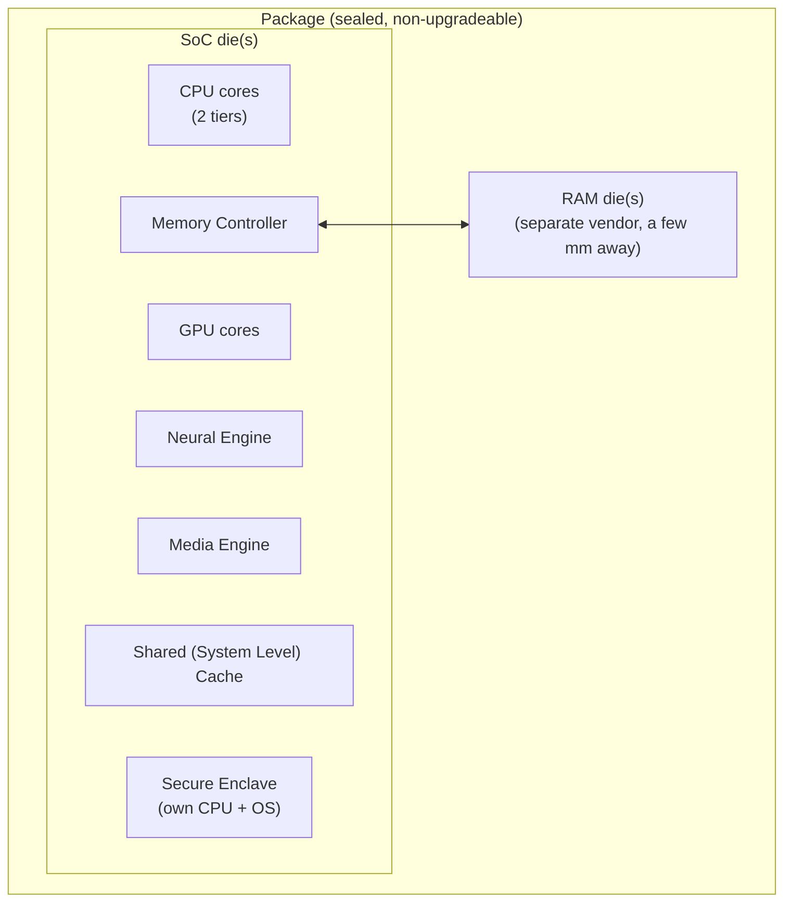

---

## 25. Cores & Clusters

### 25.1 What a core is

A **core** = one complete, self-sufficient machine for executing instructions: its own instruction-fetch logic, its own arithmetic units, its own small fast local memory. Cut off *all* communication to every other core, and a single core can still run a program to completion on its own.

### 25.2 What a cluster is

A **cluster** = a group of cores that **share one L2 cache**. On the reference M5 Pro: a cluster is **5 cores** (`sysctl hw.cpusperl2` reports 5). The chip has **3 clusters total**: one 5-core Super cluster (16 MB shared L2) and two 5-core Performance clusters (8 MB shared L2 each) = **15 cores** in 2 tiers.

**Why clustering matters:** two cores in the *same* cluster can pass data between each other through the shared L2 without ever touching main memory — much cheaper than a cross-cluster or off-chip round trip. Also: **frequency scaling is per-cluster, not per-core** — raising the clock of one Super core raises the clock of *all five* cores in that cluster simultaneously.

### 25.3 Core-tier naming — a moving target across generations

| Chip | Fast tier | Efficient/small tier |
|---|---|---|
| M1 / A14 | **Firestorm** | **Icestorm** |
| M2 (and A15-era) | **Avalanche** | **Blizzard** |
| A16 | **Everest** | **Sawtooth** |
| M1–M4 (public naming) | **Performance (P) core** | **Efficiency (E) core** |
| M5 (base, Oct 2025) | "Performance core" (fast tier — **kept the old name**) | (efficiency core) |
| **M5 Pro / M5 Max (Mar 2026)** | **"Super" core** (fast tier, renamed) | **"Performance" core** (**a brand-new**, different small-efficient design — reused the *old fast-tier name* for the *new small tier*) |

**This is a genuine naming trap:** on the base M5, "Performance core" = the *fast* tier. On the M5 Pro/Max released five months later, "Performance core" = the *small, efficient* tier — a completely different microarchitecture that just happens to share a name with the old fast tier. **Almost all public microarchitecture documentation (Dougall Johnson's tables, this note's own §30) is written against Firestorm specifically — i.e., the M1 fast core** — not "M1" generically, because the naming only stabilized retroactively. Always check *which silicon generation* a number is quoted for.

### 25.4 Unified naming vs. `sysctl`

`sysctl` on the M5 Pro reports core-tier names as literally `"super"` (×5) and `"performance"` (×10) — i.e., the kernel-facing name already reflects the *new* M5 Pro/Max scheme, not the historical P/E terminology.

---

## 26. Unified Memory Architecture

**One pool of physical memory, shared by every consumer on the die** — CPU cores, GPU cores, and the Neural Engine all read and write the *same* physical bytes at the *same* addresses.

**Contrast with a discrete-GPU PC:** there, the GPU has its **own** dedicated VRAM. Every texture and every frame has to be **copied** over a cable from main memory into VRAM before the GPU can touch it, and results have to be copied back. Apple Silicon eliminates that copy entirely — a shared buffer is written once by whichever side produces it and read directly by whichever side consumes it.

### 26.1 Bandwidth headroom, in practice

Apple's spec for the reference M5 Pro: **up to 307 GB/s** chip↔memory bandwidth. Sanity-check against a concrete real workload — driving an external 2560×1440 display at 120 Hz:

```
1 frame  = 2560 × 1440 × 4 bytes/pixel  ≈ 14.7 MB  (~15 MB)
1 second = 15 MB × 120 refreshes        ≈ 1.8 GB/s
```

**~1.8 GB/s is under 1% of the full 307 GB/s budget** — display output is a rounding error against total available bandwidth; the rest is free for everything else the machine is doing.

### 26.2 Real-world bandwidth vs. the spec sheet

Apple's bandwidth figures assume a **streaming** access pattern (large contiguous reads/writes). A university group (KTH Stockholm) measured real achievable bandwidth across the M1–M4 generations using the **STREAM** benchmark (large-array copy) and got results close to Apple's claims **only when the workload is actually streaming** — the base M4 hit ~100 GB/s, near its theoretical ceiling.

**But most real programs don't stream** — they touch a few bytes here, a few bytes there. For that access pattern, **latency**, not bandwidth, dominates: a wide road (bandwidth) doesn't make an individual short trip (latency) faster. This is exactly why the on-chip **cache hierarchy** (§31) — not raw memory bandwidth — is what most real-world Apple Silicon performance work actually optimizes for.

---

## 27. Design Philosophy: Wide and Slow

- Clock speed = ticks/second. Apple's Firestorm (M1) ran at **~3.2 GHz** in 2020, while contemporary Intel desktop chips reached **~5 GHz**.
- **Total throughput = clock speed × work-done-per-tick.** A 5 GHz core doing 4 instructions/tick = 20 billion instructions/sec. A 3.2 GHz core doing **8** instructions/tick = **25.6 billion instructions/sec** — the *slower* clock wins on raw throughput by doing more work per tick.
- **Power also favors the slower clock:** chip power draw grows **faster than linearly** with clock speed, so trading clock speed for width is a net power win, not just a throughput win.
- Apple's summary design philosophy: **"wide and slow"** — maximize instructions retired per cycle rather than cycles per second. This single decision cascades into nearly every other design choice covered below (bigger L1 caches to feed the wide front end, deep out-of-order windows to hide memory latency, aggressive branch prediction to keep a wide pipeline fed, etc.).

---

## 28. Inside the Core: The Six-Stage Pipeline

Dougall Johnson's framing (reproduced here paraphrased, as it's one of the clearest one-paragraph descriptions of a modern OoO core available): an **instruction** is one command ("add these two numbers," "load from this address," "branch if zero"); a **pipeline** is the sequence of stages an instruction passes through en route to completion — the same way a car passes through stations on a factory line, with a *different* instruction occupying each stage at any given moment.

| # | Stage | What happens |
|---|---|---|
| 1 | **Fetch** | Read the next few instructions from the L1 instruction cache |
| 2 | **Decode** | Figure out what each instruction is; turn it into one or more hardware-native **uops** (micro-operations) |
| 3 | **Map & Rename** | Assign each uop the physical registers it will actually use (register renaming — this is also where **fusion** and **elimination**, §17.4/17.5, happen for free) |
| 4 | **Dispatch → Schedule** | Uop enters a **dispatch queue**, then a **scheduler** (the "waiting room" holding uops until their operands are ready) |
| 5 | **Issue / Execute** | Once every input is ready, the uop leaves the scheduler and actually executes on an execution unit |
| 6 | **Retire** | The completed uop is marked done in the **reorder buffer**; retirement is released **strictly in program order**, even though execution (stage 5) can happen wildly out of order |

**Firestorm's headline number: 8 instructions/cycle** pipeline width (decode 8/cycle, retire up to 8/cycle) — roughly double the ~4-wide decode most contemporary (2020) desktop cores shipped with. Being twice as wide up front forces every downstream structure to be correspondingly larger: bigger L1 I-cache (§30), bigger dispatch queues/schedulers, more execution units, a deeper reorder buffer (§29).

---

## 29. Branch Prediction, Out-of-Order Execution & the Retire Queue

### 29.1 Why branches are the wide core's real enemy

**Roughly 1 in 5 instructions is a branch.** A wide, deep core cannot afford to sit idle waiting to *resolve* a branch (which may depend on a computation many stages back) — so it **predicts** which way the branch will go and speculatively keeps fetching/decoding/executing down the guessed path.

- The core keeps a short history of which way each branch went recently and predicts based on that pattern.
- **Correct guess (the overwhelming common case): free** — no cost, no stall.
- **Wrong guess: everything speculatively done down the wrong path is discarded**, and the pipeline restarts from the correct path. Firestorm's measured misprediction penalty: **~13–14 cycles**. At 8 instructions/cycle, that's **on the order of 100 instructions' worth of wasted work** thrown away per misprediction — which is exactly why prediction *accuracy*, not just prediction *existing*, is the thing that matters at this pipeline width.

### 29.2 Out-of-order execution — the core rule

If instruction 1 is a cache-missing load (~100 ns to resolve) and instructions 2–4 are independent additions that don't depend on that load, an in-order core stalls on instruction 1 before touching 2–4 at all. Firestorm's scheduler instead **issues 2–4 immediately** while instruction 1's load is still in flight — this is out-of-order **execution**.

**The one inviolable rule: the program must never be able to observe that this happened.** If instruction 1 (the load) turns out to fault (bad address), the program must see *that* fault before it ever sees the effects of instructions 2–4 — even though 2–4 may have *finished executing* well before the fault was detected. The mechanism: instructions 2–4 complete their arithmetic and sit in the **reorder buffer (ROB)**, but are **not retired (released)** until instruction 1 retires first, in original program order. **Execution is out of order; retirement is always in order; the program is only ever allowed to observe the in-order version.**

### 29.3 The scheduler/dispatch-queue hierarchy (empirically mapped)

Measuring buffer sizes on real silicon works by deliberately starving a resource: fill a scheduler/queue with a known number of dependent operations between two long-latency chains, and find the exact count at which the second chain's completion starts being delayed — that count *is* the buffer's capacity. Two-level structure, confirmed by this method:

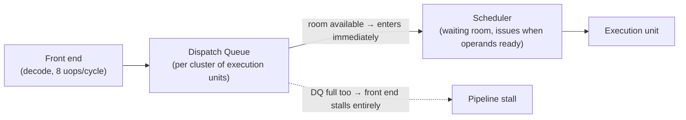

- If an op can enter a **scheduler**, it leaves and executes the instant its dependencies are ready.
- If it can enter a **dispatch queue** (but the scheduler is full), the front end keeps moving — dispatch queues buffer ahead of a busy scheduler.
- **Only when *both* the dispatch queue *and* the scheduler for a given class of op are full does the whole front end stall** — no further uops of *any* kind can enter *any* dispatch queue until room frees up. This is why a single saturated resource can stall unrelated, independent work.
- Measured concretely: the **load/store scheduler has 48 entries, fed by a 10-entry dispatch queue** — exactly matching the "Scheduler (48 Entry)" / "Dispatch Queue (10 Entry)" block in the Firestorm pipeline diagram (§30).

### 29.4 Retirement is not a flat queue — it's a coalesced, two-structure design

- **Coalesced Retire Queue (~330 entries):** uops retire in **groups of up to 7**, not one at a time. Uops that can *fail before* retiring (memory accesses) must sit at the **start** of a group; uops that can fail *after* retiring (conditional branches) must sit at the **end**. Full 7-uop groups only occur for **eliminated** instructions (`nop`, register-renamed `mov`s); groups containing real executing work cap out around **4 uops/group** in practice.
- **Rename Retire Queue (~623 entries)** — a separate structure (a.k.a. "History File" per Maynard Handley's patent-reading) tracking every write to an **architectural register**, regardless of whether the writing instruction itself was "eliminated." This is what makes late/undo-able register renaming possible — every remap gets an entry here so it can be unwound on a misspeculation that isn't covered by a full pipeline-flush checkpoint.
- **Combined effect:** ~1000+ instructions can be in flight (started, not yet retired) at once — described as the core being "**deep**." Retirement rate: up to **8 coalesced-retire-queue entries/cycle**, or up to **16 rename-retire-queue entries/cycle**.
- **Loads/stores can complete out of order** once non-speculative — i.e., architectural state can advance past a store's effects before that store has *formally* retired through the ROB in strict order. Subtle but important for anyone reasoning about memory-visibility timing.

### 29.5 What Maynard Handley's patent-reading adds (worth knowing, not in Dougall's public tables)

From detailed public-patent analysis of Apple's scheduler design (contributed as commentary on Dougall's measurement post — treat as informed inference, not confirmed spec):

- Apple's schedulers are believed to use an **age matrix** rather than a physically-shifting queue: a low-power structure that tracks *relative* temporal ordering of entries without the expensive "collapse and shift everyone down" cost a literal FIFO queue would pay every time a middle entry is scheduled out.
- **Zero-cycle tricks done at Map/Rename, not Execute** are a recurring Apple design signature: zero-cycle `MOV` (register-ID remap), zero-cycle `MOV #imm` (immediate baked into rename), and a **zero-cycle load** (if a load's address matches a very recent store to the same address, the load is satisfied by remapping to the store's *source register* instead of touching memory or even a load unit at all).
- **Non-speculated branches "execute" at Decode**, not in an integer pipe — an unconditional `B` never occupies an integer execution port at all, only a fetch-redirect + a token ROB slot.
- **Branch-predictor update is slow and rate-limited**, and deliberately decoupled from the main (fast, accurate) predictor: speculative branch outcomes are held in **side storage** and only get folded into the primary predictor tables **after that branch retires** (to avoid poisoning the predictor with never-actually-taken speculative paths). Handley's own measurement: this integration runs at roughly **one update per 3 cycles**, and the side-storage capacity is on the order of ~700 tentative branches in the best case (much less if many branches alias to the same storage bank) — meaning **sustained high branch density over thousands of cycles can itself become the bottleneck**, independent of prediction *accuracy*. Practical implication for hand-tuned hot loops: prefer predicated/`CSEL`-style branchless code over long runs of frequent taken branches, not just because of misprediction risk, but because of this separate, much-less-publicized *integration-bandwidth* limit on the predictor itself.


---

## 30. Firestorm Reference Card — Extended *(deepens §17)*

Cross-checked against a **second, independent** black-box measurement effort (a separate uops-style writeup) — the two sources agree on the broad shape, which is good corroboration for otherwise-undocumented silicon.

### 30.1 Execution-port naming, two ways

| Dougall's numbering | Independent naming | Handles |
|---|---|---|
| Unit 1 | X0/X1-class | ALU, shift, flags, branch, ADR, `MRS`/`MSR` NZCV |
| Unit 2 | X1-class | + indirect branch, PTRAUTH |
| Unit 3 | X2-class | ALU/flags + mov-from-SIMD |
| Unit 4 | X3-class | ALU + mov-from-SIMD |
| Unit 5 | X4-class | ALU, **MUL, DIV** |
| Unit 6 | X5-class | ALU, MUL, **MADD**, CRC32, BFM/EXTR |
| Units 7–10 | — | 4 load/store units: 2 pure load, 1 pure store, 1 combined load/store (all with integrated 128-bit-wide AGUs, simple offset forms free, pre/post-index costs +1 uop for the writeback) |
| Units 11–14 (V0–V3) | — | 4 FP/SIMD units, all handling most arithmetic; unit 14/"V0" is the **only** unit with divide, reciprocal/rsqrt estimate, flag-setting FP compare, crypto (SHA), and the JS-style `FJCVTZS` conversion |

**Independent source's throughput/latency summary (scalar domain, per-unit):** all 6 integer units do add/sub/logic/shift/CTZ/REV in **1 cycle**; only 2 of the 6 (mapped to Dougall's units 5/6) carry multiply, and only **one** of those two carries divide; conditional-flag-setting ops (`adds`/`ccmp`/branch-with-link) are restricted to **3 of the 6** units, not all six.

**SIMD/FP domain (scalar-to-vector and back):** forward transfer (scalar→SIMD, e.g. `FMOV`) rides on a **load-unit** slot and costs nothing extra if it fuses with the next op; reverse transfer (SIMD→scalar) uses a dedicated path plus several scalar-domain slots. Round-trip latency: **~6–7 cycles** each direction — a real cost to keep in mind for code that ping-pongs values between integer and vector registers (e.g. dense flag-heavy SIMD compare loops).

### 30.2 Cache & memory-hierarchy latency table (measured, Firestorm/M1)

| Level | Size | Latency |
|---|---|---|
| L1 Data Cache | 128 KiB, 8-way | **3 cycles** (simple pointer deref) / **4 cycles** (address needs extra ALU work first) |
| L1 Instruction Cache | 192 KiB | feeds 8 instructions/cycle |
| L2 Cache (per cluster) | up to 12 MiB (4-core M1 cluster; 16 MiB/8 MiB on the M5 Pro's 5-core clusters, §25) | **~15–18 cycles** |
| System Level Cache (SLC, whole-chip shared) | — | **~9 ns ≈ 30 cycles** |
| Main memory (LPDDR, package-adjacent) | — | **~90 ns ≈ 300 cycles** ≈ **~2,000 instructions'** worth of potential work at 8/cycle |

**TLB (address-translation cache) — 16 KiB page mode:**

| Structure | Capacity | Miss penalty |
|---|---|---|
| L1 Data TLB | ~160 entries | 6 cycles |
| L2 TLB | ~3K entries | ~26 cycles (page walk into L2 cache) |
| Page-directory cache | covers ~768 MB (24 × 32 MB blocks) | adds ~24 cycles on a miss |

**Working-set-size sweep (measured latency by footprint, Firestorm):** latency stays flat (~3 cycles) up to ~128 KB (fits L1D), jumps at 256 KB (L2 kicks in, +~15 cycles), stays roughly flat through several MB (still inside L2), jumps again around 16–32 MB (SLC/RAM territory, +tens of ns), and by 1–2 GB working sets you're paying full RAM latency **plus** page-directory-cache misses on top. **The concrete lesson for hot-path data-structure design: know which cache level your working set fits in, because crossing a boundary costs far more than the raw byte-count difference would suggest.**

### 30.3 Instruction-table shape (from the ~35,000-experiment public tables)

Every instruction entry records four numbers: **latency** (cycles until the result is ready), **throughput** (cycles/instruction in steady-state back-to-back issue), **uop count**, and **which unit(s)** it can run on. Representative entries (illustrative, not exhaustive):

| Instruction | Latency | Throughput | Uops | Notes |
|---|---|---|---|---|
| `ADD` (register, no shift) | 1 | 0.167 (≈6/cycle across all 6 int units) | 1 | Any of units 1–6 |
| `ADD` (with shift) | 2 | 0.333 | 1 (but **2 issues**) | Shift folded in, doesn't cost a separate uop, but does cost an extra *issue slot* — this is the "11 issues/cycle in contrived cases" phenomenon |
| `MUL` | 3 | 0.5 | 1 | Only 2 of 6 int units |
| `SDIV`/`UDIV` (32-bit) | 7 (fast path) – 9 (slow path) | 2 | 1 | Only 1 of 6 int units; data-dependent latency |
| `LDR` (simple offset) | ≤4 | 0.333 | 1 | Load units only |
| `STP`/`LDP` | 0.5 (store) / ≤4 (load) | 0.333–0.5 | 1–2 | Pre/post-index adds a uop for address writeback |
| `NOP` | — | 0.125 (8/cycle) | 1 but **never issues** | Fully eliminated |
| `MOV` (register, 64-bit) | — | 0.125 | 1, **eliminated via renaming** | Capped ~2 eliminations/8 instructions for immediate-load `MOV`s |
| `PAC*`/`AUT*` (pointer-auth sign/verify) | **7** | 1 | 1 | Single unit (unit 2) — meaningfully more expensive than plain ALU ops, a real cost of arm64e (§36) |
| `CRC32` | 3 | 1 | 1 | Single unit (unit 6) |
| `CASAL`/`SWPAL` (atomic RMW, acquire+release) | up to **18** | 4–6 | — | Atomics are dramatically more expensive than a plain load/store — a good reminder of why lock-free code still isn't "free" |

**Practical takeaways codified by the table:**
- **Fusion** (compare+branch, add+cbz, AES pairs, …) turns 2 program instructions into 1 core-internal operation during decode — free speedup the compiler/programmer gets by writing the idiomatic adjacent-instruction pattern.
- **Elimination** (register-to-register `MOV`, zeroing `MOV`/`MOVI`, `NOP`) costs **zero** issue-port bandwidth — handled entirely by renaming at Map/Rename.
- Divide and pointer-authentication instructions are the standout *expensive* single-uop operations — worth knowing when eyeballing disassembly for a hot loop.

### 30.4 7-Zip benchmark, for a feel of real aggregate throughput (M1, 8 threads)

| Metric | Compressing | Decompressing |
|---|---|---|
| Single-thread MIPS (normalized) | ~7,900 | ~8,000 |
| 8-thread aggregate MIPS | ~6,100 | ~5,700 |
| Single-core clock during test | ~3.2 GHz | ~3.2 GHz |

(MIPS here is 7-Zip's own normalized benchmark unit, not literal millions-of-instructions/second — useful only as a relative cross-chip comparison point, not an absolute instruction-rate figure.)

---

## 31. Memory Hierarchy — Summary Diagram

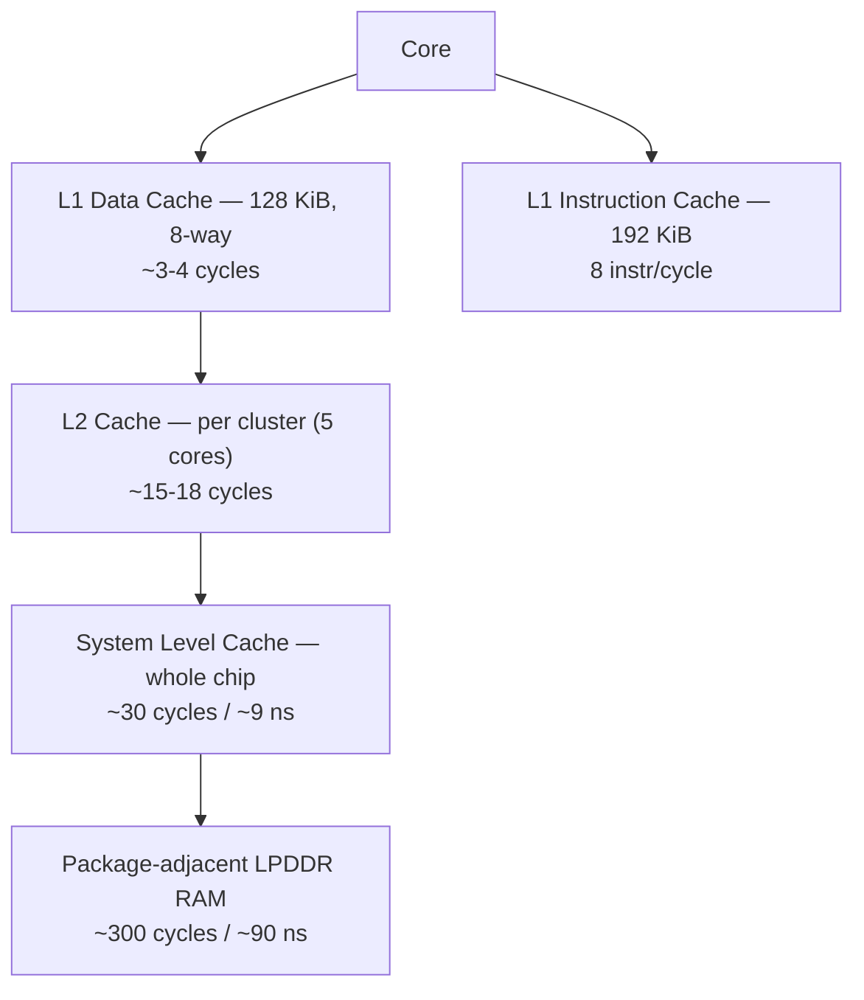

**Rule of thumb this table teaches:** each layer down costs roughly **5-10x** the layer above it. A single cache-missing load that falls all the way to RAM burns roughly **2,000 instructions'** worth of potential work at Firestorm's 8/cycle rate — which is *exactly* why the core needs a ~1,000-instruction-deep out-of-order window (§29.4): it exists specifically to have enough independent work in flight to hide one such miss.

---

## 32. Pages, TLBs, and the Practical Fallout of 16 KiB Pages

### 32.1 Why 16 KiB (Apple has never confirmed this publicly — but the arithmetic is compelling)

A page-table lookup happens on **every single memory access**, so its cost scales with entry count:

| Page size | Entries to cover 1 MB | TLB pressure |
|---|---|---|
| 4 KiB (traditional) | 256 | baseline |
| **16 KiB (Apple Silicon)** | **64** | **4× fewer entries** to walk and to cache |

Given Apple's whole design axis is "**do more work per cycle, minimize round trips**" (§27), cutting page-table lookups 4× is squarely in line with that philosophy. **Trade-off:** more wasted space per allocation — a 1-byte allocation still consumes a full 16 KiB page (worst case ~16,383 bytes wasted; compare ~4,095 bytes worst case at 4 KiB pages).

### 32.2 What actually broke when the page size changed (real cross-platform software fallout)

| Area | What broke | Why |
|---|---|---|
| **`mmap`** | Offsets had to become multiples of 16 KiB on Apple Silicon (still 4 KiB elsewhere) | `mmap` operates in page-size units; hardcoded 4 KiB assumptions in cross-platform code failed outright on the new page size |
| **Memory allocators** | Internal size-class tuning, built around 20 years of a 4 KiB assumption, needed re-tuning | Allocators manage memory per-page; page-size-naive size classes waste more space or behave incorrectly at 16 KiB |
| **Reported memory usage** | A small process could *appear* to use ~4× more memory on Apple Silicon than the identical process on a 4 KiB-page system | "Memory touched" is measured in whole pages; the same logical footprint now rounds up to 4× as many bytes minimum |

This is a genuinely useful three-item checklist for anyone porting low-level, page-size-assuming code (allocators, mmap-based file I/O, memory-mapped databases) to Apple Silicon.

---

## 33. Cache Lines & False Sharing

- A **cache line** is the actual unit a cache moves in and out as a whole — **128 bytes** on Apple Silicon (vs. the more common **64 bytes** on most Intel chips).
- **Concrete false-sharing scenario:** two threads on two different cores each maintain their own independent counter. If the compiler/allocator happens to place those two counters only ~40 bytes apart, they land on the **same 128-byte cache line** even though the threads never logically touch each other's data. Every write by core A invalidates core B's cached copy of that line (and vice versa) — the two cores end up **fighting over ownership of one cache line**, even with zero actual data dependency between them.
- **Fix:** pad/align independent per-thread hot data to at least the cache-line size — **128 bytes** on Apple Silicon, not the more commonly assumed 64 bytes. Code ported from x86 that pads to 64 bytes ("standard" cache-line padding) is **insufficient** on Apple Silicon and can still false-share.

---

## 34. Memory Bandwidth, Zero-Copy Buffers & Metal Storage Modes

### 34.1 Bandwidth scaling across the M1 family (illustrates die/package scaling, not just clock speed)

| Chip | Memory bandwidth | How it got there |
|---|---|---|
| M1 | 68 GB/s | baseline single die |
| M1 Pro | 205 GB/s | wider memory bus (not a 2nd die) |
| M1 Max | 410 GB/s | wider bus again |
| M1 Ultra | 819 GB/s | **two M1 Max dies fused** (UltraFusion) |
| M5 Pro (2026 reference machine) | up to 307 GB/s | Fusion Architecture (two dies, §24) |

### 34.2 Zero-copy via `MTLStorageMode`

Because CPU and GPU share one physical memory pool, a buffer can be made **directly visible to both sides with no copy operation at all** — the program allocates a buffer, marks it shared, and both the CPU and the GPU read/write the same bytes at the same address. Metal exposes this as a per-resource **storage mode**:

| Storage mode | Meaning |
|---|---|
| **Shared** | CPU and GPU both read/write the same physical bytes directly — the zero-copy case |
| **Private** | Only the GPU may touch it — lets the hardware rearrange data into whatever internal layout is fastest for rendering, at the cost of CPU visibility |
| **Managed** | A holdover from Intel Macs with a discrete GPU and separate VRAM — required explicit CPU↔GPU sync calls. **On Apple Silicon this mode exists only for API compatibility and has no real hardware meaning** — there's only one memory pool to begin with |
| Memoryless *(not covered in the video, but relevant)* | Tile-only, never materialized in main memory at all — see the GPU tile buffer (§38) |

---

## 35. Memory Ordering: TSO vs. ARM's Relaxed Model, and the Rosetta 2 TSO Switch

### 35.1 The classic reordering example

```
Initially: X = 0, Y = 0
Thread A (core A):  write 1 → X;  then read Y
Thread B (core B):  write 1 → Y;  then read X
```

Naively ("memory is one shared notebook"), at least one thread must observe the other's write — both reading 0 seems impossible. But real cores don't write straight to shared memory: each core has its own **store buffer**, and the actual write to shared memory lands *later*. So core A can write X into its own store buffer and then read Y from memory *before* core B's write to Y has left *its* store buffer — and symmetrically for core B. **Both threads can legitimately observe 0** despite both writes having "already happened" from each writer's own point of view. **This is memory reordering**, and essentially every modern CPU does it — the alternative (blocking until every write physically lands before continuing) would defeat the entire point of the low-latency, out-of-order machinery discussed above.

### 35.2 Memory models: how much reordering is allowed

| Model | Who uses it | What it allows |
|---|---|---|
| **TSO (Total Store Ordering)** | Intel/x86 | Only **one** kind of reordering: a later read may pass an earlier write. Every other ordering is preserved |
| **Relaxed / weak ordering** | ARM (Apple Silicon) | **All four** combinations can reorder: read-past-read, read-past-write, write-past-read, write-past-write |

Code written assuming x86's TSO guarantees will occasionally observe out-of-order values when run natively on ARM's weaker model — a real, silent correctness hazard for naively-ported lock-free code.

### 35.3 How Rosetta 2 fakes TSO on ARM hardware

Apple Silicon cores physically implement **both** memory models and expose a **per-thread kernel-settable switch** to force TSO ordering. **Rosetta 2 turns this switch on for every translated Intel binary** — giving translated x86 code the memory-ordering guarantees it was compiled assuming, while still running on the (structurally weak-ordered) native ARM hardware.

**Measured cost of the TSO switch** (Leibniz University group, M1 Ultra, comparing the *same native* program with the switch forced on vs. off): **TSO mode averaged ~8.94% slower.** Test methodology: one writer thread repeatedly writes an incrementing counter across every slot of an array; a reader thread checks two adjacent slots (later slot read *before* earlier slot) and asserts the later value is never observed ahead of the earlier one.
- Compiled for **ARM natively → runs directly**: the assertion **fails almost immediately** (weak ordering lets the reader see values out of sequence).
- Compiled for **Intel → routed through Rosetta 2**, which flips the TSO bit: the assertion **never fails** — the ARM silicon, with the switch flipped, genuinely behaves like an Intel core memory-ordering-wise while still running native machine code at native ARM speed.

---


## 36. Pointer Authentication (PAC) & `arm64` vs. `arm64e`

### 36.1 The threat model

A **pointer** is just a number naming a memory address. A classic exploitation technique overwrites a stored pointer (e.g. a function's return address) so that control flow jumps somewhere the attacker chose.

### 36.2 The mechanism (Apple Silicon since 2018)

A 64-bit pointer doesn't need all 64 bits for addressing — no Mac has anywhere near 2^64 bytes of memory, so the unused top bits are repurposed to hold a **cryptographic signature**.

- When the program stores a sensitive pointer (a return address, a function pointer, an Objective-C method-cache entry), the core **signs it** using a secret key **only the core itself knows**, writing the signature into the unused top bits.
- Before jumping through that pointer, the core **re-checks the signature**. A tampered pointer's signature won't match, and the jump is **aborted**.
- **Five separate secret keys** exist, one per pointer *kind*, each combined with a context-specific **salt** (extra signing material) — so a signature captured from one context is useless if replayed in another:
  - A return address is signed with its key **plus the address of the stack slot it lives in**.
  - A function pointer is signed with its own key.
  - An Objective-C method-cache entry is signed with its key **plus the class plus the selector**.

### 36.3 `arm64` vs. `arm64e`

| Mode | Pointers | Who uses it |
|---|---|---|
| **`arm64`** (plain) | Ordinary numbers, unsigned | Third-party apps — the signed binary format hasn't been opened to external developers, so anything you build and distribute yourself runs unsigned |
| **`arm64e`** (signed) | Top bits carry a PAC signature | Apple's own system software and every pre-installed/built-in app |

**Debugging implication:** attaching a debugger to an `arm64e` process means you must **strip the signature bits** out of any pointer value before you can follow/dereference it meaningfully.

**Inspecting which mode a binary uses** — `lipo`, from the video's own reference toolset:

```bash
lipo -info /Applications/Ghostty.app/Contents/MacOS/ghostty
# Architectures: x86_64 arm64          <- third-party app: plain arm64

lipo -info /System/Applications/Utilities/Terminal.app/Contents/MacOS/Terminal
# Architectures: x86_64 arm64e         <- Apple's own app: signed pointers
```

**Performance cost, quantified (§30.3):** `PAC*`/`AUT*` sign/verify instructions measure at **~7-cycle latency**, single-unit issue — noticeably more expensive than a plain ALU op. This is a real, small, constant per-pointer-touch tax `arm64e` pays for its added security guarantee.

---

## 37. NEON, AMX, and SME

### 37.1 NEON — the baseline vector unit

Every ARM core (including Apple's) has wide **NEON** vector registers: **128 bits** wide. One NEON instruction can, e.g., add four 32-bit numbers or process 16 bytes at once — this is what "vector instruction" means (one instruction, many values simultaneously), and it's the mechanism behind fast video encoding and image filtering.

**Apple's Achilles' heel here, historically:** Intel had **256-bit and 512-bit** vector units for years before Apple Silicon shipped. Per-instruction, a single Apple core's 128-bit NEON is *narrower* than those Intel units. **Apple compensates with width, not per-instruction size** — Firestorm issues from **4 separate SIMD/FP units simultaneously** (§30.1), so aggregate vector throughput per core competes even though each individual instruction covers fewer bits.

### 37.2 AMX — the reverse-engineered matrix coprocessor (2020–2023 era)

- **AMX = Apple Matrix coprocessor**, a separate unit sitting **beside each core cluster** (not inside an individual core), dedicated to matrix multiply/accumulate.
- **Discovered by reverse engineering**, not documented: Dougall Johnson noticed Apple's own **Accelerate** math framework was issuing instructions that **do not exist in any published ARM manual** — the tell that a hidden, proprietary unit existed.
- **How its power draw was confirmed (Howard Oakley, M3 Pro, using `powermetrics`):**

| Workload | Measured power (1 core) |
|---|---|
| Plain scalar floating-point loop | ~1 W |
| NEON vector code | ~2.5 W |
| **Accelerate matrix multiply (this thread)** | **~8 W**, with GPU and Neural Engine both idle |

  Since the core's normal floating-point/vector draw tops out around 2.5 W, and the GPU/Neural Engine were both confirmed idle at the time, **the remaining ~5.5 W had to be a fourth, otherwise-unaccounted-for unit** — the AMX coprocessor. This is a clean example of the "measure what it costs" technique (§22) applied to power draw instead of latency/throughput.

### 37.3 SME — AMX made official (M4 onward)

Starting with the **M4**, the matrix unit became a **standard, publicly documented ARM feature: the Scalable Matrix Extension (SME)**, and from **M5** it's **SME2** — on the reference M5 Pro, `sysctl` reports a **streaming vector length of 64 bytes (512 bits)** — **4× the width of one NEON register**.

**The direct consequence of AMX → SME:** every program that reverse-engineered AMX and called its undocumented instructions **directly** broke the moment M4 shipped with a new, incompatible official instruction set. Programs that instead called the **official Accelerate API** kept working unmodified — Apple simply rewrote Accelerate's internals to target the new SME hardware, and callers never noticed.

**The explicit lesson the video draws from this:** *always prefer the documented interface.* Hardware can — and, per Apple's own history here, **will** — change without notice; only the API contract is stable. (This doesn't mean reverse engineering is pointless — it's how AMX's existence and behavior were understood *at all* — but production code should not build directly on undocumented instruction encodings.)

**Active research area, still evolving (2026):** hand-written kernels talking to SME directly can still **beat** Accelerate's own SME-based implementation — one June 2026 paper on LLM matrix-multiplication kernels measured a **~23% speedup** on M4 from a hand-tuned SME kernel vs. the default Accelerate path. The trade-off from §37.3's lesson still applies: that speedup is earned at the cost of re-accepting the same "breaks on the next hardware revision" risk that killed the original AMX-direct programs.

---

## 38. GPU Recap: Tiles, the Tilebuffer & the AGX Firmware Coprocessor *(extends §18)*

### 38.1 Tile-based deferred rendering, restated with concrete numbers

- **Immediate mode** (old desktop GPU pattern): run the vertex program per triangle corner, then immediately run the pixel program, writing directly into the framebuffer in main memory — repeated per triangle, constant memory traffic. Fine when you have a dedicated graphics card with its own memory and a fan.
- **Tile-based deferred rendering** (Apple's GPU lineage, inherited from iPhone): the screen is cut into small tiles — concretely, on the video's own display, **80 tiles across × 45 down = 3,600 tiles** (32-pixel-square tiles, though Apple has never published the exact size; treat the number as illustrative/measured, not an official spec). **Deferred** = the GPU first runs *every* vertex program for the *whole frame*, works out which tiles each triangle touches, and only then processes pixels tile-by-tile — writing each finished tile out **once**. Each tile is composited inside a **tilebuffer**: a few kilobytes of very fast on-chip memory. Writes and blending inside the tilebuffer are extremely cheap because they never leave the GPU.

### 38.2 Why the buffer-overflow bug (§18.4) happens at all — restated with the exact mechanism

Because *every* vertex program for the whole frame runs before *any* pixel program, the GPU needs somewhere to **park** every vertex program's output until the pixel pass needs it — a memory buffer with a finite size. When a detailed model's total per-vertex data crosses that buffer's size, the GPU **must** do a partial render (§18.3) — and a driver that doesn't correctly implement the reload-after-partial-render path will fault, exactly as Alyssa Rosenzweig's Asahi driver initially did.

### 38.3 The deeper discovery: the GPU is not a normal GPU — it's driven by its *own* firmware computer

Building on the tile-buffer bug, a second Asahi contributor (**Asahi Lina**) reverse-engineered what's actually on the other end of the GPU's command stream, and found something structurally different from a typical desktop GPU:

- The GPU contains a **coprocessor**: a **full ARM64 processor running Apple's own real-time operating system**, which is in charge of scheduling, power management, fault recovery, and even performance-counter collection **for the GPU itself**.
- **The macOS kernel driver never talks to the raw graphics hardware directly.** It talks to this **coprocessor**, via roughly **100 distinct shared-memory data structures** that Lina identified by tracing.
- **The mental model this forces:** *"the driver is not programming the hardware — it is writing a program for the firmware to run on top of."* Concretely, Apple's own driver builds small **command sequences** (in the Asahi Linux tree, the file that constructs these is literally called `microseq`) that the GPU's firmware coprocessor then interprets — a level of indirection well beyond "submit a command buffer to a GPU," closer to "hand a script to a second, GPU-embedded operating system."
- **Practical consequence for the reverse-engineering/open-driver effort:** the Linux driver had to replicate this same protocol — talk to the *same* firmware coprocessor the same way, via the same style of shared-memory command structures — rather than driving the silicon directly. Lina's implementation was, at the time, one of the **first Rust drivers of its kind merged into the Linux kernel**, and the ~1,000-field `initdata` initialization structure she had to reverse-engineer gives a sense of how much undocumented state this handshake actually involves.

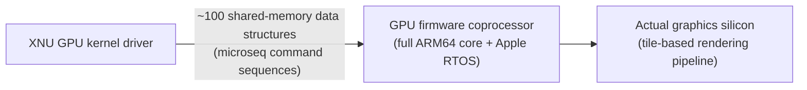

This pattern — a full embedded processor + its own OS interposed between the main kernel driver and the "real" hardware — is the same pattern the boot chain (§40) and the Secure Enclave (§39.3) both also use. It is arguably the single most distinctive architectural signature of Apple Silicon as a whole: **almost nothing talks to raw silicon directly; nearly everything talks to a small dedicated firmware computer that talks to the silicon.**

---

## 39. The Other Engines: Neural, Media, Display — and the Secure Enclave

### 39.1 Fixed-function engines (each its own small computer with its own firmware)

| Engine | Job | Access path |
|---|---|---|
| **Neural Engine** | 16 cores; low-precision multiply-accumulate arithmetic at very low power | **Only** through Apple frameworks (Core ML, and newer ML APIs) — no direct public access |
| **Media Engine** | Dedicated silicon for video decode/encode: H.264, HEVC, ProRes, ProRes RAW; **AV1 decode added on M5** | Used transparently by any video playback/export — **no core cycles spent** on video codec work at all |
| **Display Engine** | Pulls finished frames out of memory and drives them down the cable to the physical panel | Transparent to software |

**Every one of these — Neural, Media, Display, and the GPU (§38) — is its own small computer with its own firmware, loaded at boot time, alongside the main CPU cluster's own boot.** Booting macOS means booting **roughly a dozen small computers simultaneously**, each running an OS you will never directly see.

### 39.2 The Secure Enclave — what it is

A **coprocessor** (same "separate small computer" pattern as everything else on the die) that holds **every secret on the Mac**: your login password material, FileVault disk-encryption keys, Touch ID fingerprint templates. It has its own **Boot ROM, random-number generator, and encryption engine**, entirely separate from the main CPU's.

**Protocol:** the main CPU never gets direct access to a secret. It sends the Secure Enclave a *value to compare* (a password attempt, a fingerprint sample) and receives back only a **match / no-match** answer — the actual key material never crosses into main-CPU-visible memory.

### 39.3 How isolation actually works, given it's on the same die and same RAM

The Secure Enclave operates out of a **dedicated, encrypted region of main memory**. A hardware unit sits **between the Enclave and memory**:

- **On write:** encrypts every block with a key generated fresh at boot, known to **no one** — not Apple, not even the Enclave's own software.
- **On read:** verifies the block hasn't been tampered with; if verification fails, the **Enclave stops answering all requests until the Mac reboots**.
- **Every chip has a unique key fused in at manufacture, generated *inside* the Enclave itself** — never seen by Apple. Every other on-device key is derived from that one fused key. **This is literally why you cannot move a disk to a different Mac and read its encrypted contents** — the unlocking key is physically soldered into the original die and nowhere else.

### 39.4 SEPOS

The Secure Enclave's OS is a **customized L4 microkernel** — genuinely unrelated to Darwin/XNU, an entirely different, extremely small, heavily researched kernel family (§6.1's L4 discussion is the *same* L4 lineage). Apple's public name for it: **SEPOS**. Enclave-side applications (fingerprint matching, the Key Store) run as **separate processes** under SEPOS. *(Jonathan Levin's Volume II covers SEPOS in dedicated depth — see the book map, §47.)*

---

## 40. Boot Chain: Boot ROM → LLB → iBoot → LocalPolicy → Signed Kernel

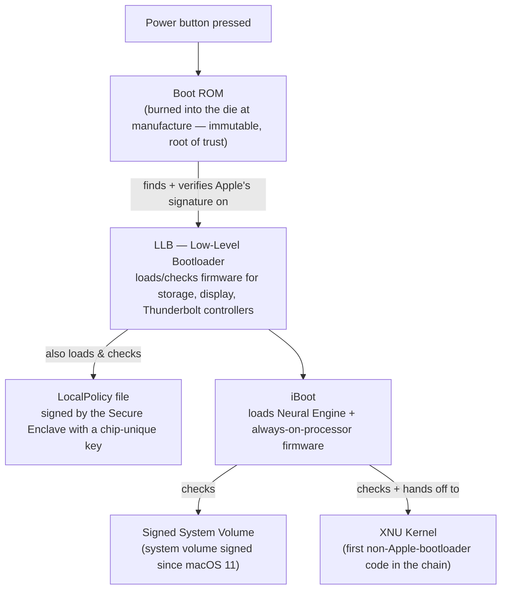

- **Boot ROM:** immutable, fused into the die at manufacture — the hardware root of trust. Its only job: find the next stage on disk, verify Apple's signature on it, and run it.
- **LLB (Low-Level Bootloader):** loads and checks firmware for the *other* small computers on the die (storage controller, display, Thunderbolt) before handing off.
- **LocalPolicy:** records the Mac's chosen security posture. **Signed by the Secure Enclave** using a key that exists only inside that specific chip — a policy file copied from a *different* Mac, or an *older/expired* one (the Enclave tracks a **monotonic counter** the file must match), will simply be refused. **You cannot downgrade a Mac's security by replaying an old settings file** — this is enforced cryptographically, not just by UI policy.
- **iBoot:** loads Neural Engine + always-on-processor firmware, verifies the kernel, hands off. **The kernel is the first component in the entire chain that is not one of Apple's own bootloaders.**
- **Signed System Volume (SSV):** since macOS 11, the entire system volume (the disk partition holding macOS itself) is cryptographically signed, not just individual executables.

### 40.1 Security levels (Startup Security Utility / `bputil`)

| Level | What it allows | How to set |
|---|---|---|
| **Full Security** (default) | Only macOS builds individually signed by Apple for *this specific chip's unique identifier* may boot | Startup Security Utility, in Recovery |
| **Reduced Security** | Accepts Apple's more general (non-chip-specific) signature — required to run an **older** macOS version, or to load a **third-party kernel extension** | Startup Security Utility, in Recovery |
| **Permissive Security** | Boot things signed **locally** by this Mac's own Secure Enclave | **Not reachable from System Settings at all** — command-line only, via `bputil`, from Recovery |

**Reaching Recovery on Apple Silicon:** hold the power button. Apple deliberately requires this **physical, human action** — the video's `bputil` man-page reference calls the state you land in **"One True Recovery,"** specifically so that **no software path can trigger a security downgrade automatically** — a deliberate anti-remote-exploitation design choice at the firmware level.


## 41. Scheduling in Practice: QoS, and Why E-Cores Make Macs *Feel* Fast

*(Source: Howard Oakley, "Why E cores make Apple silicon fast," Eclectic Light Company — extends the P/E-core material in §25.)*

### 41.1 The visual, from a cold boot

Opening Activity Monitor's **CPU History** window right after a cold boot shows the **E-cores** as a solid wall of red/green activity for the first 5–10 minutes — Spotlight indexing, `mediaanalysisd`, `BackgroundShortcutRunner`, Siri components, the initial Time Machine backup pass, an XProtect malware-remediation scan — while the **P-cores sit almost completely idle**. This is the system working *as designed*: dive straight into a foreground app during this window and it gets the P-cores essentially uncontested.

*(See `handecpuhistory.jpg`: a 14-core CPU History grid where the four Efficiency-core panes are densely packed with red/green activity blocks, while the ten Performance-core panes are almost entirely black — a handful of sparse marks near the bottom edge. This is exactly the cold-boot pattern described above, captured live.)*

### 41.2 QoS (Quality of Service) — the mechanism, not just the vibe

QoS has existed since **OS X 10.10 Yosemite** (2014), but only became *architecturally central* once Apple Silicon's asymmetric P/E cores needed a policy for **which core tier** a thread should run on — a problem that doesn't really exist on a machine where every core is identical.

**The core rule, confirmed by direct experiment** (`taskpolicy` used to force a workload to run at background QoS, then watching which cores actually light up):
- **Foreground threads** preferentially run on **P-cores** when available, but **can spill onto E-cores** when necessary.
- **Background threads are *not* normally allowed onto P-cores at all** — even if they're being delayed by contention on the E-cores they're restricted to. This was confirmed empirically: repeated attempts to force a low-QoS thread onto a P-core using `taskpolicy` **never succeeded**, no matter how starved the E-cores were.

**Why the asymmetry is deliberate, not a missing feature:** if background work *could* freely spill onto P-cores, the entire foreground/background, P-core/E-core distinction collapses — user-facing apps would start competing with background maintenance work for the fast cores, and battery life would suffer. The strict one-way rule (foreground can use either tier; background is capped to E-cores) is what actually delivers the "backgrounded work never touches the app you're using" experience.

### 41.3 The visualization trap — a documented, unaddressed Apple deception (Oakley's words, paraphrased)

Activity Monitor reports **"% active residency"** — the percentage of cycles a core spent doing work rather than idling — **identically for both core tiers**, with no adjustment for the fact that the tiers run at wildly different clock speeds while "active."

**Measured (M4 Pro, via `powermetrics`):**

| Core tier | Typical frequency while "100% active" |
|---|---|
| P-core, high-QoS thread | **~4,512 MHz** |
| E-core, low-QoS (background) thread | **~1,050 MHz** — **~0.233×** the P-core figure, *under a quarter* |
| E-core, when running a spilled-over **high**-QoS thread | jumps to **~2,592 MHz** — still well below P-core max, but far above its normal idle-tier frequency |

**Consequence:** an E-core shown "at 100%" in Activity Monitor is doing **less than a quarter of the work per second** that a P-core "at 100%" is doing — the two numbers are visually identical but represent wildly different amounts of actual computation. Oakley has proposed a corrected metric (multiply active-residency % by the ratio of actual clock to P-core max clock, so an E-core at 100% residency and ~a-quarter clock would show as ~25%) but notes Apple has not implemented any such correction in over 5 years of the asymmetric-core Mac lineup.

### 41.4 Why an idle Mac has 600+ processes and it's *fine*

An idle Apple Silicon Mac routinely runs **2,000+ threads across 600+ processes** even with no user apps open. The E-core tier's entire *raison d'être* is absorbing all of that background churn **without ever touching the cores your foreground apps need** — which is also *why* seeing a dozen `mdworker` processes each pegged at 50%+ CPU is not alarming on Apple Silicon the way it would be on an Intel Mac: those are E-core cycles at a quarter the clock rate, structurally walled off from whatever you're actively doing.

### 41.5 A second, less-obvious win: fewer context switches

Because the overwhelming majority of background/system processes are confined to the E-core cluster, the **P-cores running your foreground app see far fewer context switches** than an equivalent all-identical-core system would — background work isn't being time-sliced onto the same cores your app depends on nearly as often. This is a second, independent performance benefit of the P/E split beyond the headline "background work doesn't steal your app's cores" story — it also **reduces scheduling overhead on the cores that matter most**, compared to a traditional symmetric-core design where the OS scheduler must constantly interleave foreground and background threads on the same physical cores.

---

## 42. Tracing Tools, Extended

| Tool | Adds to the §19 cheat sheet |
|---|---|
| **`mactop`** (3rd-party, open source) | Reads chip meters via a system framework **any user can open — no root required.** Shows per-cluster clock speed, cores, memory, GPU, Neural Engine, and power in one view. Cannot tell you *which specific cores* did the work |
| **`taskpolicy`** | Runs a command at a chosen QoS tier (e.g. force background-level QoS) — the tool used to empirically confirm the P/E-core scheduling rules in §41.2 |
| **`powermetrics`** (built-in, needs `sudo`) | The tool that *can* answer "which cores, at what frequency, drawing how much power" — the ground truth `mactop` can't provide. Used throughout §37.2 and §41.3 to measure AMX power draw and P/E-core frequency behavior respectively |
| **Instruments** (Xcode) | The **only supported way** to read the same low-level performance counters Dougall Johnson's public tables were built from (§30) — see §44 for the modern, 2025-era workflow around this |

**Layered mental model these tools reinforce:** `sysctl` answers *what the machine is* (static config: cores, caches, page size, feature flags). `powermetrics`/`mactop` answer *what it's doing right now* (live: active cores, frequency, power). Neither can answer *what a specific program did inside a core* (retired instructions, cache misses) — that's Instruments' job, backed by the same hardware performance counters Dougall's black-box research relies on.

---


## 43. The Objective-C Runtime API *(deepens §10.3 — Mike Ash, "A Tour of the Objective-C Runtime API")*

### 43.1 Why a *separate*, callable runtime library exists at all

The Objective-C **compiler** doesn't implement message sending, retain/release, or autorelease-pool management itself — it emits **calls into a runtime library** (`libobjc.dylib`) for all of that. Two deliberate reasons:

1. **Separation of concerns:** this machinery is complex and evolves independently of the compiler — e.g., the tagged-pointer optimization and multiple generations of autorelease-pool implementation all shipped as *runtime* changes, with zero compiler changes required.
2. **The runtime is a first-class, documented, callable **API** in its own right** (`<objc/*.h>`, linked against `libobjc.dylib`) — enabling introspection, manual invocation of runtime behavior, and even **entirely different compilers targeting the same runtime** (historical examples: Nu, RubyMotion).

**How it's implemented:** despite Objective-C and C++ being culturally opposed toolchains, **the Objective-C runtime itself is written in C++.** A pragmatic, slightly funny bit of engineering history.

### 43.2 What you can do with the runtime API, by category

| Capability | Representative functions |
|---|---|
| **Selector ↔ string** | `sel_getName` (SEL → C string), `sel_registerName`/`sel_getUid` (string → SEL) |
| **Class introspection** | `objc_copyClassList` (every loaded class), `class_copyMethodList`, `class_copyIvarList`, `class_copyPropertyList`, `property_copyAttributeValue` (type, weak/strong, readonly, atomic, custom accessor…) |
| **Get/set an object's class** | `object_getClass` (works correctly even with tagged pointers / non-pointer `isa` — always prefer this over reading `obj->isa` directly); `object_setClass` — genuinely dangerous, requires **identical ivar layout**, used for advanced dynamic-subclassing tricks (KVO's implementation and Mike Ash's own `MAZeroingWeakRef` both do this) |
| **Manual invocation** | Look up a method's `IMP` (raw function pointer) via `method_getImplementation`, cast it to the right C function-pointer type (`self`, `_cmd`, plus the real args — the two hidden parameters every Obj-C method secretly takes), and call it directly |
| **Create methods/behavior at runtime** | `imp_implementationWithBlock` — turn an Objective-C block into a raw `IMP`, installable via `method_setImplementation`. This is the standard mechanism behind **method swizzling**: capture the original `IMP`, install a block-backed replacement that calls the original and augments the result |
| **Extra per-instance storage** | `class_createInstance(class, extraBytes)` + `object_getIndexedIvars(obj)` — allocate hidden storage tacked onto the end of an object, beyond its declared ivars |
| **Synchronization / exceptions** | `objc_sync_enter`/`objc_sync_exit` (implements `@synchronized`); `objc_exception_throw`/`objc_begin_catch`/`objc_end_catch` (implements `@throw`/`@try`/`@catch`) |
| **(Historical/dead) Garbage Collection API** | `objc_collect`, `objc_collectingEnabled`, `objc_assign_strongCast`, etc. — Objective-C GC existed and had a full runtime API surface, but is **long removed**; the functions are a fossil worth recognizing in old code, not something to use today |

**General pattern for every `*copy*List` function:** call it, ignore the returned count if you don't need it, iterate until you hit a `NULL`/`nil` sentinel, then **`free()`** the array the runtime handed you. Every introspection API in the runtime follows this exact shape.

### 43.3 `objc_msgSend` — how dynamic dispatch actually works

Every Objective-C message send — `[obj doSomething:x]` — compiles down to a call to `objc_msgSend(obj, @selector(doSomething:), x)`. Its job, distilled from a real disassembly walkthrough (Mike Ash's talk uses 32-bit ARM; the algorithm is architecture-independent):

```
objc_msgSend(receiver, selector, ...args):
    if receiver == nil:
        return nil-equivalent (zeroed return value)   # nil-messaging short-circuit

    class      = receiver->isa                         # load the object's class
    cacheMask  = class.cache_mask                       # cache size, as a bitmask
    cache      = class.method_cache                     # pointer to the method cache
    bucket     = cache + (hash(selector) & cacheMask) * entrySize   # hash-table index

    loop:
        if bucket.selector == selector:
            return jump_to(bucket.IMP)                  # cache HIT — tail-jump straight into the method
        if bucket.selector == EMPTY_SENTINEL:
            goto slow_path                              # cache MISS — nothing found
        bucket = next_bucket_with_wraparound(bucket)     # linear probe, wrapping at the cache's end
```

**Cache hit is the overwhelmingly common case** and is deliberately cheap: load the class, mask a hash into a bucket index, one pointer comparison, tail-jump. **Cache miss** falls through to a slower, fully general C-code path that walks the class's actual method list (and its superclass chain) to resolve the selector, then **populates the cache** so the next call to the same selector on the same class hits.

**Structurally, this is the same design pattern as the Firestorm branch predictor (§29.1) or the CPU's L1 cache (§30/§31):** a small, fast, associative structure optimized for the overwhelmingly common repeat case, backed by a slower, fully general fallback for the rare miss — the exact same "cache the hot path, fall back on cold" idea shows up from the silicon's branch predictor all the way up through the Objective-C runtime's method dispatch. It's a genuinely recurring motif across every layer of this whole stack.

**Why this matters for §21 (`objc2`/Rust):** every Apple framework call made from Rust via `objc2` ultimately funnels through **exactly this same `objc_msgSend` cache-lookup mechanism** — `objc2`'s job is purely to generate the correct call-site shape (selector, argument encoding, `self`/`_cmd`) so this dispatch path works identically regardless of which language originated the call.

---


## 44. Modern CPU Profiling: Processor Trace & CPU Counters *(WWDC25 Session 308, "Optimize CPU Performance with Instruments")*

This session is the practical, tool-driven counterpart to everything in §27–§35: the *why* (wide pipelines, branch prediction, cache hierarchy) turned into an actual step-by-step optimization workflow. The running example — a binary search — goes **~25× faster** purely by following the data.

### 44.1 Why predicting software performance is hard (two independent reasons)

1. **Layers of abstraction** between your Swift source and what actually executes — compiler-generated support code, the Swift runtime, system frameworks, and kernel syscalls made on your behalf all add costs you can't see in your source.
2. **How the CPU itself executes instructions** — out-of-order, deeply pipelined, cache-hierarchy-dependent (§28–§31). Code patterns that *look* equivalent can differ by multiples in real cost.

### 44.2 The performance mindset (before touching any tool)

- **Keep an open mind — collect data to test assumptions.** In the session's own worked example, the assumption "Span's bounds checking is the overhead" was **wrong**; the real overhead was unspecialized generic protocol metadata.
- **Consider non-CPU causes first:** threads can be **blocked** (waiting on files, contended locks) rather than slow on-CPU — a different tool (System Trace instrument, the "Visualize and optimize Swift concurrency" session) applies. Also check for **API misuse** (wrong QoS class — see §41 — or implicitly creating too many threads).
- **Prefer avoiding the work to speeding it up:** can the code be deleted, deferred off the critical path, precomputed (at build time even), or cached (with its own invalidation/memory costs)? Only after exhausting these do you optimize the CPU work itself.
- **Prioritize by user impact** — critical-path code the user *notices*, or long-running power-hungry work.
- **Beware ruthless micro-optimization:** it hurts extensibility/readability and often leans on **fragile compiler optimizations** (auto-vectorization, reference-count elision) that can silently disappear.

**Tool selection tree:**

| Symptom | Tool |
|---|---|
| Is the CPU heavily used while interacting with the app? | Xcode's built-in **CPU Gauge** |
| Threads blocked / who unblocks whom? | **System Trace** instrument |
| Main-thread/UI stalls | **Hangs** instrument |
| Where is CPU time going (statistically)? | **CPU Profiler** (preferred) / Time Profiler |
| Every function call, exactly, at instruction level? | **Processor Trace** (M4+/A18+) |
| Which *microarchitectural bottleneck* is limiting a hot loop? | **CPU Counters** (bottleneck analysis modes) |

### 44.3 Time Profiler vs. CPU Profiler — the aliasing problem

- **Time Profiler** samples on a **timer**. If some periodic work on the system runs at the **same cadence as the sampling timer** ("aliasing"), the sampler repeatedly catches the same function at the same phase — making it **unfairly over-represented** in the call tree even if it consumes little total time.
- **CPU Profiler** samples each CPU **independently, driven by that CPU's own cycle counter** — so a CPU that ramps up to a higher clock (as Apple Silicon's asymmetric cores routinely do, §25/§41) is sampled *proportionally more often*, with no timer-phase bias. **Prefer CPU Profiler for CPU optimization**; each function is weighted by samples × cycles-between-samples.
- Use **deferred recording mode** for automated tests on the same machine as Instruments, to keep tool overhead out of the measurement.

### 44.4 Step 1 — CPU Profiler finds the container-abstraction overhead

The starting point: a generic `binarySearch<E: Comparable, C: Collection<E>>` over an `Array`. The call tree showed a large share of samples in **protocol witnesses for `Collection`, allocations, and `Array`'s Objective-C-bridging type checks.** Switching the haystack parameter from `Collection` to the new **`Span<Int>`** type (a non-owning, non-escaping view — effectively a base pointer + count for *contiguous* memory) removed all of it: **~4× faster with only a type-signature change**, algorithm untouched.

### 44.5 Step 2 — Processor Trace reveals what sampling can't

**Processor Trace** (Instruments 16.3+, **M4 Mac/iPad Pro or A18 iPhone only** — needs specialized CPU trace hardware) records **every branching decision** the CPU makes plus cycle counts and timestamps; Instruments then **reconstructs the exact execution path** from the recorded branch outcomes plus your binaries. Properties:

- **No sampling bias**, and only ~**1% runtime overhead** — a fundamental shift from statistical to exact profiling.
- Can visualize even a single function call lasting **a few hundred nanoseconds**, as a **timeline flame graph** (width = time, rows = nested calls) where color encodes binary origin: **brown = system frameworks, magenta = Swift runtime/stdlib, blue = your app/frameworks**.
- **Limit traces to a few seconds** — a multi-threaded app can generate **gigabytes/second** of trace data. Enable via *Privacy & Security → Developer Tools* on macOS.

**What it found:** bounds-check cost was *not* the problem (assumption disproven). Real problem: the generic `Comparable` parameter was **not specialized** for `Int` because the function lives in a *framework* — the compiler can't specialize across the framework boundary without help. Fixes: annotate the framework function **`@inlinable`** (so the compiler can emit specialized copies inside *client* binaries), or hand-write a type-specific version (`binarySearchInt`). The specialized version was **~1.7× faster**, with no unexpected calls left in the trace.

### 44.6 Step 3 — CPU Counters bottleneck analysis

Once software overhead is gone, use the hardware performance counters (the same ones underpinning Dougall Johnson's black-box research, §30/§22) through Instruments' guided **CPU Bottlenecks** mode, which partitions all potential CPU work into **four broad categories** (incl. *Instruction Delivery*, *Instruction Processing*, *Discarded* work, …) and suggests a **next mode** to drill into whichever dominates:

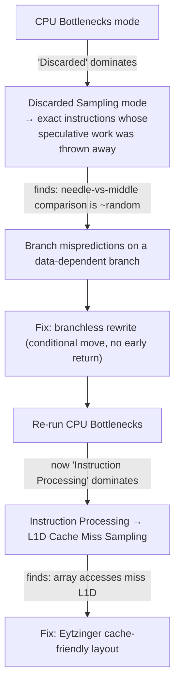

**Finding #1 — mispredicted branches.** The loop's first condition (`length > 0`) is well-predicted (almost always taken). The **needle-vs-middle comparison is effectively a random branch** — the predictor (§29.1) has no consistent history to learn from. Fix: **branchless code** — make the `if` body only assign a value so the compiler emits a **conditional-move (`CSEL`)** rather than a branch, and remove the early `return`/`break` (which *must* be branches). Uses **unchecked `&+` arithmetic** to avoid overflow-trap branches (this is where micro-optimization gets fragile and less safe). **~2× faster.**

```swift
// Branchless binary search (from the session; note &+ = unchecked add, no overflow-trap branch)
public func binarySearchBranchless(needle: Int, haystack: Span<Int>) -> Span<Int>.Index {
    var start = haystack.indices.startIndex
    var length = haystack.count
    while length > 0 {
        let remainder = length % 2
        length /= 2
        let middle = start &+ length
        let middleValue = haystack[middle]
        if needle > middleValue { start = middle &+ remainder }   // compiles to a conditional move
    }
    return start
}
```

**Finding #2 — cache misses.** Re-checking bottlenecks after the branchless rewrite showed the loop now **almost entirely bottlenecked on Instruction Processing**; the suggested L1D-miss sampling attributed it to **array element accesses**. Reason (ties directly to §31/§33): main-memory access is ~**50× slower** than the fast path, and caches move whole **64/128-byte cache lines** — a classic binary search **jumps across the array**, so after the first few probes each new probe lands on a *different* cache line and **misses**, until the search narrows to a single cache-line-sized region. **Binary search is a pathological access pattern for the memory hierarchy.**

**Fix — Eytzinger layout** (named for a 16th-century Austrian genealogist who arranged family trees this way): reorder the sorted array into the **breadth-first traversal order of the implicit binary-search tree**, so the *first several probes* (near the root) are packed **densely, on the same cache line**; only the leaf-level probes (unavoidably) miss. **~2× faster again.**

```swift
// Eytzinger-layout search: 1-indexed implicit tree, children of node i are 2i and 2i+1
public func binarySearchEytzinger(needle: Int, haystack: Span<Int>) -> Span<Int>.Index {
    var start = haystack.indices.startIndex.advanced(by: 1)
    let length = haystack.count
    while start < length {
        let value = haystack[start]
        start *= 2
        if value < needle { start += 1 }
    }
    return start >> ((~start).trailingZeroBitCount + 1)
}
```

**Trade-off explicitly called out:** Eytzinger layout **speeds up search at the cost of in-order traversal speed** (walking elements in sorted order now jumps around the array and misses the cache). It is a data-structure decision, not a free optimization — only appropriate when search dominates.

### 44.7 Summary of the optimization journey

| Step | Tool | Change | Speedup |
|---|---|---|---|
| 1 | CPU Profiler | `Collection` → `Span` | ~4× |
| 2 | Processor Trace | Specialize the generic for `Int` | ~1.7× |
| 3 | CPU Counters (Discarded) | Branchless rewrite | ~2× |
| 4 | CPU Counters (L1D miss) | Eytzinger layout | ~2× |
| **Total** | | | **~25×** |

**Ordering matters:** software-overhead tools (CPU Profiler, Processor Trace) **must come before** hardware-bottleneck tools (CPU Counters) — otherwise the counters get "confused by extra software runtime overheads." And **know when to stop** — once the function no longer shows up on the critical path, further optimization is wasted effort. Complementary resources named by the session: *Apple Silicon CPU Optimization Guide* (Version 4, requires a developer account and NDA-style agreement per §22's discussion), *Tuning your code's performance for Apple silicon*, and the WWDC24 "Explore Swift performance" session.

---


## 45. Apple M5 Quick Reference *(Wikipedia, as of Sept 2026)*

| Variant | Launched | CPU cores | GPU cores | RAM options | Memory bandwidth | Packaging |
|---|---|---|---|---|---|---|
| **M5** | Oct 15, 2025 | 9–10 (up to 4 fast + 6 efficiency) | 8–10 | 12–32 GB | 153.6 GB/s (LPDDR5X-9600) | single die |
| **M5 Pro** | Mar 3, 2026 | 15 (5 Super + 10 Performance) or 18 (6 + 12) | 16–20 | 24–64 GB | up to 307 GB/s | **Fusion** (2 dies) |
| **M5 Max** | Mar 3, 2026 | 18 (6 + 12) | 32–40 | 36–128 GB | 460 / 614 GB/s (32 / 40-core GPU) | Fusion (2 dies) |
| **M5 Ultra** | Aug 2026 | 30–36 | 64–80 | 96–512 GB | 1,228.8 GB/s | "UltraFusion" (quad-die per the table) |

- **Process:** TSMC 3 nm (N3P). **ISA:** ARMv9.2-A. **NPU:** 16-core, 42 TOPS (84 TOPS on Ultra).
- **GPU:** a Neural Accelerator in *every* GPU core (programmable through Metal 4 Tensor APIs), hardware mesh shading, 2nd-gen dynamic caching, 3rd-gen ray tracing.
- **Media engine:** H.264, HEVC, ProRes, ProRes RAW and **AV1 decode**. The M5 Max doubles the encode and ProRes engines.
- **Security:** all variants support **Memory Integrity Enforcement (MIE)**. It uses ARM's Enhanced Memory Tagging Extension in synchronous mode, aimed at buffer-overflow and use-after-free bugs. It is a hardware-assisted sibling of pointer authentication (§36).
- **I/O:** M5 Pro/Max have on-chip Thunderbolt 5 controllers, one per port. The base M5 has Thunderbolt 4.
- **Generational bandwidth (GB/s):** M1 68 → M2/M3 102 → M4 120 → M5 153. This matches the `sysctl`/spec numbers quoted in §34.
- The article carries a promotional-tone warning, and a couple of its table details (e.g. an M6 row) are marked by editors as incomplete. Treat it as a spec sheet, not a measurement source.

---

## 46. Mach `task` and `thread` at the Source Level *(Levin, *Mac OS X and iOS Internals*, "Mach Scheduling")*

Chapter 11 of Levin's book opens the Mach scheduler by dissecting the kernel's own structs (2012-era xnu). It complements §6.1's conceptual "task/thread/port" table with what the kernel actually stores.

| Concept | What it is in the kernel |
|---|---|
| **`task`** | The **resource container**, not the unit of execution: a VM map (address space), an IPC space (port namespace), a list of threads, and per-task policy (including a **task role** such as foreground app or background app, the ancestor of today's QoS classes, §41) |
| **`thread`** | The **atomic unit of scheduling**: own register state and kernel stack; scheduling fields (scheduling mode, current/base priority, task-inherited priority, importance); a **real-time triple** (period, computation, constraint) for realtime threads; a **current quantum**; and processor-affinity hints (`last_processor`, `bound_processor`) |
| **UNIX process** | A BSD-layer object *layered on* a Mach task. `fork`/`exec` manipulate the task underneath. This is the "BSD process model on top of Mach tasks" split from §7.2 |

Two points to remember:
- **Mach has a genuine realtime scheduling class**, with computation and constraint fields per thread. This is which suits audio threads: one of Oakley's commenters observed kernel-level thread priorities up to ~97 for audio work.
- Levin's book predates QoS by years, but the fields are the direct ancestors. The user-visible **QoS class** (§41.2) is mapped onto these kernel priority and role fields, and Oakley's commenters note the QoS a coder sets is **not** the final kernel priority.

---

## 47. Deep History: Apple's Pre-Darwin Operating Systems *(Amit Singh, "A Technical History of Apple's Operating Systems," extends §6)*

§6 covered the Mach → NeXT → Darwin lineage. Singh's chapter covers the **parallel, in-house track** at Apple, which explains why Apple went shopping for someone else's OS in 1996.

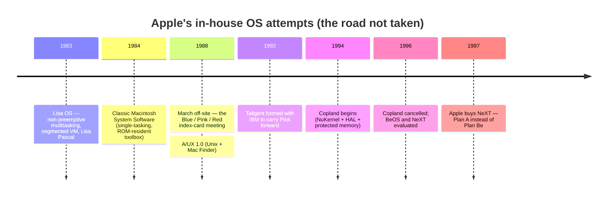

### 47.1 Lisa OS (1983)
- Designed for a GUI machine, **not tied to one OS**: no ROM-resident OS (unlike the Mac), so it could offer a boot-time "Environments Window" (Lisa OS, Lisa Workshop, later SCO Xenix).
- **Non-preemptive multitasking** with process priorities. Processes could only be created by other processes (except the initial "shell"), and terminating a process killed its descendants.
- **IPC:** events over *named channels*, shared files, shared memory. Address spaces were isolated by default.
- **Segmented virtual memory:** read-only code segments (≤128 KB each) swapped in on demand via a bus-error trap, which the memory manager handled before restarting the instruction. This is demand paging in spirit, nearly 40 years before Apple Silicon's 16 KB pages.
- Most system and application code was written in an extended **Pascal**, the same Pascal heritage that shaped the classic Toolbox APIs later carried into Carbon (§8).

### 47.2 A/UX (1988)
- Apple's own POSIX-compliant Unix: 4.2BSD/SysV R2 at first, later 4.3BSD and later System V releases. It ran only on 68k Macs with an **FPU and a paged MMU**.
- Features: BSD groups/signals/job control, SysV IPC, AppleTalk + TCP/IP + NFS, the Berkeley Fast File System, multiple shells, X Window System, and SVID/SVVS compliance.
- **The interesting bit:** A/UX 2.x hosted **Macintosh System 6**, and A/UX 3.x hosted **System 7**, with the **Finder as a graphical shell** over the Unix filesystem. You could run Mac apps, Unix CLI tools, X apps and even MS-DOS apps side by side. This is the conceptual ancestor of "Unix underneath, Mac on top," delivered again 13 years later by Mac OS X.

### 47.3 Blue, Pink, Red (March 1988)
An off-site meeting sorted OS strategy ideas onto colored index cards:

| Card | Meaning | Outcome |
|---|---|---|
| **Blue** | Improve the existing Mac OS | Became **System 7** |
| **Pink** | A revolutionary object-oriented OS: full memory protection, lightweight threads, many protected address spaces | Languished, then moved to **Taligent** |
| **Red** | Ideas "pinker than pink", too advanced even for Pink | Never shipped |

### 47.4 Taligent / TalOS (1992–1995)
- Apple + IBM formed **Taligent** in early 1992 to continue Pink. Pink morphed from an OS into **CommonPoint**, an object-oriented environment intended to run atop AIX, HP-UX, OS/2, Windows 95/NT (and Apple's NuKernel). **TalOS** was the lower layer, built around **Mach 3.0**.
- **Difference from NeXTSTEP:** NeXTSTEP had OO *frameworks* over a *procedural* Unix/Display PostScript base, so framework authors mapped objects onto procedural APIs. Taligent wanted objects *all the way down*, including drivers and network protocols, with CommonPoint apps not using host-OS APIs at all.
- IBM took full ownership in 1995. **Pink never delivered Apple's next-generation OS.**

### 47.5 Copland (1994–1996) and Gershwin
- **Copland** (the "Mac OS 8" project) targeted a fully PowerPC-native system with a **NuKernel microkernel + HAL**, SMP with preemptive multitasking, memory protection, per-user themes, servers-on-a-kernel I/O/networking/filesystems, metadata + content search, and "live upgrades."
- It slipped repeatedly; **full memory protection was cut**. CEO Gil Amelio described it as "just a collection of separate pieces, each being worked on by a different team… that were expected to magically come together somehow." Cancelled in 1996, with some pieces salvaged into Mac OS 8.
- **Gershwin** was the follow-on project (Copland and Gershwin are both named for American composers, and *Rhapsody in Blue* is Gershwin's, which is the origin of the code name **Rhapsody** for the NeXT-based plan, §6.5). Singh notes it briefly took over the project's focus and was later considered a candidate for Mac OS 9; it never shipped as a distinct OS.

### 47.6 BeOS and "Plan A" (1996–97)
- **BeOS** (Jean-Louis Gassée's Be, founded 1990): memory protection, preemptive multitasking, SMP, multimedia-oriented, metadata-rich file attributes. It was unfinished and had few apps, though. The asking price rose and fell across rounds: Apple valued Be at ~$50M, Gassée wanted $500M+, and the talks moved through figures like $125M, $200M and $300M. Be reportedly held out at a "final price" of **$275M**, and no deal happened. Be's assets went to Palm in 2001.
- **NeXT** had shipped, well-received products (OPENSTEP in the enterprise). Apple bought NeXT in **February 1997 for just over $400M**. Amelio: *"We choose plan A instead of Plan Be."*

**Takeaway:** by 1996 Apple had tried, and failed at, an object-OS (Pink/Taligent), a microkernel-native Mac (Copland/NuKernel), and a Unix hybrid (A/UX), each abandoned for reasons that map onto trade-offs in §6.1. NeXT delivered a *proven* Mach+BSD+Objective-C stack, which is why it won.

---

## 48. Book Cross-Reference Map & Source Notes

### 48.1 ⚠️ Read this first: source-quality findings on the files you uploaded

I inspected each file before using it:

| File | Verdict |
|---|---|
| `MOXiI.pdf` (867 pp) | **Genuine.** Jonathan Levin, *Mac OS X and iOS Internals: To the Apple's Core* (single-volume 2012 edition). Full bookmark outline, real chapter text. |
| `macosxinternals-singh-1-pdf.pdf` (146 pp) | **Genuine.** Amit Singh's 2006 chapter "A Technical History of Apple's Operating Systems" (the PDF's metadata subject line points at the book *Mac OS X Internals: A Systems Approach*). |
| `Mac_Os_X_Internals_PDF.pdf` (183 pp) | **A third-party bullet-point summary** (generated by a book-summary app), *not* the book's text. Chapter headings match the real book (13 chapters incl. firmware, xnu, IPC, HFS+), so it's useful as a **topic map** only. |
| Two `.mobi` files | **Byte-identical duplicates** of Singh's *Mac OS X Internals: A Systems Approach*. No MOBI tooling was available, so I wrote a small decoder for the PalmDOC-compressed file and recovered the **full text (~1.9M characters)**. Parts III (§50–§52) draw on it: Mach IPC, Mach VM and kernel startup. Other chapters (file systems, HFS+, firmware) are not yet mined. |
| `thebook.pdf` (70 pp) | **Genuine but partial.** It's the **detailed index + an appendix** from Levin's *\*OS Internals Vol. III: Security & Insecurity*, **not the full book**. Chapter list confirmed, and the appendix ("Darwin 18 beta changes": CoreTrust, AMFI, APFS snapshot-mount hardening) is real content. |
| `OS-Internals-…-Volume-II-Kernel-Mode-Jonathan-Levin.pdf` | **⚠️ NOT the book.** Its metadata author is unrelated, its front matter is a "type this link into your browser / instant download" lure, and the body pages are incoherent filler text (random sentences about unrelated topics). It is a **spam/scam document wearing the book's title**. I did **not** use anything from it, and I'd recommend deleting it and not following any link inside it. If you want Volume II (kernel mode, and the SEPOS chapter the video recommends), obtain it from the publisher/author's site. |
| `Runtime_API_Tour.pdf` | **Genuine.** Mike Ash's slide deck, used for §43. |

### 48.2 Chapter maps

**Levin, *Mac OS X and iOS Internals* (MOXiI.pdf) — use for deep dives:**

| My section | Go to (Levin) |
|---|---|
| §2, §3 (kernel/user, layers) | Ch. 2 *Architecture of OS X and iOS* |
| §6, §47 (history) | Ch. 1 *Darwinism* |
| §10 (loader, Mach-O) | Ch. 4 *Mach-O, process and thread internals* (via the Part I outline) |
| §40 (boot chain; Intel-era EFI vs. iBoot) | Ch. 6 *Boot process: EFI and iBoot* |
| §7, §46 (Mach) | Ch. 10 *Mach Primitives*, Ch. 11 *Mach Scheduling* (p. ~424), Ch. 12 *Mach Virtual Memory* |
| §7.6 (kexts), IOKit | Ch. 18 *Kernel Extensions*, Ch. 19 *I/O Kit* |

**Levin, *\*OS Internals Vol. III: Security & Insecurity* (chapter list from `thebook.pdf`):** 3 Authorization (KAuth) · 4 Mandatory Access Control Framework · 5 **Code Signing** · 6 Software Restrictions (macOS: Gatekeeper, quarantine, etc.) · 7 **AppleMobileFileIntegrity** · 8 **The Sandbox** · 9 **System Integrity Protection** · 10 Privacy (TCC) · 11 Data Protection · 12 macOS Vulnerabilities · 13–25 Jailbreaking case studies (Evasi0n, Pangu, TaiG, Pegasus, mach_portal, Yalu, async_wake/QiLin). These are the chapters behind §12 (signing, notarization, sandbox) and the video series' upcoming security episode.

**Singh, *Mac OS X Internals: A Systems Approach* (13 chapters, from the summary's headings):** 1 Origins · 2 Overview · 3 Inside an Apple (hardware) · 4 **Firmware & bootloader** (Open Firmware, Forth, device tree, EFI) · 5 **Kernel & user-level startup** (Mach init → first thread → I/O Kit → BSD init → launchd) · 6 The xnu kernel · 7 Processes (execve, scheduling) · 8 Memory · 9 Mach IPC · 10 Extending the kernel (I/O Kit, DART, kexts) · 11 File systems · 12 HFS+ · App. A x86 Macs. (Note the book predates Apple Silicon, APFS, and SIP: use it for *concepts*, not current details.)

### 48.3 Sourcing caveat on figures in Part II

- **Numbers from black-box measurement** (§29–§30, §38): Dougall Johnson's, the independent write-up's, and the load/store post's figures are inferred (e.g. Dougall's store-queue number was **reproduced only partially**: his own post has an update noting a 107-vs-60 entry discrepancy he couldn't reproduce on an M1 Max). Maynard Handley's comments are informed patent-reading, not spec.
- **Numbers from the video** (§25–§27, §32–§36): the ~13–14 cycle mispredict figure comes from the independent write-up, and the cache latencies come from a measurement site, not Apple.
- Apple's own *Apple Silicon CPU Optimization Guide* is behind a developer-account agreement that forbids sharing, so nothing here comes from it.

---

## 49. Glossary Addendum (Part II)

| Term | Meaning |
|---|---|
| **Die / package / SoC** | Silicon square / sealed unit (die + RAM dies) / everything-on-one-die design |
| **Fusion Architecture** | Two dies bonded into one logical chip (M5 Pro/Max) |
| **Cluster** | Cores sharing one L2 cache; frequency scales per cluster |
| **Super / Performance core (M5 Pro/Max)** | Fast tier / new small-efficient tier — **naming differs from the base M5** |
| **Firestorm / Icestorm** | M1's fast / efficient core microarchitecture names |
| **Wide and slow** | Design philosophy: high IPC at a moderate clock |
| **uop** | Internal micro-operation; unit of the 8-wide pipeline |
| **Coalesced retire queue / rename retire queue** | Firestorm's two-structure ROB (~330 groups / ~623 renames) |
| **Age matrix** | Low-power structure tracking instruction ordering in schedulers |
| **Misprediction penalty** | ~13–14 cycles ≈ ~100 instructions of discarded work at 8-wide |
| **False sharing** | Two cores fighting over one cache line (128 B on Apple Silicon) though data is independent |
| **TSO** | Total Store Ordering — x86's memory model; **Rosetta 2 enables it per-thread in hardware** |
| **PAC / `arm64e`** | Pointer Authentication Codes / the ABI that signs pointers (Apple system software only) |
| **NEON** | 128-bit ARM SIMD |
| **AMX → SME/SME2** | Undocumented Apple matrix coprocessor → the official ARM Scalable Matrix Extension (M4+/M5) |
| **Accelerate** | Apple's stable math framework; the safe path to the matrix hardware |
| **Storage mode** | Metal buffer residency: shared / private / managed (vestigial on Apple Silicon) |
| **Partial render / TVB** | GPU flushes a tile pass when the tiled vertex buffer overflows |
| **GPU firmware coprocessor** | ARM64 core + Apple RTOS the kernel driver actually talks to |
| **SEPOS** | The Secure Enclave's L4-based OS |
| **Boot ROM / LLB / iBoot / LocalPolicy / SSV** | The boot chain and its signed policy/volume (§40) |
| **QoS** | Quality of Service class deciding P- vs E-core placement (§41) |
| **Aliasing (profiling)** | Timer-based sampler over-counting work synchronized with it |
| **Processor Trace** | Exact, ~1%-overhead instruction-level tracing (M4+/A18+) |
| **Eytzinger layout** | Breadth-first array layout for cache-friendly binary search |
| **`objc_msgSend`** | The Obj-C runtime's cache-first dynamic dispatch trampoline |
| **Blue/Pink/Red; Copland; Gershwin; Taligent** | Apple's abandoned pre-NeXT OS efforts (§47) |

---

### Revision checklist — Part II

- [ ] Explain "die vs. package" and why Apple's RAM isn't upgradeable
- [ ] Explain why "Performance core" means different things on M5 vs. M5 Pro/Max
- [ ] Compute IPC × clock for a wide/slow vs. narrow/fast core and say why the slow one also wins on power
- [ ] Walk through the 6 pipeline stages and say where fusion/elimination happen
- [ ] Explain why execution can be out-of-order but retirement never is, using the fault example
- [ ] Give the latency ladder L1 → L2 → SLC → RAM in cycles and in "instructions of lost work"
- [ ] List the three real-world breakages caused by 16 KiB pages, and the false-sharing fix (128 B)
- [ ] Explain how Rosetta 2 gets TSO on ARM hardware, and its measured cost (~9%)
- [ ] Explain PAC keys/salts, and `arm64` vs. `arm64e` who-uses-what
- [ ] Explain why direct-AMX programs broke on M4 but Accelerate callers didn't
- [ ] Explain the GPU-firmware-coprocessor model and the "driver writes a program for firmware" line
- [ ] Draw the boot chain and explain how LocalPolicy blocks downgrade replay
- [ ] Explain QoS's one-way rule (foreground may use E, background may not use P) and the 4× frequency-illusion in Activity Monitor
- [ ] Describe the `objc_msgSend` fast path and cache-miss fallback
- [ ] Recite the 25× binary-search optimization ladder and which tool found each step

---
---

# PART III — Book Deep-Dives: Mach IPC, Mach VM, and Kernel-to-`launchd` Startup

> Source: Amit Singh, *Mac OS X Internals: A Systems Approach* (Addison-Wesley, 2006) — the full text, decoded from your `.mobi` copy. **The book is Mac OS X 10.4 / PowerPC-era.** The *concepts* (ports, rights, VM maps/objects, startup order) are still the backbone of XNU (§7), but specific function names, addresses, and PowerPC details are historical. Where a detail is clearly dated I say so.

## 50. Mach IPC in Depth *(Singh, Ch. 9; deepens §6.1 and §7.2)*

### 50.1 Lineage and the core idea
Walden's 1972 "port" idea → RIG (1975) → Accent (ports as **capabilities**, copy-on-write for large data) → **Mach**, which split "process" into **task + thread** and made the *task* the owner of port rights. Mach IPC is **message-oriented and capability-based**, and it is **integrated with the VM system**, so large payloads move by remapping pages (copy-on-write) instead of copying.

**Ports vs. sockets** (the comparison the book draws):

| | Mach port | BSD socket |
|---|---|---|
| What it is | Kernel-managed, kernel-protected, finite-length **message queue** | Byte-stream / datagram endpoint |
| Protection | **Capability**: you can only use a port if you hold a *right* to it | Access by descriptor + file/network permissions |
| Data | **Typed** messages that can carry port rights and out-of-line memory | Untyped bytes |
| Memory | VM-integrated: payload can be mapped **copy-on-write** into the receiver | Copied through kernel buffers |
| Scope | Optimized for **intra-machine** IPC (network extension existed via a user-level "netmsgserver" but **isn't used on Mac OS X**) | Designed for remote as well as local |

**Ports are also how the kernel exposes objects.** Hosts, tasks, threads, memory objects, clocks, timers and processors are all *represented by ports*; operating on one means **sending a message to its port**, with the kernel holding the receive right and acting as the server. It is object-style method invocation. Two consequences to remember:
- **A task's port gives control of every thread in it**, but a thread's port does **not** give access to the task.
- This is the mechanism behind "one task can allocate memory in another task's address space" (if it holds that task's port), and it's why **task ports are a security-critical capability** (several jailbreak case studies in Levin's Vol. III chapter list, e.g. `mach_portal` and `async_wake`, hinge on Mach-port/task-port handling; see §48.2).

### 50.2 Port rights (the capability types)

| Right | Meaning |
|---|---|
| **SEND** | May send messages; **reference-counted** per task (so many threads can share it safely) |
| **RECEIVE** | May dequeue messages. **Exactly one receiver per port** (any number of senders). Holding RECEIVE implies you can also send |
| **SEND_ONCE** | May send **one** message, then the right disappears — the standard **reply port** pattern. Even if destroyed unused, it generates exactly one "send-once notification" |
| **PORT_SET** | A bucket of receive rights; receive from *whichever member has a message first* (the message identifies which port) |
| **DEAD_NAME** | What a send/send-once right becomes when the port is destroyed; sending to it errors out, and it reserves the name so it isn't reused prematurely |

Rules worth remembering:
- **Rights are owned per task, and names are per-task** (like virtual addresses); the same port has different names in different tasks. If a task holds both send and receive for a port, they share one name; send-once rights never share a name.
- **Rights travel inside messages.** After a send and before dequeue, the *kernel* holds the rights. Messages to a port whose receive right is in flight are queued until the new owner picks it up.
- A port is **destroyed when its receive right is deallocated**: queued messages are destroyed, out-of-line memory freed, and outstanding send rights turn into dead names.

### 50.3 Message anatomy

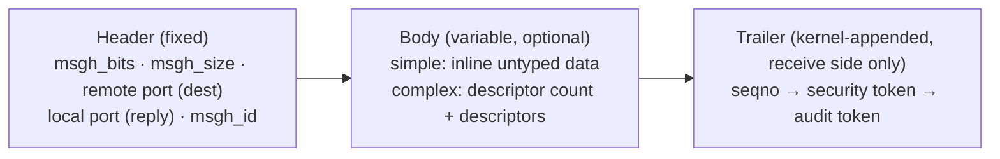

- **One syscall trap does it all:** `mach_msg_overwrite_trap()` (wrapped by `mach_msg()`), controlled by option bits (`MACH_SEND_MSG`, `MACH_RCV_MSG`, timeouts, interrupt behavior, `MACH_RCV_LARGE`). Send+receive in one call = an **RPC**.
- **Descriptors** carry **port rights** (with a *disposition*: move/copy send, receive, send-once…) or **out-of-line memory** (address, size, *virtual* vs *physical* copy, optional dealloc-after-send). Out-of-line **port arrays are always physically copied**.
- **Trailer:** the kernel appends attributes the *sender cannot forge*. The **security token** is the sender's effective UID/GID; the **audit token** identifies the sender to the BSM audit subsystem. Attributes are ordered (seqno → security → audit), so to get a later one you must accept the earlier ones. This is how a server learns *who* called it without trusting the message body.
- Sender's and receiver's port fields (and bits) are **swapped** in the header the receiver sees.

### 50.4 Kernel implementation (`osfmk/ipc/`)
- Each task has a private **IPC space** (`ipc_space`): the translation layer from a task-local port *name* to a kernel-global port structure.
- The space holds a **table** of "small" port rights (16-byte `ipc_entry`s, the name is the table *index*) and optionally a **splay tree** of "large" rights (32-byte entries).
- This mirrors virtual memory: per-task namespace → kernel-wide object.

### 50.5 Finding services: the bootstrap server = `launchd`
Because port names are per-task, there is **no global namespace**, so a *name server* is needed to broker rights between unrelated tasks.

- Mac OS X has no network name server; it has the **Bootstrap Server**, whose implementation is **`launchd`** (PID 1, §13.2). Originally created by NeXT for NEXTSTEP.
- **Every task inherits a *bootstrap port* from its parent**; that port is how it looks up system services. A parent can hand a child a **restricted/subset bootstrap port** to limit which services it can reach. This is the seed of sandboxed service visibility.
- **Bootstrap context:** the set of services a task can look up. There's a top-level *startup context* (where `launchd` and early daemons live) and per-login *user contexts*. Logging in at the console vs. via SSH can land you in different contexts (a classic source of "works in Terminal, fails over SSH").
- **Service lifecycle calls (historical API, 10.4):** `bootstrap_create_server`/`bootstrap_create_service` declare a service *before it's running* (clients can look it up and get a send right immediately); the server later calls `bootstrap_check_in` to **claim the receive right** and go active; `bootstrap_register` publishes an already-created port; `bootstrap_look_up` returns a send right; `bootstrap_status` reports whether it's active. **On-demand launch:** `launchd` can start the server the *first time* someone messages its service port. (These specific calls have been superseded; modern equivalents are launchd plists + XPC. But the idea, "**reserve the port name first, start the process lazily**," is exactly how modern on-demand daemons work.)

**Why this matters for the rest of the notes:** the Window Server (§4), input events, and most system services are reached through Mach ports found via `launchd`'s bootstrap namespace. It's the "one door" for services the way syscalls are the "one door" into the kernel.

---

## 51. Mach VM Architecture in Depth *(Singh, Ch. 8; deepens §15)*

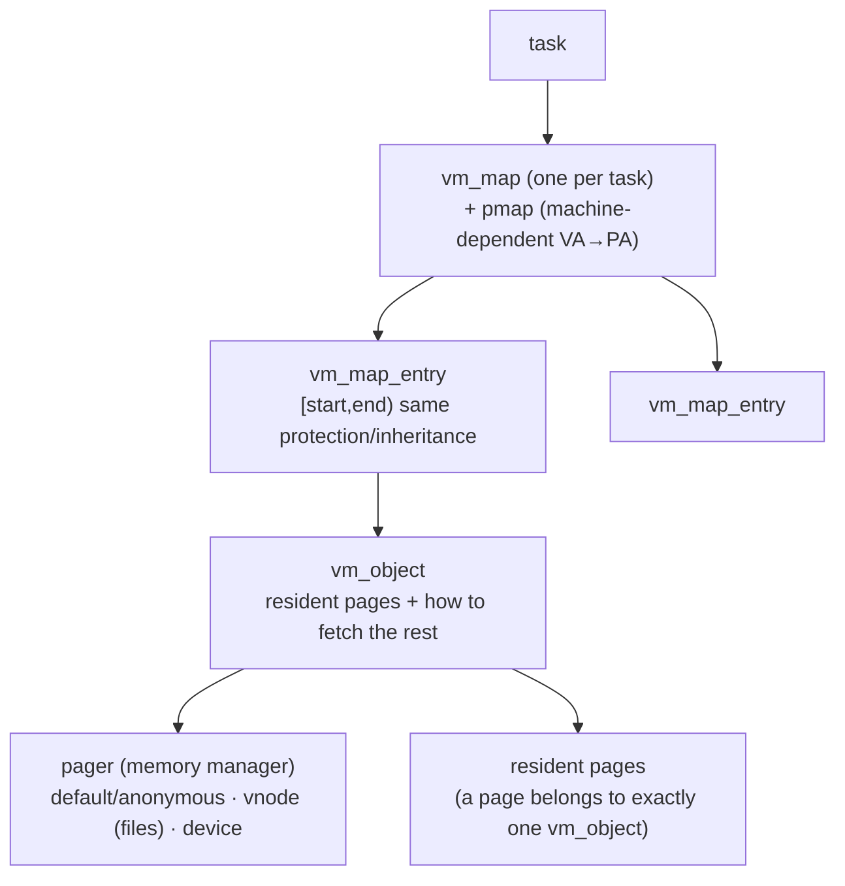

- **Machine-independent / machine-dependent split:** only the **pmap** knows hardware page-table details (this is where Apple Silicon's 16 KiB granule lives, §32); everything above is portable.
- **`vm_map`** describes a task's address space as an **ordered list of `vm_map_entry`s** — each a contiguous range with uniform properties (protection, inheritance, source). Entries are **split or merged** as attributes change (changing protection on part of an entry can split it into 2–3).
- **`vm_object`** = a *source of memory* (a file, anonymous zero-fill, a device). An entry is the bridge between a map and an object. A physical page belongs to **exactly one** object. **Pagers** (memory managers) move pages in/out and keep backing store and resident pages consistent.
- **Copy-on-write:** virtual copies (fork, big IPC payloads) share pages until one side writes. This is the same trick §50 relies on to make IPC cheap.
- **IPC-based VM interface:** because tasks are ports, one task can manipulate **another task's** address space via the Mach VM API (with the right port); the basis of debuggers and, again, security-sensitive.
- **Design goals listed by the book:** clean machine-dependent split; large sparse per-task address spaces shared by all threads; VM integrated with IPC; optimized copy; flexible sharing; memory-mapped files; multiple pager types (user-space pagers exist in Mach but **weren't supported** on Mac OS X).

**The supporting cast (10.4-era, concepts still relevant):**

| Component | Role |
|---|---|
| **UBC (Unified Buffer Cache)** | One page pool caching **both file data and anonymous memory** ("unified") |
| **UPL (Universal Page List)** | Descriptor for a bounded set of physical pages that file systems use to talk to the VM system |
| **Three in-kernel pagers** | Default (anonymous), **vnode** (file-backed), **device** (device memory; lives in I/O Kit) |
| **Page-out daemon** | Kernel threads that write cold pages out using an LRU-like scheme |
| **`dynamic_pager`** | *User-space* helper that creates/deletes **swap files**; despite the name it does **no paging itself** |
| **`update` daemon** | Periodically calls `sync()` |
| **Task Working Set (TWS) detection** | Learns per-app page-fault patterns to **prefault adjacent pages** (a read-ahead heuristic) |
| **System shared memory regions** | Two globally shared **256 MB** regions (read-only shared *text*; copy-on-write *data*) that **`dyld` used to share system libraries**, the historical ancestor of today's **dyld shared cache** (§10.2) |
| **DART** | 64-bit memory controller table mapping addresses into 32-bit PCI devices' view (an early **IOMMU**, same idea as today's DMA protection) |

Also: on 10.4 a 64-bit task got a **51-bit** address space (over 2 PB); a reminder that "64-bit" never means 2^64 usable addresses (the same unused-top-bits fact that makes pointer authentication possible, §36).

**Reading kernel memory (historical):** `/dev/kmem` and `kvm(3)` allowed raw kernel reads, and Singh's caveat explains why they were abandoned: you must know exact struct layouts (which change per release), you can't get computed values, and it's a stability/security hazard. The safe, versioned alternative is **`sysctl`**, from 4.4BSD, which is exactly the interface the video's `sysctl` demos rely on (§19). (Modern macOS has removed `/dev/kmem` entirely.)

---

## 52. From `_start` to `launchd`: Kernel Startup Order *(Singh, Ch. 5; complements §40)*

§40 covers everything up to the kernel handoff on Apple Silicon (Boot ROM → LLB → iBoot → kernel). Singh's chapter covers what the kernel does *next*. The **structure** below is still how XNU comes up. The **details** (Open Firmware/BootX, PowerPC registers, `/mach_kernel`) are 2006-era; today iBoot loads a prelinked **kernelcache** instead.

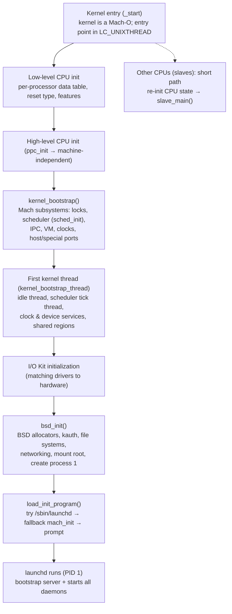

Key facts:
- **The kernel is just a Mach-O executable** with a special entry point; the linker pins segments at fixed addresses (vectors, a hibernation segment, text) so the low-level entry code can run before the VM system exists.
- **One "master" CPU** runs the whole sequence; the others take a short path and join later. **Per-CPU data** (`per_proc_info`, including feature bits and cache sizes) is set up *first*, since everything after depends on knowing the CPU.
- **Scheduler init** (Mach): default **preemption rate of 100 Hz** (a **10,000 µs timeslice**), event wait queues hashed into a statically allocated table, and a **scheduler tick thread** that does periodic priority/usage bookkeeping. (Modern XNU differs in details, e.g. QoS and multiple clusters, §41, but the Mach scheduling skeleton is the same one Levin dissects in §46.)
- **The first kernel thread** creates the **idle thread** per CPU (running at idle priority, both `RUN` and `IDLE` states), starts the scheduler services, sets up **clock and device IPC services** (clocks and the host's master device port are *Mach ports*, §50), and creates the shared-memory regions dyld uses.
- **I/O Kit init precedes BSD init**, so drivers exist before the file systems need disks.
- **`bsd_init()`** brings up the BSD side: its own kernel allocator (typed allocations, some backed by Mach zones), parsing BSD boot args, the **`kauth`** authorization subsystem (related to the authorization/MACF chapters in Levin's Vol. III list, §48.2), file-system initialization, networking initialization, mounting the root file system, creating process 1, and setting up the shared memory regions.
- **First user program:** `load_init_program()` tries **`/sbin/launchd`**, falls back to `mach_init`, and as a last resort asks the user for a path (the traditional Unix "init"). This is the moment PID 1 is born (§13.2), and it also becomes the **bootstrap server** (§50.5).
- Historical note on **funnels:** 10.4's BSD half still ran under a single "kernel funnel" lock kept for compatibility; a reminder that XNU's **hybrid** design (§6.6) had real concurrency growing pains, since BSD code originally assumed a single-threaded kernel.

---

## 53. Glossary & Checklist Addendum (Part III)

| Term | Meaning |
|---|---|
| **Port right** | A capability to a Mach port: send, receive (exactly one holder), send-once, port set, dead name |
| **IPC space** | Per-task table (+splay tree) translating local port names to kernel port objects |
| **Bootstrap server / port / context** | `launchd`'s name service; inherited port used to look up services; the visibility scope of those lookups |
| **Trailer (security/audit token)** | Kernel-appended, unforgeable sender identity on a received Mach message |
| **`vm_map` / `vm_map_entry` / `vm_object` / pager / `pmap`** | Address space / contiguous uniform range / source of pages / backing-store mover / hardware page-table layer |
| **UBC / UPL** | Unified file+anonymous page cache / page-set descriptor for FS↔VM |
| **TWS** | Task Working Set detection (prefault adjacent pages) |
| **`kernel_bootstrap` / `bsd_init` / `load_init_program`** | The Mach-init, BSD-init and "start PID 1" stages of kernel startup |

- [ ] Name the five Mach port right types and say which one has exactly one holder
- [ ] Explain why a send-once right is the natural reply port
- [ ] Explain what a task's *IPC space* does and how it parallels a VM map
- [ ] Say how a message receiver learns who sent it without trusting the payload (trailer tokens)
- [ ] Explain why a bootstrap server is needed, and how "reserve the name, launch lazily" works
- [ ] Draw `vm_map → vm_map_entry → vm_object → pager` and say where `pmap` and 16 KiB pages fit
- [ ] Explain COW and why it makes both `fork` and big IPC messages cheap
- [ ] Recite the kernel startup order from entry point to `launchd`, and say why I/O Kit init comes before BSD init