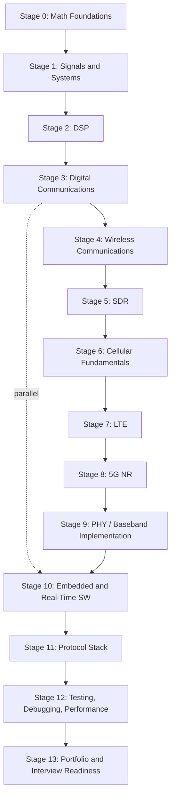

[← Table of Contents](README.md)

---

# 3. The Roadmap

Why this order: DSP and comms theory (0-4) come before cellular-specific material (6-9) because LTE/NR are just heavily-standardized applications of OFDM, channel coding, and synchronization — trying to learn "what PDCCH is" before you understand OFDM and channel estimation means memorizing rather than understanding. Stage 10 (embedded/real-time C++) runs partly in *parallel* starting around Stage 3-4, because you should be writing real-time-flavored C++ the whole way through, not bolted on at the end. Protocol stack (11) comes after PHY implementation (9) deliberately — you'll understand *why* MAC/RLC/PDCP exist much faster once you've felt the constraints PHY imposes on them (HARQ timing, transport-block sizing, scheduling).

Each stage below gives you enough to know what you're aiming at. **We will not do all of this in one sitting** — per your own instruction, we teach one topic deeply at a time. Lesson 1 begins right after this document, at the start of Stage 0.

| Stage | Core concepts | Key math | Core resource(s) | Flagship exercise | Exit criteria |
|---|---|---|---|---|---|
| **0. Math Foundations** | Complex numbers/phasors, trig identities, linear algebra (vectors, matrices, eigenvalues), probability/random variables, basic calculus, intro Fourier series | Complex exponentials, matrix multiplication, PDF/CDF/expectation | Refresher only — no dedicated book; we'll derive what's needed as we go | Represent a sinusoid as a rotating phasor and prove Euler's formula from first principles | You can explain *why* $e^{j\theta}$ represents rotation without looking it up |
| **1. Signals & Systems** | Continuous/discrete signals, convolution, impulse response, LTI systems, DTFT/DFT/FFT, sampling theorem, aliasing, filtering | Fourier transform pairs, Nyquist criterion | Lyons Ch. 1-3 | Implement DFT by hand (no library), then compare to an FFT library, on a synthetic signal | You can predict what a spectrum will look like before you plot it |
| **2. Digital Signal Processing** | FIR/IIR filters, multirate DSP (interpolation/decimation), windowing, correlation, matched filters, fixed vs. floating point, SIMD basics, **quadrature (IQ) signals** | Filter design math, Z-transform basics | Lyons Ch. 5-9 (esp. Ch. 8 on quadrature signals), PySDR chapters on filtering | Build a FIR low-pass filter from scratch in C++, verify against SciPy | You can explain what "IQ" physically represents and why negative frequency matters |
| **3. Digital Communications** | AWGN/SNR/BER, BPSK/QPSK/QAM, pulse shaping (RRC), synchronization (carrier & timing recovery), matched filtering, intro FEC | Union bound, Q-function, Eb/N0 | Proakis *Digital Communications* (reference chapters), PySDR modulation chapters | Build a BPSK/QPSK modem in Python, plot a BER curve that matches the theoretical curve | Your simulated BER curve matches theory within simulation noise |
| **4. Wireless Communications** | Multipath, fading, Doppler, delay/coherence, MIMO basics, diversity, beamforming intro, **OFDM**, cyclic prefix, pilots/reference signals | Convolution with channel impulse response, basic linear algebra for MIMO | Sesia/Toufik/Baker Ch. 1-4 (wireless fundamentals sections), Dahlman et al. intro chapters | Simulate a multipath channel and *show* ISI, then show the cyclic prefix removing it | You can derive "why cyclic prefix" from multipath → circular convolution → FFT, not from memory |
| **5. Software-Defined Radio** | IQ pipeline end-to-end, ADC/DAC, sample rates, gain, GNU Radio architecture, real signal capture | — | SDR4Engineers (Collins et al.), PySDR, GNU Radio docs | Decode a real broadcast FM signal or ADS-B from an RTL-SDR capture | You've processed *real*, not simulated, RF data end to end |
| **6. Cellular Fundamentals** | Cellular system concepts (cells, handover, duplexing FDD/TDD), survey of GSM/UMTS/HSPA evolution, why standards exist, how 3GPP works | — | Sesia et al. Ch. 1 (evolution/history), skim only | Write a one-page "why did the industry move from CDMA to OFDMA" explanation in your own words | You can place LTE/NR in historical/technical context without memorizing dates |
| **7. LTE (4G)** | Resource grid, PSS/SSS, PBCH, PDCCH/PDSCH/PUSCH, HARQ, link adaptation, LTE PHY/MAC procedures | OFDM math applied to a real numerology | Sesia, Toufik, Baker — full read of PHY/MAC chapters | Detect PSS/SSS and decode PBCH from a real or simulated LTE signal | You can trace one downlink subframe from resource grid to decoded bits |
| **8. 5G NR** | Numerologies, BWP, SSB, PDCCH/PDSCH/PUSCH/PRACH, DMRS, CSI, flexible frame structure, beam management | Same OFDM math, now multi-numerology | Dahlman, Parkvall, Sköld — full read of PHY chapters | Detect SSB and decode a basic PDSCH from a simulated NR downlink | You can explain NR as "LTE's OFDM core, generalized," not as a separate system |
| **9. PHY/Baseband Implementation** | Turning 1-8 into working C++: scaled-down LTE/NR PHY chain | Fixed-point scaling analysis | Your own code + srsRAN source as reference | Projects 7-8 (below) | A PHY chain you built runs against a real or simulated signal and produces correct bits |
| **10. Embedded & Real-Time SW** | Ring buffers, lock-free structures, DMA concepts, multithreading, atomics, cache/alignment, SIMD (AVX2/NEON), profiling, deterministic latency | — | *Linux Kernel Development* (§2 above) + hands-on | Project 9 (real-time SDR pipeline) | Your pipeline meets a fixed deadline under load without dropped samples |
| **11. Protocol Stack** | PHY↔MAC↔RLC↔PDCP↔RRC↔NAS: who talks to whom, what moves between layers, why each layer exists | State-machine reasoning, not heavy math | 3GPP spec excerpts (§5 below), srsRAN L2/L3 source | Trace one packet from application to radio waveform and back, on paper and in code | You can draw the full stack from memory and explain each layer's *job*, not just its name |
| **12. Testing, Debugging, Performance** | Profiling, tracing, hardware-in-loop testing, conformance testing, latency/throughput/memory analysis, RF impairments | Statistics for measurement (confidence, repeatability) | Your own projects + debugging scenarios (taught live, see §9 below) | Root-cause a synthetic "BER suddenly increased" scenario using only logs and measurements | You form and test hypotheses methodically, not by guessing |
| **13. Portfolio & Interview Readiness** | Consolidation, resume framing, mock technical reasoning | — | §10 (interview framework) below | Polish 4-5 flagship projects; do timed mock explanations of each | You can defend every design decision in your portfolio under questioning |

---

[← 2. Linux, specifically for this track (mapped to *Linux Kernel Development*, 3rd ed.)](02-linux-for-rf-software.md) · [4. Book & Resource Stack →](04-book-and-resource-stack.md) · [Table of Contents](README.md)
