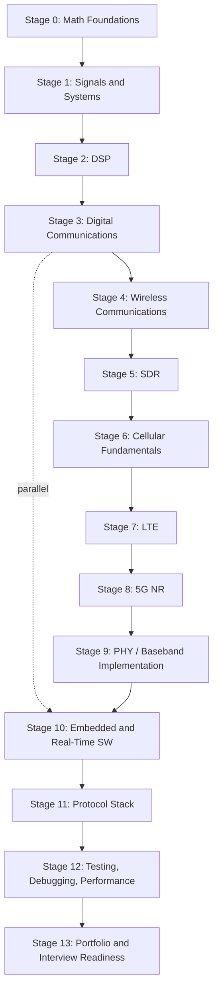

# RF / Cellular Modem Software Engineering — Master Curriculum

A living roadmap from backend/systems engineering to job-readiness for **PHY, baseband, modem, and protocol-stack software** roles (Qualcomm, MediaTek, Samsung, Apple, Nokia, Ericsson, Broadcom, Keysight, Rohde & Schwarz, and similar). Built from your stated background and from current job postings researched in September 2026. This document is meant to be revisited and edited as you progress — not read once and forgotten.

**Explicitly out of scope:** analog RF IC design. **In scope:** the software/DSP/embedded layer that sits between "IQ samples" and "a working cellular link."

---

## 1. Career Map (reference)

### Role families and how they actually differ

| Role family | What they really do | Typical code | Math depth |
| --- | --- | --- | --- |
| **RF/PHY Firmware Engineer (L1)** | Implement PHY algorithms (sync, channel estimation, equalization, FEC) as embedded C/C++ on DSP + ARM cores, against real-time deadlines | C, some assembly, DSP intrinsics | Medium-high, but implementation-focused |
| **Baseband/Modem Software Developer** | Build and maintain the L1/L2 baseband software stack — the "systems engineering" of the modem | C/C++, real-time embedded | Medium |
| **Modem Systems / Algorithms Engineer** | Design and simulate the algorithms before they're implemented (channel coding, MIMO detection, synchronization) | C/C++/MATLAB simulation, less production firmware | High |
| **DSP R&D / ASIC-adjacent Engineer** | Bit-exact modeling of DSP algorithms for silicon, RTL vector matching, ASIC lab debug | C/C++, MATLAB/Simulink | Very high; often PhD-heavy |
| **Protocol Stack Engineer (L2/L3)** | RRC/NAS/RLC/PDCP/MAC state machines, call flows, signaling | C/C++, sometimes Java; less DSP | Low-medium; more state-machine/systems thinking |
| **Wireless/RF Test & Validation Engineer** | Automate conformance/performance testing against real hardware and lab equipment (Keysight, R&S, Anritsu) | Python-heavy automation | Low-medium; needs to *understand* the measurements, not derive them |
| **Embedded Wireless / RF Software Engineer (general)** | Broad embedded role touching modem, drivers, platform software | C/C++, Linux | Medium |
| **RAN Software Engineer (network side)** | Same PHY/MAC/RLC work but on the gNB/eNB (base station / DU) side instead of the UE side | C/C++, often ORAN-adjacent (DPDK, SmartNICs) | Medium-high |

These overlap heavily — a single posting often blends two or three of these. Qualcomm's senior systems-engineering postings, for example, want strong 5G NR PHY/MAC/RLC/PDCP protocol knowledge combined with RF/MIMO understanding, communication theory, and the ability to write simulation code across modem subsystems and layers — i.e., the "systems engineer" role sits deliberately between algorithms and implementation. By contrast, Ericsson's baseband developer postings are framed much more narrowly around developing and maintaining high-performance 5G L1/L2 baseband software in C/C++ — a more purely-implementation role. Apple's modem test/validation roles are explicitly about defining and automating test scenarios for 4G/5G modems in Python, with AI/ML increasingly used to improve testing efficiency — a genuinely different day-to-day from firmware development, even though the job title says "cellular."

### Skill clusters by seniority (grounded in current postings)

| Cluster | Entry level (0-2 yrs) | Mid (2-5 yrs) | Senior/Staff (5-10+ yrs) |
| --- | --- | --- | --- |
| **Programming** | Strong C/C++, real-time embedded software experience in Linux environments | Same + emphasis on real-time, multi-threaded software; multi-core, low-latency embedded Linux | Architecture-level C/C++ across ARM + DSP + accelerators; sometimes assembly |
| **DSP/Comms theory** | Knowledge of 4G or 5G physical layer expected but not deep mastery; Python/MATLAB "an advantage" | Wireless communication theory — quadrature modulation, channel coding, OFDMA — and DSP programming: FFTs, filters, complex-number arithmetic | Deep cellular signal-processing experience: manipulating IQ samples, mod/demod, channel coding/error correction, synchronization, filtering, channel estimation, waveform design, with strong communication-theory math |
| **Standards/3GPP** | Awareness expected, not mastery | Strong understanding of 3GPP radio access standardization for LTE and NR | Strong knowledge of cellular PHY/MAC/RLC/PDCP and upper layers, familiarity with 3GPP standards across generations |
| **Linux/embedded/RTOS** | Basic real-time embedded Linux exposure | Solid understanding of Linux, including performance/data-path optimization (e.g. DPDK, SmartNICs) | Deep understanding of modem subsystem architecture — ARM cores, DSP, hardware accelerators |
| **Testing/tools** | Exposure to lab/integration environments | Test-plan development, node-level testing | Owns test methodology, works across hardware/software/RF boundary |
| **Education** | BS typically sufficient | BS + experience, MS common | MS/PhD increasingly preferred at senior/staff levels, especially for algorithm-heavy roles |

**Company-specific notes (not a ranking, just texture):**

- Broadcom's DSP roles skew ASIC/RTL-adjacent and are frequently PhD-gated — that's a different, more research-flavored track than "software engineer."
- Apple splits fairly cleanly into implementation roles (PHY/firmware, 10+ years common at senior levels) and test/validation roles (much more approachable entry point, Python-heavy).
- Defense/SIGINT-adjacent RF software roles (the "RF Software Engineer, DSP/C++/Linux" postings tied to security clearances) pay notably well and want the same core skills — DSP algorithm development, C++, Linux, Python — but require a US security clearance, which is a separate, non-technical gate.
- A growing number of postings (Qualcomm, and modem-adjacent tooling roles) explicitly expect fluency with modem-specific diagnostic tooling — DIAG, QMI, QXDM/QCAT — and the ability to map failures across NAS, RRC, and L1/L2. This diagnostic-tooling literacy is rarely taught in courses and is a genuine differentiator; the "cellular protocol analyzer" project later in this document targets exactly this skill.

### The AI/automation angle (grounded)

This is not a hype question — it shows up directly in current postings. One current Qualcomm modem-software posting is explicitly framed around an "AI-native" development paradigm: engineers are expected to use code-generation agents, LLM-based code review, and automated log/crash-triage tooling to accelerate delivery — while still being responsible for designing and optimizing real-time embedded C/C++ across DSP and ARM cores, and for root-causing complex multi-layer issues on target hardware. Read carefully, that posting is a good preview of where the field is heading: AI tools are becoming normal *inputs* to the workflow (boilerplate, log triage, test generation, first-draft code review), but the thing being hired for — the ability to reason about real-time deadlines, hardware constraints, and multi-layer root causes on physical silicon — is unchanged.

The pattern that emerges across every posting: work becomes **less** automatable as it gets closer to hardware, real-time deadlines, standards compliance, and physical measurement, and **more** assistable the further it is from those (boilerplate code, test-case generation, log summarization, documentation, first-pass simulation scripting). Skills that get *more* valuable as AI-assisted coding spreads: the ability to validate that generated code actually meets real-time/deterministic constraints, to read a spec and know an implementation is wrong even when it compiles and passes a shallow test, and to debug from physical symptoms (constellation plots, spectrum, timing) rather than from stack traces alone. This document treats AI as a tool you'll use constantly (documentation search, boilerplate, test generation, debugging hypotheses) while the actual curriculum is designed so you can derive, implement, and debug all of this independently — see §11 in the roadmap sections below for how that boundary is drawn stage by stage.

---

## 2. Linux, specifically for this track (mapped to *Linux Kernel Development*, 3rd ed.)

You already own this book. Here's exactly where to spend deep effort versus skim, mapped to Love's chapters.

**CRITICAL — master these:**

- **Process scheduling, especially real-time classes** (`SCHED_FIFO`/`SCHED_RR`) — Ch. *Process Scheduling*. This is the theory behind why your DSP thread doesn't get pre-empted at the wrong moment.
- **CPU affinity/isolation** (`taskset`, `isolcpus`, cpusets) — practical extension of the scheduling chapter; pinning a DSP-heavy thread off the noisy cores is a real technique you'll use in Stage 10/Project 9.
- **Interrupts and bottom halves** (softirqs, tasklets, threaded IRQs) — Ch. *Interrupts and Interrupt Handlers*. IQ sample delivery from an SDR/FPGA is interrupt- or DMA-driven; this chapter is the mental model for that path.
- **Memory management fundamentals** — virtual memory, page allocation, `mmap`, avoiding page faults on a real-time path (`mlock`/`mlockall`) — Ch. *Memory Management*.
- **Kernel synchronization** — spinlocks vs. mutexes, atomics, memory barriers — Ch. *Kernel Synchronization Introduction* + *Kernel Synchronization Methods*. This maps almost directly onto the lock-free ring buffers you'll write in user space between DSP pipeline stages.
- **Timers and time management** — Ch. *Timers and Time Management*. A cellular slot/TTI deadline (0.5ms/1ms) is literally a real-time timer problem.

**USEFUL — read once, don't need to derive from scratch:**

- Kernel modules & device drivers — you'll more often read/debug someone else's SDR or FPGA driver than write one from scratch, so understanding the shape (probe/init, ioctl, mmap-to-userspace) matters more than authoring one.
- The kernel/user boundary & syscall overhead — relevant when a job description mentions kernel-bypass datapaths (DPDK-style), which shows up directly in real postings for L1/L2 RAN-side roles.
- Virtual Filesystem chapter — skim, general OS literacy only.

**NOT NECESSARY for this track — skip or skim only:**

- Filesystem internals (ext4, block I/O deep mechanics)
- Networking stack internals — unless you specifically target Core Network (N3/N6) software, which is a different track from PHY/baseband
- Deep power-management internals — unless you land on a mobile SoC power team specifically
- Kernel build-system internals beyond "compile and load a module to test something"

---

## 3. The Roadmap

Why this order: DSP and comms theory (0-4) come before cellular-specific material (6-9) because LTE/NR are just heavily-standardized applications of OFDM, channel coding, and synchronization — trying to learn "what PDCCH is" before you understand OFDM and channel estimation means memorizing rather than understanding. Stage 10 (embedded/real-time C++) runs partly in *parallel* starting around Stage 3-4, because you should be writing real-time-flavored C++ the whole way through, not bolted on at the end. Protocol stack (11) comes after PHY implementation (9) deliberately — you'll understand *why* MAC/RLC/PDCP exist much faster once you've felt the constraints PHY imposes on them (HARQ timing, transport-block sizing, scheduling).

Each stage below gives you enough to know what you're aiming at. **We will not do all of this in one sitting** — per your own instruction, we teach one topic deeply at a time. Lesson 1 begins right after this document, at the start of Stage 0.

| Stage | Core concepts | Key math | Core resource(s) | Flagship exercise | Exit criteria |
| --- | --- | --- | --- | --- | --- |
| **0. Math Foundations** | Complex numbers/phasors, trig identities, linear algebra (vectors, matrices, eigenvalues), probability/random variables, basic calculus, intro Fourier series | Complex exponentials, matrix multiplication, PDF/CDF/expectation | Refresher only — no dedicated book; we'll derive what's needed as we go | Represent a sinusoid as a rotating phasor and prove Euler's formula from first principles | You can explain *why* $e^{j\\theta}$ represents rotation without looking it up |
| **1. Signals & Systems** | Continuous/discrete signals, convolution, impulse response, LTI systems, DTFT/DFT/FFT, sampling theorem, aliasing, filtering | Fourier transform pairs, Nyquist criterion | Lyons Ch. 1-3 | Implement DFT by hand (no library), then compare to an FFT library, on a synthetic signal | You can predict what a spectrum will look like before you plot it |
| **2. Digital Signal Processing** | FIR/IIR filters, multirate DSP (interpolation/decimation), windowing, correlation, matched filters, fixed vs. floating point, SIMD basics, **quadrature (IQ) signals** | Filter design math, Z-transform basics | Lyons Ch. 5-9 (esp. Ch. 8 on quadrature signals), PySDR chapters on filtering | Build a FIR low-pass filter from scratch in C++, verify against SciPy | You can explain what "IQ" physically represents and why negative frequency matters |
| **3. Digital Communications** | AWGN/SNR/BER, BPSK/QPSK/QAM, pulse shaping (RRC), synchronization (carrier & timing recovery), matched filtering, intro FEC | Union bound, Q-function, Eb/N0 | Proakis *Digital Communications* (reference chapters), PySDR modulation chapters | Build a BPSK/QPSK modem in Python, plot a BER curve that matches the theoretical curve | Your simulated BER curve matches theory within simulation noise |
| **4. Wireless Communications** | Multipath, fading, Doppler, delay/coherence, MIMO basics, diversity, beamforming intro, **OFDM**, cyclic prefix, pilots/reference signals | Convolution with channel impulse response, basic linear algebra for MIMO | Sesia/Toufik/Baker Ch. 1-4 (wireless fundamentals sections), Dahlman et al. intro chapters | Simulate a multipath channel and *show* ISI, then show the cyclic prefix removing it | You can derive "why cyclic prefix" from multipath → circular convolution → FFT, not from memory |
| **5. Software-Defined Radio** | IQ pipeline end-to-end, ADC/DAC, sample rates, gain, GNU Radio architecture, real signal capture | — | SDR4Engineers (Collins et al.), PySDR, GNU Radio docs | Decode a real broadcast FM signal or ADS-B from an RTL-SDR capture | You've processed *real*, not simulated, RF data end to end |
| **6. Cellular Fundamentals** | Cellular system concepts (cells, handover, duplexing FDD/TDD), survey of GSM/UMTS/HSPA evolution, why standards exist, how 3GPP works | — | Sesia et al. Ch. 1 (evolution/history), skim only | Write a one-page "why did the industry move from CDMA to OFDMA" explanation in your own words | You can place LTE/NR in historical/technical context without memorizing dates |
| **7. LTE (4G)** | Resource grid, PSS/SSS, PBCH, PDCCH/PDSCH/PUSCH, HARQ, link adaptation, LTE PHY/MAC procedures | OFDM math applied to a real numerology | Sesia, Toufik, Baker — full read of PHY/MAC chapters | Detect PSS/SSS and decode PBCH from a real or simulated LTE signal | You can trace one downlink subframe from resource grid to decoded bits |
| **8. 5G NR** | Numerologies, BWP, SSB, PDCCH/PDSCH/PUSCH/PRACH, DMRS, CSI, flexible frame structure, beam management | Same OFDM math, now multi-numerology | Dahlman, Parkvall, Sköld — full read of PHY chapters | Detect SSB and decode a basic PDSCH from a simulated NR downlink | You can explain NR as "LTE's OFDM core, generalized," not as a separate system |
| **9. PHY/Baseband Implementation** | Turning 1-8 into working C++: scaled-down LTE/NR PHY chain | Fixed-point scaling analysis | Your own code + srsRAN source as reference | Projects 7-8 (below) | A PHY chain you built runs against a real or simulated signal and produces correct bits |
| **10. Embedded & Real-Time SW** | Ring buffers, lock-free structures, DMA concepts, multithreading, atomics, cache/alignment, SIMD (AVX2/NEON), profiling, deterministic latency | — | *Linux Kernel Development* (§2 above) + hands-on | Project 9 (real-time SDR pipeline) | Your pipeline meets a fixed deadline under load without dropped samples |
| **11. Protocol Stack** | PHY↔MAC↔RLC↔PDCP↔RRC↔NAS: who talks to whom, what moves between layers, why each layer exists | State-machine reasoning, not heavy math | 3GPP spec excerpts (§5 below), srsRAN L2/L3 source | Trace one packet from application to radio waveform and back, on paper and in code | You can draw the full stack from memory and explain each layer's *job*, not just its name |
| **12. Testing, Debugging, Performance** | Profiling, tracing, hardware-in-loop testing, conformance testing, latency/throughput/memory analysis, RF impairments | Statistics for measurement (confidence, repeatability) | Your own projects + debugging scenarios (taught live, see §9 below) | Root-cause a synthetic "BER suddenly increased" scenario using only logs and measurements | You form and test hypotheses methodically, not by guessing |
| **13. Portfolio & Interview Readiness** | Consolidation, resume framing, mock technical reasoning | — | §10 (interview framework) below | Polish 4-5 flagship projects; do timed mock explanations of each | You can defend every design decision in your portfolio under questioning |

---

## 4. Book & Resource Stack

Small and curated, as requested — not fifty books.

| Resource | Classification | Use it for | What to actually study | What to skip |
| --- | --- | --- | --- | --- |
| **Understanding Digital Signal Processing**, Richard G. Lyons | **MUST READ** | Stages 1-2 | Ch. 1-9 deeply, especially Ch. 8 (quadrature/IQ signals) — the clearest plain-English treatment of IQ available | Advanced multirate/Hilbert-transform chapters until you actually need them |
| **PySDR: A Guide to SDR and DSP using Python**, Marc Lichtman (free, online) | **MUST READ** | Stages 1-5, parallel track | Read alongside Lyons; its Python code turns Lyons's math into something you can run immediately | Nothing — it's short and free |
| **Software-Defined Radio for Engineers**, Collins/Getz/Pu/Wyglinski (free from Analog Devices) | **MUST READ** | Stage 5 | The hands-on chapters tying IQ theory to real hardware (PlutoSDR); the OFDM chapter is a good preview of Stage 4/7 | Chapters specific to Analog Devices hardware you don't own, if any |
| **Digital Communications**, John Proakis (& Salehi) | **REFERENCE** | Stage 3 onward | Matched filtering, ML detection, error-probability derivations — use as a reference for "why," not a linear read | Don't try to read cover-to-cover; it's a graduate reference text |
| **Digital Signal Processing**, Proakis & Manolakis | **REFERENCE** | Stages 1-2, as backup | Multirate/polyphase filter design detail when Lyons doesn't go deep enough | Redundant chapters already covered by Lyons |
| **LTE – The UMTS Long Term Evolution: From Theory to Practice**, Sesia, Toufik, Baker | **MUST READ** | Stage 6-7 | PHY and MAC-scheduling/HARQ chapters closely; this is the industry-standard reference, written to map 3GPP structure onto explainable engineering | Deep RRM/mobility-optimization chapters until you need them |
| **5G NR: The Next Generation Wireless Access Technology**, Dahlman, Parkvall, Sköld | **MUST READ** | Stage 8 | PHY chapters, read as "the delta from LTE" — same authorial lineage, same approach | Advanced/optional-feature chapters (e.g. niche IoT profiles) until relevant |
| **Communication Systems Engineering with GNU Radio**, Friedt & Boeglen (2024) | **OPTIONAL** | Stage 5, supplementary | A recent, hands-on second opinion on GNU Radio if SDR4Engineers doesn't fully click | Skip if SDR4Engineers + PySDR already cover what you need |
| **Digital Communications with Emphasis on Data Modems**, Richard W. Middlestead | **ADVANCED** | Stage 9, optional deep-dive | Only once you're implementing your own acquisition/timing-recovery code and want more implementation depth on synchronization than Proakis gives | Don't start here — 824 dense pages, not a first read |
| **The Scientist and Engineer's Guide to DSP**, Steven Smith (free, online) | **OPTIONAL/HISTORICAL** | Anytime | Alternate explanation source if a specific Lyons chapter doesn't click | Superseded by Lyons/PySDR for most purposes; some examples are dated |
| **Linux Kernel Development**, 3rd ed., Robert Love | **REFERENCE** (you already have it) | Stage 10, ongoing | See §2 above for exactly which chapters | Filesystem/networking-stack internals for this track |

---

## 5. 3GPP Specification Reading Curriculum

You will never read 3GPP specs linearly — nobody does. Engineers use them as a lookup reference while implementing or debugging a specific feature.

**How 3GPP is organized:** Specs are grouped into Release "trains" (e.g., Release 15 = first 5G NR release) and numbered by series. The ones that matter for this track:

- **36-series** = LTE (36.211 physical channels, 36.212 coding, 36.213 procedures, 36.321 MAC, 36.322 RLC, 36.323 PDCP, 36.331 RRC)
- **38-series** = 5G NR (38.211 physical channels/modulation, 38.212 coding, 38.213 control procedures, 38.214 data procedures, 38.321 MAC, 38.331 RRC)
- **24-series** = NAS (24.301 for LTE, 24.501 for 5G)
- **45/44-series** = GSM/GPRS (only skim for historical context)
- **25-series** = UMTS/WCDMA (only skim for historical context)

**How to actually use them, as a habit you'll build during Stages 7-11:**

1. Start from a *procedure*, not a document. "How does initial cell search work?" points you to 38.211 (signal structure of SSB) + 38.213 (procedures) — not "read 38.211 front to back."
2. Use the table of contents as an index, not a reading order — the spec structure itself tells you where a field/procedure lives.
3. When debugging, specs answer "what should this field/value be," logs/traces answer "what did it actually do" — you triangulate between the two, which is exactly what the modem-diagnostic-tooling skill (DIAG/QMI/QXDM-style, see §1) is for.
4. Cross-reference specs with a real open-source implementation (srsRAN, OAI) — reading how a spec paragraph became 200 lines of C++ is often faster than parsing the prose alone.
5. Never try to "finish" a spec. Track *features* you've traced end-to-end, not pages read.

This becomes concrete once we reach Stage 7; for now, just know the map exists.

---

## 6. SDR Laboratory Progression

| Stage | What you do | Hardware needed |
| --- | --- | --- |
| 1. Python simulation | Build every basic block (modulator, matched filter, AWGN channel) in NumPy before touching a framework | None |
| 2. GNU Radio Companion | Flowgraph-based blocks; understand scheduling/buffers; build simple flowgraphs (AM/FM demod) | None |
| 3. Recorded IQ datasets | Practice on real captured IQ files (public signal-identification datasets, ADS-B, POCSAG captures) | None |
| 4. SDR receive experiments | Decode real broadcast FM, ADS-B, POCSAG pagers, NOAA weather satellites | **RTL-SDR (\~$25-35)** — receive-only, no license typically needed |
| 5. Transmission experiments (where legal) | Closed-loop TX/RX experiments | **HackRF One (\~$300, half-duplex)** or **LimeSDR (\~$300-600, full-duplex)** |
| 6. Real-time DSP | Move from "batch-process a file" to "process a live stream without dropping samples" | Same as above |
| 7. Custom C/C++ DSP blocks | Write your own GNU Radio out-of-tree blocks in C++ instead of relying on built-in Python blocks | Same as above |
| 8. Hardware-in-the-loop | Closed transmit→channel→receive loop; measure real BER curves | Two SDRs or one + a channel emulator, if available |

**When hardware becomes worth buying:** not until Stage 4. An RTL-SDR is cheap enough to get early anyway, but stages 1-3 genuinely need nothing but a laptop. A USRP (Ettus, $1,400+) is grad-lab-grade equipment most working PHY engineers don't personally own — it's provided by an employer or university lab; don't buy one for self-study.

**Legal/regulatory note (not legal advice):** *Receiving* is legal in essentially every country for the bands used in the exercises above. *Transmitting* generally requires either an amateur radio license (for ham bands) or staying strictly within license-exempt ISM bands at very low power — rules vary by country. In India specifically, radio transmission is regulated by the WPC (Wireless Planning & Coordination Wing); check current WPC/amateur-license rules before any TX experiment, even low-power ones.

---

## 7. Major Projects

Twelve projects, progressively harder. We'll build these as we reach the relevant stage — this is the map, not the assignment for today.

1. **Digital Modulation Laboratory** (Python) — BPSK/QPSK/QAM modulator + demodulator + AWGN channel, BER curves matching theory
2. **DSP Signal Analyzer** (C++) — real-time-ish spectrum analyzer/spectrogram from an IQ file or live SDR input
3. **Software Modem** (C++) — full TX/RX chain: bits → pulse shaping → modulation → channel → matched filter → timing/carrier recovery → demod → bits
4. **OFDM Transmitter/Receiver** (C++) — cyclic prefix, FFT/IFFT, pilot-based channel estimation, simple equalizer — the single most cellular-relevant project
5. **MIMO Simulator** (Python/C++) — 2×2 spatial multiplexing, zero-forcing/MMSE receiver, capacity-vs-SNR curves
6. **SDR Spectrum/Protocol Analyzer** (C++/GNU Radio) — live spectrum + basic protocol decode from an RTL-SDR
7. **LTE PHY Learning Implementation** (C++) — scoped subset: PSS/SSS cell search + PBCH decode — deliberately not the whole standard
8. **5G NR PHY Learning Implementation** (C++) — scoped subset: SSB detection + basic PDSCH decode chain
9. **Real-Time SDR Processing Pipeline** (C++, multithreaded) — lock-free ring buffers, deadline-driven processing, CPU-affinity-pinned threads
10. **Cellular Protocol Analyzer** (C++/Python) — parse/visualize a public LTE/5G log or trace format across PHY→MAC→RLC→PDCP→RRC, in the spirit of QXDM/QCAT
11. **High-Performance DSP Engine** (C++/SIMD) — hand-optimize FIR filtering or FFT with AVX2/NEON intrinsics; profile and document the speedup
12. **Hardware-in-the-Loop Wireless Test System** (Python + SDR/RF gear) — automated test harness producing pass/fail reports against spec-like thresholds — mirrors what test/validation engineers at Keysight/R&S/Viavi actually build

### Flagship portfolio (pick these 5)

| Project | What an engineer would learn about you |
| --- | --- |
| **#4 OFDM TX/RX** | You understand the exact mechanism (multipath → ISI → cyclic prefix → FFT) that every cellular PHY is built on, not just the buzzword |
| **#7 or #8 (LTE or NR PHY subset — pick one, do it well)** | You can turn a 3GPP procedure into working, correct code — the single highest-signal project on this list |
| **#9 Real-time pipeline** | You understand deterministic latency and concurrency under load, not just "the algorithm is correct in a script" |
| **#11 SIMD DSP engine** | You can profile, optimize, and *prove* a speedup — the performance-engineering skill that separates strong candidates from average ones |
| **#10 Protocol analyzer** | You understand the system as a whole, across layers — and you've built the exact kind of diagnostic tooling literacy that shows up repeatedly in real job postings |

No project here guarantees an interview or an offer — think of this set as evidence a hiring manager can actually evaluate, not a checklist that unlocks a job.

---

## 8. Source-Code Reading Targets

- **srsRAN** — full open-source 4G/5G RAN + UE stack in C++; the single most relevant codebase for this track
- **OpenAirInterface (OAI)** — similar scope, heavily used in O-RAN/research contexts
- **GNU Radio** — the DSP framework itself; understand its scheduler/buffer model, not just its blocks
- **Osmocom** — GSM/UMTS-focused; useful for 2G/3G internals and SDR-based GSM experiments specifically

**How to navigate any of these (the method, not a "read the whole repo" instruction):**

1. Find the top-level architecture doc/README first.
2. Find the "main loop" — the real-time thread that ties DSP ↔ scheduler ↔ protocol stack together.
3. Pick **one** procedure (e.g., PRACH detection, or a single uplink grant) and trace it start to finish across layers using `grep`/`ctags`, not linear reading.
4. Identify the threading model and where the locks are.
5. Identify one hot path and how it's been optimized.

We'll do this hands-on once you're in Stage 7-9, using srsRAN as the primary reference.

---

## 9. Debugging Training — the method

During lessons, debugging scenarios will follow this structure every time: symptoms first, cause withheld, you form hypotheses, I give you logs/measurements on request, you narrow it down, then we reveal the root cause and the correct methodology. Categories map to stages: sync/timing bugs become meaningful after Stage 4-5, fixed-point/SIMD bugs after Stage 10, protocol/HARQ bugs after Stage 11. We won't run these until you've done the stage they depend on — a debugging exercise before you have the mental model is just guessing.

---

## 10. Interview Preparation Framework

The house style, matching your own example: reason from **physical phenomenon → mathematical model → signal-processing operation → algorithm → cellular standard → protocol → implementation → CPU/memory behavior → hardware interface → measurement → debugging → performance**, rather than memorizing an answer. Three more reasoning chains you'll build (we won't answer these yet — they're previews, tied to stages not yet covered):

- *"Why do we need reference/pilot signals?"* → channel is unknown and time-varying → need known transmitted symbols to estimate it → sparsity/density tradeoff → (Stage 4/7)
- *"Why does HARQ use soft-combining instead of just retransmitting?"* → channel coding theory → mutual information doesn't reset on a failed decode → (Stage 3/7)
- *"Why fixed-point arithmetic in embedded DSP instead of float?"* → power/area/cycle cost of a hardware FPU on a DSP core → dynamic range vs. precision tradeoff → (Stage 2/9/10)

Full topic coverage (C, C++, DSA, OS, computer architecture, Linux, embedded, concurrency, networking, DSP, signals & systems, digital/wireless comms, LTE, NR, PHY/MAC/RLC/PDCP/RRC, SDR, debugging, performance, numerical computing, testing) will be built progressively, three difficulty levels each (fundamentals / engineering / expert reasoning), as we complete each stage — front-loading the full question bank now, before you've done the stages, would just be a list to memorize rather than a way of thinking.

---

## 11. AI & Automation — durable reference

See §1 above for the grounded version with sources. Durable summary: automation resistance increases with proximity to physical hardware, real-time deadlines, standards compliance, and lab measurement; automation assistance is already normal for boilerplate, test-case generation, log/crash triage, and first-pass documentation. Use AI tools for those explicitly (we'll do this throughout — e.g., you can and should use AI to search specs and explain unfamiliar code), while this curriculum is built so you can independently derive algorithms, write the C/C++, read specs, debug, profile, and validate results without needing to.

---

## 12. Job-Description Decoder

| Signal in the posting | What it usually means |
| --- | --- |
| "RTL", "ASIC", "Verilog", "tape-out", PhD-gated | Hardware/silicon-adjacent — not this track's target, even if "DSP" appears |
| "L1 firmware", "PHY DU/gNB", "baseband", "modem subsystem" + heavy C/C++ + "real-time" | RF software / PHY / baseband — the core target |
| "3GPP", "RRC/NAS", "call flow", "signaling" heavy, less low-level C++ | Protocol stack (L2/L3) — adjacent, less DSP-heavy |
| "Test automation", "conformance", named test equipment (Keysight/R&S/Anritsu/Viavi), Python-heavy | Test/validation engineering — different day-to-day, same domain |
| "Network engineer", "routing", "BGP/OSPF", "IP networking" | Core/IP networking — a different field despite "wireless" in the title |
| "MATLAB/Simulink", "bit-exact modeling", "vector matching with RTL" | Algorithms-for-silicon role, closer to hardware than software |

**Search keywords that surface real roles in this space** (from current postings): "PHY Software Engineer," "L1 Firmware Engineer," "Baseband Software Developer," "Modem Systems Engineer," "DSP Software Engineer," "Embedded Wireless Engineer," "RF Software Engineer," "5G NR gNB PHY Developer," "Layer 1/Layer 2 Developer," "Wireless Systems Engineer – PHY," "RAN Software Engineer."

---

## 13. The 12–18 Month Plan

| Months | Focus |
| --- | --- |
| 1-2 | Stage 0 (math refresh) + Stage 1 (signals & systems); parallel light Linux reading (scheduling + synchronization chapters) |
| 3-4 | Stage 2 (DSP) + Projects 1-2 |
| 5-6 | Stage 3 (digital comms) + SDR Stages 1-3 (Python/GNU Radio only) + Project 3 |
| 7-8 | Stage 4 (wireless comms: multipath/MIMO/OFDM) + SDR Stage 4 (RTL-SDR arrives) + Project 4 (OFDM TX/RX) — give this stretch real time, it's the hinge of the whole curriculum |
| 9-10 | Stage 6-7 (cellular fundamentals + LTE) + begin reading srsRAN PHY source in parallel + Project 6 |
| 11-12 | Stage 8 (5G NR) + Project 7 or 8 (LTE/NR PHY subset) |
| 13-14 | Stage 10 (embedded/real-time) + Project 9 (real-time pipeline) — heaviest C++ stretch |
| 15 | Stage 11 (protocol stack) + Project 10 |
| 16 | Stage 12 (testing/debugging/performance) + Project 11 |
| 17-18 | Stage 13 (portfolio polish + interview prep) |

**Start applying around month 14-15**, once Projects 4 and 6-7 exist — don't wait until month 18. Job searches take time on their own, and interviews will sharpen exactly what to study next.

---

## 14. Weekly Study System

| Day | Focus |
| --- | --- |
| Mon | Theory/concepts (reading) |
| Tue | Math + DSP derivations (pen and paper) |
| Wed | C/C++ implementation |
| Thu | Continue implementation / finish the week's project increment |
| Fri | Cellular standards reading or source-code reading (srsRAN/OAI) |
| Sat | Project day (longer block) |
| Sun | Active recall + spaced repetition + one debugging scenario + interview questions from the week's topic |

Keep one running "concept log" (short notes per concept, revisited on a spaced schedule) instead of re-deriving everything from scratch weekly. Adjust the week freely around real life — the rotation matters more than the specific day.

---

## 15. Progress Checklist

- [ ] Stage 0 — Math Foundations
- [ ] Stage 1 — Signals & Systems
- [ ] Stage 2 — Digital Signal Processing
- [ ] Stage 3 — Digital Communications
- [ ] Stage 4 — Wireless Communications
- [ ] Stage 5 — Software-Defined Radio
- [ ] Stage 6 — Cellular Fundamentals
- [ ] Stage 7 — LTE
- [ ] Stage 8 — 5G NR
- [ ] Stage 9 — PHY/Baseband Implementation
- [ ] Stage 10 — Embedded & Real-Time Software
- [ ] Stage 11 — Protocol Stack
- [ ] Stage 12 — Testing, Debugging, Performance
- [ ] Stage 13 — Portfolio & Interview Readiness

---

## 16. Glossary (core terms)

**Math/DSP:** IQ (in-phase/quadrature) · FFT/DFT · convolution · Nyquist rate · aliasing · matched filter · FIR/IIR **Comms:** BER · SNR/Eb-N0 · constellation · pulse shaping (RRC) · carrier/timing recovery · FEC (convolutional/turbo/LDPC/polar) **Wireless:** multipath · fading · Doppler · coherence time/bandwidth · MIMO · beamforming · OFDM · cyclic prefix **Cellular/3GPP:** PHY/MAC/RLC/PDCP/RRC/NAS · resource grid/element/block · PSS/SSS/PBCH (LTE) · SSB/DMRS (NR) · HARQ · numerology · BWP **Embedded:** DMA · ring buffer · lock-free structure · RTOS · CPU affinity · SIMD (AVX2/NEON) · fixed-point scaling

*(We'll expand this organically as each stage introduces new terms — a static glossary dump isn't as useful as one that grows with what you've actually learned.)*