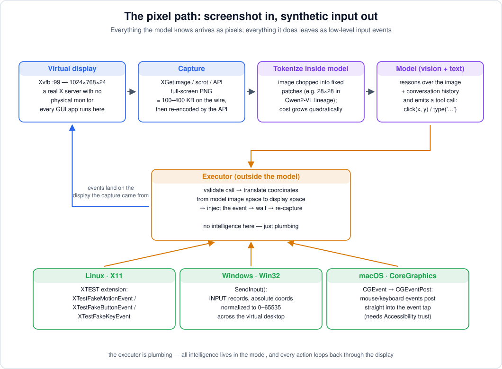

# 02 — Pixel Path I: The Display, the Capture, and What an Image Costs

> **Where this file fits**
> ```
>   machine state ──► [capture] ──► [encode] ──► tokens ──► model
>                        ▲                                   │
>                        │        coordinates come back      ▼
>                    [inject] ◄──────────── [executor] ◄── tool call
> ```
> This file covers everything left of the model: the virtual display the agent lives on, how screenshots are taken, **exactly how many tokens a screenshot costs in each major model family**, and how coordinates survive (or fail to survive) the round trip. File 03 picks up at the model and the executor.



*The whole pixel path at a glance — files 02 and 03 detail every box.*

---

## 1. Why pixels at all

Before the mechanics, the case for the pixel path — because it is expensive and fragile, and it survives anyway:

- **Universality.** A screenshot works on every app that can render: GTK, Qt, Electron, Java Swing, a Qt app from 2007, a game, a remote desktop session inside a browser tab, a video player. An accessibility tree works only where someone implemented one (files 04–05 cover how often that is, and isn't).
- **Fidelity.** The pixels are the ground truth of "what the user would see." A tree can describe a button as enabled while it's actually 80% transparent behind a modal; the screenshot cannot lie that way.
- **No cooperation needed.** The app does not need to know it's being automated, which is exactly the property that lets the same agent operate a commercial web app, a legacy internal tool, and a PDF viewer.
- **Training alignment.** The frontier models have seen enormous amounts of screenshot-and-click data. When you give them pixels, you're running them at their native capability.

The price is paid in tokens (Section 3) and in *grounding* — the model must answer "where in this image is the thing I want?" (file 03). This file is about paying the token price with open eyes.

---

## 2. The virtual display

### 2.1 Xvfb and friends

An agent should not drive *your* screen, for privacy, for safety, and mostly for reliability — you'd fight over the cursor, the screen would lock, resolution would change. So the standard setup is a **headless virtual display**: a real X server with no physical monitor attached.

```
Xvfb :99 -screen 0 1024x768x24 -ac +extension GLX +render -noreset
```

- `Xvfb` (X virtual framebuffer) is the workhorse. GUI apps by the ton — Firefox, LibreOffice, VS Code, a file manager — run against it unmodified. Rendering is software (llvmpipe); fine for documents, adequate for most desktop apps, bad for 3D and video.
- The `:99` is just a display number; `1024x768x24` is the classic agent resolution (XGA, 24-bit color); `-ac` disables access control so programs in the same sandbox can connect; `+extension GLX +render` keeps OpenGL-ish apps happier; `-noreset` stops the server from resetting when the last client exits (so a long-lived agent desktop survives app restarts).
- A human (or recording system) can view the same display via `x11vnc -display :99`, which pairs with noVNC for a browser-visible "agent screen."

**Why 1024×768 specifically?** Four reasons compound:

1. **Token cost scales with pixels.** 1024×768 ≈ 0.79 megapixels — several times cheaper than a 1080p or Retina-sized frame (numbers in Section 3).
2. **Legibility floor.** Below roughly 800px width, normal-size UI text starts degrading after the vision encoder's patching; the model misreads labels, and grounding collapses.
3. **Legacy of the training data.** The first widely-used computer-use models (Anthropic's computer tool, OpenAI's CUA demos) recommended 1024×768 for their virtual desktops, and agent training data drifted toward desktop proportions that look like XGA.
4. **Predictability.** A fixed, known resolution makes the coordinate math in Section 4 constant across runs, instead of another variable per task.

> **Under the hood**
> Why X11 and not Wayland? Input injection. X11 has the **XTEST** extension: any client of the display can ask the server to fabricate motion, button, and keyboard events, and old, boring APIs like `XTestFakeMotionEvent` do exactly what an agent needs. Wayland, by design, lets no process inject input into another — a global "press a key" is considered a security hole, not a feature. Agent sandboxes therefore overwhelmingly pin themselves to X11/Xvfb (on Linux) or to the OS-native injection APIs discussed in file 03 (Windows, macOS). Where Wayland-style thinking is required on Linux, one is left with privileged kernel routes (`uinput`, i.e., emulating a hardware input device — requires elevated access) or compositor-specific virtual-keyboard protocols that most compositors don't implement.

### 2.2 A second pattern: the display is already virtual

In commercial products the whole computer is already a VM (files 07–08) and the "virtual display" is simply the guest's own Xorg/Sway session — possibly at higher resolution because a human might be watching over VNC. In benchmark harnesses (OSWorld), the VM's screen is likewise the real thing, and the harness captures it from inside the guest. The Xvfb setup above is the *development* form of the same idea; production moves it inside a microVM.

### 2.3 Quirks that bite

| Quirk | What happens | Taming it |
|---|---|---|
| **HiDPI scaling** | Screenshots return *physical* pixels (2× on many Retina-class setups); the "logical" coordinates from accessibility APIs are in points | Force scale factor 1 in the guest; or multiply consistently by the scale factor |
| **Multi-monitor** | Capture picks a screen; coordinates may be relative to a monitor or the whole virtual desktop | Agents run single virtual monitor; if not, pin the capture to one output |
| **Cursor rendering** | Some captures include the pointer, some don't; a drawn cursor can hide a target | Prefer captures without cursor; hide pointer before capture if needed |
| **Animations & caret blink** | Every frame differs slightly; naive "screen changed?" checks false-positive forever | Compare with tolerance; wait for quiescence (two identical frames) before reasoning |

---

## 3. How an image becomes a token bill

This section is the least glamorous and most load-bearing part of the pixel path. **The model never sees your PNG; it sees tokens** — and each vendor tokenizes images with its own geometry. Three families cover almost everything in production:

### 3.1 Anthropic-style: a constant per pixel

Claude's vision processing is the simplest to reason about:

- images with a long edge above **1568 px** are downscaled until the long edge is 1568;
- the token count is then **≈ (width × height) / 750**;
- so the cost is *linear in pixels* with one constant, and resolution reduction is the only lever.

| Frame | Math | ≈ Tokens |
|---|---|---|
| 800×600 | 480,000 / 750 | ~640 |
| **1024×768** | 786,432 / 750 | **~1,050** |
| 1280×720 | 921,600 / 750 | ~1,230 |
| 1920×1080 *(downscaled to 1568×882 first)* | 1,382,976 / 750 | ~1,845 |

### 3.2 OpenAI-style: tiles

GPT-4o-class vision (and the GPT-4.1 line) counts differently — by **512×512 tiles**:

1. scale the image to fit within 2048×2048;
2. scale it so the **shortest side is 768 px**;
3. count tiles: `tokens ≈ 85 + 170 × (tiles_w × tiles_h)`.

| Frame | After scaling | Tiles | ≈ Tokens |
|---|---|---|---|
| 1024×768 | no change (short side already 768) | 2×2 | **85 + 680 = ~765** |
| 1366×768 | no change | 3×2 | 85 + 1020 = ~1,105 |
| 1920×1080 | → 1365×768 | 3×2 | ~1,105 |
| low-detail mode (any frame) | shrunk to 512×512 | 1 | 85 |

Note the punchline: on a 1024×768 desktop the OpenAI-style count is *cheaper* than the Anthropic-style count (~765 vs ~1,050), and the gap widens with resolution because tiles quantize — 1920×1080 costs only ~1,100 here versus ~1,845 in the other scheme. Vendors hide this complexity behind "image tokens" in billing dashboards; the agent engineer should still know why the same screenshot prices differently.

### 3.3 Qwen2-VL-lineage: one token per 28×28 patch

The open-model family that most GUI agents are built on (Qwen2-VL and its descendants; UI-TARS and a generation of grounding models sit on this line) takes the image at **native resolution**:

- the pipeline normalizes the image to multiples of **28×28 px**, and after patch embedding plus 2×2 merging, **roughly every 28×28 patch of the original image becomes one token**;
- token count ≈ `ceil(W/28) × ceil(H/28)` (before any harness-side downscale).

| Frame | Patch grid | ≈ Tokens |
|---|---|---|
| 800×600 | 29 × 22 | ~630 |
| **1024×768** | 37 × 28 | **~1,036** |
| 1280×720 | 46 × 26 | ~1,196 |
| 1920×1080 | 69 × 39 | ~2,690 |

An uncropped 1080p screenshot at ~2,700 tokens is a large step; this is why harnesses targeting these models habitually **downscale captures** to ~1280-wide or ~1024-wide before feeding them in — and why "the screenshot was legible enough" is a model-specific property, not a universal one.

> **Gotcha**
> Resolution is a *three-way trade-off*, not a knob: higher resolution = better grounding for small targets, worse cost, and — for some models — a surprising loss of quality if the image is far outside the proportions the model was trained on. The standard answer is: run the display at a modest fixed size (1024×768 or 1280×720), and use **zoom-and-crop** (file 03) when fine targets matter — spend tokens where the pixels are *large*, not everywhere at once.

### 3.4 The per-step and per-task view

Image tokens are per-frame, but tasks are per-step:

- one screenshot ≈ 0.6k–1.9k tokens depending on family/resolution (above);
- a 40-step task with a fresh full screenshot per step and **no pruning** re-reads an average of ~20 screenshots per turn → the tail of the run is carrying tens of thousands of image tokens *per call*;
- prompt caching (file 03) makes the re-read cheap for the unchanged prefix, and pruning replaces old frames with a few dozen summary tokens each. An agent that does neither is not "slightly wasteful" — it is 5–20× more expensive per task than the same agent with triage, and slower on top.

---

## 4. The coordinate obstacle course

A click reaches the OS as a coordinate on the *display*. It left the model as a coordinate in the *model's image frame*. Between those two statements there are up to four different coordinate spaces. Draw them:

```
   ┌────────────────┐   capture scaling    ┌────────────────┐   API preprocessing   ┌────────────────┐
   │  display       │ ───────────────────► │  captured PNG  │ ────────────────────► │ model's image  │
   │  1920×1080     │   (e.g. ×0.667)      │  1280×720      │   (vendor, e.g. ≤1568)│ frame it reasons│
   │  (cursor lives │                      │                │                       │ over, e.g.      │
   │   here)        │◄─────────────────────│                │◄──────────────────────│ 1280×720        │
   └────────────────┘   divide by factor   └────────────────┘   divide by factor    └────────────────┘
        ▲                                                                                   │
        │                              tool call: click(x_model, y_model)                   │
        └─────────────────────────────── executor maps back ◄───────────────────────────────┘
```

The rule that survives all of it:

> **Model-frame → display-frame: multiply by (display_size / model_image_size), per axis.**

If the model's image was W_model × H_model and the display is W_display × H_display:

```
x_display = x_model × (W_display / W_model)
y_display = y_model × (H_display / H_model)
```

Everything else — capture scaling, API-side downscaling, cropping, letterboxing — is just intermediate bookkeeping. Two worked examples:

**Example A — single downscale.** Display 1920×1080; harness captures and downscales to 1280×720 before sending; the model's frame is 1280×720 (stays under any vendor's 1568 limit). Model says *click(700, 375)* → display point:

```
x = 700 × (1920 / 1280) = 700 × 1.5 = 1050
y = 375 × (1080 / 720) = 375 × 1.5 =  562        → click(1050, 562)
```

**Example B — API rescale on top.** Display 1920×1080; harness sends the raw 1920×1080 PNG; the vendor downscales long edge 1920 → 1568, i.e. to 1568×882; the model's frame is 1568×882. Model says *click(900, 500)*:

```
x = 900 × (1920 / 1568) ≈ 1102
y = 500 × (1080 /  882) ≈  612                    → click(1102, 612)
```

**Example C — normalized output.** Some grounding models answer in a **0–1000 grid** normalized to the image: *click(468, 347)* means 46.8% across, 34.7% down. Then:

```
x = 0.468 × 1920 ≈ 899
y = 0.347 × 1080 ≈ 375
```

> **Gotcha**
> **Letterboxing** breaks the simple ratio. If the capture was padded (e.g., a GameBoy-shaped app embedded in a widescreen frame), the longest-edge logic produces blank bands, and the model's coordinates include them — but the display does too, so the ratio still works *if you kept the padded frame end-to-end*. It silently breaks when the harness crops the padding for "efficiency" but forgets to subtract the offset. The invariant to write on your wall: **exactly one component owns the mapping from model-frame to display-frame, and it is the executor.** The model should never be told to "account for scaling itself" — models are bad at bookkeeping arithmetic and they hallucinate plausible factors.

A less obvious cousin: **the model cannot even report what it sees in absolute terms with perfect reliability.** Grounding models trained mostly on 1× desktop screenshots show systematic biases (clicking slightly above-center of buttons, snapping to text rather than rows). Files 03 and 06 discuss verification patterns that absorb a few pixels of error — e.g., click the center of an element's *rectangle* from the tree when available, and verify via a localized pixel-change check.

---

## 5. Capture mechanics (what actually runs)

The capture path is boring code with nasty failure modes. The common implementations:

| Method | Where | Notes |
|---|---|---|
| `XGetImage` / `XShmGetImage` via python-xlib | X11 guest | Fast, direct; SHM variant avoids a round trip; what most Python agents use |
| `scrot`, `import` (ImageMagick) | X11 guest | Shell-out simplicity; fine at 1–3 fps |
| `ffmpeg -f x11grab` | X11 guest | Streaming frames; used when the harness wants near-live updates |
| Vendor-native tools (e.g., hosted "computer" APIs) | Provider's VM | The provider does capture inside its own hypervisor/guest and returns a PNG; harness sees none of this |
| OS-native APIs (`CGWindowListCreateImage` on macOS, UIAutomation-era `BitBlt` on Windows) | Real desktops | Needed for tests on real machines; permissions required (macOS Screen Recording) |

Encoding: **PNG** for lossless fidelity (bigger, ~100–400 KB for a 1024×768 desktop), **JPEG** to save bandwidth (smaller, but ringing artifacts around text can measurably hurt grounding — most agent stacks keep PNG).

Timing semantics worth nailng down:

- **When does "after the action" start?** The screenshot right after a click may catch the pre-render frame. Practical harnesses either sleep a small fixed time (100–300 ms), poll until two consecutive frames are identical (the display has quiesced), or use a smarter signal when available (window title change, accessibility event).
- **Screenshot latency budget:** on a headless X server, capture + encode is on the order of tens of milliseconds — negligible next to model latency (usually seconds). Prefer *more* screenshots, fewer *expensive* sleeps.
- **Frame currency:** always capture *after* the previous action has had a chance to land; a stale frame is worse than no frame because the model confidently reasons about a world that moved on.

> **Try this**
> On any Linux box with Xvfb installed:
> ```
> Xvfb :99 -screen 0 1024x768x24 -ac +extension GLX +render -noreset &
> DISPLAY=:99 firefox &
> DISPLAY=:99 import -window root /tmp/shot1.png     # ImageMagick capture
> DISPLAY=:99 xdotool mousemove 512 384 click 1     # XTEST motion + click
> DISPLAY=:99 import -window root /tmp/shot2.png
> ```
> Diff the two PNGs. You have just performed one pixel-path agent step by hand: capture → act → capture. Everything else in this series automates this loop and argues about what should cross the model boundary between steps.

---

## 6. Key ideas to carry forward

- Pixels are the universal observation channel: any GUI renders, no app cooperation required — at the cost of tokens and the grounding problem.
- Agent desktops are virtual displays; on Linux the industry standard is Xvfb on X11 because XTEST makes synthetic input trivial. Wayland deliberately lacks a global injection story.
- Image token cost is vendor-specific geometry: **Anthropic ≈ pixels/750 (long edge ≤1568), OpenAI ≈ 85 + 170 per 512-tile, Qwen2-VL lineage ≈ one token per 28×28 patch**. The same 1024×768 frame prices at roughly 1,050 / 765 / 1,036 tokens respectively.
- Four coordinate spaces exist between "the model's answer" and "the cursor's position"; the invariant that keeps them sane is `display = model × (display_size / model_image_size)`, owned exclusively by the executor.
- Capture and timing are second-order *per step* but first-order *per task*: stale or animated frames generate confident wrong reasoning, and screenshot cadence interacts directly with cost.

Next: [03 — grounding, synthetic input, and staying cheap](03-pixel-path-ii-grounding-control-economics.md).
