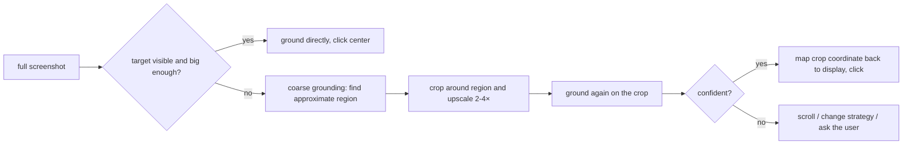

# 03 — Pixel Path II: Grounding, Synthetic Input, and the Economics of Staying Cheap

> **Where this file fits**
> ```
>   "click the Submit button"
>            │
>            ▼
>    ┌───────────────┐   where is it, in pixels?   ┌────────────────┐
>    │  GROUNDING    │ ──────────────────────────► │  tool call     │
>    │  (this file)  │                             │  click(x, y)   │
>    └───────────────┘                             └───────┬────────┘
>                                                          ▼
>                                          ┌──────────────────────────┐
>                                          │ EXECUTOR → XTEST /       │
>                                          │ SendInput / CGEvent      │
>                                          └──────────────────────────┘
> ```
> File 02 got the screenshot to the model and the coordinate math back. This file is about the two hard middle steps — deciding *where* the target is, and *delivering* the input in a way the OS honors — plus the cost discipline that makes a pixel agent viable at 40+ steps.

---

## 1. Grounding, defined

**Grounding** is the task of converting a linguistic description ("the blue Sign in button", "the third row in the inbox table") into a concrete screen location — pixels, or an element identity. Every GUI agent that acts on pixels must ground, and grounding is where most of its *perception* errors live.

Why it's genuinely hard:

- **Targets are tiny.** A 12px checkbox on a 1080p screen is a ~0.1% region of the image. Vision encoders work at patch granularity (file 02); small means a handful of patches mean a handful of tokens.
- **Text and function split.** The *label* "Sign in" may sit inside the button, above it, or in a column of identical-looking labels. The model must infer the clickable region, not just locate the glyphs.
- **Dense repetition.** Tables, sidebars, and toolbars are full of near-identical items where one attribute differs (row 3 vs row 4; enabled vs disabled styling).
- **Scale and theme drift.** The same button moves and changes appearance between apps, themes, resolutions, and zoom levels; a grounder that learned "the button is bottom-right" fails when the dialog grows.

Two families of solutions, which often combine:

| Approach | Idea | Example |
|---|---|---|
| **Trained grounders** | Fine-tune a VLM specifically to output the pixel location of a described element | SeeClick, UGround, UI-TARS family |
| **Set-of-Mark (marks)** | Detect candidate elements (via accessibility tree or a detector), draw numbered boxes, ask the model to pick a *number* | SoM prompting applied to GUI agents |

### 1.1 The grounding-model lineage

- **SeeClick (2024)** showed that screenshot-only pre-training — no HTML or accessibility tree needed at training time — yields strong GUI grounding, and introduced **ScreenSpot**, the benchmark that became the standard scoreboard for "can you point at the thing": instruction + screenshot in, target location out, split across desktop / web / mobile UIs.
- **UGround (2024)** trained a *universal* grounding model on a large corpus of GUI screenshots harvested across platforms, on a Qwen2-VL backbone — the pitch being that grounding should work "the human way": pure pixels, any GUI. It is the canonical example of "small model, single skill": a 2B–7B-class model whose entire job is `(screenshot, description) → point`.
- **UI-TARS (2025)** went end-to-end: a native GUI-agent model (also Qwen2-VL-lineage) with a trained **action space** — clicks in normalized 0–1000 coordinates, typing, scrolling, drags — and GUI-trajectory training data. Its grounding and OSWorld-class results at release were state-of-the-art for open models, and it popularized "the action schema is part of the model," which file 01 flagged as the contract that matters.
- **Generalist VLMs as grounders.** GPT-4o-class and Claude-class models can ground zero-shot surprisingly well for large targets — no fine-tuning — but their coordinate reliability degrades with density and scale, which is exactly what the specialist small models fix.

Where this leads architecturally (**the split-brain pattern**, expanded in file 06): a *planner* model (big, expensive, sees the task and history) delegates "where exactly is X?" to a *grounder* (small, cheap, local), which frees the planner from pixel-level bookkeeping and cuts the cost of every observation.

### 1.2 Set-of-Mark: turn pointing into classification

SoM inverts the problem. Instead of "where is the Submit button?", the harness:

1. finds candidate interactive elements (accessibility tree when available — files 04–05; else a UI detector);
2. draws each one with a small numbered overlay on the screenshot;
3. asks the model: "which mark is the Submit button?" → the model answers `7`;
4. the executor clicks the center of mark 7's rectangle.

The model's job collapses from *regression* (exact pixels, high variance) to *classification* (pick a label), which is exactly the kind of task VLMs are reliable at. Costs and caveats: an extra render+encode pass (the marked screenshot must be fresh), marks occlude content if the boxes are big, and the clickable universe is limited to what the detector saw — anything unmarked is invisible to the policy, so detectors must err on inclusion. OSWorld's benchmark suite carries SoM as a first-class observation mode for exactly this reason.

---

## 2. Clicking safely: observe → propose → zoom → confirm

The single most effective reliability upgrade for a pixel agent is refusing to click full-resolution guesses. The **zoom loop**:



Why it works: after a crop-and-upscale, the target occupies *more patches*; the grounder sees "a large button at the center" instead of "a 5px smudge" — and crop coordinates map back with simple offset+scale arithmetic (the executor's job, never the model's). This is also the natural place to spend the token budget asymmetrically: one full 1024×768 frame to *find the region*, then 2–3 tiny crops (each a few hundred tokens) to *pin the target*.

Additional propose-act-verify patterns that belong in every pixel agent:

| Pattern | Use |
|---|---|
| **Verify-after-click** | After each click, re-capture and check the expected change (menu opened, checkbox toggled, selection moved). If nothing changed, do not proceed as if it had. |
| **Localized diff** | Compare only the region around the click before/after; global diffs drown in caret blink and clock ticks. |
| **Escalating retries** | Same click → slightly offset click (models exhibit small systematic biases) → zoom-confirm → keyboard alternative (Tab + Enter reaches most form controls without pixels) → scroll-into-view (the target may be off-screen) → declare and rethink. |
| **Keyboard over mouse** | For text entry and form traversal, `Tab`/`Enter`/shortcuts are far more reliable than pixel clicks and cost less; the pixel path should be a fallback, not the default, for inputs. |
| **Idempotence audit** | Retries can double-fire actions (two "Submit" clicks). Where a retry completed but the observation lagged, the next action must be able to absorb the redundancy — e.g., check state before acting again. |

---

## 3. Input injection: making the computer believe

The executor's third act, after mapping coordinates, is **synthesizing input**. Three platform stacks cover the ecosystem; each has the same shape — create an event, give it coordinates/text, inject it at a level the OS treats as real — and each has its own permission model and gotchas.

### 3.1 Linux / X11: the XTEST extension

XTEST is an X server extension that fabricates events indistinguishable from hardware:

```
XTestFakeMotionEvent(display, screen, x, y, delay);      // move pointer to (x, y)
XTestFakeButtonEvent(display, button, is_press, delay);  // press/release button 1=left, 2=middle, 3=right
XTestFakeKeyEvent(display, keycode, is_press, delay);    // press/release by keycode
```

- **No kernel, no permissions.** Any X client may call it — which is precisely why agent sandboxes are X11.
- `xdotool` is the friendly front end (`xdotool mousemove 512 384 click 1`), and most Python agents wrap python-xlib directly.
- **Why not `XSendEvent`** (the older "synthesize an event" API)? Many toolkits and apps *ignore* SendEvent-delivered events because the event carries a "synthetic" flag; XTEST events carry no such flag. This distinction is a classic debugging trap: the click was "sent" and did nothing.
- **Wayland:** no XTEST equivalent by design; the escape hatches are privileged `uinput` (kernel-level fake hardware — needs elevated access) or compositor-specific virtual-keyboard protocols that most compositors don't implement. This is a large part of why agent desktops remain X11.

### 3.2 Windows: SendInput

`SendInput` takes an array of `INPUT` records — mouse or keyboard events — and inserts them into the system input queue as if generated by hardware:

```c
INPUT in = {0};
in.type = INPUT_MOUSE;
in.mi.dwFlags = MOUSEEVENTF_MOVE | MOUSEEVENTF_ABSOLUTE | MOUSEEVENTF_VIRTUALDESK;
in.mi.dx = (LONG)(x * 65535.0 / (screen_w - 1));   // normalize!
in.mi.dy = (LONG)(y * 65535.0 / (screen_h - 1));
SendInput(1, &in, sizeof(INPUT));
```

- **Absolute coordinates are normalized to 0–65535** across the *virtual desktop* (all monitors), whether or not `MOUSEEVENTF_VIRTUALDESK` is set the denominator changes — the classic off-by-monitor bug.
- Keyboard input is by `wVk` (virtual-key) + scan code, **or** `KEYEVENTF_UNICODE` with UTF-16 units to type arbitrary characters without caring about keyboard layout.
- **UIPI (integrity levels):** a normal-process agent cannot inject into a window running at higher integrity (a UAC-elevated app or the secure desktop). If the task involves elevated apps, either the agent runs elevated or the task is out of reach for input injection.
- `SendInput` returns how many events it inserted; a return of 0 usually means UIPI blocked it — check, don't assume.

### 3.3 macOS: CoreGraphics events

```swift
let move = CGEvent(mouseEventSource: nil, mouseType: .mouseMoved,
                   mouseCursorPosition: CGPoint(x: x, y: y), mouseButton: .left)
move?.post(tap: .cghidEventTap)
let clickDown = CGEvent(mouseEventSource: nil, mouseType: .leftMouseDown,
                        mouseCursorPosition: CGPoint(x: x, y: y), mouseButton: .left)
clickDown?.post(tap: .cghidEventTap)
// …matching .leftMouseUp
```

- Events post into the HID event stream (`.cghidEventTap`), below the window server — apps cannot distinguish them from a real mouse.
- **Permissions are the story:** the posting process must hold **Accessibility** trust (System Settings → Privacy & Security → Accessibility; `AXIsProcessTrustedWithOptions` prompts). Without it the calls silently no-op. For *screen capture* on modern macOS you additionally need **Screen Recording** permission. A sandboxed app generally cannot hold these grants — the agent harness must be a properly granted process on the machine.
- `CGEventPostToPid` targets a specific process; keyboard events can carry a Unicode string (`CGEventKeyboardSetUnicodeString`) — the cleanest way to "type" text on macOS.

### 3.4 Typing text, two ways

| Way | Mechanism | When |
|---|---|---|
| **Per-key events** | One keyboard event per character (XTEST / SendInput UNICODE / CGEvent Unicode) | Short strings; when the app's keyboard handling matters (autocomplete, key handlers); avoids clipboard |
| **Clipboard + paste** | Put text on the clipboard (`xclip`, `pbcopy`, PowerShell `Set-Clipboard`) and send the paste shortcut (`ctrl+v` / `cmd+v`) | Long text, code, content with awkward characters; one action instead of N; but it clobbers the clipboard and some fields/terminals treat paste differently |

This sounds like a footnote and is not: **typing is the slowest primitive** an agent has (dozens of events), and a large fraction of "the agent typed the wrong thing" bugs are encoding, keyboard-layout, or IME problems — cases where Unicode-typed input and clipboard-paste diverge. A mature executor exposes both and lets policy choose.

### 3.5 The executor contract (the same five jobs everywhere)

| Job | Detail |
|---|---|
| **Validate** | tool exists, coordinates inside screen bounds, action allowed by policy, step budget not blown |
| **Translate** | model frame → display frame (file 02's ratio); element ref → rectangle center; text → event stream or clipboard sequence |
| **Execute** | inject via the platform API; ensure atomicity for composites (a drag is down→move→up with no other client events interleaved) |
| **Settle & capture** | short wait or quiescence poll; capture the next screenshot *even if the action failed* — the model needs to see what actually happened |
| **Record** | log the call, the mapped coordinates, the result, and both frames; this is the audit trail and the debugging dataset |

> **Gotcha**
> Every one of these needs a test suite of its own: a "click the moving target" test (window being dragged), a "click behind overlay" test (tooltip), a "type into secure field" test (password boxes often block synthetic events or display nothing), a "double-click timing" test (the OS double-click interval is a setting the executor should respect, not a magic 200ms), and a "screen locked" test (lockscreens ignore injected input entirely — the agent must detect and bail).

---

## 4. The economics: caching, pruning, batching

Now the ledger. A pixel agent's recurring costs are (a) input tokens — dominated by accumulated screenshots — (b) output tokens, and (c) wall-clock. Schematic for a 40-step task with ~1,050-token screenshots and ~3k tokens of system prompt + task:

| Regime | What it sends per turn | ≈ Total input tokens across the task | Notes |
|---|---|---|---|
| **Naive** | system + *full history* (every screenshot + every action) | ~1.0M | Turn *k* re-reads *k−1* screenshots |
| **+ Prompt caching** | same content, but the unchanged prefix is cached; only the new tail is processed at full price | ~0.25M *equivalent* | Cache reads typically cost a small fraction of fresh input; cache writes slightly more than input once |
| **+ Pruning** | old screenshots collapsed to short text notes ("step 12: Advanced tab open"); the last few frames kept live | ~0.1M *equivalent* | Bounded tail: per-turn cost stops growing with step count |

*(Order of magnitude, illustrative arithmetic — the point is the shape, not the constants.)*

### 4.1 Prompt caching

The big providers cache the *prefix* of a request: same system prompt, same tool definitions, same early messages → those tokens are processed once and reused. For agents this changes the unit of thinking:

- **Cache stability is a design constraint.** Any byte-level change near the prefix (tools reordered, a timestamp in the system prompt, history edited mid-conversation) invalidates the cache and reverts you to naive pricing. Stable prompts, append-only histories, and putting "what changed" at the tail are how agents keep their cache hits.
- **Conversation shape should be append-only whenever possible.** Accumulate; don't rewrite earlier turns. When pruning *does* rewrite history (Section 4.2), do it in a burst (one big invalidation) rather than a trickle (an invalidation per step), or prune into the tail so the cached prefix survives.

### 4.2 Pruning

The model needs *state* more than it needs *photographs*. Practical pruning patterns, in ascending aggression:

1. **Keep the last K frames** as images; till then, leave everything (rarely done beyond K≈3–5).
2. **Elide the rest to text.** After each step, write a one-line fact sheet: what screen we're on, what changed, what's pending. Old screenshots are dropped; the log stays. This is the single highest-leverage change after caching.
3. **Anchor summaries.** Periodically summarize the whole task state ("Goal: …; done: …; current: …; blocked: …") into a single message; older detail can go. This doubles as the agent's scratchpad and its defense against "lost context" failures (file 09).
4. **Keep the current frame always.** Never prune the observation the model is about to act on.

> **Remember**
> Caching and pruning are not micro-optimizations; they change which *task shapes* are affordable. At naive pricing, a 40-step screenshot loop is a luxury good and a 250-step long-horizon task (OSWorld 2.0 territory) is out of reach. With caching + pruning, the same policies run long tasks with per-step costs roughly *flat* instead of *growing*.

### 4.3 Batching and speculation

- **Multiple tool calls per turn** (parallel tool-use) lets the model, e.g., type into three fields before re-observing. The win is fewer model round-trips; the risk is compounding unverified actions. Good practice: batch only *low-risk, locally-verifiable* sequences (typing then Tab; scroll times N), and require an observation before anything that branches on state.
- **Composite primitives**: a drag as one call; "focus the address bar, clear it, type a URL, press Enter" as one scripted macro is very common in real products (cheaper and more reliable than four decisions).
- **Speculation**: issuing the *likely next read* in advance (e.g., capturing a zoom crop of a region the agent is about to need — UFO2-style speculative actions, file 06). Worth it only when the marginal cost of being wrong (an unused crop) is trivial; never speculate on *writes* (a speculative destructive click is how demos become incidents).

---

## 5. Failure catalog of the pixel path

| Failure | Mechanism | Mitigation |
|---|---|---|
| **Hallucinated coordinates** | Model emits a plausible-looking point with no target there | Zoom-confirm before acting; click-center-of-detected-element; verify after |
| **Systematic offset** | Coordinate-space bug (file 02) or model bias (e.g., clicks above text) | Own all transforms in the executor; calibrate with a corner-grid test screen |
| **Adjacent-item error** | Clicks the label next to the actual row/checkbox | Prefer rectangles from a tree/detector (SoM) over freehand points |
| **Stale frame** | Acts on a screenshot older than the app's last paint | Quiescence wait; re-capture right before decide; verify after act |
| **Double-fire** | Retry storm submits forms/payments twice | Idempotence checks; read state before re-acting; confirmation gates on irreversibles |
| **Drag drift** | Long drags move the pointer in steps; UI treats it as multiple hovers | Atomic down-move-up in one executor call; intermediate motion smoothing not needed on X11 |
| **Moving targets** | Button slides due to animation/resize mid-click | Wait for quiescence; click center of *current* frame; avoid acting on animated UIs when possible |
| **Overlay interception** | Tooltip/notification/toast covers the target; click "succeeds" | Detect through pixel diff at the target; dismiss overlays first; verify the intended change |
| **Password/secure fields** | Synthetic input ignored, or characters masked in tree & screenshot | Detect secure context; escalate to user; never log keystrokes into logs |
| **CAPTCHA / bot defenses** | Input timing and pointer motion patterns look inhuman | Human-in-the-loop; respect site terms; do not build evasion |

---

## 6. Reality check: what the benchmarks actually measured

The pixel path's progress is best seen through OSWorld, the standard testbed (a VM with real apps; execution-based scoring of hundreds of real desktop tasks):

- **OSWorld 1.0 (2024):** **369 tasks** spanning web and desktop apps, OS file I/O, multi-app workflows; humans complete **~72.4%**, and the best model at release **~12.2%**. The benchmark's analysis attributed the gap to **GUI grounding and operational knowledge** — exactly the pixel-path layers of this file.
- The observation space of the benchmark includes **screenshots, the accessibility tree, both, and Set-of-Mark** — a strong statement that practitioners treat these as the real design options. Its analyses also found that *higher screenshot resolution typically improved success*, and that longer *text* histories helped more than screenshot-only histories — an early sighting of the pruning insight in Section 4.
- **Verified re-run (2025)** tightened the benchmark; frontier agents climbed into the tens of percent — but note *how* they climbed: largely by better grounding, zooming, reflection, and tree use. The residual failures were moving to a different layer.
- **OSWorld 2.0 (2026)** made that relocation explicit: **108 long-horizon tasks** (median ~**1.6 hours** of human work; **69.6%** of tasks take skilled humans over an hour) with agents averaging **>250 steps** per task (versus ~30 in v1). Best models complete ~**20%** of tasks. The published failure analyses are diagnostic gold — the agents can now *click correctly*, and still fail by losing track of constraints, missing information that arrives mid-task, guessing instead of asking, and skipping verification. "Streaming interaction" (UI changes between observation and action) is listed as its own challenge phenomenon.

The takeaway for this series: the pixel path's *mechanics* (this file) are largely solved engineering; its *limits* are the agent's memory and discipline — which is exactly why the next part of the series looks at cheaper, more structured ways to see (the accessibility tree) and at the machines these agents run on.

> **Interview angle**
> "The best agents click correctly now — what makes that true?" Good answer: dedicated grounding models or marks made pointing a classification problem, zoom/retry loops made small targets big, and executor-owned coordinate mapping eliminated scale bugs. Then land the pivot: "and what still fails is state, not clicks" — cite the OSWorld 2.0 failure modes.

---

## 7. Key ideas to carry forward

- Grounding — text to pixels — is the pixel path's core skill; the ecosystem solved it with specialist small models (SeeClick → UGround → UI-TARS lineage), Set-of-Mark classification, and zoom-confirm loops.
- Input injection is per-platform plumbing with real permission models: **XTEST** (X11, no permission drama, the reason agent sandboxes are X11), **SendInput** (Windows, normalized 0–65535 absolute coords, UIPI limits), **CGEvent** (macOS, Accessibility trust required).
- The executor validates → translates → injects → settles → captures → records; it owns every coordinate transform and every platform quirk, and it is dumb by design.
- Cost discipline (prompt caching, pruning of old frames to text, right-sized batching) is what makes long-horizon pixel agents affordable — and it changes failure modes as much as it changes bills.
- The frontier has shifted from *perception/control* failures to *planning/memory/verification* failures; interviews and roadmaps should follow the same shift.

Next: [04 — the structure path: accessibility trees on Linux](04-structure-path-i-at-spi-linux.md).
