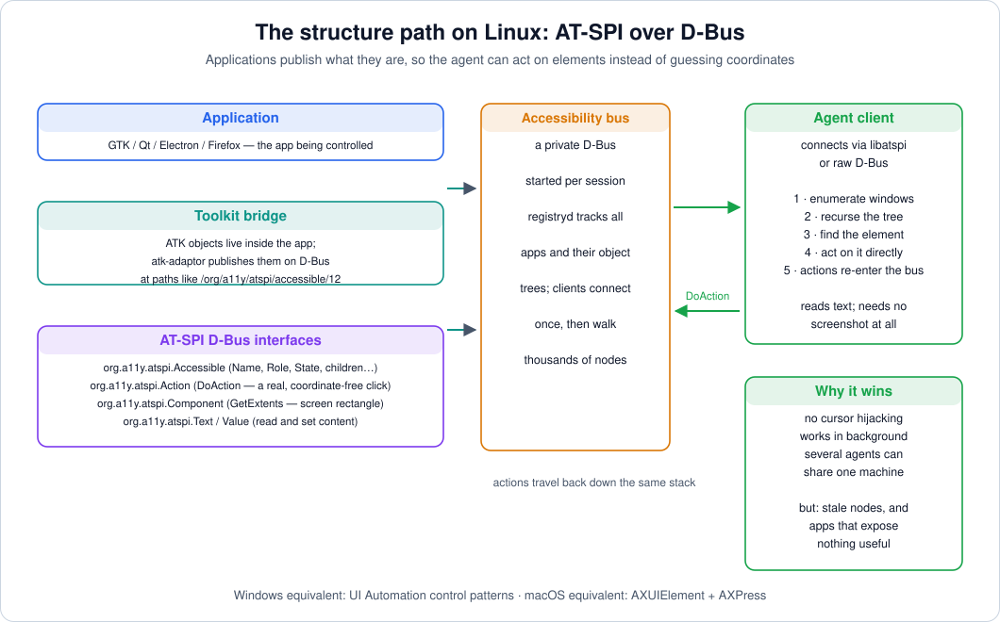

# 04 — Structure Path I: Accessibility Trees on Linux (AT-SPI)

> **Where this file fits**
> ```
>   pixel path  : screenshot → model guesses where things are → synthetic clicks
>   structure path: app PUBLISHES what it is → agent reads it → native actions
>                    ▲
>                    └── this file: how Linux apps publish themselves (AT-SPI),
>                        what's inside a node, and how an agent operates through it
> ```
> Files 04–06 cover the second way to perceive and control a computer. The core idea: the accessibility infrastructure that exists for screen readers is a full, structured, actionable description of every window on the desktop — and an agent can consume it.

---

## 1. The big idea: apps already describe themselves

For decades, GUI toolkits have shipped an **accessibility layer**: every button, text field, menu item, and table cell is exposed as an object with a **role** ("I am a button"), a **name** ("Sign in"), **states** ("enabled, focused, showing"), **geometry** (its rectangle on screen), and **behavior** ("I support a *click* action"), connected in a **tree** that mirrors the UI hierarchy. Screen readers and other assistive technologies (ATs) drive the desktop entirely through this layer — a blind user "reads" Reddit and "clicks" buttons without ever touching a pixel.

An agent that reads the same layer gets, for free:

- **Precise targeting** — "click the element with role=button, name='Sign in'" needs no pixel guessing at all.
- **Cheap observations** — a text dump of the visible tree is often a few thousand tokens, comparable to one screenshot but *precise* rather than suggestive.
- **Coordinate-free actions** — most platforms let you *invoke* an element's action directly ("press"), which doesn't move the mouse and doesn't need the window to be foreground. That single property is what makes background agents and parallel agents possible.
- **Semantic verification** — after an action, states and values change visibly in the tree ("checkbox now `checked`") — a far cleaner success signal than a pixel diff.

On Linux, this layer has a name: **AT-SPI** — the Assistive Technology Service Provider Interface — and it speaks **D-Bus**. This file reads the current implementation (the at-spi2-core project) and turns it into agent engineering.

---

## 2. Anatomy of a node

Everything an agent needs to know about a UI element is in one accessible object:

```
   ┌─────────────────────────────────────────────────────────────┐
   │  an accessible object (one node in the tree)                │
   ├─────────────────────────────────────────────────────────────┤
   │  Name          "Sign in"            (short, for humans)     │
   │  Description   "Submits the form"   (longer detail)         │
   │  Role          button               (~130 possible roles)   │
   │  States        enabled, focusable, showing, visited, …      │
   │  Relations     labelled-by → node #17 (the form's legend)   │
   │  Attributes    toolkit-specific key/values                  │
   │  Geometry      (x, y, width, height) on screen              │
   │  Children      the nodes below it                           │
   │  Interfaces    does it implement Action? Text? Value?       │
   └─────────────────────────────────────────────────────────────┘
```

A human-readable rendering of a small tree — this is roughly what a screen reader (or agent) "sees" for a login dialog:

```
application "Firefox"
└─ frame "Example App — Sign in"                       [active, focused]
   ├─ dialog "Sign in"                                 [modal]
   │  ├─ label        "Email"                          (labelled-by → entry below)
   │  ├─ entry        ""                               [editable, focused]   (x=360,y=210,w=280,h=32)
   │  ├─ label        "Password"
   │  ├─ password text "••••••••"                      [editable]            (x=360,y=258,w=280,h=32)
   │  ├─ check box    "Remember me"                    [checkable]
   │  └─ button       "Sign in"                        [enabled, is-default] (x=520,y=310,w=96,h=32)
   └─ link "Forgot password?"                          [enabled]
```

An agent acting through this tree can do things a pixel agent can only approximate: find the element by role+name regardless of where it moved; check that it's `enabled` *before* clicking; invoke it directly; then confirm the dialog disappeared from the tree. No screenshots involved.

### 2.1 Roles — the vocabulary of "what kind of thing is this"

AT-SPI defines around **130 roles**. The subset that matters most for agents, with their agent-facing meaning:

| Role | What it is | Agent consequence |
|---|---|---|
| `application` / `frame` / `window` / `dialog` | top-level containers | tree roots; dialogs may be `modal` |
| `button` (incl. `push button menu`) | clickable action | usually implements the `Action` interface |
| `toggle button` / `check box` / `switch` / `radio button` | binary choices | states `checked`/`pressed`/`indeterminate` tell the value |
| `check menu item` / `radio menu item` | menu variants of the above | same, inside menus |
| `entry` / `password text` / `text` / `editbar` | text fields vs read-only text | `editable` state; `EditableText` interface for setting content |
| `combo box` / `spin button` / `slider` / `scroll bar` | range/managed inputs | `Value` interface: current/min/max |
| `list` / `list item` / `list box` | selectable lists | selection states; `Selection` interface |
| `tree` / `tree item` | hierarchical lists | `expanded`/`collapsed` states |
| `table` / `table cell` / `table row` | tabular data | `Table` interface; often `manages descendants` (see §7) |
| `page tab` / `page tab list` | tabbed UIs | selection = active tab |
| `menu` / `menu bar` / `menu item` | menus | popups appear as separate `popup menu` objects |
| `label` | static text | often the accessible name source for an input via `labelled-by` |
| `link` | hyperlinks | typically implements an action that activates it |
| `image` / `icon` | pictures | may still carry a name |
| `progress bar` / `status bar` / `level bar` | progress/status | value or text content |
| `alert` / `notification` / `info bar` | messages to the user | agents should *notice* these before acting |
| `tool tip` | transient help | a classic overlay blocker (file 03) |
| `heading` / `paragraph` / `document frame` variants | document structure | reading order for text-heavy tasks |
| `redundant object` | "ignore me, technical artifact" | **filter out of dumps** — the tree has noise |
| `unknown` | role not known | treat cautiously |

### 2.2 States — the machine-readable flags

States arrive as a bitmask; the set below is curated for agents (each is genuinely part of the spec — the `atspi-constants.h` enumeration):

| State | Meaning | Why the agent cares |
|---|---|---|
| `enabled` / `sensitive` | interactable | don't click disabled buttons; wait for enablement |
| `focusable` / `focused` | keyboard focus | focus tells you where typing goes |
| `showing` / `visible` | exposed / potentially on screen | filter out hidden nodes; showing ≠ unobscured |
| `editable` / `read only` | content mutability | choose `EditableText` vs `Text` |
| `checked` / `indeterminate` / `checkable` | tri-state booleans | read checkbox values without pixels |
| `selected` / `selectable` / `multiselectable` | list/tab selection | verify selection changed |
| `expanded` / `collapsed` / `expandable` | disclosure widgets | open before searching children |
| `pressed` | momentary press state | rare, mostly for credentials in tests |
| `active` | "active subelement" | e.g., current cell in a table |
| `busy` | mid-change | **wait** — acting now races the app |
| `modal` | blocks other windows | treat as a wall: handle it or you're stuck |
| `required` / `invalid entry` | forms | validation logic without OCR |
| `busy`, `animated`, `transient` | in flux | avoid acting on transient things |
| `defunct` / `stale` | **dead or outdated** | the staleness alarm (see §8) |
| `manages descendants` | don't enumerate children | performance safety valve (see §7) |
| `has popup` / `has tooltip` | conditional content | predict what clicking will reveal |
| `is default` / `visited` / `truncated` / `supports autocompletion` | misc semantics | affordance hints |

### 2.3 Relations — the graph around the tree

The tree is not the whole story; relations add labeled edges *across* it (all from the spec's relation enumeration):

| Relation | Meaning |
|---|---|
| `label for` / `labelled by` | the label↔control pairing (that's how "Email" became the entry's context in §2) |
| `controller for` / `controlled by` | scrollbar ↔ viewport, spinner ↔ its input |
| `member of` | grouping ("same group as") |
| `node child of` / `node parent of` | non-tree hierarchy hints |
| `flows to` / `flows from` | logical reading/focus order |
| `subwindow of` / `embeds` / `embedded by` | cross-process/widget embedding |
| `popup for` / `parent window of` | menus/tooltips and what spawned them |
| `description for` / `described by` | extended description ↔ described object |
| `details` / `details for`, `error message` / `error for` | long-form help and validation errors |

Relations are how an agent resolves "the input for the label 'Email'" without geometric heuristics — the toolkit already computed that graph.

---

## 3. The AT-SPI architecture (read from the source)

The at-spi2-core project defines the whole stack. Its README is the map — the pieces, in its own words:

| Component | Role |
|---|---|
| `xml/` | **The D-Bus interface definitions** — the authoritative spec of what an accessible object can do (`Accessible`, `Action`, `Component`, `Text`, `Value`, `EditableText`, `Table`, `Selection`, `Cache`, `Collection`, `DeviceEventController`, …) |
| `bus/` | Launcher for the session's **accessibility bus** |
| `registryd/` | Daemon that **tracks accessible applications** in the session and lets them talk to ATs |
| `atk/` | GObject API that toolkits/apps implement to *be* accessible |
| `atk-adaptor/` | Translates the in-process ATK API into the D-Bus **AT-SPI API** (an implementation detail — but the component that makes GTK apps visible on the bus) |
| `atspi/` (libatspi) | Hand-written C client binding to the D-Bus interfaces (used by the adaptor; most agents use a language binding or raw D-Bus) |
| `dbind/`, `droute/` | D-Bus plumbing underneath (this stack predates the modern convenience bindings) |

### 3.1 How the pieces connect



The important structural facts:

- **There is a dedicated bus.** Apps don't publish accessibility data on the regular session bus. A launcher (`bus/`) starts an **accessibility bus**, and the session bus hosts a small well-known endpoint `org.a11y.Bus` whose `GetAddress` method returns the address of the accessibility bus. Clients (screen readers, agents) connect to that address and then see every accessible app in the session.
- **Every app is a D-Bus peer with an object tree.** An application exposes its accessible objects at object paths (the application root lives at `/org/a11y/atspi/accessible/root`; children below it, e.g. `/org/a11y/atspi/accessible/42`), and object references on the wire are `(string, object-path)` pairs — in practice, the app's name on the accessibility bus plus the path of the node.
- **The registry daemon keeps the census.** `registryd` tracks which applications are running and accessible, so a client can enumerate the desktop rather than guess bus names.
- **The toolkit bridge does the translation.** A GTK app implements ATK; `atk-adaptor` turns ATK objects into the D-Bus objects above. That's why "an app is agent-operable" on Linux usually reduces to "does its toolkit ship the adaptor" — GTK, Qt, Electron/Chromium, and Firefox all do.

> **Under the hood**
> AT-SPI 1.x used **CORBA** (GNOME's ORBit) for IPC — the interfaces still carry the 1990s silhouette (the source's README says as much, with the original interfaces derived from Java's accessibility framework). The move to D-Bus in the GNOME 2→3 era is why modern AT-SPI talks in `(so)` pairs and object paths instead of CORBA references. The project even ran a D-Bus performance review early on; performance remains the stack's defining tension (§7).

### 3.2 One full round trip

```mermaid
sequenceDiagram
    participant App as App (GTK/Qt/Electron) + atk-adaptor
    participant Bus as Accessibility bus (D-Bus)
    participant Reg as registryd
    participant Ag as Agent client (libatspi / raw D-Bus)

    Note over Reg,Bus: launcher starts the a11y bus; registryd tracks apps
    App->>Bus: register accessible objects (paths, children)
    Reg->>Bus: census of accessible apps
    Ag->>Bus: connect, enumerate apps
    Ag->>Bus: GetChildren(root) → [(app, path), …]
    Ag->>Bus: GetRole / GetState / GetExtents(node)
    Bus-->>Ag: role=button, state=[enabled, showing], rect=(520,310,96,32)
    Ag->>Bus: Action.DoAction(0)          ← "click", no cursor involved
    Bus->>App: invoke the ATK action
    App-->>Bus: state changes (focused→gone, dialog closed), events emitted
    Bus-->>Ag: event stream (state-changed, window events, text-changed)
```

The same channel carries passive **events** — `state-changed`, `bounds-changed`, `text-changed`, window create/activate/close, and so on. An agent can poll (`GetState` at decision time) or subscribe (event-driven updates); real harnesses do a bit of both.

---

## 4. The interfaces an agent actually uses

From the `xml/` interface definitions in the source — the exact method inventory, curated to what agents call:

### `org.a11y.atspi.Accessible` — the base interface (every object)

| Member | Use |
|---|---|
| properties `Name`, `Description`, `Locale`, `AccessibleId`, `HelpText` | identification and semantics; `AccessibleId` is an app-chosen stable id when one exists (great for test-stable targeting) |
| property `Parent`, `ChildCount` | tree navigation |
| `GetChildren` / `GetChildAtIndex` / `GetIndexInParent` | full or incremental navigation — **the round-trip generator**, see §7 |
| `GetRole` / `GetRoleName` / `GetLocalizedRoleName` | what kind of thing is this |
| `GetState` | the state bitmask (returns an array of ints) |
| `GetRelationSet` | relations from §2.3 |
| `GetAttributes` | toolkit-specific key/value annotations |
| `GetApplication` | which app owns this node |
| `GetInterfaces` | jumplist of the other interfaces this node implements — **ask before calling** |

### `org.a11y.atspi.Action` — invoke without a cursor

| Member | Use |
|---|---|
| property `NActions`; `GetActions` (batched names/descriptions/keybindings) | discover available verbs ("click", "open", "toggle", "press", "activate") |
| `GetName` / `GetLocalizedName` / `GetDescription` / `GetKeyBinding` | inspect a specific verb; keybindings give agents a keyboard path |
| **`DoAction(index)`** | **execute it** — by convention index 0 is the default action ("click" on a button). No coordinates, no cursor, no foreground requirement |

### `org.a11y.atspi.Component` — geometry and scrolling

| Member | Use |
|---|---|
| `GetExtents`, `GetPosition`, `GetSize` | the node's screen rectangle — used when a *real* pointer click is needed (apps that ignore `DoAction`, drags, hover-only UIs), or for verification |
| `Contains`, `GetAccessibleAtPoint` | hit-testing: "what element is at (x, y)?" — the bridge between pixel and tree worlds |
| `ScrollTo`, `ScrollToPoint` | bring an element into view **without synthesizing wheel events** |
| `GrabFocus` | move keyboard focus directly — central to background operation |
| `GetAlpha`, `GetLayer`, `GetMDIZOrder` | transparency/stacking hints for overlay analysis |

### `org.a11y.atspi.Text` / `EditableText` — content

| Interface | Members of note |
|---|---|
| `Text` | `GetText`, `GetStringAtOffset`, `GetAttributes` (text attributes), `GetCharacterExtents` (per-character rectangles — precise carets/selection clicks), `GetOffsetAtPoint`, selection methods (`SetSelection`, `AddSelection`, …), `ScrollSubstringTo` |
| `EditableText` | **`SetTextContents`**, `InsertText`, `DeleteText`, `CopyText`, `CutText`, `PasteText` — set a field's value directly instead of typing |

Reading a whole form's values and writing one back is two interface calls; the pixel equivalent is a screenshot plus keyboard gymnastics.

### `org.a11y.atspi.Value` — ranged controls

Properties `CurrentValue`, `MinimumValue`, `MaximumValue`, `MinimumIncrement`, `Text` — sliders, spinners, progress bars, scrollbars. Verification gold: "did the volume slider actually move to 40?"

### `org.a11y.atspi.Selection`, `Table`, `TableCell`, `Hypertext`, `Document`

Selection manipulation for lists/tabs; table structure (row/column counts, headers) and cell access; link/anchor navigation; document attributes. These are what make *data* tasks (spreadsheets, documents, web forms) structured rather than visual.

### `org.a11y.atspi.Cache` — the performance interface

| Member | Use |
|---|---|
| `GetItems` | fetch properties **and child lists for many objects in one round trip** |

This interface exists *because* of the round-trip cost described next — it is the official bulk-read path, born from the same realization that made file 03's pruning necessary.

### `org.a11y.atspi.Collection` — queries over the tree

| Member | Use |
|---|---|
| `GetMatches` / `GetMatchesFrom` / `GetMatchesTo` (with match rules) | "give me all **buttons** in this subtree that are **showing and enabled**" — a *query* interface instead of walking; `GetActiveDescendant` for containers that manage their own focus |

An agent that can express "find the enabled button named 'Continue'" as a collection query skips entire subtrees of D-Bus traffic.

### `org.a11y.atspi.DeviceEventController` — the historical input path

`GenerateMouseEvent`, `GenerateKeyboardEvent`, plus keystroke **listeners** (`RegisterKeystrokeListener`). This is AT-SPI's own input-synthesis interface (built on XTest in practice, and X11-bound). Interesting history; modern agents should prefer `Action`/`Component` first and normal injection APIs second — but it's worth knowing that the accessibility stack itself once owned this job.

---

## 5. Driving it: what an agent's code does

A raw-D-Bus session against a running app (shapes are real; bus names are illustrative):

```bash
# 1. discover the accessibility bus from the session bus
gdbus call --session --dest org.a11y.Bus \
    --object-path /org/a11y/bus --method org.a11y.Bus.GetAddress
# → (":1.3",) — the private accessibility bus

# 2. ask the registry / an app for its tree
gdbus call --address $A11Y_BUS --dest <app-bus-name> \
    --object-path /org/a11y/atspi/accessible/root \
    --method org.a11y.atspi.Accessible.GetChildren

# 3. inspect a node
gdbus call --address $A11Y_BUS --dest <app-bus-name> \
    --object-path /org/a11y/atspi/accessible/42 \
    --method org.a11y.atspi.Accessible.GetRole
gdbus call --address $A11Y_BUS --dest <app-bus-name> \
    --object-path /org/a11y/atspi/accessible/42 \
    --method org.a11y.atspi.Component.GetExtents 0

# 4. act — the coordinate-free click
gdbus call --address $A11Y_BUS --dest <app-bus-name> \
    --object-path /org/a11y/atspi/accessible/42 \
    --method org.a11y.atspi.Action.DoAction 0
```

An agent harness wraps this in a friendlier loop (libatspi or a binding): enumerate the desktop → recurse the focused window's tree (with depth/size caps) → render each node as one compact line of text for the model:

```
[e12] button "Sign in"      enabled, is-default   (x=520, y=310, w=96, h=32)
[e13] entry  "Email"        editable, focused     (x=360, y=210, w=280, h=32)  value=""
```

…the model replies `click(e12)` (or `type(e13, "a@b.com")`), and the executor resolves the ref through the tree, preferring, in order:

1. **`Action.DoAction`** (or `EditableText.SetTextContents` for text) — native, background-safe;
2. **keyboard route** — `GrabFocus` then keys — background-safe for most apps;
3. **coordinate click** — `GetExtents` center → XTEST — the pixel fallback (files 02–03), needed when the app's Action implementation is broken or the target is gesture-like.

> **Remember**
> The three-tier ladder — *native action → keyboard focus route → coordinate click* — is the same on every platform in this series (X11's `DoAction`, Windows' `InvokePattern`, macOS' `AXPress`). Agents that skip straight to coordinates are paying pixel-path prices for structure-path problems.

---

## 6. Background operation: the quiet superpower

`DoAction` (and `GrabFocus` + keyboard) don't move the physical cursor or need the app to be foreground. Consequences worth spelling out, because they're the reason production agent fleets prefer the structure path wherever it exists:

- **The machine stays usable.** A human can keep working in another window while the agent operates one app via the tree — no cursor war, no stolen focus.
- **Agents parallelize.** N apps can be driven by N workers (or even interleaved in one process) without a global pointer mutex; only coordinate clicks need one.
- **Screens can be small or hidden.** No camera-position problem: the tree doesn't care that a window is behind another.
- **Actions become testable.** "Invoke the 'Submit' action on element 42" is a deterministic, assertable statement — unlike "click near (512, 384)". Test suites and benchmarks love this.

The caveats: some apps demand `active`/`focused` before they'll do anything useful, background rendering can be throttled (a minimized window may stop updating its tree), and *element state may lag* behind the last user-visible painting — tree-first agents still verify outcomes, just via state rather than pixels.

---

## 7. Performance: the round-trip tax and its cures

Every D-Bus method call is a round trip (sub-millisecond best case, but with a real cost per node), and a naive "walk the whole tree" is dozens to thousands of calls:

```
full tree walk, no caching:        per node: GetChildren + GetRole + GetState + GetExtents + maybe GetName
with Cache.GetItems:               per node: ~proportional to 1 call for many nodes
with Collection.GetMatches:        the whole walk for a filtered set: often ONE call
```

This is a decades-old pain: the stack's own history includes a D-Bus performance review, and the adaptor grew an **accessible cache** (`atk-adaptor/accessible-cache.c`) precisely to stop round-trip storms. The modern `Cache` interface (`GetItems`) formalizes it.

Practical rules for agent harnesses:

1. **Query before you walk.** If you're looking for buttons, use `Collection.GetMatches` with a role filter instead of crawling sub-elements.
2. **Bulk-read nodes with `Cache.GetItems`.** Fetch names, roles, states, and children for whole subtrees in one shot, then cache them client-side with a generation counter.
3. **Respect `manages descendants`.** The state is an explicit "**do not enumerate my children**" — e.g. big tables and content grids manage their own focus, and enumerating them is both slow and useless. Traverse only the active-descendant paths (`GetActiveDescendant`).
4. **Cap the walk.** Depth limit (e.g., 6–8), node budget (a few hundred per window), and relevance filters (skip `filler`, `panel`, `redundant object`, and everything not `showing`).
5. **Prefer events over polling.** The bus streams changes; re-reading only what changed beats re-dumping everything between actions.

> **Gotcha**
> `GetAttributes` and text queries are where naive dumps explode. A chat log or code editor's `Text` node can hold megabytes; fetching `GetText` eagerly will freeze your agent on exactly the apps that matter most (documents, terminals, conversation UIs). Read text **lazily and by range** — visible lines, bounded offsets.

---

## 8. Staleness: the tree is a photograph too

The tree is *live* per query but *stale* as an agent's memory, in three distinct ways:

- **Node death.** The app destroyed the object (dialog closed, list re-rendered, virtualized row recycled). The path may now resolve to a *different* object — object paths are allocated, not stable identities. The state flags `defunct` and `stale` exist precisely to announce this.
- **Structural drift.** The layout changed under an unchanged path: "index 3 in this list" was the third row *then*; after a sort it's someone else. Index-based paths are the classic stale-ref bug in every tree-based automation system (Playwright's `ref=` handles it the same way — see file 05).
- **Value drift.** The node is alive and arguably the same button, but its name changed ("Download" → "Downloading…"), or a state flipped (`enabled` → gone). Acting on remembered state without re-reading is how agents click dead buttons.

The discipline that works (formalized further in file 06):

| Move | Detail |
|---|---|
| **Act on fresh reads** | Re-resolve the ref immediately before acting: does it still exist, still match role+name, still `showing`+`enabled`? |
| **Match semantically, not positionally** | Keep `(role, name, AccessibleId?)` as the identity, not `path/index`; re-search on mismatch |
| **Treat `defunct`/`stale`/missing as "re-snapshot"** | Bump a generation counter, drop the client-side cache, re-query the relevant subtree (only the subtree) |
| **Verify by state change** | After `DoAction`, look for the state/name/value delta you predicted; if the node vanished, confirm *what* replaced it |
| **Fall back gracefully** | If the tree lost the node but the app still visibly has it, that's the signal to fall back to pixels for this one action (file 06's hybrid loop) |

---

## 9. Where AT-SPI is thin (and what that means)

- **Canvas-style apps and games.** If the app draws everything (Figma-like tools, video games, custom CAD), the tree at best exposes a single `canvas` node. No roles, no names, no actions — pixels are the only channel.
- **Chromium's lazy accessibility.** Electron and Chrome builds do not maintain the full accessibility tree until something asks for it ("accessibility mode"): the first AT connection (or an explicit flag like `--force-renderer-accessibility`) switches it on and can *increase CPU noticeably*. Agents on Electron apps must ensure a11y is actually enabled, and know that turning it on changes the app's performance profile — a genuinely odd situated detail that appears in production debugging war stories.
- **Remote desktops and VMs-within-VMs.** The tree stops at the RDP/VNC/SPICE client window: everything inside is, locally, one big canvas. (This is why benchmark VMs run agents *inside* the guest, next to the apps.)
- **Wayland coordinate gaps.** AT-SPI itself is compositor-agnostic, but on Wayland apps often cannot report global screen coordinates — `GetExtents` may fail or be meaningless, breaking the coordinate fallback and anything relying on "where is this on screen". Native actions remain fine.
- **Toolkit quality spread.** Electron, GTK, and Qt apps are generally rich; some Java/Swing and cross-platform toolkit apps expose sparse trees; legacy X11 apps may expose almost nothing. Coverage is per-app, not per-desktop.

---

## 10. Security and privacy: the trust zone

The accessibility bus is a **private, per-session D-Bus** — apps and clients on it run as the same user, and anything on it can, in principle, see everything any accessible app exposes. For agents this has three sharp edges:

1. **Read scope.** Screen-reader powers include reading most widget text — documents, chat windows, form values. Toolkits mask password *content*, but the tree still reveals that a password field exists, where focus is, and the shape of private UIs. An agent with AT-SPI access has essentially full desktop visibility.
2. **Input scope.** The historical `DeviceEventController` could *listen* to global keystrokes (that's how some assistive input aids work). On X11, that capability has existed for same-session clients; treat the a11y bus as a high-trust channel and keep untrusted code (web content, downloaded apps) off the same session when possible.
3. **Action scope.** `DoAction` is a click. An agent that reads a malicious page's *tree* — where the page's own text appears — can be *spoken to* through the observation channel (prompt injection, files 06/09) and, once confused, acts with real authority.

The mitigations are the same as elsewhere in the stack — least privilege (agent sessions separate from personal ones), confirmation gates on irreversible actions, treating all screen- and tree-derived text as data — but the structure path *concentrates* the risk: it's a single interface with read, navigate, and invoke rights over every cooperating app at once.

---

## 11. Key ideas to carry forward

- AT-SPI is Linux's accessibility backbone: apps publish roles, names, states, relations, geometry, and *actions* on a dedicated D-Bus; agents consume it exactly like screen readers do.
- It exists in layers — toolkit (ATK) → adaptor → D-Bus objects at `/org/a11y/atspi/accessible/*` → registryd census → client — and its `xml/` interface files are the authoritative action inventory (`Accessible`, `Action.DoAction`, `Component`, `Text`/`EditableText`, `Value`, `Cache`, `Collection`).
- The agent's action ladder is *native action → keyboard focus route → coordinate click*; only the last rung touches pixels and the cursor, which is why tree-driven agents work in the background and parallelize.
- The tree's price is round trips; its cures are bulk reads (`Cache.GetItems`), queries (`Collection.GetMatches`), descent caps, and honoring `manages descendants`.
- Trees are photographs too: refs go stale (death, drift, values), so act on fresh reads and verify by state deltas.
- Coverage is uneven by nature: canvas apps, lazy a11y in Chromium, remote desktops, and Wayland coordinate gaps push agents back toward pixels — motivating the hybrid designs in file 06.

Next: [05 — the same idea on macOS, Windows, and in the browser](05-structure-path-ii-macos-windows-browsers.md).
