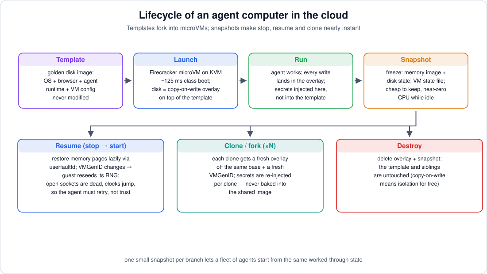
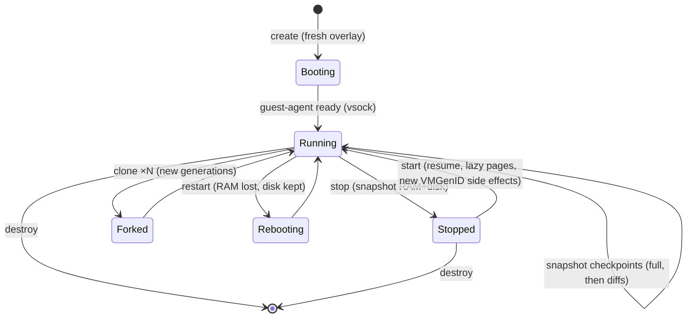

# 08 — Cloud Path II: Snapshots, Clones, and the Disk Machinery

> **Where this file fits**
> ```
>     an agent computer's superpower is not "a VM" — it's:
>        freeze a running machine mid-task      (snapshot)
>        park it for free                       (stop) / resume it in <1s (start)
>        branch it into N copies                (clone / fork)
>        start everything from a known-good base (template + CoW overlay)
>     This file is those four sentences, made mechanical.
> ```



---

## 1. Disk images: how copies become free

### 1.1 raw vs qcow2

| Format | What it is | Pros | Cons |
|---|---|---|---|
| **raw** | literally the bytes of a disk | simplest, fastest, sparse-file capable | no snapshots, no compression, clones copy data |
| **qcow2** | QEMU's copy-on-write image format: a header + a **cluster table** (L1/L2) mapping virtual blocks to real file offsets | backing chains, snapshots, compression, encryption | slight I/O overhead; indirection to reason about |

The property that matters is qcow2's indirection: because every block is looked up through a table, an image file can be *partially* populated and can *inherit* from another image.

### 1.2 Backing chains: the one command that runs the industry

```bash
qemu-img create -f qcow2 -b template.qcow2 -F qcow2 agent-271.qcow2
```

`agent-271.qcow2` is a tiny file (a header and tables — kilobytes) that declares `template.qcow2` as its **backing file**:

```
   read block 8192  ──►  is it in agent-271's own tables?
                          ├─ yes → read it from agent-271.qcow2   (the agent's writes)
                          └─ no  → read it from template.qcow2    (fall-through, shared, read-only in spirit)

   write block 8192 ──►  always allocated in agent-271.qcow2      (copy-on-write)
```

Consequences, each of which is a product feature:

- **Launch is instant.** "Create a computer" is `qemu-img create` (or a hypervisor API doing the same) — sub-millisecond file creation; the data is shared, not copied.
- **Isolation is free.** Agent 271's 8 GB of writes live only in its overlay; the template and its siblings are untouched by construction. Delete the overlay, and the instance leaves no trace in the base.
- **Cloning is branching.** To fork a *worked-through* machine, snapshot it (next section) and create overlays off *its* state — N children from one parent, sharing everything they haven't individually changed.
- **Flattening is possible when wanted.** Writes can be folded back with `qemu-img commit` (merge an overlay into its backing file) or collapsed with `qemu-img convert` (produce a single standalone image) — the exit hatches for template promotion and archival.

> **Under the hood**
> The same pattern appears far below the file layer: **LVM thin provisioning / dm-thin** gives block-level copy-on-write (a "thin snapshot" of a logical volume shares blocks until written) — this is what many host storage stacks use underneath VM disks. File-level (qcow2) and block-level (dm-thin) CoW are the two implementations you should be able to sketch on a whiteboard; the concepts — shared base, per-branch allocation, free fork — are identical.

### 1.3 "Snapshots" at the disk layer vs the machine layer

Be precise with the word, because three different things are called snapshots:

| Snapshot kind | What it captures | Where it lives |
|---|---|---|
| **Disk snapshot** | block-level state of a virtual disk | internal to an image (qcow2 internal snapshots) or as an overlay chain (external) |
| **VM snapshot** | a *paused machine*: guest RAM + device/CPU state + disk state | memory file + state file + disk overlay(s) — next sections |
| **Product snapshot** | what the user means: "save my agent's computer right now so I can come back" | a VM snapshot, managed by the control plane, addressable by name |

---

## 2. Booting to a prompt in ~100 ms

A normal Linux boot spends seconds in firmware → bootloader → kernel → initramfs → rootfs. Agent fleets skip most of it:

**Direct kernel boot** — the hypervisor loads the kernel itself, no BIOS/bootloader:

```bash
# QEMU, illustrative:
qemu-system-x86_64 \
  -kernel vmlinuz -initrd initrd.img \
  -append "root=/dev/vda rw console=ttyS0 quiet" \
  -drive file=agent-271.qcow2,if=virtio
```

**Firecracker's API model** — the VMM is told exactly what to boot: kernel image, root filesystem, and boot arguments, over its HTTP API; there is no device discovery phase at all (the device set is fixed and minimal — file 07). Boot-to-init lands in the ~125 ms class, and the *guest* boots the rest of the way in parallel.

**Readiness, not sleeping.** The control plane never guesses "wait 5 seconds then screenshot". The guest-agent daemon comes up during boot, connects over **vsock**, and says "ready" — the same channel then carries commands. This checkout/checkin handshake makes fleets deterministic and lets slow boots be detected instead of mis-clicked.

**CPU templates** deserve one line here because they're the un-sexy reason snapshot *resume* works across a fleet: when a VM is restored on a different host CPU generation, the guest sees a (virtualized) CPU; if the first boot trained the guest on one feature set (AVX-512, etc.) and the restore lands on another, the machine can fail to resume. Hypervisors expose **CPU templates** that pin/normalize CPUID features so a snapshot made on host family X restores on host family Y. "Snapshots are portable across the fleet" is a feature you configure, not one you get.

---

## 3. VM snapshots: freezing a running mind

A VM snapshot is three artifacts, taken while the VM is paused:

```
   agent-271 MEMORY  ──  the guest's RAM image     (the windows, the half-typed form, the caches)
   agent-271 STATE   ──  CPU registers + device state (where every core was, virtio queues, timers)
   agent-271 DISK    ──  its overlay (file §1)
```

Restoring is loading state (fast — it's a small file), pointing the VMM at the memory image and disks, and resuming CPUs. Two refinements make this scale:

- **Full vs diff snapshots.** The first snapshot is *full* (all RAM). Subsequent snapshots can be **diff/dirty-page** snapshots: the hypervisor tracks which pages the guest has written since the last snapshot and stores only those. Snapshot chains then resume as "base + diffs applied in order" — cheap checkpoints in a long agent session.
- **Lazy memory restore via `userfaultfd`.** Instead of copying gigabytes of RAM into place at resume, the hypervisor maps the memory file and registers it with **userfaultfd** — a kernel facility that lets a userspace handler supply pages *on fault*. The guest resumes instantly and faults in its RAM as it touches it:

```
   resume:       register memory ranges with userfaultfd, give the guest CPU state, RUN
   guest touches a page → fault → handler copies that page from the snapshot file → guest continues
   pages never touched → never loaded (they were cold; they stay on disk)
```

This is the same mechanism (and the same economics) as demand paging in file 07's oversubscription story: **start instantly, pay per page actually used.** It's also used by process-checkpoint tooling (CRIU) for live migration — one concept, several implementations.

> **Remember**
> A snapshot is *the whole running computer*, not a save file. It includes whatever the agent had in RAM — including secrets it loaded, cookies, decrypted content. Snapshot storage is therefore as sensitive as the machine itself: encrypt at rest, scope access, and expire old snapshots.

---

## 4. The clone trap: VMGenID and identity

Here is a bug that has bitten every virtualization platform in history, and that agent platforms hit *by design* because cloning is a feature:

**A cloned machine is a Xerox of a mind.** Fork agent-271 into 271a and 271b, resume both, and both guests believe they booted once, long ago, with one entropy pool, one kernel RNG state, one DHCP lease, one clock. Left alone:

- both generate the **same "random" bytes** for TLS session keys, tokens, UUIDs, password resets — the classic cloned-VM RNG disaster;
- both keep the same hostnames/IP expectations, fighting on the network;
- both act on the same "current time" picture from the moment of the fork.

The standardized fix is an ACPI-ish device called **VMGenID**: a 16-byte UUID exposed to the guest. "Snapshot" captures it; **"restore" generates a fresh one** when the machine is resumed as a new instance. The guest then *notices its own cloning*:

- the Linux kernel's `vmgenid` driver reacts to the change by **crediting entropy and reseeding the CRNG** (so no two clones ever share random state);
- it emits a **uevent** whose payload includes the new generation ID — and userspace (udev/systemd) can subscribe: e.g., network managers can re-run DHCP when the generation changes, so a clone re-identifies on the network instead of squatting its ancestor's lease.

**What cloning still breaks (design around it, don't fight it):**

- **Open TCP connections.** Sockets that existed at freeze time don't survive a resume on a different host/network path; agent runtimes must treat every connection as potentially dead and **retry/reconnect on first use** after a resume.
- **Clocks jump.** Wall-clock-dependent logic (timeouts measured against remembered timestamps, certificate validity windows, "wait until 3pm") sees a discontinuity; measure elapsed time from *fresh observations*, not from remembered timestamps, and let NTP settle after resume.
- **Write amplification on fork.** N clones diverging from one base each grow their own overlay — great for storage until every clone downloads its own copy of the world. (Content-addressed and deduped storage is the usual pressure relief; beyond scope here.)

> **Gotcha**
> The clone trap's evil twin: restoring the *same* snapshot twice for the *same* logical agent (e.g., "resume from last checkpoint" after a crash) while the pre-crash instance still runs somewhere. Two instances, one identity, both acting on the same accounts and files. Idempotency keys and a single-writer lease on the agent's state directory are the boring fixes. Snapshot/resume makes it beautifully easy to create this bug; don't.

---

## 5. Lifecycle semantics: the API the product exposes

What stop/start/restart/clone *mean*, precisely — because product copy elides the differences and users feel them:

| Operation | RAM | Disk | Processes | Identity (VMGenID) | Network | Time |
|---|---|---|---|---|---|---|
| **create** (from template) | fresh boot | new overlay off template | boot sequence | new | per policy | ~100 ms–seconds |
| **stop** | **frozen to snapshot** | preserved | *suspended*, not exited | preserved | deallocated | fast; idle cost ≈ storage only |
| **start** (resume) | **restored** (lazily) | same overlay | continue where they froze | **new generation on restore** | re-attach; sockets dead | ms-class to running |
| **restart** | discarded | preserved | rebooted from scratch (apps restart; unsaved in-RAM work gone) | new | re-attach | boot time |
| **clone / fork** | copied from a snapshot | new overlay off the snapshot's state | both continue (parent + child) | **child gets fresh generation** | per policy | fast |
| **destroy** | freed | overlay deleted; template untouched | gone | — | released | instant |

State diagram for one machine:



And the mental model users actually need (put equivalents of this in your product's docs, politely): **stop/start is hibernate, restart is reboot, clone is "duplicate this timeline", destroy is shred.**

---

## 6. Templates, hooks, and secrets

The control-plane triad that turns raw hypervisor primitives into a product:

**(a) Templates** — the golden image. OS + browser + the agent runtime + configured apps, versioned and **immutable**: every machine is a CoW overlay off some template version, so "what's installed" is a property of the template, and machine state is a property of the overlay. Template changes are new versions, not mutations; fleet upgrades are "new machines on v2", and old machines finish on v1.

**(b) Hooks** — lifecycle scripts, run inside the guest by the control plane at defined moments:

| Hook | Typical jobs |
|---|---|
| `on_start` / `on_resume` | pull the current agent-runtime build, mount the work directory, start VNC, ensure browser flags (e.g., force accessibility mode), warm caches, register with the fleet's scheduler |
| `on_snapshot` (pre) | quiesce apps, flush writes, **scrub secrets from RAM/disk** if the snapshot will outlive their validity |
| `on_destroy` | ship logs/artifacts out before the machine vanishes |

Hooks must be **idempotent** (resume can run them again) and **deterministic** (a hook that downloads "latest" makes snapshot/resume non-reproducible — pin versions).

**(c) Secrets** — credentials the agent needs to be useful (logins for the accounts it operates). The iron rule:

```
   secrets are injected per instance, at boot, into the overlay —
   NEVER baked into the template,
   because every machine that ever launches from that template
   can read everything the template contains (CoW fall-through!).
```

Injection paths: environment variables or files written by the guest-agent at boot, or a broker the agent asks per-use. Rotation and scoping (one credential per agent, not a shared master account) keep a single compromised agent from being a fleet-wide compromise — and pre-snapshot scrubbing keeps long-lived snapshots from carrying live credentials forever.

---

## 7. Resource control: cgroup v2, the fleet's immune system

On the host, each microVM (or its jailer) lives inside **cgroup v2** — Linux's unified resource-control hierarchy — typically with:

| Knob | Meaning | Typical fleet use |
|---|---|---|
| `cpu.max` | hard CPU quota, e.g. `200000 100000` = 2.00 CPUs | cap a browsing agent's runaway render loops |
| `cpu.weight` | relative share under contention | fairness between siblings |
| `memory.max` | hard memory ceiling; hitting it ⇒ **OOM kill inside the group** | bound the VM's RAM; the containment promise of "its own machine" |
| `memory.high` | soft ceiling: throttling before OOM | let a busy agent slow down, not die |
| `memory.min` | protected floor | keep critical daemons from being reclaimed |
| `pids.max` | process/thread count cap | **fork-bomb insurance** — a malicious page that spawns processes dies at the cap |
| `io.max` | disk bandwidth/IOPS caps | stop one agent's model downloads from starving the host's storage |

This is also *how oversubscription is safe to offer* (file 07): CPU quotas make "more vCPUs than cores" a scheduling hint; memory ceilings bound each guest's claim; demand paging and ballooning smooth the rest. The cgroup file is boring and it is the entire difference between a demo fleet and a multi-tenant one.

---

## 8. Operations: audit, storage, cost

- **Audit trail.** Every action the agent took (tool call, mapped coordinates/refs, before/after screenshots), every file it moved, plus the live screen stream — stored per task. When an agent does something surprising in production, this is the black box. (And it's the dataset for improving the agent.)
- **Snapshot hygiene.** Snapshots contain RAM (secrets included): encrypt at rest, scope who can restore, expire young. Garbage-collect orphan overlays and diff chains, or storage grows one abandoned timeline at a time.
- **Cost shape.** Activity is compute-bound (vCPU-seconds); idleness should be storage-bound (snapshot bytes). A machine parked as a snapshot for a day should cost a rounding error against the same machine running for that day — that ratio (idle ≈ free) is what makes "the agent waits for you" business models arithmetically sane.

> **Numbers to remember**
> microVM boot ≈ **125 ms class**; per-VM overhead ≈ **a few MiB** (≈5 in the published design); Firecracker API defaults **1 vCPU / 128 MiB** when unspecified; overlay creation = **kilobytes** regardless of template size; pause→snapshot→resume is a **paused-VM** operation; resume can start with **zero memory preloaded** thanks to `userfaultfd`; every restore/clone burns its old identity and gets a **fresh VMGenID**.

---

## 9. Key ideas to carry forward

- Copy-on-write backing chains are the economic foundation: templates are shared and immutable, machines are thin overlays, clones are kilobytes, deletion is residue-free.
- Fast boot is engineered: direct kernel boot, no device discovery, API-configured machines, vsock readiness handshake, CPU templates for cross-host restores.
- A VM snapshot is RAM + device state + disk; diff snapshots make checkpoints cheap, `userfaultfd` makes resume near-instant by paying for pages as they're touched, and snapshot storage is exactly as sensitive as the machine.
- **VMGenID is the clone alarm**: fresh identity per restore ⇒ RNG reseed + network re-identification in the guest; sockets, clocks, and duplicate-instance bugs remain the agent engineer's problem.
- Stop = hibernate, restart = reboot, clone = timeline duplication, destroy = shred — and templates/hooks/secrets must keep credentials out of the shared base while cgroup v2 keeps one bad agent from eating the fleet.

Next: [09 — strategy synthesis, safety, and interview Q&A](09-synthesis-strategy-safety-interview-qa.md).
