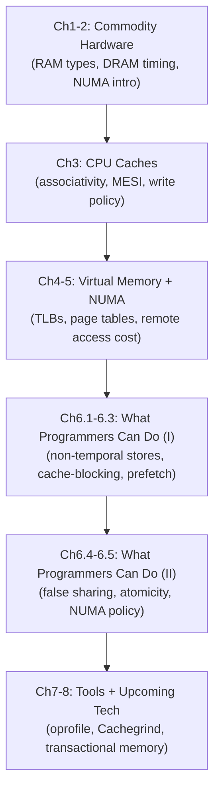

# What Every Programmer Should Know About Memory — Detailed Notes Index

> A deep-dive note series on Ulrich Drepper's *What Every Programmer Should Know About Memory* (2007), built directly from the paper's own text, measurements, and code. This is the hardware-and-performance layer underneath everything in the OSTEP-based notes (Ch13-23 there cover the OS-level virtual memory abstractions this paper explains at the hardware/measurement level) and the DDIA/microservices notes (the CAS/optimistic-concurrency pattern in transactional memory here is the same pattern SSI and lock-free structures use elsewhere in this workspace).

---

## How to Use This Series

- **First pass:** read in order -- RAM hardware (file 1) underlies caches (file 2); caches underlie virtual memory/TLBs (file 3); all three together are the prerequisite for the practical optimization techniques (files 4-5); the tools chapter (file 6) is how you'd actually go verify any of it on real hardware.
- **Interview/exam cramming:** each file ends with **"Key Talking Points"** -- read just those across all 6 files for a fast, high-signal refresher.
- **Looking something up:** use the chapter map below.
- **Companion material:** the OSTEP-based notes' paging/TLB files (04, 05 there) cover the *OS-level* abstractions; this series covers the *hardware mechanics and measured costs* underneath them -- read together for the full stack, from DRAM cell to page-replacement policy.

---

## The Paper's Structure at a Glance

---

## Chapter Map

| # | File | Book sections | Core content |
|---|---|---|---|
| 1 | `01-ram-hardware.md` | Ch1-2 | Northbridge/Southbridge, integrated memory controllers -> NUMA, SRAM vs. DRAM cell design, RAS/CAS address multiplexing, `w-x-y-z-T` timing notation, DDR1/2/3 generations |
| 2 | `02-cpu-caches.md` | Ch3 | Why caches exist, cache line structure, direct-mapped/fully-associative/set-associative trade-offs, write-through vs. write-back, MESI protocol and RFOs, measured bandwidth across architectures |
| 3 | `03-virtual-memory-and-numa.md` | Ch4-5 | Multi-level page tables, why TLBs exist, ASID tagging, huge pages, NUMA hardware topologies, `/proc/PID/numa_maps`, measured remote-access latency penalties |
| 4 | `04-cache-optimization-and-prefetching.md` | Ch6.1-6.3 | Non-temporal stores, the full matrix-multiplication optimization progression (transpose -> blocking -> vectorization), `pahole` and struct layout, hardware/software prefetching |
| 5 | `05-multithread-and-numa-programming.md` | Ch6.4-6.5 | False sharing (measured 390-1147% overhead), CAS vs. native atomics, the x86 `lock` prefix trick, thread affinity, NUMA memory policy (`MPOL_*`) |
| 6 | `06-tools-and-upcoming-technology.md` | Ch7-8 | `oprofile` (CPI-based profiling), `Cachegrind` (cache simulation), transactional memory (LT/LTX/ST/COMMIT/VALIDATE), DDR3 latency trade-offs |

---

## The Big Ideas That Run Through the Whole Paper

- **Every optimization is really about locality.** Temporal and spatial locality (file 2) motivate cache lines, cache-blocking (file 4), TLB behavior (file 3), and even NUMA-aware scheduling (file 3/5) -- it's the single unifying principle behind nearly every technique in this series.
- **Hardware transparency has a real, measurable cost, and the programmer can pay it down.** Caches, TLBs, and prefetchers all try to make memory *look* uniformly fast -- but every one of them has a specific, nameable failure mode (cache-line eviction under false sharing, TLB misses on page-boundary crossings, prefetch's inability to cross page boundaries) that a programmer who understands the mechanism can work around.
- **Concurrency correctness and concurrency performance are separate problems, both rooted in the same MESI machinery.** A race condition (OSTEP notes) and an RFO storm from false sharing (this series) are different symptoms of the same underlying fact: multiple cores sharing memory need coordination, and that coordination is never free -- the question is only how *much* it costs, and whether the code's structure minimizes or maximizes that cost.
- **Measure, don't guess.** The paper backs nearly every claim with real, reproducible numbers (CPI ratios, false-sharing overhead percentages, matrix-multiply cycle counts) -- and repeatedly warns that vendor-to-vendor and generation-to-generation differences (Netburst's write-through L1d vs. Core 2's write-back L1d; DDR3's higher bandwidth but higher latency) mean intuition alone is not a substitute for profiling on the actual target hardware.
- **Indirection and abstraction always have a floor.** Virtual memory, TLBs, and even transactional memory are all, at bottom, clever indirection layers built on simpler primitives (page tables, cache coherence) -- understanding *what's underneath* the abstraction is exactly what lets a programmer predict when it will behave well and when it won't.

---

## A Note on Scope and Age

This paper was written in 2007 and is explicitly scoped to **commodity x86/x86-64 hardware and Linux.** Some specifics have moved on (DDR3 is no longer cutting-edge; some of Ch8's "upcoming technology" like hardware transactional memory has since shipped in real CPUs, with mixed real-world adoption). But the paper's actual subject -- *why* DRAM, caches, TLBs, and multi-core coherence behave the way they do, and what that implies for how you write code -- has aged extremely well, because it's explaining physics and architecture principles, not tracking a specific product generation. Where a note above flags something as "since become real" or "aged accurately," that's worth keeping in mind if asked about current hardware specifically.