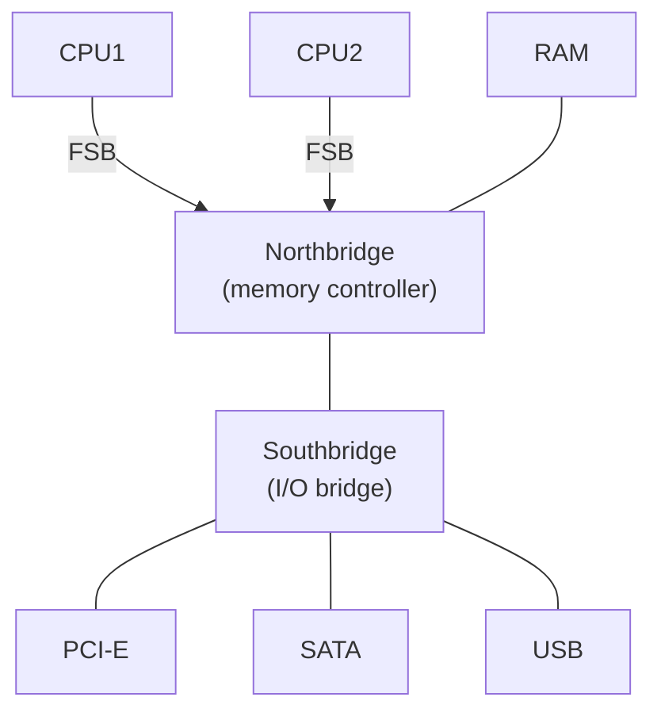
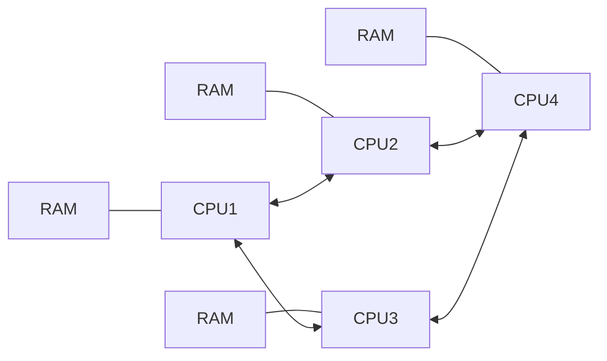
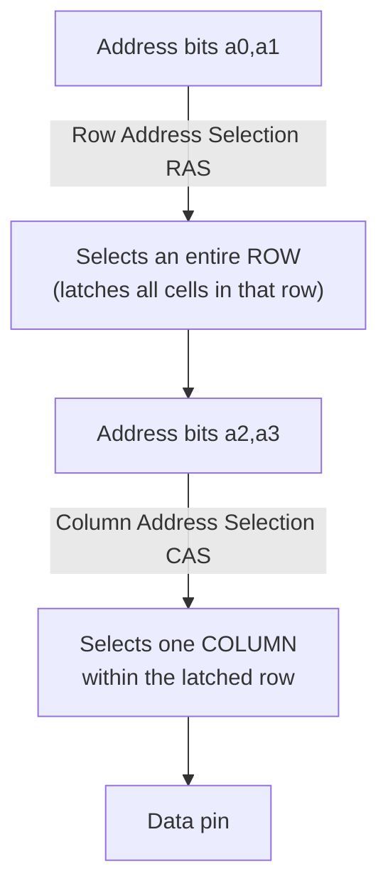
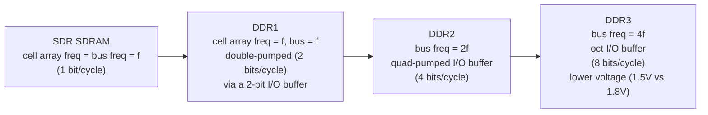

# CPU Memory Notes 1 — Commodity Hardware and RAM Technology

> Detailed notes on Ulrich Drepper's *What Every Programmer Should Know About Memory*. Covers Ch1 (Introduction) and Ch2 (Commodity Hardware Today -- RAM types and DRAM access technical details). See `00-index.md` for the full series map.

---

## 1. Introduction -- Why This Paper Exists

⭐ **The central thesis:** as CPUs got faster and more numerous, **memory access became the limiting factor** for most programs -- and will remain so for the foreseeable future. Hardware designers responded with increasingly sophisticated acceleration techniques (CPU caches foremost among them), but **these can't work optimally without help from the programmer** -- and most programmers simply don't understand the memory subsystem well enough to give that help.

- Early computers had *balanced* components -- CPU, memory, storage, and network all roughly matched in speed. As individual subsystems were optimized independently, **huge performance gaps opened up**, especially for storage and memory (cheaper to leave slow than to keep pace with CPU speed gains).
- Storage's slowness was addressed almost entirely in **software** (OS-level caching of frequently used data in RAM). Memory's slowness has needed **hardware** changes -- this paper is about understanding those changes (RAM design, memory controller design, CPU caches, DMA) well enough to write code that works *with* them rather than against them.
- ⭐ **A scoping note worth remembering:** the paper deliberately covers **commodity hardware** only, and is explicitly Linux-specific in its OS-level discussion -- not because other systems don't matter, but because covering everything would dilute the depth needed to actually teach this material well.

---

## 2. Commodity Hardware Today

⭐ **Why commodity hardware matters:** scaling today is achieved **horizontally** (many smaller connected machines) rather than **vertically** (fewer, larger, exotic machines) -- because fast, cheap networking made horizontal scaling economically dominant. Understanding the *common* building block (as of this writing: up to 4 sockets, each a quad-core, possibly hyper-threaded CPU -- up to 64 virtual processors per box) matters more than understanding exotic big-iron designs.

### The Classic Northbridge/Southbridge Architecture



- **CPUs connect to the Northbridge** via the **Front Side Bus (FSB)**; the Northbridge houses the **memory controller** (its design determines which RAM types -- DRAM, Rambus, SDRAM -- the system can use).
- **The Southbridge** ("I/O bridge") handles device communication (PCI-E, SATA, USB, etc.) and must itself talk to the Northbridge to reach RAM or other CPUs.

⭐ **Immediate consequences/bottlenecks of this design:**
- **All** inter-CPU communication and **all** RAM access must cross the *same* Northbridge bus.
- RAM traditionally has only a **single port** -- no true concurrent access from multiple requesters.
- Device-to-RAM traffic (even via **DMA**, which lets devices read/write RAM directly without CPU intervention) still **competes with CPU RAM requests** for Northbridge bandwidth -- DMA reduces CPU workload but does *not* eliminate the underlying bandwidth contention.

### Scaling Beyond a Single Memory Bus
- **External memory controllers:** rather than one memory controller *inside* the Northbridge, some systems attach **several** external controllers to it -- multiplying total available memory bandwidth and capacity, limited mainly by the Northbridge's own internal bandwidth (which can be substantial).
- **Integrated memory controllers (the more modern approach, e.g., AMD Opteron-style SMP, and Intel's Nehalem-generation CSI):** put the memory controller **inside each CPU**, with its own locally-attached memory bank.



⭐ **The trade-off this introduces: NUMA (Non-Uniform Memory Access).** As many independent memory banks as processors -> memory bandwidth scales directly with CPU count, avoiding one congested central Northbridge. But now **not all memory is equally close** to a given CPU -- a CPU's own **local** memory is fast; memory attached to a *different* CPU requires crossing one or more **interconnects**, each adding latency. ⭐ **The "NUMA factor"** quantifies this extra cost -- e.g., a system might have CPUs 1 interconnect away (cheap) and CPUs 2 interconnects away (more expensive), and real machines (IBM x445, SGI Altix) can have **multiple distinct connection types** and correspondingly complex NUMA-factor topologies. This is exactly the topic of the NUMA notes file later in this series -- and the prediction in this paper (written 2007) that essentially all SMP machines would be NUMA by ~2008 has proven true of virtually all modern multi-socket servers.

---

## 3. RAM Types -- SRAM vs. DRAM

⭐ **The core question: why isn't all RAM just the fast kind (SRAM)?** Answer: **cost.** SRAM is dramatically more expensive to produce and to use than DRAM, and that gap has only grown in importance over time.

### Static RAM (SRAM) -- the 6-Transistor Cell
```
        WL (word line)
        Vdd
   M2 --+-- M4 --+-- M6
        |        |
   M5 --+        +-- (to BL-bar)
        |        |
   M1 --+-- M3 --+
        BL              BL-bar (complement)
```
- Built from **6 transistors** -- 4 forming two cross-coupled inverters (giving two stable states: 0 and 1), plus 2 access transistors gating the bit lines (`BL`/`BL-bar`).
- ⭐ **Key properties:** the state is stable **as long as power is available** (no refresh needed); reading is available **almost immediately** once the word line (WL) is raised, with a sharp, clean (rectangular) signal -- unlike DRAM's slow analog signal.
- **Why it's expensive:** 6 transistors per bit is a lot of chip real estate, and each cell needs continuous power to hold its state -- both drive up cost and power consumption dramatically as capacity grows.

### Dynamic RAM (DRAM) -- the 1-Transistor, 1-Capacitor Cell
```
   AL (access line)
        |
   DL --M-- C (capacitor)
   (data line)
```
- Just **one transistor (M) and one capacitor (C)** -- the state lives entirely in the capacitor's charge. Reading raises the access line (AL), letting the capacitor's charge (or lack thereof) drive current onto the data line (DL); writing sets DL appropriately, then raises AL long enough to charge/drain the capacitor.
- ⭐ **Four fundamental problems this design creates, all traced to the tiny capacitor:**
  1. **Leakage:** a fully charged capacitor holds only a few tens of thousands of electrons, with tera-ohm-range resistance -- even so, it discharges (leaks) within milliseconds. This is why DRAM must be **refreshed every ~64ms** (per JEDEC spec) -- and during a refresh (which is really just "a read whose result is discarded"), that row **cannot be accessed** -- the paper cites studies finding refresh overhead can stall **up to 50%** of memory accesses for some workloads.
  2. **Weak signal:** the tiny charge means the output must be run through a **sense amplifier** to reliably distinguish stored 0 from 1.
  3. **Destructive read:** reading a DRAM cell **depletes** the capacitor's charge -- so every read must be followed by an automatic **recharge** (feeding the sense amplifier's output back into the cell), costing extra time and energy.
  4. **Non-instantaneous charge/discharge:** governed by the RC (resistance x capacitance) time constant:
```
Q_charge(t)    = Q0 (1 - e^(-t/RC))
Q_discharge(t) = Q0 * e^(-t/RC)
```
  Unlike SRAM's sharp rectangular signal, this is a smooth exponential curve -- a conservative wait is required before the output is considered reliably readable, fundamentally limiting how fast DRAM can be.

⭐ **Why DRAM wins anyway:** despite all four problems, the sheer **size and cost advantage** (one transistor instead of six, no per-cell continuous-power requirement, a simpler/more regular structure that packs far more densely) makes DRAM the dominant choice for main memory in all but specialized hardware (e.g., network routers using SRAM for guaranteed speed). **Programmers have to live with DRAM's characteristics** -- this is exactly why the rest of the paper exists.

---

## 4. DRAM Access: The Addressing Problem

⭐ **Why memory cells can't just be individually, directly addressed:** 4GB of RAM would need **2^32** address lines if addressed completely directly -- utterly impractical. Even a modest 1Gbit chip would need 30 address lines and 2^30 select lines if using a naive direct demultiplexer -- the demultiplexer's size/complexity grows *exponentially* with address-line count if speed isn't to be sacrificed, and routing 30 synchronized address-line impulses is itself a serious engineering challenge.

### The Row/Column Solution -- Address Multiplexing
⭐ **The fix: arrange cells in a 2D grid (rows x columns) and split the address into two halves, transmitted sequentially over the *same* physical address lines.**



- **RAS (Row Address Strobe/Selection):** the first half of the address selects and **latches an entire row** -- this selection stays active until explicitly revoked.
- **CAS (Column Address Strobe/Selection):** the second half then selects **one column** within that already-latched row, making that specific cell's data available on the data pin.
- ⭐ **The payoff:** instead of needing ~30 address lines (and correspondingly enormous pin counts on the memory controller for multiple modules), only ~15 lines are needed, transmitted **twice** -- a huge saving in motherboard/controller/chip complexity, at the cost of needing **two sequential steps** (and hence more time) per access instead of one.

---

## 5. DRAM Access Technical Details -- Timing

⭐ **The paper's focus from here on is Synchronous DRAM (SDRAM) and its DDR successors** -- asynchronous DRAM and Rambus (RDRAM) are explicitly out of scope as not relevant to commodity systems.

### Read Access Protocol -- the Core Timing Diagram
```
CLK:      _/^\_/^\_/^\_/^\_/^\_/^\_/^\_
RAS:      ^\___________________________
CAS:      ^^^^^^^\___________________
Address:  [ Row Addr ][      ][Col Addr]
                       <-tRCD->  <-CL->
DQ (data):                              [Out][Out][Out][Out]
```
- The memory controller places the **row address** on the address bus and lowers RAS -- the chip begins latching that row.
- After **tRCD (RAS-to-CAS Delay)** cycles, the **column address** is placed on the *same* address bus and CAS is lowered.
- After a further **CL (CAS Latency)** cycles, data finally starts appearing on the data pins.

⭐ **Key takeaway: there is substantial "downtime" between issuing a request and getting data** -- this delay (tRCD + CL, at minimum) is exactly what makes DRAM access slow relative to CPU speeds, and understanding/minimizing this downtime is the paper's whole point.

### Precharge and Activation -- Switching Rows
Before a **new** row can be RAS-latched, the currently-active row must be **deactivated** and the target row **precharged** -- this costs an additional **tRP (Row Precharge time)**. Additionally, a module needs a minimum time after activating a row -- **tRAS (Active-to-Precharge delay)** -- before it can be precharged again, which is typically **2-3x tRP.**

⭐ **The critical performance implication:** if a request only needs one or two CAS bursts after a RAS, the **actual gap until the next row can be activated** may be dictated by `tRAS`, not simply "however long the data transfer took" -- meaning short, scattered accesses waste far more time proportionally than long, sequential ones (the paper's own worked example shows a case where the data bus, despite a nominal 6.4GB/s peak, is only *actually* transferring data 2 out of every 7 cycles -- an **effective 1.8GB/s**, roughly 28% of peak -- purely due to this row-switching overhead).

⭐ **The standard notation for these four numbers: `w-x-y-z-T`** (e.g. `2-3-2-8-T1`):
| Symbol | Meaning |
|---|---|
| `w` | CAS Latency (CL) |
| `x` | RAS-to-CAS delay (tRCD) |
| `y` | RAS Precharge (tRP) |
| `z` | Active-to-Precharge delay (tRAS) |
| `T` | Command Rate (how often new commands can be accepted -- `T1` = every cycle for high-performance modules) |

> **Practical note:** these five numbers, together with FSB and module speed, are the key figures to look at when evaluating or purchasing memory -- and on many boards/modules they can be manually tuned (at the buyer's own risk) via BIOS settings, since a high-quality module may tolerate tighter timings than its conservative rated defaults.

### Recharging (Refresh) -- the Unavoidable Tax
⭐ Every DRAM row must be refreshed roughly every 64ms (JEDEC spec) -- with, say, 8,192 rows per array, this means a refresh command roughly every **7.8us on average.** **No access is possible to a row currently being refreshed** -- the paper stresses this is genuinely "surprisingly" impactful on performance in practice, and something the programmer has **no direct control over**, but should keep in mind when interpreting odd latency measurements.

### Memory Generations -- SDR -> DDR1 -> DDR2 -> DDR3



⭐ **The core trick across all DDR generations: don't increase the DRAM cell array's own operating frequency** (expensive -- power scales with `capacity x voltage^2 x frequency`) -- instead, add a small, fast **I/O buffer** that grabs multiple bits per cell-array cycle and streams them out at a much higher external bus frequency. Only that small buffer component needs to run fast; the power-hungry cell array itself stays at its original, economical frequency.

- **DDR1** ("double-pumped"): transfers data on **both** the rising and falling clock edge -- 2 bits/cycle from a 2-bit I/O buffer.
- **DDR2**: doubles the *bus* frequency relative to the cell array, requiring a 4-bit-wide I/O buffer ("quad-pumped").
- **DDR3**: cell array runs at 1/4 the external bus speed, needs an 8-bit I/O buffer, and drops voltage from 1.8V to 1.5V -- since power scales with voltage^2, this alone yields roughly a 30% power reduction, on top of further gains from smaller die size.

⭐ **Marketing name inflation, explained precisely:** module names like "DDR2-800" or "PC2-6400" are derived from the **effective** data rate, factoring in the double/quad-pumping -- e.g., a 100MHz DDR1 array with a 200MHz bus, doubled for 2 transfers/cycle, gives `100MHz x 64-bit x 2 = 1,600MB/s` -> marketed as **PC1600** (or DDR-200 by FSB naming) -- the underlying array frequency never actually reached anywhere near that number.

⭐ **A real, persistent physical constraint:** higher bus frequencies make it progressively harder to drive **multiple modules in parallel** on the same electrical bus -- signal integrity degrades with each additional daisy-chained module. This is *why* DDR2 allows only 2 modules per channel, and DDR3 allows only 1 at high frequencies -- directly limiting how much RAM a commodity motherboard can practically support without resorting to (expensive) external memory controllers.

---

## Summary Table

| Concept | Key fact |
|---|---|
| **SRAM** | 6 transistors/bit, no refresh, near-instant, expensive -- used for CPU caches |
| **DRAM** | 1 transistor + 1 capacitor/bit, needs refresh (~64ms), destructive read, slow (RC-limited) -- used for main memory |
| **RAS/CAS multiplexing** | Splits the address into row + column halves to keep pin/demultiplexer counts manageable, at the cost of a two-step, sequential access |
| **tRCD, CL, tRP, tRAS, Command Rate** | The five numbers (`w-x-y-z-T`) that determine real-world DRAM latency, beyond the nominal bus frequency |
| **Refresh (recharging)** | Mandatory every ~64ms; a row being refreshed is briefly inaccessible -- can stall a significant fraction of accesses |
| **DDR1/DDR2/DDR3** | Each generation adds a wider/faster I/O buffer to multiply effective bandwidth without raising the power-hungry cell array's own frequency |
| **NUMA** | A consequence of integrated per-CPU memory controllers -- local memory is fast, remote memory costs extra "NUMA factor" latency per interconnect hop |

## Key Talking Points

- Explain **why DRAM won over SRAM for main memory** despite being objectively slower and more complicated to use correctly -- cost and density, driven by the transistor-count difference (1 vs. 6).
- Walk through **why DRAM addresses are split into row and column halves (RAS/CAS)**, and precisely what problem this solves (pin count and demultiplexer size/complexity).
- Explain the **`w-x-y-z-T` notation** and be able to state what each of the five numbers actually delays.
- Describe **why refresh cycles can stall a meaningful fraction of memory accesses**, and why this is entirely outside programmer control.
- Explain the **DDR/DDR2/DDR3 progression** in terms of I/O buffer width and bus frequency multiplication, not cell-array speed -- and why this design choice (rather than simply "make the cells faster") makes physical/economic sense.
- Connect **integrated per-CPU memory controllers to NUMA** -- explain precisely why this architecture, despite improving aggregate bandwidth, introduces non-uniform access costs.