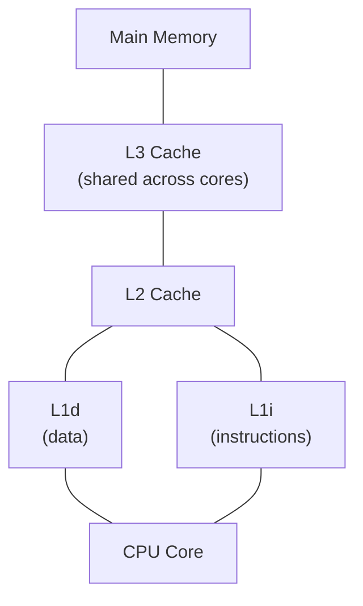
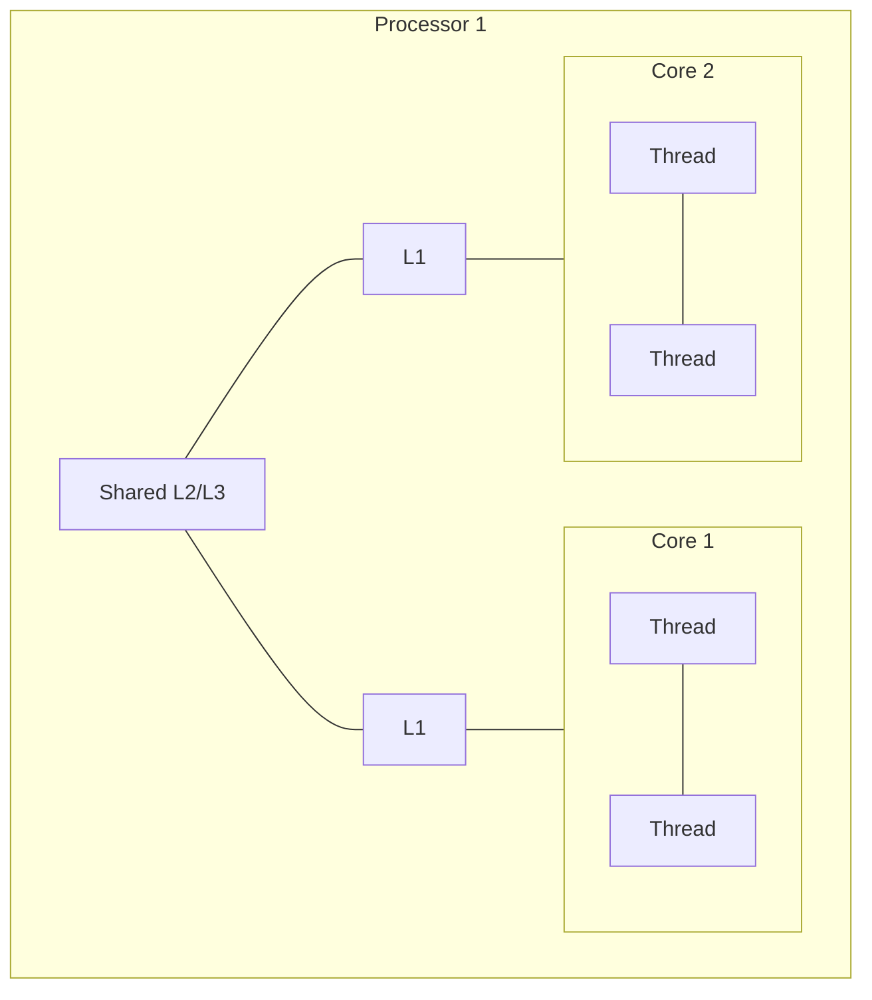
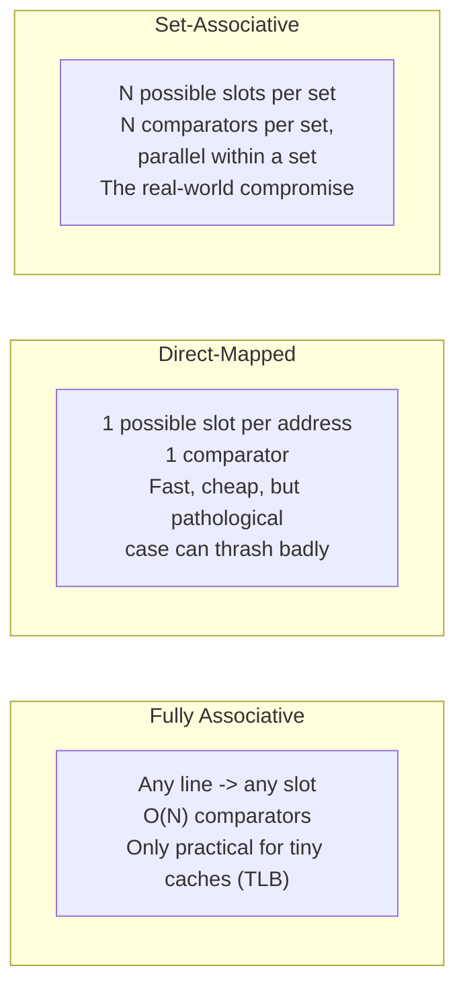
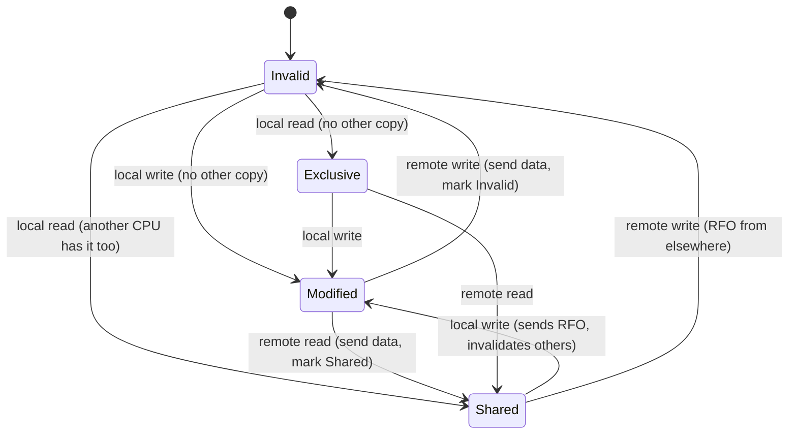

# CPU Memory Notes 2 — CPU Caches

> Detailed notes on Ulrich Drepper's *What Every Programmer Should Know About Memory*, Ch3 (CPU Caches) — the paper's most important and heavily-cited chapter. See `00-index.md` for the full series map.

---

## 1. Why Caches Exist

⭐ **The historical trigger:** in the early 1990s, CPU core frequency growth **decoupled** from memory bus/RAM frequency growth. Building RAM as fast as CPU cores is *possible* but not *economical* — SRAM at CPU speed is orders of magnitude more expensive than DRAM (recall notes file 1).

⭐ **Why not just put a little SRAM directly under OS/application control** (as an extension of the register set)? The paper explains this was seriously considered but rejected: mapping SRAM-backed physical memory into virtual address spaces is "terribly hard," the amount of fast memory varies per machine, and every program module would need to **negotiate for its own share** in software — the synchronization/administration overhead would eat up all the gains. ⭐ **The actual solution:** make the SRAM **transparent** — a resource the *hardware* manages automatically as a **cache**, holding temporary copies of main-memory data likely to be reused soon.

### Locality — Why Caching Works At All
- **Temporal locality:** data/code used once is likely to be reused again soon (e.g., loop bodies executing repeatedly).
- **Spatial locality:** data/code near something just used is likely to be used soon too (e.g., sequential array access, nearby instructions).

⭐ **A concrete illustration of the payoff:** if main memory access costs 200 cycles and cache access costs 15 cycles, code touching 100 data elements 100 times each costs **2,000,000 cycles** with no cache, but only **168,500 cycles** if everything fits in cache — a **91.5% reduction.** This single number is the entire economic justification for CPU caches.

⭐ **The catch: cache is tiny relative to memory** (historically roughly 1/1000th the size — e.g. 4MB cache vs. 4GB RAM). If a program's **working set** exceeds the cache, this simple picture breaks down — and since real systems run many processes simultaneously, the aggregate working set essentially always exceeds available cache. This is exactly why cache **replacement policy** and programmer awareness matter.

---

## 2. CPU Caches in the Big Picture

### The Cache Hierarchy


⭐ **Why separate L1 instruction and data caches (Harvard-style split at L1, despite the overall Von Neumann architecture):** code and data regions are largely independent, so splitting them lets each cache be tuned/accessed independently — and modern CPUs additionally benefit from **caching decoded instructions**, since instruction decoding itself is slow, especially after a branch misprediction empties the pipeline.

⭐ **Multiple cache levels emerged because the speed gap between cache and main memory kept widening** — rather than making L1 arbitrarily bigger (uneconomical — bigger caches are slower to search), a bigger-but-slower L2 (and often L3) was added as an intermediate step.

### Multi-Core, Multi-Thread Sharing

⭐ **The core/thread distinction that matters for caching:** separate **cores** have separate copies of almost all hardware resources (including, usually, their own L1) and run independently; separate **threads** (e.g., hyper-threads) on the *same* core share almost everything, including L1 — meaning two hyper-threads directly compete for the same, single L1d capacity and bandwidth. Higher-level caches (L2/L3) are typically shared across all cores of one processor, but **never** across separate physical processors.

### Cache Line Structure and Address Splitting
⭐ **Why cache entries aren't single words:** tagging each cached word individually would waste space on tag overhead, and would waste the spatial-locality opportunity RAM access patterns already reward (recall from notes file 1: RAM transfers many words efficiently once a row is open). Instead, caches store **cache lines** — historically 32 bytes, now typically **64 bytes** — loaded and evicted as a whole unit.

**A memory address is split into three fields:**
```
| Tag (T bits) | Set (S bits) | Offset (O bits) |
```
- **Offset (O bits):** for a 64-byte line, the low 6 bits — position *within* the line.
- **Set (S bits):** selects which "set" of the cache this line can live in (more below).
- **Tag (T bits):** the remaining high bits — distinguishes which of the many possible memory lines currently occupies that set.

⭐ **A cache line can only be loaded/evicted as a whole** — even a single-byte write requires first loading the entire containing line (an exception: write-combining, covered below). A line that's been written but not yet propagated to memory is marked **dirty.**

### Exclusive vs. Inclusive Cache Hierarchies
- **Exclusive** (AMD, VIA): a given piece of data lives in **only one** cache level at a time — evicting from L1d pushes data down into L2 (possibly cascading further into L3/memory). No wasted duplication, but every level must be searched/populated freshly.
- **Inclusive** (Intel): every L1d line is **also** present in L2 — evicting from L1d is cheap (just drop it; L2 already has a copy) at the cost of "wasting" some L2 capacity holding duplicates of what L1d already has. With a sufficiently large L2 this waste is a good trade for faster eviction.

---

## 3. Associativity — Where Can a Line Go?

> **The design question:** given a cache line's address, which physical slot(s) in the cache is it *allowed* to occupy?

### Fully Associative
⭐ **Any line can go anywhere** — no "Set" bits at all (S=0); every single cache line's tag must be compared against the requested address. Requires one comparator **per cache line.** For a realistic 4MB/64B cache (65,536 lines), this is **completely impractical** — the transistor cost of tens of thousands of fast, wide comparators is enormous. ⭐ Fully associative caches are only practical for genuinely **tiny** structures — the paper cites some CPUs' **TLB** caches (a few dozen entries) as a real example.

### Direct-Mapped
⭐ **The opposite extreme: each address maps to exactly one possible cache slot** (S bits directly index a single row). Needs only **one comparator total** — fast, cheap, scales easily with cache size (only the multiplexer complexity grows, at `O(log N)`).
⚠️ **The fatal weakness:** performance is only good if program addresses are **evenly distributed** across the S-bit index space. In practice they rarely are — some sets get hammered and constantly evicted while others sit unused, even though total cache capacity would otherwise be sufficient.

### Set-Associative — the Practical Compromise
⭐ **The actual design used everywhere in real L1/L2/L3 caches.** Combine the two: the S bits select a **set** (as in direct-mapped), but each set holds a **small number of slots** ("ways"), each independently tag-compared **in parallel** (as in fully associative, but only within that one small set).
- Growing the cache size just adds more **sets** (rows) — comparator count doesn't grow.
- Growing the **associativity** (ways per set) adds more comparators — a real cost/performance trade-off, chosen deliberately by designers.
- ⭐ **Real-world numbers cited:** L1 caches commonly use **8-way** associativity; L2/L3 caches have gone as high as **24-way** in some processors.

**Table 3.1's key empirical lesson (measured cache-miss counts across cache size, associativity, and line size):** ⭐ **doubling associativity has roughly the same beneficial effect on miss rate as doubling cache size** — e.g., an 8-way associative cache of a given size performs comparably to a direct-mapped cache of roughly double that size. This makes associativity a genuine, quantifiable lever, not just a defensive fallback against pathological address patterns.



---

## 4. Write Behavior — Keeping Cache and Memory Consistent

⭐ **The requirement:** from the outside (userlevel code), the system must behave *as if* there were no cache at all — a write must eventually be visible to anyone reading main memory, whether or not a cache sits in between.

| Policy | Mechanism | Trade-off |
|---|---|---|
| **Write-through** | Every write to a cache line is *immediately* also written to main memory | Simple, keeps memory always in sync — but generates heavy FSB traffic even for short-lived, purely local variables |
| **Write-back** | A write only marks the line **dirty**; the actual memory write happens later, only when the line is evicted | Much better performance (can even opportunistically use idle FSB bandwidth to flush dirty lines before they're forced out) — but requires real cache-coherency machinery once multiple processors are involved |

⭐ **Two further, special-purpose policies for non-RAM-backed address ranges** (configured via x86 **MTRRs**, Memory Type Range Registers):
- **Write-combining:** used for device memory (e.g., graphics cards), where per-transfer cost is high. Rather than flushing a whole cache line to the device the instant *any* word in it changes, accumulate several word-writes and flush the **combined** line once — a big win when neighboring writes (e.g., adjacent screen pixels) are common, which they usually are.
- **Uncacheable:** for memory-mapped device registers whose value can change independent of the CPU, or that must be observed instantly (e.g., a debug LED) — caching these would be actively wrong, not just wasteful.

---

## 5. Multi-Processor Support — MESI

> **The core new problem:** if a cache line is dirty (modified but not yet written back) in Processor A's cache, and Processor B tries to read or write that same address, B **cannot** simply go to main memory — it would get stale data.

⭐ **Why not just broadcast every write immediately?** Most memory accesses are reads, and broadcasting every single write's occurrence to every other processor would itself be impractically expensive. Instead, processors **snoop** — passively watch memory-bus traffic for operations touching addresses they have cached, reacting only when relevant.

### The MESI Protocol — Four States Per Cache Line

| State | Meaning |
|---|---|
| **Modified (M)** | Locally modified; guaranteed to be the *only* copy in any cache |
| **Exclusive (E)** | Unmodified, but known to be the *only* cached copy anywhere |
| **Shared (S)** | Unmodified, and possibly also cached (clean) in other processors |
| **Invalid (I)** | Unused/stale — must be reloaded before use |



⭐ **The critical, expensive operation: Request For Ownership (RFO).** When a processor wants to **write** to a line that's Shared (or held elsewhere), it must broadcast an RFO — telling every other cache holding that line to mark it **Invalid** — before the write can proceed and the local state can move to Modified. ⭐ **RFOs are precisely where multi-processor cache costs concentrate** — two specific scenarios generate them:
1. **Thread migration** — moving to a new processor forces all its cache lines to be re-fetched/re-owned there.
2. **True sharing** — two different processors genuinely need to read/write the *same* cache line.

⭐ **Why the Exclusive state exists as distinct from Shared, even though they look similar:** an **E→M** transition (writing to a line only *you* have, silently) needs **no bus announcement at all**; an **S→M** transition **requires an RFO.** Processors therefore try hard to acquire lines in the Exclusive state whenever possible (falling back to Shared only if they can't confirm exclusivity) — purely a performance optimization; correctness would survive without the E state entirely, but E→M being fast versus S→M being slow is a real, measurable difference.

### Measured Multi-Threaded Cache Effects
⭐ **A directly measured illustration (Core 2, two threads, both touching the same memory):** when the shared working set fits inside **L1d**, performance is **no better than reading from main memory** — because both cores are constantly issuing RFOs against each other for the same lines, and RFO traffic runs at *bus* speed, not L1d speed, **even though both cores physically share the same L2.** Once the working set exceeds L1d and spills into the shared L2, performance actually **improves** (a ~50% jump), because now L1d misses are satisfied directly by the shared L2 without needing an RFO round-trip at all — RFOs are only needed for lines that haven't yet been flushed down to L2.

⭐ **The paper's blunt, practical conclusion from these measurements:** *"Concurrency is severely limited by the finite bandwidth available for the implementation of the necessary synchronization. Programs need to be carefully designed to minimize accesses from different processors and cores to the same memory locations."* This single sentence is the empirical foundation for essentially all of Chapter 6's later multi-thread optimization advice (false sharing avoidance, per-thread data structures, etc. — covered in later notes files).

---

## 6. Instruction Cache and Self-Modifying Code

⭐ **L1i is generally simpler than L1d** in one key respect: instructions are (mostly) not written by the running program, so L1i doesn't need to be part of the same read/write coherency machinery in the common case — it can use a **simplified protocol**, not full MESI.

⭐ **Self-modifying code (SMC)** is the exception, and the paper is blunt about it: it's rarely a good idea today, mainly a historical relic from when it saved precious instruction bytes/cycles on far more constrained hardware. Because L1i and L1d are separate caches, writing to a memory location that also happens to hold **executable** code requires special care — the write goes through the data-cache path, but the *instruction* fetch path (L1i) needs to be invalidated/kept synchronized with that write, which costs real, avoidable overhead. ⭐ **Practical detection tip the paper gives:** on Linux, code pages are write-protected by default under the normal toolchain — a program containing SMC requires deliberate linker tricks to make code pages writable, and modern x86/x86-64 CPUs expose **dedicated performance counters** specifically for SMC use, making it straightforward to detect even in an already-compiled binary.

---

## 7. Cache Miss Factors — Bandwidth Measurements

⭐ **The paper backs up all of the above with real measured bandwidth numbers across several real processor families**, using an SSE-based benchmark loading/storing 16 bytes at a time, sweeping working-set size from 1KB to 512MB. A few standout, memorable findings:

- **Intel Netburst (P4):** read performance holds near the theoretical peak (16 bytes/cycle) as long as the working set fits in L1d, then falls off sharply once it doesn't. **Write performance never exceeds 4 bytes/cycle, even for tiny working sets** — a direct, measured consequence of Netburst's L1d using a **write-through** policy, meaning every write's real cost is gated by L2 speed, not L1d speed.
- **Intel Core 2:** because L1d here is **write-back**, write performance stays close to peak for in-L1d working sets — a dramatically different profile from Netburst purely due to this one policy choice. Once **L2** is also exceeded, though, the read/write performance gap widens to as much as a **factor of 20.**
- **AMD Opteron (family 10h):** capable of **2 instructions/cycle** when L1d suffices (>32 bytes/cycle read); but its read-side **prefetching is comparatively weak**, causing read throughput to flatten out much earlier than the Core 2's does, even though its L1d/L2 raw numbers are competitive or better.
- ⭐ **Hyper-threading, measured directly:** running the same benchmark on two hyper-threads of one Netburst core (sharing everything but registers) roughly **halves** available cache/bandwidth per thread — a concrete demonstration that hyper-threading provides **zero** benefit, and can actively hurt, for genuinely memory-bandwidth-bound workloads (as opposed to workloads with enough independent, non-memory-bound work to fill the other thread's idle cycles).

⭐ **General, practically useful conclusions the paper draws from all this data:**
- **Read performance is always measurably better than write performance** across every tested architecture — a real, consistent, hardware-level asymmetry worth remembering when designing data structures and algorithms.
- **Prefetching effectiveness varies significantly by vendor/generation** — a program that behaves well on one CPU (relying on hardware prefetch to hide latency) can behave notably worse on another with weaker prefetch logic — this is precisely why *portable* performance advice tends to emphasize things the programmer *controls* (locality, line size awareness, avoiding false sharing) over things that are vendor-specific implementation details.
- ⭐ **Critical Word Load / FSB influence (brief mention):** when a cache-line-sized load is requested, the specific word the program actually asked for **first** ("the critical word") can, on modern controllers, be delivered to the CPU **before** the rest of the line finishes arriving — reducing effective latency for that specific access. This detail, plus general FSB contention effects (multiple cores/sockets fighting over the same shared front-side bus), further motivates minimizing unnecessary memory traffic in the first place — you can't fully out-engineer a shared, finite bus.

---

## Summary Table

| Concept | Key idea |
|---|---|
| **Cache hierarchy (L1i/L1d/L2/L3)** | Split L1 for independent code/data tuning; progressively larger, slower levels bridge the CPU/RAM speed gap |
| **Cache line (64B typical)** | The atomic unit of caching — loaded/evicted whole, split address into Tag/Set/Offset |
| **Associativity (direct-mapped / fully-associative / set-associative)** | Trade-off between comparator cost and resistance to pathological address patterns; set-associative is the universal real-world compromise |
| **Write-through vs. write-back** | Simplicity + always-in-sync vs. much better performance at the cost of needing real coherency machinery |
| **MESI protocol** | 4 states (Modified/Exclusive/Shared/Invalid) tracking cache-line ownership; RFO is the expensive operation that makes true sharing costly |
| **Measured bandwidth** | Confirms in real numbers: read > write always; L1d policy (write-through vs write-back) directly shows up in measured write bandwidth; shared-line contention between cores can make L1d-resident data perform like a cache miss |

## Key Talking Points

- Explain **why CPU caches are hardware-transparent rather than software-managed** — the "SRAM as extended registers" alternative and why it was rejected.
- Precisely explain **temporal vs. spatial locality**, and connect each to a concrete example (loop bodies for temporal, sequential array access for spatial).
- Derive the **address Tag/Set/Offset split** from a given cache size, line size, and associativity — a very common systems-interview exercise.
- Compare **direct-mapped, fully-associative, and set-associative caches** on comparator cost vs. pathological-access resistance, and explain why real caches universally choose set-associative.
- Explain **write-through vs. write-back**, and connect it directly to the **measured Netburst-vs-Core-2 write-bandwidth difference** — a great way to show you understand *why* a policy choice has real, measurable consequences, not just what the policy is.
- Walk through the **MESI state diagram** from memory, and explain precisely **when and why an RFO is needed** — and why Exclusive exists as a distinct, faster-transitioning state from Shared.
- Explain **why two threads reading/writing the same cache line can perform as badly as a cache miss even when the data fits in L1d** — a genuinely surprising, memorable result directly tying MESI/RFO costs to real multi-threaded performance.