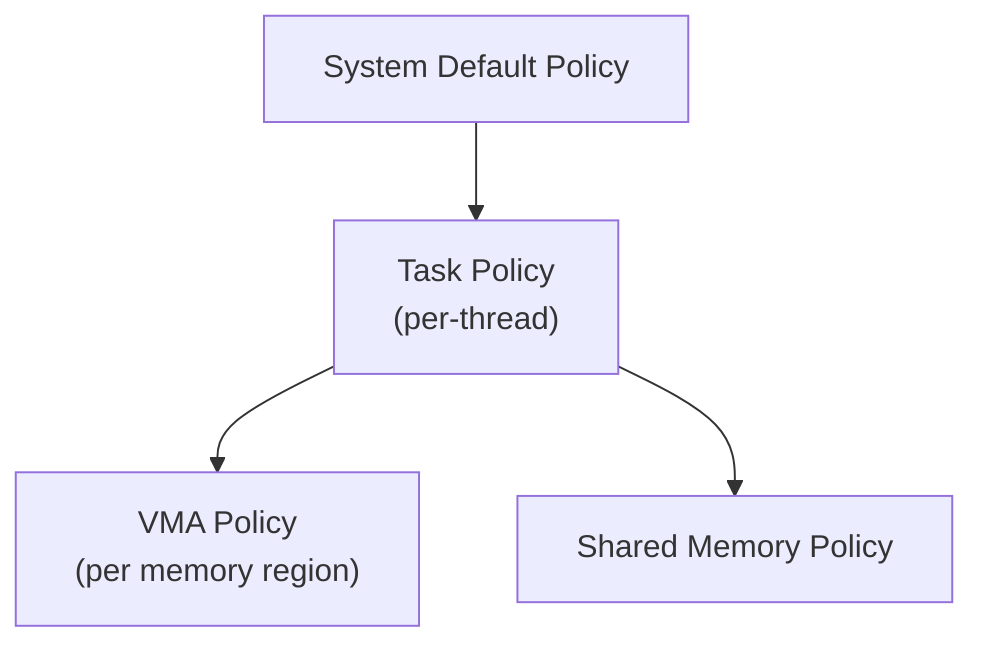

# CPU Memory Notes 5 — Multi-Thread Optimizations and NUMA Programming

> Detailed notes on Ulrich Drepper's *What Every Programmer Should Know About Memory*, Ch6.4 (Multi-Thread Optimizations) and Ch6.5 (NUMA Programming). See `00-index.md` for the full series map.

---

## 6.4 Multi-Thread Optimizations

⭐ **The chapter's opening tension, stated directly:** two goals that pull in **opposite directions.** Ordinary cache optimization says "keep the application's footprint small, so more fits in cache at once." But a multi-threaded program sharing data across threads runs straight into MESI/RFO costs (recall notes file 2) -- and the fix for *that* problem is often to **spread data out**, the opposite of footprint minimization. The paper covers three closely related but distinct sub-problems: **concurrency, atomicity, and bandwidth.**

### 6.4.1 Concurrency Optimizations -- False Sharing

⭐ **The core problem:** if multiple threads write to the **same cache line**, that line must be in the **Exclusive/Modified** state in whichever core is currently writing -- every other core touching it sends an **RFO**, in the worst case **once per write.** This is expensive even when the threads are logically writing to **completely independent variables**, purely because those variables happen to physically share a cache line -- this is **false sharing.**

### The Canonical Measured Example
⭐ **Setup:** a test program spawns several threads, each incrementing its **own** dedicated memory location 500 million times, pinned to individual processors on a 4-way P4 machine. Two configurations: each thread's counter on its **own separate cache line**, vs. all counters crammed onto **one shared cache line.**

| Threads | Overhead of 1 shared line vs. separate lines |
|---|---|
| 2 | **390%** |
| 3 | **734%** |
| 4 | **1,147%** |

⭐ **Why this happens, precisely:** the cache line holding all the counters is **pulled from one processor's cache the instant it finishes a write** -- every *other* processor is stalled, unable to do anything with that line, until it's their turn to pull it back. Each additional contending processor adds more delay, which is exactly why the overhead **grows superlinearly** with thread count, not linearly. ⭐ **The separate-cache-line configuration, by contrast, scales essentially without penalty** -- each processor keeps its own line in its own L1d, with no cross-core traffic at all; the tiny residual overhead measured is attributed to system noise and minor prefetching side-effects.

⭐ **A crucial nuance -- even a single quad-core chip isn't automatically immune:** the paper explicitly measures the same test on an Intel Core 2 QX6700 (quad-core, but with **two separate L2 caches**, each shared by only 2 of the 4 cores) -- false sharing still shows up in exactly the same shape, because two of the four cores are on the *other* L2, forcing genuine cross-cache, off-chip-equivalent RFO traffic. ⭐ **The practical takeaway the paper draws:** don't assume "it's all one chip" means "no false-sharing cost" -- the *actual* cache topology (which cores share which cache level) is what matters, and testing on real, representative multi-socket/multi-cache hardware remains important even in a multi-core era.

### The Fix -- and Why It's Not Simply "Pad Everything"
⭐ **The naive fix -- put every variable on its own cache line -- directly reintroduces the *other* goal's cost:** every padded variable inflates the application's memory footprint, hurting overall cache utilization elsewhere. **The real solution requires classifying variables by their actual sharing/write pattern:**

| Variable class | Treatment |
|---|---|
| **Never written, or written once at init (effectively constant)** | Safe to group together freely -- since RFOs are only needed for *writes*, a read-only (or read-mostly, in the Shared MESI state) line causes no contention no matter how many threads read it concurrently. **Mark these `const`** -- the toolchain will automatically place them in `.rodata`/`.data.rel.ro`, away from mutable data, with zero extra programmer effort beyond the annotation itself. |
| **Written by only one thread, ever** | Group per-thread; no cross-thread contention possible by construction |
| **Genuinely contested (written by multiple threads)** | These are the ones that actually need deliberate cache-line isolation (padding) -- but this should be a **targeted**, minority treatment, not a blanket policy |

⭐ **The general principle, restated:** false-sharing avoidance is a *classification* problem, not a *padding-everything* problem -- apply the expensive isolation treatment only where sharing genuinely occurs.

### 6.4.2 Atomicity Optimizations

⭐ **Why plain reads/writes aren't safe for shared, concurrently-modified state:** if a cache line sits in Shared state and two threads both increment it, the CPU doesn't wait for Exclusive ownership before reading the old value -- both threads can read the *same* stale value, both compute +1, and **one increment is silently lost** (this is the exact race condition already covered in the OSTEP notes' `counter++` example -- this paper explains the *hardware* mechanics behind exactly why it happens).

**The four categories of atomic operations, by hardware support:**
| Category | What it does |
|---|---|
| **Bit Test** | Atomically set/clear one bit, returning its prior state -- the *only* atomic op some early RISC CPUs provided |
| **Load-Lock/Store-Conditional (LL/SC)** | A paired instruction sequence: LL starts a "transaction"; the subsequent SC only succeeds if nothing modified that location in between -- retried on failure |
| **Compare-and-Swap (CAS)** | Ternary: write a new value only if the current value still matches an expected old value |
| **Atomic Arithmetic** | Direct atomic add/sub/etc. **only on x86/x86-64** -- RISC architectures generally lack this; a given architecture supports **either** LL/SC **or** CAS, not both, though both are roughly equivalent in expressive power |

⭐ **CAS has become the "universal" atomic primitive across architectures** -- and it's tempting to define *all* higher-level atomic operations purely in terms of it, for code portability. **The paper's central warning: this is a real, measurable performance trap.**

### Measured Comparison -- Why CAS-Based "Atomic Add" Is Slower Than a Real Atomic Add
Four concurrent threads, 1 million increments each, using GCC's `__sync_*` builtins:

| Method | Time |
|---|---|
| 1. Exchange Add (`__sync_fetch_and_add`) | 0.23s |
| 2. Add Fetch (`__sync_add_and_fetch`) | 0.21s |
| 3. **CAS-based increment loop** | **0.73s** -- over 3x slower |

```c
// The CAS-based increment loop (what gets built if you only have CAS)
int curval, newval;
do {
    curval = var;
    newval = curval + addend;
} while (CAS(&var, curval, newval));   // retry on failure
```
⭐ **Why CAS-based increment is so much more expensive, precisely explained via a two-thread trace:**
```
Thread #1        Thread #2        var Cache State
v = var                           'E' on Proc 1
n = v + 1        v = var          'S' on Proc 1+2
CAS(var)         n = v + 1        'E' on Proc 1     <- Thread 1's CAS succeeds
                 CAS(var)         'E' on Proc 2     <- Thread 2's CAS must RETRY (stale curval)
```
The cache-line ownership state churns through **at least 3 transitions in this tiny window, two of them RFOs**, and -- worse -- Thread 2's CAS **fails and must loop again**, potentially repeating the whole dance. ⭐ **A true atomic arithmetic instruction, by contrast, keeps the whole load-modify-store sequence together as one hardware-guaranteed unit** -- any concurrently-issued RFO from another core is simply **blocked/queued** until the atomic op completes, needing **at most one RFO per increment**, with no retry loop at all.

⭐ **The practical lesson, stated directly:** *"it is crucial to define the machine abstraction at a level at which atomic arithmetic and logic operations can be utilized. CAS should not be universally used as the unification mechanism."* Reach for a real atomic-add/fetch instruction where the target architecture provides one, rather than reflexively building everything on top of CAS for portability's sake.

### The x86/x86-64 `lock` Prefix Trick -- Paying for Atomicity Only When Needed
⭐ **A distinctive x86/x86-64 capability:** the *same* instruction can be issued atomically or non-atomically, purely by prepending (or omitting) the **`lock` prefix** -- meaning a library that must be thread-safe *only when actually used from multiple threads* can decide, **at runtime**, whether to pay the atomic-operation cost at all:
```asm
cmpl $0, multiple_threads
je   1f
lock
1:   add $1, some_var
```
⭐ **How this works:** if `multiple_threads == 0`, the branch jumps *past* the `lock` prefix line entirely, so `add` executes as an ordinary, cheap, non-atomic instruction; if nonzero, execution falls through and the very next instruction (`add`) is issued **with** the `lock` prefix attached, making it atomic. ⭐ **The performance trade-off the paper is explicit about:** this adds a conditional branch, which costs something if mispredicted -- but given an atomic operation itself typically costs **on the order of 200 cycles**, the break-even point for this trick is low: any code path that's frequently single-threaded benefits meaningfully, at a small, bounded cost when actually multi-threaded. ⚠️ **The real-world catch:** this trick can't be expressed through GCC's portable `__sync_*` builtins -- it requires hand-written inline assembly, trading portability for this specific performance win.

### Thread Affinity -- the Prerequisite for Everything Above to Matter
⭐ **Before any of the false-sharing/atomicity tuning above pays off reliably, threads need to actually stay put** -- `pthread_setaffinity_np()`/`pthread_getaffinity_np()` (and the attribute-based variants, settable **before** a thread even starts) let a program pin specific threads to specific CPUs.

⭐ **Two opposite scheduling goals, and why "it depends" is the honest answer:**
- **Threads sharing a working set** benefit from being scheduled on cores that **share a cache** (faster collaboration, one shared copy of the hot data instead of two).
- **Threads with genuinely independent working sets** actively **hurt each other** if forced onto cores sharing one cache -- they fight over the same limited cache capacity and effectively **halve** the bandwidth each gets, since now two full, unrelated datasets must both fit through the same cache port.

⭐ **The paper's blunt conclusion: understand which situation you're actually optimizing for before touching affinity settings** -- the correct affinity policy is the *opposite* depending on whether threads cooperate or compete for cache.

---

## 6.5 NUMA Programming

⭐ **Framing:** everything from the earlier cache-optimization sections still applies fully -- NUMA adds a **new layer of cost below that**, specifically: **which physical page a given piece of memory is allocated on**, since access cost now genuinely differs by node.

⭐ **The paper's forward-looking observation (written ~2007), which has aged accurately:** as core counts per chip rise, pure multi-*socket* SMP may become less common outside data centers -- but **this does NOT mean NUMA becomes irrelevant**, because *the exact same conceptual problem reappears at the cache level within a single chip*: cores sharing an L2/L3 collaborate faster than cores that don't, which is structurally the same "distance matters" problem NUMA describes for memory -- just one level closer to the CPU. ⭐ The paper explicitly recommends this section is worth reading even for people who only care about single-socket, non-NUMA machines, for exactly this reason.

### The Memory Policy Hierarchy

⭐ **Resolution order:** a VMA (region-specific) policy wins if one is set for the address in question; otherwise the task's own policy applies; otherwise the **system default** applies. ⭐ **The system default, specifically:** allocate memory **local to the thread requesting it** -- for a multi-threaded process, "local" means the **"home" node**, the one that first ran the process -- a sensible, transparent default requiring zero application code changes for the common case.

### The Four Policy Modes (`MPOL_*`)
| Policy | Behavior |
|---|---|
| **`MPOL_BIND`** | Allocate **only** from the specified node set; allocation **fails** if impossible |
| **`MPOL_PREFERRED`** | Prefer the specified node(s); silently fall back to others if unavailable |
| **`MPOL_INTERLEAVE`** | Spread allocations **evenly** across the specified nodes (selected by virtual-memory-region offset for VMA policies, or a free-running counter for task policies) -- useful for large, uniformly-accessed shared structures where no single node should bear the full access load |
| **`MPOL_DEFAULT`** | Use whatever the containing region's own default is |

⭐ **Key API -- `set_mempolicy()`:**
```c
#include <numaif.h>
long set_mempolicy(int mode, unsigned long *nodemask, unsigned long maxnode);
```
⚠️ **Two important caveats the paper is explicit about:**
1. **Setting a policy affects only *future* allocations** -- it never retroactively migrates already-allocated pages.
2. **Allocation != reservation:** an `mmap()`'d region isn't actually backed by physical pages until **first touch** (the first read or write) -- so if the policy changes *between* touches to different parts of the same nominally-uniform mmap'd region, the result can be a region physically **scattered** across multiple nodes despite looking like one contiguous virtual allocation.

### Swapping and NUMA -- a Subtle Interaction
⭐ **A genuinely easy-to-miss detail:** the Linux swap implementation **discards node information** when writing a page out to swap -- so when that page is later paged back in, node selection starts fresh from the current policy, which may well pick a **different** node than the page originally lived on. ⭐ **Practical consequence:** an application **cannot assume** a given page's node affiliation is a stable, permanent property -- it can silently change across a swap-out/swap-in cycle, or via kernel-initiated migration if one node runs low on free space while another has room.

### Explicit Page Migration
Beyond the passive policy mechanisms, Linux exposes direct migration control:
- **`mbind()`** -- bind a specific address range to a node set, with flags controlling existing-page behavior:
  - `MPOL_MF_MOVE` -- migrate pages currently on a "wrong" node, but **only** those used exclusively by the calling process's own page tables (i.e., not shared with others).
  - `MPOL_MF_MOVEALL` -- migrate **all** matching pages, even those shared with unrelated processes -- ⭐ a system-wide-impact operation, correctly gated behind the **`CAP_NICE`** privileged capability, since it can affect other users' processes' memory locality without their consent.
- **`migrate_pages()`** -- bulk-move all of a process's pages from one node set to another.
- **`move_pages()`** -- fine-grained: move specific individual pages, or just query which node each currently lives on.

### Querying System Topology
⭐ Beyond `/proc/PID/numa_maps` (covered in notes file 3), the paper points to `libnuma`'s system-call wrappers as the standard (if, per the paper's own assessment, "wholly inadequate" at the time) way to programmatically discover node topology and CPU-to-node mappings -- necessary groundwork before an application can make informed `MPOL_*` policy decisions rather than just relying on the default.

⭐ **Closing practical synthesis:** NUMA-aware programming is fundamentally about combining **two** levers deliberately, rather than leaving either to chance -- (1) **CPU affinity**, controlling *where a thread runs*, and (2) **memory policy**, controlling *where its memory lives* -- get these two out of sync (a thread pinned to node 0, but its working set's memory policy scattering allocations across nodes 0-3) and you can end up paying NUMA's remote-access tax needlessly, even on hardware that could have avoided it entirely.

---

## Summary Table

| Concept | Key idea |
|---|---|
| **False sharing** | Independent variables sharing one cache line cause RFO storms as if they were genuinely contested -- fix by classifying variables (constant / per-thread / genuinely contested) rather than blanket padding |
| **Measured false-sharing overhead** | 390% / 734% / 1,147% for 2/3/4 threads on one shared line vs. separate lines -- a striking, superlinear cost |
| **CAS vs. true atomic arithmetic** | CAS-based increment loops can be 3x+ slower than a native atomic add, due to retry loops and extra RFO churn -- CAS should not be the universal abstraction layer |
| **`lock` prefix trick (x86)** | Same instruction, atomic or not, chosen at runtime via a branch -- pays the ~200-cycle atomic cost only when actually multi-threaded |
| **Thread affinity** | Correct policy depends on whether threads cooperate (co-locate on shared cache) or compete (spread across separate caches) for the same working set |
| **NUMA memory policy hierarchy** | System default -> task policy -> VMA policy, resolved in that priority order |
| **`MPOL_BIND`/`PREFERRED`/`INTERLEAVE`/`DEFAULT`** | Strict node binding vs. soft preference vs. even spreading vs. inherited default |
| **Swap + NUMA** | Node affiliation is lost across a swap-out/swap-in cycle -- not a stable, assumable property of a page |

## Key Talking Points

- Explain **false sharing precisely**, and be ready to state the measured overhead numbers (390%/734%/1,147%) as a concrete, memorable illustration of just how expensive it can be.
- Explain **why the fix for false sharing isn't "pad every variable"** -- walk through the three-way variable classification (constant / per-thread / contested) and why only the last category needs isolation.
- Walk through the **CAS-based increment loop's cache-state trace** and explain precisely why it's slower than a native atomic add -- this is a genuinely deep, high-signal explanation if you can reproduce it.
- Explain the **x86 `lock` prefix runtime trick**, including the concrete cost trade-off (branch misprediction cost vs. ~200-cycle atomic operation cost) that makes it worthwhile.
- Explain **why thread affinity policy is situation-dependent** -- cooperating threads want shared cache, competing threads want separate cache -- and why blindly pinning threads together is not universally correct.
- Explain the **NUMA memory policy hierarchy and the four `MPOL_*` modes**, and be ready to explain why "allocation != reservation" (first-touch semantics) can cause a nominally uniform allocation to end up scattered across nodes.