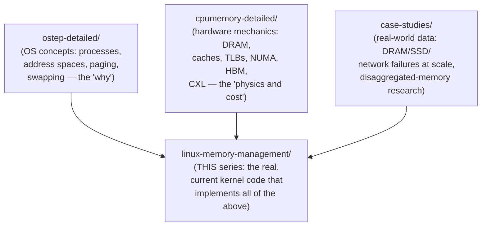

# Linux Memory Management — Index

> How the Linux kernel actually implements everything covered conceptually across this workspace's notes: `ostep-detailed` (OS abstractions), `cpumemory-detailed` (hardware mechanics and modern AI-datacenter memory), and `case-studies` (real-world failure data and disaggregated-memory research). This series is the "here's the real, current kernel code" layer underneath all of it.

---

## Chapter Map

| # | File | Core content |
|---|---|---|
| 1 | `01-physical-memory-zones-buddy-slab.md` | NUMA/zone discovery at boot (ACPI SRAT/SLIT), zones (DMA/DMA32/NORMAL/MOVABLE), the buddy allocator, `struct page` → `struct folio`, slab/SLUB/`kmalloc` |
| 2 | `02-virtual-memory-page-tables-faults.md` | `mm_struct`, VMAs (and the kernel 6.1 maple-tree rework), the real PGD→PUD→PMD→PTE walk, page fault handling (demand paging, copy-on-write, swap-in), `mmap()`/`brk()`/`madvise()`, Transparent Huge Pages |
| 3 | `03-reclaim-numa-cgroups-tiering.md` | Active/Inactive LRU → Multi-Gen LRU, `zswap`/`zram`, the real NUMA policy API (`mbind`, `set_mempolicy`, `libnuma`, `numactl`), CXL memory tiering as an extra NUMA tier, cgroups v2 memory limits, the OOM killer |

---

## How This Series Fits the Rest of the Workspace

Every file in this series is written to be read **alongside** its conceptual counterpart, not instead of it:
- File 1 (physical memory) pairs with `ostep-detailed/04-free-space-and-paging.md` (buddy allocation concept) and `cpumemory-detailed/01-ram-hardware.md` (why NUMA exists).
- File 2 (virtual memory) pairs with `ostep-detailed/01-03` (process abstraction, address spaces, paging) and `cpumemory-detailed/03` (TLBs, huge pages).
- File 3 (reclaim/NUMA/tiering) pairs with `ostep-detailed/05-beyond-physical-memory.md` (page replacement policy) and `cpumemory-detailed/05` and `07` (NUMA programming, CXL) — and is the direct, shipping answer to Case Study 2's prediction that CXL would soon need OS-level integration.

## The One Idea Worth Carrying Away

⭐ Every mechanism in this series exists to answer the same question, at a different layer: **"how much does moving this data cost, and is it worth paying that cost right now?"** — a page fault decides whether data is worth having in memory at all; the buddy allocator decides where in physical memory it goes; NUMA policy decides which node; memory tiering decides which *tier* (fast DRAM vs. slower CXL); MGLRU/reclaim decides when it's no longer worth keeping; and the OOM killer is what happens when the system runs out of cheaper answers entirely. Nothing here is arbitrary — every one of these mechanisms is a direct, traceable response to a cost asymmetry documented somewhere else in this workspace, from DRAM's RAS/CAS timing all the way up to a 2023 survey paper's prediction about CXL.