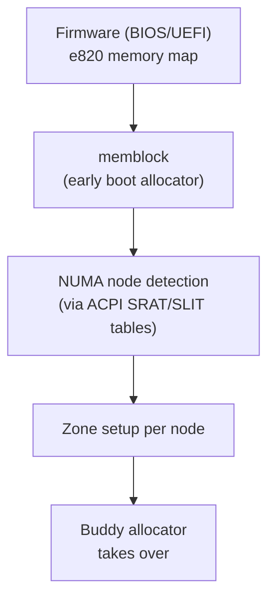
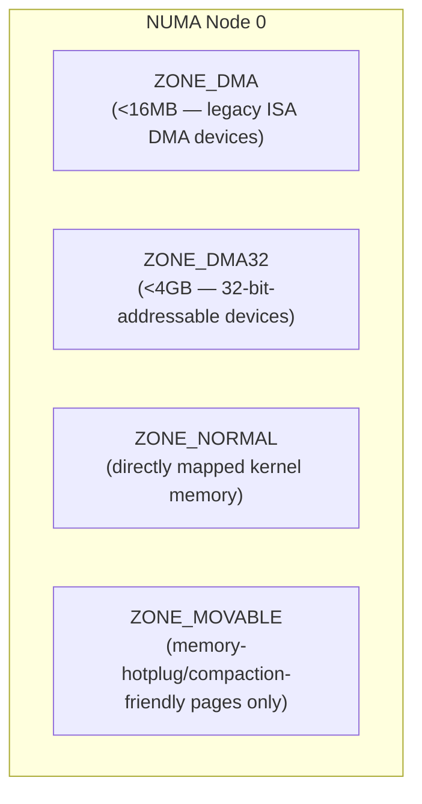
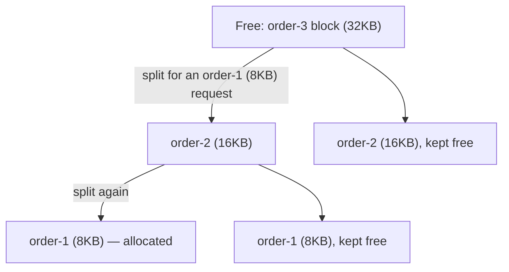
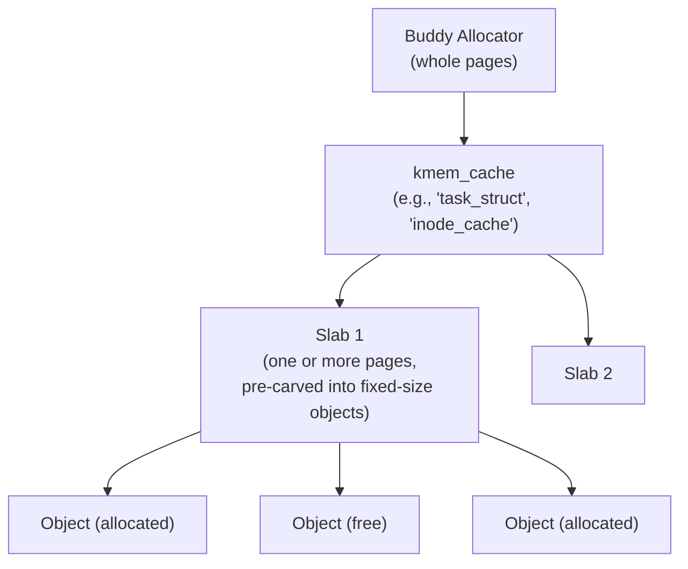

# Linux Memory Management 1 — Physical Memory: Zones, Buddy Allocator, and Slab

> How the Linux kernel actually implements everything described conceptually in the `cpumemory-detailed` series (DRAM, NUMA) and `case-studies` (disaggregated/pooled memory). This file covers physical memory: how Linux discovers, organizes, and allocates raw page frames. See `00-index.md` for the full series map.

---

## 1. Boot-Time Memory Discovery

Before any allocator can run, the kernel must learn what physical memory exists. On x86, this comes from the firmware's **e820** map (or its UEFI equivalent), which the kernel converts into its own internal representation, `memblock` — a simple, allocator-of-last-resort used only during early boot, before the "real" allocators (covered below) are initialized.



⭐ **NUMA topology (directly connecting to `cpumemory-detailed/03-virtual-memory-and-numa.md`) is discovered from ACPI tables, not guessed:**
- **SRAT (System/Static Resource Affinity Table)** — tells the kernel which physical address ranges belong to which NUMA node.
- **SLIT (System Locality Information Table)** — gives the actual **distance matrix** between nodes (this is where the "NUMA factor" numbers from the cpumemory notes ultimately come from, in machine-readable form).

```bash
# See what Linux discovered, post-boot
$ numactl --hardware
available: 2 nodes (0-1)
node 0 cpus: 0 1 2 3 4 5 6 7
node 0 size: 63864 MB
node 1 cpus: 8 9 10 11 12 13 14 15
node 1 size: 64509 MB
node distances:
node   0    1
  0:  10   21
  1:  21   10
```
⭐ The `node distances` matrix is Linux's software representation of exactly the SLIT-derived NUMA-factor concept from the cpumemory notes — `10` is the baseline (local access), `21` means roughly 2.1x the latency for a remote access — directly comparable to the AMD-published 30%/49% figures cited there.

---

## 2. Zones — Splitting Each NUMA Node's Memory by Hardware Constraint

⭐ Within **each NUMA node**, physical memory is further divided into **zones** — not for performance reasons, but because different pieces of hardware have different **addressing limitations**, and some kernel allocations have special requirements (e.g., must be physically contiguous and below a certain address for old DMA hardware).



| Zone | Purpose | Why it exists |
|---|---|---|
| **`ZONE_DMA`** | Below 16MB | Some ancient ISA-based DMA controllers can only address 24 bits |
| **`ZONE_DMA32`** | Below 4GB | Many PCI devices' DMA engines are only 32-bit addressable, even on a 64-bit CPU |
| **`ZONE_NORMAL`** | Everything else the kernel can directly map | The bulk of usable RAM on 64-bit systems |
| **`ZONE_MOVABLE`** | Pages the kernel guarantees can always be *migrated or reclaimed* | Enables memory hotplug (physically removing a DIMM/NUMA node) and reduces long-term fragmentation |
| **`ZONE_HIGHMEM`** | (32-bit only, mostly historical) | Physical memory the kernel can't permanently map into its own limited virtual address space |

```bash
$ cat /proc/zoneinfo | grep -A2 "Node 0, zone"
Node 0, zone      DMA
Node 0, zone    DMA32
Node 0, zone   Normal
Node 0, zone  Movable
```

⭐ **Why `ZONE_MOVABLE` matters directly for the disaggregated-memory case study:** memory hotplug — physically adding or removing memory at runtime — is exactly the kernel-level mechanism that would let a CXL-attached memory device be added to (or removed from) a running system without a reboot. A page can only be safely hot-unplugged if it's guaranteed relocatable, which is precisely what `ZONE_MOVABLE` promises.

---

## 3. The Buddy Allocator — Linux's Physical Page Allocator

⭐ **This is the direct, real-world implementation of the "buddy allocation" concept introduced conceptually in the OSTEP-based notes (`ostep-detailed/04-free-space-and-paging.md`)** — Linux's actual page-frame allocator works exactly this way.

### The Core Data Structure
```c
// simplified from include/linux/mmzone.h
struct zone {
    struct free_area free_area[MAX_ORDER];   // MAX_ORDER is typically 11
    ...
};

struct free_area {
    struct list_head free_list[MIGRATE_TYPES];  // one list per migration type
    unsigned long nr_free;
};
```
- Each zone tracks free memory as **`MAX_ORDER` (typically 11) separate free lists**, one per **order** — order `k` holds blocks of `2^k` contiguous pages. With 4KB pages, order 0 = 4KB, order 1 = 8KB, ... order 10 = 4MB.
- Allocation requests a specific **order**; if that order's free list is empty, the allocator recursively **splits** a block from the next-higher order — exactly the recursive-halving diagram from the OSTEP notes, now with real kernel code behind it.
- Freeing a block checks whether its **buddy** (the block that would recombine with it into the next order up) is also free; if so, they're merged, and the check repeats one level up — this is `__free_one_page()` in `mm/page_alloc.c`.



### Migration Types — Fighting Fragmentation
⭐ Beyond order, each free list is *also* split by **migration type**, because the buddy allocator alone doesn't prevent fragmentation over a long-running system's lifetime:

| Migration type | Meaning |
|---|---|
| `MIGRATE_UNMOVABLE` | Kernel data structures that can never be relocated (most kernel allocations) |
| `MIGRATE_MOVABLE` | Ordinary user-process pages — can be migrated by `compaction` or reclaimed |
| `MIGRATE_RECLAIMABLE` | Page cache, some kernel caches — can be dropped and refetched if needed |

⭐ **Why this matters:** by segregating *unmovable* allocations away from *movable* ones, the kernel keeps large contiguous free regions available for high-order allocations (e.g., huge pages) — directly mitigating the external-fragmentation problem the OSTEP notes describe for segmentation. **Memory compaction** (`mm/compaction.c`) actively defragments by migrating movable pages out of a region to consolidate free space — this is the kernel-level machinery that makes Transparent Huge Pages (next file) practically obtainable on a long-running system.

### The Allocation API
```c
// The actual kernel-internal allocation function — everything else wraps this
struct page *alloc_pages(gfp_t gfp_mask, unsigned int order);

// Common wrappers:
void *page_address(struct page *page);          // kernel virtual address of a page
unsigned long __get_free_pages(gfp_t gfp_mask, unsigned int order);
void __free_pages(struct page *page, unsigned int order);
```
⭐ **`gfp_mask` (Get Free Pages flags) is where NUMA, zone, and blocking behavior are all specified in one bitmask** — a few of the most important:
| Flag | Meaning |
|---|---|
| `GFP_KERNEL` | Normal kernel allocation, allowed to sleep/block waiting for memory |
| `GFP_ATOMIC` | Cannot sleep (e.g., inside an interrupt handler) — must succeed immediately or fail |
| `GFP_DMA` / `GFP_DMA32` | Must come from `ZONE_DMA` / `ZONE_DMA32` specifically |
| `__GFP_ZERO` | Zero the returned memory |
| `__GFP_THISNODE` | Must come from the specified NUMA node, or fail (no silent fallback) |

---

## 4. `struct page` and the Transition to `struct folio`

### The Classic `struct page`
⭐ Every 4KB physical page frame in the system has an associated **`struct page`** — a per-page metadata record, kept in a huge, densely-packed array (`mem_map`). This is Linux's concrete answer to "how does the kernel track what every single page frame is currently being used for":
```c
// heavily simplified — the real struct is a union-packed nightmare
// specifically to keep this structure as small as possible, since
// there's one per 4KB page (millions of them on a large server)
struct page {
    unsigned long flags;        // PG_locked, PG_dirty, PG_reclaim, etc.
    atomic_t _refcount;         // reference count
    atomic_t _mapcount;         // how many page tables map this page
    struct address_space *mapping;  // which file (or anon_vma) owns this page
    pgoff_t index;              // offset within that file/mapping
    struct list_head lru;       // linkage into the active/inactive LRU lists
    ...
};
```
⭐ **Why so much engineering effort goes into shrinking this struct:** a server with 512GB of RAM and 4KB pages has **~134 million** `struct page` entries — even shaving a few bytes off the struct saves gigabytes of kernel memory system-wide, which is exactly why the struct is such a densely packed union of reused fields.

### The Folio Transition (an active, still-ongoing kernel rework)
⭐ **A genuinely current (2021-2026, still in progress as of this writing) kernel restructuring**, led by Matthew Wilcox: the historical design conflated two different concepts inside `struct page` — (1) a raw 4KB physical frame, and (2) the unit the rest of the kernel (page cache, filesystems, the VM) actually reasons about, which is increasingly **multiple physically-contiguous pages treated as one unit** (to reduce per-4KB overhead, much like huge pages reduce TLB pressure).

```c
struct folio {
    // guaranteed to never be a "tail page" of a compound allocation
    ...
};
```
- **A folio is a guarantee**: "this is the *head* of a (possibly multi-page) allocation, never a tail page" — eliminating an entire historical class of kernel bugs where code accidentally called page-cache/filesystem functions on a tail page of a compound allocation.
- **Large folios** let the page cache and filesystems manage memory in bigger chunks (e.g., 16KB or 64KB instead of 4KB) transparently — directly reducing the *number* of `struct page`-equivalent metadata lookups per byte of data touched, which is conceptually the same "amortize per-unit overhead over a bigger unit" trick behind huge pages, cache lines, and DDR burst transfers throughout this whole notes ecosystem.
- ⭐ As of the most recent kernel development reporting (2025), this transition is still **actively ongoing** — fields like `mapping`, `index`, and `lru` are being progressively moved fully into `struct folio` and removed from `struct page`, and the slab allocator (below) is being adapted to use its own separate `struct slab` rather than overloading `struct page` the way it historically did.

---

## 5. `kmalloc`, Slab, and SLUB — Allocating Small Kernel Objects

⭐ **The gap this layer fills:** the buddy allocator only hands out whole pages (4KB minimum). The kernel constantly needs much smaller objects — a `struct task_struct` for each process, `struct inode` for each open file, network packet buffers — allocating a whole page for a 200-byte struct would waste enormous amounts of memory.

### The Slab Concept — Directly Analogous to `cpumemory`'s Discussion
⭐ **This is the same "slab allocator" idea referenced in `cpumemory-detailed/04-cache-optimization-and-prefetching.md`'s free-space-management discussion (Solaris's slab allocator, via Jeff Bonwick)** — Linux adopted essentially the same concept:



- A **`kmem_cache`** is created **per object type** (`task_struct`, `inode`, `dentry`, ...) — each cache requests whole pages from the buddy allocator, then carves them into fixed-size objects.
- ⭐ **The key performance win, exactly as in Bonwick's original design:** freed objects are kept in a **pre-initialized state** where possible — avoiding repeated constructor/destructor overhead on every allocate/free cycle for objects with expensive initialization.
- **SLUB** is the modern default slab implementation in Linux (replacing the older SLAB implementation) — simpler internally, with **per-CPU "freelists"** to allocate/free common-case objects **without taking a lock at all**, directly applying the lock-avoidance principle from `cpumemory-detailed/05-multithread-and-numa-programming.md` (the "pay for atomicity only when needed" theme) to kernel object allocation.

### The `kmalloc()` API — General-Purpose Small Allocations
```c
#include <linux/slab.h>

void *kmalloc(size_t size, gfp_t flags);
void kfree(const void *ptr);

// Example: allocate a 128-byte buffer, zeroed, allowed to sleep
void *buf = kmalloc(128, GFP_KERNEL | __GFP_ZERO);
if (!buf)
    return -ENOMEM;
...
kfree(buf);
```
⭐ **Under the hood, `kmalloc()` doesn't create a new cache per call** — it rounds the requested size up to the nearest of a fixed set of general-purpose size-class caches (`kmalloc-8`, `kmalloc-16`, ... `kmalloc-8192`, growing by roughly power-of-two steps) — this is Linux's own version of the **segregated free lists** concept from the OSTEP notes (dedicated free lists per common size class, avoiding per-request search cost).

```bash
# See every active kmem_cache, its object size, and how many are allocated/free
$ sudo cat /proc/slabinfo | head -5
slabinfo - version: 2.1
# name            <active_objs> <num_objs> <objsize> <objperslab> <pagesperslab>
task_struct         412    412   9856    3    8
kmalloc-1k         2048   2048   1024    4    1
inode_cache        8821   8912    608    5    1
```

---

## 6. Putting Zones, Buddy, and Slab Together — the Full Physical-Allocation Path

```mermaid
flowchart TD
    App["Kernel subsystem needs memory"] --> Size{"How big?"}
    Size -->|small object\ne.g. struct inode, network buffer| Slab["kmalloc() / kmem_cache_alloc()"]
    Size -->|whole page(s)| Direct["alloc_pages() / __get_free_pages()"]
    Slab --> Cache["Appropriate kmem_cache\n(SLUB, per-CPU freelist)"]
    Cache -->|cache empty, needs a new slab| Buddy["Buddy Allocator"]
    Direct --> Buddy
    Buddy --> ZoneChoice{"Which zone/node?"}
    ZoneChoice -->|GFP flags + NUMA policy| Node["Selected NUMA node's zone\n(DMA/DMA32/NORMAL/MOVABLE)"]
    Node --> FreeList["free_area[order] free list"]
    FreeList -->|list empty| Split["Split a higher-order block\n(recursive halving)"]
```

⭐ **The unifying theme across this entire file, worth restating:** every layer here exists to solve the exact same problem the cpumemory-detailed series raises at the hardware level — **matching allocation granularity to actual need**, at successively finer scales: NUMA nodes (whole-machine granularity) → zones (hardware-constraint granularity) → buddy orders (page-count granularity) → slab (byte-count granularity). Nothing here is hardware-specific to Linux — any production OS solves the same problem — but this is precisely *how* Linux does it, with real, inspectable code and `/proc` interfaces to verify it.

---

## Summary Table

| Layer | Unit of allocation | Purpose |
|---|---|---|
| **NUMA nodes** | Whole memory banks, discovered via ACPI SRAT/SLIT | Matches the physical topology from `cpumemory-detailed/03` |
| **Zones** | Address-range-constrained subsets of a node | Satisfies hardware DMA addressing limits; enables memory hotplug (`ZONE_MOVABLE`) |
| **Buddy allocator** | Powers of 2, in pages (order 0-10) | Fast, low-fragmentation whole-page allocation, with migration-type segregation to fight long-term fragmentation |
| **`struct page` / `struct folio`** | Per-page (or per-compound-allocation) metadata | Tracks what every physical frame is being used for; folios reduce per-4KB metadata overhead |
| **Slab / SLUB / `kmalloc`** | Fixed-size objects, sub-page granularity | Efficient allocation of the kernel's many small, frequently-allocated structures |

## Key Talking Points

- Explain **why Linux splits each NUMA node into zones**, and connect `ZONE_DMA`/`ZONE_DMA32` directly to real hardware addressing limitations, not performance.
- Walk through the **buddy allocator's split/merge mechanics** and connect it explicitly to the OSTEP-based notes' conceptual treatment of buddy allocation — same algorithm, now with real kernel code and `/proc/buddyinfo`/`/proc/zoneinfo` as inspection tools.
- Explain **why migration types exist** and how `ZONE_MOVABLE` + migration types together combat long-term fragmentation and enable memory hotplug — a direct, practical link to disaggregated/CXL memory scenarios from the case studies.
- Explain **why `struct page` is so aggressively space-optimized**, using the "millions of instances on one server" argument, and describe what problem the ongoing folio transition solves.
- Explain the **slab/SLUB allocator's purpose** (sub-page-granularity allocation) and connect it directly to Solaris's slab allocator as covered in `cpumemory-detailed/04`.