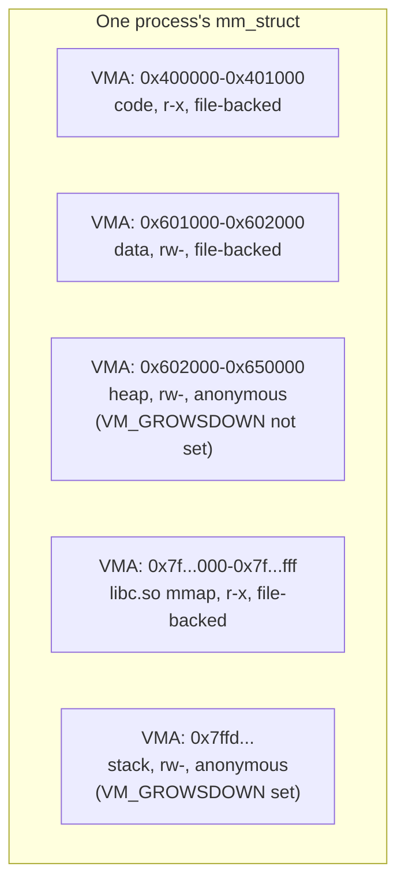
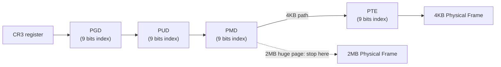

# Linux Memory Management 2 — Virtual Memory: Address Spaces, Page Tables, and Page Faults

> How Linux implements the address-space and paging concepts from `ostep-detailed/03-04` and `cpumemory-detailed/03` as real kernel data structures and code paths. See `00-index.md` for the full series map.

---

## 1. `mm_struct` — a Process's Address Space, as a Kernel Object

⭐ **This is the literal, concrete implementation of "the address space" abstraction from the OSTEP notes.** Every process (technically, every distinct address space — threads of the same process *share* one) has exactly one `mm_struct`:

```c
// simplified from include/linux/mm_types.h
struct mm_struct {
    struct maple_tree mm_mt;          // the VMAs, indexed by address (see below)
    pgd_t *pgd;                        // pointer to the top-level page table
    atomic_t mm_users;                 // number of threads sharing this mm
    atomic_t mm_count;                 // reference count (kernel-internal)
    unsigned long start_code, end_code;    // code segment bounds
    unsigned long start_data, end_data;    // data segment bounds
    unsigned long start_brk, brk;          // heap bounds
    unsigned long start_stack;             // stack start
    unsigned long total_vm;                // total pages mapped
    struct rw_semaphore mmap_lock;         // protects the VMA tree
    ...
};
```
⭐ **`mm_users` vs. `mm_count` — a genuinely subtle but important distinction:** `mm_users` counts threads/processes actively *using* this address space right now; `mm_count` is a raw reference count that also includes kernel code temporarily borrowing a reference (e.g., during a context switch). An address space is only truly torn down once **both** hit zero — this two-level counting exists specifically to let kernel code safely hold a reference to an `mm_struct` slightly longer than any actual thread is using it, without races.

```bash
# Every process's mm_struct summary, human-readable
$ cat /proc/<pid>/status | grep -E "Vm|Threads"
VmSize:  1048576 kB   # total virtual address space size
VmRSS:     45200 kB   # actual physical memory currently resident
VmData:    12300 kB   # heap
VmStk:       132 kB   # stack
Threads:       4
```

---

## 2. VMAs — Virtual Memory Areas

⭐ **The direct implementation of "regions" within an address space** (code, heap, stack, each `mmap`'d file or anonymous region) — recall the address-space diagram from the OSTEP notes; each labeled region there is, in real Linux, one `struct vm_area_struct`:

```c
// simplified
struct vm_area_struct {
    unsigned long vm_start, vm_end;   // [start, end) -- the address range this VMA covers
    struct mm_struct *vm_mm;           // which address space this belongs to
    pgprot_t vm_page_prot;             // page protection (read/write/exec)
    unsigned long vm_flags;            // VM_READ, VM_WRITE, VM_EXEC, VM_SHARED, VM_GROWSDOWN...
    struct file *vm_file;              // the mapped file, if any (NULL for anonymous memory)
    const struct vm_operations_struct *vm_ops;  // fault handler callbacks
    ...
};
```



⭐ **How VMAs are looked up — a real, recent kernel-internals change worth knowing:** Linux historically kept VMAs in **both** a linked list (for sequential iteration) and a **red-black tree** (for fast lookup-by-address). Since **kernel 6.1**, this was replaced by a single **maple tree** (`mm_mt`) -- a B-tree-like structure specifically designed for storing address ranges, offering better cache locality (RCU-friendly range lookups) and enabling safer concurrent VMA lookups than the old rbtree+list combination. This is a direct, real-world instance of the multi-level, cache-aware tree-structure design principles from `cpumemory-detailed/02` -- a kernel data structure redesigned specifically for better cache-line behavior at scale.

```bash
# Human-readable view of a process's VMAs -- literally a dump of vm_area_struct entries
$ cat /proc/<pid>/maps
00400000-00401000 r-xp 00000000 08:01 1234  /usr/bin/myapp
00601000-00602000 rw-p 00001000 08:01 1234  /usr/bin/myapp
00602000-00650000 rw-p 00000000 00:00 0     [heap]
7f1234500000-7f1234700000 r-xp 00000000 08:01 5678  /usr/lib/libc.so.6
7ffd12340000-7ffd12361000 rw-p 00000000 00:00 0     [stack]
```

---

## 3. Page Tables — Linux's Real x86-64 Implementation

⭐ **Linux's page table code is generic enough to abstract over architectures with 2 to 5 translation levels** -- on x86-64 with 4-level paging (the default), the naming maps directly onto the abstract "L1-L4" levels from `cpumemory-detailed/03-virtual-memory-and-numa.md`:

| Linux name | x86-64 term | What it is |
|---|---|---|
| **PGD** (Page Global Directory) | CR3-referenced top level | The `pgd_t *pgd` field in `mm_struct` |
| **P4D** (Page 4th Directory) | (only present with 5-level paging) | Extra level for the 57-bit address space extension |
| **PUD** (Page Upper Directory) | -- | |
| **PMD** (Page Middle Directory) | -- | Where huge-page (2MB) mappings terminate, one level early |
| **PTE** (Page Table Entry) | -- | The final level -- holds the actual physical frame number |



```c
// simplified walk logic (conceptually -- real code is in arch/x86/mm/)
pgd_t *pgd = pgd_offset(mm, addr);
p4d_t *p4d = p4d_offset(pgd, addr);
pud_t *pud = pud_offset(p4d, addr);
pmd_t *pmd = pmd_offset(pud, addr);
if (pmd_large(*pmd))
    return pmd_page(*pmd);      // a 2MB huge page -- stop early
pte_t *pte = pte_offset_map(pmd, addr);
return pte_page(*pte);           // the ordinary 4KB page
```
⭐ **This is literally the same generic tree-walk algorithm described abstractly in `cpumemory-detailed/03`**, now expressed as real kernel functions -- and it's exactly why a 2MB huge page mapping can "stop one level early" (at the PMD) and skip the final PTE lookup entirely, directly realizing the "fewer levels to walk on a TLB miss" benefit described there.

---

## 4. Page Fault Handling -- the Real Code Path

⭐ **Recall from the OSTEP notes: a page fault means the hardware trapped into the OS because a virtual address had no valid translation.** Here is what Linux's fault handler actually does, step by step:

```mermaid
flowchart TD
    Fault["CPU raises #PF exception"] --> Handler["do_page_fault() /\nhandle_mm_fault()"]
    Handler --> FindVMA{"find_vma():\nis this address in\na valid VMA?"}
    FindVMA -->|No| SEGV["SIGSEGV\n(segmentation fault)"]
    FindVMA -->|Yes| CheckPerm{"Access permitted?\n(read on write-only VMA, etc.)"}
    CheckPerm -->|No| SEGV
    CheckPerm -->|Yes| WhatKind{"What kind of fault?"}
    WhatKind -->|Not yet mapped\n(demand paging)| DoFault["do_anonymous_page() or\n->fault() callback\n(allocate/read in a page)"]
    WhatKind -->|Present but read-only,\nwrite attempted| COW["do_wp_page()\n(Copy-On-Write)"]
    WhatKind -->|Present, but swapped out| Swapin["do_swap_page()\n(read back from swap)"]
    DoFault --> InstallPTE["Install new PTE,\nreturn to faulting instruction"]
    COW --> InstallPTE
    Swapin --> InstallPTE
```

### Demand Paging -- Lazy Allocation in Practice
⭐ **This is the concrete mechanism behind the OSTEP notes' "modern OSes load lazily"** claim. When a process calls `malloc()` and the C library extends the heap (or a file is `mmap()`'d), Linux does **not** immediately allocate physical pages -- it just creates/extends a VMA. The **first actual access** to that memory is what triggers the fault, and only then does the kernel allocate a real physical frame:
```c
// Simplified: what do_anonymous_page() does on first touch of a heap page
static vm_fault_t do_anonymous_page(struct vm_fault *vmf) {
    struct page *page = alloc_zeroed_user_highpage_movable(vmf->vma, vmf->address);
    ...
    set_pte_at(vmf->vma->vm_mm, vmf->address, vmf->pte,
               mk_pte(page, vmf->vma->vm_page_prot));
    ...
}
```
⭐ **This is a direct, real-world realization of the "spatial locality matters at the page level" theme from `cpumemory-detailed/03`'s TLB discussion** -- and it's also exactly why the buddy allocator's `__GFP_ZERO` flag matters here: newly-faulted-in anonymous pages must be **zeroed** before being handed to userspace, to avoid leaking another process's stale data -- a real security requirement, not just tidiness.

### Copy-on-Write (COW) -- `fork()`'s Actual Implementation
⭐ **This directly answers "how does `fork()` create an 'almost exact copy' cheaply?"** from the process-API notes file (`ostep-detailed/01`). Naively copying an entire address space on every `fork()` would be prohibitively slow. Instead:
1. On `fork()`, the child's page tables are set up to point to the **same physical pages** as the parent -- but **both** parent's and child's PTEs for those pages are marked **read-only**, regardless of their original permissions.
2. If either process later tries to **write**, the write triggers a page fault -> `do_wp_page()`.
3. `do_wp_page()` checks the page's reference count: if it's still shared (count > 1), it **allocates a fresh physical page, copies the data, and remaps only the faulting process's PTE** to the new, private, writable copy. If the count is already 1 (no one else references it), it just flips the PTE back to writable -- no copy needed at all.

⭐ **Why this matters concretely:** a `fork()` immediately followed by `exec()` (the shell pattern from the process-API notes) **never actually copies any data** -- the child's pages are all marked COW, but `exec()` discards the entire address space before any of them are ever written to, making the whole `fork()`+`exec()` sequence essentially free in terms of real memory copying, despite `fork()`'s "exact copy" semantics.

### Swap-In -- the Real Path Behind Beyond-Physical-Memory
⭐ Directly implements the swap mechanics from `ostep-detailed/05-beyond-physical-memory.md`. A PTE for a swapped-out page doesn't hold a physical frame number at all -- it holds a **swap entry** encoding *which swap device* and *which offset* the data lives at. `do_swap_page()` reads it back:
```c
static vm_fault_t do_swap_page(struct vm_fault *vmf) {
    swp_entry_t entry = pte_to_swp_entry(vmf->orig_pte);
    struct folio *folio = swap_cache_get_folio(entry, vmf->vma, vmf->address);
    if (!folio) {
        // not in the swap cache -- actually read it from the swap device
        folio = swapin_readahead(entry, GFP_HIGHUSER_MOVABLE, vmf);
    }
    ...
    set_pte_at(vmf->vma->vm_mm, vmf->address, vmf->pte, mk_pte(&folio->page, vmf->vma->vm_page_prot));
}
```
⭐ **`swapin_readahead()` is Linux's real, concrete instance of the "page selection policy: prefetching" concept from the OSTEP notes** -- rather than reading back only the single faulted page, the kernel opportunistically reads in *neighboring* swapped-out pages too, betting on spatial locality to avoid a second fault soon after.

---

## 5. `mmap()` and `brk()` -- the Syscalls Userspace Actually Calls

```c
#include <sys/mman.h>

void *mmap(void *addr, size_t length, int prot, int flags, int fd, off_t offset);
int munmap(void *addr, size_t length);
```

**The two big use cases, both creating a new VMA under the hood:**

```c
// 1. Anonymous mapping -- pure memory, no backing file (what malloc() uses internally for large allocations)
void *buf = mmap(NULL, 1 << 20,               // 1 MB
                  PROT_READ | PROT_WRITE,
                  MAP_PRIVATE | MAP_ANONYMOUS,
                  -1, 0);

// 2. File-backed mapping -- map a file's contents directly into the address space
int fd = open("data.bin", O_RDONLY);
void *data = mmap(NULL, file_size, PROT_READ, MAP_PRIVATE, fd, 0);
// Now data[i] reads the file's bytes directly -- the kernel demand-pages them in
// via the VMA's ->vm_ops->fault() callback, no explicit read() calls needed.
```

⭐ **`MAP_PRIVATE` vs. `MAP_SHARED` -- directly determines COW behavior:**
| Flag | Meaning |
|---|---|
| `MAP_PRIVATE` | Writes are **private** to this process (COW-based, per the mechanism above) -- never written back to the underlying file |
| `MAP_SHARED` | Writes **are** propagated back to the underlying file (or visible to other processes sharing the same mapping) -- this is real, hardware/OS-level shared memory, and is the mechanism behind POSIX shared-memory IPC |

⭐ **`brk()`/`sbrk()`** -- the older, simpler heap-extension syscall referenced in the OSTEP memory-API notes -- just moves the single boundary of the heap VMA up or down. Modern `malloc()` implementations (glibc's `ptmalloc`) use **`brk()` for small allocations** and **`mmap()` directly for large ones** (above `M_MMAP_THRESHOLD`, typically 128KB by default) -- avoiding heap fragmentation for big allocations by giving each one its own dedicated VMA that can be independently `munmap()`'d.

### `madvise()` -- Telling the Kernel What You're Going to Do
```c
int madvise(void *addr, size_t length, int advice);
```
| Advice | Meaning | Connects to |
|---|---|---|
| `MADV_WILLNEED` | "I'll need this soon" -- kernel proactively pages it in | Direct userspace analog of hardware prefetch hints (`cpumemory-detailed/04`) |
| `MADV_DONTNEED` | "Discard this -- I don't need the data anymore" | Immediately frees the physical pages without unmapping the VMA |
| `MADV_HUGEPAGE` / `MADV_NOHUGEPAGE` | Request/refuse Transparent Huge Pages for this region | See Section 6 |
| `MADV_COLD` / `MADV_PAGEOUT` | Proactively demote/reclaim this memory | Userspace-triggered reclaim, used by e.g. Android's memory manager |

---

## 6. Transparent Huge Pages (THP)

⭐ **The direct, automatic, kernel-managed version of the "huge pages" lever from `cpumemory-detailed/03-virtual-memory-and-numa.md`.** Recall that file's distinction: manually-reserved huge pages (`hugetlbfs`) require deliberate upfront setup; THP instead lets the kernel **transparently** back ordinary anonymous memory with 2MB pages when possible, with zero application code changes.

```bash
$ cat /sys/kernel/mm/transparent_hugepage/enabled
always [madvise] never
```
- `always` -- the kernel tries to use THP for every eligible anonymous mapping.
- `madvise` (commonly the default) -- only use THP for VMAs explicitly marked via `madvise(MADV_HUGEPAGE)`.
- `never` -- disabled entirely.

⭐ **How it actually happens:** when a fault occurs in an eligible region, `do_huge_pmd_anonymous_page()` tries to allocate a full 2MB, **physically contiguous** block (via the buddy allocator -- recall order-9 = 2MB at 4KB base pages) instead of a single 4KB page. If contiguous 2MB blocks aren't available (a fragmented system), it falls back to a regular 4KB page, and a background kernel thread -- **`khugepaged`** -- periodically scans for opportunities to retroactively **collapse** several already-present, physically-adjacent small pages into one huge page.

⭐ **The exact same trade-off `cpumemory-detailed/03` describes, now automated rather than manual:** THP reduces TLB pressure (fewer entries needed) and shortens page-table-walk depth on a miss -- but risks **increased internal fragmentation** (an application touching only 4KB of a 2MB region still consumes the whole 2MB), and the `khugepaged` collapse scan itself has real, sometimes-surprising CPU/latency cost -- this is precisely why databases and latency-sensitive services often explicitly set `never` or `madvise` rather than trusting the `always` default.

---

## Summary Table

| Structure/Mechanism | Role | Corresponding conceptual notes-file idea |
|---|---|---|
| `mm_struct` | One process's whole address space | "The address space" (OSTEP) |
| `vm_area_struct` (VMA) | One region (code/heap/stack/mmap) within an address space | Address-space regions diagram (OSTEP) |
| PGD->PUD->PMD->PTE | The real 4-level x86-64 page table | Multi-level page tables (both OSTEP and cpumemory) |
| `do_page_fault()` / `handle_mm_fault()` | The real fault dispatcher | Page-fault control flow (OSTEP) |
| `do_wp_page()` (COW) | Cheap `fork()` via lazy copying | Why `fork()`+`exec()` is efficient (OSTEP process-API notes) |
| `do_swap_page()` | Real swap-in mechanism | Swapping/beyond-physical-memory (OSTEP) |
| `mmap()`/`munmap()`/`brk()` | Userspace-facing memory APIs | The memory API (OSTEP) |
| THP / `khugepaged` | Automatic, transparent huge pages | Huge pages lever (cpumemory) |

## Key Talking Points

- Explain **why `mm_users` and `mm_count` are two separate reference counts**, and what class of bug this design avoids.
- Walk through the **maple-tree VMA lookup change (kernel 6.1)** as a concrete, recent example of a kernel data structure redesigned for better cache/concurrency behavior -- connects directly to the cache-locality themes in `cpumemory-detailed/02`.
- Explain **exactly why `fork()` is cheap despite copying "the entire address space"** -- the COW mechanism, and why `fork()`+`exec()` in particular does zero real data copying.
- Walk through the **full page-fault decision tree** (not-yet-mapped vs. COW-write vs. swapped-out) and name the real kernel function handling each case.
- Distinguish **`MAP_PRIVATE` vs. `MAP_SHARED`**, and explain precisely how each interacts with the COW mechanism.
- Explain **THP's trade-off** (fewer TLB entries/shorter walks vs. internal fragmentation and `khugepaged` scan overhead) and why latency-sensitive production systems often disable the `always` default.