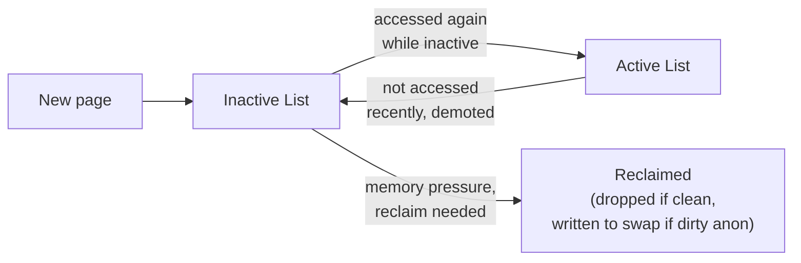
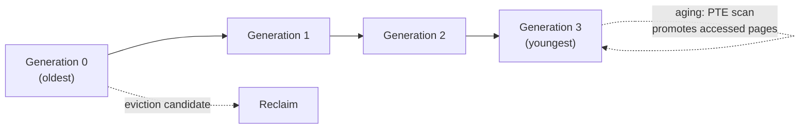
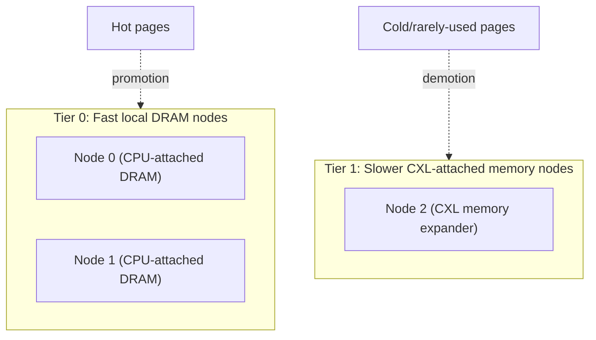
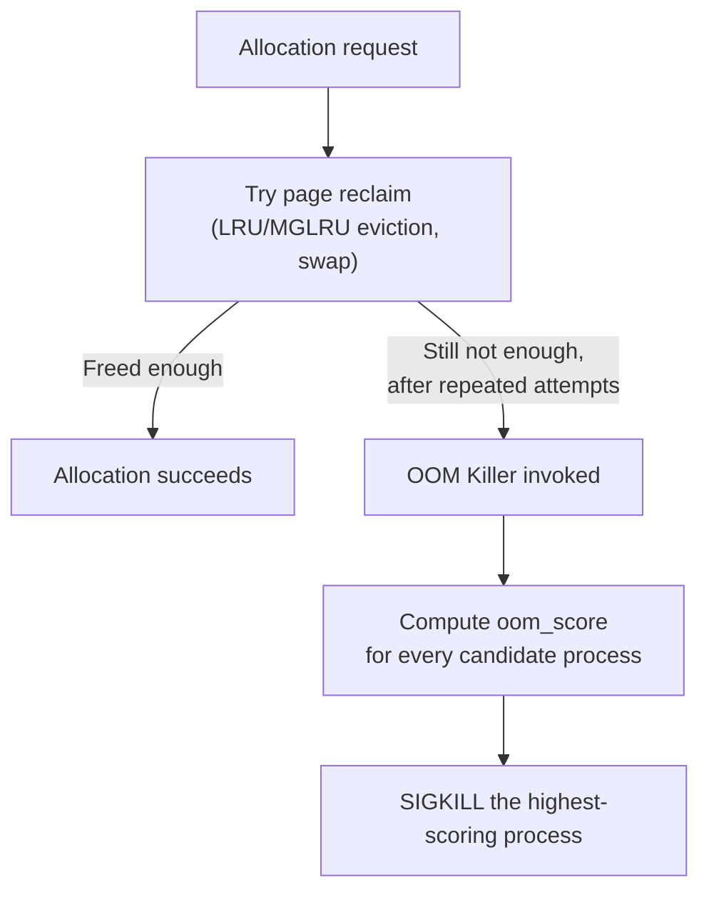
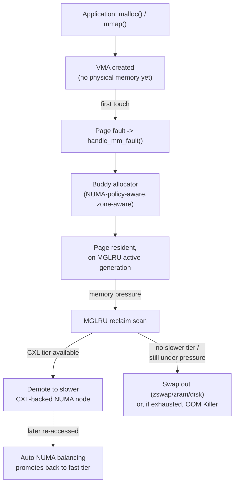

# Linux Memory Management 3 — Reclaim, NUMA Policy, cgroups, and Memory Tiering (CXL)

> How Linux decides what to evict, how it lets applications control NUMA/CXL placement, how it enforces per-workload memory limits, and what happens when memory truly runs out. This file is where the whole series (`ostep-detailed`, `cpumemory-detailed`, `case-studies`) converges into one running kernel. See `00-index.md` for the full series map.

---

## 1. Page Reclaim — from Active/Inactive Lists to MGLRU

### The Classic Two-List LRU (still the conceptual baseline)
⭐ **Recall the OSTEP notes' page-replacement policies (Optimal, FIFO, LRU, Clock)** — Linux's historical implementation is a direct, practical approximation of the **Clock algorithm** described there: pages live on one of two per-zone lists.



- **Active list:** pages believed to be in current use.
- **Inactive list:** pages that are reclaim candidates — under memory pressure, the kernel scans from the tail of this list.
- A page's hardware **accessed bit** (the same PTE `Accessed` bit referenced in the OSTEP/cpumemory notes) is what the scanner checks and clears — exactly the Clock algorithm's "check the use bit, clear it if set, advance" logic, just applied to two coarse lists instead of one circular one.

### Multi-Generational LRU (MGLRU) — the Modern Replacement
⭐ **A genuinely current (merged in kernel 6.1, actively refined through 2024-2025) rework** that generalizes the two-list scheme into **multiple generations**, addressing real, measured weaknesses of the old two-list approach (poor discrimination under mixed workloads, expensive reverse-mapping scans).



- **Generations replace the binary active/inactive split** with a spectrum — a page's generation number reflects *roughly when* it was last accessed, giving the reclaim logic far more discrimination than a simple two-bucket split.
- ⭐ **`lru_gen_look_around()`** — a specific, clever optimization: rather than doing an expensive reverse-mapping (rmap) search to find and check every PTE pointing at a page (costly because PTEs from different VMAs aren't cache-friendly to scan), MGLRU **exploits spatial locality** — when it finds one "young" (recently-accessed) PTE, it also scans the **immediately adjacent** PTEs in the same page table, on the bet that nearby pages were probably accessed together too. ⭐ This is *exactly* the spatial-locality principle from `cpumemory-detailed/02` applied directly to kernel reclaim-scanning cost, not just data access.
- **Tiers within generations:** pages are further split into tiers by **access-through-file-descriptor frequency** (`order_base_2(N)` accesses) — moving between tiers only touches `folio->flags` atomically (no lock needed), while moving between *generations* requires the LRU lock — a deliberate two-speed design trading precision for update cost, directly echoing the "pay for atomicity only when needed" theme from `cpumemory-detailed/05`.
- **`lru_gen_min_ttl`** — a time-based protection knob: pages within a working set younger than this TTL are protected from eviction; if that protected working set genuinely can't fit in memory, **the OOM killer fires** (Section 4) rather than silently thrashing — a direct, explicit design choice preferring a clear failure signal over the thrashing scenario described in the OSTEP notes.

```bash
# Check whether MGLRU is enabled and see live generation stats
$ cat /sys/kernel/mm/lru_gen/enabled
$ cat /sys/kernel/debug/lru_gen
memcg  (id)  (name)
 node  (id)
  (gen) (age_in_ms) (nr_anon_pages) (nr_file_pages)
```

---

## 2. Swap, `zswap`, and `zram` — Real Swap-Space Options

⭐ **Directly extends the OSTEP swap-space notes with actual Linux configuration options:**

```bash
# Traditional swap: a dedicated partition or file
$ sudo mkswap /swapfile && sudo swapon /swapfile
$ swapon --show
NAME       TYPE      SIZE USED PRIO
/swapfile  file        8G   0B   -2

# swappiness: how aggressively the kernel swaps anonymous pages
# vs. reclaiming file-backed (page cache) pages, 0-200 (default 60)
$ cat /proc/sys/vm/swappiness
```

⭐ **`zswap`** — a compressed **write-back cache** sitting in front of real swap: pages about to be swapped out are first compressed and kept in a RAM-resident pool; only if that pool fills up do they actually get written to the (much slower) swap device. This is Linux's kernel-native version of the "compress before swap-out" idea seen in the disaggregated-memory survey's `FastSwap`/`XMemPod` proposals (Case Study 2) — same technique, now standard in mainline Linux.

⭐ **`zram`** — takes this further: creates an entirely **in-RAM compressed block device**, usable *as* the swap device itself, so "swapped out" pages never touch a physical disk at all — trading CPU cycles (compression/decompression) for effectively expanding usable memory capacity, useful specifically on memory-constrained systems (embedded, containers, low-RAM cloud instances) where disk I/O would be disproportionately expensive relative to available CPU headroom.

```bash
$ sudo modprobe zram
$ echo 4G | sudo tee /sys/block/zram0/disksize
$ sudo mkswap /dev/zram0 && sudo swapon /dev/zram0
```

---

## 3. NUMA Policy — the Real Linux API Behind `cpumemory-detailed/03` and `/05`

⭐ **This section is the concrete syscall-level realization of the `MPOL_*` policy discussion already covered in `cpumemory-detailed/05-multithread-and-numa-programming.md`** — worth reading together, since that file covers *why* these policies matter and *what they cost*; this section shows the exact code.

```c
#include <numaif.h>

// Set the calling THREAD's default allocation policy
long set_mempolicy(int mode, const unsigned long *nodemask, unsigned long maxnode);

// Bind a specific address RANGE to a node set (used for a VMA-level policy)
long mbind(void *addr, unsigned long len, int mode,
           const unsigned long *nodemask, unsigned long maxnode, unsigned flags);

// Move already-allocated pages to different nodes explicitly
long move_pages(int pid, unsigned long count, void **pages,
                 const int *nodes, int *status, int flags);
```

```c
// Worked example: force a specific buffer to be allocated on node 1
#include <numaif.h>
#include <numa.h>

void *buf = mmap(NULL, size, PROT_READ|PROT_WRITE,
                  MAP_PRIVATE|MAP_ANONYMOUS, -1, 0);

unsigned long nodemask = 1UL << 1;   // node 1 only
mbind(buf, size, MPOL_BIND, &nodemask, sizeof(nodemask)*8, 0);

// Nothing is actually allocated yet! mbind() only affects FUTURE
// page faults on this range -- this is exactly the "allocation != reservation"
// / first-touch caveat from cpumemory-detailed/05.
memset(buf, 0, size);   // <-- THIS is what actually triggers physical allocation on node 1
```

⭐ **The `libnuma` convenience wrapper**, used far more often in practice than raw syscalls:
```c
#include <numa.h>

if (numa_available() < 0) { /* no NUMA support */ }

void *p = numa_alloc_onnode(size, 1);       // allocate directly on node 1
numa_free(p, size);

numa_set_preferred(0);                       // prefer node 0 for this thread going forward
numa_run_on_node(0);                         // pin the calling thread to node 0's CPUs
```

```bash
# The command-line equivalent of set_mempolicy() + CPU affinity, for whole programs
$ numactl --cpunodebind=0 --membind=0 ./myapp
$ numactl --interleave=all ./myapp     # MPOL_INTERLEAVE across every node
```

### Balancing Threads and Memory — `numa_balancing`
⭐ Rather than requiring every application to be manually NUMA-aware, Linux includes **automatic NUMA balancing** — a background kernel mechanism that periodically unmaps a sampling of a process's pages, waits for the resulting page faults to reveal *which CPU/node is actually accessing them*, and then **migrates** those pages toward the accessing node (or migrates the task itself) to improve locality over time — a runtime, adaptive approximation of manually-tuned `mbind()`/`numactl` placement.
```bash
$ cat /proc/sys/kernel/numa_balancing     # 1 = enabled (Linux default on NUMA hardware)
```

---

## 4. Memory Tiering — the Direct Linux Answer to CXL and Disaggregated Memory

⭐ **This is where `cpumemory-detailed/07-modern-ai-datacenter-memory.md` and Case Study 2 (disaggregated memory survey) meet real, shipping kernel code.** Modern Linux (kernel 5.15+, substantially refined through 6.x) treats CXL-attached memory not as a special case, but as an extension of the **existing NUMA machinery** — a CXL memory expander simply shows up as **one or more additional NUMA nodes**, just with different (`SLIT`-reported) latency/bandwidth characteristics than "normal" local DRAM nodes.



- ⭐ **Demotion:** when the fast tier's LRU reclaim needs to evict a page and the page is likely to be reused soon, instead of discarding it (or writing it to swap), the kernel can **demote** it — migrate it to the slower CXL tier — keeping it in memory (fast to fault back in) rather than paying full swap-device latency, while freeing up scarce fast-tier capacity for hotter data.
- **Promotion:** the same automatic NUMA balancing mechanism from Section 3 (unmap-and-observe-faults) drives promotion — a page on the slow CXL tier that gets accessed frequently is migrated back up to the fast local-DRAM tier.
- ⭐ **Tier-aware reclaim/placement:** the kernel exposes a **tier hierarchy**, not just a flat node list — reclaim and balancing logic consult this hierarchy so a page falls to the *next* tier down (fast DRAM -> CXL memory -> swap/disk) rather than jumping straight to disk-backed swap the instant local DRAM is full.

```bash
# See the tier hierarchy the kernel has constructed
$ cat /sys/devices/system/node/memory_tiers
# Per-node CXL-relevant stats
$ numactl --hardware   # now shows the CXL-backed node(s) with their higher distance values
```

⭐ **Why this design directly validates a prediction from Case Study 2:** the disaggregated-memory survey (2023) explicitly noted CXL "has not reached commercialization yet" and flagged it as ripe for **OS-level integration as future work.** Linux's memory-tiering subsystem is exactly that predicted work, now real — and its design choice (treat CXL memory as just another, slower NUMA tier, reusing the *existing* NUMA balancing/reclaim machinery rather than inventing a parallel mechanism) is a direct, practical instance of the survey's own client-implementation taxonomy: this is the **"OS: NUMA"** client-implementation category from that survey's taxonomy (Section IV-B), now realized in mainline Linux rather than as a research prototype.

---

## 5. cgroups — Per-Workload Memory Limits (the Answer to Case Study 1's Over-Provisioning Problem)

⭐ **Directly addresses the exact economic problem that opens Case Study 2 (the disaggregated-memory survey):** worst-case, static memory allocation per application, leading to severe underutilization. **cgroups v2's `memory` controller** is Linux's mechanism for expressing memory limits and, critically, letting the kernel *reclaim* memory from an over-quota workload rather than simply killing it outright.

```bash
# Create a cgroup and set memory limits for a workload
$ mkdir /sys/fs/cgroup/myworkload
$ echo "512M" > /sys/fs/cgroup/myworkload/memory.max     # hard limit
$ echo "256M" > /sys/fs/cgroup/myworkload/memory.high    # soft limit -- triggers reclaim pressure
$ echo $$ > /sys/fs/cgroup/myworkload/cgroup.procs        # add the current shell (and children) to it
```

| Control file | Meaning |
|---|---|
| `memory.max` | Hard limit -- exceeding it triggers reclaim; if reclaim can't free enough, the **cgroup-scoped OOM killer** fires (see Section 6) |
| `memory.high` | Soft limit -- the kernel actively throttles/reclaims the cgroup once exceeded, but doesn't invoke OOM for it alone |
| `memory.current` | Live usage -- the real-time answer to "how much memory is this workload actually using right now" |
| `memory.stat` | Detailed breakdown (anon, file, kernel stack, slab, etc.) -- the cgroup-scoped equivalent of `/proc/meminfo` |

⭐ **The direct connection to memory tiering (Section 4):** cgroups v2 also exposes **per-cgroup, per-node statistics**, letting an orchestrator (Kubernetes, a custom scheduler) observe *which NUMA/CXL tier* a given container's memory actually lives on -- the practical building block for exactly the kind of elastic, fine-grained, per-application memory provisioning that both case studies argue the traditional server-centric model fails to provide.

---

## 6. The OOM Killer — What Happens When Reclaim Isn't Enough

⭐ **The last-resort mechanism referenced in the OSTEP thrashing discussion** (`ostep-detailed/05`), now with the real algorithm:



- **`oom_score`** is computed per-process, primarily from **RSS (resident memory) as a fraction of total available memory**, adjusted by `oom_score_adj` (a per-process tunable, `-1000` to `1000`) that administrators can set to protect critical processes (e.g., `-1000` effectively makes a process un-killable) or bias the killer toward killing a specific process first.
```bash
$ cat /proc/<pid>/oom_score
$ echo -500 > /proc/<pid>/oom_score_adj   # make this process less likely to be killed
```
- **Cgroup-scoped OOM:** with `memory.max` set on a cgroup, an OOM event can be **scoped to just that cgroup** -- the kernel kills a process *within* the over-limit cgroup rather than considering the entire system, directly enabling the "one workload's memory problem shouldn't crash unrelated workloads on the same machine" isolation goal that both case studies (Meza's failure-blast-radius concerns, and the disaggregated-memory survey's multi-tenant motivation) care about.

⭐ **Direct connection back to Case Study 1:** Meza's thesis measured real DRAM socket/channel failures causing a "denial of service" pattern (server becomes unresponsive under MCE flooding) -- the OOM killer is a **different**, software-triggered form of memory-pressure crisis response, but shares the same underlying philosophy: when a resource genuinely cannot satisfy demand, the system must make an **explicit, bounded decision** (kill one process, offline one page, demote to a slower tier) rather than degrading unboundedly or hanging indefinitely.

---

## 7. Full Picture — Tying the Whole Series Together



⭐ **This single diagram is the practical synthesis of every notes file and case study in this workspace:** the DRAM cell physics and NUMA hop costs from `cpumemory-detailed` determine *why* tiers exist and *how expensive* each transition is; the address-space/page-table/reclaim concepts from `ostep-detailed` explain the mechanisms Linux uses to move data between tiers; Case Study 1 (Meza's thesis) is what happens when the *hardware* underneath any of these tiers fails; and Case Study 2 (the disaggregated-memory survey) is the broader architectural conversation about pushing this same tiering logic *beyond* one machine, onto pooled, shared, rack-scale memory -- which Linux's memory-tiering subsystem (Section 4) is now the real, shipping, first concrete step toward.

---

## Summary Table

| Mechanism | Real Linux implementation | Connects to |
|---|---|---|
| Page replacement policy | Active/Inactive lists -> Multi-Gen LRU (MGLRU) | OSTEP Clock algorithm |
| Swap space | `swapon`, `zswap` (compressed write-back cache), `zram` (in-RAM swap device) | OSTEP beyond-physical-memory |
| NUMA policy | `set_mempolicy()`, `mbind()`, `move_pages()`, `libnuma`, `numactl` | `cpumemory-detailed/05`'s `MPOL_*` |
| Automatic NUMA balancing | Unmap-and-observe-faults, background migration | Adaptive version of manual `mbind()` |
| Memory tiering (CXL) | CXL memory = extra, slower NUMA node(s); demotion/promotion | `cpumemory-detailed/07`, Case Study 2's "OS:NUMA" client category |
| Per-workload limits | cgroups v2 `memory.max`/`memory.high`/`memory.stat` | Case Study 2's over-provisioning motivation |
| Last-resort failure handling | OOM killer, `oom_score`/`oom_score_adj`, cgroup-scoped OOM | OSTEP thrashing; Case Study 1's failure-response philosophy |

## Key Talking Points

- Explain **why MGLRU replaced the two-list active/inactive scheme**, and describe the spatial-locality trick in `lru_gen_look_around()` as a concrete instance of caching principles applied to kernel-internal scanning cost, not just application data.
- Walk through **`zswap` vs. `zram`** and explain precisely what each trades (CPU for I/O, and in zram's case, for capacity) — and connect both back to the compression techniques used by disaggregated-memory proposals like `FastSwap`/`XMemPod` in Case Study 2.
- Explain **why `mbind()` alone doesn't allocate memory** — the first-touch/"allocation != reservation" principle — and walk through the full worked C example showing exactly when physical allocation actually happens.
- Describe **how Linux integrates CXL memory as an additional, slower NUMA tier** rather than inventing new machinery, and connect this design choice directly to the disaggregated-memory survey's own predicted "OS-based, near-term" path for CXL adoption.
- Explain **cgroups v2's `memory.max` vs. `memory.high`** distinction, and connect the whole cgroups mechanism back to the core over-provisioning economic argument that opens Case Study 2.
- Walk through the **OOM killer's `oom_score` computation and cgroup-scoping**, and be ready to connect its "make an explicit, bounded decision under resource exhaustion" philosophy to Meza's thesis's own findings about memory-failure response (page offlining, aggressive CE-based repair thresholds).