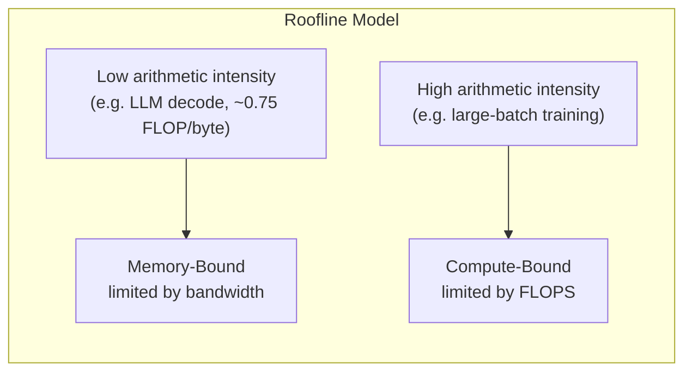
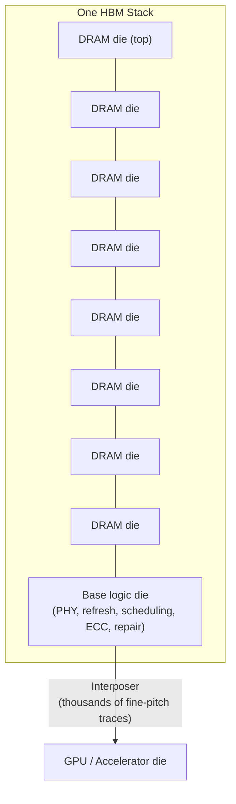
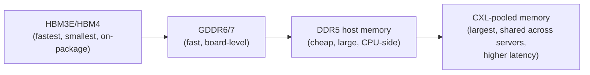
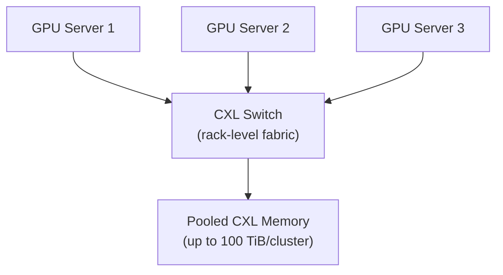
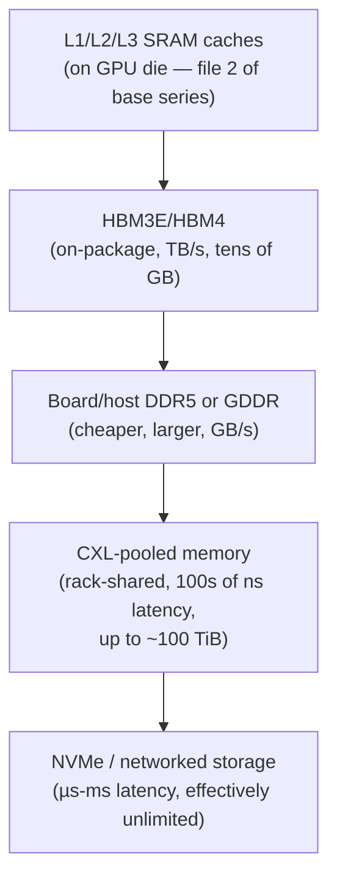

# Modern AI Datacenter Memory — HBM, CXL, and the "Memory Wall"

> A current-technology companion to the *What Every Programmer Should Know About Memory* notes series (files 01-06). Drepper's 2007 paper explains the physics and mechanisms (DRAM cells, RAS/CAS, banks, refresh, bus width, NUMA) that every technology below is still built from — this file is "what commodity DRAM concepts turned into once AI accelerators became the dominant DRAM customer." Citations are inline; a source list is at the end. Given the pace of change here, treat specific numbers as a snapshot rather than a permanent ceiling.

---

## 1. Why This Needed Its Own Technology Track: The "Memory Wall"

⭐ **The core problem, in one line:** AI accelerator compute (FLOPS) has grown far faster than memory bandwidth — a widely-cited estimate puts GPU compute growth at roughly **60,000x over ~20 years, versus ~100x for DRAM bandwidth and ~30x for interconnect bandwidth** over the same period.[1] More recent snapshots show the same shape: one analysis found AI compute grew **~3x every two years while memory bandwidth grew only ~1.6x**.[2] This growing gap is the **memory wall** — a direct, modern instance of exactly the trend Drepper's paper opens by describing (Ch1: "memory access became the limiting factor").

### The Roofline Model — a mental model worth having
⭐ **Arithmetic intensity** = FLOPs performed ÷ bytes moved from memory. Plot achieved performance against arithmetic intensity, and every accelerator has a **roofline**: below a certain intensity, you're **memory-bound** (bandwidth is the ceiling); above it, you're **compute-bound** (FLOPS is the ceiling).[3]

⭐ **Why this matters concretely for LLMs:** autoregressive decoding (generating one token at a time) has *very* low arithmetic intensity — one cited estimate is **~0.75 FLOPs/byte in FP16**[4] — meaning decode is almost always memory-bound: the GPU spends most of its time waiting to stream the entire model's weights through memory for every single token, with compute units sitting mostly idle.[5] This is *precisely* the same underlying phenomenon as Drepper's matrix-multiplication example (file 4 of the base series) — except at the scale of "streaming tens/hundreds of GB per token" instead of "streaming a few MB matrix," and the fix isn't cache-blocking, it's an entirely new tier of memory technology.

---

## 2. HBM — High Bandwidth Memory (the dominant answer)

### The Core Idea — Same DRAM Cell, Radically Different Packaging
⭐ **The crucial thing to internalize:** HBM is **not** a new kind of DRAM cell. It's still the exact same 1-transistor-1-capacitor DRAM cell from file 1 of the base series, with the exact same refresh/RAS/CAS mechanics. What HBM changes is **how many DRAM dies you connect to the processor, how close, and over how wide a bus** — an extreme, physically-realized version of the "wider bus instead of faster cells" trick that DDR2/DDR3 already used (file 1), taken to its logical extreme.

### The Physical Structure

- **TSVs (Through-Silicon Vias)** are microscopic copper pillars drilled vertically through each DRAM die, electrically connecting every layer in the stack straight up and down — this is what lets a stack of 8-16 DRAM dies act as one extremely wide memory device.[6][7]
- **The base (logic) die** at the bottom of the stack is not itself DRAM — it holds the PHY (physical interface), command scheduling, and increasingly **on-die ECC, fault repair (retiring bad TSVs/pages), and adaptive refresh/retraining** logic.[8] This directly generalizes the refresh mechanics from file 1 — HBM manages refresh *per stack*, autonomously, with active fault tolerance built in, because at this density and stack height, some cell/TSV failures are statistically expected.
- **The interposer** — a passive silicon substrate with extremely fine, dense wiring — sits beneath both the HBM stacks and the GPU/accelerator die, physically wiring them together over a distance of millimeters rather than the centimeters of a DIMM-based system. The dominant packaging process for this is TSMC's **CoWoS (Chip-on-Wafer-on-Substrate)**.[9] This is a direct, physical instance of exploiting *spatial locality at the package level* — the same principle (data physically closer to the compute) that motivates cache-line-aware struct layout in file 4, just one more rung down the hierarchy.
- **Channels and pseudo-channels:** each HBM stack's wide bus is subdivided into independent channels (16 in HBM3e, doubling to **32 channels / 64 pseudo-channels in HBM4**), each of which can be addressed and scheduled largely independently — a direct descendant of the bank/row structure from file 1, just replicated far more widely.[10][11]

### Generation-by-Generation Comparison

| Generation | Interface width | Channels | Peak BW/stack | Typical capacity/stack | Introduced |
|---|---|---|---|---|---|
| HBM (1) | 1,024-bit | 8 | ~0.128 TB/s | ~1-2 GB | 2013[12] |
| HBM2 | 1,024-bit | 8 | ~0.256 TB/s | ~4-8 GB | 2016[12] |
| HBM2E | 1,024-bit | 8 | ~0.46 TB/s | ~8-16 GB | 2019[12] |
| HBM3 | 1,024-bit | 16 | ~0.6-0.8 TB/s | ~16-24 GB | 2022[12] |
| **HBM3E** | 1,024-bit | 16 | **~1.15-1.33 TB/s** | **24-48 GB** | 2023-2025[12][13] |
| **HBM4** | **2,048-bit** (doubled) | **32** | **~2.0-2.5 TB/s** | **48-64 GB** | JEDEC spec April 2025; volume 2026-2027[14][15][16] |

⭐ **The HBM4 headline change, stated precisely:** JEDEC doubled the *interface width* (1,024→2,048 bits) rather than continuing to push per-pin signaling speed on the existing bus.[17] This is the same design lever Drepper's file 1 describes for DDR generations (wider I/O buffer vs. faster cell array) — HBM4 is choosing "wider" specifically because pushing per-pin speed further on an already-enormous 1,024-wire bus runs into signal-integrity limits, the same physical constraint file 1 describes limiting how many DDR modules can share one bus at high frequency.

### Real Product Numbers (2025-2026 snapshot)
- **NVIDIA H100:** 80GB HBM3e, 3.35 TB/s aggregate bandwidth.[18]
- **NVIDIA H200:** 141GB HBM3e, ~4.89 TB/s aggregate bandwidth.[18]
- **AMD MI300X / Trainium3-class chips:** competitive HBM3e configurations in the 128-192GB range.[19]
- **NVIDIA Vera Rubin (H2 2026 roadmap):** HBM4, targeting **288GB per GPU at 13 TB/s**; the Rubin NVL144 rack-scale system is projected at 16-32 TB/s aggregate bandwidth across the rack.[13][19]
- ⭐ **A recurring, very Drepper-flavored lesson from 2024-2025 deployments:** the paper's own repeated warning — "theoretical peak bandwidth is not achieved bandwidth" — showed up directly in practice: HBM3e's theoretical peak (~1.2 TB/s/stack, ~7.2 TB/s for 6 stacks) was **not** what shipped in the H200; real-world figures land meaningfully lower (H200: 4.89 TB/s) due to reliability/power margins.[20] This is the exact same "nominal vs. effective bandwidth" gap Drepper measures directly for DDR modules in file 1 (his `w-x-y-z-T` timing example showing 1.8 GB/s effective against a 6.4 GB/s nominal peak) — same underlying phenomenon, new generation of hardware.
- ⭐ **Supply, not design, has been the actual bottleneck:** through 2024-2025, HBM3e **yield** (not GPU die yield) was reported as the dominant gating factor on Blackwell-generation GPU availability — a striking real-world example of Drepper's file 1 discussion of DRAM economics (cost/complexity trade-offs) mattering at a geopolitical/supply-chain scale, not just a technical one.[21]

---

## 3. HBM vs. GDDR vs. DDR/LPDDR — Why Not Just Use One Kind of Memory Everywhere?

⭐ Just as Drepper's file 1 explains DRAM's cost/speed trade-off against SRAM, the modern memory landscape has its **own** three-way trade-off, and different tiers exist because no single technology wins on every axis:

| Technology | Bandwidth | Capacity/cost | Where it's used | Why |
|---|---|---|---|---|
| **HBM3E/HBM4** | Highest (TB/s per stack) | Expensive, capacity-constrained (tens of GB) | AI training/inference accelerators (GPU, TPU) | Needs to feed enormous, hungry compute arrays; cost/complexity of TSV stacking + interposer packaging is justified at this scale |
| **GDDR6/GDDR7** | High, but per-pin/board-routed (not stacked) | Cheaper than HBM, more capacity per dollar | Consumer/prosumer GPUs, some inference-focused accelerators | Good middle ground — much higher bandwidth than DDR, without HBM's packaging cost/complexity |
| **DDR5 / LPDDR5X** | Lower than HBM/GDDR | Cheapest per GB, largest capacity | CPU main memory, host-side memory in AI servers | Same commodity economics Drepper describes for DRAM generally — cost and capacity matter more than raw bandwidth for general-purpose host memory |

⭐ **The architectural pattern this produces in a real AI server:** HBM sits **closest** to the GPU die (highest bandwidth, smallest capacity, most expensive per GB); ordinary DDR5 sits on the **host CPU side** (cheapest, largest capacity, used for staging data, the OS, and orchestration); and — as covered next — **CXL-attached memory** is emerging as an *additional* tier **beyond** both, trading some latency for much larger pooled capacity. This is a direct, larger-scale echo of the cache hierarchy itself (L1→L2→L3→RAM from file 2): a spectrum of tiers, each trading capacity against speed, with data ideally living at the tier matching how "hot" it currently is.

---

## 4. CXL — Compute Express Link: Treating Memory as a Poolable, Disaggregated Resource

### The Problem CXL Solves
⭐ Recall Drepper's file 5 point about NUMA: memory bound to a specific socket is efficient when local, but **"stranded"** and wasted when a workload doesn't need it. At datacenter scale this happens constantly — one server's DRAM sits underutilized while a neighboring server runs out, and there was traditionally **no way to share DRAM capacity across physically separate machines** the way CPUs already share compute via the network. CXL is the industry's answer: a **cache-coherent interconnect** (built on the PCIe physical layer) that lets memory be **pooled, expanded, and shared** across CPUs, GPUs, and other accelerators — potentially across an entire rack — rather than being permanently bolted to one box.[22][23]

### How It Works, at a High Level
- **Memory expansion:** a CXL-attached memory module effectively adds an *extra tier* of DRAM beyond a server's local DIMM slots — same DRAM technology underneath, connected over CXL instead of the local memory bus.
- **Memory pooling:** a rack-level **CXL switch** (e.g., Marvell's Structera line) lets multiple hosts (CPUs, GPUs, other accelerators) dynamically share a common pool of memory, rather than each host owning a fixed, private allocation.[24][25]
- **Latency, quantified:** CXL memory access latency is reported in the **200-500 nanosecond range**[26] — much higher than local DRAM (tens of nanoseconds), but *far* lower than the alternative of fetching data over a network (RDMA) from a remote server's memory or storage. One benchmark found CXL memory pooling delivering a **3.8x speedup vs. 200G RDMA and 6.5x vs. 100G RDMA** for LLM inference sharing memory across GPU servers.[27]

### Why AI Workloads Specifically Care — KV Cache
⭐ **The concrete AI use case driving CXL adoption: KV (key-value) cache for LLM inference.** During autoregressive generation, an LLM must retain a growing cache of intermediate attention state (the "KV cache") for the entire context window — for long-context or high-concurrency serving, this cache can **exceed** what fits in a GPU's own HBM. CXL-pooled memory lets that overflow spill into a much larger, still-reasonably-fast pool instead of falling all the way back to network-fetched storage — directly reducing time-to-first-token and enabling longer context windows / larger batch sizes without buying more GPUs purely for their memory capacity.[28][29]

⭐ **A genuinely Drepper-flavored caveat from current practice:** CXL is explicitly **not** a universal replacement for local DRAM — for workloads highly sensitive to latency and bandwidth at the socket level, local DDR and a carefully planned NUMA topology (file 3 of the base series) remain preferable; CXL earns its place specifically for data that can tolerate living a tier further away.[30] This is precisely the same "not everything should move" caution Drepper gives about NUMA and huge pages — a new tool doesn't erase the underlying physics, it adds one more knob to reason about deliberately.

### 2026 Snapshot
- CXL switching has moved from "does the server support CXL at all" to "which device class, tiering software, and workload pattern actually benefit" — the mature question in 2026 is about **software-level tiering and placement policy**, not raw protocol support.[30]
- Real deployments now cite pooled capacity at **up to ~100 TiB per cluster**.[28]
- Major vendors (Marvell, via its XConn acquisition) are shipping dedicated rack-scale CXL switches specifically marketed as breaking the AI "memory wall" at the infrastructure level, not just the chip level.[24][25]

---

## 5. Putting It Together — the Modern AI Server Memory Hierarchy

⭐ **The unifying idea, tying this whole file back to the base series:** every tier in this diagram exists because of the exact same trade-off Drepper's paper spends its entire length on — **speed, capacity, and cost cannot all be maximized simultaneously**, so real systems build a *hierarchy* and rely on locality (temporal and spatial) to keep the hottest data in the fastest, smallest, most expensive tier. HBM is what happens when you take that principle and are willing to pay enormous packaging complexity (TSVs, interposers, CoWoS) to buy bandwidth; CXL is what happens when you apply the *opposite* end of the trade-off — accepting more latency to buy a shared, elastic pool of capacity across an entire rack instead of one socket. Nothing about the underlying DRAM cell, refresh requirement, or RAS/CAS addressing scheme from file 1 has actually changed — what changed is how many of those cells you connect, how close, over how wide a bus, and to how many other machines.

---

## Summary Table

| Technology | What it actually changes vs. Drepper's 2007 baseline | Stays the same |
|---|---|---|
| **HBM3E/HBM4** | Bus width (up to 2,048-bit/stack), stacking via TSVs, on-package placement via interposer, on-die ECC/repair | Underlying 1T1C DRAM cell, refresh requirement, bank/channel addressing logic |
| **GDDR6/7** | Board-level wide bus tuned for graphics/inference workloads, sits between DDR and HBM on the cost/bandwidth curve | Same DRAM fundamentals; still a discrete, non-stacked package |
| **DDR5/LPDDR5X** | Higher clock speeds, more banks, on-die ECC as standard | Structurally still the DDR generational trick from file 1 (wider/faster I/O, not faster cells) |
| **CXL memory pooling** | Cache-coherent interconnect turning memory into a shared, poolable, rack-level resource | The remote memory is still ordinary DRAM — CXL changes *access path and sharing model*, echoing NUMA's local-vs-remote trade-off (file 3) at a larger physical scale |

## Key Talking Points

- Explain the **memory wall precisely** using the roofline model and arithmetic intensity — and connect it directly to Drepper's own 2007 framing ("memory access became the limiting factor") as the same trend, just measured two decades later at a much larger gap.
- Explain **why HBM is "the same DRAM, radically repackaged"** rather than a new memory cell technology — TSVs, base logic die, and interposer are packaging/interconnect innovations, not changes to the fundamental capacitor-based cell from file 1.
- Walk through **why HBM4 doubled interface width instead of pushing per-pin speed further** — tie this to the same bus-loading/signal-integrity constraint Drepper describes limiting DIMMs-per-channel in DDR2/DDR3.
- State the **nominal-vs-effective bandwidth gap for HBM3e** (H200's real 4.89 TB/s vs. nominal peak) as a modern instance of Drepper's own DDR timing-notation lesson — theoretical peak bandwidth is rarely what software actually observes.
- Explain **why CXL memory pooling exists** (stranded/underutilized DRAM across a fleet) and its **quantified latency cost** (200-500ns) vs. the alternative (RDMA over network) — and be ready to state the concrete AI use case (KV cache overflow) driving its adoption.
- Be able to sketch the **full modern AI-server memory hierarchy** (SRAM → HBM → GDDR/DDR → CXL pool → storage) and explain it as a direct, larger-scale extension of the cache-hierarchy principle from file 2 of the base series.

---

## Sources

1. AI and Memory Wall (arXiv, Gholami et al.) — https://www.stat.berkeley.edu/~mmahoney/pubs/AI_and_Memory_Wall.pdf
2. TrendForce, "Memory Wall Bottleneck: AI Compute Sparks Memory Supercycle" — https://www.trendforce.com/insights/memory-wall
3. Spheron Blog, "AI's Memory Wall Problem" (2026) — https://www.spheron.network/blog/ai-memory-wall-inference-latency-guide-2026/
4. EmergentMind, "Memory Wall in AI: Bottlenecks & Strategies" — https://www.emergentmind.com/topics/memory-wall-in-ai
5. Medium/Data Science Collective, "The Memory Wall Is Strangling Your LLM" — https://medium.com/data-science-collective/the-memory-wall-is-strangling-your-llm-why-gpus-are-faster-than-you-think-and-slower-than-you-need-cfaf28226e06
6. Medium, "The Great Wall of High Bandwidth Memory (HBM)" — https://medium.com/the-low-end-disruptor/the-great-wall-of-high-bandwidth-memory-hbm-4d19b9f48549
7. Wevolver, "High Bandwidth Memory: Concepts, Architecture, and Applications" — https://www.wevolver.com/article/high-bandwidth-memory
8. Wevolver, "What is HBM (High Bandwidth Memory)? Deep Dive" — https://www.wevolver.com/article/what-is-hbm-high-bandwidth-memory-deep-dive-into-architecture-packaging-and-applications
9-11. (same Wevolver/Siemens sources on channels, interposer, CoWoS)
12. Challenges and Research Directions for LLM Inference Hardware (arXiv) — https://arxiv.org/pdf/2601.05047
13. Introl Blog, "HBM evolution: from HBM3 to HBM4 and the AI memory war" — https://introl.com/blog/hbm-evolution-hbm3-hbm3e-hbm4-memory-ai-gpu-2025
14-17. Siemens Blog / gpusmith.com, HBM3e/HBM4 IC design guides — https://blogs.sw.siemens.com/semiconductor-packaging/2026/04/24/hbm3e-hbm4-ic-design-guide/ ; https://gpusmith.com/articles/en/pdfs/hbm3e-vs-hbm4-ai-gpus.pdf
18-19. IntuitionLabs, "NVIDIA Data Center GPU Specs" — https://intuitionlabs.ai/articles/nvidia-data-center-gpu-specs
20. Tom's Hardware via Yahoo, "SK Hynix says new HBM for GPUs on track" — https://tech.yahoo.com/general/articles/sk-hynix-says-high-bandwidth-163142186.html
21. Yobitel, "HBM3e — High-Bandwidth Memory for AI GPUs" — https://yobitel.com/knowledge-base/hbm3e
22-23. GIGABYTE Global, "Revolutionizing the AI Factory: The Rise of CXL Memory Pooling" — https://www.gigabyte.com/Article/revolutionizing-the-ai-factory-the-rise-of-cxl-memory-pooling
24-25. Marvell Newsroom / StorageNewsletter, CXL switch announcements — https://www.marvell.com/company/newsroom/marvell-next-gen-cxl-switch-memory-pooling-breaks-ai-memory-wall.html
26,28-29. Compute Express Link Consortium blog, "Overcoming the AI Memory Wall" — https://computeexpresslink.org/blog/overcoming-the-ai-memory-wall-how-cxl-memory-pooling-powers-the-next-leap-in-scalable-ai-computing-4267/
27. Introl Blog, "Disaggregated Computing for AI" — https://introl.com/blog/disaggregated-computing-composable-infrastructure-cxl-ai-2025
30. ServerMall, "CXL in 2026: Server Memory Expansion & Pooling" — https://servermall.com/blog/cxl-in-2026-memory-expansion-and-pooling/

*Note: this is a fast-moving field. HBM4 volume shipping timelines, exact bandwidth figures, and CXL adoption maturity should be re-verified against current sources for anything time-sensitive (e.g., procurement decisions).*