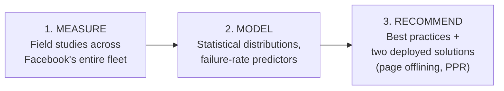
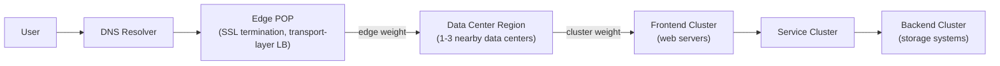
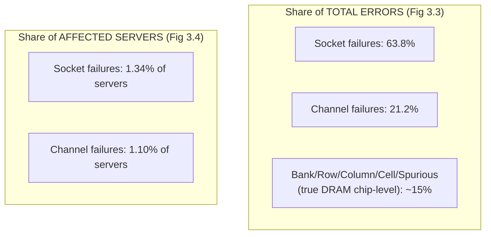
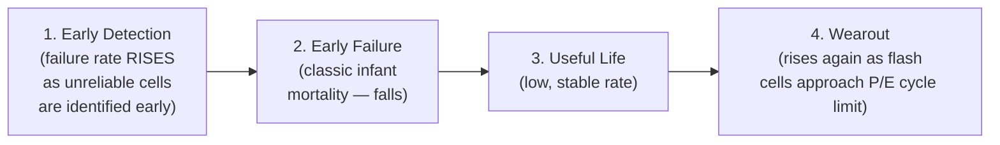

# Case Study 1 — Large-Scale Studies of Memory, Storage, and Network Failures in a Modern Data Center

> **Source:** Justin Meza, PhD Dissertation, Carnegie Mellon University, December 2018. Field study conducted at Facebook, covering DRAM failures (14 months, entire fleet), SSD failures (4 years), and network failures (7 years intra-datacenter, 18 months inter-datacenter). Advised in the CMU SAFARI group (Onur Mutlu), with direct ties to the RowHammer and DRAM-reliability research line referenced in the `cpumemory-detailed` notes series already in this workspace.

---

## 1. Why This Thesis Exists — The Framing Problem

⭐ **The thesis's own three-property argument for why hardware failure is a *software* problem at datacenter scale**, stated as the core motivation:

| Property | What it means | Why it matters |
|---|---|---|
| **Interdependence** | Programs in a workload share state (caches, databases) and depend on each other | A failure in one program can propagate through shared memory, message passing, or network communication to others |
| **Distribution** | Workloads spread across tens of thousands of servers for availability/scalability | More servers = proportionally higher chance *some* server hits a device failure at any moment |
| **Commodity hardware** | Datacenters use cheap, unprotected commodity parts (unlike mainframes/HPC) | Trades some reliability for cost — meaning failures are *expected*, not exceptional |

⭐ **The resulting core claim:** because workloads are interdependent programs distributed across many unreliable-by-design servers, **a failure isolated to a single device can cascade into a workload-wide failure** — this is the exact justification for spending an entire PhD measuring, at unprecedented scale, *how* commodity DRAM, SSD, and network devices actually fail in production.

### The Thesis Statement, Precisely
> *"If we measure the device failures in modern data centers, then we can learn the reasons why devices fail, develop models to predict device failures, and learn from failure trends to make recommendations to enable workloads to tolerate device failures."*

This is a **measure → model → recommend** pipeline, applied identically across all three device classes — worth keeping in mind as the organizing structure of the whole 180-page document.



---

## 2. Data Center Context (the "Background" the Thesis Builds On)

⭐ **How a request actually reaches a Facebook server** — worth understanding because it explains *why* the thesis cares about hierarchical failure classification (a socket failure vs. a whole-datacenter network outage are structurally different problems):



- Facebook groups machines into **frontend** (web servers), **backend** (storage), and **service** clusters, with traffic routed via a hierarchy of edge/cluster/server **weights** — meaning a device failure's *blast radius* depends heavily on which layer of this hierarchy it sits in.
- Different workload types have measurably different resource profiles (Web: high CPU/low memory; Database: medium CPU/high memory/high storage; Memcache: low CPU/high memory/low storage) — this directly sets up the thesis's later finding that **workload type itself predicts failure rate** (up to 6.5×), since different workloads stress different hardware components differently.

---

## 3. Chapter 3 — DRAM Failures (14 months, entire Facebook fleet)

### Methodology
- DIMMs from **4 vendors**, capacities **2GB–24GB**, DDR3 protocol, **1/2/4 ranks**, **8/16/32/64 chips per DIMM**, chip architecture with **8 banks**, 16K/32K/64K rows, 2K–4K columns, 4- or 8-bit transfer width per chip.
- For every **correctable error (CE)**, the system logs: timestamp, physical memory address, and — critically — the **socket, channel, bank, row, column, and byte offset** the error mapped to, plus whether it was a read or write. **Uncorrectable errors (UCE)** are logged separately (non-volatile on-server log), since a UCE typically crashes the machine before software logging can complete.
- ⭐ This granular component-level attribution (not just "a memory error occurred," but "the error was attributable to *this specific* socket/channel/bank") is what makes the thesis's most distinctive contribution possible (Finding 2, below) — most prior large-scale DRAM studies (Schroeder et al., Sridharan et al.) did not have this level of attribution.

### Finding 1 — Memory Errors Follow a Pareto Distribution (Power-Law, Decreasing Hazard Rate)
⭐ **The number** of errors per affected machine is **extremely skewed**: mean error rate exceeds the **median** by **~55×**. This means the "average machine with an error" is a highly misleading statistic — most affected machines have very few errors, while a small tail has an enormous number. ⭐ **Practical implication the thesis draws directly:** any reliability engineering decision (e.g., "how many correctable errors before repair?") based on *mean* error counts will badly misjudge the typical case — a **repair threshold based on a distribution's tail behavior**, not its mean, is the statistically correct design.
- Correctable errors affected **2.08% of servers per month** on average; monthly incidence dropped to **9.62% over 14 months cumulative** — notably *lower* than the 32.2%/annual figure reported in a study from 7 years earlier, suggesting real DRAM reliability *improved* generation over generation, contrary to some prior predictions.
- Uncorrectable errors affected only **0.03% of servers/month** — but the ratio of CE-rate to UCE-rate (69.3× in this study, vs. 25.0× in Schroeder et al.'s earlier work) suggests Facebook's **more aggressive automated repair policy** (replacing any machine hitting >100 CEs/week, rather than waiting for a UCE) is measurably effective — the thesis estimates this could cut UCE rate by up to **2.8×** if adopted more broadly.

### Finding 2 — The "Denial of Service" Discovery (the thesis's most novel contribution)
⭐ **This is the standout finding of the DRAM chapter, and it directly extends the DRAM cell hardware model covered in the cpumemory-detailed notes series (file 1).** By attributing every error to its physical hardware component, the thesis shows:



⭐ **The striking, counter-intuitive juxtaposition:** socket (memory controller) and channel failures cause the **vast majority of all errors** (85% combined) — but they occur on only a **tiny fraction of servers** (~2.4% combined). Actual DRAM-*cell*-level failures (bank/row/column/cell — the failure modes the cpumemory series' DRAM-cell physics chapter describes) are common across servers but individually generate far fewer errors each.
- ⭐ **The mechanism, precisely:** when a socket (memory controller) fails, it "bombards" the server with a flood of **Machine Check Exceptions (MCEs)** that the OS must handle — the thesis explicitly compares this to **a denial-of-service attack on the server itself**, since the constant MCE handling and context-switching into the kernel can leave a server **unresponsive for minutes at a time**, even though the underlying DRAM cells are mostly fine.
- ⭐ **Practical implication the thesis is explicit about:** any large-scale DRAM reliability study that doesn't separately classify socket/channel failures from true chip-level failures will get **inflated and misleading chip-level failure rates**, since a handful of socket/channel-failing machines can dominate the aggregate error count. This is a methodological correction to essentially all prior large-scale DRAM field studies.

### Finding 3 — Newer, Denser DRAM Fabrication Has HIGHER Failure Rates
⭐ Chip **density** (a proxy for fabrication process generation) shows a clear, monotonic relationship with failure rate — newer, denser chips fail **1.8× more** than the prior generation. ⭐ **Important methodological nuance the thesis stresses:** prior work measuring **DIMM capacity** (total GB) found *inconclusive* trends — because capacity conflates two independent variables (chip density AND number of chips per DIMM). By isolating density specifically, this thesis resolves an ambiguity in the prior literature. This directly echoes the cpumemory series' point (file 1) about DRAM cell physics — smaller/denser cells hold less charge, leak faster, and are more susceptible to disturbance, so the *direction* of this finding is exactly what the underlying physics would predict; the thesis's contribution is putting a **hard, field-measured number** (1.8×) on it.

### Finding 4 — DIMM Architecture: Fewer Chips + Lower Transfer Width = More Reliable
⭐ DIMMs with **fewer chips** and **lower transfer widths** (4-bit vs. 8-bit) have the **lowest** error rates — attributed to **lower electrical noise/crosstalk** between components. This is a direct, actionable hardware-procurement recommendation: reliability and cost/performance are in tension here (wider transfer width = faster, but noisier).

### Finding 5 — Workload Type Matters More Than Raw Utilization
⭐ Counter-intuitively, raw **CPU and memory utilization percentages show no clear correlation** with failure rate — but the *type* of workload running (Web vs. Hadoop vs. Database vs. Memcache) predicts failure rate by up to **6.5×**. This suggests the *access pattern* (e.g., how memory is exercised — sequential streaming vs. random small reads, sustained vs. bursty) matters far more than the sheer volume of activity — a nuance that would be entirely invisible if you only logged aggregate utilization metrics.

### The DRAM Failure Model
⭐ The thesis builds an **open, reusable statistical model** predicting relative failure rate as a function of DIMM density, chips-per-DIMM, transfer width, and CPU count — validated by showing that a hypothetical server built from the *lowest*-failure-rate configuration (low-density DIMMs, fewer CPUs) would cut baseline failure rate by up to **57.7%**. This model is offered as a **procurement tool**: hardware designers can plug in candidate configurations and get a *relative* reliability prediction before committing to a purchase, without needing their own multi-year field study.

### Two Deployed Mitigations — the Thesis's Applied Contribution

**Page Offlining (deployed on 12,276 real production servers):**
- ⭐ **Mechanism:** the OS proactively removes physical pages containing DRAM cells with a history of correctable errors from the available address space — before they can escalate to an uncorrectable error.
- **Measured result: ~67% reduction in memory error rate** — the first real-world (not simulated) evaluation of this previously-simulation-only technique.
- ⭐ **Real-world impediments the thesis identifies (genuinely valuable "lessons from deployment"):** (1) deciding *how long* to keep a page offline is a real trade-off — too short reopens the vulnerability window, too long wastes memory; (2) **socket and channel failures** (Finding 2, above) can cause page offlining to try to remove an enormous number of pages at once, since one failing component can implicate huge swaths of address space — the naive algorithm needs an explicit guard against this pathological case.

**Physical Page Randomization (PPR) — a newer, proof-of-concept technique:**
- ⭐ **Mechanism:** rather than reactively offlining bad pages after they show errors, **randomize which physical pages back which virtual addresses over time**, spreading wear/access more evenly — directly analogous to SSD wear-leveling (covered next) but applied to DRAM.
- Evaluated as a prototype with measured **overhead**, not yet a production deployment at the scale of page offlining — presented as a promising future direction rather than a finished solution.

---

## 4. Chapter 4 — SSD Failures (4 years)

### Finding 1 — SSDs Follow a Four-Phase Lifecycle, NOT the Classic "Bathtub Curve"
⭐ **This is the SSD chapter's headline, novel contribution.** The classic hard-drive reliability "bathtub curve" has three phases: high failure rate early (infant mortality), low steady-state failure rate, rising failure rate at end-of-life (wearout). ⭐ **The thesis identifies a FOURTH, previously undocumented phase specific to flash SSDs:**



- ⭐ **Why "Early Detection" is a genuinely new finding:** it occurs *before* the classic infant-mortality dip, and reflects the SSD controller's own internal process of identifying and flagging **less-reliable flash blocks** early in the device's life — the thesis's interpretation is that a heterogeneous pool of flash blocks with varying inherent reliability exists from manufacturing, and the controller's own error-correction/bad-block-management logic surfaces the weakest ones first.
- ⭐ **Practical implication, explicitly stated:** reliability engineering effort shouldn't be concentrated only at *end of life* (wearout, the traditionally-assumed danger zone) — the **early-detection period** independently needs its own mitigation (e.g., stronger error correction specifically during early operation), since it's a distinct failure mode, not simply "manufacturing defects shaking out."
- **Magnitude:** up to an **81.7% difference** in failure rate between a device's early-detection/early-failure period and its wearout period (Platform A) — a substantial, actionable spread.

### Finding 2 — Read Disturbance Is NOT a Dominant Real-World Factor
⭐ **A notable non-finding, worth flagging precisely because it corrects prior lab-based literature.** Earlier controlled-lab studies (cited in the thesis) found read-disturbance errors (repeatedly *reading* a flash cell can disturb neighboring cells, similar in spirit to RowHammer's write-based disturbance for DRAM) could be significant under specific adversarial access patterns. ⭐ **In real production field data, however, this effect is not a predominant source of errors** — corroborating other work showing **write-induced** errors dominate over read-disturbance in practice. This is a good example of the thesis's broader epistemic contribution: **lab-induced worst-case phenomena don't always manifest as significant contributors under real, heterogeneous production workloads** — a caution against over-generalizing from controlled experiments alone.

### Finding 3 — Data Layout (Sparsity) Strongly Affects Reliability
⭐ **Sparse (non-contiguous) logical data layout** across an SSD's physical address space **greatly increases failure rate** — and, in certain conditions, even **dense (contiguous)** layout can hurt reliability too, likely due to adversarial access patterns concentrating wear. This motivates a specific future-work recommendation: **flash write-coalescing policies informed by OS-level access-pattern information** — i.e., let the operating system tell the SSD controller which non-contiguous data is accessed most frequently, so it can be steered into a dedicated write buffer rather than scattered across physical flash.

### Finding 4 — Temperature and Throttling
⭐ Higher operating **temperature increases failure rate** — but critically, this effect is **most pronounced specifically in SSDs that lack throttling** (deliberately reducing access rate to cool down). Devices *with* throttling show a **much smaller** temperature-related reliability penalty — a clear, actionable engineering recommendation: throttling isn't just a thermal-safety feature, it measurably improves long-run reliability too. ⭐ **A clever secondary finding:** SSD temperature correlates with **PCIe bus power consumption** — meaning power draw can serve as a **proxy for temperature** in systems that lack a dedicated SSD temperature sensor, a low-cost monitoring workaround.

### Finding 5 — System-Level Write Counts Overstate Actual Flash Writes
⭐ **A genuinely subtle methodological warning:** the amount of data the *operating system* reports writing is **not** the same as the amount of data actually written to raw flash cells, because both the OS and the SSD controller **buffer** writes (write coalescing, wear-leveling remapping). ⭐ **Direct consequence for reliability modeling:** any study (or product decision) that tries to reduce SSD wear purely by reducing *software-level* write volume, without accounting for how that translates through OS buffering and controller wear-leveling, is working with a **misleading proxy metric** — actual cell-level write amplification/reduction must be measured at the flash-cell level, not the syscall level.

---

## 5. Chapter 5 — Network Failures (7 years intra-datacenter, 18 months inter-datacenter/WAN)

### Root Cause Breakdown — Humans Cause 2× More Failures Than Hardware
⭐ **The single most quotable statistic in the network chapter:**

| Root cause | Share of unrepairable-by-software incidents |
|---|---|
| **Maintenance** (routine software/hardware upgrades) | 17% |
| **Misconfiguration** (human error) | 13% |
| **Software bugs** | ~12% (combined with misconfig = 25% "human-induced") |
| **Hardware failures** | 13% |
| Undetermined, accidents, capacity planning, etc. | remainder |

⭐ **The headline conclusion: human-induced failures (misconfiguration + bugs, ~25%) occur at roughly 2× the rate of pure hardware failures (13%).** The thesis attributes this directly to the **rising complexity of operating and maintaining** modern network infrastructure — a finding consistent with (and corroborating) prior published studies at other companies (Turner et al., Wu et al.), while noting Facebook's own lower misconfiguration rate (13% vs. up to 38% elsewhere) is plausibly attributable to standardized pre-deployment testing practices.

### Fabric Networks Outperform Older Cluster Networks
⭐ Facebook's network architecture evolved from an older **cluster network** design (CSA/CSW devices, sourced from third-party vendors) to a newer **fabric network** design (ESW/SSW/FSW devices, built from **commodity chips** with **automated failover/repair software**).

```mermaid
flowchart TD
    subgraph Old["Cluster Network (older)"]
        CSA["CSA/CSW\n(third-party vendor devices,\nmanual remediation)"]
    end
    subgraph New["Fabric Network (newer)"]
        ESW["ESW / SSW / FSW\n(commodity chips,\nautomated failover)"]
    end
    Old -.2.8x more software incidents.-> New
```

- ⭐ **Measured result: fabric networks have 2.8× fewer software incidents than cluster networks**, and when incidents *do* occur on fabric devices, they're **lower severity** — specifically **52% fewer SEV3 (high-severity) incidents** — attributed directly to the combination of commodity hardware (simpler, more homogeneous, better-understood failure modes) plus automated failover software (reduces human involvement, and hence the human-error channel described above).
- ⭐ **A striking severity/frequency inversion:** high-**bandwidth** core network devices have the **highest number** of software incidents overall — but these tend to be **low severity**, while **rack switches** (lower-bandwidth, but far more numerous — the "long tail" of the network) are a **growing share of incidents (~28%)** and trending upward over time. This is a scale argument: a device type's *aggregate* impact depends on both its individual failure rate *and* how many of them exist in the fleet — a nuance easy to miss if you only look at per-device-type failure rates in isolation.

### Wide-Area Network (Inter-Datacenter Backbone) Reliability
⭐ The thesis models WAN edge-node and link failure/repair times as **exponential distributions**, finding: edge nodes fail **on the order of months** and recover **on the order of hours**; vendor-supplied fiber links similarly fail on the order of months, with links in **major cities failing less often** (presumably denser infrastructure, faster repair access). ⭐ **The resilience mechanism identified:** **path diversity** in the backbone topology is what allows the overall network to tolerate individual link failures with long repair times without the *aggregate* service being meaningfully affected — a direct network-scale analog of the redundancy/replication techniques covered in the disaggregated-memory survey (Case Study 2, below).

---

## 6. Cross-Cutting Lessons and Critical Analysis

### What Makes This Thesis Methodologically Strong
- ⭐ **Scale and duration**: entire-fleet, multi-year field data is extremely rare in published literature — most prior DRAM/SSD reliability studies use either lab-controlled small samples or shorter/partial field logs. This thesis's scale is what makes statistically rare-but-impactful phenomena (like socket-failure "denial of service" events, or the early-detection SSD phase) visible at all.
- ⭐ **Component-level attribution** (DRAM socket/channel/bank/row/column) is the single biggest methodological upgrade over prior work — it's what enables the "denial of service" finding, which is invisible in any study that only logs aggregate error counts.
- **Applied validation, not just measurement:** page offlining wasn't just proposed and simulated — it was **actually deployed on 12,276 production servers** and measured, closing the classic academia-to-production gap that afflicts much systems reliability research.

### Limitations the Thesis Itself Acknowledges
- **Single-company data:** all findings are from Facebook's specific hardware mix, workload mix, and operational practices — the thesis is explicit that generalization to other companies' fleets (different vendors, different repair policies, different workload composition) should be done cautiously.
- **Confounding factors:** the thesis discusses (but cannot fully eliminate) confounds like co-located workload changes over time, hardware generation changes happening concurrently with the measurement window, and the difficulty of establishing pure causal relationships from observational field data (as opposed to controlled experiments).
- **No CPU, GPU, or emerging non-volatile memory failure data** — the thesis explicitly scopes itself to DRAM/SSD/network, leaving other device classes as described-but-unstudied future work.

### Connection to the Broader Systems Literature (in this workspace)
- ⭐ **DRAM cell physics (cpumemory-detailed file 1):** the thesis's density-vs-failure-rate finding (1.8×) is a direct field-measured confirmation of the capacitor-leakage/refresh physics Drepper's paper explains theoretically — smaller, denser cells hold less charge and are more failure-prone, exactly as predicted.
- ⭐ **RowHammer (mentioned directly in the thesis's background chapter):** the thesis explicitly cites RowHammer as a disturbance-failure mechanism and references its use for real security exploits (Google Project Zero's kernel-privilege-escalation attack) — tying DRAM *reliability* research directly to DRAM *security* research, a connection worth remembering since they share the same root physical cause (electrical interference between densely-packed cells).
- ⭐ **This thesis is a natural bridge to Case Study 2 (disaggregated memory) below:** disaggregated/pooled memory architectures fundamentally change the failure blast radius calculus this thesis measures — pooling memory across a rack (as CXL enables) means a single memory-node failure can now affect **many** compute nodes simultaneously, rather than the one-server-at-a-time failure model this thesis's entire methodology assumes. Any organization deploying disaggregated memory would need to essentially **redo this thesis's entire measurement methodology** under the new failure-domain topology.

---

## Summary Table

| Device | Headline finding | Practical recommendation |
|---|---|---|
| **DRAM** | Socket/channel failures cause 85% of errors but affect only ~2.4% of servers — a "denial of service" pattern | Always classify errors by hardware component, not just count them; use aggressive CE-based repair thresholds |
| **DRAM** | Newer/denser chips fail 1.8× more than prior generation | Weigh reliability against density/cost when selecting DIMMs; consider low-chip-count, low-transfer-width DIMMs |
| **DRAM** | Page offlining reduces error rate ~67% in real production deployment | Deploy with safeguards against socket/channel-failure-triggered mass page removal |
| **SSD** | Four-phase lifecycle (early detection → early failure → useful life → wearout), not the classic bathtub curve | Apply stronger error correction early in device life, not just at end-of-life |
| **SSD** | Read disturbance is not a dominant real-world factor (unlike some lab studies) | Focus mitigation effort on write-induced and data-layout-induced errors |
| **SSD** | Throttling substantially reduces temperature's reliability impact | Treat throttling as a reliability feature, not just a thermal-safety feature |
| **Network** | Human-induced failures occur at ~2× the rate of hardware failures | Invest in standardized pre-deployment testing and automated remediation, not just better hardware |
| **Network** | Fabric (commodity + automated) networks have 2.8× fewer incidents than legacy cluster networks | Prioritize automated failover/repair software over premium third-party hardware |

## Key Talking Points

- Explain the **"denial of service" DRAM finding precisely**, including the striking error-volume-vs-affected-servers juxtaposition (85% of errors from 2.4% of servers) — this is the thesis's single most memorable, citable result.
- Walk through the **four-phase SSD lifecycle**, and explain exactly why "early detection" is a genuinely novel addition to the classic three-phase bathtub curve, and what it implies about flash manufacturing heterogeneity.
- State the **fabric-vs-cluster network comparison** (2.8× fewer incidents, 52% fewer high-severity ones) and explain *both* contributing factors (commodity hardware AND automated software) — not just one.
- Be ready to connect the **DRAM density finding (1.8×)** directly to the underlying capacitor-charge physics from the cpumemory-detailed notes series — showing you understand *why* the field-measured trend matches the theoretical prediction.
- Critically evaluate the thesis's **single-company generalizability limitation** — a strong answer acknowledges Facebook-scale findings are directionally useful but shouldn't be treated as universal constants without re-measurement in a different environment.
- Be ready to discuss how **disaggregated/pooled memory (Case Study 2)** would change this thesis's entire failure-domain assumptions — a good synthesis question connecting both documents.