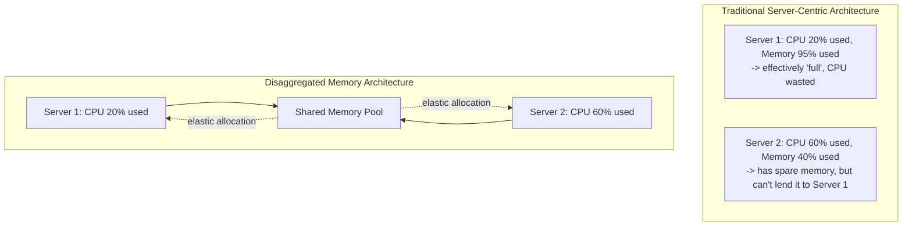
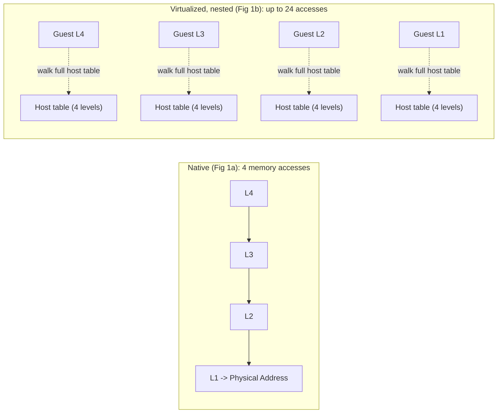
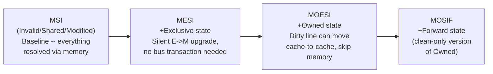
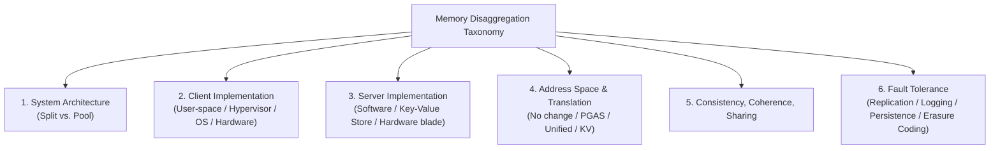
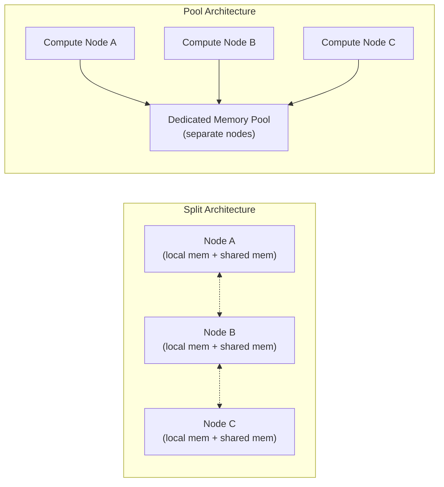
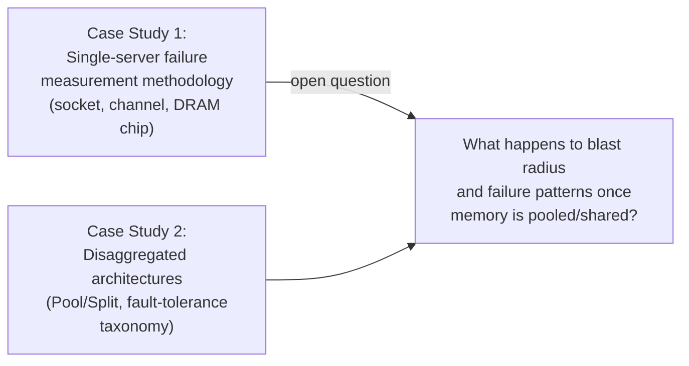

# Case Study 2 — Disaggregated Memory in the Datacenter: A Survey

> **Source:** Mohammad Ewais and Paul Chow, *IEEE Access*, Vol. 11, pp. 20688-20712, February 2023 (DOI: 10.1109/ACCESS.2023.3250407). A systematic survey and taxonomy of ~50 memory disaggregation research proposals published post-mid-2000s. This case study connects directly to Case Study 1 (device failure blast-radius implications) and to `cpumemory-detailed/07-modern-ai-datacenter-memory.md` (the CXL section in this workspace, which this survey predates and anticipates).

---

## 1. The Problem the Survey Addresses

⭐ **The core economic argument, stated with real numbers:** the traditional datacenter server tightly couples compute, memory, and storage on one motherboard, provisioned at **worst-case** capacity for each application's entire lifetime. Real utilization data cited in the survey exposes the waste this causes:

| Study | CPU utilization | Memory utilization |
|---|---|---|
| Amazon AWS EC2 | 7-17% | -- |
| Google (prior studies, cited) | 28-56% | -- |
| Alibaba (recent study, cited) | 20-50% (peak 70%) | **80-100%** |

⭐ **The Alibaba figures are the crux of the whole survey's motivation:** memory runs *nearly full* while CPU sits mostly idle -- meaning servers "run out" of memory and become unusable **long before their CPUs are actually saturated.** This happens because, unlike CPU (which can be time-shared via multi-threading), **memory allocated to one VM/container cannot be opportunistically lent to another** in a traditional server-centric architecture -- once allocated, it's reserved for that application's *peak* need, whether or not that peak is ever actually reached.

⭐ **The proposed fix: resource disaggregation** -- decouple memory from compute so each can be **independently provisioned and scaled**, following the precedent already well-established for **storage** (network-attached storage pools have existed for decades) but newly extended to memory, which historically required much lower latency/higher bandwidth than storage networking could provide -- this gap is exactly what modern high-speed interconnects (RDMA, CXL) close.

---

## 2. Background Concepts the Survey Requires (and How They Connect to This Workspace's Other Notes)

### Address Translation Under Disaggregation
⭐ The survey walks through ordinary multi-level page table translation (same 4-level x86 structure as `cpumemory-detailed/03-virtual-memory-and-numa.md`), then explains why **virtualized environments make this dramatically worse**:

⭐ **The striking number:** a native 4-level page table walk needs 4 memory accesses; a **nested** (virtualized) walk -- where each of the guest's 4 levels requires walking the *entire* host's 4-level table to resolve a guest-physical to host-physical address -- needs up to **24 accesses total** (4 guest levels x [4 host levels + 1] ~ their reported figure). This is precisely why **PTW caches** (caching intermediate, non-final page-table levels, distinct from a TLB which only caches the *final* translation) exist -- a direct extension of the TLB discussion in the cpumemory-detailed notes, applied to the specifically harder virtualized case that disaggregated-memory systems must contend with.

### Memory Consistency Models -- the Survey's Own Comparison Table
⭐ This directly extends the concepts from the DDIA-based notes (`distributed-systems-notes.md`, on linearizability/consistency) into the *hardware* memory-model domain -- worth reading side by side:

| Model | Reordering allowed | Used by | Performance benefit (cited, 8x8 NoC study) |
|---|---|---|---|
| **Sequential Consistency** | None -- strictly program order across all cores | Reference/theoretical baseline | -- |
| **TSO (Total Store Order)** | Stores can be reordered after subsequent loads (FIFO write buffer) | **Intel and AMD x86 processors** | +8.9% |
| **PSO (Partial Store Order)** | Stores within the buffer can also reorder among themselves | SPARC (historically) | +10.6% |
| **Weak/Release Consistency** | Data ops reorder freely; only synchronization ops preserve program order | ARMv8, RISC-V | +34.3% |

⭐ **Why this table matters for disaggregated memory specifically:** weaker consistency models allow **more buffering and grouping of memory operations**, which directly **reduces coherence traffic** -- and coherence traffic is exactly the scarce, expensive resource once memory operations must cross a *network* rather than an on-chip bus. This is why software-based disaggregation proposals, unconstrained by legacy hardware consistency guarantees, so often adopt weak consistency (see Section 5 below) -- it's a direct, deliberate trade of programmer difficulty for network efficiency.

### Cache Coherence Protocol Evolution -- MSI -> MESI -> MOESI -> MOSIF
⭐ The survey's protocol comparison directly extends `cpumemory-detailed/02-cpu-caches.md`'s MESI explanation one step further, showing the design lineage:

⭐ **The consistent design principle across all four:** each additional state exists to **avoid an expensive round-trip to memory** by letting caches satisfy each other's requests directly -- Owned/Forward specifically let a **dirty** line be shared cache-to-cache without first writing back to (slow) memory. ⭐ **Direct relevance to disaggregation:** in a disaggregated system, "memory" may now be a network hop away rather than a local DRAM access -- making the cost of *not* having these richer states (i.e., falling back to memory on every sharing event) dramatically higher than in a traditional single-box system. This is exactly why the survey highlights that **"as the number of states...grow, more savings in latency as well as traffic on the coherence fabric are achieved, which is extremely attractive for disaggregated memory proposals"** -- richer coherence protocols, expensive metadata-wise on a single chip, become an even better trade in a disaggregated setting where the alternative (a network round trip) is so much costlier.

### Snooping vs. Directory-Based Coherence
| Mechanism | How | Scalability |
|---|---|---|
| **Snooping** | Every cache watches (snoops) a shared bus, filters relevant transactions | Fast, but bus bandwidth/latency requirements grow with cache count -- poor scaling |
| **Directory-based** | A central directory tracks which caches hold which lines, forwards only relevant requests | No broadcast needed -- scales much better, dominant in recent large-scale designs |

⭐ **Direct relevance:** disaggregated memory systems are, almost definitionally, **large-scale** (many compute nodes sharing memory) -- meaning **directory-based coherence is essentially the only viable choice** at this scale; several proposals covered later in the survey (Concordia, MIND) go a step further and implement the directory **inside programmable network switches**, exploiting the switch's unique position between every client and server to minimize the latency of coherence lookups.

### CXL and RDMA -- the Two Enabling Interconnects
⭐ **CXL** (PCIe-based, cache-coherent) is noted as **not yet commercialized at the time of this survey's writing** ("almost no proposals discussed in this survey depend on it") -- a genuinely interesting historical marker, since `cpumemory-detailed/07-modern-ai-datacenter-memory.md` (written from a 2025-2026 vantage point) shows CXL has since become a real, deployed, rack-scale pooling technology. This survey is thus a useful **snapshot of the "before" state** -- most proposals it covers had to build their own custom coherence/networking machinery precisely because CXL didn't yet exist as an off-the-shelf option.

⭐ **RDMA**, by contrast, **is** the dominant practical enabler across nearly every proposal in this survey -- the key insight being **one-sided verbs** (read/write/atomic) that let a remote node's memory be accessed **without involving its CPU at all**, a direct hardware analog of the "don't wake up the other core unnecessarily" principle from the false-sharing discussion in `cpumemory-detailed/05-multithread-and-numa-programming.md`, just applied across a network instead of across cores.

| RDMA mode | Connection | Reliability | Scalability |
|---|---|---|---|
| **Reliable Connection (RC)** | Required, 1 QP per connection | Guaranteed, ordered | Poor -- many connections thrash the NIC's QP cache |
| **Unreliable Connection (UC)** | Required, 1 QP per connection | None | Poor (same QP issue), but higher throughput (no ack overhead) |
| **Unreliable Datagram (UD)** | Connectionless -- one QP, many destinations | None | Best -- no per-connection QP overhead |

---

## 3. The Survey's Taxonomy -- the Core Analytical Contribution

⭐ **This is the survey's real intellectual contribution: not any single proposal, but the systematic classification framework** used to compare ~50 otherwise incomparable systems. Six axes:

### Axis 1 -- System Architecture: Split vs. Pool

- **Split:** every node's local memory is logically partitioned -- part private, part advertised to the cluster. Every node is *simultaneously* a client and a server. ⭐ Cannot be trivially implemented in pure hardware (needs a software daemon on every participating node).
- **Pool:** dedicated, separate memory-only nodes serve compute nodes -- a clean architectural separation, potentially freeing compute nodes from running a "memory server" workload alongside their real work, at the cost of needing genuinely separate hardware for the memory tier.
- ⭐ **The survey's own critical observation (Section V):** almost **no** studied proposal justifies its choice of Split vs. Pool with actual reasoning or comparison -- each just picks one and never engages with the alternative. This is flagged as a genuine, unresolved gap in the field.

### Axis 2 -- Client Implementation, Ranked by Where the Abstraction Lives
| Level | Transparency to applications | Cost |
|---|---|---|
| **User-space library/API** | None -- app must be rewritten to call the API explicitly | Easiest to build, hardest to adopt |
| **Hypervisor** | Full -- unmodified guest OS/apps just run | Requires hypervisor modification; can't help native OSes or containers |
| **OS: disk abstraction** | Requires explicit `mmap` by the user | Just needs a device driver, no kernel changes |
| **OS: swap space** | Fully transparent | Reuses existing OS swap machinery -- one of the **most common approaches** surveyed |
| **OS: page fault handling** | Fully transparent | More flexible than swap (can disaggregate proactively, not just under memory pressure) |
| **OS: NUMA** | Fully transparent | Requires hardware-level cache coherence already, or major kernel surgery |
| **Hardware** | Fully transparent, supports legacy apps unmodified | Most complex to build; usually only feasible via simulation or FPGA prototyping |

⭐ **The clear pattern: transparency and implementation cost trade off directly against each other**, and this single trade-off predicts most of the design choices seen across the ~50 surveyed systems.

### Axis 3 -- Address Space and Translation
| Mode | Description | Used by |
|---|---|---|
| **No Change** | Swap-based systems -- virtual memory unchanged, invisible to translation | MemX, Infiniswap, FastSwap |
| **PGAS (Partitioned Global Address Space)** | Address space split into local + explicit remote regions, accessed via API | FaRM, Grappa, GAM |
| **PGAS-like** | File/region abstraction -- remote memory accessed via ordinary pointers after an `mmap`-like call | Hotpot, Remote Regions |
| **Unified** | Single virtual address space spans multiple physical nodes | vNUMA, vDSM, GiantVM, Semeru |
| **Key-Value** | No traditional addressing at all -- data accessed by key | Clover |

### Axis 5 -- Memory Transfer Granularity: a Direct Trade-off
⭐ **This connects directly to the false-sharing/cache-line discussion in `cpumemory-detailed/05`:**
- **Page-sized transfers** (the majority of surveyed systems, typically 4KB): simple, matches existing OS virtual-memory machinery -- but causes **dirty data amplification**: if data sharing is enabled and only a few bytes within a page actually change, the *entire* page still gets marked dirty and must be re-transferred/re-validated across the network -- a direct, larger-scale analog of false sharing's cache-line-level waste.
- **Cache-line-sized transfers** (a minority -- e.g., PBerry, some hardware proposals): eliminates dirty-data amplification, but at the cost of **many more, smaller requests** -- trading network-traffic-per-byte efficiency for higher request-count overhead. Exactly the same "coarse vs. fine granularity" trade-off appears at every layer of this stack -- cache lines, pages, and now disaggregated-memory transfer units are all instances of the identical underlying tension.

---

## 4. Representative Proposals -- a Curated Walkthrough

Given the survey covers ~50 systems, here is a representative cross-section illustrating the taxonomy's range:

| Proposal | Architecture | Client type | Sharing? | Notable idea |
|---|---|---|---|---|
| **MemX** (earliest, pre-2010s) | Pool | OS (disk/swap) | No | Custom protocol bypassing TCP/IP entirely for lower latency |
| **Infiniswap** | -- | OS (swap) | No | Uses remote memory as a *cache in front of* disk swap -- best of both worlds for capacity vs. speed |
| **FastSwap** | -- | OS (swap) | Limited (same-host VMs) | Adds compression on swap-out/decompression on swap-in to conserve remote memory |
| **Google zswap** | -- | OS (swap) | No | Proactively identifies and compresses **cold** pages *before* memory pressure hits, not reactively |
| **Hotpot** | -- | OS (file-like) | Yes, 4KB granularity | Blurs memory/storage line using non-volatile memory; pointers persist across reruns |
| **DeX** | -- | OS (thread migration) | Yes | Inverts the whole paradigm: migrate the *thread* to the data, not the data to the thread |
| **vNUMA** | Split | Hypervisor (Type 1) | Yes | Lets a *single VM* span multiple physical machines transparently |
| **Semeru / MemLiner / Mako** | Pool | Hypervisor | Yes | JVM-specific -- distributed garbage collection offloaded to lightweight JVMs on memory servers |
| **AIFM** | -- | Software library (implicit) | Future work | C++ container-like data structures that transparently decide local vs. remote placement |
| **Clover** | Pool | Key-value store | Yes | Passive memory nodes + separate metadata servers splitting control/data paths |
| **Concordia / MIND** | -- | Programmable switch | Yes | Coherence directory implemented **inside the network switch itself** |
| **Blade** | Pool | Hardware | No | Two variants: (1) unmodified CPUs + PCIe memory blades, or (2) cache-coherent interconnect + cache-line granularity |
| **DirectCXL** | Pool | Hardware | No (per-host only) | The **only** proposal in the entire survey using CXL directly |
| **LegoOS** | Pool | OS (full split-kernel redesign) | No | TLBs and page tables **entirely relocated to memory blades** -- radical compute/memory separation |
| **ThymesisFlow / PBerry / Kona** | -- | FPGA-based hardware | Varies | Use FPGA-side cache-coherent interconnects (OpenCAPI) to present remote memory as a giant local cache |

⭐ **Two "meta" proposals worth noting specifically:** **Leap** doesn't build a new disaggregation system at all -- it builds a **better prefetcher** (adaptive window size + Boyer-Moore majority-vote trend detection) and *bolts it onto* two existing systems (Infiniswap, Remote Regions) to show the improvement is portable. **Hydra** similarly doesn't innovate in disaggregation mechanics -- it's purely a **fault-tolerance** study, showing **erasure coding** meaningfully outperforms simple replication when layered onto the same two base systems. ⭐ This modular "improve one orthogonal axis, bolt it onto an existing base system" pattern is exactly the kind of incremental, decomposed research the survey's own conclusion argues the *whole field* should be doing more of.

---

## 5. Consistency, Coherence, and Fault Tolerance -- Patterns Across the Field

### The Consistency Spectrum, Empirically Observed
⭐ **The survey's own summary pattern:** proposals that **don't support data sharing** at all (a majority) need no consistency model beyond basic request ordering. Among those that *do* support sharing, there's a clear split:
- **Software-only proposals** (no legacy-code constraint) skew toward **weak/release consistency** -- since the programmer must rewrite code for the new API anyway, there's no cost to also requiring them to reason about weak consistency, and it saves substantial network/coherence traffic.
- **Proposals preserving backward compatibility** typically adopt **TSO** (matching real x86 hardware's native model) or full **sequential consistency**, since legacy application code implicitly assumes these guarantees and cannot be safely retrofitted with weaker ones.

### Fault Tolerance -- the Weakest Area of the Surveyed Field
⭐ **The survey's own blunt assessment:** fault tolerance is "for the most part, ignored" across the ~50 proposals. Of those that *do* address it:

| Technique | Mechanism | Trade-off |
|---|---|---|
| **Replication** | Multiple live copies, writes propagate to all | Simple, but expensive in resources -- the most common approach used |
| **Logging** | Every mutating operation logged separately, replayed on recovery | Finer-grained than replication, cheaper storage-wise |
| **Persistence** | Either replicate to disk (slow, done off critical path) or use non-volatile memory directly | NVM avoids the replication cost entirely, at NVM's own price premium |
| **Erasure Coding** | Redundant encoding split across devices; original recoverable from a subset | Better fault-tolerance-per-byte than replication, at the cost of encode/decode latency and higher per-access network fan-out |

⭐ **Only one surveyed proposal (Hydra) treats fault tolerance as its primary research question** -- everything else treats it as, at best, a secondary concern bolted onto a system whose main contribution lies elsewhere. This is flagged as a direct, actionable research gap.

---

## 6. The Survey's Own Critical Self-Assessment (Section V) -- and Why It's the Most Valuable Part

⭐ **This is unusually candid for a survey paper, and worth taking seriously as a meta-lesson about the whole research area, not just this specific survey:**

1. **Design choices are driven by intuition, not measurement.** The authors note bluntly: *"none of the studies we covered show any reasoning for implementing disaggregation in pool or split format."* Proposals simply pick an architecture and never engage with, let alone quantitatively compare against, the alternative.
2. **Everyone tries to build a complete, monolithic solution.** Instead of studying one variable at a time (architecture, coherence, fault tolerance, caching policy) in isolation, most systems bundle every design decision into one paper -- making it nearly impossible to attribute performance gains/losses to any *specific* design choice, and preventing fair cross-proposal comparison.
3. **No shared simulators or benchmarks exist** for the field -- meaning the survey explicitly **cannot** offer a head-to-head performance comparison table across the 50 systems, despite that being the single most useful thing such a survey could otherwise provide. This absence is itself presented as the field's most urgent infrastructure gap.
4. **Caching depth is arbitrary.** No surveyed system goes beyond **one** level of caching (typically some or all of the client's local DRAM) -- with no study establishing *why* one level is sufficient, or what a second level would buy, unlike the deeply-multi-level cache hierarchies covered in `cpumemory-detailed/02-cpu-caches.md`. The survey explicitly recommends this as underexplored.
5. **The scope question (rack? multiple racks? warehouse-scale?) is never directly studied** -- most papers report a scale purely to demonstrate *their own system's* scalability, not to answer the more fundamental, technology-agnostic question of what scope of disaggregation is actually optimal.

⭐ **The forward-looking recommendation, which the 2025-2026 CXL adoption reality (per `cpumemory-detailed/07`) has since partly validated:** the authors specifically flag CXL as "the perfect candidate for future work" *because* its components were "(almost) readily available" -- correctly predicting that CXL-based practical, near-term disaggregation would follow shortly after this survey's publication, which the companion notes file in this workspace confirms did happen.

---

## 7. Cross-Document Synthesis -- Reading Case Studies 1 and 2 Together

⭐ **This is the most valuable analytical move available across the two documents, and worth stating explicitly:**

- **Case Study 1 (Meza's thesis)** measures failure behavior under the assumption that **memory failure is a single-server event** -- a socket fails, one machine is affected, repair/replace that one machine.
- **Case Study 2 (this survey)** describes architectures where memory is explicitly **pooled and shared across many compute nodes** -- meaning a single memory-node/blade failure (in a Pool architecture) could simultaneously affect **every compute node currently using that pool**, a fundamentally larger blast radius than anything Meza's thesis methodology was designed to measure.
- ⭐ **The unresolved question this creates:** none of the ~50 proposals surveyed in Case Study 2 report field-scale failure-rate data anywhere near the rigor of Case Study 1's methodology -- meaning **the reliability implications of memory disaggregation, at the scale Meza's thesis operates, remain an open empirical question.** A natural, well-motivated next research step (which the survey's own Section V gestures toward, without saying so explicitly) would be applying Meza's exact component-level failure-attribution methodology to a *disaggregated* memory pool, to see whether the same power-law/Pareto error distribution and "denial of service" patterns reappear -- and, more importantly, whether they now propagate to *multiple* compute nodes simultaneously instead of just one.
- **Fault-tolerance technique overlap:** the survey's four fault-tolerance categories (replication, logging, persistence, erasure coding) are the *architectural* tools available to mitigate exactly the kind of failures Case Study 1 measures in the field -- reading them together turns Case Study 2's fault-tolerance section from an abstract taxonomy into a concrete answer to "given that DRAM/network failures look like *this* in practice (Case Study 1), which of these four techniques would actually help, and how much?"

---

## Summary Table

| Taxonomy axis | Key options | Central trade-off |
|---|---|---|
| **System architecture** | Split vs. Pool | Simplicity/flexibility (split) vs. clean separation of concerns (pool) -- never rigorously compared in the literature |
| **Client implementation** | User-space / Hypervisor / OS (disk, swap, page-fault, NUMA) / Hardware | Transparency to legacy applications vs. implementation complexity |
| **Address space model** | No change / PGAS / PGAS-like / Unified / Key-Value | Programmer burden vs. flexibility and performance |
| **Transfer granularity** | Page-sized vs. cache-line-sized | Simplicity + fewer requests (page) vs. avoiding dirty-data amplification (cache-line) |
| **Consistency model** | Sequential / TSO / PSO / Weak-Release | Legacy compatibility vs. network/coherence-traffic efficiency |
| **Fault tolerance** | Replication / Logging / Persistence / Erasure coding | Resource cost vs. recovery granularity and latency overhead |

## Key Talking Points

- Explain the **core economic motivation precisely** using the cited Alibaba figures (80-100% memory utilization vs. 20-50% CPU) -- this single statistic is the survey's entire justification for the field's existence.
- Walk through **why nested page table walks under virtualization cost up to 24 memory accesses** instead of 4, and why this motivates PTW caches as a distinct structure from TLBs.
- Explain the **MSI -> MESI -> MOESI -> MOSIF progression** and why richer coherence states become *more* valuable, not less, once "memory" might be a network hop away.
- Distinguish **Split vs. Pool architecture** precisely, and be ready to cite the survey's own critical observation that this choice is essentially never empirically justified in the literature.
- Explain the **page-granularity vs. cache-line-granularity trade-off** for memory transfers, connecting it directly to false sharing from the cpumemory-detailed notes as the same underlying tension at a different scale.
- Be ready to **synthesize both case studies together**: explain why Meza's single-server failure methodology doesn't directly answer the reliability question for pooled/disaggregated memory, and what a natural follow-up study would need to measure.
- Critically evaluate the survey's own self-assessment (Section V) -- intuition-driven design choices, monolithic proposals, and the total absence of shared benchmarks/simulators -- as a genuine, well-argued critique of an entire research subfield, not just a list of individual paper summaries.