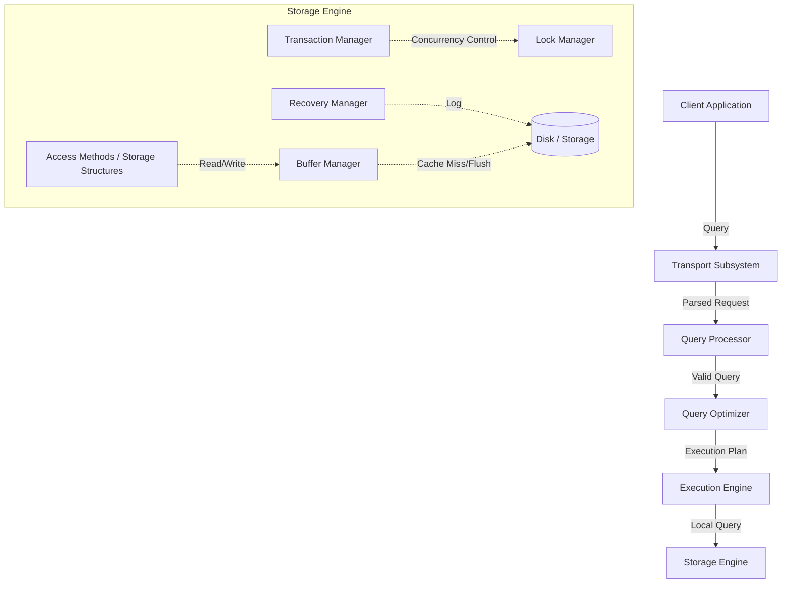
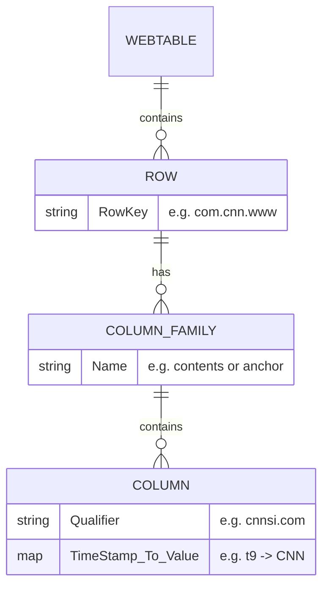
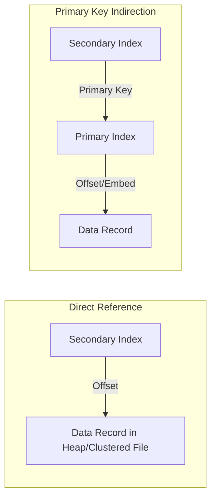

<Chapter 1: Introduction and Overview>
> A foundational overview of database management system architecture, storage mediums, layout strategies, and indexing fundamentals.

## Table of Contents
- [Chapter Overview](#chapter-overview)
- [DBMS Architecture](#dbms-architecture)
- [Memory- Versus Disk-Based DBMS](#memory--versus-disk-based-dbms)
- [Column- Versus Row-Oriented DBMS](#column--versus-row-oriented-dbms)
- [Wide Column Stores](#wide-column-stores)
- [Data Files and Index Files](#data-files-and-index-files)
- [Buffering, Immutability, and Ordering](#buffering-immutability-and-ordering)
- [Worked Examples & Code Implementations](#worked-examples--code-implementations)
- [Design Patterns & Best Practices](#design-patterns--best-practices)
- [Trade-offs & Decision Framework](#trade-offs--decision-framework)
- [Interview & System Design Angles](#interview--system-design-angles)
- [AI/ML Engineering Relevance](#aiml-engineering-relevance)
- [Key Takeaways](#key-takeaways)
- [Glossary](#glossary)

## Chapter Overview

Database management systems (DBMS) serve highly specialized purposes—ranging from short-lived, low-latency, hot-data transaction processing to massive, analytical cold-storage data warehouses. Understanding the architecture and storage design of a DBMS is critical for selecting the right tool for a given workload and for designing performant, reliable applications.

This chapter sets the stage by demystifying core DBMS concepts and taxonomies. It breaks down the internal architecture of a DBMS, compares memory-based and disk-based storage engines, and evaluates the distinctions between row-oriented and column-oriented data layouts. It also introduces the essential structures that connect logical requests to physical data: data files, index files, and the underlying principles of buffering, immutability, and ordering that govern all modern storage engines.

## DBMS Architecture

### Core Concept
While no universal blueprint exists for all databases, most adhere to a layered client/server architecture where queries are transported, parsed, optimized, and executed by a distinct set of components before reaching the storage engine layer, which safely interacts with the physical medium.

### How It Works
1. **Transport Subsystem:** Accepts client queries (often in a query language like SQL) and handles intra-cluster node communication.
2. **Query Processor:** Parses, interprets, and validates the syntax and semantics of the query.
3. **Query Optimizer:** Eliminates redundant constraints and searches for the most efficient execution plan based on internal statistics (e.g., index cardinality) and data placement. It transforms the query into an execution plan (a tree of relational operations).
4. **Execution Engine:** Executes the operations in the chosen plan, orchestrating remote execution and gathering results.
5. **Storage Engine:** The local executor of data read/writes. It delegates responsibilities to:
   - **Transaction Manager:** Schedules transactions and guarantees logical consistency.
   - **Lock Manager:** Secures database objects for concurrent transactions, ensuring physical data integrity.
   - **Access Methods:** Manages data placement on disk (e.g., B-Trees, LSM Trees, heap files).
   - **Buffer Manager:** Caches frequently used data pages in memory to mitigate slow disk I/O.
   - **Recovery Manager:** Maintains operation logs (Write-Ahead Logs) to restore system state after failures.

### Diagram


### Real-World Usage
This decoupled architecture allows databases like **PostgreSQL** or **MySQL** to utilize different storage engines under the hood (e.g., MySQL's pluggable storage engines like InnoDB or MyISAM) while sharing the same optimizer and execution engine. 

---

## Memory- Versus Disk-Based DBMS

### Core Concept
Databases exist on a spectrum between being **disk-based** (using RAM only as a buffer/cache) and **in-memory** (storing primary data in RAM, using disk only for durability).

### How It Works
- **Disk-Based DBMS:** Assumes data will not fit in RAM. Data structures are optimized for disk block access (e.g., wide and short trees like B-Trees) to minimize costly random I/O operations.
- **In-Memory DBMS:** Assumes data fits entirely in RAM. Data structures use direct memory pointers, completely avoiding serialization and disk-page management overheads for primary operations.

#### Durability in Memory-Based Stores
Because RAM is volatile, in-memory databases ensure durability via:
1. **Write-Ahead Logging (WAL):** Sequential logs of operations written to disk before an operation completes.
2. **Asynchronous Checkpointing:** A sorted, disk-based backup copy is maintained. Log records are periodically applied to this backup in batches. Once applied, older log records are discarded. This dramatically shortens recovery times on startup.

### Trade-offs
- **In-Memory:** Extremely low latency, simple pointer-based data structures. **Cons:** Expensive, limited by RAM size, complex durability mechanisms.
- **Disk-Based:** Highly scalable, economical, naturally persistent. **Cons:** High latency for random access, complex buffer management and layout constraints.

---

## Column- Versus Row-Oriented DBMS

### Core Concept
Data in tables can be physically laid out on disk either horizontally (by row) or vertically (by column). The choice fundamentally dictates the efficiency of different query workloads (OLTP vs. OLAP).

### Row-Oriented Data Layout
- **Mechanics:** All fields belonging to a single record (e.g., an entire user profile) are stored contiguously on disk.
- **Use Case:** Best suited for OLTP (Online Transaction Processing) where workloads consist of point queries, insertions, and updates of individual, complete records.
- **Why it works:** Because disk reads happen in blocks, fetching one user's record brings the entire record into the cache. This maximizes *spatial locality* for row-level access.

### Column-Oriented Data Layout
- **Mechanics:** All values for a single column (e.g., just the "Price" field of all stock quotes) are stored contiguously.
- **Use Case:** Best suited for OLAP (Online Analytical Processing) where workloads involve complex aggregations, computing averages, or scanning specific fields across millions of rows without caring about the other fields.
- **Why it works:** Prevents fetching useless data. If a query only sums up "Price", a columnar database reads only the blocks containing prices.

### Distinctions and Optimizations
Columnar formats unlock advanced hardware optimizations:
1. **Cache Utilization:** Sequential access of homogeneous data types fits perfectly in CPU caches.
2. **Vectorization:** Modern CPUs can use SIMD (Single Instruction Multiple Data) to process multiple column values in a single instruction.
3. **Compression:** Storing similar data types consecutively allows for aggressive, type-specific compression algorithms (e.g., Run-Length Encoding). To reconstruct tuples, columnar stores often use implicit virtual IDs (offsets) to map columns back to a logical row without explicit key duplication.

### Real-World Usage
- **Row-Oriented:** MySQL, PostgreSQL.
- **Column-Oriented:** ClickHouse, Apache Parquet, Apache ORC, Vertica.

---

## Wide Column Stores

### Core Concept
Not to be confused with column-oriented databases, **wide column stores** (like Bigtable, Cassandra, HBase) represent data as a multidimensional map. 

### How It Works
Columns are grouped into **column families**. Inside a column family, data is stored **row-wise**. 

**Webtable Example:**
- Pages are identified by a reversed URL (Row Key).
- Attributes are grouped into column families (e.g., `contents`, `anchor`).
- Inside the column family, specific columns are identified by a combination of the family and a qualifier (e.g., `anchor:cnnsi.com`).
- Data values are versioned by a timestamp.

### Diagram


---

## Data Files and Index Files

### Core Concept
Databases do not rely on standard filesystem directory trees for indexing data. They use specialized **data files** and **index files** to minimize storage overhead, maximize access efficiency, and optimize updates.

### Data Files
Data files store the actual records. The three primary organizations are:
1. **Heap Files:** Records are stored in write-order (append-only). Fast inserts, but requires external indexes to be searchable.
2. **Hashed Files:** Records are placed in buckets determined by a hash function of the key.
3. **Index-Organized Tables (IOT):** Records are stored directly inside the index structure (usually a tree), keeping them sorted by key.

*Note: Deletions are typically handled via "tombstones" (deletion markers) and reclaimed later via Garbage Collection, rather than deleting data in-place immediately.*

### Index Files
Auxiliary structures that map search keys to the physical locations in data files.
- **Primary Index:** Built over the primary key. 
- **Secondary Index:** Built over other keys. May hold multiple entries per search key.
- **Clustered Index:** The physical order of the data records matches the index order. (An IOT is clustered by definition).
- **Nonclustered Index:** The index points to data stored in a different physical order.

### Primary Index as an Indirection
A major architectural decision is how secondary indexes locate the primary data:
1. **Direct Reference:** Secondary index stores the physical offset of the data record. *Pros:* Faster read (fewer hops). *Cons:* Every time a record moves, all secondary indexes must be updated.
2. **Indirection via Primary Key:** Secondary index stores the Primary Key. To find data, the system queries the secondary index, gets the primary key, and then queries the primary index. *Pros:* Data can move freely without updating secondary indexes. *Cons:* Reads suffer an extra index traversal.

### Diagram


---

## Buffering, Immutability, and Ordering

### Core Concept
Most storage structures and their optimizations boil down to the interplay of three core design variables:

1. **Buffering:** Does the system batch data in memory before writing to disk? All systems buffer block I/O, but *avoidable buffering* (e.g., holding writes in memory to amortize cost) is a conscious design choice. Examples include adding buffers to B-Tree nodes, or the MemTable in LSM Trees.
2. **Mutability vs. Immutability:** Does the system perform *in-place updates* (reading a page, modifying it, and writing it back over the same spot)? Or is it *immutable* (append-only)? Immutability can be implemented via logs or Copy-On-Write mechanisms. 
3. **Ordering:** Are records stored physically in order of their keys? Ordered storage allows for efficient range scans but makes arbitrary insertions costly. Out-of-order storage (insertion order) makes writes blazing fast but requires extensive indexing for reads.

---

## Worked Examples & Code Implementations

### Example 1: Row-Store vs. Column-Store Scan & Aggregation Benchmark

This example simulates the memory layout and disk I/O differences between a row-oriented store (which must read entire tuples from disk) and a column-oriented store (which reads only the targeted column array) when computing `AVG(salary)`.

```python
import time

class RowStore:
    def __init__(self):
        self.rows = []  # List of full tuples: (user_id, age, salary, country)
        
    def insert(self, user_id: int, age: int, salary: float, country: str):
        # Tuple byte estimate: 4 (int) + 2 (short) + 8 (double) + 16 (str) = 30 bytes/row
        self.rows.append((user_id, age, salary, country))
        
    def scan_avg_salary(self):
        total_salary = 0.0
        bytes_read = 0
        for r in self.rows:
            bytes_read += 30  # Entire record loaded into memory/cache
            total_salary += r[2]
        return total_salary / len(self.rows), bytes_read

class ColumnStore:
    def __init__(self):
        self.user_ids = []
        self.ages = []
        self.salaries = []    # Stored as contiguous 8-byte floats
        self.countries = []
        
    def insert(self, user_id: int, age: int, salary: float, country: str):
        self.user_ids.append(user_id)
        self.ages.append(age)
        self.salaries.append(salary)
        self.countries.append(country)
        
    def scan_avg_salary(self):
        bytes_read = len(self.salaries) * 8  # Only salary column is scanned from disk
        total_salary = sum(self.salaries)
        return total_salary / len(self.salaries), bytes_read

# Benchmark on 100,000 records
N = 100_000
row_db = RowStore()
col_db = ColumnStore()
for i in range(N):
    salary = 50000.0 + (i % 1000) * 50
    row_db.insert(i, 20 + (i % 50), salary, 'US')
    col_db.insert(i, 20 + (i % 50), salary, 'US')

t0 = time.perf_counter()
row_avg, row_bytes = row_db.scan_avg_salary()
t_row = (time.perf_counter() - t0) * 1000

t0 = time.perf_counter()
col_avg, col_bytes = col_db.scan_avg_salary()
t_col = (time.perf_counter() - t0) * 1000

print(f"=== Row-Store vs Column-Store Benchmark ({N:,} rows) ===")
print(f"Row-Store   : Avg Salary = ${row_avg:,.2f} | Bytes Scanned: {row_bytes / (1024*1024):.2f} MB | Time: {t_row:.2f} ms")
print(f"Column-Store: Avg Salary = ${col_avg:,.2f} | Bytes Scanned: {col_bytes / (1024*1024):.2f} MB | Time: {t_col:.2f} ms")
print(f"I/O Reduction: {(1 - col_bytes/row_bytes)*100:.1f}% less data scanned from storage")
```

#### Execution Output
```text
=== Row-Store vs Column-Store Benchmark (100,000 rows) ===
Row-Store   : Avg Salary = $74,975.00 | Bytes Scanned: 2.86 MB | Time: 3.77 ms
Column-Store: Avg Salary = $74,975.00 | Bytes Scanned: 0.76 MB | Time: 0.85 ms
I/O Reduction: 73.3% less data scanned from storage
```

---

### Example 2: Primary Key Indirection vs. Direct Physical Offset

Demonstrates how updating record location (e.g., during page defragmentation or node splits) forces updates across all secondary indexes when using **Direct Offsets**, compared to zero secondary index writes when using **Primary Key Indirection**.

```python
class DirectSecondaryIndex:
    """Secondary index maps directly to physical byte offset."""
    def __init__(self):
        self.index = {}  # email -> physical_offset
        
    def update_record_location(self, email: str, old_offset: int, new_offset: int) -> int:
        self.index[email] = new_offset
        return 1  # 1 index rewrite required

class IndirectSecondaryIndex:
    """Secondary index maps to Primary Key (PK). Physical location is resolved via Primary Index."""
    def __init__(self):
        self.index = {}  # email -> pk
        
    def update_record_location(self, email: str, old_offset: int, new_offset: int) -> int:
        # Secondary index remains unchanged because PK has not changed!
        return 0  # 0 index rewrites required

# Scenario: Alice's record relocates from page offset 0x1000 to 0x2400
sec_direct = DirectSecondaryIndex()
sec_indirect = IndirectSecondaryIndex()

sec_direct.index['alice@example.com'] = 0x1000
sec_indirect.index['alice@example.com'] = 101  # PK = 101

writes_direct = sec_direct.update_record_location('alice@example.com', 0x1000, 0x2400)
writes_indirect = sec_indirect.update_record_location('alice@example.com', 0x1000, 0x2400)

print(f"Direct Reference   -> Secondary Index Writes on Record Move: {writes_direct}")
print(f"PK Indirection     -> Secondary Index Writes on Record Move: {writes_indirect} (Zero write amplification!)")
```

#### Execution Output
```text
Direct Reference   -> Secondary Index Writes on Record Move: 1
PK Indirection     -> Secondary Index Writes on Record Move: 0 (Zero write amplification!)
```

---

### Example 3: Append-Only File with Tombstones & Compaction

Demonstrates an append-only log with soft deletes using tombstones (`__DELETED__`), followed by a garbage collection compaction pass to eliminate shadow/deleted entries.

```python
class AppendLogDB:
    TOMBSTONE = "__DELETED__"
    
    def __init__(self):
        self.log = []  # Chronological append log
        
    def put(self, key: str, value: str):
        self.log.append((key, value))
        
    def delete(self, key: str):
        self.log.append((key, self.TOMBSTONE))
        
    def compact(self):
        """Compacts the append-only log into the minimal live state."""
        latest_state = {}
        for key, val in self.log:
            if val == self.TOMBSTONE:
                latest_state.pop(key, None)
            else:
                latest_state[key] = val
        self.log = list(latest_state.items())
        return self.log

db = AppendLogDB()
db.put("user:1", "Alice")
db.put("user:2", "Bob")
db.put("user:1", "Alice Cooper")  # In-place update simulated via append
db.delete("user:2")               # Soft delete via tombstone
db.put("user:3", "Charlie")

print("Raw Append Log:", db.log)
compacted_state = db.compact()
print("Compacted Log (Live Records Only):", compacted_state)
```

#### Execution Output
```text
Raw Append Log: [('user:1', 'Alice'), ('user:2', 'Bob'), ('user:1', 'Alice Cooper'), ('user:2', '__DELETED__'), ('user:3', 'Charlie')]
Compacted Log (Live Records Only): [('user:1', 'Alice Cooper'), ('user:3', 'Charlie')]
```

---

## Design Patterns & Best Practices

- **Separation of Concerns in Engine Design:** The query parser/optimizer should be completely agnostic to the underlying physical layout, communicating via a standardized execution plan to the storage engine.
- **Tombstoning over In-Place Deletions:** Modern databases heavily favor appending tombstones rather than modifying files in-place to ensure crash safety, prevent locking, and maximize write throughput.
- **Batching Log Commits:** For in-memory systems, asynchronously batching log writes to a persistent backup via checkpointing is the gold standard for balancing durability with high performance.

---

## Trade-offs & Decision Framework

| Requirement | Preferred Architecture | Rationale |
|---|---|---|
| **High write throughput, point reads** | Row-oriented, Heap files with Secondary Indexes | Write operations append quickly. Reads bring full tuples into cache. |
| **Complex Aggregations, Range Scans** | Column-oriented | Prevents reading unneeded fields, maximizes vectorization and compression. |
| **Ultra-Low Latency, Bounded Data** | In-Memory DBMS | Avoids disk page management entirely, relying on direct memory pointers. |
| **Massive Scale, Unpredictable Reads** | Disk-Based, Wide Column Stores | Allows scalable horizontal partitioning and efficient single-key lookups. |
| **Heavy Secondary Indexing** | Primary Key Indirection | Prevents catastrophic write-amplification when base records are updated or moved. |

---

## Interview & System Design Angles

When tackling FAANG system design interviews (e.g., designing a metric tracking system, ad click aggregator, or user timeline):
- **OLTP vs. OLAP:** Immediately clarify the access pattern. If designing a data warehouse or analytics dashboard (OLAP), explicitly mention choosing a **columnar store** (like Parquet/ClickHouse) and cite *vectorization* and *compression*.
- **Write-Heavy Workloads:** If designing a time-series or logging system, advocate for an **append-only (immutable) storage layout** with out-of-order appending to maximize throughput.
- **Index Architecture:** Understand why systems like MySQL InnoDB use **clustered indexes** (index-organized tables) and **indirection** for secondary indexes. Mentioning that "secondary indexes map to primary keys to avoid pointer update amplification" is a strong signal of deep knowledge.

---

## AI/ML Engineering Relevance

- **Feature Stores & Online/Offline Separation:** The dichotomy between row and column stores perfectly mirrors the Online vs Offline Feature Store paradigm. Offline stores (e.g., Snowflake, BigQuery) use **columnar formats** (Parquet) for generating training datasets over millions of rows. Online stores (e.g., Redis, DynamoDB) use **row-oriented/in-memory layouts** for ultra-fast, point-lookup inference.
- **Vector Databases & ANN Indexes:** The core variable of **Buffering vs Immutability** is heavily present in vector databases (e.g., Milvus, Pinecone). High-dimensional vectors are often buffered in memory to build complex HNSW (Hierarchical Navigable Small World) graphs before being immutably flushed to disk segments. 
- **Time-Series / Model Monitoring:** For capturing model telemetry and drift, **wide column stores** or out-of-order append-only engines are critical due to their high write throughput capabilities.

---

## Key Takeaways
- DBMS Architecture is modular, decoupling query parsing/optimization from physical storage and concurrency control.
- In-memory databases are not just "disk databases cached in RAM"; they utilize fundamentally different, pointer-based data structures optimized for zero-serialization.
- Row-oriented stores excel at spatial locality for individual entity transactions, while column-oriented stores excel at CPU cache utilization, compression, and vectorization for analytical queries.
- Wide-column stores arrange data as multi-dimensional maps, optimal for sparse datasets accessed via complex key hierarchies.
- The choice between Direct Reference and Primary Key Indirection in secondary indexing is a fundamental trade-off between read latency and write amplification.
- All modern storage engine designs balance three variables: Buffering, Mutability, and Ordering.

---

## Glossary
- **OLTP (Online Transaction Processing):** Workloads defined by high concurrency, short-lived queries, and row-level updates.
- **OLAP (Online Analytical Processing):** Workloads defined by complex aggregations and long-running queries over large datasets.
- **HTAP (Hybrid Transactional and Analytical Processing):** Systems combining OLTP and OLAP capabilities.
- **Spatial Locality:** The principle that accessing a location implies nearby locations will be accessed soon.
- **SIMD (Single Instruction Multiple Data):** Vectorized CPU instructions that apply the same operation to multiple data points simultaneously.
- **Virtual ID:** An implicit offset used in columnar stores to map disparate columns back to a logical row without storing an explicit primary key.
- **Tombstone:** A deletion marker appended to a file instead of physically deleting the data in place.
- **Index-Organized Table (IOT):** A structure where data records are stored directly within the index itself, sorted by the primary key.
- **Clustered Index:** An index where the physical order of data on disk matches the sorting order of the index.
</Chapter 1: Introduction and Overview>
